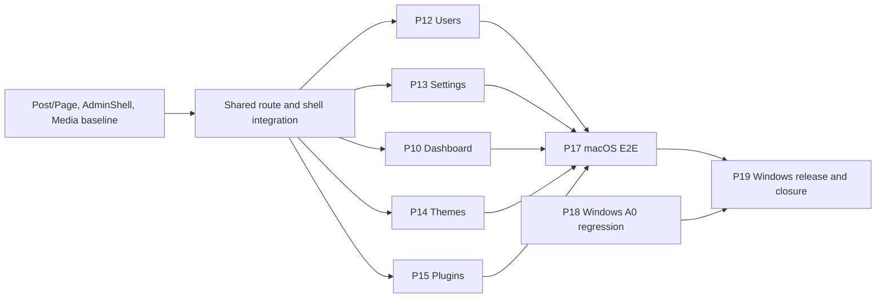

# Issue #45 · G1 và dự thảo G2 cho phần M3 còn lại

**Agent:** Atlas · **Baseline:** `origin/main@2c679ce3825a10fbc69f2e12e212a43ec5194174` · **Ngày:** 2026-11-11.

[Issue #45](https://github.com/thientran2359/opendash-cms/issues/45) · [G0 M3 phương án A](../../docs/product/PRODUCT_REQUIREMENTS.md#quyết-định-bổ-sung-m3--core-cms-usable-10112026) · [M3 TASK_PLAN](../../docs/plans/milestones/M3/TASK_PLAN.md) · [Module Catalog](../../docs/plans/MODULE_CATALOG_V1.md) · [Planning Workflow](../../docs/plans/PLANNING_WORKFLOW.md) · [ADR-0003](../../docs/decisions/ADR-0003-agent-consensus-governance.md) · [ADR-0004](../../docs/decisions/ADR-0004-m3-post-page-publication-boundary.md) · [ADR-0005](../../docs/decisions/ADR-0005-m3-harbor-forge-autonomous-delivery.md).

Các trạng thái dưới đây phản ánh source tại baseline và phạm vi của báo cáo đã merge. `VERIFIED` phải đọc cùng OS, SHA và acceptance của báo cáo. Các thiết kế mới ở trạng thái **PROPOSED**, các gói triển khai ở trạng thái **DRAFT**. M3 giữ taxonomy và Builder AST ở M4, CPT/field bridge của plugin ở M6, video ở M7, media delete/reconcile và backup engine ở M8.

## G1 · Kiểm kê 19 candidate

| Candidate · owner module | Trạng thái và bằng chứng | Phần còn lại · dependency và gate |
| --- | --- | --- |
| P01 · CNT-01/02 | IMPLEMENTED; `ContentTypeDefinition` và `ContentFieldDefinition` trong [core/content.rs](../../cms/crates/opendash-core/src/content.rs); [macOS domain tests](../../docs/verification/2026-11-08-m3-1-content-domain.md). | FND-01. Giữ chín kiểu field và schema legacy trong regression P17/P19. |
| P02 · CNT-01 | IMPLEMENTED; [routes/content.rs](../../cms/crates/opendash-server/src/routes/content.rs), [migration 0004](../../cms/migrations/0004_content_types.sql); [macOS](../../docs/verification/2026-11-08-m3-2-content-types-backend.md) và Windows #33 cho create/list/restart. | P01/FND-02/03. Tạo chỉ Admin, đọc Admin/Editor; giữ CPT provider inactive đọc được. |
| P03 · CNT-02/04 | IMPLEMENTED; `create_entry`, `update_entry`, `delete_entry` trong [storage/entries.rs](../../cms/crates/opendash-server/src/storage/entries.rs); [macOS](../../docs/verification/2026-11-08-m3-3-content-entry-crud.md) và Windows #33. | P02. Giữ validation, CAS/412, rollback và dữ liệu sau restart. |
| P04 · CNT-01/02/04 | IMPLEMENTED; [ContentWorkspace](../../cms/admin/src/features/content/ContentWorkspace.tsx); [macOS UI](../../docs/verification/2026-11-08-m3-4-admin-content-ui.md), legacy Content route trong [Windows AdminShell](../../docs/verification/2026-11-11-m3-s21-adminshell-windows.md). | P03/FND-05. Kiểm hồi quy chín field, form khi 401/412 và chuyển màn. |
| P05 · CNT-05 | IMPLEMENTED; `media_upload`, `media_list` trong [routes/media.rs](../../cms/crates/opendash-server/src/routes/media.rs), [MediaPicker](../../cms/admin/src/features/media/MediaPicker.tsx); [macOS](../../docs/verification/2026-11-09-m3-5-media-library.md), Windows #33. | P03/P04. Giữ raster validation, MIME/size, private file/thumbnail, picker, persistence. |
| P06 · CNT-04/05 | IMPLEMENTED; `list_published`, `media_is_referenced` trong [storage/public_content.rs](../../cms/crates/opendash-server/src/storage/public_content.rs); [macOS](../../docs/verification/2026-11-09-m3-6-public-content-rendering.md), Windows #33. | P03/P05. Giữ public legacy, escaping/CSP và reference ACL trong P14/P17/P19. |
| P07 · CNT-01/02 | VERIFIED theo [#24](https://github.com/thientran2359/opendash-cms/issues/24) và [ADR-0004](../../docs/decisions/ADR-0004-m3-post-page-publication-boundary.md); [migration 0008](../../cms/migrations/0008_post_page_publication.sql), preflight trong [storage/mod.rs](../../cms/crates/opendash-server/src/storage/mod.rs). | P02/P03. Chạy lại fixture collision và upgrade khi thêm migration mới. |
| P08 · CNT-02/04, FND-05 | VERIFIED theo #24 và [#35](https://github.com/thientran2359/opendash-cms/issues/35); [PostPageWorkspace](../../cms/admin/src/features/posts/PostPageWorkspace.tsx), [Windows UI](../../docs/verification/2026-11-11-m3-s22-t01-post-page-admin-windows.md). | P07/P04/P09. Chạy browser flow trên macOS và release Windows trong P17/P19. |
| P09 · FND-05 | VERIFIED Windows theo [#25/#31](https://github.com/thientran2359/opendash-cms/pull/31); [AdminShell](../../cms/admin/src/shell/AdminShell.tsx) và [evidence](../../docs/verification/2026-11-11-m3-s21-adminshell-windows.md). | FND-02/P04. Giữ deep link, responsive, role guard, mounted editor state khi nối màn mới. |
| P10 · FND-05/CNT-04 | PARTIAL; `AdminShell.tsx` có lời chào và quick links, thiếu thống kê API, loading/retry theo role. | P07/P09. Đếm server-side theo loại và trạng thái; kiểm public 401, Editor và Admin, DB lỗi. |
| P11 · CNT-05/FND-05 | VERIFIED macOS theo [#36](https://github.com/thientran2359/opendash-cms/issues/36); [MediaLibraryPage](../../cms/admin/src/features/media/MediaLibraryPage.tsx), [evidence](../../docs/verification/2026-11-11-m3-s23-t01-media-library-macos.md). | P05/P09. Browser parity Windows P19, bao gồm upload, phân trang, resize và picker. |
| P12 · FND-02/05 | PARTIAL; `POST /api/admin/users` gọi `create_editor`; [UsersPanel](../../cms/admin/src/features/users/UsersPanel.tsx) chỉ tạo Editor. [0002](../../cms/migrations/0002_auth.sql) có hai role và FK session, chưa có CRUD/revoke lifecycle. | P09 và auth baseline. Full-Track, G2 transaction bảo vệ Admin cuối và đồng bộ login/reset. |
| P13 · SITE-01/FND-05 | MISSING chức năng General Settings; `App.tsx` nối [SystemStatus](../../cms/admin/src/features/system/SystemStatus.tsx), migrations 0001–0008 không có site settings. | P09/FND-03. Full-Track, quyết định defaults, timezone, schema, CAS, nơi hiển thị. |
| P14 · THM-01/FND-05 | PARTIAL; `POST /theme`, [Theme::from_zip](../../cms/crates/opendash-server/src/theme.rs), `insert_theme_block` và `active_content_templates` trong [storage/page.rs](../../cms/crates/opendash-server/src/storage/page.rs). Màn Themes là placeholder. Active template hiện suy từ block homepage. | P09 và Builder M1/P06. Full-Track, quyết định active state tách khỏi homepage và fallback. |
| P15 · PLG-01/FND-05 | IMPLEMENTED phần lớn; màn [PluginsPanel](../../cms/admin/src/features/plugins/PluginsPanel.tsx), [API client](../../cms/admin/src/api/plugins.ts), [routes/plugin.rs](../../cms/crates/opendash-server/src/routes/plugin.rs), [PluginManager](../../cms/crates/opendash-server/src/plugin/manager.rs) và [ABI](../../docs/contracts/PLUGIN_ABI.md). `upsert` hiện enable lại khi thay gói cùng ID. | P09/M2.5. Acceptance chính trên UI: quyền, trạng thái, lỗi, restart, phục hồi. Nếu đổi semantics ZIP thay phiên bản hoặc worker, dừng và tách quyết định Full-Track. |
| P16 · CNT-04/SITE-02 | VERIFIED theo #24; [public routes](../../cms/crates/opendash-server/src/routes/public_content.rs), [macOS](../../docs/verification/2026-11-11-m3-s20-t01-post-page-publication-macos.md) và [Windows](../../docs/verification/2026-11-11-m3-s20-t01-post-page-publication-windows.md). | P06/P07/P08. P14/P17/P19 giữ public URL, preview `no-store`, draft ACL và `/`. |
| P17 · CNT-01/04, FND-02/05 | MISSING một lượt E2E macOS toàn M3. Evidence rải theo #24/#36 và các slice; [Dev Launcher #44](https://github.com/thientran2359/opendash-cms/pull/44) hỗ trợ dev nhưng chưa phải release acceptance. | P07–P16. Browser thật + binary đúng SHA + SQLite/site fixtures; chạy toàn ma trận bảo mật và dữ liệu. |
| P18 · OPS-02/FND-04 | IMPLEMENTED và có Windows runtime PASS theo [#33](https://github.com/thientran2359/opendash-cms/pull/33), harness commit `6896286`; bốn scripts hiện đều dùng `contextlib.closing` cho SQLite. [Evidence](../../docs/verification/2026-11-11-m3-s20-t01-post-page-publication-windows.md). | P02/P03/P05/P06. Ghi nhận A0, đưa bốn lệnh vào regression đúng SHA P19. Chỉ mở task test-only nếu tái hiện lỗi ở chính bốn harness. |
| P19 · OPS-02/FND-04/05 | MISSING nghiệm thu release Windows toàn M3. [Evidence #35](../../docs/verification/2026-11-11-m3-s22-t01-post-page-admin-windows.md) ghi hai legacy harness lỗi còn thấy trong source: `HTTP: ok` ở [windows_admin_browser.py](../../cms/scripts/windows_admin_browser.py), migration count `3` và SQLite cleanup ở [windows_distribution_smoke.py](../../cms/scripts/windows_distribution_smoke.py). | P17/P18 và release runner. Sửa harness theo acceptance hiện hành, kiểm parity và DB copy. Linux early smoke báo độc lập. |

## G2 · Đề xuất theo cụm phụ thuộc

Hợp đồng dùng chung: [Core Foundation](../../docs/contracts/CORE_FOUNDATION.md), `auth` guards, `ApiError`, SQL ở `storage`, ZIP validator `package`, registry có owner, router hiện tại trong [app.rs](../../cms/crates/opendash-server/src/app.rs) và client trong [api/client.ts](../../cms/admin/src/api/client.ts). `GET` Admin không có session trả 401, sai role trả 403. Mutation yêu cầu CSRF và Origin theo policy hiện hành. `If-Match` cho cập nhật record có version: thiếu 428, sai dạng 400, stale 412. Admin UI giữ form khi lỗi, có thể tải lại bản mới trước khi thử lưu lại. Tất cả panel mới dùng heading, label, trạng thái loading/empty/error, focus khi lỗi, trạng thái thao tác đọc được qua keyboard và layout 390 px.

### P12 · Users — Full-Track

- Dùng tiếp `users`/`sessions`, thêm `users.version` với default cho row cũ. `GET /api/admin/users?limit&offset` trả `{items,total}` với `id,username,role,version`; `POST` trả 201 và giữ mặc định Editor khi client cũ bỏ `role`; `PATCH /api/admin/users/{id}` sửa username/role, `POST .../{id}/password` nhận mật khẩu thay thế, `DELETE .../{id}` trả 204. Tất cả yêu cầu Admin; ba mutation theo ID dùng `If-Match`. Trùng username hoặc làm mất Admin cuối trả 409; bản ghi không tồn tại trả 404. Reset là Admin đặt mật khẩu mới, không có email workflow trong G0.
- Hash bằng `hash_password_blocking` trước khi lấy write lock. Trong một transaction SQLite có khóa ghi trước khi kiểm trạng thái, kiểm lại quyền actor, CAS và số Admin còn lại, rồi ghi mutation và revoke session của target khi đổi username/role/password hoặc xóa. Nếu actor tự thay đổi, chuyển về đăng nhập sau khi phản hồi thành công. Xử lý cuộc đua login/reset: insert session chỉ khi version thông tin xác thực vẫn là version vừa verify. So với chỉ đếm Admin ở handler, transaction bảo vệ cả hai yêu cầu đồng thời.
- User DTO và log loại mật khẩu, hash, cookie và token. Dùng fixture hai Admin và hai phiên trên cùng tài khoản để kiểm race, last-admin, 401 của phiên bị thu hồi, xác thực lại bằng mật khẩu mới và restart. Giữ bootstrap một lần và legacy `POST` tạo Editor.

### P13 · General Settings — Full-Track

- Chọn singleton site-owned typed SQLite `{site_title,tagline,timezone,version}`, default `OpenDash`, chuỗi rỗng, `UTC`. So với KV tùy ý, schema nhỏ có constraints và CAS rõ. SITE-01 sở hữu model; theme/plugin có thể đọc giá trị đã lọc qua interface sau này. Tên site 1–120 ký tự Unicode sau trim, tagline 0–240, từ chối control characters. Timezone là IANA canonical ID, kiểm từ danh mục cố định cùng bản build, ưu tiên tái sử dụng thư viện pin nếu có. Chốt nguồn danh mục và policy alias ở G2 trước khi thêm dependency. Timestamp DB giữ UTC; múi giờ áp dụng khi trình bày thời gian nơi có hỗ trợ.
- `GET /api/admin/settings/general` trả object và ETag, `PUT` Admin + CSRF + `If-Match` trả object và ETag mới. Ghi transaction đơn, giữ bản cũ nếu validation/ghi thất bại. Dùng title/tagline đã escape trong chrome mặc định của public content, giữ nguyên markup đã lưu của Builder `/`. Theme custom có thể dùng context đã định kiểu khi contract được chốt. Không gửi toàn bộ settings Admin qua public API. Kiểm defaults trên DB cũ, stale edit ở hai tab, persistence/restart, escaping và chênh lệch timezone ở UI có hiển thị thời gian.

### P10 · Dashboard — Full-Track nếu thêm API

- `GET /api/admin/dashboard` yêu cầu Admin hoặc Editor và trả `{post:{draft,published},page:{draft,published}}` theo quyền xem nội dung hiện hành. Đếm aggregate trực tiếp trong SQLite bằng một snapshot; không tải danh sách rồi đếm trên client vì pagination. Nếu G2 thay quyền xem theo tác giả, query phải dùng cùng predicate với danh sách. Không trả draft IDs, danh sách tài khoản, log hoặc secret. Giữ shortcut theo `isViewAllowed`; lỗi lấy số không ngăn điều hướng, hiển thị retry và phân biệt zero với lỗi.
- Tách `DashboardPage` khỏi `AdminShell`; cùng session client và lỗi 401, giữ UI hiện có của Posts/Pages, Builder. Kiểm fixture draft/published, zero, role, loading/error và dữ liệu cập nhật sau publish/unpublish.

### P14 · Themes — Full-Track

- Giữ `Theme::from_zip`, ZIP format legacy và `theme_blocks` làm danh mục cài đặt. Thêm singleton lựa chọn template theme explicit, khóa ngoại trỏ block đã cài, CAS bằng version. Mặc định legacy: template theo block của `home_page` cho tới lần activate explicit. Sau activate, public archive/single dùng template của block được chọn, thiếu template thì dùng built-in. Builder `/` luôn đọc block/fields đã lưu; Builder Save cập nhật `/` theo hợp đồng cũ và giữ active choice explicit. UI phân biệt theme nội dung đang kích hoạt và block trang chủ đang lưu.
- `GET /api/admin/themes` trả installed, active mode/id và version; `POST` ZIP Admin + CSRF dùng chung use case với `/theme`; `PUT /api/admin/themes/active` nhận `block_id` hoặc lựa chọn legacy, dùng `If-Match`. Validate identity, ZIP và render checks trước khi đổi con trỏ. Activate atomic, target thiếu 404, duplicate install 409, stale 412. Chọn lại theme cũ hoặc legacy qua cùng flow để rollback. So với ghi lại `home_page` lúc activate, con trỏ riêng bảo toàn chỉnh sửa và preview. Chốt với người dùng nếu yêu cầu G0 được hiểu là đổi cả homepage, vì đó là thay đổi hành vi đã lưu.
- DB copy có legacy ZIP, custom CPT, published và draft, upload được tham chiếu và homepage đã sửa. Cài A/B, đổi A→B→A, reload/restart, kiểm template chọn đúng và giữ nguyên public URLs, draft/media ACL, custom CPT và Builder fields. ZIP lỗi không tạo row hoặc đổi active state. Giữ CSP và template sandbox hiện hành.

### P15 · Plugins — Fast-Track nếu giữ API/ABI hiện hành

- Tái sử dụng màn hiện có, bổ sung theo gap kiểm chứng: permission summary trước khi enable/re-enable, version, trạng thái enabled/disabled, lỗi gần nhất đã lọc, feedback khi action đang chạy, refresh từ kết quả server và retry có chủ đích. Lỗi worker phải hiển thị trên trang và không ngăn Admin vào lại để disable. Kiểm install/list/disable/enable, quyền Editor, malformed ZIP và timeout/recovery bằng fixtures sẵn có. Dữ liệu CPT/entries và plugin KV vẫn còn sau disable/re-enable; tiếp tục thực thi bằng worker theo ABI hiện hành.
- G2 cần xác nhận hành vi reinstall cùng ID: source hiện cập nhật gói và enable lại. Phương án đề xuất cho M3 là giữ compatibility, UI nói rõ tác động trước khi thay gói; nếu review yêu cầu preserve-disabled hoặc chấp thuận lại quyền ở server, tách Full-Track cho lifecycle, schema, concurrency và compatibility. Không gộp CPT/field bridge vào P15.

### P17/P18/P19 · Nghiệm thu và đóng M3

- **P17:** Reuse các assertions #24/#35/#36, bổ sung browser route thật cho Dashboard, Users, Settings, Themes và Plugins. Chạy fresh site, rồi upgrade fixture DB copy riêng. Ghi commit, binary profile, browser, OS, lệnh, fixture và kết quả theo case. Test harness dùng port localhost riêng, dừng và chờ server trước khi cleanup. So với chạy từng API, E2E phải chứng minh cùng site qua cả các chuyển trạng thái và restart.
- **P18:** Giữ bản sửa `contextlib.closing` đã merge. Kiểm bốn harness hiện tại bằng đúng binary P19, xác minh exit 0, cleanup thành công và assertions còn nguyên. Nếu cần sửa do regression, giới hạn ownership trong harness lỗi; không dùng retry cleanup để che process chưa thoát.
- **P19:** Chạy Windows release từ artifact build có Admin nhúng, dùng cùng contract P17 và chứng minh DB copy upgrade/rollback. Browser harness phải truy cập health qua API và kiểm Dashboard bằng UI contract hiện tại. Distribution harness nên đối chiếu danh sách migration của release với SQLx records, xác minh nội dung sau upgrade và đóng SQLite ngay cả khi assertion fail. Linux early smoke báo riêng theo runner; `NOT_RUN` khi thiếu runner. Windows/macOS cần evidence riêng; milestone chỉ đóng khi toàn bộ gate có evidence và trạng thái Project được kiểm tra.

## Phụ thuộc và ownership đề xuất

| Đợt / gói G3 dự kiến | Writer dự kiến và ranh giới | Primary acceptance |
| --- | --- | --- |
| Chuẩn bị seam | Một writer được chỉ định cho `app.rs`, `routes/mod.rs`, `storage/mod.rs`, `App.tsx`, `AdminShell.tsx`, barrel API và migration numbering. Hai feature branches chỉ thay file riêng; writer nối router/panel sau khi hai phía chốt interface. Feature tests trước tích hợp, E2E sau tích hợp. | Shell mở được màn mới, role guard và editor state giữ nguyên. |
| 1A · P12 | Forge đề xuất; `routes/users.rs`, `storage/auth.rs`, `routes/auth.rs`, UsersPanel/API, migration Users riêng, test auth. | Hai Admin thay đổi đồng thời vẫn còn Admin; session cũ 401; legacy Editor create hoạt động. |
| 1B · P13 | Harbor đề xuất; `routes/settings.rs`, `storage/settings.rs`, General Settings/API, migration riêng, public renderer seam theo G2. | Settings giữ qua restart, CAS 412, title/tagline được escape. |
| 2A · P14 | Harbor đề xuất; routes/storage Themes, `storage/page.rs`, template lookup, Themes panel/API và migration riêng. Nếu P13 còn sửa public renderer, nối theo commit đã merge. | Đổi A/B và rollback, giữ homepage/content/media. |
| 2B · P15 | Forge đề xuất; PluginsPanel/API và UI tests; runtime change cần G2 riêng. | Admin cài, quản lý và phục hồi sau lỗi; Editor 403; state giữ sau restart. |
| P10 | Writer riêng sau seam, feature dashboard/API và storage aggregate; tích hợp shell theo lượt. | Counts theo loại/trạng thái và role; retry khi lỗi. |
| P17 / P18 / P19 | Harbor E2E macOS; Forge A0 và Windows parity; cùng fixture contract, riêng runner/script và evidence. | E2E, upgrade, rollback và hành vi bảo mật trên mỗi OS. |

Migration cấp số tại điểm tích hợp, thứ tự giữa các migration độc lập được ghi trong handoff trước khi code. G3 chỉ được phát hành sau G2 phù hợp đã chốt, source đã merge, exact file ownership, base SHA, acceptance và Project Ready theo ADR-0005. Đợt 1 ưu tiên Users và Settings; issue này chưa phân công implementation.

## Ma trận quyền và lỗi

| Bề mặt | Public | Editor | Admin | Negative acceptance |
| --- | --- | --- | --- | --- |
| Dashboard | API 401 | Aggregate nội dung theo quyền | Aggregate nội dung | Không lộ secret; UI retry khi API lỗi |
| Users/Settings/Themes/Plugins | API 401 | 403 kể cả gọi trực tiếp | Read; mutation có CSRF | Missing/wrong CSRF, wrong Origin 403; 412 với stale write có CAS; 409 last Admin/duplicate ZIP theo contract |
| Posts/Pages/Media/Builder | Chỉ published và media đủ điều kiện public | Content flow, private preview, media và Builder theo quyền hiện hành | Cùng content flow | Draft URL/asset 404; preview guest 401 và response authenticated `no-store`; CAS 412 giữ form; escape/CSP; ACL shared ref |
| Worker plugin | Không có admin execution API | 403 | Theo plugin permissions | Invalid ZIP bị từ chối; timeout/permission failure giữ Admin hoạt động và còn đường disable |

## Ma trận dữ liệu và runner

| Kiểm chứng | macOS P17 | Windows P18/P19 | Linux |
| --- | --- | --- | --- |
| Fresh, browser, restart | Rust binary + embedded Admin, browser thật, SQLite/site root riêng | Release binary đã đóng gói, cùng luồng và fixture | Early smoke build/health và luồng tối thiểu nếu có runner |
| Upgrade/rollback | Copy site DB và uploads tại điểm nhất quán; upgrade bằng migrator thật, so row/refs, chạy bản cũ trên bản restore riêng | Cùng acceptance, kiểm cả cleanup file lock và migration records | Ghi lệnh/kết quả hoặc `NOT_RUN` |
| Users/Settings | Race Admin cuối, revoke/login, CAS Settings và persistence | Cùng assertions ở runtime Windows | Ghi rõ scope thực chạy |
| Themes/Plugins | Atomic active pointer, legacy fallback, restart, lỗi worker; giữ DB/content/media | Cùng contract và xác minh packaged worker từ release binary | Ghi rõ scope thực chạy |
| A0 và regression | Content/Media/Public assertions theo fixture | Bốn harness A0 exit 0; auth, browser và distribution trên baseline release | V1 Linux release thuộc M8 |

Rollback migration forward-only dùng bản sao site nhất quán đã xác minh với binary cũ. Kiểm DB, assets, schema marker, homepage fields và refs trước/sau; không dùng Git revert làm DB rollback. `STOP_AND_PROPOSE` khi thay G0, đụng migration đã dùng, cần đổi ABI/security contract, phát hiện dữ liệu mất hoặc baseline upgrade có collision chưa có phương án. Scope Issue #45 chưa chạy runtime mới và chưa ghi nhận G5 mới.
