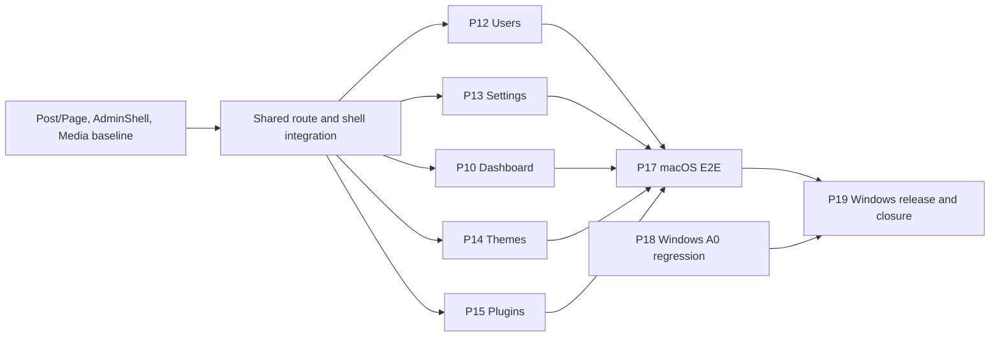

# Issue #45 · G1 và dự thảo G2 cho phần M3 còn lại

**Agent:** Atlas · **Baseline:** `origin/main@2c679ce3825a10fbc69f2e12e212a43ec5194174` · **Ngày:** 2026-11-11.

[Issue #45](https://github.com/thientran2359/opendash-cms/issues/45) · [G0 M3 phương án A](../../docs/product/PRODUCT_REQUIREMENTS.md#quyết-định-bổ-sung-m3--core-cms-usable-10112026) · [M3 TASK_PLAN](../../docs/plans/milestones/M3/TASK_PLAN.md) · [Module Catalog](../../docs/plans/MODULE_CATALOG_V1.md) · [Planning Workflow](../../docs/plans/PLANNING_WORKFLOW.md) · [ADR-0003](../../docs/decisions/ADR-0003-agent-consensus-governance.md) · [ADR-0004](../../docs/decisions/ADR-0004-m3-post-page-publication-boundary.md) · [ADR-0005](../../docs/decisions/ADR-0005-m3-harbor-forge-autonomous-delivery.md).

Các trạng thái dưới đây phản ánh source tại baseline và phạm vi của báo cáo đã merge. `VERIFIED` phải đọc cùng OS, SHA và acceptance của báo cáo. Các thiết kế mới ở trạng thái **PROPOSED**, các gói triển khai ở trạng thái **DRAFT**. M3 giữ taxonomy và Builder AST ở M4, CPT/field bridge của plugin ở M6, video ở M7, media delete/reconcile và backup engine ở M8.

## G1 · Kiểm kê 19 candidate

| Candidate · owner module | Trạng thái và bằng chứng | Phần còn lại · dependency và gate |
| --- | --- | --- |
| P01 · CNT-01/02 | IMPLEMENTED; `ContentTypeDefinition` và `ContentFieldDefinition` trong [core/content.rs](../../cms/crates/opendash-core/src/content.rs); [macOS domain tests](../../docs/verification/2026-11-08-m3-1-content-domain.md). | FND-01. Giữ chín kiểu field và schema legacy trong regression P17/P19. |
| P02 · CNT-01 | IMPLEMENTED; [routes/content.rs](../../cms/crates/opendash-server/src/routes/content.rs), [migration 0004](../../cms/migrations/0004_content_types.sql); [macOS](../../docs/verification/2026-11-08-m3-2-content-types-backend.md) và Windows #33 cho create/list/restart. | P01/FND-02/03. Tạo chỉ Admin, đọc Admin/Editor; giữ CPT provider inactive đọc được. |
| P03 · CNT-02/04 | IMPLEMENTED; `create_entry`, `update_entry`, `delete_entry` trong [storage/entries.rs](../../cms/crates/opendash-server/src/storage/entries.rs); [macOS](../../docs/verification/2026-11-08-m3-3-content-entry-crud.md) và Windows #33. | P02. Giữ validation, CAS/412, rollback và dữ liệu sau restart. |
| P04 · CNT-01/02/04 | IMPLEMENTED; [ContentWorkspace](../../cms/admin/src/features/content/ContentWorkspace.tsx); [macOS UI](../../docs/verification/2026-11-08-m3-4-admin-content-ui.md), legacy Content route trong [Windows AdminShell](../../docs/verification/2026-11-11-m3-s21-adminshell-windows.md). | P03/FND-05. Kiểm hồi quy chín field, form khi 401/412 và chuyển màn. |
| P05 · CNT-05 | IMPLEMENTED; `media_upload`, `media_list` trong [routes/media.rs](../../cms/crates/opendash-server/src/routes/media.rs), [MediaPicker](../../cms/admin/src/features/media/MediaPicker.tsx); [macOS](../../docs/verification/2026-11-09-m3-5-media-library.md), Windows #33. | P03/P04. Giữ raster validation, MIME/size, private file/thumbnail, picker, persistence. |
| P06 · CNT-04/05 | IMPLEMENTED; `list_published`, `media_is_referenced` trong [storage/public_content.rs](../../cms/crates/opendash-server/src/storage/public_content.rs); [macOS](../../docs/verification/2026-11-09-m3-6-public-content-rendering.md), Windows #33. | P03/P05. Giữ public legacy, escaping/CSP và reference ACL trong P14/P17/P19. |
| P07 · CNT-01/02 | VERIFIED theo [#24](https://github.com/thientran2359/opendash-cms/issues/24) và [ADR-0004](../../docs/decisions/ADR-0004-m3-post-page-publication-boundary.md); [migration 0008](../../cms/migrations/0008_post_page_publication.sql), preflight trong [storage/mod.rs](../../cms/crates/opendash-server/src/storage/mod.rs). | P02/P03. Chạy lại fixture collision và upgrade khi thêm migration mới. |
| P08 · CNT-02/04, FND-05 | VERIFIED theo #24 và [#35](https://github.com/thientran2359/opendash-cms/issues/35); [PostPageWorkspace](../../cms/admin/src/features/posts/PostPageWorkspace.tsx), [Windows UI](../../docs/verification/2026-11-11-m3-s22-t01-post-page-admin-windows.md). | P07/P04/P09. Chạy browser flow trên macOS và release Windows trong P17/P19. |
| P09 · FND-05 | VERIFIED Windows theo [#25/#31](https://github.com/thientran2359/opendash-cms/pull/31); [AdminShell](../../cms/admin/src/shell/AdminShell.tsx) và [evidence](../../docs/verification/2026-11-11-m3-s21-adminshell-windows.md). | FND-02/P04. Giữ deep link, responsive, role guard, mounted editor state khi nối màn mới. |
| P10 · FND-05/CNT-04 | PARTIAL; `AdminShell.tsx` có lời chào và quick links, thiếu thống kê API, loading/retry theo role. | P07/P09. Đếm server-side theo loại và trạng thái; kiểm public 401, Editor và Admin, DB lỗi. |
| P11 · CNT-05/FND-05 | VERIFIED macOS theo [#36](https://github.com/thientran2359/opendash-cms/issues/36); [MediaLibraryPage](../../cms/admin/src/features/media/MediaLibraryPage.tsx), [evidence](../../docs/verification/2026-11-11-m3-s23-t01-media-library-macos.md). | P05/P09. Browser parity Windows P19, bao gồm upload, phân trang, resize và picker. |
| P12 · FND-02/05 | PARTIAL; `POST /api/admin/users` gọi `create_editor`; [UsersPanel](../../cms/admin/src/features/users/UsersPanel.tsx) chỉ tạo Editor. [0002](../../cms/migrations/0002_auth.sql) có hai role và FK session, chưa có CRUD/revoke lifecycle. | P09 và auth baseline. Full-Track, G2 transaction bảo vệ Admin cuối và đồng bộ login/reset. |
| P13 · SITE-01/FND-05 | MISSING chức năng General Settings; `App.tsx` nối [SystemStatus](../../cms/admin/src/features/system/SystemStatus.tsx), migrations 0001–0008 không có site settings. | P09/FND-03. Full-Track, quyết định defaults, timezone, schema, CAS, nơi hiển thị. |
| P14 · THM-01/FND-05 | PARTIAL. `POST /theme` cài block qua [Theme::from_zip](../../cms/crates/opendash-server/src/theme.rs). [`GET /`](../../cms/crates/opendash-server/src/routes/public.rs) render block đã lưu theo ID và `active_content_templates` trong [storage/page.rs](../../cms/crates/opendash-server/src/storage/page.rs) cũng suy theme từ block đó. Màn Themes là placeholder. | P09 và Builder M1/P06. Full-Track. Theme active chi phối cả homepage. Nội dung và bố cục lưu trong Admin được giữ, block thiếu hỗ trợ bị ẩn khi render. |
| P15 · PLG-01/FND-05 | IMPLEMENTED phần lớn; màn [PluginsPanel](../../cms/admin/src/features/plugins/PluginsPanel.tsx), [API client](../../cms/admin/src/api/plugins.ts), [routes/plugin.rs](../../cms/crates/opendash-server/src/routes/plugin.rs), [PluginManager](../../cms/crates/opendash-server/src/plugin/manager.rs) và [ABI](../../docs/contracts/PLUGIN_ABI.md). `upsert` hiện enable lại khi thay gói cùng ID. | P09/M2.5. Acceptance chính trên UI: quyền, trạng thái, lỗi, restart, phục hồi. Nếu đổi semantics ZIP thay phiên bản hoặc worker, dừng và tách quyết định Full-Track. |
| P16 · CNT-04/SITE-02 | VERIFIED theo #24; [public routes](../../cms/crates/opendash-server/src/routes/public_content.rs), [macOS](../../docs/verification/2026-11-11-m3-s20-t01-post-page-publication-macos.md) và [Windows](../../docs/verification/2026-11-11-m3-s20-t01-post-page-publication-windows.md). | P06/P07/P08. P14/P17/P19 giữ public URL, preview `no-store`, draft ACL và `/`. |
| P17 · CNT-01/04, FND-02/05 | MISSING một lượt E2E macOS toàn M3. Evidence rải theo #24/#36 và các slice; [Dev Launcher #44](https://github.com/thientran2359/opendash-cms/pull/44) hỗ trợ dev nhưng chưa phải release acceptance. | P07–P16. Browser thật + binary đúng SHA + SQLite/site fixtures; chạy toàn ma trận bảo mật và dữ liệu. |
| P18 · OPS-02/FND-04 | IMPLEMENTED và có Windows runtime PASS theo [#33](https://github.com/thientran2359/opendash-cms/pull/33), harness commit `6896286`; bốn scripts hiện đều dùng `contextlib.closing` cho SQLite. [Evidence](../../docs/verification/2026-11-11-m3-s20-t01-post-page-publication-windows.md). | P02/P03/P05/P06. Ghi nhận A0, đưa bốn lệnh vào regression đúng SHA P19. Chỉ mở task test-only nếu tái hiện lỗi ở chính bốn harness. |
| P19 · OPS-02/FND-04/05 | MISSING nghiệm thu release Windows toàn M3. [Evidence #35](../../docs/verification/2026-11-11-m3-s22-t01-post-page-admin-windows.md) ghi hai legacy harness lỗi còn thấy trong source: `HTTP: ok` ở [windows_admin_browser.py](../../cms/scripts/windows_admin_browser.py), migration count `3` và SQLite cleanup ở [windows_distribution_smoke.py](../../cms/scripts/windows_distribution_smoke.py). | P17/P18 và release runner. Sửa harness theo acceptance hiện hành, kiểm parity và DB copy. Linux early smoke báo độc lập. |

## G2 · Hợp đồng đề xuất

Đặc tả API, storage, migration, xử lý đồng thời, an toàn theme/plugin và kiểm chứng release nằm tại [ADR-0006](../../docs/decisions/ADR-0006-m3-admin-and-release-contracts.md). Ma trận dưới đây dùng để chuẩn bị bàn giao và kiểm chứng theo phạm vi Issue #45.

## Phụ thuộc và ownership đề xuất

| Đợt / gói G3 dự kiến | Writer dự kiến và ranh giới | Primary acceptance |
| --- | --- | --- |
| Chuẩn bị seam | Một writer được chỉ định cho `app.rs`, `routes/mod.rs`, `storage/mod.rs`, `App.tsx`, `AdminShell.tsx`, barrel API và migration numbering. Hai feature branches chỉ thay file riêng; writer nối router/panel sau khi hai phía chốt interface. Feature tests trước tích hợp, E2E sau tích hợp. | Shell mở được màn mới, role guard và editor state giữ nguyên. |
| 1A · P12 | Forge đề xuất; `routes/users.rs`, `storage/auth.rs`, `routes/auth.rs`, UsersPanel/API, migration Users riêng, test auth. | Hai Admin thay đổi đồng thời vẫn còn Admin; session cũ 401; legacy Editor create hoạt động. |
| 1B · P13 | Harbor đề xuất; `routes/settings.rs`, `storage/settings.rs`, General Settings/API, migration riêng, public renderer seam theo G2. | Settings giữ qua restart, CAS 412, title/tagline được escape. |
| 2A · P14 | Harbor đề xuất. Ownership gồm routes/storage Themes, `storage/page.rs`, public/Builder render resolver, Themes panel/API và migration riêng. Nếu P13 còn sửa public renderer, nối theo commit đã merge. | Homepage dùng nội dung đã lưu dưới theme mới. Block tương thích hiển thị, block thiếu hỗ trợ ẩn và hiện lại khi rollback. Giữ content/media. |
| 2B · P15 | Forge đề xuất; PluginsPanel/API và UI tests; runtime change cần G2 riêng. | Admin cài, quản lý và phục hồi sau lỗi; Editor 403; state giữ sau restart. |
| P10 | Writer riêng sau seam, feature dashboard/API và storage aggregate; tích hợp shell theo lượt. | Counts theo loại/trạng thái và role; retry khi lỗi. |
| P17 / P18 / P19 | Harbor E2E macOS; Forge A0 và Windows parity; cùng fixture contract, riêng runner/script và evidence. | E2E, upgrade, rollback và hành vi bảo mật trên mỗi OS. |

Migration cấp số tại điểm tích hợp, thứ tự giữa các migration độc lập được ghi trong handoff trước khi code. G3 chỉ được phát hành sau G2 phù hợp đã chốt, source đã merge, exact file ownership, base SHA, acceptance và Project Ready theo ADR-0005. Đợt 1 ưu tiên Users và Settings; issue này chưa phân công implementation.

## Ma trận quyền và lỗi

| Bề mặt | Public | Editor | Admin | Negative acceptance |
| --- | --- | --- | --- | --- |
| Dashboard | API 401 | Aggregate nội dung theo quyền | Aggregate nội dung | Không lộ secret; UI retry khi API lỗi |
| Users/Settings/Themes/Plugins | API 401 | 403 kể cả gọi trực tiếp | Read; mutation có CSRF | Missing/wrong CSRF, wrong Origin 403; 412 với stale write có CAS; 409 last Admin/duplicate ZIP theo contract |
| Posts/Pages/Media/Builder | Chỉ published và media đủ điều kiện public | Content flow, private preview, media và Builder theo quyền hiện hành | Cùng content flow | Draft URL/asset 404; preview guest 401 và response authenticated `no-store`; CAS 412 giữ form; escape/CSP; ACL shared ref |
| Worker plugin | Không có admin execution API | 403 | Theo plugin permissions | Invalid ZIP bị từ chối; timeout/permission failure giữ Admin hoạt động và còn đường disable |

## Ma trận dữ liệu và runner

| Kiểm chứng | macOS P17 | Windows P18/P19 | Linux |
| --- | --- | --- | --- |
| Fresh, browser, restart | Rust binary + embedded Admin, browser thật, SQLite/site root riêng | Release binary đã đóng gói, cùng luồng và fixture | Early smoke build/health và luồng tối thiểu nếu có runner |
| Upgrade/rollback | Copy site DB và uploads tại điểm nhất quán; upgrade bằng migrator thật, so row/refs, chạy bản cũ trên bản restore riêng | Cùng acceptance, kiểm cả cleanup file lock và migration records | Ghi lệnh/kết quả hoặc `NOT_RUN` |
| Users/Settings | Race Admin cuối, revoke/login, CAS Settings và persistence | Cùng assertions ở runtime Windows | Ghi rõ scope thực chạy |
| Themes/Plugins | Đổi theme atomic. Kiểm homepage với block tương thích và thiếu hỗ trợ, khôi phục sau đổi lại theme, restart, lỗi worker và bảo toàn DB/content/media. | Cùng contract và xác minh packaged worker từ release binary | Ghi rõ scope thực chạy |
| A0 và regression | Content/Media/Public assertions theo fixture | Bốn harness A0 exit 0; auth, browser và distribution trên baseline release | V1 Linux release thuộc M8 |

Rollback migration forward-only dùng bản sao site nhất quán đã xác minh với binary cũ. Kiểm DB, assets, schema marker, homepage fields và refs trước/sau; không dùng Git revert làm DB rollback. `STOP_AND_PROPOSE` khi thay G0, đụng migration đã dùng, cần đổi ABI/security contract, phát hiện dữ liệu mất hoặc baseline upgrade có collision chưa có phương án. Scope Issue #45 chưa chạy runtime mới và chưa ghi nhận G5 mới.
