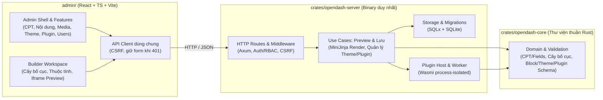

# OpenDash — Bản đồ Kiến trúc CMS và Cấu trúc Thư mục

> **Hiện trạng 07/11/2026.** M1/M2 đã được nhập vào hai crate và React Admin. Các mục M3/M4 và bố cục V1 dưới đây mô tả kiến trúc đích. Xem [ranh giới đã kiểm chứng](../verification/2026-11-07-m1-m2-import.md).

**Nguồn định hướng:**
- [Yêu cầu sản phẩm](../product/PRODUCT_REQUIREMENTS.md): Quyết định phạm vi tính năng sản phẩm V1.
- [Đánh giá tech stack](TECH_STACK.md): Ghi nhận tech stack đã chốt (Rust, Axum, SQLx/SQLite, React/TypeScript/Vite, MiniJinja, Wasmi) và bằng chứng đã chạy.
- [Đề xuất CMS-first (Mục 2)](CMS_PROPOSAL.md): Điểm xuất phát cho việc phân tách ranh giới `opendash-core`, `opendash-server` và giao diện quản trị.

---

## 1. Ranh giới Kiến trúc: `opendash-core`, `opendash-server` và `admin`

Để xây dựng một CMS hoàn chỉnh thay vì ghép nối trực tiếp lên bản thử nghiệm (spike), mã nguồn được đề xuất tổ chức thành **Workspace Rust 2 crate** kết hợp với ứng dụng **React Admin** và vẫn đóng gói ra **đúng một file thực thi duy nhất** (`opendash` / `opendash.exe`):



### 1.1. Trách nhiệm từng phần

1. **`crates/opendash-core` (Thư viện Rust thuần domain & kiểm tra hợp lệ):**
   - Không phụ thuộc `axum`, `sqlx`, `wasmi` hay I/O hệ thống.
   - Giữ định nghĩa kiểu dữ liệu và quy tắc xác thực (validation) cho:
     - Mô hình nội dung: loại nội dung tùy chỉnh (CPT), schema custom fields, danh mục cha–con và thẻ.
     - Mô hình bố cục & builder: cấu trúc cây `Section → Row → Column → Element`, thuộc tính block và liên kết dữ liệu (field binding).
     - Hợp đồng gói mở rộng: khai báo block/setting của Theme và manifest/quyền của Plugin.
2. **`crates/opendash-server` (Ứng dụng thực thi phụ thuộc `opendash-core`):**
   - Sở hữu cấu hình HTTP server, router, session, phân quyền (`Admin` / `Editor`), kiểm tra `Origin` và `X-CSRF-Token`.
   - Sở hữu kết nối SQLite (`sqlx`), migrations và các thao tác đọc/ghi dữ liệu theo transaction.
   - Thực thi các use case **Xem trước (Preview)** và **Lưu (Save)**, gọi `opendash-core` để xác thực trước khi render bằng `minijinja` hoặc ghi xuống SQLite.
   - Quản lý vòng đời plugin và chạy guest Wasm qua `wasmi` trong worker cô lập tiến trình.
   - Nhúng toàn bộ bản build tĩnh của `admin/dist/` qua `rust-embed` để phân phối thành **một file thực thi duy nhất**.
3. **`admin/` (Giao diện quản trị và Builder trên trình duyệt):**
   - Giữ tên thư mục `admin/`, tách rõ hai không gian làm việc dùng chung tầng gọi API (`admin/src/api/`):
     - **Admin Shell & Features:** Khung điều hướng CMS tiếng Việt (phân quyền hiển thị theo `admin` / `editor`) và các màn hình quản lý bài viết/trang/CPT, danh mục, media, cài đặt theme, quản lý plugin, tài khoản người dùng và cấu hình site.
     - **Builder Workspace:** Không gian dựng bố cục trên máy tính (cây bố cục, bảng thuộc tính bên cạnh khung `iframe` preview).

### 1.2. Luồng Xem trước (Preview), Lưu (Save) và Quyền sở hữu Dữ liệu

- **Khi người dùng chỉnh sửa và Xem trước (Preview):**
  1. Trình duyệt gửi dữ liệu đang chỉnh lên route preview và dùng số thứ tự cục bộ để bỏ qua phản hồi cũ.
  2. Server kiểm tra phiên đăng nhập và quyền chỉnh sửa.
  3. `opendash-core` xác thực cấu trúc dữ liệu/bố cục.
  4. `opendash-server` dùng cùng bộ quy tắc render MiniJinja với dữ liệu chưa lưu để trả HTML về `iframe` preview (có `sandbox` và CSP). Thay đổi chưa lưu **không ghi đè trang công khai**.
- **Khi người dùng bấm Lưu (Save):**
  1. Route server kiểm tra quyền (`Admin` hoặc `Editor` tùy thao tác) và CSRF token.
  2. `opendash-core` xác thực toàn bộ nội dung, kiểu dữ liệu custom fields và cấu trúc cây bố cục.
  3. Use case của `opendash-server` ghi nguyên tử trong transaction SQLite và cập nhật ngay website công khai. Nếu dữ liệu không hợp lệ hoặc ghi lỗi, bản đang phục vụ công khai được giữ nguyên; nếu phiên hết hạn (`401`), giao diện Admin giữ nguyên dữ liệu người dùng đang nhập trên form để lưu lại sau khi đăng nhập.
- **Dữ liệu thuộc về Website (tách khỏi Theme/Plugin và tách khỏi Repo):**
  - Định nghĩa CPT, custom fields, danh mục, nội dung đã nhập và bố cục đã chỉnh thuộc về từng website. Khi đổi/cập nhật theme hoặc tắt plugin, các dữ liệu và bố cục này vẫn được giữ nguyên.
  - Thư mục dữ liệu vận hành của từng website tách biệt với mã nguồn phát triển. Đường dẫn cơ sở dữ liệu được cấu hình qua `OPENDASH_DB_PATH` (mặc định `database/opendash.sqlite` theo [README.md](../../README.md), đặt ở root website).
  - Bố cục V1 dành các thư mục sau cho gói và media. M1/M2 hiện lưu theme block và plugin đã cài trong SQLite. Các thư mục gồm [`themes/`](../../themes/README.md), [`plugins/`](../../plugins/README.md) và [`uploads/`](../../uploads/README.md). SQLite mặc định nằm trong [`database/`](../../database/README.md).
  - **Trạng thái của `SitePaths` và các luồng sử dụng đường dẫn**
    - **Đã triển khai và kiểm chứng trên Windows.** Server dùng `SitePaths` để mở SQLite. Binary phân phối lấy thư mục chứa file thực thi làm gốc ngay từ lần chạy đầu. Bản build dưới `cms/target/` dùng gốc dự án. `OPENDASH_SITE_ROOT` chọn gốc website và `OPENDASH_DB_PATH` có ưu tiên cao nhất cho riêng tệp SQLite. [Báo cáo unit test và HTTP smoke](../verification/2026-11-07-site-paths.md).
    - **Đã kiểm tra bằng unit test.** `SitePaths` trả đường dẫn theme, plugin, upload, backup và staging. Việc dùng các đường dẫn này để cài ZIP, lưu media, sao lưu và phục hồi thuộc thiết kế `AGREED` của V1.
    - **Staging cùng ổ đĩa (same-volume atomic swap):** Khi giải nén và kiểm tra gói ZIP (Theme/Plugin) hoặc chuẩn bị dữ liệu cho Backup/Restore trên Windows, đặt thư mục giải nén tạm ngay bên trong `site_root` (ví dụ `runtime/staging/`, đã được [`.gitignore`](../../.gitignore) loại trừ) thay vì `%TEMP%` hệ thống để bảo đảm thao tác đổi tên/hoán đổi nguyên tử (`std::fs::rename`) luôn thực hiện trên cùng filesystem.
    - **Bảo toàn `README.md` trong thư mục dữ liệu gốc khi dev:** Vì `database/`, `themes/`, `plugins/`, `uploads/` tại gốc repository có chứa `README.md` được Git theo dõi, bộ quét theme/plugin chỉ duyệt các thư mục con `<theme-id>/`, `<plugin-id>/` (bỏ qua file lẻ như `README.md` ở cấp 1), và thao tác Backup/Restore không xóa hoặc ghi đè các file `README.md` này.
    - **Cách ly dữ liệu khi chạy test:** Mọi integration test và smoke script (`scripts/*.py`) bắt buộc truyền `OPENDASH_SITE_ROOT` (và/hoặc `OPENDASH_DB_PATH`) trỏ vào thư mục tạm riêng của ca kiểm thử, không đọc/ghi trực tiếp vào `database/`, `themes/`, `plugins/`, `uploads/` ở gốc repository.

---

## 2. Cây thư mục lịch sử repository nguồn và cấu trúc đích

### 2.1. Cây trước khi chuyển (sau M1 và M2)

Trước khi chuyển, toàn bộ mã Rust nằm trong một crate gốc (`src/`), trong đó `src/main.rs` (758 dòng) gộp chung cấu hình HTTP, kiểm quyền, truy vấn SQLite, preview và Lưu; phía frontend `admin/src/App.tsx` (642 dòng) ghép chung đăng nhập, tạo người dùng, chạy thử plugin và form 1 block:

```text
opendash/
├── Cargo.toml
├── build.rs
├── src/
│   ├── main.rs                 # Gộp entrypoint, AppState, rust-embed, SQL queries và toàn bộ HTTP handlers
│   ├── auth.rs                 # Xác thực Argon2, session, RBAC, CSRF, Origin
│   ├── theme.rs                # Gộp kiểu dữ liệu Block/Fields, giải nén ZIP và render MiniJinja
│   └── plugin/                 # Host Wasmi, manifest, package ZIP, worker process-isolated, host_ops, tests
├── admin/
│   └── src/
│       ├── main.tsx
│       ├── App.tsx             # Gộp UI đăng nhập, tạo user, quản lý/test plugin và form sửa 1 block
│       ├── api.ts              # Toàn bộ hàm gọi HTTP API trong một file
│       ├── types.ts
│       └── styles.css
├── migrations/                 # 0001_builder_slice.sql, 0002_auth.sql, 0003_plugins.sql
├── fixtures/                   # baseline_0001.sqlite
├── sdk/                        # sdk/as/opendash.ts (AssemblyScript SDK cho plugin)
├── examples/                   # examples/plugins/sample-plugin
├── spikes/                     # spikes/stack-v1 (bằng chứng thử nghiệm ban đầu)
└── scripts/                    # build.ps1 và các script smoke test Python trên Windows
```

### 2.2. Cấu trúc đích (scaffold mới chỉ triển khai một phần)

> **Nguyên tắc mở rộng:** Chỉ tạo file và module khi có trách nhiệm và mã thực tế. Các module cho các mốc tiếp theo (như `content`, `media`, `builder` nhiều tầng, `site`) được quy hoạch rõ vị trí bên dưới nhưng **chỉ tạo khi triển khai mốc tương ứng**, không tạo sẵn file hay thư mục rỗng.

`opendash-cms/` là thư mục website; `cms/` chứa source code, SDK, scripts và fixtures, còn `docs/` chứa tài liệu ở ngay gốc:

```text
opendash-cms/
├── .agents/                   # Codex ↔ Antigravity (giữ ở root)
├── .vscode/                   # settings.json cấu hình rust-analyzer.linkedProjects -> cms/Cargo.toml
├── cms/                       # Mã nguồn và công cụ phát triển (xem cây bên dưới)
├── docs/                      # Yêu cầu sản phẩm, kiến trúc, ADR và verification
├── database/                  # SQLite của website (tên cũ: data/)
├── themes/                    # Theme cài đặt của website
├── plugins/                   # Plugin cài đặt của website
├── uploads/                   # Media người dùng
├── .gitignore
├── AGENTS.md
└── README.md
```

Cây bên trong `cms/` (các module ghi M3/M4 chỉ là kế hoạch):

```text
cms/
├── Cargo.toml                              # [workspace] members = ["crates/opendash-core", "crates/opendash-server"]
├── Cargo.lock
├── crates/
│   ├── opendash-core/                      # Thư viện thuần Rust: kiểu dữ liệu, schema & validation
│   │   ├── Cargo.toml
│   │   └── src/
│   │       ├── lib.rs
│   │       ├── theme.rs                    # Kiểu Block, Fields và kiểm tra hợp lệ schema/field key
│   │       ├── plugin.rs                   # PluginManifest, quyền, giới hạn và validation manifest
│   │       ├── content.rs                  # (Mở ở M3) CPT, field schema V1, danh mục cha–con, thẻ & validation
│   │       └── builder.rs                  # (Mở ở M4) Cây bố cục Section -> Row -> Column -> Element & binding
│   └── opendash-server/                    # Ứng dụng thực thi: [[bin]] name = "opendash"
│       ├── Cargo.toml
│       ├── build.rs                        # Theo dõi thay đổi của admin/dist/ khi build
│       └── src/
│           ├── main.rs                     # Entrypoint mỏng: đọc biến môi trường, nhánh --plugin-worker, chạy server
│           ├── app.rs                      # AppState, AdminAssets (rust-embed), ghép Router & middleware
│           ├── error.rs                    # ApiError, ApiResult và ánh xạ mã lỗi HTTP
│           ├── auth.rs                     # Session, Argon2, RBAC (Admin/Editor), CSRF, Origin
│           ├── theme.rs                    # Giải nén Theme ZIP an toàn và thực thi render MiniJinja
│           ├── storage/
│           │   ├── mod.rs                  # Khởi tạo SqlitePool (WAL, foreign_keys, busy_timeout) & chạy migrations
│           │   ├── page.rs                 # Truy vấn đọc/ghi trang và theme đang lưu
│           │   └── content.rs              # (Mở ở M3) Truy vấn SQLite cho CPT, fields, entries, taxonomies
│           ├── routes/
│           │   ├── mod.rs
│           │   ├── public.rs               # Route phục vụ trang công khai
│           │   ├── auth.rs                 # /api/auth/* và /api/admin/users
│           │   ├── builder.rs              # /builder, /assets/*, /api/{registry,page,preview,save,theme}
│           │   ├── plugin.rs               # /api/admin/plugins/* (cài đặt, bật/tắt, chạy plugin)
│           │   └── content.rs              # (Mở ở M3) Route quản trị CPT, fields, entries, media
│           └── plugin/                     # Quản lý vòng đời plugin, package ZIP, worker Wasmi & host_ops
├── admin/                                  # Giao diện React + TypeScript + Vite
│   └── src/
│       ├── main.tsx
│       ├── App.tsx                         # Quản lý phiên đăng nhập, giữ dữ liệu chưa lưu khi 401, điều phối view
│       ├── types.ts
│       ├── styles.css
│       ├── api/                            # HTTP client dùng chung (client.ts) và các module auth, builder, plugins...
│       ├── shell/                          # Khung đăng nhập (AuthPanel) và khung điều hướng CMS (AdminShell)
│       ├── builder/                        # Không gian làm việc của Visual Builder & khung iframe Preview
│       └── features/                       # Các phân hệ quản trị: users/, plugins/, và mở thêm content/, media/... ở M3+
├── migrations/                             # Giữ tại gốc cms/ để bảo toàn chuỗi migration SQLite
├── fixtures/                               # Database mẫu kiểm tra nâng cấp (baseline_0001.sqlite)
├── sdk/                                    # SDK phát triển plugin
├── examples/                               # Plugin/Theme mẫu phục vụ kiểm thử
├── spikes/                                 # Giữ nguyên bằng chứng kỹ thuật stack-v1
└── scripts/                                # Script đóng gói và bộ smoke test tự động
```

---

## 3. Đề xuất xử lý các thành phần đã làm ở M1 & M2 (Giữ / Tách / Đánh giá lại)

Bảng dưới đây phân loại từng phần hiện có trong repo để chủ dự án xem xét quyết định:

| Thành phần hiện tại | Đề nghị | Vị trí đích & Lý do kỹ thuật |
|---|---|---|
| `src/auth.rs` + `migrations/0002_auth.sql` | **Giữ** | Đưa vào `crates/opendash-server/src/auth.rs`. Đã kiểm chứng Argon2, session, phân quyền `Admin`/`Editor`, CSRF, chống race khi setup và strict `Origin` qua `windows_auth_smoke.py`. |
| `src/plugin/{mod,manager,package,runtime,worker,host_ops,tests,review_regressions}.rs` + `migrations/0003_plugins.sql` | **Giữ** | Đưa vào `crates/opendash-server/src/plugin/`. Đã kiểm chứng Wasmi fuel/memory limit, worker cô lập tiến trình, timeout SQLite/HTTP, rollback nguyên tử và zero late writes ở M2. |
| `sdk/as/opendash.ts`, `examples/plugins/sample-plugin/`, `spikes/stack-v1/`, `scripts/*`, `fixtures/baseline_0001.sqlite` | **Giữ** | Giữ cấu trúc tương đối dưới `cms/` để thuận tiện nhập lại và kiểm tra các bản thử nghiệm, fixtures lịch sử. |
| `src/plugin/manifest.rs` | **Tách** | Chuyển kiểu `PluginManifest`, quyền, giới hạn và hàm kiểm tra hợp lệ thuần sang `crates/opendash-core/src/plugin.rs` để tách hợp đồng dữ liệu khỏi runtime thực thi. |
| `src/theme.rs` | **Tách** | Chuyển kiểu `Block`, `Fields` và hàm kiểm tra tên trường/chuẩn hóa dữ liệu sang `crates/opendash-core/src/theme.rs`; giữ phần đọc ZIP (`Theme::from_zip`) và render MiniJinja tại `crates/opendash-server/src/theme.rs`. |
| `src/main.rs` (758 dòng) | **Tách** | Chia thành `main.rs` (entrypoint), `app.rs` (state, nhúng asset, ghép router), `error.rs`, `storage/` (kết nối DB & truy vấn trang) và `routes/{public,auth,builder,plugin}.rs` trong `crates/opendash-server`. |
| `admin/src/App.tsx` (642 dòng) & `admin/src/api.ts` | **Tách** | Chia thành `api/`, `shell/`, `builder/` và `features/{users,plugins}/` để có khung Admin CMS rõ ràng trước khi thêm màn hình quản lý nội dung ở M3. |
| Mô hình 1 block phẳng trong `migrations/0001_builder_slice.sql` và luồng gắn mọi thứ vào `/builder` | **Đánh giá lại** | Giữ migration `0001` để không làm hỏng khả năng nâng cấp từ DB baseline (`baseline_0001.sqlite`), nhưng mô hình dữ liệu 1 block phẳng chỉ là lát cắt khởi đầu. Khi sang M3–M4 cần chuyển sang bảng CPT/entries/fields và cây bố cục `Section → Row → Column → Element`, đồng thời tách điều hướng Admin CMS khỏi màn hình Builder. |

---

## 4. Đối chiếu chọn lọc với Đề xuất CMS-first

Tài liệu [Đề xuất CMS-first](CMS_PROPOSAL.md) được giữ làm tài liệu đề xuất kiến trúc đang tham chiếu, với sự phân định rõ ba nhóm sau khi đối chiếu cùng [Yêu cầu sản phẩm](../product/PRODUCT_REQUIREMENTS.md) và [Tech Stack](TECH_STACK.md):

1. **Phần dùng lại làm nền thiết kế:**
   - Ranh giới module `opendash-core` (domain/validation không phụ thuộc HTTP/DB) và `opendash-server` (use cases, SQLite, HTTP, đóng gói 1 file thực thi) tại Mục 2.
   - Tách thư mục dữ liệu vận hành của từng website khỏi kho mã nguồn tại Mục 2.1.
   - Tách mô hình dữ liệu (CPT, custom fields, danh mục, nội dung) khỏi theme/plugin tại Mục 3.1 và 8.2.
   - Nguyên tắc một renderer phục vụ cả Preview và Public, tách mã template khỏi dữ liệu người dùng và xử lý escape theo ngữ cảnh tại Mục 5.4 và 7.1.
2. **Phần đã được `PRODUCT_REQUIREMENTS` và `TECH_STACK` thay thế hoặc lùi sau bản đầu (V1):**
   - **Runtime plugin:** Đã chốt chạy logic server từ bản đầu bằng **Wasmi** (thay vì QuickJS ở giai đoạn cuối như Mục 10 của `CMS_PROPOSAL`).
   - **Luồng Lưu:** Quy định thay đổi chưa lưu hiển thị trong màn hình chỉnh sửa/preview và bấm **Lưu** cập nhật thẳng website công khai. Luồng lưu nháp/xuất bản tách riêng (`entry_revisions`) và lịch sử phiên bản thuộc nhóm **Để sau bản đầu**.
   - **Phạm vi dữ liệu & tính năng nâng cao:** `repeater`, `relation` (quan hệ giữa nội dung), khối đồng bộ tùy ý (`reusable_blocks`/symbols) và tác vụ định kỳ thuộc nhóm **Để sau bản đầu**.
3. **Phần kỹ thuật còn mở (quyết định theo bằng chứng riêng):**
   - Việc có lưu bảng `render_artifacts` / `render_dependencies`, dùng cache pre-compressed hay công cụ CSS như `encre-css` chưa bị khóa cứng. Các chi tiết tối ưu render/cache này sẽ được đánh giá bằng thử nghiệm và số đo thực tế khi triển khai M4–M5, không áp đặt trước vào M3.

---

## 5. Vị trí tài liệu trong repo

| Thư mục hiện tại | Tài liệu |
|---|---|
| `docs/product/` | [PRODUCT_REQUIREMENTS.md](../product/PRODUCT_REQUIREMENTS.md) — Yêu cầu sản phẩm |
| `docs/architecture/` | [CMS_ARCHITECTURE.md](CMS_ARCHITECTURE.md) · [TECH_STACK.md](TECH_STACK.md) · [CMS_PROPOSAL.md](CMS_PROPOSAL.md) |
| `docs/contracts/` | [PLUGIN_ABI.md](../contracts/PLUGIN_ABI.md) — Hợp đồng plugin ABI |
| `docs/decisions/` | [ADR-0001](../decisions/ADR-0001-workspace-layout.md) — Quyết định cấu trúc workspace |
| `docs/plans/` | [README.md](../plans/README.md) — Quy ước và kế hoạch đưa source vào |
| `docs/verification/` | [README.md](../verification/README.md) · [Kiểm kê workspace](../verification/2026-11-06-repository-inventory.md) — Bằng chứng thực thi |
| `docs/discussions/` | [PROTOCOL.md](../discussions/PROTOCOL.md) — Giao thức thảo luận kỹ thuật |

Xem [mục lục tài liệu](../README.md) hoặc [README gốc](../../README.md).

## 6. Trình tự Chuyển đổi và Tiêu chí Kiểm chứng

Trước khi nhập mã nguồn CMS M1/M2 vào `/opendash-cms/cms`, xác nhận trạng thái repository nguồn, bảo toàn migrations và fixture cũ, và đối chiếu API với sơ đồ trên. Scaffold chưa có Auth/Save/Preview/Plugin Host; các bước chuyển đổi bên dưới chỉ áp dụng khi cần đưa module đã kiểm chứng từ repository nguồn sang. Các lệnh Cargo trong tài liệu lịch sử chạy bên trong `cms/`, hoặc thêm `--manifest-path cms/Cargo.toml` khi chạy từ gốc website:

1. **Bước 0 — Chạy kiểm chứng baseline trước khi dời file:**
   - Chạy toàn bộ bộ kiểm tra hiện có (`cargo fmt --check`, `cargo build --locked`, `cargo test`, `scripts/build.ps1` và các script smoke Python) để xác nhận trạng thái xuất phát xanh, giúp phân biệt ngay lỗi phát sinh do dời cấu trúc với hành vi cũ.
2. **Bước 1 — Chuyển sang Workspace 2 crate (`opendash-core`, `opendash-server`) và tách nhỏ `src/main.rs`:**
   - Giữ nguyên tên binary là `opendash` (`[[bin]] name = "opendash"`) trong `crates/opendash-server/Cargo.toml`.
   - Rà soát và cập nhật các đường dẫn phụ thuộc vào vị trí `Cargo.toml` của crate server:
     - `build.rs` (theo dõi thay đổi trong `admin/dist`).
     - Thuộc tính `#[folder = "..."]` của `RustEmbed` cho `AdminAssets`.
     - Đường dẫn thư mục `migrations/` trong `sqlx::migrate!(...)`.
     - Các đường dẫn nạp gói ZIP/fixture mẫu trong `include_bytes!(...)` của unit test / integration test và trong `scripts/*.py`.
     - Dùng lại `SitePaths` khi tích hợp các module M1/M2 và chạy smoke script trong thư mục website tạm riêng.
   - *Tiêu chí nghiệm thu Bước 1:* `cargo fmt --check`, `cargo build --locked`, `cargo test --workspace --locked` và toàn bộ smoke script Python chạy qua.
3. **Bước 2 — Tách cấu trúc `admin/src/` (`api/`, `shell/`, `builder/`, `features/`):**
   - Tách giao diện React theo ranh giới đã thiết kế mà không làm thay đổi hợp đồng API, cơ chế giữ dữ liệu form khi gặp lỗi `401`, cơ chế `sequence ID` của preview và các DOM selector đang dùng trong bộ kiểm thử.
   - *Tiêu chí nghiệm thu Bước 2:*
     - Đóng gói bản thực thi duy nhất qua `powershell -ExecutionPolicy Bypass -File scripts/build.ps1`.
     - Chạy kiểm tra nâng cấp từ fixture DB cũ (`python scripts/make_baseline_fixture.py`, `python scripts/windows_auth_smoke.py`).
     - Chạy kiểm tra bản release độc lập trong thư mục trống (`python scripts/windows_distribution_smoke.py`).
     - Chạy kiểm tra luồng builder và plugin (`python scripts/windows_smoke.py`, `python scripts/windows_plugin_smoke.py`) và kiểm tra trực tiếp giao diện Admin trên trình duyệt.
4. **Bước 3 — Mở lại M3 (Nội dung & Media) trên cấu trúc mới:**
   - Đặt định nghĩa CPT, custom fields và kiểm tra hợp lệ vào `crates/opendash-core`, truy vấn SQLite và route API vào `crates/opendash-server`, và màn hình quản trị nội dung vào `admin/src/features/` + `admin/src/shell/`.
