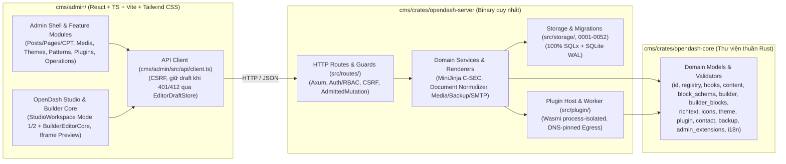

# OpenDash — Bản đồ Kiến trúc CMS và Cấu trúc Thư mục

**Nguồn định hướng:**
- [Yêu cầu sản phẩm](../product/PRODUCT_REQUIREMENTS.md): Phạm vi tính năng và ràng buộc nghiệp vụ V1.
- [Tech Stack](TECH_STACK.md): Các thư viện đã pin trong `cms/Cargo.toml` và `cms/admin/package.json`.
- [Bộ khung Lõi & Quy chuẩn Code](../contracts/CORE_FOUNDATION.md): Danh mục Base APIs bắt buộc tái sử dụng và ranh giới phân tầng.

---

## 1. Ranh giới Kiến trúc: `opendash-core`, `opendash-server`, `opendash-plugin-sdk` và `admin`

Mã nguồn CMS được tổ chức thành **Workspace Rust 3 crate** (`opendash-core`, `opendash-server`, `opendash-plugin-sdk`) kết hợp với ứng dụng **React Admin** và đóng gói ra **đúng một file thực thi duy nhất** (`opendash` / `opendash.exe`):



### 1.1. Trách nhiệm từng phần

1. **`cms/crates/opendash-core` (Thư viện Rust thuần domain & kiểm tra hợp lệ):**
   - Chỉ phụ thuộc `serde`, `serde_json`, `url`. Tuyệt đối không dùng `axum`, `sqlx`, `wasmi`, `tokio`, `reqwest` hoặc `std::{fs, io, net, process, thread}`.
   - Gồm 15 modules ([`src/lib.rs`](../../cms/crates/opendash-core/src/lib.rs)): `admin_extensions`, `backup`, `block_schema`, `builder`, `builder_blocks`, `contact`, `content`, `hooks`, `i18n`, `icons`, `id`, `plugin`, `registry`, `richtext`, `theme`.
2. **`cms/crates/opendash-server` (Ứng dụng thực thi phụ thuộc `opendash-core`):**
   - **`routes/` (23 files: `mod.rs` + 22 modules):** Xác thực phiên/CSRF (`require_*`), admission lease (`AdmittedMutation`), kiểm tra body/headers và ánh xạ HTTP response (`ApiError`). Không chứa câu lệnh SQL.
   - **`storage/` (32 module files + 2 test files):** Sở hữu **100% truy vấn `sqlx::query*` / `sqlx::raw_sql`**, transactions `BEGIN IMMEDIATE` và migrations `0001`–`0052`.
   - **`plugin/`:** Vòng đời plugin revisions, worker cô lập tiến trình (`--plugin-worker`), `host_ops` (`kv_get`, `kv_set`, `http_request`, `content_save`) và HTTP egress chống SSRF (`egress.rs`).
   - **Hạ tầng server:** `SiteCoordinator` (`operations.rs`), `SitePaths` (`paths.rs`), `template_sec.rs` (`C-SEC`), `document.rs` (`normalize_public_document`), `backup*.rs` & `restore.rs` (`age` encrypted), `media*.rs`, `smtp.rs`, `secrets.rs`, `config.rs`, và `rust-embed` (`app.rs`).
3. **`cms/crates/opendash-plugin-sdk` (Rust Guest SDK cho Plugin WASM):**
   - Thư viện không phụ thuộc ngoài (`edition = "2024"`) nhắm tới `opendash_v1` ABI v1/v1.1 với macro `export_plugin!`, wrapper cho 15 Host Ops và `MockHost` native test harness.
4. **`cms/admin/` (Giao diện quản trị và Builder trên trình duyệt):**
   - **`api/` (21 files):** Mọi lời gọi HTTP đi qua [`client.ts`](../../cms/admin/src/api/client.ts).
   - **`shell/`:** `AdminShell.tsx` (điều hướng 3 nhóm `Nội dung`, `Giao diện`, `Hệ thống`), `router.ts`, `AuthPanel.tsx`.
   - **`builder/` & `studio/`:** `StudioWorkspace.tsx` (Mode 1 Customizer + Mode 2 Entry/Pattern UX Builder), `StudioBlockTree.tsx`, `StudioBlockCatalog.tsx`, `BuilderEditorCore.tsx`, `BuilderInspector.tsx`, `BuilderPreviewFrame.tsx` (`BuilderWorkspace.tsx`, `BuilderCanvas.tsx` và `BuilderTree.tsx` cũ đã được gỡ bỏ hoàn toàn).
   - **`features/` (17 thư mục):** `contact/`, `content/`, `dashboard/`, `editor/` (`SingleEditWorkspace.tsx`, `EditorDraftStore.ts`), `extensions/`, `library/`, `media/`, `operations/`, `patterns/`, `plugins/`, `seo/`, `settings/`, `shared/`, `system/`, `taxonomy/`, `themes/`, `users/`.

### 1.2. Luồng Xem trước (Preview), Lưu (Save), Xuất bản (Publish) và Quyền sở hữu Dữ liệu

- **Xem trước (Preview):** Gửi dữ liệu chưa lưu lên route preview có xác thực và `sequence ID` cục bộ; server dùng cùng bộ render MiniJinja (`C-SEC`) trả HTML vào `iframe sandbox=""`. Thay đổi chưa lưu **không ghi đè trang công khai**.
- **Lưu vs Xuất bản:**
  - Với `post`, `page` và các CPT cấu hình `publication: "draft_publish"` (`0038_content_type_settings.sql`), thao tác **Lưu** trên bản `draft` chỉ ghi DB (không công khai URL, archive, sitemap hoặc media ACL); chỉ thao tác **Xuất bản** mới công khai.
  - Với **OpenDash Studio** (template overrides, Global Options, Menus, Reading Settings, Pattern riêng tư và entry CPT cấu hình `immediate`) cùng các CPT `immediate`, thao tác **Lưu** cập nhật trực tiếp ngay; riêng `post`, `page` và CPT `draft_publish` chỉnh sửa trong Studio Mode 2 vẫn giữ ranh giới `draft` / `published`.
- **Tách biệt Dữ liệu Website & Mã nguồn (`SitePaths`):**
  - Toàn bộ dữ liệu runtime của website tách khỏi mã nguồn trong `cms/` thông qua `SitePaths` (`OPENDASH_SITE_ROOT`, `OPENDASH_DB_PATH`): `database/opendash.sqlite`, `database/secrets/smtp/`, `themes/revisions/`, `plugins/revisions/`, `uploads/media/`, `uploads/.quarantine/`, `backups/artifacts/`, `config/site.json`, `runtime/site.lock`.
  - Staging cùng ổ đĩa (`runtime/staging/`, `.staging/<run_uuid>/`) đảm bảo `std::fs::rename` nguyên tử trên cả Windows và POSIX.
  - Mọi integration test và smoke script bắt buộc trỏ `OPENDASH_SITE_ROOT` vào thư mục tạm riêng, không ghi đè dữ liệu tại root repository.

---

## 2. Cấu trúc Workspace Thực tế

```text
opendash-cms/
├── .agents/                                # Skill ngữ cảnh opendash-elephant và tài liệu lịch sử
├── cms/                                    # Mã nguồn CMS, migrations và công cụ build/test
│   ├── Cargo.toml                          # [workspace] members = ["crates/opendash-core", "crates/opendash-server", "crates/opendash-plugin-sdk"]
│   ├── Cargo.lock
│   ├── crates/
│   │   ├── opendash-core/src/              # 15 domain modules thuần Rust (lib.rs)
│   │   ├── opendash-plugin-sdk/src/        # Rust Guest SDK cho Plugin WASM (opendash_v1 ABI v1/v1.1)
│   │   └── opendash-server/src/            # Server binary: routes/ (23 files), storage/ (32 module files + 2 test files), plugin/, tests/
│   ├── admin/src/                          # React + TS + Vite + Tailwind CSS (api/, shell/, studio/, builder/, i18n/, features/)
│   ├── migrations/                         # 51 migrations SQLite (0001–0052, bỏ qua số 0016)
│   ├── fixtures/                           # baseline_0001.sqlite, admin-review/, demo-website/, m7/, m8/
│   ├── sdk/                                # AssemblyScript Plugin SDK (sdk/as/opendash.ts)
│   ├── examples/                           # Plugin/Theme mẫu (sample-plugin, rust-seo-plugin, sample-theme-v3)
│   ├── deploy/                             # Cấu hình systemd & nginx mẫu cho Linux VPS
│   └── scripts/                            # build.ps1, build-release-linux.sh, check-standards.py, check-plans.py, E2E scripts
├── docs/                                   # Tài liệu sản phẩm, kiến trúc, contracts, designs (EGM), verification, archive
├── database/, themes/, plugins/, uploads/  # Thư mục dữ liệu website ở root (tách khỏi cms/)
├── AGENTS.md                               # Quy trình chuẩn EGM & ranh giới kỹ thuật
└── README.md                               # Hướng dẫn chạy dev & build release
```

> Hồ sơ lịch sử chuyển đổi cấu trúc M1/M2 từ 1 crate sang 2 crate (`2026-11-07-m1-m2-module-map.md` và `2026-11-07-layout-migration.md`) được lưu giữ trong Git history.
