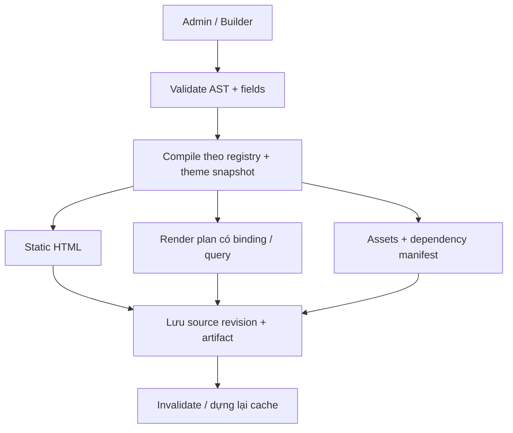

# OpenDash — ĐỀ XUẤT KIẾN TRÚC CMS & LỘ TRÌNH TRIỂN KHAI

**Tên dự án đã chốt:** OpenDash\
**Ngày tổng hợp:** 2026-11-05\
**Trọng tâm hiện tại:** CMS trước, e-commerce sau.\
**Trạng thái tài liệu:** Tổng hợp đề xuất để thảo luận; ngoài tên dự án, ưu tiên CMS và các yêu cầu người dùng đã nêu, các chi tiết kỹ thuật dưới đây chưa mặc nhiên là quyết định đã duyệt.

Tài liệu này tổng hợp đề xuất kiến trúc CMS-first cho OpenDash. Đối chiếu cùng [yêu cầu sản phẩm](../product/PRODUCT_REQUIREMENTS.md), [đánh giá tech stack](TECH_STACK.md) và [kiến trúc CMS hiện hành](CMS_ARCHITECTURE.md).

## 1. Định hướng sản phẩm

OpenDash hướng đến trải nghiệm quen thuộc với developer từng làm WordPress: quản lý nội dung, CPT/custom fields, taxonomy, template hierarchy, theme tùy biến, hook mở rộng và visual builder kiểu Flatsome.

### 1.1. Yêu cầu đã thể hiện trong thảo luận

* Rust, một executable cho mỗi website, SQLite riêng, dễ vận hành trên VPS.
* Admin nhúng vào binary; không cần Node.js trên máy chạy production.
* Builder có một sidebar trái khoảng 340px, chuyển giữa Tree / Edit / Add; preview trong iframe dùng renderer thật.
* CPT và fields tạo bằng giao diện; theme có thể cung cấp HTML/CSS và block riêng.
* Có định hướng plugin sandbox, nhưng ưu tiên xây CMS hoàn chỉnh trước.
* Không triển khai WordPress REST compatibility hoặc chuyển Elementor/Divi trong MVP.
* Không lấy e-commerce làm tiêu chí thiết kế hay nghiệm thu giai đoạn CMS đầu tiên.

### 1.2. Đề xuất ranh giới MVP

| Có trong CMS đầu tiên | Để sau khi CMS dùng được |
|---|---|
| Setup, auth, session, quyền cơ bản | E-commerce |
| Posts/pages/CPT, custom fields, taxonomy | Plugin JS có egress và tích hợp ngoài |
| Draft, revision, preview, publish | Marketplace / installer nâng cao |
| Media library, navigation menu | Self-update binary |
| Theme loader, template selection, design tokens | Static edge publishing |
| Builder, field bindings, CollectionGrid, reusable blocks | Tối ưu theo benchmark lớn và các tính năng mở rộng khác |
| SEO metadata, canonical, sitemap, robots, redirect cơ bản | Các công cụ migration WordPress |

“Single binary” ở đây nghĩa là single executable chứa runtime và Admin assets. Dữ liệu, uploads, theme và plugin vẫn nằm trong thư mục trạng thái; không phải website chỉ có đúng một file.

## 2. Ranh giới module và workspace

Giữ kiến trúc đủ gọn để triển khai. Chưa cần nhiều crate nếu chưa xuất hiện ranh giới phụ thuộc rõ ràng.

```text
OpenDash/
├── Cargo.toml
├── crates/
│   ├── OpenDash-core/
│   │   └── src/
│   │       ├── content/       # Model, field schemas, validation
│   │       ├── ast/           # AST, bindings, versioning, constraints
│   │       ├── blocks/        # Registry và render contract
│   │       ├── render/        # Compiler, artifacts, context
│   │       ├── themes/        # Manifest, override, template selection
│   │       └── hooks/         # Hook contracts; chưa cần QuickJS
│   └── OpenDash-server/
│       ├── migrations/
│       └── src/
│           ├── main.rs
│           ├── state.rs
│           ├── services/      # Use cases: save, preview, publish
│           ├── storage/       # SQLite repositories, index management
│           ├── routes/        # Public/Admin/Preview/Collections
│           ├── cache/
│           ├── media/
│           └── jobs/
└── admin-ui/                  # React, TypeScript, Vite, Zustand
```

`OpenDash-core` không phụ thuộc Axum hoặc connection SQLite. Nó xác thực fields/AST và mô tả việc render. DDL/index SQLite nằm ở storage adapter thay vì ở field model.

Route chuyển request thành use case; publish/revision/dependency không được phân tán thành nhiều đoạn SQL độc lập trong các route khác nhau.

Media và plugin runtime có thể tách crate sau khi có lý do cụ thể. Việc chưa chạy QuickJS không ngăn xây hook contracts từ đầu.

### 2.1. Thư mục runtime đề xuất

```text
/var/www/site/
├── opendash                  # Binary phân phối
├── database/
│   └── opendash.sqlite
├── uploads/                  # Bản gốc và các biến thể media
├── themes/
├── plugins/                  # Dùng khi runtime plugin được triển khai
└── backups/
```

File WAL/SHM do SQLite quản lý khi hoạt động. Backup dùng API/snapshot thích hợp, không coi copy riêng file `.sqlite` đang chạy là quy trình backup đầy đủ.

## 3. Hợp đồng 1 — Content Types & Fields

### 3.1. Tách mô hình dữ liệu khỏi theme

CPT, field definitions, taxonomy và nội dung thuộc website. Theme cung cấp template, style, block và blueprint cài đặt ban đầu.

Ví dụ, website có CPT `project` với các fields `location`, `area`, `gallery`. Khi đổi theme, dữ liệu và màn hình nhập liệu vẫn tồn tại. Theme mới quyết định trình bày các trường đó ra sao.

Blueprint do theme cung cấp cần được import thành định nghĩa do website quản lý; gỡ theme không xóa content type hay dữ liệu đã tạo.

### 3.2. Schema có kiểu

MVP có thể giữ `fields_schema` theo từng content type. Định nghĩa tối thiểu gồm:

* Field ID/key ổn định, tách khỏi label hiển thị.
* Type, required, default và constraints theo type.
* Cấu hình UI và quyền hiển thị/chỉnh sửa nếu cần.
* Khả năng filter/sort và tập toán tử được phép.
* Schema version và quy tắc thay đổi type/rename.

Nhóm field đầu tiên: text, textarea/rich text, number, boolean, date, select, media, gallery, relation và repeater. Có thể triển khai tuần tự; quan hệ và repeater cần validation độ sâu/kích thước.

Backend là nơi xác thực cuối cùng. Form React không thay thế validation phía Rust.

### 3.3. JSON fields và expression index

JSON thích hợp cho dữ liệu tùy chỉnh, nhưng không thay thế mọi quan hệ. Dùng bảng quan hệ cho taxonomy, menu và các quan hệ cần foreign key/truy vấn chéo rõ ràng.

Với filterable fields:

1. Whitelist field key và JSON path; chỉ nội suy identifier/path đã kiểm tra.
2. Bind toàn bộ giá trị truy vấn.
3. Chuẩn hóa kiểu: `100` và `"100"` không được dùng lẫn cho trường number.
4. Query builder chỉ cho phép type, operator, sort và page size được khai báo.
5. Index phải phù hợp biểu thức query; kiểm chứng bằng `EXPLAIN QUERY PLAN`.
6. Tạo/thay index là thay đổi schema, cần lên lịch và giới hạn để không giữ writer quá lâu.

Trường mảng/repeater không mặc nhiên lọc tốt bằng một scalar expression index. Chọn chiến lược index theo nhu cầu thực tế.

## 4. Hợp đồng 2 — AST và Block Registry mở

### 4.1. Định dạng AST

Node lưu mã block có namespace. Không đóng toàn bộ định dạng lưu trữ vào một enum Rust chỉ có các block biết trước lúc biên dịch.

```json
{
  "ast_version": 1,
  "nodes": [
    {
      "id": "heading_01",
      "type": "core/heading",
      "block_version": 1,
      "label": "Page heading",
      "props": { "tag": "h1" },
      "bindings": {
        "text": {
          "source": "entry",
          "path": "title"
        }
      },
      "styles": {
        "desktop": {},
        "tablet": {},
        "mobile": {}
      },
      "children": []
    }
  ]
}
```

Đây là schema minh họa để chốt hợp đồng, chưa phải format đã duyệt. Cần phân biệt version của document AST, version block và version artifact.

Block có thể lấy props tĩnh hoặc binding có cấu trúc. Binding xác định nguồn như entry, custom field, site hay collection item; không phải đoạn JavaScript tùy ý.

### 4.2. Registry và schema dùng chung

Một block definition cần mô tả:

| Thành phần | Mục đích |
|---|---|
| ID và schema version | Ví dụ `core/heading`, `agency/hero` |
| Props schema và defaults | Validation Rust và tạo form |
| Editor UI schema | Nhóm options, media picker, repeater, slider |
| Parent/child constraints | `Row -> Col`, leaf không có children |
| Renderer | Rust native hoặc MiniJinja template |
| Assets | CSS/JS cần nạp, dependency và vòng đời khởi tạo |
| Binding support | Prop nào nhận nguồn động, kiểu dữ liệu phù hợp |
| Migration | Chuyển props cũ sang schema mới |
| Render/cache behavior | Static, context/query phụ thuộc và điều kiện cache |

Rust vẫn dùng struct/enum có kiểu bên trong cho block core. Registry mở cho phép theme/plugin thêm loại block qua contract đã định nghĩa.

Registry được resolve một cách xác định. Xung đột đăng ký ID phải có lỗi rõ ràng; theme override renderer là thao tác có chủ đích, không phải vô tình ghi đè schema.

### 4.3. Validation AST phía server

* ID duy nhất trong phạm vi document; duplicate node phải tạo ID mới.
* Giới hạn node count, độ sâu, kích thước props và tổng payload.
* Kiểm tra loại node, version, parent/child và type của bindings.
* Ngăn symbol tham chiếu vòng và vượt độ sâu.
* URL, rich text và CSS values có quy tắc riêng; escaping HTML không thay thế kiểm tra URL scheme.
* Block thiếu renderer không làm mất dữ liệu: editor có placeholder, publish có chính sách báo lỗi/fallback rõ ràng.

Symbol được dùng nhiều lần cần ID instance để metadata chọn node trong iframe không bị trùng.

## 5. Hợp đồng 3 — Compile-on-Save và Render Artifacts

### 5.1. Giữ dual-storage

AST là dữ liệu chuẩn để chỉnh sửa. Kết quả biên dịch là dữ liệu dẫn xuất có thể dựng lại. Public renderer không bắt buộc parse AST mỗi request.



### 5.2. Ba loại công việc render

| Loại | Ví dụ | Thời điểm xử lý |
|---|---|---|
| Static | Heading nhập tay, ảnh cố định, hero | Compile khi publish |
| Context-bound | `entry.title`, custom field, breadcrumb | Resolve theo context khi render, rồi cache nếu được phép |
| Query-bound | CollectionGrid, bài liên quan | Query/render khi cần, hoặc dựng lại theo dependency |

Một block được phân loại theo dữ liệu thực tế, không chỉ theo tên. Heading có binding là context-bound. Container có thể gồm cả đoạn tĩnh và động.

Khi cần nội dung phụ thuộc người dùng, phải có chính sách cache riêng; không đưa dữ liệu riêng vào shared public cache.

### 5.3. Định dạng kết quả đề xuất

Tách rõ:

* `rendered_html`: HTML đã hoàn tất cho trường hợp static.
* `render_plan_json` hoặc artifact tương đương: phần tĩnh xen thao tác binding/query đã được kiểm tra.
* `assets_manifest`, `dependencies` và các version phục vụ kiểm tra artifact còn hiệu lực.

Có thể lưu các dữ liệu này trong bảng `render_artifacts` thay vì tiếp tục thêm cột vào mọi loại nội dung.

Artifact tối thiểu xác định source revision, format version, theme/registry revision và kind. Đây là hợp đồng cần chốt trước, không yêu cầu xây một ngôn ngữ template mới trong MVP.

### 5.4. MiniJinja và escaping

Template block do developer viết được parse/cache độc lập. Giá trị người dùng đi vào context dưới dạng dữ liệu; không lấy chuỗi đã ghép user content rồi parse lại thành template.

Chỉ đánh dấu safe cho HTML mà renderer/sanitizer kiểm soát, ví dụ children đã render. Không dùng `safe` như mặc định cho custom fields hoặc rich text chưa được xử lý.

Binding trong HTML text, attribute và URL cần renderer xử lý đúng context. Không thay marker bằng nối chuỗi tùy ý.

### 5.5. Publish nhất quán

Luồng đề xuất:

1. Auth và kiểm tra quyền chỉnh sửa/publish.
2. Validate fields, AST và version kỳ vọng của document.
3. Compile trên snapshot theme/registry/context xác định; tránh giữ SQLite write transaction khi chạy tác vụ nặng.
4. Trong transaction, kiểm tra version chưa thay đổi rồi lưu revision, source, artifact và dependencies nhất quán.
5. Commit, sau đó cập nhật cache/invalidation và phát sự kiện.

Nếu compile thất bại, bản publish trước vẫn hoạt động. Hai tab sửa cùng nội dung phải nhận conflict có thể xử lý, thay vì im lặng ghi đè.

## 6. Schema CMS cần điều chỉnh trước khi triển khai

Schema file 01 là điểm xuất phát, chưa nên dùng làm migration production nguyên trạng.

| Nhóm bảng | Đề xuất |
|---|---|
| `users`, `sessions` | Tài khoản quản trị, phiên, quyền, hết hạn/revoke |
| `content_types` | CPT definitions, supports, routing options, field schema version |
| `entries` | Posts/pages/CPT, author, parent nếu hierarchical, trạng thái, timestamps, version |
| `entry_revisions` | Snapshot phục hồi; draft và published revision tách biệt rõ ràng |
| `taxonomies`, `terms`, `entry_terms` | Tách định nghĩa taxonomy khỏi term; có thể dùng FK rõ ràng |
| `templates` | Theme association, slot/type, điều kiện chọn, version; chỉ một default cho cùng phạm vi |
| `reusable_blocks` | AST dùng chung/symbol, version và instance overrides |
| `media` | ID, original, variants, MIME, dimensions, alt và metadata |
| `menus`, `menu_items` | Navigation có thứ tự và cấu trúc cha–con |
| `render_artifacts`, `render_dependencies` | Output dựng lại được và quan hệ phụ thuộc |
| `settings` | Settings có namespace và validation |
| `jobs`/outbox | Bổ sung khi có tác vụ cần retry hoặc sự kiện không được mất |

Các tên bảng là đề xuất, không phải migration hoàn chỉnh.

### 6.1. Constraints và vòng đời dữ liệu

* Thêm CHECK cho JSON hợp lệ, trạng thái và số lượng/giá trị có miền xác định.
* Không mặc định publish nội dung mới trước khi người dùng thực sự publish.
* Định nghĩa slug/routing theo type, hierarchy và URL thực tế; xử lý xung đột và redirect khi đổi permalink.
* Xem lại `ON DELETE CASCADE` ở content type. Xóa định nghĩa CPT không nên tự xóa toàn bộ nội dung mà thiếu quy trình rõ ràng.
* Đổi label field không đổi field key; đổi type/rename key cần migration.
* Với MVP chỉ có entries, dùng bảng join có FK thay vì quan hệ polymorphic không được database kiểm tra.

### 6.2. SQLite

WAL là lựa chọn hợp lý cho single-tenant CMS. Cần giới hạn connection pool/concurrency ghi, đặt busy timeout và cấu hình connection-local PRAGMA trên mọi connection tương ứng. Không chỉ đặt `foreign_keys` trong migration rồi coi pool đã được cấu hình.

WAL không tạo nhiều writer đồng thời. Index build, media và plugin không được kéo dài write transaction.

`sqlx` vẫn là lựa chọn cho OpenDash nếu phù hợp cách tổ chức ứng dụng; không cần đổi sang `rusqlite` chỉ để giống Daypress. Quyết định driver dựa trên API, transaction, integration và đo thực tế.

## 7. UX Builder: Sidebar + Clean Iframe

Giữ thiết kế người dùng yêu cầu:

* Sidebar trái khoảng 340px, ba chế độ Tree / Edit / Add.
* Tree hỗ trợ collapse, reorder, reparent, duplicate, hide/show, insert đúng vị trí.
* Options dùng block schema; Element Picker chỉ gợi ý block hợp lệ.
* Zustand quản lý document, selection, undo/redo và dirty state.
* Iframe dùng theme/assets và renderer giống public.

### 7.1. Một renderer, hai mode

Preview và publish dùng cùng hợp đồng render. Preview thêm metadata chọn node; public không xuất `data-ux-*`.

Chính sách root của block phải cho phép định vị để morph. Nếu hỗ trợ nhiều root hoặc node tạo markup đặc biệt, cần quy ước rõ thay vì bọc một `div` làm hỏng ngữ nghĩa HTML.

Render node cần context của entry/template/collection item, không chỉ JSON subtree. Khi đổi thuộc tính ảnh hưởng phạm vi lớn hơn, có thể rerender ancestor phù hợp.

### 7.2. Đồng bộ thay đổi

1. Sửa props trong store và ghi undo transaction.
2. Gửi request có document/context ID, node ID và sequence/version.
3. Rust validate rồi render fragment bằng registry hiện tại.
4. Chỉ áp dụng response còn đúng với phiên bản hiện tại.
5. Morph đúng vùng, giữ focus/selection/scroll theo hợp đồng.

Dùng debounce hoặc batching hợp lý; hủy request cũ khi có thể. Server render time và thời gian người dùng thấy thay đổi là hai metric khác nhau.

### 7.3. Iframe bridge và assets

Preview phải được auth, kiểm tra quyền, bypass public cache và không công khai bản nháp chỉ vì có `?ux_preview=1`.

`postMessage` dùng target origin cụ thể; bên nhận kiểm tra origin, source và schema message. Iframe không phải toàn bộ ranh giới bảo mật nếu chạy cùng origin và cho phép script theme.

Fragment mới có thể cần CSS/JS chưa nạp. Registry/assets manager phải nạp dependency và định nghĩa mount/unmount. Kiểm tra vòng đời Alpine/HTMX khi morph node, đặc biệt với form, input và component có state.

## 8. Theme, CSS và Template Hierarchy

### 8.1. Quyền sở hữu và override

Theme có manifest, design tokens, layouts, templates mặc định, block renderers và assets. Dữ liệu người dùng lưu riêng; update ZIP không ghi đè bản chỉnh sửa trong database.

Đề xuất thứ tự chọn template:

1. Template người dùng gán trực tiếp cho nội dung.
2. Template có điều kiện phù hợp trong theme hiện tại.
3. Template mặc định theo loại nội dung/route.
4. Fallback core.

Cần quy tắc ưu tiên xác định khi nhiều điều kiện cùng khớp.

Theme được ghi đè renderer của block core khi tương thích contract. Block do theme tự đăng ký dùng namespace riêng.

### 8.2. Update và chuyển theme

Giữ AST trong SQLite không tự đảm bảo tương thích. Cần version, migration, phát hiện missing block và khả năng rollback.

Template có `theme_id` để bảo toàn layout riêng của từng theme. Field definitions và nội dung độc lập với theme. Cấu trúc cũ không được xóa khi thiếu renderer.

Khi thay theme hoặc renderer, compiled artifacts cũ phải được dựng lại/đánh dấu stale; chỉ xóa hot cache không sửa HTML đã compile.

### 8.3. CSS

Làm thử nghiệm nhỏ với `encre-css` trước khi coi đây là phần bắt buộc của kiến trúc:

* Utility/responsive variants thực sự cần.
* Class sinh từ props và class chọn có điều kiện.
* Khả năng safelist hoặc enumerate classes từ schema.
* Thời gian build, output size và cách cập nhật assets trong preview.

Quét riêng `template.html` không đảm bảo tìm đủ class động. Có thể dùng CSS variables/scoped CSS cho giá trị tùy chỉnh như padding, màu và chiều rộng.

CSS sinh ra nên nằm ở thư mục generated có content hash; không ghi đè file được theme phát hành. Preview cần CSS bổ sung cho thay đổi chưa publish, không chờ compile-on-save.

Template loader phải giới hạn đường dẫn trong root cho phép. MiniJinja không thay thế toàn bộ chính sách quyền đối với theme được cài đặt.

## 9. Dependency Tracking và Cache

### 9.1. Phụ thuộc cần ghi nhận

Ví dụ: một trang dùng symbol CTA, template header, block `agency/hero`, design tokens và collection của CPT `project`.

Compiler ghi dependency vào manifest/bảng riêng. Khi phụ thuộc thay đổi, artifact và cache tương ứng phải được rebuild hoặc invalidated.

Collection cần phụ thuộc vào phạm vi query/type/taxonomy, không chỉ những entry ID đang có trong kết quả. Entry mới có thể làm thay đổi trang đầu, sắp xếp, số trang hoặc empty state.

Ngăn vòng tham chiếu symbols, và kiểm tra fan-out rebuild trên dữ liệu thực tế.

### 9.2. MVP ưu tiên đúng dữ liệu

MVP có thể invalidation rộng toàn public cache và rebuild theo phạm vi đơn giản. Chỉ tối ưu dependency tags khi luồng publish đã đúng.

Cần xử lý race giữa render đang chạy và publish: response từ thế hệ nội dung cũ không được ghi trở lại cache hiện hành sau invalidation.

### 9.3. Pre-compressed hot cache

`Bytes` phù hợp để clone handle thay vì clone cả buffer tại tầng ứng dụng. Chọn DashMap hoặc cache có eviction theo benchmark; một map concurrent không tự cung cấp giới hạn bộ nhớ.

Cache policy cần:

* Key gồm route và query chuẩn hóa; thêm variant ảnh hưởng HTML.
* Bypass admin, draft preview và nội dung phụ thuộc người dùng.
* Xử lý Accept-Encoding, `Vary`, ETag và response 304 đúng.
* Không nén body gzip lần thứ hai qua middleware.
* Giới hạn byte, số entry, payload và thời gian sống khi cần.
* Không cache vô hạn mọi tổ hợp query của collection.
* Phân biệt HTML page đầy đủ với HTML fragment của HTMX/fetch.

Không cache dữ liệu riêng theo giả định “request không có cookie admin thì luôn public”.

## 10. Hook Contracts và QuickJS

### 10.1. Triển khai theo hai bước

Định nghĩa hooks cho core ngay từ đầu, ví dụ `before_entry_validate`, `entry_saved`, `entry_published`, `before_render_context` và `after_render_html`. Có thể dùng Rust handlers trước; nối QuickJS khi CMS nền tảng đã ổn.

Chốt tên, payload, thứ tự chạy, phạm vi quyền, error policy và ảnh hưởng cache. Hook contract có version để plugin không phụ thuộc cấu trúc nội bộ tùy ý.

### 10.2. Runtime execution

Không chạy JavaScript không kiểm soát trực tiếp trên Tokio worker xử lý request. Dùng worker/runtime ownership phù hợp ràng buộc threading của thư viện, hàng đợi bounded và giới hạn concurrency.

Timeout async đơn thuần không dừng vòng lặp JS đang chạy. Cần interrupt của engine, giới hạn memory, stack, output và host calls. Tác vụ host cũng cần deadline/cancellation.

Các mốc 8MB/10ms và 32MB/5s trong file 01 là giả thuyết cần đo. Nhiều runtime đồng thời và media processing phải được tính vào RAM peak của website.

### 10.3. Hành vi theo nhóm hook

| Nhóm | Đề xuất |
|---|---|
| Filter trên render path | Deterministic khi có thể; không egress; error/fallback rõ ràng |
| Action hậu xử lý không quan trọng | Có thể chạy nền, chấp nhận quy tắc mất việc đã định nghĩa |
| Action không được mất | Transactional outbox/job bền vững, retry và idempotency |
| Đăng ký block/routes | Giai đoạn khởi tạo/activate; không phải job chạy sau response |

Plugin dùng `cms.http` phải khai báo destination/quyền, có timeout và giới hạn request/response. Tránh trao API filesystem/network/SQL thô ngoài phạm vi đã cấp.

Hook sửa HTML/context có thể làm output phụ thuộc người dùng hoặc request. Plugin cần khai báo ảnh hưởng cache hoặc làm cache bypass; không chỉ xóa cache khi bật/tắt plugin.

## 11. Các phần nền tảng cần có trong CMS

### 11.1. Auth và quyền

Có setup owner account, password hashing, session hết hạn/revoke, bảo vệ CSRF cho mutation dùng cookie, cookie flags phù hợp và rate limit đăng nhập.

Tối thiểu phân biệt quản trị hệ thống và chỉnh sửa/publish nội dung. Không cho quyền editor cài theme/plugin hay chạy script chỉ vì họ được sửa bài.

Tất cả API preview/render-node/upload/save phải kiểm tra quyền tương ứng. Query flag hoặc URL khó đoán không phải cơ chế auth.

### 11.2. Media

Giữ media ID ổn định, metadata, bản gốc và danh sách biến thể để dễ thay ảnh và dựng lại.

Decode/resize/encode chạy trong nhóm worker có concurrency bounded, tránh chặn async HTTP worker. Giới hạn upload bytes, dimensions và dung lượng ảnh sau giải mã; xử lý MIME, EXIF orientation và đường dẫn file nhất quán.

WebP là điểm bắt đầu hợp lý. AVIF và OG image generation có thể bổ sung sau khi pipeline cơ bản dùng được và đã đo tải.

### 11.3. Cài đặt theme/plugin

Khi triển khai ZIP installer, kiểm tra path traversal, absolute path, symlink, số file và tổng kích thước sau giải nén. Stage ở thư mục tạm, validate manifest rồi mới activate.

Không chạy script của gói ngay khi chỉ mới upload. Activation có quy trình riêng, và lỗi activate không làm hỏng theme đang chạy.

### 11.4. Backup và self-update

Backup SQLite bằng backup API hoặc snapshot thích hợp với WAL. Xác định tập dữ liệu cần phục hồi cùng nhau: database, uploads, theme/plugin versions và cấu hình cần thiết. Thử restore, không chỉ kiểm tra file backup tồn tại.

Self-update để giai đoạn sau. Thiết kế cần xác thực nguồn release/manifest, atomic replacement, health check, supervisor restart và rollback tương thích với database migrations. SHA-256 chỉ có ý nghĩa khi hash kỳ vọng đến từ nguồn đáng tin cậy.

## 12. Đo hiệu năng trước khi cam kết SLA

Không dùng các con số Daypress hay mốc trong file 01 làm kết quả đã đo của OpenDash.

| Metric | Cách phân định |
|---|---|
| Cache-hit server processing | Thời gian trong process; ghi payload, encoding và concurrency |
| Public TTFB | Đo qua HTTP/TLS/proxy/network theo điều kiện công bố |
| Dynamic SSR/query | Tách thời gian SQLite, render, compression; ghi cache state |
| Builder preview | Tách server render time với edit-to-visible latency trên browser |
| Memory | Idle, warmed cache, normal load, peak media/plugin |
| Binary size | Ghi platform, features, release profile và assets đã nhúng |

Báo cáo p50/p95/p99, throughput, lỗi và mức tải. So sánh trên cùng phần cứng, dữ liệu và điều kiện đo.

Dataset cần có: nội dung tĩnh, CPT với fields có kiểu, taxonomy, collection filter/sort/pagination và trang dùng symbols. Chạy cả cold/warm cache; đối chiếu query plan và tập kết quả trước khi đánh giá tốc độ.

Mốc <50µs, <1ms, <2ms và RAM 12–25MB trong bản gốc tiếp tục là giả thuyết benchmark. End-to-end builder latency có network round trip nên không đồng nhất với thời gian morph hoặc render node.

## 13. Lộ trình CMS theo tiêu chí nghiệm thu

### M0 — Chốt ba hợp đồng

**Kết quả:** Content/field schema, AST/block registry và compile-on-save artifact có version, ví dụ dữ liệu và quy tắc migration.

**Nghiệm thu:** Có thể mô tả cùng một trang gồm hero tĩnh, heading lấy title, collection và symbol mà không mâu thuẫn giữa editor và public renderer.

### M1 — CMS nền tảng

**Kết quả:** Workspace, cấu hình SQLite, migrations, setup/auth, entries/CPT, draft/revision, media cơ bản, menu và public routing.

**Nghiệm thu:** Tạo và publish một bài/trang; chỉnh draft không thay bản public; restore revision hoạt động; backup phục hồi được.

### M2 — Theme loader và renderer

**Kết quả:** Manifest, template hierarchy, design tokens, core blocks, theme override và lưu artifacts.

**Nghiệm thu:** Một theme ngoài thay được renderer mà không build lại Rust. Đổi theme không xóa content type/fields/nội dung. Render lỗi không ghi đè bản publish đang dùng.

### M3 — UX Builder

**Kết quả:** Sidebar Tree/Edit/Add, drag/drop, constraints, duplicate, hide/show, undo/redo, schema forms và preview iframe.

**Nghiệm thu:** Preview khớp publish; public HTML sạch; response cũ không ghi đè thay đổi mới; block mới nạp đủ assets; sai cấu trúc bị server từ chối.

### M4 — Nội dung động và tái sử dụng

**Kết quả:** Field bindings, CollectionGrid, filter/sort/pagination, symbols, dependency tracking và SEO cơ bản.

**Nghiệm thu:** Bài mới/sửa bài làm collection cập nhật đúng; sửa symbol cập nhật nơi dùng; ngăn tham chiếu vòng; filter/phân trang hoạt động qua URL chuẩn khi không có JS.

### M5 — Đóng gói và hoàn thiện vận hành

**Kết quả:** Admin assets nhúng, cache giới hạn bộ nhớ, media jobs, logging, graceful shutdown, backup/restore và benchmark baseline.

**Nghiệm thu:** Build release chạy trên máy không cài Node/PHP/MySQL; restore sang thư mục mới được; kiểm tra invalidation race và RAM peak dưới workload xác định.

### M6 — Mở rộng plugin

**Kết quả:** QuickJS workers, permissions, activation lifecycle, limits, error reporting và durable jobs khi cần.

**Nghiệm thu:** Plugin lỗi hoặc vòng lặp bị ngắt theo policy; HTTP workers vẫn phục vụ; task quan trọng retry an toàn; dữ liệu riêng không lọt vào shared cache.

Các mốc là trình tự phụ thuộc kỹ thuật, chưa phải cam kết lịch. Ước lượng tuần sau khi M0 rõ và có prototype compiler/builder/theme.

## 14. Ghi lại đề xuất e-commerce để dùng ở giai đoạn sau

Không triển khai phần này trong CMS MVP. Các nhận xét trước vẫn được giữ để tránh mất quyết định cần xem lại:

* Quyết định product là CPT mở rộng hay domain riêng trước khi tạo song song hai cơ chế.
* Tiền lưu INTEGER với currency/đơn vị rõ ràng, không REAL.
* Checkout tính lại giá và tổng tiền từ server; có idempotency key.
* Atomic stock update phải validate quantity dương và nằm trong cùng transaction/connection cho toàn đơn.
* Xác định giữ kho, hết hạn, hủy và hoàn kho đúng một lần.
* VietQR tạo thông tin chuyển khoản; xác nhận thanh toán cần nguồn sự kiện đã xác thực.
* Payment events lưu provider transaction ID duy nhất; đối soát tài khoản, số tiền, nội dung và trạng thái.
* Sự kiện đơn hàng/thanh toán quan trọng dùng outbox, retry và idempotent consumers.

## 15. Quyết định cần chốt và bước tiếp theo

| Cần chốt | Đề xuất khởi điểm |
|---|---|
| Driver SQLite | Giữ hướng sqlx hiện có, làm prototype transaction/connection config |
| Content fields | Schema có kiểu theo CPT; field groups mở rộng sau |
| AST | Namespace block, version, props/bindings/styles/children |
| Block extensions | Registry mở; schema dùng chung editor/server |
| Compiled output | Static HTML + dạng artifact hỗ trợ binding/query |
| Draft/public | Revision riêng và publish có optimistic concurrency |
| Theme ownership | Content model thuộc site; layout/theme overrides được version hóa |
| CSS compiler | Spike encre-css và phương án CSS variables/scoped CSS |
| Invalidation | Bắt đầu rộng, có dependency/version metadata từ đầu |
| QuickJS | Sau nền tảng CMS; hook contracts định nghĩa sớm |

**Bước triển khai đầu tiên được đề xuất:** Viết đặc tả chính thức cho ba hợp đồng ở mục 3–5, dựng một vertical slice gồm tạo entry → sửa AST → preview → publish → public render. Dùng kết quả đó để quyết định các chi tiết compiler/CSS trước khi mở rộng toàn bộ Admin.
