# Cấu trúc Nội dung Chuẩn ACF Pro: Clean-Slate CPT, Field Groups & Location Rules, Taxonomy Term Meta & Custom Options Pages (Đợt 2)

* **Author:** Orion (Elephant / Antigravity)
* **Status:** Approved
* **Date:** 2026-11-28
* **Baseline:** `main@b3fba26`
* **Approved By:** Owner
* **Approval Evidence:** Chủ dự án phê duyệt trực tiếp đặc tả ngày 2026-11-28 ("mình chốt" tại phiên EGM Bước 4, chốt Cách 1 Clean-Slate và yêu cầu mở đoạn chat mới cùng Feature Worktree riêng feat/acf-content-structure để triển khai trọn gói Bước 5 từ S01 đến S06).
* **Migration Reserved:** `0063_acf_content_structure.sql` *(Làn song song: `0060` Search `+5` objects → `247/256`; `0061` Spec A1 `+0` → `247/256`; `0062` Spec A2 `-3` → `244/256`; `0063` đặc tả này **`+0` net `sqlite_schema` objects**; tự động đánh lại số `NNNN` nối tiếp khi sync `origin/main` ở Bước 5/7 nếu thứ tự merge thay đổi)*
* **Goldfish Review:** Đã hoàn tất 2 vòng rà soát bởi 4 reviewer độc lập (`egm-design`, `egm-codebase-details`, `egm-implementation-readiness`, `egm-structural`; tối đa 2 vòng theo `AGENTS.md`). Đã vá 100% Blocker, Major, Minor và Nit sau Vòng 2.
* **Related Contracts & Specs:**
  * [Hợp đồng Hệ kiểu Trường Thống nhất (`UNIFIED_FIELD_SCHEMA` V1)](../contracts/UNIFIED_FIELD_SCHEMA.md)
  * [Yêu cầu Sản phẩm V1](../product/PRODUCT_REQUIREMENTS.md)
  * [Core Foundation & Quy chuẩn Code](../contracts/CORE_FOUNDATION.md)
  * [M8 Writer & Recovery Inventory](../contracts/M8_WRITER_INVENTORY.md)
  * [Plugin ABI v1 / v1.1](../contracts/PLUGIN_ABI.md)
  * [Admin Navigation, CPT Schema Builder & Single Edit](../contracts/ADMIN_NAVIGATION_AND_SINGLE_EDIT.md)
  * [Content Foundation (C1–C4)](../contracts/CONTENT_FOUNDATION_2026_11.md)
  * [Unified Field Engine — Đợt 1 (`Verified`)](unified-field-engine.md)
  * [OpenDash Studio Unified Recursive AST V1 (Spec A1)](studio-unified-recursive-ast.md)
  * [OpenDash Studio Theme Format V1 & `core/loop-item` (Spec A2)](studio-template-blocks-and-loop.md)

---

## Overview

Sau khi **Đợt 1 ([Unified Field Engine](unified-field-engine.md))** hợp nhất toàn bộ 25 kiểu dữ liệu + 3 layout UI-only vào `opendash_core::field_schema` và `<UnifiedFieldForm>`, hệ thống đã có động cơ nhập/lưu/hydrate/C-SEC đồng nhất. Tuy nhiên, phần **cấu trúc nội dung (Content Structure)** vẫn mang mô hình cũ: trường lồng kép trong CPT, giao diện Field Group chỉ cho tạo tối đa 1 trường mới và không có màn sửa, không có Location Rules DNF, Taxonomy Term bị khóa custom field bởi cơ chế `AdminTermPanel` 3 trường cũ, chưa có Custom Options Pages và chưa có CPT phân cấp.

Đặc tả **Đợt 2 — Trọn gói ACF Pro** hiện thực hóa toàn bộ phần còn lại của [`UNIFIED_FIELD_SCHEMA.md`](../contracts/UNIFIED_FIELD_SCHEMA.md) (§5–§7) theo nguyên tắc **Clean-Slate V1 (Cách 1 — Zero `Base Fields` Duplication)**:

1. **Clean-Slate CPTs & Hierarchical CPT:** Xóa bỏ hoàn toàn `ContentTypeDefinition.fields`, `ThemeContentTypeDeclaration.fields`, `BaseFieldSlicePanelConfig`, `base_field_panels`, `core:base_fields`; giao `body`, `featured_image`, `excerpt` cho `CPT.supports`; hợp nhất 100% custom fields vào **Field Groups** (tự động migrate dữ liệu/field cũ an toàn với `owner_kind = 'user'`); bổ sung `singular_label`, `description`, `menu_icon`, `menu_position`, `show_in_menu`, `list_columns`, `archive_per_page`, `default_sort`, `exclude_from_sitemap`, `supports` 6 cờ (`editor`, `featured_image`, `builder`, `excerpt`, `menu_order`, `custom_template`), `hierarchical` cha–con tối đa 8 cấp (`parent_id`, `menu_order`), chỉnh `rewrite_base` & `taxonomies` trực tiếp trên màn CPT, và hỗ trợ `DELETE` User CPT an toàn.
2. **Field Groups Builder 4 tab ACF & DNF Location Rules Engine:** Tách Field Groups thành màn hình quản trị độc lập hoàn chỉnh (danh sách, lọc, bật/tắt `active`, nhân bản Duplicate, rút/xóa vĩnh viễn `?purge=true`), trình dựng nhiều field kéo-thả HTML5 + nút lên/xuống, 4 tab cấu hình chuẩn ACF (`General`, `Validation`, `Presentation & Access`, `Conditional Logic`), tạo sửa sub-fields đệ quy ngay tại chỗ cho `group` (2 tầng) và `repeater` (1 tầng), và động cơ **Location Rules DNF** (`content_type`, `taxonomy_term`, `options_page`, `page_layout`, `custom_template`, `special_page`, `entry_taxonomy`, `entry_id`, `user_role`) kèm trình dựng rule trực quan và bảo toàn giá trị ẩn (`COMPAT-1..4`).
3. **Custom Taxonomies & Term Meta cho MỌI Taxonomy:** Nâng cấp `taxonomy_terms` có `description`, `sort_order`, `featured_image_media_id`, `values_json`, `seo_json`; cho phép gắn Field Groups (25 kiểu) vào bất kỳ taxonomy nào qua `taxonomy_term == <key>`; nhập custom fields ở cả **tạo mới (`new`)** và **chỉnh sửa (`edit`)**; hydrate `term.description`, `term.sort_order`, `term.featured_image` (`SafeMediaObject` cho `od_image()`), `term.fields.<key>` và Term SEO ra template `taxonomy*.html` (C-SEC + Zero-N+1); bổ sung `selection_mode`, `picker_style`, `default_term_id`, `required_on_publish`, `editor_can_create_terms`, `show_in_menu`, `show_admin_column`, inline `rewrite_base` và `+ Thêm mới` trong `TermPicker`; kích hoạt `term_ref.sync_entry_terms`; loại bỏ hoàn toàn `AdminTermPanel` & bảng `term_extension_values`.
4. **Custom Options Pages (ACF Pro):** Cho phép Admin/Theme/Plugin đăng ký trang cấu hình tùy chỉnh (`custom_options_pages`, tối đa 64 trang/site), gắn trực tiếp vào menu Admin, gán Field Groups qua Location Rule `options_page == custom:<key>` (cùng `site_global` & `theme:<id>`), lưu giá trị đa ngôn ngữ trên hạ tầng `theme_option_*` (`owner_kind = 'options_page'`, bao gồm rebuild `theme_option_locale_values` và `theme_option_locale_versions` theo `(owner_kind, owner_id, ...)`), và hydrate ra template công khai qua `{{ custom_options.<page_key>.<field_key> }}`.
5. **Migration `0063` với Ngân sách `sqlite_schema` Net `= +0`:** Bảo toàn giới hạn cứng `MAX_SCHEMA_OBJECTS = 256` ([`restore.rs#L14`](../../cms/crates/opendash-server/src/storage/restore.rs#L14)), an toàn nâng cấp từ `baseline_0001.sqlite` (cập nhật `preflight_builtin_key_collisions` cho cả `post`/`page`/`pattern`/`section`), tách biệt sạch khỏi làn song song **Spec A1** (`studio/` & `page/`).

---

## The Problem

Kiểm toán mã nguồn thực tế tại baseline `main@b3fba26` xác nhận 5 nhóm hạn chế trực tiếp đang ngăn OpenDash đạt trải nghiệm Content Structure ngang chuẩn ACF Pro:

1. **Mô hình field kép chồng chéo trên CPT & giao diện Field Group sơ khai:**
   - `ContentTypeDefinition` ([`definitions.rs#L47-L55`](../../cms/crates/opendash-core/src/content/definitions.rs#L47-L55)) và `ThemeContentTypeDeclaration` ([`theme/types.rs#L355-L368`](../../cms/crates/opendash-server/src/theme/types.rs#L355-L368)) vẫn nhúng mảng `fields` riêng song song với `content_field_groups`, kéo theo hệ thống `BaseFieldSlicePanelConfig` / `base_field_panels` (`layout:*`) và panel `"core:base_fields"` ([`layout_types.rs#L54-L101`](../../cms/crates/opendash-core/src/content/editor_projection/layout_types.rs#L54-L101), [`editor_panels.rs#L168-L184`](../../cms/crates/opendash-core/src/content/roles/editor_panels.rs#L168-L184)).
   - Trong [`ContentTypeSchemaSettings.tsx#L889-L894,L980-L999`](../../cms/admin/src/features/content/ContentTypeSchemaSettings.tsx#L889-L894), base fields chỉ đọc sau khi tạo CPT (`handleUpdateSettings` gửi nguyên `descriptor.fields` cũ ở `L669`), chưa có UI/API xóa User CPT ([`routes/content.rs#L35-L83`](../../cms/crates/opendash-server/src/routes/content.rs#L35-L83)), và `ContentSupport` mới chỉ có 3 cờ `Editor | FeaturedImage | Builder` ([`editor_projection/types.rs#L82-L88`](../../cms/crates/opendash-core/src/content/editor_projection/types.rs#L82-L88)).
   - `FieldGroupsManager.tsx` cũ (nay được thay bằng [`FieldGroupEditorPage.tsx`](../../cms/admin/src/features/field-groups/FieldGroupEditorPage.tsx)) trước đây chỉ cho tạo **1 field duy nhất** khi tạo nhóm mới, không hỗ trợ sửa nhóm/trường đã tạo, không nhập được `instructions`/`width`/`conditions`/`group`/`repeater`/`tab`/`accordion`/`message`, và chỉ gán được `target_types` phẳng.
   - Các file trong `cms/scripts/loc-baseline.json` như `ContentTypeSchemaSettings.tsx` (`1299/1299`), `EntryListPage.tsx` (`1757/1757`), `QuickEditForm.tsx` (`876/876`), `validate_single_spec.rs` (`1016/1016`), và `editor_panels.rs` (`776/796`) đã sát/chạm trần ratchet nên phải tách module feature-first (`<= 600` LOC).
2. **Taxonomy & Term Meta là công dân hạng hai:**
   - `AdminExtensions` ([`admin_extensions.rs#L44-L52,L132`](../../cms/crates/opendash-core/src/admin_extensions.rs#L44-L52)) khóa `AdminTermPanel` chỉ cho `category`/`tag`, lưu vào bảng `term_extension_values` tách rời; mọi Custom Taxonomy hoàn toàn không gắn được custom field.
   - `taxonomy_terms` chưa có `description`, `sort_order`, `values_json`, `seo_json`; [`TermEditPage.tsx#L132,L498`](../../cms/admin/src/features/taxonomy/TermEditPage.tsx#L132) ẩn custom fields khi tạo term mới; [`routes/taxonomy/terms.rs#L199-L236`](../../cms/crates/opendash-server/src/routes/taxonomy/terms.rs#L199-L236) và [`create_term_with_locale.rs#L27`](../../cms/crates/opendash-server/src/storage/taxonomy/types/create_term_with_locale.rs#L27) khóa cứng quyền tạo term chỉ cho `Admin`.
   - `PublicTermView` ([`page_render.rs#L14-L21`](../../cms/crates/opendash-server/src/content_render/page_render.rs#L14-L21)) và route `render_canonical_taxonomy` ([`routes/public_content/types.rs#L415-L480`](../../cms/crates/opendash-server/src/routes/public_content/types.rs#L415-L480)) chưa xuất thông tin chi tiết `term` (`description`, `featured_image`, `fields`) hay Term SEO `<head>`.
   - [`validate_single_spec.rs#L137`](../../cms/crates/opendash-core/src/field_schema/constants/validate_single_spec.rs#L137) hiện vẫn chặn `sync_entry_terms: true` đến Đợt 2.
3. **Thiếu Custom Options Pages, Phân trang/Sắp xếp/Cột danh sách, & CPT Phân cấp:**
   - `theme_option_locale_values` & `theme_option_locale_versions` ([`0047#L305-L320`](../../cms/migrations/0047_multilingual_content_and_theme_l10n.sql#L305-L320)) mới chỉ khóa theo `theme_id` nên chưa dùng chung cho `options_page`; [`validate_single_spec.rs#L67-L71`](../../cms/crates/opendash-core/src/field_schema/constants/validate_single_spec.rs#L67-L71) cũng chưa cho phép `acl` trên `FieldContext::Options`.
   - [`enqueued_for_route.rs#L205-L209`](../../cms/crates/opendash-server/src/routes/public_content/assets_and_sitemap/enqueued_for_route.rs#L205-L209) hardcode `ARCHIVE_SIZE` (`20`); `entry_lookup.rs` / `PublishedListSort` chưa hỗ trợ `default_sort` đa dạng; [`storage/sitemap.rs#L69-L192`](../../cms/crates/opendash-server/src/storage/sitemap.rs#L69-L192) chưa lọc `exclude_from_sitemap` / `term_seo` `noindex`; [`entry_table/read.rs#L91-L97`](../../cms/crates/opendash-server/src/storage/entry_table/read.rs#L91-L97) lọc bỏ trường `Private` khỏi `list_columns`.
4. **Áp lực giới hạn 256 đối tượng SQLite Schema (`MAX_SCHEMA_OBJECTS`):**
   - Baseline `main@b3fba26` sau `0059` đã dùng `240` object thuần (`242 / 256` tổng khi SQLx chạy). Sau làn song song `0060` (`+5`), `0061` (`+0`), `0062` (`-3`), ngân sách là `244 / 256`. Do đó migration `0063` bắt buộc cân bằng **`+0` net objects**.

---

## Goals

1. **Loại bỏ hoàn toàn dual-field model trên CPT (`Cách 1 — Clean-Slate`):** Mọi custom field gắn qua Field Groups; `body`/`featured_image`/`excerpt` do `CPT.supports` quản lý trên tất cả CPT (gồm cả `post` và `page`) và không thể bị trùng khóa bởi bất kỳ Field Group nào.
2. **Nâng cấp trọn vẹn CPT + Hierarchical CPT + Editor Layout:** Đủ metadata ACF (`singular_label`, `description`, `hierarchical`, 6 `supports`, `menu_*`, `list_columns` kể cả field `Private` theo `min_view_role`, `archive_per_page`, `default_sort`, `exclude_from_sitemap`), cây cha–con tối đa 8 cấp + `menu_order` (đồng bộ cả `revisions`/`autosaves`), inline `rewrite_base` & `taxonomies` (cho cả site override trên Theme/Plugin CPT), và `DELETE` User CPT an toàn.
3. **Field Groups Builder hoàn chỉnh & Động cơ Location Rules DNF:** Màn hình độc lập ở `Hệ thống → Cấu trúc nội dung`, trình dựng nhiều field kéo-thả, 4 tab ACF, sub-fields `group`/`repeater` đệ quy ngay trong UI, DNF Location Rules đa ngữ cảnh (cấm chu trình `sync_entry_terms` ↔ `entry_taxonomy`), bảo toàn 100% giá trị ẩn (`COMPAT-1..4`), và chống oracle leak cho `Editor`.
4. **Taxonomy & Term Meta hạng nhất cho mọi Taxonomy:** Custom fields (25 kiểu) ở cả tạo mới & sửa term, `description`/`sort_order`/`Term SEO`, `TaxonomySettings` + inline `rewrite_base`/`content_types`, kích hoạt `term_ref.sync_entry_terms` hai chiều có kiểm soát giữa Composite Save và Quick Edit, `+ Thêm mới` trong `TermPicker`, và hydrate công khai `term.*` + `term.fields.*` an toàn qua `ThemeUrlPolicy`, `ThemeCompositionCache`, `sitemap.rs`, và `media_is_referenced.rs`.
5. **Custom Options Pages chuẩn ACF Pro:** Đăng ký qua Admin UI hoặc manifest Theme/Plugin (`declarations.options_pages`), gắn Field Groups bằng Location Rule `options_page`, hỗ trợ đa ngôn ngữ (`translatable`) & Backup/Restore/Orphan Purge qua hạ tầng `theme_option_*` (được rebuild theo `(owner_kind, owner_id, ...)`), và hydrate công khai qua `custom_options.<page_key>.<field_key>`.
6. **An toàn Nâng cấp, Bảo mật & Tách làn Song song:** Migration `0063` đạt **`+0` net `sqlite_schema` objects**, xử lý không mất dữ liệu/ACL khi nâng cấp từ `baseline_0001.sqlite` hoặc DB đang có `term_extension_values`/CPT `fields`/historical `manifest_json`, tách rời vùng `studio/`/`page/` của Spec A1, và mọi file mới trong `cms/` tuân thủ `<= 600` LOC.

---

## Non-Goals

Các hạng mục sau nằm ngoài phạm vi Đợt 2:

- **Không đụng vùng code AST của Spec A1 (`studio-unified-recursive-ast.md`):** Không sửa `BuilderDocument` AST đệ quy, `cms/crates/opendash-server/src/page/`, `builtin_blocks/`, hay `cms/admin/src/studio/`. Với 2 file binding cũ sắp bị Spec A1 xóa (`storage/builder_binding.rs` và `cms/admin/src/builder/BuilderBindingFields.tsx`), S02/S04 chỉ cập nhật tối thiểu nguồn đọc từ `descriptor.fields` sang `EffectiveContentSchema` / `effective-editor-config` để biên dịch/typecheck workspace luôn xanh dù Đợt 2 hay Spec A1 merge trước.
- **Không mở rộng `cms/sdk/as/opendash.ts` (AssemblyScript Wasm SDK):** File đã ở trần `611/617` LOC (`loc-baseline.json`); giữ nguyên ABI host ops Wasm hiện hành. (`cms/sdk/js/opendash.d.ts` chỉ bổ sung optional fields không phá vỡ tương thích cho `OdEntryRecord` / `OdTaxonomyTerm`; `od.site.options()` tiếp tục chỉ trả Global Site Options để bảo mật `custom_options` nội bộ.)
- **Không triển khai `flexible_content` hoặc `repeater` > 1 cấp:** OpenDash Studio Mode 2 đảm nhận bố cục đa hình theo [`PRODUCT_REQUIREMENTS.md`](../product/PRODUCT_REQUIREMENTS.md) §7.
- **Không rewrite URL hierarchical dạng `/parent-slug/child-slug` cho Hierarchical CPT:** Ở V1, mọi CPT entry giữ canonical flat URL hiện hành trong `storage/permalinks/`; cờ `hierarchical` quản lý quan hệ `parent_id` (tối đa 8 tầng), hiển thị cây Admin, `entry.parent` trong template và guard Trash/Purge.
- **Không hỗ trợ Theme/Plugin dùng biến tĩnh `custom_options.<page_key>` trỏ tới Options Page không khai báo trong `theme.json` của gói đó** khi kiểm tra gói ngoại tuyến `--check-theme` (site Admin có thể dùng mọi `custom_options` qua Template Overrides trong Studio).
- **Không thêm dependency mới trong `cms/Cargo.toml` hay `cms/admin/package.json`:** Dùng HTML5 Drag-and-Drop sẵn có trong React (như `StudioBlockTree.tsx`) cùng nút `↑`/`↓`.
- **Không tự động đồng bộ giá trị non-translatable giữa các bản dịch entry/term** (ngoài phạm vi V1).

---

## Critical User Journeys (CUJs)

### CUJ 1: Quản trị viên tạo CPT phân cấp `docs`, chỉnh sửa Field Group 4 tab & Location Rules DNF
* **Given:** Admin đang ở `Hệ thống → Cấu trúc nội dung` (`#/content-structure/content-types`).
* **When:** Admin tạo CPT `docs` (`hierarchical: true`, `supports: ["editor", "featured_image", "excerpt", "menu_order", "custom_template"]`, `rewrite_base: "tai-lieu"`, `menu_icon: "book-open"`, `list_columns: [{ kind: "field", key: "difficulty" }, { kind: "menu_order", key: "" }]`), rồi chuyển sang **Nhóm trường** (`#/content-structure/field-groups`) tạo Field Group `user:docs_meta` gồm `select` (`difficulty`, `show_in_list: true`), `group` (`author_box`), `repeater` (`steps` với sub-field inline), `richtext` (`notes`, có DNF `conditions` ẩn khi `difficulty == "basic"`), và đặt Location Rules `content_type == docs AND user_role == admin`.
* **Then:**
  - `docs` xuất hiện trên thanh bên **Nội dung** với icon `book-open` và route `/tai-lieu/{slug}` có hiệu lực tức thì.
  - Khi tạo bài `docs` cấp cha và cấp con trong Single Edit, vùng `core:excerpt` và `core:page_attributes` (chọn Bài cha + Thứ tự + Custom Template) hoạt động bình thường; Admin thấy nhóm `docs_meta`, còn Editor không thấy (mọi nỗ lực Editor gửi khóa `docs_meta` bị chặn `403 Forbidden`), không bị chặn lưu bởi trường `required` trong nhóm ẩn và không làm mất dữ liệu `docs_meta` đã lưu trước đó.
  - Bảng danh sách `docs` hiển thị cấu trúc phân cấp thụt lề theo cây (khi không tìm kiếm lọc và cha có mặt trên trang) cùng cột `difficulty` và `menu_order`; cố xóa vào Thùng rác bài cha đang có bài con bị chặn với `409 cannot_trash_entry_with_children`.

### CUJ 2: Chuyển đổi sạch DB nâng cấp (`Base Fields`, `term_extension_values`, `historical manifest_json`, `baseline_0001.sqlite`)
* **Given:** Một website nâng cấp từ `baseline_0001.sqlite` hoặc DB đang có CPT `project` (chứa base fields `body`, `client`, `excerpt` có ACL `private`), `content_entries` đã lưu dữ liệu, `content_editor_layouts` chứa `base_field_panels` (`layout:extra`), `theme_revisions.manifest_json` chứa `"fields"`/`"term_panels"`, và hai extension (`theme` + `plugin`) từng khai báo `term_panel` trùng key trên `category` trong `admin_extensions` + `term_extension_values`.
* **When:** Hệ thống chạy `preflight_builtin_key_collisions` và migration `0063_acf_content_structure.sql`.
* **Then:**
  - `preflight_builtin_key_collisions` chấp nhận đầy đủ hình thái lịch sử của `post`, `page`, `pattern`, và legacy `section`.
  - Tổng `sqlite_schema` delta của `0063` đúng bằng **`+0`**, `PRAGMA integrity_check = ok`, `PRAGMA foreign_key_check` rỗng.
  - Custom fields của `project` được chuyển thành Field Group **`owner_kind = 'user'`** (`user:project_fields` / `_migrated_fields`), giữ nguyên `client`; mọi field `body`/`featured_image`/`excerpt` riêng tư/khác kiểu được giữ an toàn dưới `<key>_legacy` (đổi khóa tương ứng trong `values_json`), còn `excerpt` chuẩn được giữ quyền trong `supports`. `sync_owner_cnt_declarations_in_tx` không bao giờ tự rút nhóm đã chuyển đổi này.
  - `term_extension_values` được gộp an toàn (giữ đúng boolean `true`/`false`/number/nested object, tự giải quyết va chạm key nếu hai provider trùng tên trên cùng taxonomy) vào `taxonomy_terms.values_json`, chuyển thành Field Groups, xóa `term_extension_values`, và strip sạch `"fields"` / `"term_panels"` khỏi `manifest_json` lịch sử.

### CUJ 3: Biên tập viên dùng Taxonomy tùy chỉnh (chọn 1, bắt buộc, tạo nhanh term) & Term Meta công khai
* **Given:** Admin tạo taxonomy `topic` (`selection_mode: "single"`, `picker_style: "select"`, `required_on_publish: true`, `default_term_id` trỏ tới `"Chung"`, `editor_can_create_terms: true`, `rewrite_base: "chu-de"`, gắn với `post`) và Field Group `user:topic_meta` (gồm `media` `banner_img`, `color` `accent_color`, `richtext` `intro`, đặt `public_exposure: "public"`, Location Rule `taxonomy_term == topic`), plus một trường `term_ref` (`taxonomy: "topic"`, `multiple: false`, `sync_entry_terms: true`).
* **When:** Editor mở màn hình **Thêm mới Term** (hoặc **Tạo nhanh `+ Thêm mới`** ngay trong `TermPicker` khi soạn bài viết), nhập `banner_img` + `accent_color`, tạo bài viết mới gán `topic` qua `term_ref` và xuất bản (và sau đó thử đổi qua Quick Edit).
* **Then:**
  - Cả màn hình tạo mới lẫn chỉnh sửa term đều hiển thị `<UnifiedFieldForm context="term" />` và Term SEO (`Admin` mới sửa Term SEO khi chỉnh sửa; `Editor` tạo term nhanh với `name`/`slug`/`parent_id`/`featured_image`/`description` + field `min_edit_role == editor`).
  - `sync_entry_terms` đồng bộ hai chiều giữa `term_ref` và `entry_terms`, tôn trọng `selection_mode == single` và `required_on_publish` (kể cả khi `Restore` từ Thùng rác).
  - Trang public `/chu-de/{slug}` hydrate `term.description`, `term.sort_order`, `term.featured_image` (qua `od_image()`), `term.fields.banner_img.url`, `term.fields.intro` (qua `RichTextNonceTable`), xuất Term SEO `<head>` và `sitemap.xml` (lọc `noindex`), và mở `/media/{id}/file` qua index `term_field_media_refs` + `seo_public_media_refs` (`term_seo`).

### CUJ 4: Admin/Theme tạo Custom Options Page đa ngôn ngữ & hiển thị ra Frontend
* **Given:** Theme v3 (hoặc Admin) khai báo Options Page `company_info` (`parent_menu: "settings"`, `min_edit_role: "editor"`) và Field Group gắn `options_page == custom:company_info` gồm `hotline: text`, `logo: media` (`public: true`, `translatable: true`, `acl.min_edit_role: "editor"`) và `internal_api_note: text` (`public: false`, `acl: { min_view_role: "admin", min_edit_role: "admin" }`).
* **When:** Editor vào `#/options/company_info` sửa `hotline` + `logo` cho mặc định và `<LocaleTabs>` ngôn ngữ phụ rồi mở trang public có `{{ custom_options.company_info.hotline }}` & `{{ od_image(custom_options.company_info.logo) }}`.
* **Then:**
  - Hệ thống dùng `theme_option_*` & `theme_option_locale_*` với `owner_kind = 'options_page', owner_id = 'company_info'`, bảo toàn khóa `internal_api_note` của Admin (chặn `403` nếu Editor gửi), pin ảnh vào `theme_option_media_refs`, tham gia đầy đủ Backup/Restore/Orphan Purge.
  - `ThemeCompositionCache` tự động vô hiệu hóa khi Field Group/Options Page thay đổi, `ThemeUrlPolicy` cho phép `custom_options.company_info.logo`, và `internal_api_note` không bao giờ lọt ra public hay `media_is_referenced`.

---

## Technical Plan (Architecture)

### 1. Kiến trúc Tổng thể Clean-Slate V1

```mermaid
flowchart LR
    subgraph Core["opendash-core (Thuần Rust · 0 I/O · 0 SQL)"]
        CPT["ContentTypeDefinition (KHÔNG còn fields)\nsingular_label · description · hierarchical\n6 ContentSupport · menu_* · list_columns"]
        TAX["TaxonomyDefinition + TaxonomySettings\nselection_mode · picker_style · default_term_id\nrequired_on_publish · editor_can_create_terms"]
        OPT["CustomOptionsPageDefinition\npage_key · parent_menu · min_edit_role"]
        LOC["location_rules.rs (DNF LocationRule)\ncontent_type · taxonomy_term · options_page\n+ context params (role/layout/template/entry)"]
        FG["FieldGroupRecord (Trung tâm duy nhất)\nlocation · presentation · active · fields"]
        FS["field_schema (Options ACL · sync_entry_terms = ON)"]
        FG --> LOC
        FG --> FS
    end

    subgraph Storage["opendash-server/src/storage (SQLite + Migration 0063 +0 objects)"]
        T1["content_types · taxonomy_definitions\ncustom_options_pages"]
        T2["content_field_groups + content_field_group_targets\n(group_id, target_kind, target_key)"]
        T3["content_entries (parent_id, menu_order)\ntaxonomy_terms (description, sort_order, values_json, seo_json)\nterm_field_media_refs · theme_option_* (options_page)"]
    end

    subgraph Render["Hydration (Zero-N+1) · C-SEC · Admin"]
        HYD["field_hydrate + public_content\nentry.{fields,parent,excerpt} · term.{fields,featured_image}\ncustom_options.<page_key>.<field_key>"]
        CSEC["template_sec (ThemeUrlPolicy + CacheKey + NonceTables)\nmedia_is_referenced (Location + O(log N) indexes) · sitemap"]
        UI["Admin Features (<= 600 LOC/file)\nContentTypes · FieldGroups (4 tabs + DNF)\nTaxonomies & TermMeta · OptionsPages"]
    end

    Core --> Storage --> Render
```



---

### 2. Trụ cột 1: Clean-Slate CPTs & Hierarchical CPT

#### 2.1. Hợp đồng Domain mới (`opendash-core/src/content/`)
1. **Xóa hoàn toàn mô hình dual-field:**
   - Gỡ trường `fields` khỏi `ContentTypeDefinition`, `ContentTypeDefinitionInput`, `ContentTypeDeclaration` và `ThemeContentTypeDeclaration` ([`theme/types.rs#L357-L368`](../../cms/crates/opendash-server/src/theme/types.rs#L357-L368)). (Giữ helper `merge_package_redeclared_fields` **riêng cho `ManifestFieldGroupInput`**, vì `sync_owner_cnt_declarations_in_tx.rs#L106,L382` dùng nó để giữ `field.declaration_state = 'withdrawn'` khi gói cập nhật rút bớt trường trong `field_groups`.)
   - Xóa hoàn toàn `BaseFieldSlicePanelConfig`, `EditorLayoutConfigV1.base_field_panels`, `PanelKind::BaseFieldsSlice`, `eligible_base_field_keys`, `check_base_fields_compatibility` ([`validation.rs#L71-L78`](../../cms/crates/opendash-core/src/content/editor_projection/validation.rs#L71-L78)) và panel `"core:base_fields"` ([`editor_panels.rs#L168-L184`](../../cms/crates/opendash-core/src/content/roles/editor_panels.rs#L168-L184)).
2. **Bảo vệ khóa Core do `supports` quản lý (`CORE_MANAGED_ENTRY_KEYS`):**
   - Bổ sung `"excerpt"`, `"parent_id"`, `"menu_order"`, `"trashed_at"`, `"published_at"` vào `RESERVED_ENTRY_KEYS` ([`definitions.rs#L9-L24`](../../cms/crates/opendash-core/src/content/roles/definitions.rs#L9-L24)); **`"body"`, `"featured_image"`, `"excerpt"`** thuộc quyền sở hữu độc quyền của `ResourceOwner::Core` do `CPT.supports` điều khiển — mọi Field Group khai báo trùng các khóa này đều bị từ chối với `409 field_key_collision`.
   - Trong `EffectiveContentSchema::assemble` ([`effective_schema.rs#L7-L166`](../../cms/crates/opendash-core/src/content/roles/effective_schema.rs#L7-L166)): tổng hợp Core built-in fields cho **mọi CPT (gồm cả `post` và `page`, trừ `pattern`/`section`)** trực tiếp từ `settings.supports`:
     - `supports(Editor) || supports(Builder)` → `body: FieldSpec(Richtext)` (`acl: Editor/Editor/Public`);
     - `supports(FeaturedImage)` → `featured_image: FieldSpec(Media, Image)` (`acl: Editor/Editor/Public`);
     - `supports(Excerpt)` → `excerpt: FieldSpec(Textarea, max_chars: 1000)` (`acl: Editor/Editor/Public`).
   - **Miễn trừ tương thích khi bật/tắt `supports` & kiểm tra lúc lưu entry:** Trong `verify_effective_schema_transition` (`effective_schema.rs#L220-L250`), miễn trừ mọi khóa Core-managed (`body`, `featured_image`, `excerpt`, `owner == Core`) khi CPT tắt cờ `supports` tương ứng kể cả khi đã có entries (không xóa giá trị cũ trong `values_json` hay nhả `media_refs`, chỉ ẩn panel trên UI và ngừng xuất vào `EntryView`). Đồng thời tổng quát hóa `verify_supported_values` (`storage/entries/body_and_refs/forbid_generic_pattern_write.rs#L15-L39`) cho **mọi CPT** (trừ `pattern`/`section`) thay vì chỉ `"post" | "page"`, kiểm tra cả `ContentSupport::Excerpt` với `"excerpt"`.
3. **Mở rộng `ContentTypeDefinition` & `ContentTypeSettings`:**
   - Mọi trường mới trên `ContentTypeDefinition` (`singular_label`, `description`) và `ContentTypeSettings` dùng `#[serde(default = ..., skip_serializing_if = ...)]` khi bằng mặc định (giữ JSON gọn cho built-in `post`/`page`/`pattern` và tương thích `assert_core_builtins`).
   - `ContentSupport`: `Editor | FeaturedImage | Builder | Excerpt | MenuOrder | CustomTemplate`. Riêng `CustomTemplate` bị **cấm trên `page`** (`prepare_composite_entry_save.rs#L109-L113` chỉ dùng `page_layout_key` cho `page` và `custom_template_key` cho CPT khác `page`/`pattern`/`section`).
   - `ContentDefaultSort`: `PublishedAtDesc` *(default)* | `CreatedAtDesc` | `UpdatedAtDesc` | `TitleAsc` | `MenuOrderAsc`.
   - `ContentListColumnKind` (`Field | Taxonomy | MenuOrder | Parent`) & `ContentListColumn { kind, key, label? }`, tối đa **`MAX_CPT_LIST_COLUMNS = 8`**.
   - `ContentTypeSettings`: `public`, `has_archive`, `publication`, `supports`, `hierarchical` (`bool`, cấm trên `post`/`pattern`; cấm tắt `true -> false` khi có `parent_id IS NOT NULL` → `409 cannot_disable_hierarchy_with_parents`), `archive_per_page: u16` (`1..=100`, mặc định `12` cho CPT mới; `builtin_publication()` / `post` đặt `20` để giữ nguyên phân trang hiện hành và `builtin_page()` giữ `archive_per_page: 12`; migration `0063` chỉ backfill `archive_per_page: 20` cho CPT có sẵn từ trước `0063` có `has_archive = true`), `default_sort`, `exclude_from_sitemap` (ẩn cả archive lẫn single entries khỏi `sitemap.xml`, không tự chèn `<meta name="robots" content="noindex">`), `menu_name`, `menu_icon` (`CORE_ICONS`), `menu_position: i32` (`0..=1000`, default `50`), `show_in_menu` (default `true`; **`private_pattern()` đặt `show_in_menu: false, exclude_from_sitemap: true, hierarchical: false`**), `list_columns`.

#### 2.2. CPT APIs, Inline Overrides & Xóa User CPT
- `POST /api/admin/content-types` và `PUT /api/admin/content-types/{type_key}`:
  - Hỗ trợ `taxonomies: Option<Vec<String>>` và `rewrite_base: PatchField<String>` (`PatchField::Omitted` = giữ nguyên; `PatchField::Clear` từ `null` hoặc `Set("")` = xóa base tùy chỉnh về mặc định `/{cpt}/{slug}`; `Set("<seg>")` = đặt base mới; cấm đặt trên `post`/`page` → `400`). Riêng khi xóa `rewrite_base` trên Theme/Plugin CPT (hoặc Theme/Plugin Taxonomy), `permalinks` **bắt buộc lưu khóa `key: null`** trong `site_permalink_settings.{content_type_bases_json, taxonomy_bases_json}` (tuyệt đối không xóa key khỏi map) để `read_effective_settings` (`public_resolve.rs#L87-L92`) không rơi ngược về `provider_rewrite_defaults`.
  - Ma trận quyền `PUT /api/admin/content-types/{type_key}` theo `owner_kind`:
    - `user`: sửa đầy đủ `label`, `singular_label`, `description`, `settings`, `taxonomies`, `rewrite_base` (vẫn kiểm `DraftPublish -> Immediate` khi còn nháp và `hierarchical` guard).
    - `core` (`post`/`page`): từ chối đổi `key`, `label`, `singular_label`, `description`, `publication`, `rewrite_base` (`403`/`400`), và từ chối `hierarchical: true` trên `post` (`400`); cho phép đổi behavioral `settings` (`supports` — trừ `CustomTemplate` trên `page`, `archive_per_page`, `default_sort`, `exclude_from_sitemap`, `list_columns`, `menu_*`, `hierarchical` trên `page`) và `taxonomies`. Riêng `pattern` luôn trả `403`.
    - `theme` / `plugin` (`active`/`withdrawn`/`provider_inactive`): chỉ cho Admin cập nhật **site overrides** (`taxonomies`, `rewrite_base`) ngay trên màn CPT; nếu `key`, `label`, `singular_label`, `description`, hoặc `settings` (`Some`) gửi lên khác với descriptor đang lưu → trả `403` (Admin có thể gửi kèm descriptor giữ nguyên từ GET mà không bị chặn).
  - Toàn bộ thay đổi thực thi nguyên tử trong 1 transaction `BEGIN IMMEDIATE` + gọi `permalinks::sync_claims_in_tx`. `ContentTypeApiItem` trả thêm `taxonomies` và `rewrite_base`.
- **Mới: `DELETE /api/admin/content-types/{type_key}` (`AdmittedMutation`, `require_admin_with_csrf`, `If-Match`):**
  - Chỉ cho phép `owner_kind = 'user'` (`403` cho built-in `post`/`page`/`pattern`, `409` cho Theme/Plugin CPT).
  - Kiểm tra `EXISTS(SELECT 1 FROM content_entries WHERE content_type_key = ?)` (bao gồm cả Trash và mọi locale); nếu có entry → `409 cannot_delete_content_type_with_entries`.
  - Trong `BEGIN IMMEDIATE`: xóa target khỏi `content_field_group_targets WHERE target_kind = 'content_type' AND target_key = ?` (**giữ nguyên** `content_field_groups` và `location_rules_json` của người dùng không tự động sửa JSON rule), xóa `content_editor_layouts`, `content_type_taxonomy_overrides`, `content_type_taxonomy_eligibility`, xóa khóa khỏi `site_permalink_settings.content_type_bases_json`, chạy `permalinks::sync_claims_in_tx`, xóa dòng trong `content_types`, cập nhật `AppState.content_registry` và bump `SiteCacheEpoch`.

#### 2.3. Hierarchical CPT, Archive Sorting/Pagination, Sitemap & List Columns
- **Schema DB (`0063`):** `content_entries` thêm `parent_id INTEGER DEFAULT NULL REFERENCES content_entries(id) ON DELETE RESTRICT`, `menu_order INTEGER NOT NULL DEFAULT 0`, và partial index `idx_content_entries_parent`. Thêm `parent_id INTEGER NULL`, `menu_order INTEGER NOT NULL DEFAULT 0` vào `entry_revisions` và `entry_autosaves` (`+0` `sqlite_schema` objects!).
- **Panel hệ thống tổng quát (`editor_panels.rs`):**
  - Đổi tên/kiểu panel hệ thống: `core:page_attributes` (vùng `sidebar`, order `60`) bật cho mọi CPT thỏa `type_key == "page" || settings.supports(CustomTemplate) || settings.supports(MenuOrder) || settings.hierarchical`; `core:excerpt` (vùng `main_bottom`, order `25`, `collapsible: true`) bật khi `settings.supports(Excerpt)` (trường `excerpt` bind qua `values_json["excerpt"]` với ACL kiểm tra đồng nhất).
- **Ràng buộc Cây phân cấp trong `BEGIN IMMEDIATE`:**
  - Khi `parent_id: Some(pid)`: đòi hỏi `settings.hierarchical == true` (`400 content_type_not_hierarchical`), `parent.content_type_key == entry.content_type_key`, `parent.locale == entry.locale`, `parent.trashed_at IS NULL`, `pid != entry.id`, không tạo chu trình, và `parent_depth + self_subtree_height(entry_id) <= 8` (`WITH RECURSIVE` hai chiều — lên cha + xuống con cháu; vi phạm trả `409 hierarchy_cycle_or_depth_exceeded`).
  - `commit_entry_translation`: nếu bài nguồn có `parent_id`, tự động ánh xạ sang bản dịch của bài cha ở `target_locale` (nếu tồn tại & active), tương tự `create_term_with_locale.rs#L89-L107`.
  - `Trash`: từ chối với `409 cannot_trash_entry_with_children` nếu tồn tại con `parent_id = entry.id AND trashed_at IS NULL`. `Purge`: từ chối `409 cannot_purge_entry_with_children` nếu còn bất kỳ con nào trỏ tới `parent_id`. `Restore`: nếu `parent_id` trỏ tới cha đang ở Thùng rác, tự tách về `parent_id = NULL` (ghi nhận trong response).
  - `revisions/`: `capture_entry_revision_in_tx` chụp thêm `parent_id`/`menu_order` (bổ sung `#[serde(default)]` trên `CanonicalRevisionPayload` & cập nhật `MissingRefsReport::has_blocking_refs()` ở `opendash-core/src/revisions/types.rs#L301-L331`); `restore_preflight` kiểm tra `parent_id` còn active/cùng locale/không chu trình/depth <= 8 (nếu cha đã Purge/Trash → đưa vào `missing_refs.parent_id` để người dùng xác nhận tách về gốc khi khôi phục); đồng bộ `revisions/{autosave_merge,restore,diff_builder}.rs`; sửa `support_allows_field` ở `restore_preflight.rs#L276-L287` áp dụng cho **tất cả CPT** gồm cả `Excerpt`.
  - `purge_orphan_locale` (`orphans.rs`): chạy `UPDATE content_entries SET parent_id = NULL WHERE locale = ? AND parent_id IS NOT NULL` trước khi `DELETE FROM content_entries WHERE locale = ?`.
- **Archive Pagination, Sorting, Sitemap & List Columns:**
  - `enqueued_for_route.rs#L205-L250` và `public_content/entry_lookup.rs`: thay `ARCHIVE_SIZE` cứng bằng `schema.settings.archive_per_page`, mở rộng `PublishedListSort` đủ 5 giá trị `ContentDefaultSort` với tie-breaker tất định (`PublishedAtDesc`: `COALESCE(e.published_at, e.created_at) DESC, e.id DESC`; `CreatedAtDesc`: `e.created_at DESC, e.id DESC`; `UpdatedAtDesc`: `e.updated_at DESC, e.id DESC`; `TitleAsc`: `e.title COLLATE NOCASE ASC, e.id ASC`; `MenuOrderAsc`: `e.menu_order ASC, e.id ASC`) đồng thời giữ nguyên `PublishedListSort::IdAsc` cho `builderrendercontext.rs`.
  - `storage/sitemap.rs` (`INDEXABLE_ROUTES_UNION` route 2 & route 3): loại bỏ CPT có `COALESCE(json_extract(t.definition_json, '$.settings.exclude_from_sitemap'), 0) = 1`.
  - `storage/entry_table/read.rs#L91-L97` **và `storage/entry_table/types.rs#L358-L364`**: cho phép nạp giá trị các trường nằm trong `CPT.list_columns` / `FieldSpec.show_in_list` (cùng cột `AdminColumn`) kể cả khi `public_exposure == Private` miễn `actor_role >= field.min_view_role` (không còn lọc bỏ bởi `PublicExposure::Public` trên cả màn tổng quan lẫn reload dòng đơn của Admin `/entry-table`).
  - `EntryView` (`content_render/page_render.rs` + tách `content_render/theme_context.rs` giữ `page_render.rs <= 600` LOC): thêm `parent: Option<EntryParentView>` (`{ id, title, slug, url }` batch-load Zero-N+1 trong `hydrate_entry_views_with_options_in_conn`, chỉ xuất khi cha `published && trashed_at IS NULL && same_locale && public & active CPT`) và `menu_order: i32`. `EntryView.excerpt` ưu tiên `values.excerpt` → `summary` → `body` → plain text khác.

---

### 3. Trụ cột 2: Field Groups, DNF Location Rules Engine & 4-Tab Builder UI

#### 3.1. Mô hình `LocationRule` DNF (`opendash-core/src/content/location_rules.rs`)
- **Kiểu chuẩn (`#[serde(deny_unknown_fields)]`):**
  - `LocationOp`: `#[serde(rename_all = "snake_case")] Eq | Neq`.
  - `LocationParam`: `#[serde(rename_all = "snake_case")]`
    - *Schema-level:* `ContentType` (`"<type_key>" | "all"`), `TaxonomyTerm` (`"<tax_key>" | "all"`), `OptionsPage` (`"site_global" | "theme:<pkg_id>" | "custom:<page_key>"`, chỉ hỗ trợ `Eq`).
    - *Context-narrowing:* `PageLayout` (**`valid_snake_key`**, khớp `ThemeV3Manifest`), `CustomTemplate` (**`valid_snake_key`**, khớp `TemplateCandidate`), `SpecialPage` (`"homepage" | "posts_page"`), `EntryTaxonomy` (`"<tax_key>:<positive_i64>"`), `EntryId` (`"<positive_i64>"`), `UserRole` (`"admin" | "editor"`).
  - `LocationRule { pub param: LocationParam, pub op: LocationOp, pub value: String }`.
  - `LocationRuleGroups = Vec<Vec<LocationRule>>` (`1..=16` OR nhóm; `1..=16` AND rules/nhóm; tổng `<= 64`).
- **Bất biến Domain & An toàn (Single-Domain Invariant):**
  1. Hàm `validate_location_rules_and_infer_domain(groups) -> Result<FieldGroupDomain, SchemaTransitionError>` suy diễn đúng **1 `FieldGroupDomain` (`Content` | `Term` | `OptionsPage`)**:
     - Chứa `TaxonomyTerm` → `Term` (cấm trộn param của `Content` hoặc `OptionsPage`).
     - Chứa `OptionsPage` → `OptionsPage` (cấm trộn param của `Content` hoặc `Term`).
     - Còn lại (dùng `ContentType` hoặc context entry) → `Content`.
     - Mọi nhóm `OR` phải cùng domain; vi phạm trả `422 invalid_location_rules_domain`.
  2. Cấm `content_type == "pattern"` hoặc `"section"`. Không cho phép `sync_entry_terms: true` nằm trong group/repeater hoặc dùng `taxonomy_from_field` hoặc `min_edit_role == Admin` (`422 invalid_field_acl`), cấm >1 trường `sync_entry_terms: true` cùng nhắm 1 taxonomy trên một `EffectiveContentSchema` (`422 duplicate_sync_entry_terms_taxonomy`), và cấm đặt `sync_entry_terms: true` bên trong nhóm có rule `entry_taxonomy` (`422 sync_entry_terms_location_cycle`) để loại bỏ vòng lặp phụ thuộc.
  3. **Rule ACL-2 cho `user_role`:** Định nghĩa hàm `is_restricted_to_admin_only(groups)` trả `true` khi **tất cả các nhánh `OR`** đều bắt buộc `actor == Admin` (`(param == UserRole && op == Eq && value == "admin") || (param == UserRole && op == Neq && value == "editor")`). Nếu `is_restricted_to_admin_only == true`, cấm chứa bất kỳ field nào có `public_exposure == Public` hoặc `options.public == true` (`422 invalid_field_acl`).
  4. Đối với `FieldGroupDomain::OptionsPage`, validate `fields` bằng `FieldContext::Options` (cho phép `acl`, `public`, `translatable`, `spacing`; cấm trùng `GLOBAL_SITE_OPTION_KEYS` khi rule chứa `"site_global"`). Ràng buộc đồng bộ 1:1 cho `Options` (`validate_single_spec.rs` / `validate_context_caps.rs`): cấm `public: true` khi `min_view_role == Admin` hoặc `acl.public_exposure == Some(Private)`, và cấm `acl.public_exposure == Some(Public)` khi `public: false` (`422 invalid_field_acl`). Đồng thời cập nhật **`HydrationVisibility::OptionsPublicOnly`** (`field_schema/spec/types.rs#L67`) kiểm tra đầy đủ `spec.public && min_view_role <= Editor && public_exposure == Public` để bảo đảm public không bao giờ lộ trường Admin/Private.
- **Presentation & Input/Output DTO chuẩn hóa (dứt điểm 100%, không còn trường nhập nhằng):**
  - Định nghĩa `FieldGroupPresentation` (`#[serde(default, deny_unknown_fields)]`): `{ region: MainBottom, order: 50, collapsible: true, collapsed_by_default: false, style: Card | Seamless, label_placement: Top | Left }`.
  - **Input DTO (`UserFieldGroupInput` & `ManifestFieldGroupInput`):** chấp nhận `presentation?: FieldGroupPresentation` HOẶC các khóa phẳng v2/Đợt 1 (`default_region`, `default_order`, `collapsible` — nếu gửi đồng thời cả `presentation` và bất kỳ khóa phẳng nào → `400 invalid_field_group_presentation`), và chấp nhận `location?: LocationRuleGroups` HOẶC `target_types?: Vec<String>` (nếu gửi cả hai, không gửi trường nào, hoặc `target_types: []` → `422 invalid_location_rules_domain`; `target_types: ["*"]` quy đổi thành `[[ContentType(Eq, "all")]]`).
  - **Domain & Output DTO (`FieldGroupRecord`, `AttachedFieldGroupSnapshot`, `PanelDefinition`, `EffectivePanelProjection`):** luôn trả cấu trúc chuẩn `{ presentation: FieldGroupPresentation, location, active }` (truyền `presentation` xuyên suốt qua `editor_projection/layout_types.rs` & `panel_projection.rs` để Single Edit áp dụng `collapsed_by_default`, `style: seamless`, `label_placement: left`; `PanelPlacementConfig.collapsed_by_default` trong `content_editor_layouts` ghi đè `presentation.collapsed_by_default` khi có cấu hình layout tường minh). Trên SQLite, mọi thao tác ghi luôn đồng bộ 3 cột `default_region`/`default_order`/`collapsible` khớp 1:1 với `presentation_json` để giữ nguyên truy vấn chỉ mục SQL.
  - `EffectiveContentSchema::canonical_token_payload_json` bao gồm thêm `location`, `active`, `presentation`, và `settings` của CPT.

#### 3.2. Target Index (`content_field_group_targets`), `COMPAT-1` Toàn cục & Bảo toàn Giá trị Ẩn
1. **Materialized Targets (`extract_materialized_targets`):**
   - Union kết quả từng nhánh `OR`: `ContentType(Eq, k)` → `('content_type', k)`; `ContentType(Eq, "all")` hoặc `ContentType(Neq, _)` hoặc nhánh entry context không ghi `ContentType` → `('content_type', '*')` (tối ưu: nếu có `PageLayout`/`SpecialPage` không kèm `ContentType` khác `page`, thu hẹp về `('content_type', 'page')`); tương tự cho `('taxonomy_term', key | '*')` và `('options_page', value)`.
   - Khi ghi **bất kỳ Field Group nào** (kể cả có `target_key = '*'`) HOẶC khi tạo/đồng bộ **bất kỳ CPT / Taxonomy / OptionsPage mới nào**: kiểm tra đối xứng `COMPAT-1` (`field_key_collision`) trên toàn bộ nhóm hiện hữu khớp `(target_kind, target_key)` hợp nhất với `(target_kind, '*')`.
   - `storage/content/builtins/update_user_field_group.rs` và `type_catalog.rs::has_persisted_group_values` được tổng quát hóa cho 3 domain (`content_entries`, `taxonomy_terms.values_json`, `theme_option_values` / `theme_option_locale_values` where `owner_kind = 'options_page'`).
2. **Thứ tự & Quy tắc Xử lý Giá trị Ẩn + Chống Oracle Leak (Xác định 100%):**
   - **Bước A — Đánh giá `TermRef.sync_entry_terms`:** Chỉ đọc các trường `term_ref(sync_entry_terms: true)` thuộc nhóm đang `active == true`, khớp `evaluate_location_rules` trên ngữ cảnh phi-`entry_taxonomy`, và khả chỉnh (`min_edit_role == Editor`, không khóa `user_role == admin` nếu actor là Editor) để tính tập `candidate_term_ids`.
   - **Bước B — Role Gate (Kiểm tra TRƯỚC khi chạm DB entry):** Kiểm tra trên tất cả field của CPT và `location` với `actor_role`: nếu `Editor` gửi key thuộc field `min_edit_role == Admin` hoặc nhóm có nhánh khớp nhưng bị chặn bởi `user_role == admin` → trả ngay **`403 Forbidden`** (tuyệt đối không rò trạng thái tồn tại/layout của entry).
   - **Bước C — Context Location Evaluation (trên trạng thái candidate hậu-lưu):** Đánh giá `group.active && evaluate_location_rules(group.location, &candidate_ctx)` (với `special_page` đọc từ `site_reading_settings WHERE locale = entry.locale`, `entry_terms` dùng `candidate_term_ids`). Với mọi trường thuộc nhóm `active == false` hoặc không khớp context Location Rule:
     - **Không** kiểm tra `required`;
     - **Bỏ qua mọi thay đổi gửi lên cho các key ẩn đó và giữ nguyên 100% giá trị đã lưu trước đó trong DB `values_json`** (khiến người dùng chuyển tạm sang layout khác không bị mất dữ liệu, và khi quay lại layout cũ giá trị vẫn còn nguyên);
     - **Giữ nguyên 100% pin media** trong `entry_builder_media_refs` (`source_kind = 'field'`).
   - **Bước D — Bảo vệ đồng nhất trên mọi đường ghi/khôi phục/đọc:** Áp dụng cùng hàm lọc `LocationEvalContext` trên `prepare_composite_entry_save`, `routes/entries/crud.rs` (gỡ `ContentEntryInput::validate_against(&ContentTypeDefinition)` dùng chung `validate_against_effective`), `revisions/{restore_preflight,autosave_merge}.rs`, `entry_lifecycle/validation_and_fences.rs` (`Restore`), và `media_is_referenced.rs` (đường đọc public & hydration `hydrate_entry_views_with_options_in_conn` luôn đặt trần **`user_role = FieldRole::Editor`** khi đánh giá `LocationEvalContext` để nhóm/nhánh `user_role == admin` không bao giờ rò giá trị hoặc giữ pin media ra public).
3. **`DELETE /api/admin/content-field-groups/{group_id}` (`?purge=true`):**
   - Mặc định (`purge` vắng/`false`): chuyển `status = 'withdrawn'` (bảo toàn 100% dữ liệu & tombstone `270-R1`).
   - Khi `?purge=true`: kiểm tra `owner == User`, `If-Match`, và xác minh **0** dòng dữ liệu non-null chứa bất kỳ `field.key` của nhóm trong `content_entries.values_json`, `taxonomy_terms.values_json`, và `theme_option_{values,locale_values}` (`owner_kind = 'options_page'`). Nếu sạch → dọn reference khỏi `content_editor_layouts.layout_json`, xóa targets + group; nếu còn dữ liệu → `409 cannot_purge_field_group_with_data`.

#### 3.3. Field Group Builder UI (`cms/admin/src/features/field-groups/`)
- Danh sách Field Groups (`#/content-structure/field-groups`): lọc theo Target Domain / Owner / Status, công tắc bật/tắt `active`, nhân bản Duplicate (`<key>_copy`), rút / xóa vĩnh viễn (`?purge=true`).
- Trình dựng Field Group (`#/content-structure/field-groups/new`, `.../:groupId/edit`):
  - Chỉnh sửa multi-field, kéo-thả HTML5 + nút `↑`/`↓`, nhân bản field, xóa (hoặc chuyển `withdrawn` nếu đã có dữ liệu), **4 tab chuẩn ACF** (`General`, `Validation`, `Presentation & Access`, `Conditional Logic`), **đệ quy sub-fields ngay tại chỗ** cho `group` (độ sâu <= 2) & `repeater` (độ sâu 1), trình dựng `LocationRulesBuilder.tsx` + `locationRulesEvaluator.ts`, và cấu hình `FieldGroupPresentation`.

---

### 4. Trụ cột 3: Custom Taxonomies & Term Meta cho MỌI Taxonomy

#### 4.1. `TaxonomySettings` & Tích hợp Entry / Editor
- **`TaxonomySettings` (`taxonomy_definitions.settings_json`):**
  - `singular_label?: String`, `description: String` (`0..=400`), `selection_mode: Multiple | Single`, `picker_style: Auto | Checklist | Tags | Select | Radio` (tái sử dụng `TermPickerStyle`), `default_term_id?: i64` (ID term thuộc đúng taxonomy & ngôn ngữ mặc định; xóa term này trả `409 default_term_in_use`; khi gán tự động cho entry ở ngôn ngữ phụ sẽ tra term cùng `translation_group_id` ở locale đó nếu tồn tại), `required_on_publish: bool`, `editor_can_create_terms: bool` (seeded `true` cho `tag`, `false` cho `category` & taxonomy mới), `show_in_menu: bool`, `show_admin_column: bool`.
- **Inline `rewrite_base` & `content_types` trên Taxonomy Definitions API:**
  - `POST /api/admin/taxonomy/definitions` & `PATCH /api/admin/taxonomy/definitions/{key}`: hỗ trợ cập nhật nguyên tử `settings`, `content_types`, và `rewrite_base: PatchField<String>` thông qua `content_type_taxonomy_overrides` + `permalinks::sync_claims_in_tx` (xóa `rewrite_base` trên Provider Taxonomy cũng lưu tường minh `key: null` trong `site_permalink_settings.taxonomy_bases_json` để không fallback về `provider_rewrite_defaults`). Admin cũng được sửa `settings`, `content_types`, `rewrite_base` trên Theme/Plugin taxonomy (không đổi được `key`/`owner`/tính chất cấu trúc cốt lõi) và sửa `label`/`public`/`settings`/`rewrite_base` trên Core `category`/`tag` (giữ khóa `hierarchical`). `DELETE /api/admin/taxonomy/definitions/{key}` dọn thêm key khỏi `site_permalink_settings.taxonomy_bases_json`.
- **Thực thi trên `entry_terms` & `term_ref.sync_entry_terms` (hành vi hai chiều không deadlock):**
  1. `validate_single_spec.rs`: bật `sync_entry_terms: true` cho `FieldContext::Content` (chỉ ở top-level ngoài `group`/`repeater`, không dùng `taxonomy_from_field`, `min_edit_role == Editor`, duy nhất tối đa 1 field/taxonomy trên một CPT, `taxonomy` trỏ tới taxonomy active; cấm `multiple: true` khi `selection_mode == Single`).
  2. Trên **Composite Save** (`prepare_composite_entry_save`): nếu payload gửi trường `term_ref(sync_entry_terms: true)` khả chỉnh & thuộc nhóm đang `active &&` khớp Location Rules, tập term IDs hợp lệ từ trường đó **ghi đè cập nhật (replace)** phần membership của taxonomy `K` trong `entry_terms` (giúp bỏ/đổi term trực tiếp qua `term_ref` mà không kẹt union trên `selection_mode == Single`).
  3. Trên **Quick Edit / Bulk Taxonomy** (`entry_metadata_patch`): cập nhật `entry_terms` trước (cho phép gỡ/thay term thoải mái), sau đó đồng bộ ngược vào `values_json[term_ref_field]` (tại hệ thống) nếu tồn tại trường `term_ref(sync_entry_terms: true)` khả chỉnh thuộc taxonomy đó (đồng nhất bất kể `min_edit_role` vì đã khóa ở `Editor`).
  4. Trên mọi lưu bản `published` và `Restore` bài viết `immediate` (`apply_lifecycle_in_tx` / `validation_and_fences.rs`): kiểm tra `selection_mode == Single` (`len <= 1`, lỗi `422 taxonomy_single_selection_violation`), và với `required_on_publish == true`: tự gán `default_term_id` (đã resolve theo locale) nếu rỗng, hoặc trả `422 taxonomy_required_on_publish`.
- **Quyền `Editor` tạo Term (`editor_can_create_terms`):**
  - `POST /api/admin/taxonomy/terms` (`require_session_with_csrf`): truyền `allow_editor = true` vào `begin_admin_write`, sau đó trong `BEGIN IMMEDIATE` kiểm tra `actor.role == Admin || taxonomy.effective_settings().editor_can_create_terms` (ngược lại trả `403`).
  - Khi `actor.role == Editor` tạo term: được phép gửi `kind`, `name`, `slug`, `parent_id`, `description`, `sort_order`, `featured_image_media_id`, `source_term_id` (nếu `multilingual_enabled`), và `values` cho các field có `min_edit_role == Editor` (`403` pre-lookup nếu Editor gửi `seo`, key field `Admin`, hoặc key thuộc FieldGroup khóa `user_role == admin`; mọi field `Admin` khi bỏ trống tự áp dụng `default`). Trên `PATCH /api/admin/taxonomy/terms/{id}`, giữ quy tắc bảo vệ hiện hữu: `Admin` sửa mọi trường + `seo`; `Editor` chỉ sửa `values` thuộc `min_edit_role == Editor` & nhóm khả kiến (kèm `schema_token` CAS). `DELETE /api/admin/taxonomy/terms/{id}` giữ nguyên **chỉ `Admin`** (`require_admin_with_csrf`) ngay cả khi `editor_can_create_terms == true`.

#### 4.2. Nâng cấp Term Meta (25 kiểu), Term SEO, Public C-SEC & Loại bỏ `AdminTermPanel`
- **Cột mới (`0063`):** `taxonomy_terms.{description, sort_order, values_json, seo_json}` + bảng `term_field_media_refs` (`STRICT, WITHOUT ROWID`, pin media mọi độ sâu từ `values_json`) + mở `seo_public_media_refs` thêm `'term_seo'`.
- **Schema & APIs Term Meta:**
  - `EffectiveTermSchema`: tổng hợp mọi `FieldGroupRecord` khớp `taxonomy_term == <kind>` (đối xứng `COMPAT-1..4`), sinh `schema_token` bao gồm cả `TaxonomySettings`, `location`, `active`, `presentation`.
  - Cung cấp `GET /api/admin/taxonomy/definitions/{key}/effective-editor-config` (`require_session`) cho màn Tạo mới Term (`new`, trả `values` chứa các `default` hợp lệ và `seo: None`) và `GET /api/admin/taxonomy/terms/{id}/effective-editor-config` (`require_session`) cho màn Chỉnh sửa Term (`edit`) — cả hai dùng chung `EffectiveTermEditorConfig { schema_version: 1, schema_token, taxonomy, groups: Vec<AttachedFieldGroupSnapshot>, effective_fields, read_only_keys, values, seo }` (với `Editor`, lọc ẩn các nhóm `user_role == admin` và tính `schema_token` theo phạm vi `Editor` như `admin_extensions.rs#L243`).
  - **Loại bỏ hoàn toàn:** `AdminTermPanel` khỏi `opendash-core/src/admin_extensions.rs` (giữ `AdminColumn`), `Declaration::TermPanel`/`term_extension_values` khỏi `storage/admin_extensions.rs`, `AdminTermPanels` khỏi `AdminContributionRenderer.tsx`; cập nhật `cms/fixtures/admin-review/{theme/theme.json,plugin/plugin.json}` sang `field_groups` targeting `taxonomy_term == category`.
- **Render Công khai & C-SEC (`routes/public_content/types.rs`, `content_render/`, `template_sec/`, `sitemap.rs`, `orphans.rs`):**
  - Giữ tên `PublicTermView` cho `EntryView.terms`/`all_terms` (tránh phá tương thích `EntryView` và khớp Spec A2, có thể kèm `description`/`featured_image_url`), đồng thời định nghĩa **`PublicTermDetailView`** (`cms/crates/opendash-server/src/content_render/term_view.rs`, giữ `page_render.rs <= 600` LOC) nạp tại biến gốc `term` trên `taxonomy*.html`: `{ id, kind, name, slug, description, sort_order, url, featured_image: SafeMediaObject?, fields: { <public hydrated fields> } }`.
  - Hydrate qua `field_hydrate.rs` (`HydrationVisibility::ContentPublic { max_view_role: Editor }`, `RichTextNonceTable`, `IconNonceTable`, `tag_media_provenance: true` cho `od_image()`).
  - **C-SEC An toàn Vòng lặp `term` (`ast_validation.rs`):** Giữ `"custom_options"` trong global `RESERVED_CONTEXT_VARS`; chỉ cấm gán lại/dùng làm biến lặp `"term"` khi compile/render ngữ cảnh `taxonomy` (`PublicTemplateContext::Taxonomy` / `taxonomy*.html`), không cấm `` trên `single*.html`/`archive*.html`!
  - **`ThemeUrlPolicy` & `ThemeCompositionCacheKey`:** Bổ sung `taxonomy_term_nodes` và `custom_options_nodes: BTreeMap<String, UrlSchemaNode>` (khóa theo `page_key` cho `custom_options.<page_key>.<field_key>`), hỗ trợ `term.featured_image.{url,thumbnail_url}` (`TrustedTerm` + `od_image()`), `term.fields.*`, `entry.parent.url`, và `custom_options.<page_key>.*` trong `theme_url_scopes.rs`; thêm hash của `taxonomy_term_nodes` + `custom_options_nodes` vào `ThemeCompositionCacheKey` và gọi xóa `ThemeCompositionCache::global()` trong `SiteCacheEpoch::bump()`.
  - **Term SEO & Orphan Purge & Media ACL:** `seo::build_term_seo_view_for_locale` dùng `taxonomy_terms.seo_json` (`title`, `description`, `og_image_id`, `canonical_url`, `noindex`); trong `storage/sitemap.rs`, áp dụng bộ lọc `noindex` / non-self-canonical trên **cả** `INDEXABLE_ROUTES_UNION` route 4 (`tm.seo_json`) **lẫn** truy vấn `term_rows` `hreflang alternates` (`sib.seo_json`); đồng bộ xóa `seo_public_media_refs` `'term_seo'` khi tắt `taxonomy.public`, khi `delete_term`, và trong `orphans.rs::purge_orphan_locale`; `media_is_referenced.rs` tra index `term_field_media_refs` & `seo_public_media_refs ('term_seo')` kèm kiểm `group.active` và `EffectiveTermSchema`.

---

### 5. Trụ cột 4: Custom Options Pages (ACF Pro)

1. **Schema & Manifest (`custom_options_pages`, `STRICT, WITHOUT ROWID`, max `64` trang/site):**
   - `page_key` (`valid_snake_key` `1..=64`, cấm trùng `RESERVED_SYSTEM_ROOTS` và `"site_global"`, `"theme"`, `"options"`, `"general"`, `"multilingual"`, `"permalinks"`, `"reading"`, `"seo"`, `"smtp"`, `"contact"`).
   - Thuộc tính: `owner_kind` (`user | theme | plugin`), `owner_id`, `title`, `menu_label`, `description`, `menu_icon` (`CORE_ICONS`), `menu_position` (`0..=1000`), `parent_menu` (`content | appearance | system | settings | top_level`), `min_edit_role` (`admin | editor`), `provider_status`, `declaration_state`, `version`.
   - Khai báo qua `CntDeclarations.options_pages` (`opendash-core/src/content/definitions.rs`) và `ThemeDeclarations.options_pages` (`theme/types.rs`, yêu cầu `PluginManifest.manifest_schema >= 3` + `min_host_version` trên Plugin, tối đa `16` trang/package, đụng `page_key` khác owner trả `409 Conflict`). Đồng bộ từ `sync_owner_cnt_declarations_in_tx` (cùng hàm `sync_provider_options_pages_in_tx`), theme switch/disable chỉ đặt `provider_status = 'provider_inactive'`, bảo toàn 100% giá trị và media pins.
2. **Hạ tầng Lưu trữ Dùng chung `theme_option_*` (`0063` rebuild đồng nhất 5 bảng):**
   - Migration `0063` rebuild toàn bộ 5 bảng (đều giữ là **bảng rowid chuẩn**, không dùng `WITHOUT ROWID`, để giữ `+0` delta; giữ cột `theme_id TEXT NOT NULL DEFAULT ''` — gán `''` cho dòng `options_page` và giữ cột `locale TEXT NOT NULL DEFAULT ''` trên `theme_option_media_refs` với PK `(owner_kind, owner_id, locale, option_key, media_id)`):
     - `theme_option_{values,versions,media_refs}`: thêm `'options_page'` vào `CHECK (owner_kind IN ('theme', 'plugin', 'theme_functions', 'options_page'))`.
     - `theme_option_locale_{values,versions}`: thêm `owner_kind` (`CHECK (owner_kind IN ('theme', 'options_page'))`) và `owner_id`, đổi PK thành `(owner_kind, owner_id, locale, option_key)` và `(owner_kind, owner_id, locale)`, giữ nguyên `CHECK (json_valid(value_json))` và FK `REFERENCES site_locales(code) ON UPDATE CASCADE ON DELETE RESTRICT`, backfill `'theme', theme_id` với **`+0` net schema objects**.
   - Cập nhật `theme_options/storage.rs` (trích `theme_options/storage_helpers.rs` giữ `< 600` LOC từ mức `594`), `theme_options/schema.rs#L262` (`WHERE owner_kind = 'theme' AND owner_id = ?`), `media_refs.rs#L202-L237` (đọc `owner_kind, owner_id` từ `theme_option_locale_values` và gán `pin_kind = "options_page"` khi `owner_kind == "options_page"`), `locales/orphans.rs`, `media_is_referenced.rs` (kiểm `custom_options_pages.{provider_status = 'active', declaration_state = 'declared'}` + `field_groups.{active = 1, status = 'active'}` + `HydrationVisibility::OptionsPublicOnly` + `site_locales` bật), và `tests/i18n/multilingual_orphan_purge.rs#L480-L483`.
3. **Public Hydration & Offline `--check-theme` Policy:**
   - Public context nạp batch mọi Options Page có `provider_status = 'active' && declaration_state = 'declared'`, chỉ lấy Field Group `active = 1 && status = 'active'`, hydrate qua `HydrationVisibility::OptionsPublicOnly` thành `custom_options.<page_key>.<field_key>`.
   - Khi `--check-theme` / cài Theme ZIP kiểm tra tĩnh `ThemeUrlPolicy`: build `custom_options_nodes` từ `declarations.options_pages` + `declarations.field_groups` trong chính `theme.json` đó; khi render site / Studio preview runtime: nạp toàn bộ `custom_options_pages` + Field Groups đang active trong DB.

---

### 6. Chuẩn Wire DTO, Serde Attributes, CAS & Ma trận Quyền (Contract Chi tiết)

Tất cả DTO input bên dưới dùng `#[serde(deny_unknown_fields)]` (trừ khi ghi khác) và tuân thủ `check-standards.py` (`AdmittedMutation` + `require_*_with_csrf` + `no-store`):

| Endpoint | Auth & CSRF | CAS & Giới hạn | Request / Response Wire DTO & Ghi chú Quan trọng |
|---|---|---|---|
| `POST /api/admin/content-types`<br>`PUT /api/admin/content-types/{key}` | `Admin` + CSRF | `If-Match: "vN"` (`PUT`), `512 KiB` | `ContentTypeDefinitionInput { key, label, singular_label?, description?, taxonomies?, rewrite_base: PatchField<String>, settings? }`; không còn `fields`. Provider chỉ nhận override `taxonomies`/`rewrite_base` (`403` nếu đổi descriptor); trả `ContentTypeApiItem` + `taxonomies` + `rewrite_base` |
| `DELETE /api/admin/content-types/{key}` | `Admin` + CSRF | `If-Match: "vN"`, empty body | Chỉ `user`-owned & `0` entry (cả Trash); trả `{ deleted_key }` |
| `POST`/`PUT /api/admin/content-field-groups*` | `Admin` + CSRF | `If-Match: "vN"` (`PUT`), `512 KiB` | `location?: Vec<Vec<LocationRule>>`, `target_types?: Vec<String>` (mutually exclusive -> `422`), `presentation?: FieldGroupPresentation` (loại trừ với khóa phẳng cũ -> `400`), `active?: bool`, `fields: Vec<FieldSpec>` |
| `DELETE /api/admin/content-field-groups/{id}[?purge=true]` | `Admin` + CSRF | `If-Match: "vN"` | `purge=false`/omitted → `withdrawn`; `purge=true` → xóa vĩnh viễn khi `0` persisted values |
| `POST`/`PATCH`/`DELETE /api/admin/taxonomy/definitions*` | `Admin` + CSRF | `If-Match: "vN"` (`PATCH`/`DELETE`), `64 KiB` | Bổ sung `settings?: TaxonomySettings`, `content_types?: Vec<String>`, `rewrite_base?: PatchField<String>` (Provider cho sửa `settings`, `content_types`, `rewrite_base`; xóa `rewrite_base` lưu explicit `null`); `DELETE` dọn `taxonomy_bases_json` |
| `GET /api/admin/taxonomy/definitions/{key}/effective-editor-config`<br>`GET /api/admin/taxonomy/terms/{id}/effective-editor-config` | `Session` | `no-store` | Trả `EffectiveTermEditorConfig { schema_version: 1, schema_token, taxonomy, groups: Vec<AttachedFieldGroupSnapshot>, effective_fields, read_only_keys, values, seo? }` (`new` trả `values` default + `seo: None`; `Editor` lọc theo quyền + role-scoped `schema_token`) |
| `POST /api/admin/taxonomy/terms` | **`Session`** + CSRF | `64 KiB` | `NewTaxonomyTerm { kind, name, slug, parent_id?, description?, sort_order?, locale?, source_term_id?, featured_image_media_id?, values?, schema_token?, seo? }` (`Editor` nếu `editor_can_create_terms`; `403` pre-lookup nếu `Editor` gửi `seo`, field `Admin`, hoặc nhóm `user_role == admin`) |
| `PATCH` / `DELETE` `/api/admin/taxonomy/terms/{id}` | `PATCH`: `Session`+CSRF<br>`DELETE`: **`Admin`**+CSRF | `If-Match: "vN"`, `64 KiB` | `PatchTaxonomyTerm { name?, slug?, parent_id?, description?, sort_order?, featured_image_media_id?, values?, schema_token?, seo?: PatchField<TermSeoInput> }` (`Admin` mọi trường; `Editor` chỉ `values` khả chỉnh); `DELETE` giữ **chỉ `Admin`** |
| `GET /api/admin/options-pages` | **`Session`** | `no-store` | Trả `Vec<CustomOptionsPageApiItem>` (`page_key`, `owner_kind`, `owner_id`, `provider_status`, `declaration_state`, `version`, `title`, `menu_label`, `description`, `menu_icon`, `menu_position`, `parent_menu`, `min_edit_role`). Admin thấy tất cả (gồm `provider_inactive`/`withdrawn`); Editor chỉ thấy `active + declared + min_edit_role == Editor` có `active_groups.is_empty() \|\| active_groups.iter().any(\|g\| !is_restricted_to_admin_only(&g.location))` |
| `POST/PUT/DELETE /api/admin/options-pages*` | `Admin` + CSRF | `If-Match: "vN"`, `16 KiB` | `CustomOptionsPageInput { page_key, title, menu_label, description?, menu_icon?, menu_position?, parent_menu, min_edit_role }`. `PUT` từ chối Theme/Plugin (`403`); `DELETE` từ chối provider đang `active && declared` (`409`), cho phép `user` hoặc provider `withdrawn`/`provider_inactive`; `DELETE ?purge=true` xóa `theme_option_{values,versions,media_refs}`, `theme_option_locale_{values,versions}` và `content_field_group_targets` (`target_key = 'custom:' + key`) |
| `GET /api/admin/options-pages/{key}/values?locale=...`<br>`PUT /api/admin/options-pages/{key}/values?locale=...` | `Session` (+ CSRF trên `PUT`) | `If-Match: "vN"` + `ETag: "vN"` (`theme_option_versions` ở default locale, `theme_option_locale_versions` ở locale phụ; mặc định `"v1"`), `256 KiB` | `GET` trả `OptionsPageValuesResponse { page: CustomOptionsPageApiItem, locale, default_locale, is_default_locale, version, schema_token, groups: Vec<AttachedFieldGroupSnapshot>, effective_fields, read_only_keys, values: BTreeMap<String, Value>, updated_at? }` (lọc ẩn `min_view_role == Admin` và nhóm `user_role == admin` khi `actor == Editor`, `schema_token` scoped theo role). `PUT` nhận `{ values: BTreeMap<String, Value>, expected_schema_token?: String }` (`409 options_page_schema_token_mismatch` nếu lệch; `400 options_page_non_translatable_field` nếu gửi field `translatable == false` ở locale phụ; `403` pre-lookup nếu `Editor` gửi key `Admin`; bảo toàn khóa `Admin` chưa gửi; trả lại `OptionsPageValuesResponse` kèm `ETag` mới) |

---

### 7. Trụ cột 5: Migration `0063` (`+0` Net `sqlite_schema` Objects), `M8_WRITER_INVENTORY` & `error_codes.json`

#### 7.1. Bảng Kế toán Đối tượng `sqlite_schema` (Chứng minh `+0` Net Delta)

Baseline trên `main@b3fba26` sau `0059`: **`240` object** trong file migration (`242 / 256` tổng thực tế khi SQLx chạy). Sau làn song song `0060` (`+5`), `0061` (`+0`), `0062` (`-3`), ngân sách dùng trước `0063` là `244 / 256`:

| Thao tác trong `0063_acf_content_structure.sql` | Chi tiết đối tượng | Delta `sqlite_schema` |
|---|---|---:|
| Xóa bảng `term_extension_values` | `-1` table, `-1` autoindex PK, `-1` index `term_extension_values_owner` | **`-3`** |
| Tái dựng `content_field_group_targets` sang `STRICT, WITHOUT ROWID` | Bỏ `REFERENCES content_types(key)` FK để chứa đa target; PK `(group_id, target_kind, target_key)` không tạo autoindex; thay `idx_content_field_group_targets_type` (`0034#L46`) bằng `idx_content_field_group_targets_target` (`3 → 2` objects) | **`-1`** |
| Các lệnh `ALTER TABLE ... ADD COLUMN` | Trên `content_field_groups`, `content_entries`, `entry_revisions`, `entry_autosaves`, `taxonomy_definitions`, `taxonomy_terms` | **`+0`** |
| Tái dựng `seo_public_media_refs` & 5 bảng `theme_option_*` | Mở rộng `'term_seo'` và `owner_kind = 'options_page'` + PK `(owner_kind, owner_id, ...)` trên `theme_option_locale_{values,versions}` (cả 5 giữ nguyên là bảng rowid chuẩn, giữ `theme_id DEFAULT ''`, `table + autoindex` 1:1) | **`+0`** |
| Tạo `custom_options_pages` (`STRICT, WITHOUT ROWID`) | `1` table (PK `page_key` không tạo autoindex) | **`+1`** |
| Tạo `term_field_media_refs` (`STRICT, WITHOUT ROWID`) + index | `1` table + `1` index `idx_term_field_media_refs_media` | **`+2`** |
| Tạo partial index `idx_content_entries_parent` | Index trên `content_entries (content_type_key, locale, parent_id, menu_order, id) WHERE parent_id IS NOT NULL` | **`+1`** |
| **Tổng Net Delta của `0063`** | `-3 - 1 + 0 + 0 + 1 + 2 + 1` | **`+0`** |

*(Ghi chú: Đã kiểm chứng DDL/rebuild toàn bộ 5 bảng `theme_option_*` & delta `= 0` dưới `PRAGMA foreign_keys = ON` trên baseline `0001..0059` (`240` object) với `PRAGMA integrity_check = ok` và `PRAGMA foreign_key_check` rỗng.)*

#### 7.2. Trình tự Chuyển đổi Dữ liệu An toàn trong `0063` & `preflight_builtin_key_collisions`
1. **`ALTER TABLE`** thêm cột mới lên `content_field_groups`, `content_entries`, `entry_revisions`, `entry_autosaves`, `taxonomy_definitions`, `taxonomy_terms`; backfill `taxonomy_definitions.settings_json` (`tag` bật `editor_can_create_terms = true`).
2. Quy đổi `content_field_groups` hiện có sang `location_rules_json` DNF & `presentation_json`; tái dựng `content_field_group_targets` thành `(group_id, target_kind, target_key)`.
3. **Di dời `admin_extensions` `term_panel` & `term_extension_values`:**
   - Gộp theo thứ tự xác định `(owner_kind, owner_id, local_key)` và map `admin_extensions.provider_status = 'inactive' -> 'provider_inactive'`. Nếu cùng `(owner_kind, owner_id)` đã có `content_field_groups.local_key` trùng tên do CPT trước đó (gây đụng `idx_content_field_groups_owner_local`), tự động định danh lại thành `<local_key>__term` (`<= 64` chars, kèm suffix số nếu cần).
   - Với trường trùng `key` giữa 2 provider trên cùng taxonomy `kind` (hoặc trùng cột lõi term), tự động đổi khóa thứ 2 sang `<key>__<n>` (`<= 64` chars) trên cả `fields_json` lẫn giá trị gộp vào `taxonomy_terms.values_json` (loại trùng khóa qua `ROW_NUMBER() OVER (PARTITION BY je.key ORDER BY ...) = 1` và tái dựng an toàn bằng `json_group_object(k, CASE WHEN tp = 'true' THEN json('true') WHEN tp = 'false' THEN json('false') WHEN tp IN ('object','array') THEN json(val) ELSE val END)`, bỏ `null` — đã kiểm chứng thực tế trên SQLite không bị double-stringify boolean/object/array). Xóa `term_panel` và `DROP TABLE term_extension_values`.
4. **Di dời CPT `definition_json -> $.fields` không mất ACL & không bị provider rút:**
   - Tạo Field Group **`owner_kind = 'user', owner_id = NULL`** (`user:<key>_fields` hoặc `user:<key>_migrated_fields`) gắn `content_type == <key>` (loại trừ `post`/`page`/`pattern`).
   - Với `body`/`featured_image`/`excerpt`: nếu tương thích Core (`Editor` + `Public`, đúng kiểu) thì bật cờ tương ứng vào `settings.supports`; nếu có ACL `Private`/`Admin` hoặc kiểu khác chuẩn thì giữ lại trong Field Group với khóa `<key>_legacy` và đổi khóa tương ứng trong `content_entries.values_json` của CPT đó.
   - Strip `$.fields` trên `content_types.definition_json`; backfill `archive_per_page: 20` cho CPT có `has_archive = true`; cập nhật `definition_json` cho `pattern` (`show_in_menu: false, exclude_from_sitemap: true, hierarchical: false`); làm sạch `content_editor_layouts.layout_json` (gỡ `base_field_panels`, `core:base_fields`, `layout:*`).
   - Chuẩn hóa **`plugins.manifest_json`**, **`plugin_revisions.manifest_json`**, và **`theme_revisions.manifest_json`** lịch sử (gỡ `"fields"` trong `declarations.content_types[*]` và `"term_panels"` trong `admin_extensions`) để `#[serde(deny_unknown_fields)]` không lỗi lúc khởi động/nâng cấp hay tải revision cũ; đồng bộ chấp nhận cập nhật digest gói lịch sử tương ứng (`compute_plugin_revision_digest_with_blocks_json`) khi strip khóa lỗi thời trong nâng cấp clean-slate.
5. Tạo `custom_options_pages`, `term_field_media_refs`, tái dựng `seo_public_media_refs` + 5 bảng `theme_option_*`; đồng bộ `term_field_media_refs` khi boot/rebase nếu có dữ liệu term media.
6. **Cập nhật `preflight_builtin_key_collisions` (`contenttypeapiitem.rs#L71-L148`):** Đọc qua `serde_json::Value` trực tiếp, chấp nhận mọi hình thái lịch sử (`pre-0056`, `0056..0062`, `0063+`) của **cả `post`, `page`, `pattern`, và legacy `section`** (bỏ qua khóa `fields` cũ hoặc các thuộc tính `settings` mới khi DB chưa chạy `0063`).

#### 7.3. Cập nhật `M8_WRITER_INVENTORY.md` & Chuẩn `error_codes.json`
- Bổ sung vào `M8_WRITER_INVENTORY.md`: `routes::content::content_type_delete`, `routes::options_pages::{options_page_create, options_page_update, options_page_delete, options_page_values_put}`, mở rộng `routes::taxonomy::{taxonomy_create, taxonomy_patch}` (`term_field_media_refs`, `seo_public_media_refs` `'term_seo'`), và `storage::settings::locales::orphans`.
- **Bảng Mã Lỗi Chuẩn (`cms/l10n/error_codes.json` — dùng đồng nhất 1:1 với chuỗi `ApiError`):**

| HTTP | Error Prefix (`ApiError`) | Key trong `error_codes.json` | Thông điệp `vi` chuẩn | Thông điệp `en` chuẩn |
|---:|---|---|---|---|
| `409` | `field_key_collision` | `content.field_key_collision` | Đã tồn tại trong contract hiện tại | Already covered in contract |
| `409` | `cannot_delete_content_type_with_entries` | `cpt.cannot_delete_with_entries` | `cannot_delete_content_type_with_entries: Không thể xóa loại nội dung khi vẫn còn bản ghi.` | `cannot_delete_content_type_with_entries: Cannot delete content type while entries exist.` |
| `409` | `cannot_disable_hierarchy_with_parents` | `cpt.cannot_disable_hierarchy_with_parents` | `cannot_disable_hierarchy_with_parents: Không thể tắt phân cấp khi vẫn còn bài viết có bài cha.` | `cannot_disable_hierarchy_with_parents: Cannot disable hierarchy while entries have parent_id set.` |
| `400` | `content_type_not_hierarchical` | `entry.hierarchy_not_supported` | `content_type_not_hierarchical: Loại nội dung này không bật phân cấp cha-con.` | `content_type_not_hierarchical: This content type does not enable entry hierarchy.` |
| `409` | `hierarchy_cycle_or_depth_exceeded` | `entry.hierarchy_cycle_or_depth_exceeded` | `hierarchy_cycle_or_depth_exceeded: Quan hệ cha-con tạo vòng lặp hoặc vượt tối đa 8 cấp.` | `hierarchy_cycle_or_depth_exceeded: Entry hierarchy creates a cycle or exceeds max depth of 8.` |
| `409` | `cannot_trash_entry_with_children` | `entry.cannot_trash_with_children` | `cannot_trash_entry_with_children: Không thể chuyển vào Thùng rác khi bài viết vẫn còn bài con hoạt động.` | `cannot_trash_entry_with_children: Cannot move to Trash while active child entries exist.` |
| `409` | `cannot_purge_entry_with_children` | `entry.cannot_purge_with_children` | `cannot_purge_entry_with_children: Không thể xóa vĩnh viễn khi vẫn còn bài con tham chiếu.` | `cannot_purge_entry_with_children: Cannot permanently delete while child entries still reference this entry.` |
| `422` | `invalid_location_rules_domain` | `field_group.invalid_location_rules_domain` | `invalid_location_rules_domain: Quy tắc hiển thị nhóm trường không hợp lệ hoặc trộn lẫn phạm vi.` | `invalid_location_rules_domain: Field group location rules are invalid or mix incompatible domains.` |
| `409` | `cannot_purge_field_group_with_data` | `field_group.cannot_purge_with_data` | `cannot_purge_field_group_with_data: Không thể xóa vĩnh viễn nhóm trường đang có dữ liệu đã lưu.` | `cannot_purge_field_group_with_data: Cannot permanently delete field group while persisted values exist.` |
| `422` | `taxonomy_single_selection_violation` | `taxonomy.single_selection_violation` | `taxonomy_single_selection_violation: Phân loại này chỉ cho phép chọn tối đa một mục.` | `taxonomy_single_selection_violation: This taxonomy allows selecting at most one term.` |
| `422` | `taxonomy_required_on_publish` | `taxonomy.required_on_publish` | `taxonomy_required_on_publish: Cần chọn ít nhất một mục cho phân loại bắt buộc trước khi xuất bản.` | `taxonomy_required_on_publish: At least one term is required for this taxonomy before publishing.` |
| `409` | `default_term_in_use` | `taxonomy.default_term_in_use` | `default_term_in_use: Không thể xóa term đang được đặt làm mặc định của phân loại.` | `default_term_in_use: Cannot delete term currently assigned as the taxonomy default term.` |
| `422` | `sync_entry_terms_location_cycle` | `field_group.sync_entry_terms_location_cycle` | `sync_entry_terms_location_cycle: Không thể bật đồng bộ term_ref bên trong nhóm trường dùng điều kiện entry_taxonomy.` | `sync_entry_terms_location_cycle: Cannot enable sync_entry_terms inside a field group conditioned on entry_taxonomy.` |
| `422` | `duplicate_sync_entry_terms_taxonomy` | `field_group.duplicate_sync_entry_terms_taxonomy` | `duplicate_sync_entry_terms_taxonomy: Mỗi phân loại chỉ được đồng bộ tối đa bởi một trường term_ref trên cùng loại nội dung.` | `duplicate_sync_entry_terms_taxonomy: At most one term_ref field may sync each taxonomy on the same content type.` |
| `400` | `invalid_field_group_presentation` | `field_group.invalid_presentation` | `invalid_field_group_presentation: Cấu hình hiển thị nhóm trường không được trộn lẫn cấu trúc presentation mới và các khóa phẳng cũ.` | `invalid_field_group_presentation: Field group presentation cannot mix the presentation object with legacy flat layout keys.` |
| `422` | `invalid_field_acl` | `field_schema.invalid_field_acl` | Đã có trong `error_codes.json`; giữ đồng bộ quy tắc `user_role == admin` và `Options` `public` vs `acl` | Already in `error_codes.json`; aligned with admin-only & Options ACL rules |
| `400` | `options_page_key_reserved` | `options_page.key_reserved` | `options_page_key_reserved: Khóa trang tùy chọn trùng với tên hệ thống được bảo lưu.` | `options_page_key_reserved: This options page key is reserved by the system.` |
| `409` | `options_page_limit_reached` | `options_page.limit_reached` | `options_page_limit_reached: Website đã đạt giới hạn tối đa 64 Custom Options Pages.` | `options_page_limit_reached: Site has reached the maximum limit of 64 Custom Options Pages.` |
| `409` | `options_page_cannot_delete_with_values` | `options_page.cannot_delete_with_values` | `options_page_cannot_delete_with_values: Không thể xóa trang tùy chọn khi vẫn còn dữ liệu hoặc liên kết nhóm trường.` | `options_page_cannot_delete_with_values: Cannot delete options page while persisted values or field group targets exist.` |
| `409` | `options_page_key_conflict` | `options_page.key_conflict` | `options_page_key_conflict: Khóa trang tùy chọn đã được sở hữu bởi một thành phần khác.` | `options_page_key_conflict: This options page key is already owned by another owner.` |
| `409` | `options_page_schema_token_mismatch` | `options_page.schema_token_mismatch` | `options_page_schema_token_mismatch: Cấu trúc trường của trang tùy chọn đã thay đổi, vui lòng tải lại.` | `options_page_schema_token_mismatch: Options page field schema has changed; please reload.` |
| `400` | `options_page_non_translatable_field` | `options_page.non_translatable_field` | `options_page_non_translatable_field: Trường này không bật đa ngôn ngữ và chỉ được chỉnh sửa ở ngôn ngữ mặc định.` | `options_page_non_translatable_field: This field is not translatable and can only be edited in the default locale.` |

---

## Alternatives Considered

1. **Cách 2 (Giữ `Base Fields` bên trong CPT & chỉ chỉnh UI inline trên màn CPT):** Bị bác bỏ vì duy trì hai nguồn sự thật song song cho custom field, hai mặc định `public_exposure` trái ngược, mã phức tạp của `base_field_panels`, và không đạt cấu trúc 3 thực thể chuẩn ACF như Owner đã chốt.
2. **Tạo bộ bảng giá trị riêng cho Custom Options Pages:** Bị bác bỏ vì tiêu tốn 6–7 đối tượng `sqlite_schema` (tiến sát trần 256) và lặp lại logic Backup/Restore/Orphan Purge; mở rộng `owner_kind = 'options_page'` trên 5 bảng `theme_option_*` dùng chung hạ tầng với `+0` net schema objects.
3. **Thay đổi URL hierarchical thành `/cha/con` ngay ở Đợt 2:** Bị bác bỏ để tránh rủi ro cascade path/redirect trên hàng nghìn trang con; giữ flat canonical URL cho V1.
4. **Dùng `@dnd-kit/core`:** Bị bác bỏ do nguyên tắc 0 dependency mới trong `package.json`; dùng HTML5 Drag-and-Drop sẵn có + nút `↑`/`↓`.

---

## Non-Functional Requirements

- **Hiệu năng Zero-N+1 & Index SQL:** Batch hydration qua `field_hydrate.rs` (`CHUNK = 500`, `<= 3` SQL round-trips); batch-load `entry.parent` trong `hydrate_entry_views_with_options_in_conn`; Public Media ACL dùng index `idx_term_field_media_refs_media`, `idx_seo_public_media_refs_media_id`, `theme_option_media_refs`; cây cha–con dùng `idx_content_entries_parent` + `WITH RECURSIVE ... WHERE depth <= 8`.
- **Bảo mật, ACL & C-SEC:** Tất cả endpoint thay đổi dữ liệu dùng `require_*_with_csrf` + `AdmittedMutation` + CAS `If-Match`; đánh giá ACL `min_edit_role` & `user_role == admin` pre-lookup chống oracle leak; `ThemeUrlPolicy` + `ThemeCompositionCacheKey` + `SiteCacheEpoch` bảo đảm tĩnh C-SEC luôn khớp chính xác schema runtime.
- **Tổ chức Module & Giới hạn LOC (`<= 600` LOC):** Mọi file nguồn `.rs`/`.ts`/`.tsx` mới không vượt `600` dòng (cấm đặt tên `part_*`). Các file chạm trần `loc-baseline.json` (`ContentTypeSchemaSettings.tsx` `1299`, `EntryListPage.tsx` `1757`, `QuickEditForm.tsx` `876`, `validate_single_spec.rs` `1016`, `editor_panels.rs` `796`, `SingleEditWorkspace.tsx` `1354`, `app.rs` `883`) và các file chưa vào baseline cận `600` LOC (`theme_options/storage.rs` `594`, `page_render.rs` `591`, `locales/orphans.rs` `494`, `sync_owner_cnt_declarations_in_tx.rs` `539`, `admin_extensions.rs` `576`, `media_refs.rs` `574`, `routes/taxonomy.rs` `535`, `TaxonomyDefinitionsPage.tsx` `561`, `TermEditPage.tsx` `546`, `TermPicker.tsx` `503`) đều được trích tách submodule theo tính năng để không bao giờ vượt ngưỡng kiểm tra tự động của `check-standards.py`.
- **Bảo toàn dữ liệu & Rollback:** Nâng cấp forward-only qua `0063`; rollback thực hiện qua khôi phục bản sao lưu tiền-nâng cấp ở Safe Mode ([`M8_OPERATIONS_RELEASE.md`](../contracts/M8_OPERATIONS_RELEASE.md)).

---

## Detailed Implementation Plan

### Target Files to Create/Modify

1. **Migrations, Scripts & Contracts:**
   - **Create `cms/migrations/0063_acf_content_structure.sql`** *(S02)* & update `cms/migrations/README.md`.
   - **Modify `cms/scripts/run-tests.py`** *(S03)*: Thêm `0063_acf_content_structure.sql` vào nhóm kích hoạt `site-media-seo`, ánh xạ `options_pages` (`routes/` & `storage/`) vào `{"theme", "content", "site-media-seo", "ops"}`, và cập nhật kiểm tra nội bộ `--self-test`.
   - **Modify `docs/contracts/M8_WRITER_INVENTORY.md`** *(S03)*, `cms/l10n/{error_codes.json,opendash.pot,vi.po}` *(S03, S06)*, `cms/sdk/js/opendash.d.ts` *(S03 — optional `parent_id`/`menu_order`/`description`/`sort_order`)*. *(Cập nhật `UNIFIED_FIELD_SCHEMA.md` và chuyển trạng thái `SITEMAP.md` sang `Implemented`/`Verified` thực hiện ở Bước 7 closure sau khi merge.)*

2. **Core Crate (`cms/crates/opendash-core/src/`, mọi file mới `<= 600` LOC):**
   - **Create `content/location_rules.rs`** *(S01)*: `LocationOp`, `LocationParam`, `LocationRule`, `FieldGroupDomain`, `FieldGroupPresentation`, `FieldGroupStyle`, `FieldGroupLabelPlacement`, `LocationEvalContext`, `validate_location_rules_and_infer_domain`, `is_restricted_to_admin_only`, `evaluate_location_rules`, `extract_materialized_targets`.
   - **Modify `content/{mod,declarations,definitions,entry_input}.rs`, `content/roles/{mod,declarations,definitions,effective_schema}.rs`, `content/tests/**` & `revisions/types.rs`:** Xóa `ContentTypeDefinition.fields`, `TaxonomyDefinitionInput` giữ backward defaults hoặc mở rộng `settings`, xóa `validate_against(&ContentTypeDefinition)` thay bằng `validate_against_effective` có `LocationEvalContext`, `PatchField<String>` / `PatchField<TermSeoInput>`, chuẩn hóa `FieldGroupPresentation`, thêm `ContentSupport` 6 cờ, `ContentDefaultSort`, `ContentListColumn`, `TaxonomySettings`, `CustomOptionsPageDefinition`/`Declaration`, `EffectiveTermSchema`, cập nhật `EffectiveContentSchema::assemble` & `canonical_token_payload_json`, miễn trừ Core-managed keys khi toggle `supports`, và cập nhật `CanonicalRevisionPayload` (`#[serde(default)]`) + `MissingRefsReport::has_blocking_refs()` (`parent_id`).
   - **Modify `content/editor_projection/{types,layout_types,validation}.rs` & `content/roles/{editor_panels,panel_fields}.rs`:** Xóa `BaseFieldSlicePanelConfig`, `base_field_panels`, `PanelKind::BaseFieldsSlice`, `core:base_fields`, `eligible_base_field_keys`, `check_base_fields_compatibility`; truyền `presentation: FieldGroupPresentation` qua `PanelDefinition`/`EffectivePanelProjection`; trích submodule `content/roles/panel_projection.rs` giữ `editor_panels.rs <= 796` LOC; thêm `core:excerpt` & tổng quát hóa `core:page_attributes`.
   - **Modify/Create `field_schema/spec/{types,canonicalize}.rs`, `field_schema/constants/{validate_single_spec,validate_context_caps}.rs`, `field_schema/tests/**`:** Tách `validate_context_caps.rs` giữ `validate_single_spec.rs <= 1016` LOC; mở `acl` (ràng buộc 1:1 `public` vs `acl`) cho `FieldContext::Options`, cập nhật `HydrationVisibility::OptionsPublicOnly` kiểm cả `min_view_role`/`public_exposure`, bật `sync_entry_terms: true` (top-level + non-Admin + duy nhất/taxonomy) cho `FieldContext::Content`, xóa `FieldScopeKind::TermPanelField` (cả trong `canonicalize.rs` & `tests/`).
   - **Modify `admin_extensions.rs`, `plugin/{permissions,routes_actions}.rs`:** Xóa `AdminTermPanel` & `term_panels` khỏi `AdminExtensions`; mở rộng `CntDeclarations.options_pages` + quota/version gating (`manifest_schema >= 3` trên Plugin) trong `PluginManifest::validate`.

3. **Server Crate (`cms/crates/opendash-server/src/`, mọi file mới `<= 600` LOC):**
   - **Modify `storage/{mod.rs,content/**}`, `storage/media/refs.rs`, `storage/builder/context_and_lists/builderrendercontext.rs`, `storage/builder_binding.rs`, `plugin/manager/{owner_action/actions,staged_commit}.rs`, `routes/public_content/types.rs` (cắt `.fields`):** `preflight_builtin_key_collisions` 3 hình thái cho `post`/`page`/`pattern`/`section`; xóa `.fields` trên mọi caller struct literal (bao gồm `actions.rs`, `staged_commit.rs`, `public_content/types.rs`, `builderrendercontext.rs`); `delete_user_content_type`; inline `taxonomies`/`rewrite_base` cho cả provider overrides; `update_user_field_group` & `withdraw_or_purge_user_field_group` đa domain + `'*'`; `storage/media/refs.rs` dùng `EffectiveContentSchema`; `storage/builder_binding.rs` đọc từ `EffectiveContentSchema` (giữ compile sạch trước Spec A1).
   - **Modify/Create `theme/{types,resolver}.rs`, `dev_mode/types.rs`, `storage/import/read/execute_sample_import_with_cutpoint.rs`:** Xóa `ThemeContentTypeDeclaration.fields`; thêm `ThemeDeclarations.options_pages`; truyền `ThemeUrlPolicy` có `taxonomy_term_nodes` & `custom_options_nodes` khi validate offline; cập nhật `dev_mode` gọi `declared_fields_for_cpt` mới; kiểm `storage/import/` đồng bộ `sync_entry_field_media_refs_in_conn` & `TaxonomySettings`.
   - **Modify `storage/{entries/**,entry_lifecycle/**,entry_table/{read,types}.rs,revisions/**}`:** Cây cha–con `parent_id`/`menu_order` (`<= 8` cấp, Trash/Purge/Restore/Translation/Revisions), `verify_supported_values` tổng quát cho mọi CPT (`Excerpt`), `LocationEvalContext` + Role Gate chống oracle trên Composite Save / `routes/entries/crud.rs` / `Restore` / `revisions`, `sync_entry_terms` hai chiều, `selection_mode`/`required_on_publish` (`default_term_id`), `entry_table/{read,types}.rs` cho `list_columns` `Private` theo `min_view_role`.
   - **Modify/Create `storage/taxonomy/**`, `storage/options_pages/**`, `storage/settings/{theme_options/{schema,storage,storage_helpers}.rs,locales/orphans.rs}`, `storage/admin_extensions.rs`, `storage/media_refs.rs`:** `TaxonomySettings` + inline `rewrite_base`/`content_types`; `Editor` term create; `term_field_media_refs` + `term_seo`; `EffectiveTermSchema` (giữ wrapper tương thích tạm trong S02 cho `routes/{taxonomy,content}` tới S03); CRUD & values `custom_options_pages` qua 5 bảng `theme_option_*` (`owner_kind = 'options_page'`); gỡ `TermPanel`/`term_extension_values`; cập nhật `media_refs.rs` (trích helper giữ `<= 600` LOC) và `orphans.rs`.
   - **Modify/Create `cache.rs`, `field_hydrate.rs`, `public_context.rs`, `seo.rs`, `content_render/{mod,entry_view,page_render,theme_context,term_view,document_compose}.rs`, `storage/{seo/**,sitemap.rs,public_content/**,overrides/{preview_context,public_render,studio_preview,resolve_2axis/resolve_template_2axis_on_connection}.rs}`, `template_sec/{cache,policy/{types,theme_url_scopes,composition_cache},composition/ast_validation}.rs`:** Hydrate `entry.{parent,menu_order,excerpt}`, `PublicTermDetailView` (`term.*` + `term.fields.*`), `custom_options.*`; `ThemeUrlPolicy` + `ThemeCompositionCacheKey` (`policy_digest` + clear `ThemeCompositionCache::global()` trong `cache.rs` `SiteCacheEpoch::bump()`); nối non-AST `EntryView` fields (`preview_context.rs`) & `ThemeUrlPolicy`/`ThemeCompositionCache` ở `storage/overrides/`; `ast_validation` bảo vệ `custom_options` toàn cục & `term` riêng trên taxonomy templates; `sitemap.rs` lọc `exclude_from_sitemap` & `term_seo.noindex` trên cả Route 4 lẫn `alternates`; `PublishedListSort` 5 kiểu & `archive_per_page`; `media_is_referenced.rs` dùng index + Location Rule (`Editor` cap) cho entry, `term_field_media_refs`, `term_seo`, và `options_page`.
   - **Modify/Create `app.rs`, `routes/{mod,content,entries/crud,public_content/**,taxonomy/**,options_pages}.rs`, `content_render/tests/**`, `cms/fixtures/admin-review/**`, `tests/**`:** Tách `routes/taxonomy/` & khai báo module ở `routes/mod.rs` giữ `<= 600` LOC; giữ `app.rs <= 883` LOC; cập nhật `content_render/tests/**`, `tests/i18n/multilingual_orphan_purge.rs#L480-L483`, fixture & tests hiện hữu + thêm bộ test CUJ 1–4 & `baseline_0001 -> 0063`.

4. **Admin React (`cms/admin/src/`, mọi file mới `<= 600` LOC):**
   - **Modify `App.tsx`, `shell/{AdminShell,AdminShellMenu,ContentWorkspaces}.tsx`, `shell/router.ts`, `builder/BuilderBindingFields.tsx`, `api/{content,taxonomy,index}.ts`, Create `api/optionsPages.ts`:** Điều hướng `Hệ thống → Cấu trúc nội dung` 4 mục (giữ alias cũ `#/appearance/content-types*`); menu động CPT & Options Pages (cho cả `Editor` khi `min_edit_role == 'editor'`); `S04` gán route keys & placeholder slots trong `App.tsx`/`AdminShellMenu.tsx` (sau đó `S05`/`S06` lắp view thực tế & `listOptionsPages`); cập nhật `BuilderBindingFields.tsx` đọc từ `getEffectiveEditorConfig` giữ typecheck xanh trước Spec A1.
   - **Modify/Create `features/content/` (`types, ContentTypeForm, ContentTypeSchemaSettings, ContentTypeGeneralPanel, ContentTypeDeleteModal, ContentTypeColumnsEditor, EditorLayoutConfigurator, EntryListPage, EntryListColumns, QuickEditForm`) & `features/editor/{SingleEditWorkspace,PanelRegionRenderer,PanelFieldSliceForm,editorFieldValidation}.*`:** Ở `S04`, gỡ tab/import `FieldGroupsManager` (`L25, L1272`) và prop `baseFields` (`L1288`) khỏi `ContentTypeSchemaSettings.tsx`, UI CPT chuẩn ACF, bảng cây + `list_columns`, `EditorLayoutConfigurator` kéo-thả/`collapsed_by_default`/`subgroups`/dirty, `SingleEditWorkspace` & `editorFieldValidation.ts` dùng `evaluateLocationRules()` realtime + `core:excerpt` + `core:page_attributes`.
   - **Create `features/field-groups/**` & Modify `cms/admin/scripts/test-field-engine.mjs` *(S05)* (xóa `features/content/FieldGroupsManager.tsx`):** Danh sách & Trình dựng Field Group 4 tab + kéo-thả + sub-fields đệ quy + `LocationRulesBuilder` + `locationRulesEvaluator.ts` + test `node:test`, nối view vào `App.tsx`.
   - **Modify/Create `features/taxonomy/**`, `features/options-pages/**`, `features/extensions/AdminContributionRenderer.tsx` *(S06)*:** `TaxonomySettingsPanel`, `TermSeoFields`, `<UnifiedFieldForm context="term" />` ở cả Tạo mới & Sửa term, `TermPicker` `+ Thêm mới` inline, gỡ `AdminTermPanels`, màn quản trị + nhập liệu Custom Options Pages đa ngôn ngữ (`<LocaleTabs>`), nối `App.tsx` + `AdminShellMenu.tsx`.

---

### Slice S01: Core Domain Model (`Clean-Slate CPT`, `LocationRules`, `TaxonomySettings`, `OptionsPages`, `sync_entry_terms`)
- **Dependencies:** Đợt 1 (`main@b3fba26`), Owner phê duyệt spec.
- **File Ownership:** `cms/crates/opendash-core/src/{content/**,revisions/types.rs,admin_extensions.rs,field_schema/spec/{types,canonicalize}.rs,field_schema/constants/{validate_single_spec,validate_context_caps}.rs,field_schema/tests/**,plugin/{permissions,routes_actions}.rs}` *(mọi file mới `<= 600` LOC, tách `panel_projection.rs` & `validate_context_caps.rs` giữ ratchet `loc-baseline.json`)*.
- **Acceptance Criteria:**
  - [ ] Xóa `ContentTypeDefinition.fields`, `ContentTypeDeclaration.fields`, `BaseFieldSlicePanelConfig`, `base_field_panels`, `core:base_fields`, `AdminTermPanel`, `FieldScopeKind::TermPanelField` (cả trong `canonicalize.rs` & `field_schema/tests/`, giữ `merge_package_redeclared_fields` cho `field_groups`), cập nhật `CanonicalRevisionPayload`/`MissingRefsReport::has_blocking_refs()` & truyền `FieldGroupPresentation` qua `editor_projection/layout_types.rs`.
  - [ ] Hoàn thiện `content/location_rules.rs` (`PageLayout`/`CustomTemplate` `snake_case`, DNF Single-Domain Invariant, ACL-2 cho mọi nhánh `OR`, cấm chu trình `sync_entry_terms` ↔ `entry_taxonomy`, `evaluate_location_rules`, `extract_materialized_targets`) kèm unit test đầy đủ.
  - [ ] Hoàn thiện `ContentTypeSettings` (`archive_per_page`, `default_sort`, `exclude_from_sitemap`, `hierarchical`, 6 `ContentSupport`, `menu_*`, `list_columns`, `builtin_page()` `12`, `private_pattern()` đặt `show_in_menu: false`), `TaxonomySettings`, `CustomOptionsPageDefinition`/`CntDeclarations.options_pages`, `EffectiveTermSchema`, `PatchField<String>`/`PatchField<TermSeoInput>`, miễn trừ Core-managed keys khi toggle `supports`, mở `acl` (ràng buộc 1:1 `public`) cho `FieldContext::Options`, cập nhật `HydrationVisibility::OptionsPublicOnly`, bật `sync_entry_terms: true` (top-level + non-Admin + duy nhất/taxonomy) cho `Content`.
  - [ ] Biên dịch và vượt qua 100% test thuần core: `RUSTC_WRAPPER="" TMPDIR=/private/tmp cargo test --manifest-path cms/Cargo.toml -p opendash-core`.
- **Rollback:** Revert commit `S01` trên nhánh `feat/acf-content-structure`.

### Slice S02: Migration `0063` (`+0` Objects), Preflight & Storage + Core Callers Cutover
- **Dependencies:** `S01`.
- **File Ownership:** `cms/migrations/{0063_acf_content_structure.sql,README.md}`, `cms/crates/opendash-server/src/{main.rs,dev_mode/types.rs,theme/{types,resolver}.rs,plugin/manager/{owner_action/actions,staged_commit}.rs,storage/{mod.rs,content/**,entries/**,entry_lifecycle/**,entry_table/{read,types}.rs,media/refs.rs,media_refs*.rs,taxonomy/**,permalinks/**,fields/**,settings/**,admin_extensions.rs,revisions/**,restore.rs,options_pages/**,builder/context_and_lists/builderrendercontext.rs,builder_binding.rs,import/read/execute_sample_import_with_cutpoint.rs},content_render/{entry_view.rs,tests/**},routes/{entries/crud.rs,public_content/types.rs}}`, `cms/fixtures/admin-review/{theme/theme.json,plugin/plugin.json}`, `cms/crates/opendash-server/tests/**` *(cập nhật `.fields`, `AdminTermPanel`, và `multilingual_orphan_purge.rs#L480-L483` cho 5 bảng `theme_option_*`)*.
- **Acceptance Criteria:**
  - [ ] Migration `0063` áp dụng thành công trên DB trống, `baseline_0001.sqlite`, và DB chứa đồng thời CPT `fields` (gồm ACL `private` cho `body`/`excerpt`), `term_extension_values` va chạm key giữa nhiều extension, `content_field_groups.local_key` trùng tên giữa CPT & `term_panel`, `base_field_panels`, và `plugins.manifest_json` + `{theme,plugin}_revisions.manifest_json` lịch sử; delta `sqlite_schema == +0`, `integrity_check = ok`, `foreign_key_check` rỗng; `preflight_builtin_key_collisions` chấp nhận đầy đủ `post`/`page`/`pattern`/`section`.
  - [ ] Toàn bộ 5 bảng `theme_option_*` & `theme_option_locale_*` (giữ rowid + `theme_id DEFAULT ''`) hỗ trợ `(owner_kind, owner_id)` với `'options_page'` (`theme_options/{storage,storage_helpers,schema}.rs`, `media_refs.rs`, `orphans.rs`, `restore.rs`).
  - [ ] Hoàn tất storage cho Delete CPT, Hierarchy (`<= 8` tầng, Trash/Purge/Restore/Translation/Revisions), `verify_supported_values` mọi CPT, DNF `LocationEvalContext` + Role Gate `403` + giữ nguyên giá trị ẩn, `TaxonomySettings` + `sync_entry_terms` hai chiều + `Editor` tạo term + `term_field_media_refs` + `term_seo`, `entry_table/{read,types}.rs` `Private` columns, và `custom_options_pages` (`User`/Provider), kèm chữ ký tương thích mỏng tạm thời trong `storage/` cho `routes/{taxonomy,content}` tới `S03`.
  - [ ] Workspace biên dịch sạch hoàn toàn (`RUSTC_WRAPPER="" TMPDIR=/private/tmp python3 cms/scripts/run-tests.py --check`).
- **Rollback:** Revert commit `S02` và khôi phục bản sao DB tiền-`0063`.

### Slice S03: Public Hydration, C-SEC (`ThemeUrlPolicy` + Cache), Sitemap, HTTP Routes & Integration Tests
- **Dependencies:** `S02`.
- **File Ownership:** `cms/crates/opendash-server/src/{app.rs,cache.rs,field_hydrate.rs,public_context.rs,seo.rs,content_render/{mod,page_render,theme_context,term_view,document_compose}.rs,template_sec/{cache,policy/{types,theme_url_scopes,composition_cache},composition/ast_validation}.rs,routes/{mod.rs,content.rs,taxonomy/**,options_pages.rs,public_content/**},storage/{public_content/**,sitemap.rs,seo/**,overrides/{preview_context,public_render,studio_preview,resolve_2axis/resolve_template_2axis_on_connection}.rs}}` *(riêng `storage/overrides/` chỉ sửa wiring `EntryView` fields + `ThemeUrlPolicy`/`ThemeCompositionCache`, không sửa AST của Spec A1)*, `cms/crates/opendash-server/tests/**`, `cms/scripts/run-tests.py`, `cms/l10n/error_codes.json`, `cms/sdk/js/opendash.d.ts`, `docs/contracts/M8_WRITER_INVENTORY.md`.
- **Acceptance Criteria:**
  - [ ] Đăng ký đủ endpoint mới/cập nhật trong `app.rs` (`<= 883` LOC) & `routes/mod.rs`, gỡ bỏ compat shim tạm của `S02` trên `routes/{content,taxonomy/**}`, tuân thủ `require_*_with_csrf` + `AdmittedMutation` chuẩn `check-standards.py`, cập nhật `M8_WRITER_INVENTORY.md` và đủ cặp `vi`/`en` 1:1 trong `cms/l10n/error_codes.json`.
  - [ ] Hydrate Zero-N+1 cho `entry.{parent,menu_order,excerpt}`, `PublicTermDetailView` (`term.*`, `term.fields.*`) và `custom_options.<page_key>.<field_key>` (tách `theme_context.rs` giữ `page_render.rs <= 600` LOC); `ast_validation` bảo vệ `custom_options` toàn cục & `term` trên route taxonomy; `ThemeUrlPolicy` + `ThemeCompositionCacheKey` + `ThemeCompositionCache::global().clear()` trong `cache.rs` `SiteCacheEpoch::bump()` chính xác; `archive_per_page`, `default_sort`, `sitemap.rs` (`exclude_from_sitemap`, `term_seo` cả Route 4 lẫn `alternates`), và `media_is_referenced.rs` (Location Rules trần `Editor` + `term_field_media_refs` + `term_seo` + `options_page`) hoạt động đầy đủ.
  - [ ] Bổ sung suite test tích hợp bao phủ CUJ 1–4 + test nâng cấp `baseline_0001.sqlite` → `0063` (`< 256` objects); cập nhật `run-tests.py` (`--self-test` + `options_pages`/`0063`); `run-tests.py --check` xanh.
- **Rollback:** Revert commit `S03` trên nhánh `feat/acf-content-structure`.

### Slice S04: Admin Navigation, Modular ACF Content Types, Layout, Hierarchy & Entry Columns UI
- **Dependencies:** `S03`.
- **File Ownership:** `cms/admin/src/{App.tsx,shell/{AdminShell,AdminShellMenu,ContentWorkspaces}.tsx,shell/router.ts,builder/BuilderBindingFields.tsx,api/{content,index}.ts,features/content/{types.ts,ContentTypeForm.tsx,ContentTypeSchemaSettings.tsx,ContentTypeGeneralPanel.tsx,ContentTypeDeleteModal.tsx,ContentTypeColumnsEditor.tsx,EditorLayoutConfigurator.tsx,EntryListPage.tsx,EntryListColumns.tsx,QuickEditForm.tsx},features/editor/{SingleEditWorkspace,PanelRegionRenderer,PanelFieldSliceForm,editorFieldValidation}.*}` *(tách module giữ đúng `loc-baseline.json`, không sửa AST của Spec A1)*.
- **Acceptance Criteria:**
  - [ ] `router.ts` & Sidebar menu: `Hệ thống → Cấu trúc nội dung` gồm 4 mục (`content-types`, `taxonomies`, `field-groups`, `options-pages`, giữ alias `#/appearance/content-types*`); CPT hiển thị động theo `menu_icon`/`menu_position`/`show_in_menu`; cho phép `Editor` truy cập `#/options/:pageKey` (khi `min_edit_role == editor`) và `#/taxonomy/*/terms/new` (khi `editor_can_create_terms == true`); `App.tsx` & `AdminShellMenu.tsx` chuẩn bị sẵn slot route/menu an toàn cho `S05`/`S06`.
  - [ ] Màn CPT xóa sạch `Base Fields`, gỡ tab/import `FieldGroupsManager` (`L25, L1272`) và prop `baseFields` (`L1288`) khỏi `ContentTypeSchemaSettings.tsx`, cấu hình đủ thông số ACF, `DELETE` User CPT; `EditorLayoutConfigurator` chỉnh sửa `order`/`collapsed_by_default`/`subgroups`/dirty state; `SingleEditWorkspace` & `editorFieldValidation.ts` đánh giá Location Rules realtime + `core:excerpt` + `core:page_attributes`; `EntryListPage` hiển thị cây phân cấp & `list_columns`; `BuilderBindingFields.tsx` đọc qua `getEffectiveEditorConfig` giữ `npm --prefix cms/admin run typecheck` & Tầng 0 xanh.
- **Rollback:** Revert commit `S04`.

### Slice S05: Standalone 4-Tab ACF Field Group Builder UI & Location Rules Engine TS
- **Dependencies:** `S04`.
- **File Ownership:** `cms/admin/src/features/field-groups/**`, `cms/admin/src/App.tsx` *(nối Field Groups slot vào view thực tế)*, xóa `cms/admin/src/features/content/FieldGroupsManager.tsx`, `cms/admin/scripts/test-field-engine.mjs`.
- **Acceptance Criteria:**
  - [ ] Màn hình Danh sách & Trình dựng Field Group 4 tab (`General`, `Validation`, `Presentation & Access`, `Conditional Logic`), kéo-thả HTML5 + `↑`/`↓`, sub-fields đệ quy `group`/`repeater`, Duplicate, rút/xóa vĩnh viễn `?purge=true`, `LocationRulesBuilder.tsx`, `locationRulesEvaluator.ts` kèm unit test `node:test`.
  - [ ] `App.tsx` nối router view cho Field Groups; `run-tests.py --check` & `npm --prefix cms/admin run typecheck` xanh.
- **Rollback:** Revert commit `S05`.

### Slice S06: ACF Taxonomies + Term Meta, Custom Options Pages UI, L10n & E2E
- **Dependencies:** `S05`.
- **File Ownership:** `cms/admin/src/features/taxonomy/**`, `cms/admin/src/features/options-pages/**`, `cms/admin/src/features/extensions/AdminContributionRenderer.tsx`, `cms/admin/src/api/{taxonomy,optionsPages}.ts`, `cms/admin/src/{App.tsx,shell/AdminShellMenu.tsx}` *(nối Options Pages view + `listOptionsPages` động)*, `cms/l10n/{opendash.pot,vi.po}`, `cms/scripts/acf_content_structure_e2e.py`.
- **Acceptance Criteria:**
  - [ ] Custom Taxonomies cấu hình đủ `TaxonomySettings` + inline `rewrite_base` & `content_types`; màn **Tạo mới Term** và **Chỉnh sửa Term** đều hiển thị `description`, `sort_order`, `featured_image`, `<UnifiedFieldForm context="term" />`, và Term SEO (đúng quyền Admin/Editor); `TermPicker` hỗ trợ kiểu chọn cấu hình + tạo term nhanh `+ Thêm mới`; xóa `AdminTermPanels`.
  - [ ] Custom Options Pages UI (`OptionsPagesListPage`, `CustomOptionsPageView`) tạo/sửa/nhập liệu đa ngôn ngữ (`<LocaleTabs>`, `EditorDraftStore`) và hiển thị động trên `AdminShellMenu.tsx`.
  - [ ] Toàn bộ chuỗi UI đi qua `__()`/`_x()` (`check-i18n.mjs --strict` PASS) và kịch bản E2E `cms/scripts/acf_content_structure_e2e.py` hoàn tất.
- **Rollback:** Revert commit `S06`.

---

### Verification Plan

Tuân thủ **Kiểm chứng 3 Tầng (`Owner Directive 2026-11-27`)**:

1. **Tầng 0 (Giữa các Slice trung gian):**
   ```bash
   # Riêng sau S01 (opendash-core, trước khi S02 cập nhật server callers):
   RUSTC_WRAPPER="" TMPDIR=/private/tmp cargo check --manifest-path cms/Cargo.toml -p opendash-core --all-targets
   RUSTC_WRAPPER="" TMPDIR=/private/tmp cargo test --manifest-path cms/Cargo.toml -p opendash-core --locked
   # Từ S02–S05 (toàn workspace Rust + Admin TS từ S04):
   RUSTC_WRAPPER="" TMPDIR=/private/tmp python3 cms/scripts/run-tests.py --check
   npm --prefix cms/admin run typecheck   # từ S04 trở đi
   ```
2. **Tầng 1 (Chạy 1 lần duy nhất trên `feat/acf-content-structure` sau khi hoàn tất toàn bộ `S01`–`S06`, trước Bước 6):**
   ```bash
   python3 cms/scripts/check-standards.py
   python3 cms/scripts/check-standards.py --self-test
   python3 cms/scripts/check-plans.py
   python3 cms/scripts/check-plans.py --self-test
   python3 .agents/scripts/check-agent-artifacts.py
   cargo fmt --manifest-path cms/Cargo.toml --all --check
   npm --prefix cms/admin run typecheck
   npm --prefix cms/admin run test:fields
   npm --prefix cms/admin run build
   node cms/scripts/check-i18n.mjs --strict
   RUSTC_WRAPPER="" TMPDIR=/private/tmp python3 cms/scripts/run-tests.py --changed
   python3 cms/scripts/acf_content_structure_e2e.py
   git diff --check
   ```
   - Kèm 1 lượt kiểm tra drift gọn (`/egm-drift-report`) đối chiếu spec với code thực tế ngay trên worktree `feat/acf-content-structure`.
3. **Tầng 2 (Theo đợt gom tính năng trước release hoặc khi Owner yêu cầu):**
   ```bash
   RUSTC_WRAPPER="" TMPDIR=/private/tmp python3 cms/scripts/run-tests.py --group all --release
   ```
   - Kết hợp Live Browser Verification trên instance cô lập cổng riêng kiểm chứng trọn vẹn 4 CUJ trên giao diện Admin + trang công khai (`/tai-lieu/...`, `/chu-de/...`, footer `custom_options`, `0` console error).
