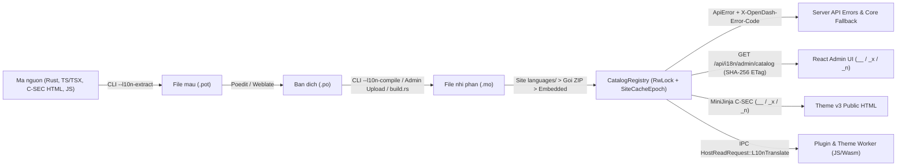

# Hệ thống Bản địa hóa Chuẩn Gettext (`.pot` / `.po` / `.mo`) Toàn diện (Core, Admin UI, Theme v3 & Plugin)

**Date:** 2026-11-27
**Author:** Elephant / Nova
**Status:** Approved
**Approved By:** Owner
**Approval Evidence:** Owner confirmed approval directly on 2026-11-27 (including Clean-Slate V1 update to `PRODUCT_REQUIREMENTS.md#L37`)
**Goldfish Review:** `/egm-review-loop` (`egm-design`, `egm-codebase-details`, `egm-implementation-readiness`) · 2026-11-27 · baseline `c956496` · 2 rounds (`0 Blocker / 0 Major / 0 Minor`)
**Baseline SHA:** c956496
**Target:** OpenDash V1 (1.0.0) — Clean-Slate V1

---

## Overview

Đặc tả này thiết kế và chuẩn hóa toàn bộ cơ chế bản địa hóa (i18n/l10n) cho mã nguồn, giao diện quản trị, giao diện công khai (Theme v3) và phần mở rộng (Plugin & Theme JS/Wasm) của OpenDash CMS sang định dạng **GNU gettext (`.pot` / `.po` / `.mo`)** kiểu WordPress. Hệ thống mới giữ nguyên bất biến **một file thực thi duy nhất** của OpenDash bằng bộ đọc/biên dịch `.po`/`.mo` viết thuần Rust (không phụ thuộc `libintl` hay `msgfmt` ngoài), lưu gói ngôn ngữ runtime tại `<site_root>/languages/` tách biệt với mã nguồn và bảo toàn qua Backup/Restore.

---

## The Problem

Hiện trạng ở baseline `c956496` đang phân mảnh thành 4 cơ chế đóng cứng khác nhau, làm tăng mạnh chi phí bảo trì và chặn khả năng mở rộng ngôn ngữ ngoài cặp `en`/`vi`:

1. **Admin UI đóng cứng trong Vite bundle (`cms/admin/src/i18n/`):**
   - `locales/en.ts` và `locales/vi.ts` chứa ~2.290+ semantic keys biên dịch tĩnh vào bundle React nhúng trong binary (`rust-embed`).
   - Mặc dù `opendash_core::i18n::CMS_LANGUAGE_CATALOG` ([cms/crates/opendash-core/src/i18n.rs](../../cms/crates/opendash-core/src/i18n.rs)) liệt kê sẵn 32 ngôn ngữ WordPress-style, mọi ngôn ngữ ngoài `en`/`vi` đều có `installed: false` và `translation_coverage: 0` vì không có cơ chế nạp gói dịch tại runtime.
2. **Bảng lỗi API Server phình to (`cms/crates/opendash-server/src/i18n.rs`) & `AppState.ui_locale` giới hạn:**
   - File `i18n.rs` hiện dài **12.489 dòng** chỉ để map tĩnh cặp `(code, vi, en)` trong Rust (`EXACT_ERROR_ENTRIES` và `TEMPLATE_MATCHERS`) và gắn header `X-OpenDash-Error-Code` qua `localize_error_response` (`app.rs`).
   - `AppState.ui_locale` đang dùng `Arc<AtomicU8>` (`0=unset, 1=en, 2=vi`), không thể biểu diễn 32+ ngôn ngữ runtime.
3. **Core Public Fallback đóng cứng (`cms/crates/opendash-server/src/content_render/l10n.rs`):**
   - 24 chuỗi thông báo public (`CORE_L10N_VI`, `CORE_L10N_EN`) và `DEFAULT_BREADCRUMB_HOME_LABEL = "Trang chủ"` được đóng cứng bằng struct `Copy` với `&'static str`.
4. **Theme v3 & Plugin thiếu chuẩn gettext:**
   - Theme v3 dùng `locales/*.json` dạng key-value phẳng (`{{ t.* }}`, `cms/crates/opendash-server/src/theme/{types,package,resolver}.rs`), không hỗ trợ `Plural-Forms` (số nhiều phức tạp như tiếng Nga, Ả Rập, Ba Lan) và không hỗ trợ `msgctxt` phân biệt ngữ cảnh.
   - Plugin (`plugin.wasm` / `plugin.js`) và Theme `functions.js` chưa có cơ chế `text_domain` và hàm dịch chuẩn.

---

## Goals

- **Thống nhất 1 chuẩn Gettext (`.pot` / `.po` / `.mo`) trên cả 4 lớp:** Core Server (lỗi API + fallback public), React Admin UI, Theme v3 (C-SEC templates + `functions.js`), và Plugin (`plugin.js` / `plugin.wasm`).
- **Chuẩn `msgid` tiếng Anh tự nhiên kiểu WordPress:** Dùng chuỗi tiếng Anh trực tiếp làm `msgid` qua `__("...")`, `_x("...", "context")`, `_n("singular", "plural", count)` và `t!`/`tx!`/`tn!` phía Rust, kèm `text_domain` cho Theme/Plugin.
- **Thuần Rust, 0 phụ thuộc C ngoài:** Tự cài đặt parser `.mo`, parser/compiler `.po` → `.mo` và bộ đánh giá `Plural-Forms` an toàn trong `opendash-core::l10n` (không cần cài `gettext`/`msgfmt` trên máy chủ hay máy dev).
- **Quản lý gói ngôn ngữ runtime & Backup/Restore:** Lưu tại `<site_root>/languages/{core,themes,plugins}/`, tự động tính `translation_coverage`, hỗ trợ upload `.po`/`.mo` qua Admin UI (server tự biên dịch `.po` → `.mo`, hot-reload `CatalogRegistry` và bump `SiteCacheEpoch`), và bảo toàn qua Snapshot Backup/Restore.
- **Clean-Slate V1 cho Theme v3:** Xóa bỏ hoàn toàn `locales/*.json` của Theme v3 (kèm cập nhật [PRODUCT_REQUIREMENTS.md](../product/PRODUCT_REQUIREMENTS.md) trình Owner duyệt theo ADR-0010); mọi theme dùng `languages/<textdomain>-<locale>.mo` và C-SEC `{{ __(...) }}` / `{{ _x(...) }}` / `{{ _n(...) }}`.
- **Bảo toàn 100% bản dịch tiếng Việt đã kiểm chứng:** Tự động migrate ~2.300 key Admin UI và bảng lỗi `i18n.rs` sang `cms/l10n/opendash.pot` + `cms/l10n/vi.po` (biên dịch tại `build.rs`, không commit binary `.mo` vào Git) kèm `msgctxt` tự động cho các chuỗi tiếng Anh trùng nhau nhưng khác nghĩa tiếng Việt.

## Non-Goals

- **Không thay đổi kiến trúc Content i18n (`0047_multilingual_content_and_theme_l10n.sql`):** Cơ chế Entity-per-Locale, `translation_group_id`, bảng `site_locales`, định tuyến tiền tố URL, `hreflang` và `sitemap.xml` giữ nguyên hoàn toàn.
- **Không xây dựng trình dịch từng dòng trên web (như Loco Translate UI):** Admin UI chỉ quản lý danh sách gói ngôn ngữ, xem `%` độ phủ, upload `.po`/`.mo` và xóa bản override; việc dịch chi tiết dùng Poedit / Weblate / Crowdin / editor ngoài.
- **Không hỗ trợ ngược `locales/*.json` của Theme v3:** Theo chủ trương Clean-Slate V1, `--check-theme` và validator gói Theme v3 sẽ từ chối `locales/*.json`.
- **Không kết nối kho dịch online bên ngoài (WordPress.org Translations API):** Mọi gói ngôn ngữ được nạp cục bộ từ gói cài đặt hoặc upload trực tiếp từ Admin.

---

## Critical User Journeys (CUJs)

### CUJ-1: Cài đặt hoặc cập nhật gói ngôn ngữ Core qua Admin UI
- **Given:** Quản trị viên đăng nhập Admin tại `#/settings/multilingual` (mục Language Packs), hệ thống hiện có sẵn `en` (nguồn) và `vi` (biên dịch nhúng sẵn).
- **When:** Quản trị viên chọn ngôn ngữ mục tiêu (ví dụ `fr` hoặc `vi` tùy chỉnh), tải lên file `opendash-fr.po` hoặc `opendash-fr.mo` (≤ 2 MiB) và nhấn **Tải lên**.
- **Then:** Server xác thực kích thước/định dạng, nếu là `.po` thì biên dịch sang `.mo`, ghi nguyên tử (qua `AdmittedMutation`) vào `<site_root>/languages/core/opendash-fr.mo`, reload `CatalogRegistry` + `SiteCacheEpoch::global().bump()` ngay lập tức, tính lại `translation_coverage`, và Admin UI chuyển ngay sang ngôn ngữ mới khi chọn `cms_locale = fr` (các chuỗi chưa dịch tự động fallback về `msgid` tiếng Anh).

### CUJ-2: Ghi đè bản dịch Theme/Plugin tại `<site_root>/languages/` và bảo toàn khi nâng cấp
- **Given:** Site đang dùng Theme `opendash-starter` (có sẵn `languages/opendash-starter-vi.mo` trong gói) và Plugin `seo-toolkit`.
- **When:** Quản trị viên upload file override vào `<site_root>/languages/themes/opendash-starter-vi.mo` (hoặc khôi phục từ bản sao lưu `age` Backup), sau đó cập nhật Theme lên phiên bản mới hoặc Restore site sang thư mục mới.
- **Then:** Chuỗi dịch tại `<site_root>/languages/{themes,plugins}/<domain>-<locale>.mo` luôn được ưu tiên cao hơn file đi kèm trong gói Theme/Plugin, không bị ghi đè khi nâng cấp Theme/Plugin và được giữ nguyên vẹn sau Backup/Restore.

### CUJ-3: Tác giả Theme v3 dùng Gettext trong C-SEC Template & kiểm tra bằng `--check-theme`
- **Given:** Tác giả phát triển Theme v3 khai báo `"text_domain": "my-theme"` (tùy chọn, mặc định lấy `theme_id`) trong `theme.json`, đặt file dịch trong `languages/my-theme-vi.mo`, và dùng `{{ __("Read more", "my-theme") }}`, `{{ _x("Post", "noun", "my-theme") }}`, `{{ _n("{n} comment", "{n} comments", count, "my-theme") }}` trong `.html`.
- **When:** Chạy `opendash --check-theme <dir>` hoặc upload gói Theme ZIP lên Admin.
- **Then:** Validator C-SEC chấp nhận `__`, `_x`, `_n` với `msgid`/`context`/`domain` là string literal tĩnh ở ngữ cảnh HTML text/attribute an toàn (tự động HTML-escape output qua MiniJinja, cấm trong `<script>`/`<style>`/`on*`/URL attributes), kiểm tra tối đa 32 file trong `languages/*.{pot,po,mo}` (≤ 1 MiB/file), và từ chối nếu gói còn chứa thư mục `locales/*.json` cũ.

### CUJ-4: Plugin / Theme JS & Wasm gọi `od.i18n` theo `cms_locale` / `public_locale`
- **Given:** Plugin viết bằng JS (`plugin.js`), Rust (`opendash-plugin-sdk`) hoặc AssemblyScript (`opendash.ts`) đóng gói kèm `languages/<textdomain>-vi.mo`.
- **When:** Handler chạy trong `--plugin-worker` gọi `od.i18n.__("Saved successfully", "my-plugin")` (hoặc Host Op `l10n_translate` / `l10n_translate_batch`).
- **Then:** Worker gửi `HostReadRequest::L10nTranslate` qua binary IPC tới host để tra cứu từ `CatalogRegistry` theo locale ngữ cảnh (`envelope.locale` hoặc `default_locale` của request) với thứ tự ưu tiên `site languages/plugins/` → `package languages/` → `msgid` gốc, không cần quyền egress hay filesystem trực tiếp.

### CUJ-5: Developer trích xuất `.pot` và biên dịch `.po` → `.mo` bằng CLI tích hợp
- **Given:** Developer sửa/thêm chuỗi `__(...)` hoặc `t!(...)` trong mã nguồn CMS, Theme hoặc Plugin trên Windows/macOS/Linux không cài GNU gettext.
- **When:** Chạy `opendash --l10n-extract <source_dir> --out <domain>.pot` và `opendash --l10n-compile <domain>-vi.po --out <domain>-vi.mo`.
- **Then:** CLI dùng bộ quét từ vựng (lexical scanner) 0 dependency ngoài trên `.rs`, `.ts`, `.tsx`, `.html`, `.js` để xuất file `.pot` chuẩn UTF-8 (có `#: file:line`, `msgctxt`, `msgid`, `msgid_plural`) và biên dịch `.po` → `.mo` chuẩn nhị phân, báo lỗi rõ nếu sai `Plural-Forms`, trùng entry hoặc lệch placeholder (`{name}`, `{{name}}`, `%s`, `%d`).

---

## Technical Plan (Architecture)



### 1. Lõi Gettext thuần Rust (`cms/crates/opendash-core/src/l10n/`)
Tuân thủ ranh giới `opendash-core` (không I/O, không HTTP, không SQL) và giới hạn **≤ 600 LOC/file** theo `Feature-First`:

- **`mo.rs` (Binary `.mo` Reader):**
  - Giới hạn cứng chống OOM/DoS (kể cả overlapping-slice amplification): `MAX_MO_BYTES = 4 * 1024 * 1024` (4 MiB), `MAX_CATALOG_ENTRIES = 16_384`, `MAX_ENTRY_BYTES = 64 * 1024` (64 KiB/chuỗi), `MAX_MATERIALIZED_BYTES = 8 * 1024 * 1024` (8 MiB tổng bộ nhớ string sau giải mã).
  - Kiểm tra magic number GNU `.mo`: `0x950412de` (Little-Endian) hoặc `0xde120495` (Big-Endian), revision `0` (major `0`, minor `0` hoặc `1` — **bắt buộc từ chối nếu `n_sysdep_strings != 0`** ở minor `1`).
  - Validate toàn bộ bảng offset/length bằng `checked_add` và giới hạn kích thước trước khi cấp phát.
  - Tách `msgctxt` bằng `\x04` (`msgctxt\x04msgid`), tách số nhiều bằng `\x00` (`msgid\x00msgid_plural` → `msgstr[0]\x00msgstr[1]...`).
  - Đọc entry rỗng `""` làm header MIME để trích xuất `Plural-Forms` và kiểm tra `Content-Type` phải là `UTF-8` (hoặc không ghi charset khác UTF-8).
- **`po.rs` (`.po` Parser & `.mo` Compiler):**
  - Hỗ trợ UTF-8 BOM (`\u{FEFF}`), CRLF/LF, chuỗi nhiều dòng (`"..."\n"..."`), escape sequences (`\n`, `\t`, `\"`, `\\`, `\r`), `msgctxt`, `msgid`, `msgid_plural`, `msgstr`, `msgstr[0..N]`.
  - Từ chối entry `(msgctxt, msgid)` trùng lặp, từ chối `msgstr[k]` có `k >= nplurals` (với `nplurals` ∈ `1..=6`), bỏ qua entry `#, fuzzy` chưa duyệt hoặc `msgstr` rỗng khi biên dịch sang `.mo`.
  - `compile_po_to_mo(po_text: &str) -> Result<Vec<u8>, L10nError>` sinh file `.mo` Little-Endian rev `0.0` với `hash_table_size = 0`, `hash_table_offset = 0` và bảng chuỗi sắp xếp theo thứ tự từ điển byte gốc.
- **`plural.rs` (Safe `Plural-Forms` Evaluator):**
  - Recursive-descent parser thuần Rust cho `Plural-Forms: nplurals=K; plural=<expr>;` với giới hạn: AST depth ≤ 16, tokens ≤ 128, `nplurals` ∈ `1..=6`.
  - Hỗ trợ đầy đủ toán tử C chuẩn: `? :`, `||`, `&&`, `==`, `!=`, `<`, `<=`, `>`, `>=`, `+`, `-`, `%`, `!`, ngoặc đơn, biến `n` và hằng số nguyên không âm.
  - Dùng `u64` `checked_rem` / `wrapping_sub` / `wrapping_add`: **từ chối phép chia/modulo cho 0 hằng số khi compile `.po`** (khi chạy nếu chia 0 động thì fallback an toàn về `0`), đổi `count: i64` sang `count.unsigned_abs()`, và clamp index trả về trong `0..msgstr_plural.len()`. Nếu thiếu header, fallback `nplurals=2; plural=(n != 1);`.
- **`catalog.rs` (`Catalog`, `PotDocument` & `PlaceholderValidator`):**
  - Lưu trữ `Catalog` (kèm `sha256_etag: String`), phương thức `get`, `get_context`, `get_plural(singular, plural, count: i64)`, `get_plural_context`.
  - `validate_placeholders`: kiểm tra tương thích biến nội suy `{name}`, `{{name}}`, `%s`, `%d` giữa `msgid` và `msgstr[k]`.
  - `coverage_against_pot(pot: &PotDocument) -> u8`: tính `%` số chuỗi đã dịch hợp lệ (`0..=100`).

### 2. Thư mục `languages/`, `CatalogRegistry` & Backup/Restore (`opendash-server`)
- **Đường dẫn runtime (`cms/crates/opendash-server/src/paths.rs`):**
  - Quy ước **1 cấu trúc phẳng chuẩn duy nhất**:
    ```text
    <site_root>/languages/
    ├── core/      # opendash-<canonical_locale>.mo (+ .po tùy chọn)
    ├── themes/    # <textdomain>-<canonical_locale>.mo (+ .po tùy chọn)
    └── plugins/   # <textdomain>-<canonical_locale>.mo (+ .po tùy chọn)
    ```
  - Chuẩn hóa `<canonical_locale>`: chuyển `_` → `-`, viết thường toàn bộ, validate theo `^[a-z]{2,3}(-[a-z0-9]{2,8})*$`.
  - `domain` phải hợp lệ theo `opendash_core::id::valid_kebab_segment_with_limit(domain, 32)`. Giá trị `"opendash"` được **dành riêng cho Core** (từ chối trong `ThemeV3Manifest` và `PluginManifest`).
  - Giới hạn tối đa **128 file** trong `<site_root>/languages/`, kiểm tra `ensure_no_reparse_or_symlink` trên mọi thư mục cha, bỏ qua các file tạm `.tmp-*` khi quét thư mục.
- **Thứ tự ưu tiên phân giải (Precedence):**
  1. **Site override:** `<site_root>/languages/{core,themes,plugins}/<domain>-<locale>.mo` (không mất khi nâng cấp gói).
  2. **Dev Live-Edit overlay** (khi bật `--dev-theme` / `--dev-plugin`): `languages/` từ thư mục dev (tự biên dịch `.po` trong RAM nếu chưa có `.mo`).
  3. **Package bundled / Embedded Core:** Core nhúng sẵn `vi.mo` biên dịch tại `cms/crates/opendash-server/build.rs` từ `cms/l10n/vi.po` (không commit binary `.mo` vào Git); Theme/Plugin đọc `languages/<textdomain>-<locale>.mo` trong revision active.
  4. **Fallback locale cha** (ví dụ `vi-vn` → `vi`) → nguyên bản `msgid` (`en`).
- **`CatalogRegistry` & Concurrency (`cms/crates/opendash-server/src/l10n/registry.rs`):**
  - Đồng bộ hóa bằng `RwLock<Arc<CatalogSnapshot>>` + `reload_lock: Mutex<()>` (tránh race condition khi 2 thao tác upload/enable chạy đồng thời).
  - Pre-serialize `Arc<Bytes>` + SHA-256 `ETag` (hoặc `"en-builtin"`) cho từng Admin locale đang cài để `GET /api/i18n/admin/catalog` không phải serialize lại mỗi request và không reset ETag khi restart server.
  - **Bắt buộc gọi `SiteCacheEpoch::global().bump()`** ở mọi điểm làm mới `CatalogRegistry`: upload/delete pack, kích hoạt theme, bật/tắt plugin, `activate_recovery` sau restore, và thay đổi fingerprint `--dev-theme`/`--dev-plugin` (`dev_mode`).
- **Database (`+0` migrations) & Backup/Restore:**
  - Không thêm bảng SQLite mới.
  - Thêm `BackupFileKind::LanguagePack` vào `cms/crates/opendash-core/src/backup.rs` kèm `validate_logical_key` (chỉ nhận `languages/{core,themes,plugins}/...` đuôi `.po`/`.mo`, không traversal).
  - Cập nhật `backup_archive.rs`, `backup_worker/`, `restore.rs`: tương thích ngược khi restore bản backup cũ chưa có `languages/`, chạy preflight kiểm tra kích thước/symlink/format `.po`/`.mo` khi restore, và gọi `CatalogRegistry::reload` + `SiteCacheEpoch::global().bump()` trong `activate_recovery`. Cập nhật `docs/contracts/M8_WRITER_INVENTORY.md`.

### 3. API & Wire Contracts
1. **Pre-auth Admin i18n Bootstrap & Catalog (`routes/settings.rs` & `storage/settings/general.rs`):**
   - `GET /api/i18n/admin` giữ nguyên tên trường hiện hành của `AdminI18nBootstrap`: `configured_locale`, `effective_locale`, `effective_bcp47`, `effective_direction`, `configured_installed`, `catalog_version`, `available_locales: Vec<CmsLocaleOption>` (tính động `installed` và `translation_coverage` trong `get_admin_i18n_bootstrap`), bổ sung `catalog_etag: String` và `catalog_url: String` (`/api/i18n/admin/catalog?locale=<effective_locale>`).
   - `GET /api/i18n/admin/catalog?locale=<code>`: endpoint pre-auth mới, validate `locale` thuộc allowlist `CMS_LANGUAGE_CATALOG` (tránh unauthenticated DoS). Trả về pre-serialized `Arc<Bytes>` với header `ETag` (`If-None-Match` → `304 Not Modified`) và `Cache-Control: public, max-age=0, must-revalidate`. JSON schema:
     ```json
     {
       "locale": "vi",
       "etag": "\"sha256-...\"",
       "nplurals": 1,
       "plural_forms": "nplurals=1; plural=0;",
       "entries": { "Save": "Lưu" },
       "context_entries": { "nav": { "Posts": "Bài viết" } },
       "plural_entries": { "{{n}} item\u0000{{n}} items": ["{{n}} mục"] },
       "context_plural_entries": {}
     }
     ```
2. **Admin Language Pack Management (`routes/l10n.rs`, Admin + CSRF + `AdmittedMutation`):**
   - `GET /api/admin/l10n/packs`: liệt kê toàn bộ text domain (`core:opendash`, active theme, installed plugins) kèm các locale hiện có (`embedded` / `bundled` / `site_override`), kích thước và `translation_coverage`.
   - `POST /api/admin/l10n/packs/upload`: chốt **1 định dạng duy nhất JSON** `{ scope: "core" | "theme" | "plugin", domain: string, locale: string, filename: string, content_base64: string }` (giới hạn route `DefaultBodyLimit::max(3 * 1024 * 1024)` cho payload giải mã ≤ 2 MiB). Nếu file là `.po`, biên dịch sang `.mo` và ghi cả `.po` + `.mo`; nếu upload `.mo`, kiểm tra hợp lệ và xóa file `.po` cũ cùng `(scope, domain, locale)` nếu tồn tại để tránh lệch nguồn. Ghi nguyên tử qua `.tmp-<uuid>` + `fsync` + `rename`, reload `CatalogRegistry`, bump `SiteCacheEpoch`.
   - `DELETE /api/admin/l10n/packs/{scope}/{domain}/{locale}`: xóa cả `.mo` và `.po` override tại `<site_root>/languages/...`, reload `CatalogRegistry`, bump `SiteCacheEpoch`.

### 4. Tích hợp 4 Lớp & Codemod Di chuyển

#### Lớp 1: Server API Errors, `X-OpenDash-Error-Code` & Core Public Fallback
- **Thay thế `AppState.ui_locale: Arc<AtomicU8>`:** Đổi sang `Arc<std::sync::RwLock<Option<String>>>` đọc non-blocking qua `try_read()` và cập nhật nguyên tử tại `routes/settings.rs::general_put` (giữ nguyên bất biến `unset_locale_does_not_wait_for_exhausted_pool`).
- **Bảo toàn `X-OpenDash-Error-Code` và `localize_json_error` (`error.rs` + `i18n.rs`):**
  - `ApiError` (`error.rs`) giữ wire format HTTP `text/plain; charset=utf-8` (hoặc JSON khi middleware `localize_json_error` xử lý veto/plugin payload).
  - Mở rộng `ApiError` mang thêm metadata tùy chọn: `code: Option<&'static str>`, `msgid: Cow<'static, str>`, `params: Vec<(&'static str, String)>` (cùng constructor/macro `ApiError::l10n(status, code, msgid)` / `t!`/`tx!`/`tn!`).
  - Đối với các chuỗi lỗi chưa chuẩn hóa hoặc thông báo cũ, giữ bảng ánh xạ English-only gọn nhẹ ở `l10n/error_catalog.rs` (mapping template tiếng Anh → `code`) để `localize_error_response` tra cứu bản dịch từ `CatalogRegistry` theo `effective_ui_locale`, nội suy `{param}` và luôn gắn đúng header `X-OpenDash-Error-Code` (cũng như dịch `message` / `field_errors` trong `localize_json_error`).
  - Xóa bỏ hoàn toàn 12.489 dòng map cứng ở `cms/crates/opendash-server/src/i18n.rs` và gỡ khỏi `cms/scripts/loc-baseline.json`.
- **Core Public Fallback (`content_render/l10n.rs`):**
  - Đổi 24 trường của `CoreL10n` từ `&'static str` (`Copy`) sang `Cow<'static, str>` (bỏ `Copy`), tạo từ `CatalogRegistry` theo `locale_code`.
  - Chuyển `DEFAULT_ARCHIVE`, `DEFAULT_SINGLE` và `DEFAULT_BREADCRUMB_HOME_LABEL` (`"Trang chủ"` → `"Home"`) sang tra cứu Core catalog `"opendash"`.

#### Lớp 2: React Admin UI (`cms/admin/src/i18n/`)
- Thay `t("key")` / `tCount("key", count)` bằng `__(msgid, params?)`, `_x(msgid, context, params?)`, `_n(singular, plural, count, params?)`, `_nx(singular, plural, count, context, params?)` (giữ quy ước placeholder **`{{name}}`** thống nhất với `check-i18n.mjs` và `index.tsx` hiện có).
- Tạo `cms/admin/src/i18n/plural.ts`: bộ parse & đánh giá `Plural-Forms` AST thuần TypeScript (giới hạn depth ≤ 16, tokens ≤ 128, **tuyệt đối không dùng `eval`/`new Function`** để tuân thủ CSP).
- Chống FOUC & đồng bộ `tStatic`: `I18nProvider` đọc `AdminI18nBootstrap`; nếu `effective_locale !== "en"` (hoặc có `catalog_etag` khác mặc định), kiểm tra `localStorage` theo khóa `od_i18n_<locale>_<etag>`, nếu miss thì `await fetch(catalog_url)` và nạp vào biến module `currentCatalog` **trước khi gọi `setReady(true)`**.
- **Codemod & Dọn dẹp (`cms/scripts/l10n-migrate.mjs`):**
  - Chuyển toàn bộ ~2.290+ key trong `cms/admin/src/` từ `t("...")` sang `__("...")` / `_x(...)` / `_n(...)` (tự gắn `msgctxt` khi 2 key khác nhau có cùng chuỗi tiếng Anh nhưng khác bản dịch tiếng Việt), sinh `cms/l10n/opendash.pot` và `cms/l10n/vi.po`.
  - Xóa `cms/admin/src/i18n/locales/{en,vi}.ts` và gỡ khỏi `cms/scripts/loc-baseline.json`.
  - Cập nhật `cms/admin/src/i18n/README.md` và `cms/scripts/check-i18n.mjs` (bỏ `--mode=s03`, kiểm tra parity giữa source calls ↔ `cms/l10n/opendash.pot` ↔ `vi.po` và cấm chuỗi tiếng Việt hardcoded trong `cms/admin/src/`).

#### Lớp 3: Theme v3 (Clean-Slate V1)
- `cms/crates/opendash-core/src/theme/declarations.rs`: thêm `#[serde(default)] pub text_domain: Option<String>` vào `ThemeV3Manifest` (mặc định là `manifest.theme_id`, cấm `"opendash"`).
- `cms/crates/opendash-server/src/theme/{package,types,resolver}.rs`, `storage/theme/`, `storage/overrides/public_render.rs`, `builtin_themes/mod.rs`, `dev_mode/types.rs`:
  - Sửa `v3_entry_cap_and_allowlist` & `DevThemeSnapshot`: chấp nhận `languages/*.{pot,po,mo}` (tối đa 32 file, ≤ 1 MiB/file), biên dịch `.po` in-memory ở Dev Mode khi chưa có `.mo`; **từ chối thẳng `locales/*.json`**.
  - Gỡ bỏ `ActiveThemeV3::merged_translations`, `shared_t`, và `include_bytes!("opendash-starter/locales/*.json")` trong `builtin_themes/mod.rs`.
  - Nâng cấp `opendash-starter` (kèm xử lý `ensure_default_starter_theme` trong `main.rs` để tự nâng cấp revision starter mặc định trên site sẵn có mà không lỗi boot), `sample-theme-v3`, `theme-js-starter` và fixtures từ `{{ t.* }}` sang `{{ __("...", "opendash-starter") }}` + `languages/<domain>-vi.po/.mo`.
  - Cập nhật `docs/product/PRODUCT_REQUIREMENTS.md#L37` (chuyển mô tả `locales/` sang `languages/`, trình Owner phê duyệt theo ADR-0010).
- `cms/crates/opendash-server/src/template_sec/` & `content_render/`:
  - Truyền `Option<RenderL10nContext>` (`Arc<CatalogRegistry>`, `locale`, `default_domain`) qua `RenderFormattingConfig`.
  - Đăng ký C-SEC functions: `__(msgid, domain?, params?)`, `_x(msgid, context, domain?, params?)`, `_n(singular, plural, count, domain?, params?)` (tự động nội suy `{n}`/`{count}` và `{key}` trong `params`).
  - Trong `template_sec/policy/{theme_stmt_walker,block_stmt_walker,theme_html_walker,theme_url_scopes}.rs`: bắt buộc `msgid`, `msgid_plural`, `context`, `domain` là **string literal tĩnh**; cấm gọi `__`/`_x`/`_n` bên trong `<script>`, `<style>`, `on*` và các thuộc tính URL (`href`, `src`, `action`, `formaction`).

#### Lớp 4: Plugin & Theme JS/Wasm SDK
- `cms/crates/opendash-core/src/plugin/{permissions,routes_actions}.rs`: thêm `#[serde(default)] pub text_domain: Option<String>` vào `PluginManifest` (tương thích `manifest_schema` `1..=3`, mặc định `manifest.id`, cấm `"opendash"`).
- `cms/crates/opendash-server/src/plugin/package.rs` & `docs/contracts/PLUGIN_ABI.md`:
  - Cho phép `languages/*.{pot,po,mo}` trong Plugin ZIP (tối đa 32 file, **≤ 256 KiB/file**, dùng chung ngân sách `MAX_UNCOMPRESSED_TOTAL_BYTES = 10 MiB`), nâng `MAX_PLUGIN_FILES` từ `72` lên `104`.
- **Host Op `l10n_translate` & `l10n_translate_batch` (`plugin/host_ops/{types,policy,mod}.rs`, `plugin/runtime/`, `plugin/worker.rs`):**
  - Thêm `HostReadRequest::L10nTranslate` và `L10nTranslateBatch` qua binary IPC (`WorkerToHostFrame::ReadRequest` / `HostToWorkerFrame::ReadResponse`) gọi `CatalogRegistry` ở host process.
  - Wire response: `{ "text": "..." }` (hoặc `{ "texts": ["..."] }`).
  - Cho phép trên **tất cả `HookExecutionMode`** (kể cả `FilterContactBeforeSubmit`), tách riêng pure-read budget `MAX_L10N_CALLS = 256` (không ăn vào `MAX_RENDER_HOST_CALLS = 64`; `L10nTranslateBatch` trừ `items.len()` vào `MAX_L10N_CALLS`), giới hạn `msgid <= 2 KiB`, từ chối `E_PERMISSION_DENIED` nếu plugin đọc `text_domain` của extension khác (chỉ được đọc `text_domain` của chính mình hoặc `"opendash"`).
  - Thêm `default_locale: Option<String>` vào `WorkerInvocationRequest` & `HostContext` (lấy từ `public_locale` cho render/public hooks và `cms_locale` cho admin/action hooks).
- **SDK:** Bổ sung `od.i18n.__(msgid, domain?)`, `od.i18n._x(...)`, `od.i18n._n(...)` vào `cms/sdk/js/opendash.d.ts`, `plugin/js_runtime/`, `cms/sdk/as/opendash.ts` và `cms/crates/opendash-plugin-sdk/` (kèm `MockHost`).

### 5. CLI Tích hợp (`--l10n-extract` & `--l10n-compile`)
- `opendash --l10n-extract <dir> --out <file.pot> [--domain <name>]`: dùng bộ quét từ vựng thuần Rust 0 dependency ngoài (hỗ trợ string literal chuẩn và chuỗi nhiều dòng), xuất `.pot` UTF-8 có `#: relative/path:line` và phát hiện xung đột `msgid_plural`.
- `opendash --l10n-compile <file.po> --out <file.mo> [--pot <file.pot>]`: parse `.po`, kiểm tra `Plural-Forms`, kiểm tra placeholder parity và biên dịch sang `.mo`.

---

## Alternatives Considered

1. **Giữ nguyên JSON (`locales/*.json` + `en.ts`/`vi.ts`):**
   - *Bác bỏ:* Thiếu chuẩn số nhiều đa ngôn ngữ (`Plural-Forms` cho 32+ ngôn ngữ), thiếu `msgctxt`, không tương thích Poedit/Weblate, và tiếp tục phình bundle/binary khi thêm ngôn ngữ.
2. **Dùng Mozilla Fluent (`.ftl`):**
   - *Bác bỏ:* Không khớp thói quen/hệ sinh thái `.pot/.po/.mo` của người dùng WordPress mà OpenDash hướng tới.
3. **Link thư viện C `libintl` / crate `gettext-sys`:**
   - *Bác bỏ:* Phá vỡ quy trình build đa nền tảng sạch (Windows MSVC + Linux musl static binary) và phụ thuộc locale OS.
4. **Giữ semantic key làm `msgid` (ví dụ `__("entry.save_failed")`):**
   - *Bác bỏ:* Khi chưa có file dịch hoặc chuỗi mới chưa kịp dịch, UI sẽ lộ raw key thay vì tiếng Anh tự nhiên.

---

## Non-Functional Requirements

- **Bảo mật:**
  - Chặn path traversal và symlink (`ensure_no_reparse_or_symlink`) khi đọc/ghi `<site_root>/languages/`.
  - Giới hạn `MAX_MO_BYTES = 4 MiB`, `MAX_CATALOG_ENTRIES = 16_384`, `MAX_MATERIALIZED_BYTES = 8 MiB`, `MAX_PACK_UPLOAD_BYTES = 2 MiB`, `Plural-Forms` AST depth ≤ 16 (zero `eval` cả Rust lẫn TypeScript).
  - C-SEC `__`/`_x`/`_n` chỉ nhận string literal cho `msgid`/`context`/`domain`, cấm đặt trong `<script>`/`<style>`/`on*`/URL attributes và luôn auto-escape HTML.
  - Upload/xóa language pack bắt buộc `require_admin_with_csrf` + `AdmittedMutation` lease.
- **Hiệu năng:**
  - Toàn bộ catalog active nạp sẵn trong `Arc<CatalogSnapshot>`: `0` disk I/O trên hot path render HTML hay API error.
  - `GET /api/i18n/admin/catalog` phục vụ từ pre-serialized `Arc<Bytes>` với SHA-256 `ETag` (`304 Not Modified`).
- **Độ bền & Tổ chức mã nguồn:**
  - Ghi file upload nguyên tử (`.tmp-<uuid>` + `fsync` + `rename`).
  - Mọi file nguồn mới (`.rs`, `.ts`, `.tsx`) tuân thủ tuyệt đối ngưỡng **≤ 600 dòng (LOC)** và tổ chức `Feature-First`.

---

## Detailed Implementation Plan

### Target Files to Create/Modify

| File | Action | Purpose & Key Signatures |
| :--- | :--- | :--- |
| `cms/crates/opendash-core/src/{lib.rs,l10n/{mod,mo,po,plural,catalog}.rs}` | Create/Modify | Engine gettext thuần Rust (`parse_mo`, `compile_po_to_mo`, `PluralRule`, `Catalog`, `PotDocument`, `validate_placeholders`; mỗi file ≤ 600 LOC) |
| `cms/crates/opendash-core/src/{i18n.rs,backup.rs,theme/declarations.rs,plugin/{permissions,routes_actions}.rs}` | Modify | `CMS_LANGUAGE_CATALOG`, `BackupFileKind::LanguagePack`, `text_domain: Option<String>` (cấm `"opendash"`) |
| `cms/crates/opendash-server/build.rs` & `cms/l10n/{opendash.pot,vi.po}` | Create/Modify | Biên dịch `cms/l10n/vi.po` → `$OUT_DIR/vi.mo` lúc build (không commit binary `.mo`) |
| `cms/crates/opendash-server/src/{main.rs,paths.rs,l10n/{mod,registry,extract,error_catalog}.rs}` | Create/Modify | `SitePaths::languages_dir()`, `CatalogRegistry` (`RwLock<Arc>` + `SiteCacheEpoch::bump()`), CLI `--l10n-extract`/`--l10n-compile` |
| `cms/crates/opendash-server/src/{app.rs,error.rs,i18n.rs,content_render/l10n.rs}` | Modify | Thay `ui_locale: AtomicU8` bằng `RwLock<Option<String>>`, giữ `X-OpenDash-Error-Code`, xóa bảng 12.489 dòng, đổi `CoreL10n` sang `Cow<'static, str>` |
| `cms/crates/opendash-server/src/{backup_archive.rs,backup_worker/**,restore.rs}` | Modify | Backup/Restore `<site_root>/languages/` + preflight & `CatalogRegistry` reload |
| `cms/crates/opendash-server/src/routes/{mod.rs,settings.rs,l10n.rs}` & `storage/settings/general.rs` | Create/Modify | `AdminI18nBootstrap` + `catalog_etag`/`catalog_url`, `GET /api/i18n/admin/catalog`, `/api/admin/l10n/packs*` |
| `cms/crates/opendash-server/src/{theme/**,dev_mode/**,template_sec/**,storage/{theme/**,overrides/public_render.rs},builtin_themes/{mod.rs,opendash-starter/**}}` | Modify | Clean-Slate Theme v3 (`languages/*.{pot,po,mo}`, cấm `locales/*.json`), C-SEC `__`/`_x`/`_n` + XSS guard, `RenderL10nContext` |
| `cms/crates/opendash-server/src/plugin/{package.rs,host_ops/**,runtime/**,worker.rs,js_runtime/**}` | Modify | Plugin `languages/*` (`MAX_PLUGIN_FILES = 104`), `HostReadRequest::L10nTranslate`, `default_locale`, `od.i18n.*` |
| `cms/admin/src/i18n/{index.tsx,plural.ts,format.ts,README.md}`, `cms/admin/src/features/settings/LanguagePacksPanel.tsx`, `cms/admin/src/api/locales.ts` | Create/Modify | `__`/`_x`/`_n`, CSP-safe `plural.ts`, FOUC-free catalog loader, xóa `locales/{en,vi}.ts`, UI upload/quản lý pack |
| `cms/sdk/{js/opendash.d.ts,as/opendash.ts}`, `cms/crates/opendash-plugin-sdk/`, `cms/examples/**` | Modify | `od.i18n.*`, `l10n_translate` binding + `MockHost`, cập nhật example themes/plugins |
| `cms/scripts/{l10n-migrate.mjs,check-i18n.mjs,loc-baseline.json}` | Create/Modify | Codemod 1 lần, kiểm tra `.pot`/`.po` parity, gỡ `i18n.rs` & `locales/{en,vi}.ts` khỏi `loc-baseline.json` |
| `docs/product/PRODUCT_REQUIREMENTS.md`, `docs/contracts/{CORE_FOUNDATION.md,PLUGIN_ABI.md,M8_WRITER_INVENTORY.md}` | Modify | Cập nhật Theme v3 `languages/` (Owner duyệt), hợp đồng i18n, Host Op `l10n_translate` & writer inventory |

---

### Slice S01: Lõi Gettext thuần Rust, `SitePaths::languages_dir`, `CatalogRegistry` & Backup/Restore

**Dependencies:** None (nền tảng từ `main@c956496`).
**File Ownership:** `cms/crates/opendash-core/src/lib.rs`, `cms/crates/opendash-core/src/l10n/**`, `cms/crates/opendash-core/src/backup.rs`, `cms/crates/opendash-server/src/paths.rs`, `cms/crates/opendash-server/src/l10n/{mod.rs,registry.rs}`, `cms/crates/opendash-server/src/backup_archive.rs`, `cms/crates/opendash-server/src/backup_worker/**`, `cms/crates/opendash-server/src/restore.rs`, `docs/contracts/M8_WRITER_INVENTORY.md`.
**Acceptance Criteria:**
- Bộ parser `.mo` (LE/BE, bounded `16_384` entries / `8 MiB` materialized, reject `n_sysdep_strings != 0`), parser/compiler `.po` → `.mo` (`hash_table_size = 0`) và `PluralRule` AST evaluator (depth ≤ 16, tokens ≤ 128, `% 0` rejected at compile) chạy thuần Rust trong `opendash-core::l10n`, mỗi file ≤ 600 LOC, pass unit tests cho `en`, `vi`, `fr`, `ru`, `ar` và test fuzz/OOM.
- `SitePaths::languages_dir()` (`<site_root>/languages/{core,themes,plugins}/<domain>-<locale>.mo`) và `CatalogRegistry` (`RwLock<Arc<CatalogSnapshot>>` + `reload_lock`, SHA-256 ETag, `SiteCacheEpoch::global().bump()`) hoạt động đúng thứ tự ưu tiên và chặn symlink/traversal.
- `BackupFileKind::LanguagePack` + `backup_archive.rs` + `restore.rs` bảo toàn `<site_root>/languages/`, tương thích backup cũ và reload `CatalogRegistry` khi `activate_recovery`.
**Rollback:** Xóa module `l10n` mới và revert thay đổi ở `lib.rs`, `backup.rs`, `paths.rs`, `backup_archive.rs`, `backup_worker/`, `restore.rs`; không có migration DB nào cần hoàn tác.

---

### Slice S02: CLI Trích xuất/Biên dịch (`.pot`/`.po` → `.mo`) & Cắt chuyển Server Errors / Core Fallback

**Dependencies:** S01.
**File Ownership:** `cms/crates/opendash-server/build.rs`, `cms/crates/opendash-server/src/l10n/{extract.rs,error_catalog.rs}`, `cms/crates/opendash-server/src/main.rs`, `cms/crates/opendash-server/src/app.rs` (`ui_locale` + middleware wiring), `cms/crates/opendash-server/src/error.rs`, `cms/crates/opendash-server/src/i18n.rs`, `cms/crates/opendash-server/src/content_render/l10n.rs`, `cms/crates/opendash-server/src/routes/**` (error strings), `cms/crates/opendash-server/src/storage/**` (error strings), `cms/l10n/**`, `cms/scripts/l10n-migrate.mjs`, `cms/scripts/loc-baseline.json` (gỡ `i18n.rs`).
**Acceptance Criteria:**
- `build.rs` biên dịch `cms/l10n/vi.po` → `$OUT_DIR/vi.mo` không commit binary `.mo` vào Git; `opendash --l10n-extract` (lexical scanner 0-dep) và `--l10n-compile` chạy ổn định.
- `AppState.ui_locale` chuyển sang `Arc<RwLock<Option<String>>>` non-blocking (`try_read`), toàn bộ bảng map tĩnh 12.489 dòng ở `i18n.rs` bị xóa (gỡ khỏi `loc-baseline.json`), `ApiError` + `error_catalog.rs` bảo toàn trọn vẹn header `X-OpenDash-Error-Code` và `localize_json_error`.
- `CoreL10n` (`content_render/l10n.rs`) đổi sang `Cow<'static, str>`, chuyển `DEFAULT_ARCHIVE`/`DEFAULT_SINGLE`/`DEFAULT_BREADCRUMB_HOME_LABEL` sang Core catalog và pass 100% integration tests.
**Rollback:** Khôi phục `i18n.rs`, `error.rs`, `content_render/l10n.rs`, `app.rs` và `loc-baseline.json` từ commit trước S02.

---

### Slice S03: Cắt chuyển React Admin UI sang `__`/`_x`/`_n`, Runtime Catalog & Codemod

**Dependencies:** S02.
**File Ownership:** `cms/admin/src/i18n/**`, `cms/admin/src/**` (codemod thay `t(...)` → `__`/`_x`/`_n`), `cms/crates/opendash-core/src/i18n.rs`, `cms/crates/opendash-server/src/routes/settings.rs`, `cms/crates/opendash-server/src/storage/settings/general.rs`, `cms/scripts/check-i18n.mjs`, `cms/scripts/loc-baseline.json` (gỡ `locales/en.ts`, `locales/vi.ts`).
**Acceptance Criteria:**
- Codemod chuyển toàn bộ ~2.290+ key sang English `msgid` + `msgctxt` (giữ nguyên `{{param}}`), cập nhật `cms/l10n/opendash.pot` & `cms/l10n/vi.po`, xóa `locales/{en,vi}.ts` và gỡ khỏi `loc-baseline.json`.
- `GET /api/i18n/admin` giữ nguyên tên trường `AdminI18nBootstrap` (`effective_locale`, `effective_bcp47`, `effective_direction`, `available_locales: Vec<CmsLocaleOption>`) kèm `catalog_etag`/`catalog_url`; `GET /api/i18n/admin/catalog` trả pre-serialized `Arc<Bytes>` + SHA-256 `ETag` (`304`).
- `cms/admin/src/i18n/plural.ts` đánh giá `Plural-Forms` không dùng `eval`; `I18nProvider` hydrate `currentCatalog` trước `setReady(true)` (0 FOUC); `check-i18n.mjs`, `typecheck` và `build` pass.
**Rollback:** Khôi phục `cms/admin/src/i18n/locales/{en,vi}.ts`, `t()` calls và `loc-baseline.json` từ git trước S03.

---

### Slice S04: Cắt chuyển Theme v3 (Clean-Slate bỏ `locales/*.json`, C-SEC) & Plugin/Theme JS/Wasm SDK

**Dependencies:** S01, S02.
**File Ownership:** `cms/crates/opendash-core/src/theme/declarations.rs`, `cms/crates/opendash-core/src/plugin/{permissions,routes_actions}.rs`, `cms/crates/opendash-server/src/theme/**`, `cms/crates/opendash-server/src/dev_mode/**`, `cms/crates/opendash-server/src/template_sec/**`, `cms/crates/opendash-server/src/storage/{theme/**,overrides/public_render.rs}`, `cms/crates/opendash-server/src/plugin/**`, `cms/crates/opendash-server/src/builtin_themes/{mod.rs,opendash-starter/**}`, `cms/examples/**`, `cms/sdk/**`, `cms/crates/opendash-plugin-sdk/**`, `docs/product/PRODUCT_REQUIREMENTS.md`, `docs/contracts/{CORE_FOUNDATION.md,PLUGIN_ABI.md}`.
**Acceptance Criteria:**
- Theme v3 & Dev Mode chấp nhận `languages/*.{pot,po,mo}` (≤ 32 file, ≤ 1 MiB/file), từ chối `locales/*.json` và `text_domain == "opendash"`; xóa `shared_t` / `merged_translations` và nâng cấp `opendash-starter` (`{{ t.* }}` → `{{ __(...) }}`) cùng `ensure_default_starter_theme` khi boot.
- C-SEC MiniJinja (`template_sec/policy/**`) bắt buộc literal `msgid`/`context`/`domain`, cấm `__`/`_x`/`_n` trong `<script>`/`<style>`/`on*`/URL attributes và auto-escape HTML.
- Plugin ZIP nâng `MAX_PLUGIN_FILES = 104` (`languages/*` ≤ 256 KiB/file trong `10 MiB` budget); `HostReadRequest::L10nTranslate` / `L10nTranslateBatch` (`MAX_L10N_CALLS = 256`, mọi `HookExecutionMode`, `default_locale` trên `WorkerInvocationRequest`) và `od.i18n.*` hoạt động trên JS, Rust SDK (`MockHost`) & AssemblyScript SDK.
**Rollback:** Khôi phục `locales/*.json`, `builtin_themes/mod.rs`, `shared_t`, `PRODUCT_REQUIREMENTS.md` và bỏ Host Op `l10n_translate` về trước S04.

---

### Slice S05: Admin UI Quản lý & Upload Language Packs (`.po`/`.mo`) và Kiểm chứng E2E

**Dependencies:** S01, S03, S04.
**File Ownership:** `cms/crates/opendash-server/src/routes/{mod.rs,l10n.rs}`, `cms/crates/opendash-server/src/app.rs` (gắn route `/api/admin/l10n/packs*`), `cms/admin/src/features/settings/LanguagePacksPanel.tsx` (tích hợp tại `#/settings/multilingual`), `cms/admin/src/api/locales.ts`, `cms/crates/opendash-server/tests/i18n/**`, `cms/scripts/admin_i18n_multilingual_e2e.py`.
**Acceptance Criteria:**
- Endpoint `GET /api/admin/l10n/packs`, `POST /api/admin/l10n/packs/upload` (JSON base64 ≤ 2 MiB decoded / `DefaultBodyLimit` 3 MiB, biên dịch `.po` → `.mo`, xóa `.po` cũ khi upload `.mo`, atomic write + `CatalogRegistry::reload` + `SiteCacheEpoch::global().bump()`) và `DELETE /api/admin/l10n/packs/{scope}/{domain}/{locale}` hoạt động đầy đủ dưới Admin + CSRF + `AdmittedMutation`.
- Admin UI tại `#/settings/multilingual` hiển thị packs của Core / Theme / Plugin kèm `translation_coverage %` thực tế, cho phép upload `.po`/`.mo` ngôn ngữ thứ 3 và xóa bản override.
- Toàn bộ Tier-1/Tier-2 Rust tests, `check-standards.py`, `check-i18n.mjs` và Chrome E2E (`admin_i18n_multilingual_e2e.py`) pass.
**Rollback:** Gỡ `routes/l10n.rs` khỏi `routes/mod.rs` + `app.rs` và xóa `LanguagePacksPanel.tsx`.

---

### Verification Plan

Sau khi hoàn tất từng Slice và trước khi đóng Spec (`Status: Verified` + `/egm-drift-report`), chạy đầy đủ các kiểm tra chuẩn từ gốc repo:

```powershell
python cms/scripts/check-standards.py
python cms/scripts/check-standards.py --self-test
python cms/scripts/check-plans.py
python cms/scripts/check-plans.py --self-test
python .agents/scripts/check-agent-artifacts.py
node cms/scripts/check-i18n.mjs
npm --prefix cms/admin run typecheck
npm --prefix cms/admin run build
cargo fmt --manifest-path cms/Cargo.toml --all --check
# Kiểm tra round-trip CLI gettext:
cargo run --manifest-path cms/Cargo.toml --bin opendash -- --l10n-extract cms/crates --out target/test-opendash.pot
cargo run --manifest-path cms/Cargo.toml --bin opendash -- --l10n-compile cms/l10n/vi.po --out target/test-vi.mo --pot target/test-opendash.pot
python cms/scripts/run-tests.py --changed
# Trước khi đóng Spec / release (Tier 2 đầy đủ):
python cms/scripts/run-tests.py --group all --release
python cms/scripts/admin_i18n_multilingual_e2e.py
git diff --check
```
