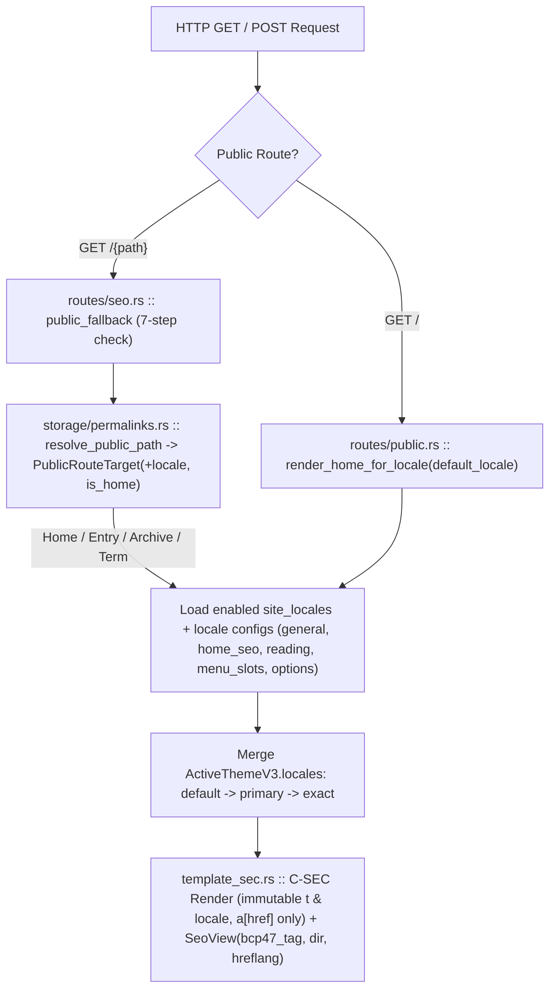

# Đa ngôn ngữ Nội dung (Content i18n) & Bản địa hóa Theme v3 (Theme L10n)

- **Author:** Elephant (Coordinator Draft)
- **Status:** Approved
- **Approved By:** Owner
- **Approval Evidence:** Owner chat 2026-11-24 ("duyệt spec" — Đa ngôn ngữ Nội dung Lớp 1 & Bản địa hóa Theme v3 Lớp 2 + cập nhật PRD)
- **Date:** 2026-11-24
- **Baseline:** `main@98e316ac4819f53911d0661f837cd5fda3085ed1`
- **Goldfish Review:** 7-persona independent swarm (`egm-design`, `egm-codebase-details`, `egm-implementation-readiness`, `egm-zoom-out`, `egm-comprehension`, `egm-structural`, `egm-style`) · 2026-11-24 · reviewed `main@98e316a` · `0 Blockers / 0 Majors` còn tồn đọng sau `/egm-resolve`
- **Related:** [`docs/product/PRODUCT_REQUIREMENTS.md`](../product/PRODUCT_REQUIREMENTS.md), [`docs/contracts/CORE_FOUNDATION.md`](../contracts/CORE_FOUNDATION.md), [`docs/contracts/PLUGIN_ABI.md`](../contracts/PLUGIN_ABI.md), [`docs/contracts/M8_WRITER_INVENTORY.md`](../contracts/M8_WRITER_INVENTORY.md), [`docs/contracts/M5_THEME_TEMPLATES.md`](../contracts/M5_THEME_TEMPLATES.md), [`docs/contracts/M7_SITE_FEATURES.md`](../contracts/M7_SITE_FEATURES.md), [`docs/contracts/ADMIN_NAVIGATION_AND_SINGLE_EDIT.md`](../contracts/ADMIN_NAVIGATION_AND_SINGLE_EDIT.md), [`docs/contracts/CONTENT_FOUNDATION_2026_11.md`](../contracts/CONTENT_FOUNDATION_2026_11.md), [`theme-format-and-template-resolver.md`](theme-format-and-template-resolver.md), [`cpt-content-builder-and-pattern-library.md`](cpt-content-builder-and-pattern-library.md), [`wordpress-style-permalinks.md`](wordpress-style-permalinks.md), [`opendash-studio-customizer-and-ux-builder.md`](opendash-studio-customizer-and-ux-builder.md), [`declarative-block-json-engine.md`](declarative-block-json-engine.md), [`starter-typed-url-and-conformance-delta.md`](starter-typed-url-and-conformance-delta.md)

---

## Overview

Đặc tả này thiết kế hạ tầng đa ngôn ngữ ở tầng **Core** của OpenDash CMS cho **Lớp 1 (Content i18n — nội dung, taxonomy, menu, cài đặt, định tuyến và SEO công khai)** và **Lớp 2 (Theme v3 L10n — từ điển chuỗi giao diện, bộ chuyển ngôn ngữ và chuỗi fallback hệ thống)**, đồng thời xác lập ranh giới dự phòng kiến trúc cho **Lớp 3 (Admin UI & API L10n — chưa triển khai trong đợt này)**.

1. **Vì sao đa ngôn ngữ thuộc Core thay vì Plugin Wasmi:** Theo [`PLUGIN_ABI.md`](../contracts/PLUGIN_ABI.md), plugin chạy trong sandbox WebAssembly (`wasmi`) qua tiến trình worker cô lập và chỉ tương tác với host qua `kv_get`, `kv_set`, `http_request`, `content_save` cùng save hooks. Plugin không thể sửa schema SQLite, không thể can thiệp vào bộ định tuyến [`storage/permalinks.rs`](../../cms/crates/opendash-server/src/storage/permalinks.rs), bộ kiểm duyệt & render C-SEC [`template_sec.rs`](../../cms/crates/opendash-server/src/template_sec.rs), kiểm tra truy cập media (`Media ACL`) hay sinh thẻ `hreflang` / `sitemap.xml`. Vì vậy, hạ tầng lưu trữ, định tuyến và bản địa hóa theme bắt buộc thuộc Core; plugin về sau chỉ làm lớp mở rộng phía trên (ví dụ kết nối hệ thống quản lý dịch thuật TMS hoặc dịch máy gọi `content_save`).
2. **Mô hình Lưu trữ Entity-per-Locale + Bảng/Cấu hình theo `locale`:**
   - **Thực thể nội dung** (`content_entries`, `taxonomy_terms`): lưu mỗi bản dịch thành một bản ghi độc lập theo `locale`, liên kết các bản dịch cùng nghĩa qua `translation_group_id`. Mỗi bản dịch giữ riêng trạng thái `draft`/`published`, slug, metadata SEO, `values_json` (bao gồm comment blocks OpenDash Studio/Builder trong `values_json["body"]`) và tham chiếu media. Tạo bản dịch thực hiện bằng thao tác sao chép một lần khi khởi tạo (Copy-on-create).
   - **Cấu hình cấp Site/Theme:** Giữ một nguồn chân lý duy nhất (Single Source of Truth) cho từng thực thể: tái cấu trúc trực tiếp `site_reading_settings`, `site_home_seo`, `site_menu_slot_assignments` và `site_menu_slot_versions` theo khóa `locale`; tách riêng phần tiêu đề/khẩu hiệu dịch được (`site_general_settings_locales`) khỏi `timezone` toàn cục (`site_general_settings`); và tách `theme_option_locale_values` + `theme_option_locale_versions` cho các option khai báo `translatable: true`.
3. **Chiến lược URL & Tương thích ngược:** Quản trị viên nhập một mã BCP47 duy nhất cho mỗi ngôn ngữ (giữ nguyên dạng `bcp47_tag` cho `<html lang>` và `hreflang`; chuẩn hóa chữ thường làm `code` khóa DB, tiền tố URL và khóa tra cứu `locales/<code>.json` có fallback về ngôn ngữ gốc). Tiền tố URL bị **ẩn ở ngôn ngữ mặc định** (`/gioi-thieu`, `/posts`) và gắn `/<code>` cho các ngôn ngữ phụ đang bật (`/en/about`, `/en/posts`), dùng chung một bộ cấu hình permalink (`post_structure`, `content_type_bases`, `taxonomy_bases`).
4. **Lớp 2 — Theme v3 L10n An toàn C-SEC:** Giữ nguyên lệnh cấm gọi hàm `Expr::Call(_)` trong [`template_sec.rs`](../../cms/crates/opendash-server/src/template_sec.rs). Rust tiền-phân-giải từ điển `locales/*.json` bằng **gộp từng khóa (per-key merge)** để không bao giờ phát sinh `UndefinedError` (`HTTP 500`) dưới chế độ `UndefinedBehavior::Strict`, bơm map chỉ đọc `t` cùng đối tượng `locale` vào ngữ cảnh render, chỉ cho phép URL ngữ cảnh trong `a[href]`, khóa biến ngữ cảnh khỏi bị gán đè (`reject_reserved_context_rebinding`), dùng `template-part/language-switcher.html` thuần HTML/CSS (tuân thủ CSP `script-src 'none'`), và phát hành thư mục tệp overlay `opendash-starter-1.1.0/` kế thừa `1.0.0`/`1.0.1` mà giữ nguyên các bản chụp đóng băng cũ trong [`builtin_themes/mod.rs`](../../cms/crates/opendash-server/src/builtin_themes/mod.rs).
5. **Chế độ Đơn ngữ Mặc định & Ngân sách `sqlite_schema`:** Khi website chỉ có một ngôn ngữ trong `site_locales`, giao diện quản trị ẩn toàn bộ điều khiển đa ngôn ngữ tại các màn hình nội dung, giao diện và OpenDash Studio (chỉ giữ lối vào `+ Thêm ngôn ngữ` trong `Cài đặt → Tổng quát`), còn HTML/URL/`sitemap.xml` công khai và `PUT /api/admin/settings/public` hoạt động tương thích ngược hoàn toàn. Tổng số đối tượng `sqlite_schema` hiện tại sau `0046` là `183` đối tượng (gồm `_sqlx_migrations` và `sqlite_sequence`); sau migration `0047` ước tính khoảng `212` đối tượng, nằm an toàn dưới ngưỡng trần `MAX_SCHEMA_OBJECTS = 256` trong [`storage/restore.rs`](../../cms/crates/opendash-server/src/storage/restore.rs).

---

## The Problem

1. **Ràng buộc Đơn ngữ Cứng trong Schema SQLite (`0005`–`0046`):**
   - [`0005_content_entries.sql`](../../cms/migrations/0005_content_entries.sql) đặt `UNIQUE (content_type_key, slug)` toàn cục; [`0039_taxonomy_definitions.sql`](../../cms/migrations/0039_taxonomy_definitions.sql) đặt `UNIQUE (kind, slug)` toàn cục; [`0027_seo_routes.sql`](../../cms/migrations/0027_seo_routes.sql) đặt `entry_public_paths.path UNIQUE` toàn cục, `entry_redirects.source_path PRIMARY KEY` toàn cục, và `seo_public_media_refs.source_id INTEGER NOT NULL` (không lưu được khóa `locale TEXT` cho từng trang chủ ngôn ngữ).
   - `site_general_settings` (`0010`), `site_public_settings` (`0025`), `site_home_seo` (`0027`), `site_reading_settings` (`0042`), `theme_option_values` (`0017`/`0024`), `site_menu_slot_assignments` (`0019`), và `site_menu_slot_versions` (`0026`) đều chưa có trục `locale`.
2. **Router, Permalink, Sitemap & Media ACL Giả định Một Namespace Duy nhất:**
   - [`storage/permalinks.rs`](../../cms/crates/opendash-server/src/storage/permalinks.rs) áp dụng `UNIQUE (target_kind, target_id)` không phân biệt `locale`, khóa `reading_page_owner_transfer` và `resolve_public_path` vào `site_reading_settings WHERE id = 1`, đối chiếu `homepage_redirects` bằng `current_path != "/"`, và đẩy claim cũ vào `historical` dẫn tới `409 Conflict` khi đổi ngôn ngữ mặc định hoặc biến route ngôn ngữ đã tắt thành redirect.
   - [`routes/seo.rs`](../../cms/crates/opendash-server/src/routes/seo.rs#L182) trả `404` cho `PublicRouteTarget::Home`; [`routes/public_content.rs`](../../cms/crates/opendash-server/src/routes/public_content.rs#L444) cố định `"/"` trong `render_homepage_entry_response`; [`public_context.rs`](../../cms/crates/opendash-server/src/public_context.rs#L340-L353) cố định `"/"` trong `CanonicalUrlBuilder::home_list_pages`; và 6 điểm tra cứu theo `(content_type_key, slug)` / `(kind, slug)` không có `locale` (`storage/builder_binding.rs`, `storage/overrides.rs`, `storage/public_content.rs`, `storage/import.rs`, `storage/entries.rs`, `storage/seo.rs`).
   - [`storage/sitemap.rs`](../../cms/crates/opendash-server/src/storage/sitemap.rs#L157) ép `CASE WHEN page.route_kind = 1 THEN '/'` khi xuất trang chủ; [`storage/public_content.rs`](../../cms/crates/opendash-server/src/storage/public_content.rs#L612-L823) (`media_is_referenced`) chưa lọc `site_locales.enabled = 1` ở cả nhánh entry/builder lẫn nhánh `template_override_media_refs`.
3. **Theme v3, C-SEC & Starter Theme Cố định Tiếng Việt:**
   - [`template_sec.rs`](../../cms/crates/opendash-server/src/template_sec.rs#L563) bật `UndefinedBehavior::Strict`, chỉ kiểm tra `reject_options_rebinding` khi `ThemeUrlPolicy` không rỗng (`L609`, `L847`), cho phép `ALLOWED_DYNAMIC_URL_VARS` dùng trên `src`/`poster`/`cite`, và chưa có biến từ điển `t` hay `locale`. [`document.rs`](../../cms/crates/opendash-server/src/document.rs#L451-L489) loại bỏ thuộc tính trên thẻ `<html>`.
   - [`theme.rs`](../../cms/crates/opendash-server/src/theme.rs#L515) từ chối mọi file chưa khai báo trong `declared`; [`storage/settings.rs`](../../cms/crates/opendash-server/src/storage/settings/mod.rs) phân tích nhánh `BlockFieldSpec` (`deny_unknown_fields`) sẽ từ chối khóa `"translatable"` trên `options`; [`storage/theme.rs`](../../cms/crates/opendash-server/src/storage/theme.rs#L703-L741) đối chiếu digest sửa chữa lúc khởi động dựa vào snapshot đóng băng `opendash-starter/` (`v1.0.0`); và [`content_render.rs`](../../cms/crates/opendash-server/src/content_render.rs), [`page.rs`](../../cms/crates/opendash-server/src/page.rs), [`routes/contact.rs`](../../cms/crates/opendash-server/src/routes/contact.rs#L362-L379) đang cố định chuỗi tiếng Việt.

---

## Goals

1. **Lớp 1 — Quản lý Nội dung Đa ngôn ngữ tại Core:**
   - Hỗ trợ quản lý tối đa `20` ngôn ngữ (`MAX_SITE_LOCALES = 20`) với kiểm soát phiên bản tập hợp (Collection CAS), tương thích với API đơn ngữ `/api/admin/settings/public` (bao gồm input `"en-US"` của bộ test hiện hành).
   - Lưu giữ độc lập bài viết, trang, CPT, danh mục/thẻ (`taxonomy_terms`), cài đặt đọc (`Reading Settings`), SEO trang chủ, tiêu đề/khẩu hiệu trang, vị trí menu (`site_menu_slot_assignments`) và `Theme Options` dịch được theo từng `locale`.
   - Định tuyến công khai chuẩn xác với tiền tố ẩn ở ngôn ngữ mặc định và `/<code>` cho ngôn ngữ phụ đang bật, chuyển hướng `301` an toàn khi hoán đổi ngôn ngữ mặc định mà không làm mất lịch sử redirect canonical (`origin = 'canonical'`), và cô lập hoàn toàn URL lẫn `Media ACL` khi tạm tắt một ngôn ngữ (`enabled = 0`).
   - Hỗ trợ tạo bản dịch qua Copy-on-create (lọc quyền theo `min_view_role`/`min_edit_role`, ánh xạ taxonomy & block `core/list`), giữ tương thích Plugin ABI v1 (`ContentSave` giữ nguyên ngôn ngữ hiện có khi cập nhật), và xuất `<html lang="..." dir="...">`, `hreflang`, `x-default`, `sitemap.xml` `xhtml:link` đúng chuẩn SEO.
2. **Lớp 2 — Bản địa hóa Theme v3 & Starter `1.1.0`:**
   - Hỗ trợ từ điển `locales/*.json` trong gói Theme ZIP v3 với kiểm định toàn vẹn `file_digests_json`, kiểm tra AST thiếu khóa ngay lúc cài theme, gộp từ điển từng khóa tại runtime dưới `UndefinedBehavior::Strict`, bảo vệ chống gán đè ngữ cảnh C-SEC, và giới hạn URL ngữ cảnh chỉ trong `a[href]`.
   - Cung cấp chuỗi fallback Core (`vi`/`en`) cho toàn bộ trang mặc định, phân trang danh sách, thông báo lỗi form liên hệ và phát hành overlay `opendash-starter-1.1.0` kèm `template-part/language-switcher.html` thuần HTML/CSS.
3. **Đơn ngữ Tương thích ngược & Ranh giới Mở rộng Lớp 3:**
   - Khi site chỉ có một ngôn ngữ, ẩn các điều khiển đa ngôn ngữ tại màn hình nội dung, giao diện và OpenDash Studio (giữ mục thêm ngôn ngữ trong `Cài đặt → Tổng quát`) và bảo toàn hành vi công khai hiện tại.
   - Thiết lập ranh giới tách biệt giữa ngôn ngữ nội dung công khai (`site_locales`) và ngôn ngữ giao diện người dùng tương lai (`users.ui_locale`), giữ `cms/admin/package.json` không thêm thư viện ngoài và giữ cấu trúc `ApiError` sẵn sàng mở rộng mã lỗi ở Lớp 3.

---

## Non-Goals

- **Không** triển khai Lớp 3 (dịch giao diện React Admin, thêm `users.ui_locale` hoặc dịch thông báo lỗi `ApiError`).
- **Không** hỗ trợ đa ngôn ngữ theo nhiều tên miền hoặc subdomain (như `en.example.com`).
- **Không** hỗ trợ cấu trúc permalink (`post_structure`, `content_type_bases`, `taxonomy_bases`) riêng biệt cho từng ngôn ngữ; dùng chung một bộ cấu hình kèm tiền tố ngôn ngữ.
- **Không** nhân bản `template_overrides` theo từng ngôn ngữ; dùng chung một bộ Template và Template Part trong `template_overrides`, còn phần thay đổi theo ngôn ngữ đi qua `menus`, `options`, `t.*`, `locale.*`.
- **Không** tự động hoán đổi `core/pattern_ref` theo nhóm dịch lúc render (vì [`storage/overrides.rs`](../../cms/crates/opendash-server/src/storage/overrides.rs#L902-L910) đã cấm `PatternRef` trong shared templates và `entry_pattern_refs` tĩnh 1-hop đảm bảo Media ACL nhất quán; mỗi ngôn ngữ tạo Pattern riêng nếu cần).
- **Không** tự động đồng bộ trường không dịch giữa các bản dịch sau khi đã khởi tạo.
- **Không** cho phép đổi `locale` của từng entry hoặc taxonomy term riêng lẻ sau khi đã tạo (ngoại trừ đồng bộ toàn bộ mã đơn ngữ qua `PUT /api/admin/settings/public` khi chỉ có `1` ngôn ngữ trong `site_locales`), và **không** xây dựng giao diện ghép hai bài viết độc lập có sẵn vào cùng nhóm dịch ở đợt đầu.
- **Không** tạo `KnownElement::LanguageSwitcher` hay block `block.json` mới cho bộ chuyển ngôn ngữ; dùng `template-part/language-switcher.html` kết hợp `core/template_part`.
- **Không** truyền map `t` toàn cục của theme vào `render_block_csec_with_budget` của custom blocks (`blocks/<slug>/render.html`); custom block dùng nhãn do người dùng nhập qua trường cấu hình khai báo trong `BlockSchemaV1`.
- **Không** fallback ngầm vị trí menu (`site_menu_slot_assignments`) hoặc `Reading Settings` từ ngôn ngữ mặc định sang ngôn ngữ phụ trên website công khai.
- **Không** tích hợp dịch máy AI vào Core.

---

## Critical User Journeys (CUJs)

### CUJ 1: Vận hành Ở Chế độ Đơn ngữ Mặc định
- **Given:** Website vừa chạy migration `0047` hoặc cài mới chỉ có một ngôn ngữ `vi` (mặc định).
- **When:** Quản trị viên và biên tập viên quản lý bài viết, trang, danh mục, menu, cài đặt, OpenDash Studio hoặc cập nhật mã ngôn ngữ công khai thành `"en-US"` tại mục `Cài đặt công khai`.
- **Then:** Các màn hình quản lý nội dung, giao diện và OpenDash Studio giữ nguyên bố cục hiện tại (chỉ giữ mục `+ Thêm ngôn ngữ` trong `Cài đặt → Tổng quát`); URL công khai nằm tại `/` và `/<slug>`, không xuất hiện thẻ `hreflang` hay `xmlns:xhtml` trong `sitemap.xml`, và mã ngôn ngữ `"en-US"` được cập nhật đồng bộ xuống DB làm `<html lang="en-US">`.

### CUJ 2: Thêm Ngôn ngữ Phụ, Chặn Va chạm Root & Cấu hình Tường minh
- **Given:** Website mặc định `vi` đang có một Trang công khai tại `/en`.
- **When:** Quản trị viên vào `Cài đặt → Tổng quát`, thêm ngôn ngữ phụ `en` (`English`), sau đó đổi đường dẫn Trang kia thành `/en-page` rồi thêm lại `en`, và truy cập `/en` trước rồi mới gán Trang chủ tiếng Anh trong `Reading Settings`.
- **Then:** Lần thêm đầu bị từ chối với HTTP `409` chỉ rõ `/en` đang va chạm với Trang hiện có. Sau khi thêm thành công, các màn hình quản trị hiển thị bộ lọc và tab đa ngôn ngữ; `/en` lúc chưa gán Trang chủ phục vụ trạng thái `Unconfigured` kèm `noindex`, và menu đầu trang của `en` giữ rỗng cho tới khi được gán tường minh (tránh lẫn link tiếng Việt).

### CUJ 3: Tạo Bản dịch Copy-on-Create, Lưu/Xuất bản Độc lập & Cô lập Quyền/Media
- **Given:** Bài viết tiếng Việt đã xuất bản có nội dung dựng bằng comment blocks, một trường ghi chú riêng tư chỉ dành cho Admin, ảnh nội dung `M1`, ảnh đại diện `M2`, ảnh OG SEO `M3`, danh mục `Tin tức` (đã có bản dịch `News`), và một danh sách bài viết (`core/list`) lọc theo `Tin tức`.
- **When:** Biên tập viên (vai trò `Editor`) bấm **"+ Tạo bản dịch (English)"** nhập slug `hello-world`, xem thử khi bản dịch còn ở trạng thái `draft`, rồi bấm **Xuất bản**.
- **Then:** Bản dịch tiếng Anh được tạo mới ở trạng thái `draft` gắn cùng nhóm dịch với bản tiếng Việt, sao chép nội dung, ảnh, cấu hình SEO (bỏ `canonical_url` tùy chỉnh để giữ self-canonical), ánh xạ danh mục chính/gán và `core/list` sang `News`, đồng thời lược bỏ trường riêng tư ngoài quyền `Editor`. Khi còn `draft`, `/en/hello-world` trả `404` và thẻ `hreflang` của bài tiếng Việt chưa liệt kê bản `en`; sau khi xuất bản, `/en/hello-world` trả `200 OK` và các tham chiếu media được bảo vệ độc lập.

### CUJ 4: Đổi Ngôn ngữ Mặc định & Tạm Tắt Một Ngôn ngữ
- **Given:** Website đang đặt `vi` làm mặc định (có Trang chủ `/`, `/gioi-thieu`, `/tin-tuc` chưa dịch sang `en`, và một redirect lịch sử `/promo-cu` → `/promo-moi`), đồng thời đã bật `en` (có Trang chủ `/en` và `/en/about` cùng nhóm dịch với `/gioi-thieu`).
- **When:** Quản trị viên đặt `en` làm ngôn ngữ mặc định mới, kiểm tra các URL chuyển hướng, sau đó tạm tắt `vi`.
- **Then:**
  1. Sau khi đặt `en` làm mặc định: `/` phục vụ Trang chủ tiếng Anh, `/about` phục vụ bản dịch tiếng Anh, `/vi` phục vụ Trang chủ tiếng Việt, `/vi/gioi-thieu` và `/vi/tin-tuc` hoạt động bình thường; `/en`, `/en/about` chuyển hướng `301` về `/`, `/about`; `/gioi-thieu` chuyển hướng `301` về `/vi/gioi-thieu`; còn `/promo-cu` vẫn giữ nguyên redirect lịch sử của nó.
  2. Sau khi tắt `vi`: mọi đường dẫn `/vi/*` (kể cả redirect chuyển hướng sang `vi`), thẻ `hreflang` trỏ tới `vi`, và `/media/{id}/file` đối với ảnh chỉ dùng trên bài `vi` đều trả `404` (hoặc bị ẩn khỏi sitemap), nhưng dữ liệu bài viết `vi` vẫn được bảo toàn trong cơ sở dữ liệu và màn hình quản trị để bật lại khi cần.

### CUJ 5: Bản địa hóa Theme v3, Bảo mật C-SEC & Starter `1.1.0`
- **Given:** Website bật `vi` và `en`, kích hoạt theme `opendash-starter-1.1.0` (chứa từ điển `locales/vi.json`, `locales/en.json`, `template-part/language-switcher.html` và option nút CTA kiểu `url` có đánh dấu dịch được).
- **When:** Quản trị viên thử cài một theme thiếu khóa dịch ở ngôn ngữ mặc định, thử cài theme chứa `` hoặc ``, và cài theme hợp lệ có `locales/en.json` thiếu một khóa so với `locales/vi.json`.
- **Then:** Theme thiếu khóa ở ngôn ngữ mặc định hoặc vi phạm quy tắc C-SEC bị từ chối với HTTP `400` ngay khi tải lên. Theme thiếu khóa ở file phụ vẫn cài được và trang `/en/posts` trả `200 OK` nhờ gộp từng khóa từ từ điển mặc định (không phát sinh lỗi `HTTP 500`); bộ chuyển ngôn ngữ `<details>` chuyển trang qua lại giữa `/` và `/en` hoạt động không cần JavaScript dưới chính sách CSP `script-src 'none'`.

### CUJ 6: SEO Quốc tế (`<html lang dir>`, `hreflang` & `sitemap.xml`)
- **Given:** Website bật `vi` và `en`, đã cấu hình `public_origin = "https://example.com"`; cặp trang `gioi-thieu` (`vi`) và `en/about` (`en`) đều đã xuất bản và cho phép lập chỉ mục (`self-canonical`, không `noindex`), còn trang `bai-noindex` gắn `noindex`.
- **When:** Trình thu thập dữ liệu truy cập `/gioi-thieu`, `/en/about`, `/bai-noindex`, `/sitemaps/1.xml`, và sau đó kiểm tra lại trong trường hợp `public_origin` để trống.
- **Then:** `/gioi-thieu` và `/en/about` đều xuất `<html lang="..." dir="ltr">` cùng cặp đối xứng `<link rel="alternate" hreflang="..." />` và `hreflang="x-default"`; `/bai-noindex` không xuất `hreflang`; `/sitemaps/1.xml` xuất `<url>` kèm `<xhtml:link rel="alternate" ... />`. Khi `public_origin` là `NULL`, thuộc tính `<html lang dir>` và biến `locale.alternates` trong theme vẫn hoạt động bình thường nhưng `<link rel="alternate" hreflang>` được bỏ qua vì chuẩn `hreflang` bắt buộc dùng URL tuyệt đối.

---

## Technical Plan (Architecture)



### 1. Quản lý Danh mục Ngôn ngữ, Chuẩn hóa BCP47 & Collection CAS

- **Hằng số & Kiểm tra mã ngôn ngữ (`opendash-server/src/storage/settings.rs`):**
  - `pub const MAX_SITE_LOCALES: usize = 20;`
  - `pub const MAX_CONTENT_LANGUAGE_BYTES: usize = 35;`
  - `valid_content_language(value: &str)` giữ nguyên quy tắc BCP47 ASCII (`primary` 2–8 chữ cái ASCII; mọi subtag sau `-` dài 1–8 ký tự ASCII chữ hoặc số; tổng `<= 35` bytes; không chứa `--`).
  - `normalize_locale_code(tag: &str) -> Result<(String, String), &'static str>`: kiểm `valid_content_language(tag)`, tạo `code = tag.to_ascii_lowercase()`, và từ chối nếu `crate::seo::is_reserved_namespace_key(&code)` trả `true` (chặn 25 gốc hệ thống trong [`RESERVED_SYSTEM_ROOTS`](../../cms/crates/opendash-server/src/public_context.rs#L14-L40) cùng `"posts"`, `"category"`, `"tag"`). Giữ `bcp47_tag = tag` để xuất `<html lang>` và `hreflang`, còn `code` dùng làm khóa chính DB, tiền tố URL `/<code>` và tên tệp `locales/<code>.json` (khi không khớp chính xác sẽ fallback về primary subtag).
- **Schema `site_locales` và `site_locales_state`:**
  ```sql
  CREATE TABLE site_locales (
      code TEXT PRIMARY KEY NOT NULL CHECK (
          length(code) BETWEEN 2 AND 35
          AND code = lower(code)
          AND code GLOB '[a-z]*'
          AND code NOT GLOB '*[^a-z0-9-]*'
      ),
      bcp47_tag TEXT NOT NULL CHECK (length(bcp47_tag) BETWEEN 2 AND 35 AND lower(bcp47_tag) = code),
      label TEXT NOT NULL CHECK (length(label) BETWEEN 1 AND 80),
      direction TEXT NOT NULL DEFAULT 'ltr' CHECK (direction IN ('ltr', 'rtl')),
      is_default INTEGER NOT NULL DEFAULT 0 CHECK (is_default IN (0, 1)),
      enabled INTEGER NOT NULL DEFAULT 1 CHECK (enabled IN (0, 1)),
      position INTEGER NOT NULL DEFAULT 0,
      CHECK (is_default = 0 OR enabled = 1)
  );
  CREATE UNIQUE INDEX idx_site_locales_single_default ON site_locales(is_default) WHERE is_default = 1;
  CREATE INDEX idx_site_locales_enabled_pos ON site_locales(enabled, position, code);

  CREATE TABLE site_locales_state (
      id INTEGER PRIMARY KEY NOT NULL CHECK (id = 1),
      version INTEGER NOT NULL DEFAULT 1 CHECK (version >= 1),
      rename_in_progress INTEGER NOT NULL DEFAULT 0 CHECK (rename_in_progress IN (0, 1))
  );
  INSERT INTO site_locales_state (id, version, rename_in_progress) VALUES (1, 1, 0);
  ```
- **Khóa ghi & Collection CAS:** Mọi mutation trên `site_locales` bắt buộc nhận `AdmittedMutation`, xác thực `require_admin_with_csrf`, bắt đầu transaction bằng `BEGIN IMMEDIATE`, kiểm tra `If-Match` khớp `site_locales_state.version` và tăng `version = version + 1` khi commit.
- **Đồng bộ với `PUT /api/admin/settings/public` & Đổi mã Đơn ngữ Không Deadlock:**
  - Tất cả khóa ngoại `locale REFERENCES site_locales(code)` trong schema `0047` dùng **`ON UPDATE CASCADE ON DELETE RESTRICT`**; tất cả trigger bảo vệ `locale` đều gắn điều kiện **`WHEN (SELECT rename_in_progress FROM site_locales_state WHERE id = 1) = 0`**.
  - Trong `save_public` (mở transaction `BEGIN IMMEDIATE`):
    - Khi `(SELECT COUNT(*) FROM site_locales) == 1`: nếu `content_language` thay đổi so với `bcp47_tag` hiện tại, cập nhật `site_locales_state.rename_in_progress = 1`, thực hiện `UPDATE site_locales SET code = ?, bcp47_tag = ? WHERE is_default = 1` (SQLite `ON UPDATE CASCADE` tự động cập nhật đồng bộ toàn bộ 13 bảng tham chiếu trong một bước mà không cần chèn row tạm), đặt lại `rename_in_progress = 0`, cập nhật `site_public_settings`, rồi chạy `sync_claims_in_tx`. Nếu `code` mới trùng gốc hệ thống trả `422`.
    - Khi `(SELECT COUNT(*) FROM site_locales) >= 2`: từ chối thay đổi `content_language` khác `default_locale.bcp47_tag` bằng `409 Conflict` (`"Website đang bật nhiều ngôn ngữ; hãy quản lý ngôn ngữ mặc định tại phần Ngôn ngữ nội dung."`).
- **Hợp đồng API `/api/admin/locales*` (`routes/settings.rs`):**
  - Cố ý **không** cung cấp endpoint `DELETE /api/admin/locales/{code}` (quản trị viên chỉ được tắt ngôn ngữ bằng `enabled = false` để bảo toàn nội dung và liên kết).
  - `GET /api/admin/locales` (`require_session`, `ETag: "v<version>"`): trả `200 OK` với `{ version, max_locales: 20, default_code, items: [{ code, bcp47_tag, label, direction, is_default, enabled, position }] }`.
  - `POST /api/admin/locales` (`require_admin_with_csrf`, `AdmittedMutation`, `If-Match`): input `{ code: String, label: String, direction?: "ltr"|"rtl" }` (`#[serde(deny_unknown_fields)]`). Kiểm tra `COUNT(*) < 20` (`422` nếu vượt), `normalize_locale_code` (`422` nếu sai BCP47 hoặc trùng gốc hệ thống), trùng `code` (`409`), `If-Match` sai (`412`); chèn row (`enabled = 1, is_default = 0`) và gọi `sync_claims_with_options(&mut tx, true)` (trả `409 PermalinkConflictError` nếu đụng claim ở root). Thành công trả `201 Created` kèm snapshot mới và `ETag`.
  - `PUT /api/admin/locales/{code}` (`require_admin_with_csrf`, `AdmittedMutation`, `If-Match`): input `{ label: String, direction: "ltr"|"rtl", enabled: bool, position: i64 }` (`#[serde(deny_unknown_fields)]`). Trả `404` nếu không tồn tại `code`, `422` nếu `is_default == 1 && !enabled`, gọi `sync_claims_with_options(&mut tx, true)` nếu `enabled` thay đổi, trả `200 OK`.
  - `POST /api/admin/locales/{code}/set-default` (`require_admin_with_csrf`, `AdmittedMutation`, `If-Match`): yêu cầu không có body (hoặc `{}`), `code` phải tồn tại (`404`) và `enabled == 1` (`409` nếu đang tắt); bật `is_default` mới, đồng bộ `site_public_settings.content_language = bcp47_tag`, chạy `sync_claims_with_options_and_swap(&mut tx, true, Some(&old_default_code))`, trả `200 OK`.

---

### 2. Migration `0047_multilingual_content_and_theme_l10n.sql`: Rebuild Topo & Ngân sách Schema

- **Kiểm kê toàn bộ FK trỏ tới `taxonomy_terms(id)` và `content_entries(id)` qua `0001`–`0046`:**
  - Trỏ `taxonomy_terms(id)`: `taxonomy_terms.parent_id` (`0039`), `entry_terms.term_id` (`0039`), `term_extension_values.term_id` (`0039`), `content_entries.primary_category_term_id` (`0045` — `ON DELETE SET NULL`).
  - Trỏ `content_entries(id)`: `entry_terms.entry_id` (`0039`), `entry_public_paths.entry_id` (`0027`), `entry_redirects.entry_id` (`0027`), `entry_seo.entry_id` (`0030`), `entry_builder_documents.entry_id` (`0042`), `entry_builder_media_refs.entry_id` (`0042`), `entry_pattern_refs` (`0044` — 2 FK: `source_entry_id` và `target_pattern_id`).
- **Thứ tự 8 bước rebuild trong 1 transaction (`PRAGMA foreign_keys = ON`, mẫu `0039` & `0042`):**
  1. Tạo `site_locales`, `site_locales_state`; seed 1 dòng mặc định từ `site_public_settings.content_language`.
  2. Sao lưu `seq` từ `sqlite_sequence` cho cả `taxonomy_terms` và `content_entries` vào bảng tạm `_seq_0047(tbl, seq)`.
  3. Tạo và nạp dữ liệu bảng `*_0047` theo thứ tự topo (trước khi tạo trigger, tránh kích hoạt `content_entries_core_insert_draft` ở `0008`):
     - `taxonomy_terms_0047`: thêm `locale TEXT NOT NULL REFERENCES site_locales(code) ON UPDATE CASCADE ON DELETE RESTRICT`, `translation_group_id TEXT NOT NULL`, `UNIQUE (kind, locale, slug)`, `UNIQUE (kind, translation_group_id, locale)`; copy `parent_id = NULL` rồi `UPDATE` lại `parent_id`, backfill `translation_group_id = 'tg-' || id`.
     - `content_entries_0047`: thêm `locale TEXT NOT NULL REFERENCES site_locales(code) ON UPDATE CASCADE ON DELETE RESTRICT`, `translation_group_id TEXT NOT NULL`, `UNIQUE (content_type_key, locale, slug)`, `UNIQUE (content_type_key, translation_group_id, locale)`, FK `primary_category_term_id REFERENCES taxonomy_terms_0047(id) ON DELETE SET NULL`; copy dữ liệu, backfill `translation_group_id = 'eg-' || id`.
     - Tạo & copy đủ 8 bảng FK con: `entry_terms_0047`, `term_extension_values_0047`, `entry_public_paths_0047` (thêm `locale TEXT NOT NULL REFERENCES site_locales(code) ON UPDATE CASCADE ON DELETE RESTRICT`, đổi `UNIQUE(path)` thành `UNIQUE(locale, path)`), `entry_redirects_0047` (thêm `locale TEXT NOT NULL REFERENCES site_locales(code) ON UPDATE CASCADE ON DELETE RESTRICT`, đổi PK thành `PRIMARY KEY (locale, source_path)`), `entry_seo_0047`, `entry_builder_documents_0047`, `entry_builder_media_refs_0047`, `entry_pattern_refs_0047`.
  4. `DROP TABLE` 8 bảng con cũ → `DROP TABLE content_entries` → `UPDATE taxonomy_terms SET parent_id = NULL WHERE parent_id IS NOT NULL` → `DROP TABLE taxonomy_terms`.
  5. `ALTER TABLE ..._0047 RENAME TO ...` cho đủ 10 bảng.
  6. Phục hồi `sqlite_sequence` cho cả `taxonomy_terms` lẫn `content_entries` (`MAX(old_seq, COALESCE(MAX(id), 0))`) và xóa `_seq_0047`.
  7. Tạo mới và rebuild in-place các bảng cấu hình/định tuyến (không duy trì song song hai bản singleton + locale cho Reading/HomeSEO):
     - Tạo `site_general_settings_locales(locale PRIMARY KEY REFERENCES site_locales(code) ON UPDATE CASCADE ON DELETE RESTRICT, site_title CHECK(length(site_title) BETWEEN 1 AND 120), tagline CHECK(length(tagline) <= 240), version INTEGER NOT NULL DEFAULT 1 CHECK(version >= 1))` và backfill từ `site_general_settings (id = 1)`.
     - Rebuild in-place `site_reading_settings` với khóa `locale TEXT PRIMARY KEY REFERENCES site_locales(code) ON UPDATE CASCADE ON DELETE RESTRICT` (giữ nguyên toàn bộ `CHECK (version > 0)`, `CHECK (homepage_page_id IS NULL OR homepage_page_id > 0)`, `CHECK (posts_page_id IS NULL OR posts_page_id > 0)`, `CHECK (homepage_page_id IS NULL OR posts_page_id IS NULL OR homepage_page_id != posts_page_id)` từ `0042`); migrate dòng `id = 1` sang `default_locale`.
     - Rebuild in-place `site_home_seo` với khóa `locale TEXT PRIMARY KEY REFERENCES site_locales(code) ON UPDATE CASCADE ON DELETE RESTRICT`, migrate dòng `id = 1` sang `default_locale`; đồng thời dọn các hàng `source_kind = 'home_seo'` khỏi `seo_public_media_refs` (bảng `seo_public_media_refs` giữ nguyên cho `entry_seo`, còn `site_home_seo` tự bảo vệ media bằng `og_image_id REFERENCES media_assets(id) ON DELETE SET NULL` và quét trực tiếp trong `collect_pins_in_tx` / `media_is_referenced`).
     - Tạo `theme_option_locale_values(theme_id, locale, option_key, value_json, updated_at, PRIMARY KEY(theme_id, locale, option_key))` và `theme_option_locale_versions(theme_id, locale, version, updated_at, PRIMARY KEY(theme_id, locale))` với FK `locale REFERENCES site_locales(code) ON UPDATE CASCADE ON DELETE RESTRICT`.
     - Rebuild `site_menu_slot_assignments` (`PRIMARY KEY(theme_id, locale, slot_key)`), `site_menu_slot_versions` (`PRIMARY KEY(theme_id, locale)`), `permalink_route_claims` (`locale`, `UNIQUE(target_kind, target_id, locale)`), `permalink_route_redirects` (`locale`, `origin TEXT NOT NULL DEFAULT 'canonical' CHECK(origin IN ('canonical', 'locale_swap'))`).
     - Tái tạo đầy đủ toàn bộ indexes cũ trên `content_entries` (`0005`, `0008`, `0043`, `0045`), `taxonomy_terms`/`entry_terms`/`term_extension_values` (`0039`), `entry_builder_media_refs` (`0042`), `entry_pattern_refs` (`0044`), `idx_entry_redirects_entry_id` (`0027`), `idx_permalink_route_claim_target` và `idx_permalink_route_redirect_target` (`0040`), cùng các indexes mới theo `locale` và `translation_group_id`.
  8. Tái tạo toàn bộ triggers cũ (`0008` `content_entries_core_insert_draft`, `0039` nâng cấp kiểm `p.locale = NEW.locale`, `0044` `content_entries_pattern_private_*`, `0045` `content_entries_mark_has_been_published_*`) và **10 triggers toàn vẹn `locale`** (mọi trigger cập nhật đều mang `WHEN (SELECT rename_in_progress FROM site_locales_state WHERE id = 1) = 0`):
     - `taxonomy_terms_locale_guard` (`BEFORE UPDATE OF locale` chặn khi `COUNT(site_locales) > 1` hoặc lệch parent/child/entry_terms/primary_category).
     - `content_entries_locale_guard` (`BEFORE UPDATE OF locale` chặn khi `COUNT(site_locales) > 1` hoặc lệch `entry_terms`/`primary_category_term_id`/`site_reading_settings`).
     - `content_entries_primary_cat_locale_insert` & `update` (chặn khi `primary_category_term_id` khác `NEW.locale`).
     - `entry_terms_locale_insert` & `update` (chặn khi `entry.locale != term.locale`).
     - `entry_public_paths_locale_insert` & `update` (chặn khi `NEW.locale != entry.locale`).
     - `entry_redirects_locale_insert` & `update` (chặn khi `NEW.locale != entry.locale`).
- **Tổng ngân sách `sqlite_schema`:** `183` đối tượng ban đầu + `5` bảng mới + `~14` indexes/autoindexes mới + `10` triggers mới = **`~212` đối tượng < `256`** (`MAX_SCHEMA_OBJECTS`). Slice `S01` bổ sung test assert trực tiếp `COUNT(*) FROM sqlite_schema < 256` sau khi chạy `0047`.
- **Sinh `translation_group_id` lúc runtime:** `opendash-server` dùng `crate::auth::generate_random_token()` tạo token CSPRNG gắn tiền tố (`eg-<hex>` cho entry, `tg-<hex>` cho term) trước khi `INSERT`; không thêm crate `uuid` vào `opendash-core` để tuân thủ [`check-standards.py`](../../cms/scripts/check-standards.py).

---

### 3. Bảng Overlay, Quy tắc Fallback Tường minh & Media ACL

| Tài nguyên | Cơ chế Lưu trữ `0047` | Quy tắc Đọc / Fallback, Ghi CAS & Ràng buộc |
|---|---|---|
| **General Settings** | `timezone` giữ tại `site_general_settings (id = 1)`; `site_title`, `tagline`, `version` lưu tại `site_general_settings_locales (locale PK)` | Đọc ở `locale = L`: ưu tiên dòng `L`; nếu chưa có dòng `L` thì fallback `site_title`/`tagline` từ `default_locale` và trả `version: 1` (kèm cờ `has_override: false`) cho API Admin `GET /api/admin/settings/general?locale=L`. Khi `PUT ?locale=L`: bắt buộc `BEGIN IMMEDIATE` + `If-Match`; chỉ `default_locale` (hoặc khi omit `?locale`) mới sửa được `timezone` (`400` nếu locale phụ gửi `timezone` khác giá trị toàn cục); upsert dòng `L` với kiểm CAS `expected_version == 1` lúc tạo mới hoặc `version = expected_version` khi cập nhật. |
| **Home SEO** | `site_home_seo` rebuild in-place với `locale TEXT PRIMARY KEY` | Đọc `build_home_seo_view_for_locale`: ưu tiên `entry_seo` của `homepage_page_id(L)` (nếu đang `published`), fallback sang `site_home_seo(L)` (nếu chưa tạo dòng `L` thì các field SEO trống, `version: 1`, title/description lấy mặc định từ `site_general_settings_locales(L)`). Khi `PUT /api/admin/seo/home?locale=L`: chạy `BEGIN IMMEDIATE` + `If-Match` (`1` cho lần tạo đầu). Không còn bảng projection thừa; `storage/media_refs.rs::collect_pins_in_tx` quét thẳng `site_home_seo.og_image_id`. |
| **Reading Settings** | `site_reading_settings` rebuild in-place với `locale TEXT PRIMARY KEY` | **Không tự suy diễn** từ `translation_group_id`. Khi chưa có row `L` (hoặc `homepage_page_id IS NULL`), trạng thái là `Unconfigured` (tại public `/<L>` render template `home.html` của theme kèm `<meta name="robots" content="noindex,nofollow">`, hoặc thông báo `"Chưa cấu hình trang chủ."` theo `core_l10n` khi không có theme; khi `homepage_page_id` đã bị xóa hoặc chuyển về `draft`, giữ nguyên trạng thái `Missing` trả `404` + `noindex`). Khi `PUT /api/admin/settings/reading?locale=L`: `BEGIN IMMEDIATE` + `If-Match` (`1` khi tạo đầu), xác thực `homepage_page_id` / `posts_page_id` phải là `page` có `locale == L` (`422` nếu khác). Khi `delete_entry` xóa Page, gọi `bump_reading_version_on_deleted_entry_in_tx` cho đúng `locale` của Page đó. |
| **Menu Slots** | `site_menu_slot_assignments (theme_id, locale, slot_key)` & `site_menu_slot_versions (theme_id, locale)` | **Không fallback ngầm** sang `default_locale`: slot chưa gán cho `L` trả rỗng. `GET/PUT /api/admin/menu-slots/{theme_id}?locale=L` mặc định `default_locale` nếu bỏ trống `?locale=`; mở giao dịch `BEGIN IMMEDIATE` kiểm CAS trên `site_menu_slot_versions(theme_id, L)` (mặc định `1` khi chưa có dòng). |
| **Theme Options** | `theme_option_values` (giá trị toàn cục) & `theme_option_locale_values` + `theme_option_locale_versions` (`(theme_id, locale)`) | Thêm `#[serde(default)] pub translatable: bool` vào `ThemeOptionDef` tại [`storage/settings.rs`](../../cms/crates/opendash-server/src/storage/settings/mod.rs) (đồng thời bóc tách và validate `"translatable"` trong [`extract_public_flags_and_strip`](../../cms/crates/opendash-server/src/storage/settings/mod.rs) + `def_from_modern_leaf_spec` cho các option qua nhánh `BlockFieldSpec`). Chỉ cho phép `translatable: true` trên `ThemeOptionType::String \| Url` (`400` cho kiểu khác, giữ `ImageRef` toàn cục ở `theme_option_media_refs`). API `get_theme_options`, `put_theme_options`, `get_active_public_theme_options` nhận `locale: Option<&str>`: ở `locale` phụ chỉ cho phép ghi các key có `translatable == true` vào `theme_option_locale_values` (CAS qua `theme_option_locale_versions` trong `BEGIN IMMEDIATE`, fallback giá trị về `theme_option_values` → `def.default`). Cập nhật `check_theme_options_compatibility` kiểm tương thích cả `theme_option_locale_values` khi nâng cấp revision theme. |

- **Khóa chặt Media ACL (`storage/public_content.rs::media_is_referenced` & `storage/entries.rs`):**
  1. Bổ sung `JOIN site_locales sl ON sl.code = e.locale AND sl.enabled = 1` vào toàn bộ các nhánh truy vấn `content_entries`, `entry_builder_media_refs`, `entry_seo`, `entry_pattern_refs` (với Pattern kiểm tra `sl.enabled = 1` trên bài viết nguồn `source_entry`) trong `media_is_referenced`.
  2. Bổ sung kiểm tra `site_reading_settings` theo `locale` + `site_locales.enabled = 1` cho toàn bộ các nhánh `template_override_media_refs` (`home`, `page`, `page_layout`, `single_custom`, `single`, `taxonomy`).
  3. Thay nhánh `home_seo` cứng `source_id = 1` trong `media_is_referenced` bằng kiểm tra trực tiếp `site_home_seo h JOIN site_locales sl ON sl.code = h.locale WHERE h.og_image_id = ? AND sl.enabled = 1`.
  4. Sửa `commit_composite_entry_save` (`storage/entries.rs`) luôn gọi `sync_entry_seo_media_ref_in_tx` khi `publication_status` thay đổi dù `input.seo` là `PatchField::Omitted`.

---

### 4. Permalinks Authority, Public Routing & Default-Locale Swap (`storage/permalinks.rs`)

1. **Mở rộng `PublicRouteTarget`, `permalink_route_claims` & Trích xuất Helper dùng chung:**
   ```rust
   #[derive(Clone, Debug, Eq, PartialEq, Serialize)]
   #[serde(tag = "kind", rename_all = "snake_case")]
   pub enum PublicRouteTarget {
       Home { locale: String },
       Entry { id: i64, locale: String, is_home: bool },
       Term { id: i64, locale: String },
       Archive { type_key: String, locale: String },
   }
   ```
   - Trích xuất 1 bộ helper dùng chung trong `storage/permalinks.rs` (`prefix_for_locale(locale, default_locale, path)`, `is_secondary_locale_root`) để dùng chung giữa `permalinks.rs`, `storage/seo.rs::validate_route_claim_in_tx` và `storage/entries.rs::resolve_auto_unique_slug_in_tx`.
   - `entry_public_paths` và `entry_redirects` lưu đường dẫn tương đối **không có tiền tố ngôn ngữ**, gắn ràng buộc `UNIQUE (locale, path)` và `PRIMARY KEY (locale, source_path)`. Khi kiểm tra ở `validate_route_claim_in_tx` và `sync_claims_with_options`, chiếu sang `effective_path = prefix_for_locale(entry.locale, default_locale, relative_path)` trước khi đối chiếu với `permalink_route_claims` & `permalink_route_redirects`, còn đối với `entry_public_paths` & `entry_redirects` thì lọc đúng `WHERE locale = ?` (riêng `check_cpt_root_claim_in_tx` tiếp tục kiểm tra trên mọi locale để bảo vệ khả năng đổi mặc định về sau).
2. **Dynamic Reserved Root Guard & Ràng buộc Path Tương đối:**
   - Tập `25` gốc bảo vệ trong [`is_reserved_system_root`](../../cms/crates/opendash-server/src/public_context.rs#L43-L45) giữ nguyên và tiếp tục cấm ở segment 0 của mọi `custom_path` tương đối (tránh va chạm `/admin`, `/api`, `/media` nếu ngôn ngữ phụ đó được đặt làm mặc định về sau).
   - Bổ sung tập động `secondary_locale_roots` gồm tất cả `code` trong `site_locales` có `enabled = 1 AND is_default = 0`. Bộ kiểm tra `secondary_locale_roots` **chỉ** chặn segment 0 của các path thuộc `default_locale`; đường dẫn `/<code>/...` của ngôn ngữ phụ được miễn trừ tiền tố `/<code>` của chính nó và cho phép trùng tên base ở segment sau `/<code>` vì đã được tiền tố `/<code>` phân tách khỏi root.
3. **Thuật toán Default-Locale Swap, Secondary Home & Tắt Ngôn ngữ (`enabled = 0`):**
   - **Secondary Home (`homepage_redirects`):** So sánh `if has_been_published != 0 && current_path != prefix_for_locale(&locale, &default_locale, "/")` (thay cho `!= "/"`) để không bắn `409` khi ngôn ngữ phụ gán `homepage_page_id` tại `/en`.
   - **Tắt ngôn ngữ (`enabled = 0`):** Khi một ngôn ngữ chuyển sang `enabled = 0`, toàn bộ claims cũ của ngôn ngữ đó bị loại khỏi `proposed` và **không** được đẩy vào `historical` (`permalink_route_redirects`). Trong `resolve_public_path`, các dòng redirect trỏ tới target thuộc ngôn ngữ `enabled = 0` bị bỏ qua (trả `NotFound` / `404`), đảm bảo không rò route hay sinh vòng lặp.
   - **Đổi ngôn ngữ mặc định (`sync_claims_with_options_and_swap(conn, collect_conflicts, swapped_from)`):**
     - Nhận biết swap từ tham số `swapped_from: Option<&str>` (hoặc khi claim đang giữ `path = "/"` thuộc locale khác `default_locale`).
     - Các `previous` claims thuộc `old_default` hoặc `new_default` có path nay chuyển sang thuộc về ngôn ngữ kia được giải phóng trực tiếp trước bước kiểm tra `historical` để không gây `409` tự va chạm.
     - Sinh redirect `origin = 'locale_swap'` cho mọi `entry` (`has_been_published == 1`), `term`, `archive` thuộc `old_default` (từ `/...` → `/<old_default>/...`) và mọi `entry`, `term`, `archive`, **`home` (`/en` → `/`)** thuộc `new_default` (từ `/<new_default>...` → `/...`) **chỉ khi** `old_path` đó không trùng với bất kỳ `proposed` claim hay `DynamicPattern` nào của ngôn ngữ đang chiếm không gian path tương ứng; riêng `home` tại `/` được `new_default` tiếp quản trực tiếp, không tạo redirect từ `/`.
     - **Thu hồi & bảo toàn redirect canonical:** Khi một claim mới trùng với dòng trong `permalink_route_redirects`: nếu `origin == 'locale_swap'` → tự động thu hồi dòng redirect đó (và ở `validate_route_claim_in_tx` không chặn `origin = 'locale_swap'`); nếu `origin == 'canonical'` của mục tiêu khác → từ chối `409 Conflict` bảo toàn lịch sử.
   - **Cập nhật các điểm khác trong `permalinks.rs`:** `previous_map` & `previous_history` so khớp cả `(kind, id, locale, origin)`; `reading_page_owner_transfer` nhận `posts_page_by_locale: &BTreeMap<String, Option<i64>>` kiểm cùng `locale`; `prior_post_archive_path` lọc `WHERE locale = ?`; `canonical_archive_path_in_tx(conn, key, locale)` nhận `locale`; `resolve_public_path` nhận biết cả `path == "/<locale>"` và đọc `site_reading_settings` theo `claim.locale`; `DynamicPattern` nhân bản theo từng enabled locale; nâng `MAX_CLAIMS = 200_000` (`50_000/locale`) và `MAX_REDIRECTS = 200_000`.
4. **Hợp nhất Render Home, Phân trang `core/list` & 6 Điểm Lookup Theo `locale`:**
   - Hợp nhất `render_home_for_locale(db, themes_root, locale, canonical_path)` dùng chung giữa [`routes/public.rs`](../../cms/crates/opendash-server/src/routes/public.rs) (`GET /`) và [`routes/seo.rs`](../../cms/crates/opendash-server/src/routes/seo.rs) (`PublicRouteTarget::Home { locale }` và `PublicRouteTarget::Entry { id, locale, is_home: true }`, kèm `301 /<locale>/` → `/<locale>`), truyền `canonical_path` động vào `render_homepage_entry_response` thay vì cố định `"/"`.
   - Sửa [`CanonicalUrlBuilder`](../../cms/crates/opendash-server/src/public_context.rs#L340-L353) bổ sung `list_pages(base_path: &str, pages: &BTreeMap<String, i64>)` (truyền đường dẫn hiện tại từ [`page.rs`](../../cms/crates/opendash-server/src/page.rs#L1664-L1685)) để phân trang `core/list` trên `/en` giữ nguyên `/en?list_page_...=2`.
   - Cập nhật đủ 6 điểm lookup thiếu `locale`:
     1. [`storage/builder_binding.rs`](../../cms/crates/opendash-server/src/storage/builder_binding.rs#L90): thêm `#[serde(default)] pub entry_locale: Option<String>` vào **`ElementBinding`** ([`opendash-core/src/builder.rs`](../../cms/crates/opendash-core/src/builder/mod.rs), cùng dedup `L947` & `valid_binding` `L1220`), lọc `e.locale = COALESCE(entry_locale, render_locale)`.
     2. `storage/overrides.rs`: cập nhật `resolve_preview_entry`, `build_preview_context_in_tx`, `render_resolved_public_builder`, `resolve_slot_menus_in_tx` theo `locale`.
     3. `storage/public_content.rs`: thêm `locale` cho `get_by_slug` và `taxonomy_public_page`.
     4. `storage/import.rs`: nhập toàn bộ entries/menus/slots vào `default_locale`, thêm `locale` + `translation_group_id` vào `INSERT content_entries`, kiểm slug theo `AND locale = ?`.
     5. `storage/entries.rs`: `resolve_auto_unique_slug_in_tx` lọc `AND locale = ?` và dựng path qua helper `permalinks`.
     6. `storage/seo.rs`: cập nhật `validate_route_claim_in_tx`, `set_entry_route_in_tx`, `apply_entry_route_patch_in_tx`, `custom_path_for_published_slug` và `resolve_custom_or_redirect_path` theo `locale`.

---

### 5. Copy-on-Create, `ContentList`, Plugin ABI & SEO/Sitemap

1. **Copy-on-Create cho Entry & Taxonomy Term:**
   - **`POST /api/admin/content-types/{type_key}/entries/{id}/translations` (`routes/entries.rs`, `require_session_with_csrf`, `AdmittedMutation`, `If-Match` cho `expected_source_version`):**
     - Input `{ target_locale: String, slug: String, title?: String, auto_unique_slug?: bool }` (`#[serde(deny_unknown_fields)]`).
     - Từ chối `403` cho `type_key == "pattern"`; `404` nếu source không tồn tại; `422` nếu `target_locale` không tồn tại hoặc bằng `source.locale`; `409` nếu `translation_group_id` đã có bản dịch ở `target_locale` hoặc trùng slug.
     - Đọc source entry & `EffectiveContentSchema`: tạo bản sao `title`, `content_mode`, `page_layout_key`, `custom_template_key`, `values_json` (lọc bỏ field mà `actor_role` không thỏa `min_view_role` & `min_edit_role`; nếu field Admin-only bị lọc lại đặt `required: true` và không có `default`, trả `403 Forbidden`), sao chép `entry_seo` (`title`, `description`, `og_image_id`, `noindex`; luôn đặt `canonical_url = NULL`), không sao chép `entry_public_paths` hay `entry_redirects`.
     - Ánh xạ `entry_terms`, `primary_category_term_id` và ID term trong `core/list` (`values_json["body"]`) sang term dịch cùng `translation_group_id` ở `target_locale` (chỉ giữ term đã có bản dịch để tránh vi phạm trigger DB). Trạng thái khởi tạo: `draft` (trừ CPT `immediate` là `published`).
     - **Thứ tự Hook (`CORE_FOUNDATION.md`):** chạy `HookDispatcher::dispatch_content_before_save` **trước** `BEGIN IMMEDIATE`; thực thi `INSERT` + `sync_entry_body_refs_in_conn` + `sync_entry_seo_media_ref_in_tx` + `sync_claims_in_tx` bên trong transaction rồi `COMMIT`; mới phát `ContentAfterSave` sau `COMMIT`. Thành công trả `201 Created` (kèm `ContentEntryRecord` và `ETag`).
   - **`POST /api/admin/taxonomy/terms` (tái sử dụng route hiện hữu ở `app.rs`, `require_admin_with_csrf`, `AdmittedMutation`):**
     - Bổ sung `#[serde(default)] pub locale: Option<String>` (mặc định `default_locale`) và `#[serde(default)] pub source_term_id: Option<i64>` vào `NewTaxonomyTerm`; nếu có `source_term_id`, kế thừa `translation_group_id` (trả `409` nếu nhóm đó đã có term ở `locale`) và tự động gán `parent_id` sang bản dịch của cha ở `locale` nếu tồn tại.
   - **DTO & Filters (`#[serde(deny_unknown_fields)]`):** Thêm `locale` (`?locale=all|<code>`, mặc định `all` khi Admin lọc danh sách, bắt buộc trả `400` nếu mã `locale` lạ) vào `EntryPagination` & `parse_table_query`, `TaxonomyPagination`, `PatchTaxonomyTerm` (cấm đổi `locale`), `ReadingSettingsInput` / query `?locale=`, `StudioPreviewRequest` (`preview_locale`), `TemplateOverridePreviewInput` (`preview_locale`). Bổ sung `locale`, `translation_group_id`, `translations: Vec<TranslationLinkSummary>` vào `ContentEntryRecord` và `EntryTableRow`.
2. **Lọc `ContentList`, Preview & Plugin ABI v1:**
   - `EntryFilters` (`storage/entries.rs`) thêm `pub locale: Option<String>`; `resolve_lists_in_tx` (`storage/builder.rs`) luôn lọc theo `render_locale`.
   - `routes/entries.rs::entry_preview` và `routes/content.rs::content_entry_preview` truyền `bcp47_tag` & `dir` ứng với `entry.locale` vào `SeoView::for_noindex_page`.
   - `plugin/host_ops.rs` (`StagedContentCommand`, `HostOperationRequest::ContentSave`): thêm `#[serde(default)] pub locale: Option<String>`; tạo mới mặc định `default_locale`, cập nhật entry có sẵn giữ nguyên `existing_entry.locale` (trả `400` nếu truyền `locale` khác). `HookEnvelope` bổ sung `locale` và `translation_group_id`.
3. **SEO (`hreflang`) & `sitemap.xml` (`seo.rs`, `storage/seo.rs`, `storage/sitemap.rs`):**
   - `SeoView` bổ sung `pub dir: String` và `pub alternates: Vec<HreflangAlternate>` (`hreflang`, `href`).
   - Chỉ phát `hreflang` khi **đồng thời** đạt: `enabled_locales.len() >= 2`, `public_origin.is_some()`, `indexing_enabled == true`, trang hiện tại không phải `404`/`Unconfigured`/trang Archive `page > 1` hoặc có filter query, trang hiện tại `published` & `noindex == 0` & `self-canonical` (`custom_canonical.is_none() || custom_canonical == Some(self_abs_url)`), và tập bản dịch hợp lệ (gồm `site_locales.enabled = 1`, `published`, `noindex == 0`, `self-canonical`) trong cùng cụm (`Home` nối mọi trang chủ hợp lệ theo từng enabled locale; `Entry` nối theo `translation_group_id`; `Archive` nối theo `type_key`; `Term` nối theo `translation_group_id`) có ít nhất `2` mục. Xuất `hreflang="x-default"` chỉ khi `default_locale` nằm trong tập hợp lệ đó.
   - `storage/sitemap.rs`: đưa `site_locales.enabled = 1`, `permalink_route_claims.path` (join đúng `locale`), `site_reading_settings` (theo `locale`), `site_home_seo` (theo `locale`), kiểm `e.locale = sl.code` ở Archive/Term, và điều kiện `self-canonical` vào bên trong CTE `indexable` **trước** `COUNT(*)` / `LIMIT` / `OFFSET`; bỏ `CASE WHEN page.route_kind = 1 THEN '/' ELSE claims.path END` tại `L157`. Khi `enabled_locales.len() >= 2`, batch-query `alternates` cho mỗi trang `<= 5_000` URL và xuất `xmlns:xhtml="http://www.w3.org/1999/xhtml"` + `<xhtml:link rel="alternate" ... />` trong `render_sitemap_part` (`5_000 * 20 * ~120B ≈ 12 MiB < 50 MiB` `SITEMAP_MAX_PART_BYTES`).

---

### 6. Lớp 2 — Theme v3 L10n, C-SEC Hardening & `opendash-starter-1.1.0`

1. **`ThemeV3Manifest` & `ThemeOptionDef`:**
   - `ThemeV3Manifest` (`cms/crates/opendash-core/src/theme.rs:351`): thêm `#[serde(default)] pub default_locale: Option<String>`.
   - `ThemeOptionDef` (`cms/crates/opendash-server/src/storage/settings.rs:341`): thêm `#[serde(default)] pub translatable: bool`. Trong `parse_theme_options_with_fields`, bóc `"translatable"` trong `extract_public_flags_and_strip` (và `def_from_modern_leaf_spec`) cho nhánh `BlockFieldSpec`; chỉ cho phép `translatable: true` khi `option_type` là `String` hoặc `Url`.
2. **Theme ZIP v3 Ingestion & AST Verification (`theme.rs`, `storage/theme.rs`):**
   - `v3_entry_cap_and_allowlist`: cho phép `locales/<code>.json` (tối đa `32` file, mỗi file `<= V2_MAX_TEXT_BYTES`, không trùng hoa/thường); mỗi file là JSON flat object `Map<SnakeKey(<=64), String(<=500)>` tối đa `512` keys, không control char.
   - `validate_theme_v3_files`: đưa tất cả `locales/*.json` hợp lệ vào tập `declared: BTreeSet<String>` và `file_digests_json`.
   - **Kiểm AST khóa `t.*`:** Nếu bất kỳ Template, Template Part, Page Layout (hoặc `template_overrides` khi lưu ở Admin/Studio) tham chiếu `t.<key>`, `theme.json` bắt buộc khai báo `default_locale` và cung cấp `locales/<default_locale>.json` chứa toàn bộ khóa `t.<key>` xuất hiện trong AST; nếu thiếu trả `400`.
   - `ActiveThemeV3`: thêm `pub locales: BTreeMap<String, BTreeMap<String, String>>`, nạp sau `verify_revision_durability`.
3. **C-SEC Runtime & Hardening (`template_sec.rs`, `document.rs`):**
   - **Lý do & cơ chế Per-key Merge:** Do C-SEC cấm `Expr::Call(_)` (nên không gọi hàm `t("key")`) và bật `UndefinedBehavior::Strict`, Rust gộp từng khóa theo thứ tự `theme.locales[default_locale]` → `theme.locales[primary_subtag]` → `theme.locales[code]`. Map `t` luôn đủ toàn bộ khóa của `default_locale`, loại bỏ `UndefinedError` `500`.
   - **Chia sẻ ngữ cảnh `t` & `locale`:** Cấp phát một lần `Arc<BTreeMap<String, String>>` / `minijinja::Value` trong `PublicCompositionBudget` để tái sử dụng qua header/body/footer (bảo toàn `TEMPLATE_FUEL_LIMIT = 10_000`). Trong `locale.alternates`, mỗi mục có `{ code, bcp47_tag, label, url, is_current, has_translation }` — khi `has_translation == false`, `url` trỏ thẳng về trang chủ của ngôn ngữ đó (`home_url`, ví dụ `"/en"`).
   - **Khóa bảo mật AST & URL:**
     - Mở rộng `reject_options_rebinding` thành `reject_reserved_context_rebinding` và chạy **vô điều kiện** ở **cả hai** call sites ([`validate_template_csec_with_theme_urls`](../../cms/crates/opendash-server/src/template_sec.rs#L609-L611) và [`composition_sites`](../../cms/crates/opendash-server/src/template_sec.rs#L847-L849)), chặn gán đè `options`, `theme_options`, `locale`, `t`, `site`, `menus`, `entry`, `entries` (kể cả biến vòng lặp hoặc alias).
     - Chặn `Expr::GetItem` trên gốc `t` (`t[...]`) tại `validate_expr` (`L1591-1594`) để mọi truy cập từ điển bắt buộc qua `t.<key>` đã được AST kiểm đủ lúc cài theme.
     - Chuyển `"item.url"` (sau khi xác minh các theme/test hiện hữu chỉ dùng `item.url` trong thẻ `<a>`) và `"locale.home_url"` vào nhánh chỉ cho phép khi `tag_name == "a" && name == "href"` tại [`template_sec.rs:1917-1920`](../../cms/crates/opendash-server/src/template_sec.rs#L1917-L1920) (không đưa `locale.home_url` vào `ALLOWED_DYNAMIC_URL_VARS` vốn mở cho `src`/`poster`/`cite`).
   - **`document.rs` & `content_render.rs`:** Cập nhật `document.rs` trích xuất/kiểm tra an toàn thuộc tính `lang` và `dir` trên thẻ `<html>` (hoặc bảo toàn qua `compose_document_with_seo` phát `<html lang="..." dir="...">` kèm thẻ `<link rel="alternate" hreflang>`).
4. **Core Fallbacks (`core_l10n`) & `opendash-starter-1.1.0`:**
   - Thêm `core_l10n(locale_code: &str)` hỗ trợ `vi` + fallback `en` thay toàn bộ chuỗi cố định tiếng Việt trong `content_render.rs` (`DEFAULT_ARCHIVE`, `DEFAULT_SINGLE`, `"Có"`, `"Không"`, `"Nội dung mẫu không hợp lệ."`), `page.rs` (`"Danh sách chưa khả dụng."`, `"Trang này không có nội dung."`, `"Về trang đầu"`, `"Chưa có nội dung."`, `"Trang trước"`, `"Trang sau"`, `"Biểu mẫu liên hệ hiện không khả dụng."`, `"Pattern không còn tồn tại."`, `"-- Chọn --"`, `"Để trống"`), `routes/public.rs` (`"Chưa cấu hình trang chủ."`), `routes/public_content.rs` (`"404 — Không tìm thấy trang"`), `routes/contact.rs` (`public_submit` & `public_received` `L362, L379`), và `storage/overrides.rs` (`L2850, L3016` nhận `bcp47_tag` & `dir` thay cho `"vi"`).
   - **`opendash-starter-1.1.0/` (`builtin_themes/mod.rs` & `storage/theme.rs`):** Giữ nguyên đóng băng `builtin_starter_theme_v100_files()` (`1.0.0`) và tách `builtin_starter_theme_v101_files()` (`1.0.1`) cho cơ chế repair digest trong `ensure_default_starter_theme`. Tạo thư mục tệp overlay `opendash-starter-1.1.0/` kế thừa `1.0.0` + `1.0.1`, nâng `STARTER_THEME_VERSION = "1.1.0"` (kích hoạt cho site cài mới, cài sẵn dạng opt-in cho site nâng cấp từ `1.0.0`/`1.0.1` theo [`starter-typed-url-and-conformance-delta.md`](starter-typed-url-and-conformance-delta.md)): thêm `"default_locale": "vi"`, `"language-switcher": "template-part/language-switcher.html"`, `"translatable": true` cho `header_badge`/`header_cta_label`/`header_cta_url`/`footer_copyright`; thêm `locales/vi.json`, `locales/en.json`; `template-part/language-switcher.html` dùng `<details>`/`<summary>` thuần HTML/CSS (``), không dùng JS và không tạo request tài nguyên tĩnh ngoài HTML/CSS nội tuyến; cập nhật `header.html` (gỡ menu fallback tiếng Việt cố định khi `menus.primary` rỗng), `footer.html`, `home.html`, `archive*.html`, `single*.html`, `taxonomy.html`, `404.html`; cập nhật `build-public-tailwind.mjs` và build lại `opendash-tailwind.css`.

---

### 7. Giao diện Quản trị & Chế độ Đơn ngữ (`cms/admin/src/`)

- **Trạng thái Locale tập trung (`cms/admin/src/api/locales.ts` & `App.tsx`):** Fetch `/api/admin/locales` khi khởi tạo phiên, lưu `locales` (`allLocales`), `enabledLocales`, `defaultLocale`, phân biệt hai ngưỡng:
  - `hasMultipleLocales = allLocales.length > 1` (hiển thị bộ lọc, cột/card `Bản dịch` và tab chỉnh cấu hình trong Admin để vẫn quản lý được dữ liệu của ngôn ngữ đang tạm tắt `enabled = 0`).
  - `hasMultiplePublicLocales = enabledLocales.length > 1` (ngưỡng kích hoạt cho công khai: `hreflang`, `sitemap.xml`, `language-switcher`).
- **Khi `allLocales.length <= 1`:** Ẩn toàn bộ điều khiển đa ngôn ngữ tại `EntryListPage`, `SingleEditWorkspace`, `TaxonomyPage`, `TermEditPage`, `MenusPanel`, `ReadingSettingsPanel`, `SeoPanel`, `ThemeOptionsForm`, `StudioWorkspace`; chỉ giữ bảng ngôn ngữ hiện tại + nút `+ Thêm ngôn ngữ` trong [`GeneralSettingsPanel.tsx`](../../cms/admin/src/features/system/GeneralSettingsPanel.tsx).
- **Khi `hasMultipleLocales == true` (tái sử dụng [`AdminPrimitives.tsx`](../../cms/admin/src/components/AdminPrimitives.tsx)):**
  - `GeneralSettingsPanel.tsx`: quản lý `site_locales` (tái sử dụng component hiển thị `PermalinkConflictItem[]` từ `PermalinkSettingsPage.tsx` qua `ApiClientError.conflicts`), khóa ô `content_language` cũ, tab theo `locale` cho `site_title` & `tagline`.
  - `EntryListPage.tsx` & `TaxonomyPage.tsx` / `TermEditPage.tsx`: lọc theo `locale` (mặc định `Tất cả`) + badge trạng thái bản dịch; `TermEditPage.tsx` cho chọn `locale` khi tạo term mới (hoặc điền sẵn khi tạo bản dịch từ term có sẵn) và lọc danh sách term cha theo `locale`.
  - `SingleEditWorkspace.tsx` & `EditorDraftStore.ts`: khi tạo mới (`entryId === null`), cho chọn `locale` khởi tạo (lưu `locale` vào `EditorDraftPayload` để khôi phục đúng sau `401`); sau khi tạo, khóa cố định `locale`; `TermPicker.tsx` chỉ hiển thị terms cùng `locale` của entry; bổ sung card `Bản dịch` ở `sidebar` chứa link tới bản dịch đã có và nút **"+ Tạo bản dịch"** mở modal nhập `title`/`slug` (sau khi API trả `201 Created`, điều hướng sang trang chỉnh sửa bản dịch mới).
  - `ReadingSettingsPanel.tsx`, `SeoPanel.tsx`, `ThemeOptionsForm.tsx`, `MenusPanel.tsx`: tab theo `locale` (`ReadingSettingsPanel` lọc danh sách `Page` theo `locale` đang chọn và gắn key `pendingDrafts` thành `${siteInstanceId}:${actorId}:${locale}` để không ghi đè nháp giữa các tab ngôn ngữ khi lỗi `401`/`412`; `ThemeOptionsForm` hiển thị các option `translatable == false` ở chế độ read-only kèm ghi chú dùng chung ở ngôn ngữ mặc định; `MenusPanel` đặt tab `locale` ở phần gán Menu Slots).
  - `StudioWorkspace.tsx` & `StudioCustomizerNav.tsx`: thanh chọn **Ngôn ngữ xem trước (`Preview Locale`)** gửi `preview_locale` trong `StudioPreviewRequest`; nếu đang có thay đổi `transient` chưa lưu khi chuyển `preview_locale`, hỏi xác nhận giữ hay đặt lại `transient` cho ngữ cảnh mới.

---

## Alternatives Considered

1. **Triển khai bằng Plugin Wasmi thay vì Core:** Bác bỏ vì sandbox Wasmi v1 bị cô lập khỏi schema SQLite, `permalinks.rs`, C-SEC `template_sec.rs`, `seo.rs` và `sitemap.rs`.
2. **Một bảng `content_entries` dùng chung nhiều ngôn ngữ qua bảng dịch phụ (Sidecar) hoặc JSON Map:** Bác bỏ vì phá vỡ khóa `entry_id` của `entry_seo`, `entry_public_paths`, `permalink_route_claims`, và không tách biệt được vòng đời `draft`/`published` cùng Builder AST độc lập từng ngôn ngữ.
3. **Suy diễn tự động Reading Settings & fallback ngầm Menu Slot từ ngôn ngữ mặc định:** Bác bỏ vì làm Editor vô tình chiếm/gỡ quyền route Home/Archive của Admin, đánh mất trạng thái `Missing` (`404`), và làm lộ nhãn/URL sai ngôn ngữ trên trang công khai.
4. **Hoán đổi động `core/pattern_ref` theo nhóm dịch lúc render:** Bác bỏ vì `storage/overrides.rs` đã cấm `PatternRef` trong shared templates và `entry_pattern_refs` tĩnh 1-hop sẽ làm lệch đếm tham chiếu và gây `404` Media ACL cho ảnh trong Pattern dịch.
5. **Tạo `core/language_switcher` dạng `block.json` hoặc `KnownElement`:** Bác bỏ cho đợt đầu vì `block.json` không truyền `locale.alternates` và cấm `GetItem`; dùng `template-part/language-switcher.html` kết hợp `core/template_part` tận dụng hạ tầng hiện có mà không đụng serializer Builder.
6. **Fallback cấp tệp cho `locales/*.json`:** Bác bỏ vì `template_sec.rs` bật `UndefinedBehavior::Strict`; gộp từng khóa đảm bảo không phát sinh `UndefinedError` HTTP `500`.
7. **Dùng bảng overlay song song cho `site_reading_settings` / `site_home_seo` và `ON UPDATE RESTRICT` kèm chèn row tạm khi đổi mã đơn ngữ:** Bác bỏ vì gây Split-Brain CAS, dư thừa bảng `seo_home_locale_media_refs` và gây deadlock trigger trong transaction.

---

## Non-Functional Requirements

- **Security:** Giữ bất biến C-SEC (`Expr::Call` bị cấm, `AutoEscape::Html`, `UndefinedBehavior::Strict`, `reject_reserved_context_rebinding` vô điều kiện cho 8 biến ngữ cảnh, cấm `GetItem` trên `t`, `locale.home_url` & `item.url` chỉ dùng trong `a[href]`). Giữ CSP `script-src 'none'`. `media_is_referenced` kiểm chặt `site_locales.enabled = 1` ở mọi nhánh (gồm `template_override_media_refs` & `site_home_seo`). Áp dụng lọc quyền `min_view_role`/`min_edit_role` khi Copy-on-create. Mọi endpoint ghi gắn `require_*_with_csrf` + `AdmittedMutation` + `If-Match` + `BEGIN IMMEDIATE`.
- **Performance & Scale:** Lookup công khai `O(log N)` trên `permalink_route_claims(path)`; batch SQL trong `permalinks.rs`, `resolve_lists_in_tx`, và `sitemap.rs`; trần `MAX_SITE_LOCALES = 20`, `MAX_CLAIMS = 200_000`, `MAX_REDIRECTS = 200_000`; chia sẻ `Arc` từ điển `t` (tối đa `32` file × `512` keys) giữ dưới `TEMPLATE_FUEL_LIMIT = 10_000`; mỗi part sitemap `<= 5_000` URL (~12 MiB) dưới ngưỡng `50 MiB`.
- **Durability & Boundaries:** Migrations `0001`–`0046` bất biến; `0047` rebuild topo dưới `PRAGMA foreign_keys = ON`, bảo toàn `sqlite_sequence` và tổng `sqlite_schema < 256` (`storage/restore.rs`); `opendash-core` thuần Rust (`serde`, `serde_json`, `url`, không thêm `uuid`); 100% SQL ở `storage/`; Admin HTTP qua `cms/admin/src/api/client.ts`.

---

## Detailed Implementation Plan

### Target Files to Create/Modify

| Slice | File / Thư mục mục tiêu | Vai trò chính |
|---|---|---|
| **S01** | `cms/migrations/0047_multilingual_content_and_theme_l10n.sql` (new), `cms/migrations/README.md`, `cms/crates/opendash-core/src/{id.rs,content.rs,theme.rs}`, `cms/crates/opendash-server/src/{seo.rs,app.rs}`, `cms/crates/opendash-server/src/storage/{settings,media_refs,seo,entries,patterns,import,taxonomy,permalinks,builder,entry_table,public_content,overrides,menu,s03_media_acl_tests}.rs`, `cms/crates/opendash-server/src/routes/{settings,seo,menu,public_content}.rs` | Schema `0047` (`site_locales`, rebuild topo `content_entries` & `taxonomy_terms` + 8 bảng FK con, rebuild `site_reading_settings`, `site_home_seo`, `entry_redirects`, `menu_slots`, `permalinks`), Collection CAS `/api/admin/locales*`, `ON UPDATE CASCADE` single-locale rename, cập nhật toàn bộ writers & tests với `default_locale` để S01 compile & pass độc lập, `ThemeOptionDef.translatable` & API `ThemeOptions` (`BEGIN IMMEDIATE`). |
| **S02** | `cms/crates/opendash-server/src/{seo.rs,public_context.rs}`, `cms/crates/opendash-server/src/storage/{permalinks,seo,sitemap,public_content,entries,overrides}.rs`, `cms/crates/opendash-server/src/routes/{public,seo,public_content}.rs` | `PublicRouteTarget` + `permalinks.rs` đa ngôn ngữ (helper prefix chung, Dynamic Reserved Root Guard, Default-Locale Swap `origin = 'locale_swap'`, Secondary Home, tắt ngôn ngữ), `render_home_for_locale`, `CanonicalUrlBuilder::list_pages`, `media_is_referenced` kiểm `site_locales.enabled = 1` (gồm `template_override_media_refs`), `SeoView` (`dir`, `hreflang`, `x-default`), và `storage/sitemap.rs` `xhtml:link`. |
| **S03** | `cms/crates/opendash-core/src/builder.rs`, `cms/crates/opendash-server/src/{hooks.rs,app.rs}`, `cms/crates/opendash-server/src/plugin/{host_ops,manager}.rs`, `cms/crates/opendash-server/src/storage/{entries,entry_table,taxonomy,builder,builder_binding,overrides,import,public_content}.rs`, `cms/crates/opendash-server/src/routes/{entries,content,taxonomy,themes}.rs` | Copy-on-create Entry (`POST /api/admin/content-types/{type_key}/entries/{id}/translations`) & Term (`POST /api/admin/taxonomy/terms` + `source_term_id`), `HookDispatcher` (pre-tx/post-commit), `ElementBinding.entry_locale`, cập nhật lookup `(type_key, slug)`/`(kind, slug)` theo `locale`, `ContentList`/`entry_table`/`taxonomy` lọc `locale`, `Plugin ABI` giữ nguyên `locale` khi update, `preview_locale` cho Studio preview. |
| **S04** | `cms/crates/opendash-server/src/{theme.rs,template_sec.rs,content_render.rs,document.rs,page.rs}`, `cms/crates/opendash-server/src/routes/{public,public_content,contact}.rs`, `cms/crates/opendash-server/src/storage/{theme,theme_tests,settings,overrides}.rs`, `cms/crates/opendash-server/src/builtin_themes/{mod.rs,opendash-tailwind.css}`, `cms/crates/opendash-server/src/builtin_themes/opendash-starter-1.1.0/*` (new), `cms/admin/scripts/build-public-tailwind.mjs`, `cms/crates/opendash-server/tests/{starter_theme_v3_test,starter_url_delta_test}.rs` | Theme v3 `locales/*.json` + kiểm AST khóa `t.*`, `ActiveThemeV3.locales`, C-SEC (`per-key merge`, `reject_reserved_context_rebinding` tại cả 2 call sites, `a[href]` only, chặn `GetItem` trên `t`), `document.rs` + `core_l10n`, overlay `opendash-starter-1.1.0` + giữ freeze `v1.0.0`/`v1.0.1` + `build-public-tailwind.mjs` & cập nhật starter tests. |
| **S05** | `cms/admin/src/api/locales.ts` (new), `cms/admin/src/api/{content,settings,taxonomy,menus,seo,themes,studio}.ts`, `cms/admin/src/{App,types}.ts` (`App.tsx`), `cms/admin/src/builder/{document.ts,BuilderBindingFields.tsx}`, `cms/admin/src/features/content/{types.ts,EntryListPage.tsx}`, `cms/admin/src/features/editor/{EditorDraftStore.ts,SingleEditWorkspace.tsx,PanelRegionRenderer.tsx}`, `cms/admin/src/features/taxonomy/{TaxonomyPage,TermEditPage,TermPicker}.tsx`, `cms/admin/src/features/system/GeneralSettingsPanel.tsx`, `cms/admin/src/features/settings/ReadingSettingsPanel.tsx`, `cms/admin/src/features/seo/SeoPanel.tsx`, `cms/admin/src/features/themes/ThemeOptionsForm.tsx`, `cms/admin/src/features/menus/MenusPanel.tsx`, `cms/admin/src/studio/{StudioWorkspace,StudioCustomizerNav}.tsx`, `cms/crates/opendash-server/tests/multilingual_test.rs` (new) | Admin UI đa ngôn ngữ (`hasMultipleLocales`), ẩn điều khiển đa ngôn ngữ khi đơn ngữ, `ReadingSettingsPanel` lọc `Page` & `pendingDrafts` key theo `locale`, `TermPicker`/`TermEditPage` lọc `locale`, `SingleEditWorkspace` card `Bản dịch` + `EditorDraftStore`, `StudioWorkspace` `preview_locale`, tái sử dụng `AdminPrimitives` + conflict rendering, và bộ test tổng hợp Rust + Live Browser E2E. |

---

### Slice S01: Core Locale Registry, Migration `0047` Rebuild, Overlays & Single-Locale Parity

- **Dependencies:** `main@98e316ac4819f53911d0661f837cd5fda3085ed1` (hiện có 45 migrations `0001`–`0046`, bỏ qua `0016`).
- **File Ownership:**
  - `cms/migrations/0047_multilingual_content_and_theme_l10n.sql` (new)
  - `cms/migrations/README.md`
  - `cms/crates/opendash-core/src/{id.rs,content.rs,theme.rs}`
  - `cms/crates/opendash-server/src/{seo.rs,app.rs}`
  - `cms/crates/opendash-server/src/storage/{settings,media_refs,seo,entries,patterns,import,taxonomy,permalinks,builder,entry_table,public_content,overrides,menu,s03_media_acl_tests}.rs`
  - `cms/crates/opendash-server/src/routes/{settings,seo,menu,public_content}.rs`
- **Implementation Details:**
  1. Tạo `0047_multilingual_content_and_theme_l10n.sql` đúng 8 bước topo tại Technical Plan §2 (gồm `ON UPDATE CASCADE`, `rename_in_progress`, rebuild in-place `site_reading_settings`, `site_home_seo`, `entry_redirects`, đủ indexes & triggers cũ/mới); cập nhật `cms/migrations/README.md`.
  2. Trong `opendash-core`: bổ sung `"locale"`, `"translation_group_id"` vào `RESERVED_ENTRY_KEYS` (`content.rs:23`); thêm `#[serde(default)] pub default_locale: Option<String>` vào `ThemeV3Manifest` (`theme.rs:351`).
  3. Trong `storage/settings.rs` & `routes/settings.rs` & `app.rs`: triển khai `MAX_SITE_LOCALES = 20`, `normalize_locale_code`, Collection CAS `/api/admin/locales*`, `save_public` đổi mã đơn ngữ via `rename_in_progress = 1` + `ON UPDATE CASCADE`, `ThemeOptionDef.translatable` (`extract_public_flags_and_strip` + `def_from_modern_leaf_spec` + `check_theme_options_compatibility`), và cập nhật `get_general`, `save_general`, `get_reading`, `save_reading`, `get_theme_options`, `put_theme_options`, `get_active_public_theme_options`, `resolve_merged_public_options_with_overrides_in_conn` nhận `locale: Option<&str>` cùng `BEGIN IMMEDIATE`.
  4. Trong `storage/seo.rs`, `routes/seo.rs`, `storage/media_refs.rs`, `storage/menu.rs`, `routes/menu.rs`: cập nhật `get_home_seo`/`put_home_seo` (`?locale=`), `sync_entry_seo_media_ref_in_tx` gọi luôn khi đổi trạng thái xuất bản, `collect_pins_in_tx` quét thẳng `site_home_seo`, và cập nhật `site_menu_slot_assignments`/`site_menu_slot_versions` theo `locale` (truyền `default_locale` ở `routes/menu.rs`, `routes/public_content.rs`, `storage/overrides.rs` để giữ S01 parity).
  5. Cập nhật toàn bộ production writers & inline `#[cfg(test)]` chèn vào `content_entries`, `taxonomy_terms`, `entry_public_paths`, `entry_redirects`, `site_menu_slot_*` (`entries.rs`, `patterns.rs`, `import.rs`, `taxonomy.rs`, `permalinks.rs`, `builder.rs`, `entry_table.rs`, `public_content.rs`, `s03_media_acl_tests.rs`) để truyền `default_locale` và `generate_random_token()` cho `translation_group_id`.
- **Acceptance Criteria:**
  - Migration `0047` chạy an toàn trên DB trống và DB có sẵn dữ liệu (`post`, `page`, `pattern`, cây `taxonomy_terms`, `term_extension_values`, `primary_category_term_id`, `entry_pattern_refs`, `site_home_seo`), giữ nguyên ID/dữ liệu/`sqlite_sequence` và test xác nhận `COUNT(*) FROM sqlite_schema < 256`.
  - CRUD `/api/admin/locales*` và đồng bộ `PUT /api/admin/settings/public` (kể cả đổi `"en-US"` trên site đơn ngữ và `409` khi đa ngữ) vượt qua toàn bộ kiểm tra quyền/CAS/trigger; toàn bộ `cargo test --workspace --release --locked` hiện có (bao gồm `m7_s01_t01_settings.rs`, `m8_s10_t01_restored_startup.rs`) PASS.
- **Rollback:** Revert PR S01; phục hồi DB từ snapshot trước migration `0047`.

---

### Slice S02: Multilingual Permalinks, Public Routing, Default-Locale Swap, Media ACL & SEO/Sitemap

- **Dependencies:** Slice S01 merged on `main`.
- **File Ownership:**
  - `cms/crates/opendash-server/src/{seo.rs,public_context.rs}`
  - `cms/crates/opendash-server/src/storage/{permalinks,seo,sitemap,public_content,entries,overrides}.rs`
  - `cms/crates/opendash-server/src/routes/{public,seo,public_content}.rs`
- **Implementation Details:**
  1. Trong `storage/permalinks.rs`: cập nhật `PublicRouteTarget`, trích xuất helper `prefix_for_locale` & `is_secondary_locale_root`, triển khai Dynamic Reserved Root Guard, Default-Locale Swap (`swapped_from`, `origin = 'locale_swap'`, bao gồm `/<new_default>` → `/` và thu hồi an toàn `locale_swap`), Secondary Home (`current_path != prefix_for_locale(...)`), tắt ngôn ngữ không tạo redirect, `reading_page_owner_transfer` theo `locale`, `prior_post_archive_path`, `canonical_archive_path_in_tx(conn, key, locale)`, `resolve_public_path` (lọc redirect ngôn ngữ đang tắt, đọc `site_reading_settings` theo `locale`), `DynamicPattern` theo locale, `MAX_CLAIMS = 200_000` & `MAX_REDIRECTS = 200_000`.
  2. Cập nhật `storage/seo.rs` (`validate_route_claim_in_tx` kiểm `locale` trên `entry_public_paths`/`entry_redirects`, bỏ qua `origin = 'locale_swap'`, chiếu `effective_path`; `set_entry_route_in_tx`, `apply_entry_route_patch_in_tx`, `custom_path_for_published_slug`, `resolve_custom_or_redirect_path`), `storage/entries.rs` (`resolve_auto_unique_slug_in_tx`), `storage/overrides.rs` (đọc `site_reading_settings` và menu slots theo `locale`).
  3. Cập nhật `routes/public.rs`, `routes/seo.rs`, `routes/public_content.rs`: hợp nhất `render_home_for_locale` cho `/` và `/<locale>`, bỏ cố định `"/"` ở `render_homepage_entry_response`, xử lý `301 /<locale>/` → `/<locale>`, thêm `CanonicalUrlBuilder::list_pages` trong `public_context.rs`.
  4. Trong `storage/public_content.rs::media_is_referenced`: bổ sung kiểm tra `site_locales.enabled = 1` ở mọi nhánh (bao gồm toàn bộ nhánh `template_override_media_refs` và `site_home_seo`).
  5. Trong `seo.rs`, `storage/seo.rs`, `storage/sitemap.rs`: bổ sung `dir` + `alternates` (`hreflang`, `x-default` với đầy đủ điều kiện self-canonical/noindex/indexable); đưa `locale`, `claims.path`, `site_reading_settings`, `site_home_seo`, self-canonical check vào CTE `indexable` trước `LIMIT` trong `sitemap.rs`, bỏ `CASE WHEN page.route_kind = 1 THEN '/'` (`L157`), batch-load `alternates` và xuất `<xhtml:link>`.
- **Acceptance Criteria:**
  - Ngôn ngữ mặc định phục vụ tại `/`, `/<slug>`, `/posts`; ngôn ngữ phụ bật phục vụ tại `/en`, `/en/<slug>`, `/en/posts`; `/en/` `301` → `/en`; trang chủ `homepage_page_id` ở `/en` dùng đúng `Home` candidate chain và `CanonicalUrlBuilder::list_pages` giữ `/en?list_page_...=2`.
  - Thêm ngôn ngữ trùng slug root trả `409 PermalinkConflictError`; đổi Default-Locale không gây `409` tự va chạm hay mất redirect canonical cũ; tắt ngôn ngữ (`enabled = 0`) ẩn route công khai + `sitemap.xml` + `hreflang` + `Media ACL` (kể cả `template_override_media_refs` & `site_home_seo`) trong khi bảo toàn dữ liệu DB.
  - `cargo test --workspace --release --locked` PASS.
- **Rollback:** Revert PR S02; schema & các API của S01 vẫn hoạt động ở chế độ đơn ngữ.

---

### Slice S03: Copy-on-Create Translations, Locale-Filtered Lookups, Plugin ABI & Studio Preview Locale

- **Dependencies:** Slices S01 và S02 merged on `main`.
- **File Ownership:**
  - `cms/crates/opendash-core/src/builder.rs` (`ElementBinding.entry_locale`)
  - `cms/crates/opendash-server/src/{hooks.rs,app.rs}`
  - `cms/crates/opendash-server/src/plugin/{host_ops,manager}.rs`
  - `cms/crates/opendash-server/src/storage/{entries,entry_table,taxonomy,builder,builder_binding,overrides,import,public_content}.rs`
  - `cms/crates/opendash-server/src/routes/{entries,content,taxonomy,themes}.rs`
- **Implementation Details:**
  1. Triển khai `POST /api/admin/content-types/{type_key}/entries/{id}/translations` (Copy-on-create theo Technical Plan §5: lọc RBAC, `entry_seo` trừ `canonical_url`, ánh xạ terms & `core/list`, `ContentBeforeSave` trước `BEGIN IMMEDIATE` → `COMMIT` → `ContentAfterSave`) và mở rộng `POST /api/admin/taxonomy/terms` với `source_term_id` (`require_admin_with_csrf`).
  2. Cập nhật `EntryPagination`, `parse_table_query`, `TaxonomyPagination`, `NewTaxonomyTerm`, `PatchTaxonomyTerm`, `StudioPreviewRequest`, `TemplateOverridePreviewInput`, `ContentEntryRecord` (`translations`), `EntryTableRow` theo `#[serde(deny_unknown_fields)]` và lọc `locale` trong `entry_table.rs`, `taxonomy.rs`, `builder.rs::resolve_lists_in_tx`, `public_content.rs::{get_by_slug, taxonomy_public_page}`, `overrides.rs::resolve_preview_entry`, `import.rs`.
  3. Cập nhật `ElementBinding.entry_locale` (`opendash-core/src/builder.rs` + `storage/builder_binding.rs`), truyền `entry.locale` (`bcp47_tag`/`dir`) trong `routes/entries.rs::entry_preview` & `routes/content.rs::content_entry_preview`, và cập nhật `plugin/host_ops.rs::ContentSave` + `hooks.rs::HookEnvelope`.
- **Acceptance Criteria:**
  - Copy-on-create Entry & Term tôn trọng đầy đủ RBAC, CAS `If-Match`, thứ tự `HookDispatcher`, triggers `locale`, và cô lập trạng thái `draft`/`published`.
  - Tất cả 6 điểm lookup theo slug, `ContentList`, `entry_table`, `ElementBinding`, `import`, `StudioPreviewRequest` và `Plugin ABI` hoạt động chính xác theo `locale`; `cargo test --workspace --release --locked` PASS.
- **Rollback:** Revert PR S03; routing S02 và schema S01 vẫn vận hành độc lập.

---

### Slice S04: Lớp 2 Theme v3 L10n, C-SEC Hardening, Core Fallbacks & `opendash-starter-1.1.0`

- **Dependencies:** Slices S01 và S02 merged on `main` (có thể triển khai song song với S03).
- **File Ownership:**
  - `cms/crates/opendash-server/src/{theme.rs,template_sec.rs,content_render.rs,document.rs,page.rs}`
  - `cms/crates/opendash-server/src/routes/{public,public_content,contact}.rs`
  - `cms/crates/opendash-server/src/storage/{theme,theme_tests,settings,overrides}.rs`
  - `cms/crates/opendash-server/src/builtin_themes/{mod.rs,opendash-tailwind.css}`
  - `cms/crates/opendash-server/src/builtin_themes/opendash-starter-1.1.0/*` (new)
  - `cms/admin/scripts/build-public-tailwind.mjs`
  - `cms/crates/opendash-server/tests/{starter_theme_v3_test,starter_url_delta_test}.rs`
- **Implementation Details:**
  1. Cập nhật `theme.rs` & `storage/theme.rs` hỗ trợ `locales/*.json` (Allowlist, `declared`, AST check `t.<key>` cả khi `theme_install` lẫn khi lưu `template_overrides`, `file_digests_json`, `ActiveThemeV3.locales`), và tách giữ nguyên `builtin_starter_theme_v101_files()` cùng `v100_files()` trong `ensure_default_starter_theme`.
  2. Cập nhật `template_sec.rs`: per-key merge `t` + `Arc` context `t`/`locale`, `reject_reserved_context_rebinding` vô điều kiện ở cả `validate_template_csec_with_theme_urls` (`L609-611`) và `composition_sites` (`L847-849`), cấm `Expr::GetItem` trên `t`, chuyển `"item.url"` & `"locale.home_url"` vào kiểm tra `a[href]` tại `L1917-1920`; cập nhật `document.rs` bảo toàn `lang` & `dir` an toàn.
  3. Triển khai `core_l10n` trong `content_render.rs` cho `DEFAULT_ARCHIVE`, `DEFAULT_SINGLE`, `page.rs` (cùng `CanonicalUrlBuilder::list_pages`), `routes/public.rs`, `routes/public_content.rs`, `routes/contact.rs`, và `storage/overrides.rs` (`L2850, L3016`).
  4. Tạo overlay `opendash-starter-1.1.0/`, nâng `STARTER_THEME_VERSION = "1.1.0"` (theo cơ chế opt-in cho site cũ và kích hoạt cho site mới), bổ sung `locales/{vi,en}.json`, `template-part/language-switcher.html`, cập nhật các file HTML starter, thêm thư mục vào `cms/admin/scripts/build-public-tailwind.mjs`, chạy build `opendash-tailwind.css`, và cập nhật test version ở `storage/theme_tests.rs`, `tests/starter_theme_v3_test.rs`, `tests/starter_url_delta_test.rs`.
- **Acceptance Criteria:**
  - Theme thiếu khóa ở `default_locale`, dùng `t["key"]`, gán đè `locale`/`t`, hoặc đặt `locale.home_url` vào `` bị từ chối `400`; theme thiếu khóa ở file phụ vẫn render `200 OK` nhờ per-key merge dưới `Strict` và đạt mức tiêu thụ dưới `TEMPLATE_FUEL_LIMIT = 10_000`.
  - `opendash-starter-1.1.0` render trang tiếng Việt/Anh chuẩn xác cùng bộ chuyển ngôn ngữ không JS dưới CSP `script-src 'none'`; toàn bộ `cargo test --workspace --release --locked` PASS.
- **Rollback:** Revert PR S04; dữ liệu và định tuyến Lớp 1 không bị ảnh hưởng.

---

### Slice S05: Admin UI Đa ngôn ngữ (Ẩn khi Đơn ngữ), OpenDash Studio Preview Locale & Test E2E

- **Dependencies:** Slices S01–S04 merged on `main`.
- **File Ownership:**
  - `cms/admin/src/api/locales.ts` (new)
  - `cms/admin/src/api/{content,settings,taxonomy,menus,seo,themes,studio}.ts`
  - `cms/admin/src/{App.tsx,types.ts}`
  - `cms/admin/src/builder/{document.ts,BuilderBindingFields.tsx}`
  - `cms/admin/src/features/content/{types.ts,EntryListPage.tsx}`
  - `cms/admin/src/features/editor/{EditorDraftStore.ts,SingleEditWorkspace.tsx,PanelRegionRenderer.tsx}`
  - `cms/admin/src/features/taxonomy/{TaxonomyPage,TermEditPage,TermPicker}.tsx`
  - `cms/admin/src/features/system/GeneralSettingsPanel.tsx`
  - `cms/admin/src/features/settings/ReadingSettingsPanel.tsx`
  - `cms/admin/src/features/seo/SeoPanel.tsx`
  - `cms/admin/src/features/themes/ThemeOptionsForm.tsx`
  - `cms/admin/src/features/menus/MenusPanel.tsx`
  - `cms/admin/src/studio/{StudioWorkspace,StudioCustomizerNav}.tsx`
  - `cms/crates/opendash-server/tests/multilingual_test.rs` (new)
- **Implementation Details:**
  1. Tạo `cms/admin/src/api/locales.ts` và nạp `localeState` trong `App.tsx`; xây dựng quản lý `site_locales` + tab `site_title`/`tagline` trong `GeneralSettingsPanel.tsx` (tái sử dụng `AdminPrimitives` và giao diện hiển thị `ApiClientError.conflicts`), khóa `content_language` cũ khi `hasMultipleLocales`.
  2. Ẩn toàn bộ điều khiển đa ngôn ngữ tại các màn hình nội dung/giao diện/OpenDash Studio khi `allLocales.length <= 1`; khi `hasMultipleLocales`: thêm lọc & cột bản dịch trên `EntryListPage.tsx` & `TaxonomyPage.tsx`, lọc `parentOptions` & chọn `locale` trên `TermEditPage.tsx`, lọc `TermPicker.tsx` theo `locale`, khóa `locale` cố định + card `Bản dịch` + `EditorDraftPayload.locale` trên `SingleEditWorkspace.tsx` & `EditorDraftStore.ts`.
  3. Cập nhật `ReadingSettingsPanel.tsx` (lọc Page theo `locale`, key `pendingDrafts` theo `${siteInstanceId}:${actorId}:${locale}`), `SeoPanel.tsx`, `ThemeOptionsForm.tsx` (khóa read-only option `!translatable` ở tab phụ), `MenusPanel.tsx` (tab `locale` ở Menu Slots), `BuilderBindingFields.tsx` & `document.ts` (`entry_locale`), và `StudioWorkspace.tsx` / `StudioCustomizerNav.tsx` (`preview_locale` + xử lý `transient` khi đổi ngôn ngữ xem trước).
  4. Viết bộ test tích hợp toàn diện `cms/crates/opendash-server/tests/multilingual_test.rs` kiểm chứng 6 CUJs và toàn bộ các ca hồi quy trọng yếu (rebuild FK/triggers/`sqlite_sequence`, single-locale `ON UPDATE CASCADE`, Default-Locale Swap, Media ACL khi `enabled = 0`, C-SEC injection/Strict fallback/Fuel `20` locales, RBAC Copy-on-create, `hreflang` + `sitemap.xml`).
- **Acceptance Criteria:**
  - Site đơn ngữ giữ nguyên UI Admin như hiện hành (ngoại trừ mục `+ Thêm ngôn ngữ` trong Cài đặt); thêm ngôn ngữ thứ 2 hiển thị đầy đủ bộ điều khiển đa ngôn ngữ và Studio Preview Locale.
  - `npm --prefix cms/admin run typecheck`, `npm --prefix cms/admin run build`, `cargo test --workspace --release --locked` và Live Browser E2E PASS.
- **Rollback:** Revert PR S05; backend API & website công khai vẫn vận hành bình thường.

---

### Verification Plan

Sau khi triển khai từng Slice (`S01`–`S05`) và trước khi đóng đặc tả sang `Implemented` / `Verified`, bắt buộc chạy đầy đủ:

```powershell
python cms/scripts/check-standards.py
python cms/scripts/check-standards.py --self-test
python cms/scripts/check-plans.py
python cms/scripts/check-plans.py --self-test
python .agents/scripts/check-agent-artifacts.py
cargo fmt --manifest-path cms/Cargo.toml --all --check
cargo build --manifest-path cms/Cargo.toml --locked
cargo test --manifest-path cms/Cargo.toml --workspace --release --locked
npm --prefix cms/admin run typecheck
npm --prefix cms/admin run build
git diff --check
```

Và kiểm chứng thực tế trên server `opendash` đang chạy (Live Browser E2E):
1. **Đơn ngữ Mặc định:** Mở Admin khi chỉ có `vi`, xác nhận không hiển thị bộ lọc/cột/tab/hộp `Bản dịch` ở các màn hình nội dung/giao diện/OpenDash Studio; kiểm HTML nguồn `/` không chứa `hreflang`.
2. **Thêm Ngôn ngữ & Chặn Va chạm:** Tạo Page `/en` rồi thêm ngôn ngữ `en` → xác nhận UI hiển thị lỗi `409` chỉ rõ `/en`; đổi slug Page sang `/en-page` rồi thêm `en` thành công.
3. **Copy-on-Create & Cô lập Draft/Published:** Tạo bản dịch tiếng Anh cho một Page dùng OpenDash Studio / Builder và một Post (có Category + Ảnh đại diện + OG Image); kiểm tra `/en/<slug>` trả `404` khi còn `draft`, chuyển `published` trả `200`, bấm bộ chuyển ngôn ngữ chuyển qua lại giữa `/` ↔ `/en` và `/gioi-thieu` ↔ `/en/about` hoạt động không JS dưới CSP `script-src 'none'`.
4. **Menu Slots, Theme Options & OpenDash Studio Preview Locale:** Gán menu và `header_cta_label`/`header_cta_url` riêng cho `en`, mở `#/studio` đổi **Preview Locale** giữa `vi` và `en` kiểm tra canvas render lại đúng từ điển, menu và options theo ngôn ngữ đã chọn.
5. **Đổi Ngôn ngữ Mặc định & Tạm Tắt Ngôn ngữ:** Đổi mặc định sang `en` → kiểm `/about` `200`, `/en/about` `301` → `/about`, `/gioi-thieu` `301` → `/vi/gioi-thieu`; tắt `vi` → `/vi/gioi-thieu` và media chỉ dùng ở bài `vi` trả `404`.
6. **SEO & Đóng Spec:** Cấu hình `public_origin`, kiểm `<html lang="..." dir="...">`, cặp `<link rel="alternate" hreflang="...">` + `x-default`, và `/sitemaps/1.xml` có `<xhtml:link>`. Sau S05, Coordinator cập nhật [`M8_WRITER_INVENTORY.md`](../contracts/M8_WRITER_INVENTORY.md), chạy `/egm-drift-report`, cập nhật [`SITEMAP.md`](SITEMAP.md) (cả dòng Spec này sang `Verified` và mô tả baseline `PRODUCT_REQUIREMENTS.md`), và chạy `node cms/scripts/codegraph-index-docs.mjs`.
