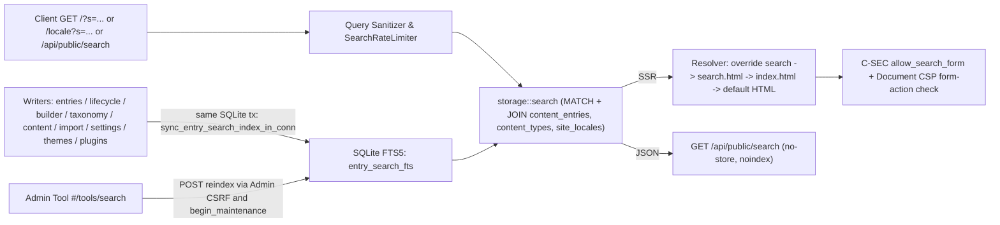

# Tìm kiếm Công khai Toàn site (`/?s=...`, `search.html`, SQLite FTS5 & Public Search API)

* **Author:** Orion (Elephant / Antigravity)
* **Status:** Approved
* **Date:** 2026-11-27
* **Approved By:** Owner
* **Approval Evidence:** Owner confirmed "Duyệt spec / bắt đầu S01" (2026-11-27); baseline rebased from `43c19c2` onto `origin/main@2655e8d` (PR #615 gettext `.pot/.po/.mo` l10n, no new migrations).
* **Baseline:** `origin/main@43c19c2` (`43c19c23122e2e2ea902e842b3fb39ff48175dfc`; rebased onto `origin/main@2655e8d` trước S01, gồm `0055`, Starter V1 `1.0.0`, 7 domain test binaries, gettext `.pot/.po/.mo`, ratchet `loc-baseline.json` & giới hạn `<= 600` LOC cho file mới)
* **Owner Decisions Locked (2026-11-26):**
  * **Q1 = `1A`:** Thực hiện đúng quy trình EGM trong worktree & branch cô lập (`feat/public-site-search`), hoàn tất Design Spec + PRD Delta + Goldfish fresh-context review (`0 Blocker / 0 Major`) để chủ dự án phê duyệt (`Status: Approved`) trước khi viết code triển khai.
  * **Q2 = `2B`:** Nới **có giới hạn chặt** trong `C-SEC` cho nguồn Theme v3 thông qua cờ tách biệt `allow_search_form: bool` (chỉ bật cho Theme v3 templates/parts ngoài `<svg>` và `<math>`, **không** bật cho legacy `render_csec()`, fragment validation, và Declarative Blocks) để cho phép `<form method="get" action="...">`, `<input type="search|text|hidden|submit|reset|radio">`, `<select>`, `<option>`, `<optgroup>`, bảo toàn 100% lệnh cấm `POST`/external `action`/`form*`/`password`/`file`/`email`/dynamic attributes; đồng thời bổ sung block **`core/search_form`** và **`core/search_results`** cho OpenDash Studio.
  * **Q3 = `3A`:** Triển khai đầy đủ cả **SSR Search** (`/?s=...` và `/{locale}?s=...` kèm lọc `?type=<cpt>`, phân trang, facet theo CPT, `noindex,follow`) lẫn **Public JSON Search API** (`GET /api/public/search`) có giới hạn tốc độ & độ dài truy vấn cho live search / autocomplete ở theme.
  * **Q4 = `4A`:** Dùng **SQLite FTS5 (`content=''`, `contentless_delete=1`, `+5` schema objects)** đồng bộ giao dịch qua Rust (`storage::search`), bổ sung công cụ **Admin Search Index Status & Reindex** tại `Hệ thống → Công cụ → Chỉ mục tìm kiếm` (`#/tools/search`), và mở mục **`Tìm kiếm (Search)`** (`TemplateCandidateKind::Search`) để tùy biến trực tiếp trong **OpenDash Studio Mode 1**.
* **Goldfish Review:** Round 1 (2026-11-26 trên `646fcf1`) + Round 2 (2026-11-27 trên `43c19c2`): 4/4 fresh-context auditors đạt `0 Blocker / 0 Major` (`egm-structural` `0dad148a`, `egm-design` `b514913a`, `egm-implementation-readiness` `74b18656`, `egm-codebase-details` `431594a0`).
  * `egm-structural` (`0dad148a`): `PASS (0 Blocker / 0 Major / 0 Minor / 2 Nit)` — cả 2 Nit đã xử lý.
  * `egm-design` (`b514913a`): `PASS (0 Blocker / 0 Major / 0 Minor / 1 Nit)` — Nit đã xử lý (`check-i18n.mjs#L84`).
  * `egm-implementation-readiness` (`74b18656`): `PASS (0 Blocker / 0 Major / 0 Minor / 0 Nit)`.
  * `egm-codebase-details` (`431594a0`): `PASS (0 Blocker / 0 Major / 0 Minor / 1 Nit)` — Nit đã gộp (`build_entry_preview_context_in_tx` giải `search_url` từ `record.locale`).
* **Related Contracts & Specs:**
  * [Yêu cầu Sản phẩm V1](../product/PRODUCT_REQUIREMENTS.md)
  * [Core Foundation & Quy chuẩn Code](../contracts/CORE_FOUNDATION.md)
  * [M5 Theme Packages, Templates & C-SEC](../contracts/M5_THEME_TEMPLATES.md)
  * [M7 Site Features, SEO, Contact/SMTP & Video](../contracts/M7_SITE_FEATURES.md)
  * [M8 Writer & Recovery Inventory](../contracts/M8_WRITER_INVENTORY.md)
  * [Content Foundation (C1–C4)](../contracts/CONTENT_FOUNDATION_2026_11.md)
  * [Theme Format v3 & Template Resolver](theme-format-and-template-resolver.md)
  * [Trusted Theme HTML & Asset Enqueue](trusted-theme-js-svg-and-asset-enqueue.md)
  * [Đa ngôn ngữ Nội dung & Bản địa hóa Theme v3](multilingual-content-and-theme-l10n.md)
  * [Entry Lifecycle, Bulk Actions & Quick Edit](entry-lifecycle-bulk-quick-edit.md)
  * [Design Sitemap](SITEMAP.md)

---

## Overview

Đặc tả này bổ sung **Tìm kiếm công khai toàn site (`/?s=...` và `/{locale}?s=...`)** cho OpenDash CMS trên cùng single binary Rust + SQLite, tận dụng trực tiếp **SQLite FTS5** (`-DSQLITE_ENABLE_FTS5` đã biên dịch sẵn trong `libsqlite3-sys 0.37.0` / SQLite `3.51.3`, **0** dependency ngoài mới).

Giải pháp tổ chức theo cấu trúc module hóa feature-first (`<= 600` LOC cho mọi file nguồn mới và tôn trọng giới hạn ratchet của [`loc-baseline.json`](../../cms/scripts/loc-baseline.json)) gồm năm lớp gắn kết:

1. **Chỉ mục FTS5 gọn nhẹ & chuẩn tiếng Việt (`0056_public_site_search_fts5.sql` + `opendash_core::search`):** Tạo bảng ảo `entry_search_fts` chế độ `content='', contentless_delete=1` với tokenizer `unicode61 remove_diacritics 2` kết hợp gập chữ `đ`/`Đ` → `d` trước khi lập chỉ mục và truy vấn; rebuild sạch `template_overrides` (thêm `'search'`) và `operation_jobs` (thêm `'search_reindex'` trong `CHECK` & partial index) qua bảng copy; chỉ cộng đúng **+5 đối tượng `sqlite_schema`** (`221 → 226 / 256` trước `_sqlx_migrations`), tương thích hoàn toàn với `PRAGMA trusted_schema = OFF` và `PRAGMA integrity_check` của [Backup/Restore (`restore.rs`)](../../cms/crates/opendash-server/src/storage/restore.rs).
2. **Tìm kiếm SSR chuẩn WordPress (`/?s=...`, `/{locale}?s=...`):** Hỗ trợ lọc theo loại nội dung (`?type=<cpt>`), phân trang (`?page=N`, trần `MAX_SEARCH_PAGE = 100`), đếm facet theo CPT (kèm URL đặt lại `page=1`), trích đoạn ngữ cảnh có từ khóa đánh dấu có cấu trúc (`snippet_segments`) giữ auto-escape 100% của MiniJinja, thẻ `<meta name="robots" content="noindex,follow">` + header `X-Robots-Tag: noindex, follow`, bảo toàn query tìm kiếm qua redirect `301` bỏ dấu `/` cuối URL, và hoạt động cả khi trang chủ chưa cấu hình hoặc homepage đang bị chuyển draft/trash.
3. **Public JSON Search API (`GET /api/public/search`):** API chỉ đọc phân tích từ `RawQuery` với kiểm tra biên độ chặt (`limit` `1..=20`, `page` `1..=100`, giới hạn `200` ký tự / `16` từ khóa), `SearchRateLimiter` dùng `crate::contact::normalize_peer_ip` trên `Option<ConnectInfo<SocketAddr>>` (fail-closed ở ngưỡng `4096` bucket, áp dụng thống nhất cho cả `/api/public/search` lẫn SSR `?s=`), trả JSON error envelope thống nhất (`400`/`404`/`429`), và lọc nghiêm ngặt ở tầng SQL theo quyền công khai.
4. **Hợp đồng Theme v3 `search.html`, C-SEC Form Giới hạn Chặt (`allow_search_form`) & OpenDash Studio:** Bổ sung `TemplateCandidateKind::Search` theo chuỗi dự phòng an toàn `DB override "search" → search.html → index.html → render_default_search_html`, `EnqueueCondition::Search`, mở khóa có kiểm soát GET form cho Theme v3 (wrapper state `form_depth`/`svg_depth`/`math_depth`, cấm tự đóng `/>` trên non-void tags, cấm `/./api/...`, tính CSP `form-action` tập trung tại [`rendered_layout_with_form_csp`](../../cms/crates/opendash-server/src/routes/public.rs#L151) bằng [`tokenize`](../../cms/crates/opendash-server/src/document/normalize/tokenize_and_normalize.rs#L199)), mở override `search` trong Studio Mode 1 cùng hai block `core/search_form` & `core/search_results`, và cập nhật trực tiếp gói Starter V1 `opendash-starter` (`1.0.0`) + `build-public-tailwind.mjs` + `opendash-tailwind.css`.
5. **Công cụ Quản trị Chỉ mục (`#/tools/search`):** Màn hình dành riêng cho `Admin` (`OperationKind::SearchReindex`) kiểm tra độ đồng bộ chỉ mục và chạy tái lập chỉ mục dưới khóa bảo trì `SiteCoordinator::begin_maintenance` + `require_admin_with_csrf`, ghi nhận `operation_jobs`, tăng `SiteCacheEpoch`.

---

## The Problem

Kiểm toán mã nguồn thực tế trên `origin/main@43c19c2` chỉ ra năm khoảng trống cụ thể:

1. **Tham số `/?s=...` bị bỏ qua ở route trang chủ và đa ngôn ngữ ([`public.rs`](../../cms/crates/opendash-server/src/routes/public.rs), [`public_context.rs`](../../cms/crates/opendash-server/src/public_context.rs), [`seo.rs`](../../cms/crates/opendash-server/src/routes/seo.rs)):**
   - [`public_page`](../../cms/crates/opendash-server/src/routes/public.rs#L126) gọi [`render_home_for_locale`](../../cms/crates/opendash-server/src/routes/public.rs#L28) với `validate_single_query(raw_query)`. Vì [`parse_query`](../../cms/crates/opendash-server/src/public_context.rs#L87) bỏ qua mọi khóa query không thuộc archive filters, request `GET /?s=rust` hiện trả về trang chủ thay vì tìm kiếm.
   - Tại [`public_fallback`](../../cms/crates/opendash-server/src/routes/seo.rs#L103), `let raw = uri.query();` chỉ được đọc tại dòng 147 **sau** `resolve_public_path`, và đường dẫn `/en` đi vào `Entry { is_home: true, .. }` (nơi `get_published_by_id` chạy trước) hoặc `Home`, khiến nếu homepage của locale phụ đang draft/trashed hoặc chưa gán Reading homepage thì `/{locale}?s=...` thất bại; đồng thời `permanent_public_redirect(resolved.canonical_path)` làm rớt `?s=...`. Ngoài ra `storage/settings/locales/queries.rs` hiện chỉ có `resolve_requested_locale_in_conn` (trả `400`, không kiểm `enabled = 1`/`multilingual_enabled`) thay vì helper công khai trả `404`.
2. **Chưa có vai trò template `search` & Giới hạn `PaginationView` / Studio Preview / Tailwind scanner:**
   - [`TemplateCandidateKind`](../../cms/crates/opendash-core/src/theme/declarations.rs#L21) và [`EnqueueCondition`](../../cms/crates/opendash-core/src/theme/enqueue.rs#L5) chưa có `Search`; `template_overrides` (`0042`) khóa `target_kind CHECK` và `operation_jobs` (`0032`) khóa `kind CHECK` chưa có `'search'` và `'search_reindex'`.
   - `archive.html` đánh giá `{{ content_type.label }}` gây HTTP `500` dưới `UndefinedBehavior::Strict` khi `content_type` là `null`, nên fallback của `search` phải đi thẳng `search.html → index.html`.
   - `PaginationView::compute` (`page_render.rs#L193`) kẹp cứng `total_pages` về `MAX_ARCHIVE_PAGE` (`10_000`) thay vì `MAX_SEARCH_PAGE` (`100`).
   - [`cms/admin/scripts/build-public-tailwind.mjs`](../../cms/admin/scripts/build-public-tailwind.mjs#L24-L29) vẫn trỏ tới 3 file đơn khối đã xóa (`content_render.rs`, `page.rs`, `routes/public_content.rs`), sẽ lỗi `ENOENT` nếu không chuyển sang quét thư mục mới.
3. **Rào cản C-SEC & CSP đối với form tìm kiếm trên Theme v3 ([`template_sec/`](../../cms/crates/opendash-server/src/template_sec/), [`routes/public.rs`](../../cms/crates/opendash-server/src/routes/public.rs)):**
   - [`FORBIDDEN_TAGS`](../../cms/crates/opendash-server/src/template_sec/composition/allowlists.rs) và `is_dangerous_attr_name` chặn `<form>`, `<input>`, `<select>`, `action`; ngược lại [`block_render.rs`](../../cms/crates/opendash-server/src/template_sec/policy/block_render.rs#L229) lại gọi `validate_html_and_css_context(..., true, true)`, do đó bắt buộc phải tách `allow_search_form: bool` độc lập khỏi `allow_trusted_theme_markup: bool` để Declarative Block không bị mở khóa `<form>`.
   - [`contact_form_ui.rs`](../../cms/crates/opendash-server/tests/site_media_seo/contact_form_ui.rs#L266-L272) bắt buộc trang `/` không chứa `<form>` giữ CSP `form-action 'none'`.
4. **Hạ tầng trích xuất văn bản & Ràng buộc LOC Ratchet (`loc-baseline.json`):**
   - `strip_richtext_to_plain` (`entry_view.rs`) cần được đưa về `opendash_core::richtext` và bỏ thân `<script>`, `<style>`, `<!-- ... -->`; `extract_visible_text_with_schemas` (`parser.rs`) cần tách chung `extract_document_visible_text` dùng cho cả Comment-Block lẫn `BuilderDocument`.
   - Bảy file đích (`app.rs` `883`, `page/cache_types/types.rs` `986`, `theme_html_walker.rs` `605`, `BuilderInspector.tsx` `820`, `App.tsx` `879`, `en.ts` `2346`, `vi.ts` `2346`) đang ở đúng trần `loc-baseline.json`, buộc phải tách helper feature-first `<= 600` LOC (và modular hóa i18n catalog với `check-i18n.mjs`) để không bao giờ tăng trần ratchet.

---

## Goals

* **G1 — Chỉ mục SQLite FTS5 nhẹ, chuẩn tiếng Việt & tương thích `restore.rs`:** Dùng FTS5 `content='', contentless_delete=1` (`unicode61 remove_diacritics 2` + gập `đ`/`Đ` → `d`), đồng bộ tức thời trong cùng giao dịch SQLite trên toàn bộ điểm ghi (`M8_WRITER_INVENTORY.md`), tự đối soát khi khởi động sau recovery/migration (`MIN`/`MAX`/`SUM`/`COUNT` & set difference), chỉ cộng **+5** schema objects (`226 / 256`).
* **G2 — Route SSR Tìm kiếm Công khai (`/?s=...` & `/{locale}?s=...`):** Hỗ trợ ngôn ngữ mặc định và các ngôn ngữ phụ đang bật (kể cả khi homepage chưa cấu hình hoặc đang draft/trashed), lọc `?type=<cpt>`, phân trang `?page=N` (`20` kết quả/trang, trần `MAX_SEARCH_PAGE = 100` nhất quán trong `PaginationView`), đếm facet theo CPT kèm URL `page=1`, đoạn trích an toàn `snippet_segments`, SEO `noindex,follow`, và `301` bỏ `/` cuối vẫn giữ nguyên query tìm kiếm (`Some("")` giữ `?s=`).
* **G3 — Public JSON Search API (`GET /api/public/search`) & `SearchRateLimiter` An toàn:** Trả JSON chuẩn (`items`, `pagination`, `facets`) qua `RawQuery`; `400`/`404`/`429` JSON error envelope rõ ràng có `Cache-Control: no-store` và `X-Robots-Tag: noindex, nofollow`; `SearchRateLimiter` chuẩn hóa IP qua `crate::contact::normalize_peer_ip` và fail-closed ở `4096` bucket trên cả API lẫn SSR `?s=`; tắt cache LRU `ExtensionRenderCache` theo từ khóa.
* **G4 — Nới C-SEC Có Kiểm Soát (`allow_search_form`) & CSP Tập trung:** Cho phép riêng Theme v3 templates/parts (ngoài `<svg>` và `<math>`) khai báo `<form method="get" action="...">` (bắt buộc `action` không rỗng hợp lệ, chống `/./api/...`, cấm `/>` trên `form`/`select`/`option`/`optgroup`, theo dõi `form_depth` trên `ThemeHtmlState::Trusted` chống lồng/leak qua `od_part`/`od_content`), `<input type="search|text|hidden|submit|reset|radio">`, `<select>`, `<option>`, `<optgroup>`, chặn tuyệt đối mọi biến thể độc hại và giữ 100% lệnh cấm trên `render_csec()`, fragment validation & Declarative Blocks. CSP `form-action` được xác định tập trung bằng `document::contains_html_form_tag(&html)` trong `rendered_layout_with_form_csp`.
* **G5 — Template `search.html`, Studio Mode 1 (`search` & Blocks), Preview Diagnostics & Starter V1 (`1.0.0`):** Hỗ trợ `TemplateCandidateKind::Search` (`DB override "search" → search.html → index.html → render_default_search_html`), `EnqueueCondition::Search`, `core/search_form` & `core/search_results` (nối đủ `res.diagnostics` ở Studio Mode 1), cập nhật `opendash-starter` `1.0.0` (gồm `builtin_themes/mod.rs`) và sửa `build-public-tailwind.mjs` để build `opendash-tailwind.css`.
* **G6 — Công cụ Admin Chỉ mục Tìm kiếm (`#/tools/search`):** Cho phép `Admin` xem đối chiếu chỉ mục và chạy `Reindex` thông qua `SiteCoordinator::begin_maintenance(OperationKind::SearchReindex, ...)` (`operation_jobs` CHECK mở rộng) + `require_admin_with_csrf` trực tiếp, tăng `SiteCacheEpoch`; `Editor` bị chặn `403`.
* **G7 — Bảo mật Tầng Lưu trữ & Phân tầng ACL 3 Trục:** Mọi kết quả tìm kiếm và lập chỉ mục tuân thủ 3 trục ACL (`Active`, `Public`, `min_view_role <= Editor`), loại `Url`/media/scalar kỹ thuật khỏi FTS5, ẩn hoàn toàn `pattern`/`section`/`draft`/`trashed`/CPT ẩn/locale tắt.

## Non-Goals

* Không tích hợp search engine ngoài (Meilisearch, Elasticsearch, Tantivy) hoặc thêm crate Rust / npm package mới.
* Không chiếm đường dẫn `/search` làm route hệ thống cố định; đường dẫn này tiếp tục thuộc quyền người dùng nếu tạo Page/Post slug `search` (`/?s=...` và `/{locale}?s=...` theo chuẩn WordPress).
* Không thay đổi cơ chế lọc/tìm kiếm nội bộ trong bảng quản trị Admin (`entry-table`) hay thư viện media và không đưa dữ liệu ẩn vào FTS5.
* Không mở cú pháp FTS5 thô (`NEAR`, `column:term`, `NOT`, `*` đầu từ) cho khách truy cập, không làm tìm mờ Levenshtein hoặc đồng nghĩa tùy chỉnh trong V1.
* Không lưu log từ khóa tìm kiếm của người dùng cuối vào SQLite trong V1.
* Không mở `<form method="post">`, `<textarea>`, `<fieldset>`, hay `<form>` trong Declarative Block `block.json`, fragment HTML hoặc `render_csec()`.

---

## Proposed PRD Delta

Tại [`docs/product/PRODUCT_REQUIREMENTS.md`](../product/PRODUCT_REQUIREMENTS.md):

1. **Mục `## 3. Điều hướng Admin & Màn hình Single Edit`:** Bổ sung `Chỉ mục tìm kiếm` (thuộc Spec [`public-site-search.md`](../designs/public-site-search.md) đang trình duyệt) vào nhóm `Công cụ`.
2. **Mục `## 6. Tính năng tích hợp sẵn`:** Bổ sung gạch đầu dòng mới mô tả tính năng Tìm kiếm công khai toàn site (`/?s=...`, `/{locale}?s=...`, FTS5 gập dấu `đ` → `d`, lọc `?type=`, `GET /api/public/search`, `search.html`, Studio Mode 1 + `core/search_form`/`core/search_results`, `#/tools/search`) và gắn chú thích *(thuộc đặc tả [`public-site-search.md`](../designs/public-site-search.md) đang trình duyệt — chưa triển khai)* cho tới khi hợp nhất xong code.

---

## Critical User Journeys (CUJs)

### CUJ 1: Khách truy cập tìm kiếm SSR qua `/?s=...` với tiếng Việt, lọc `?type=` và phân trang
* **Given:** Website có các `post`, `page` và một CPT `public: true` (`project`) đã xuất bản bằng tiếng Việt gồm cả bài `content_mode == "editor"` (tiêu đề `"Kiến trúc Đường dẫn tĩnh"`) và bài `content_mode == "builder"` (`values_json["body"]` chứa Comment-Block), cùng 1 bài `draft`, 1 bài đã chuyển Thùng rác (`trashed_at IS NOT NULL`), 1 `pattern`, 1 `section`, và các field `internal_note` (`public_exposure: "private"`), `admin_only_pub` (`public_exposure: "public"`, `min_view_role: "admin"`), `secret_ref` (`Url` hoặc `Secret`).
* **When:** Khách mở `GET /?s=duong%20dan`, `GET /?s=duong%20dan&type=post`, `GET /?s=duong%20dan&type=`, `GET /?s=rust&page=100` (trên tập có `total_pages >= 100`), và `GET /?s=bi-mat-noi-bo`.
* **Then:**
  * `GET /?s=duong%20dan` trả HTTP `200`, khớp cả bài `editor` lẫn `builder`, gập đúng `đ` → `d`, phát `<mark>` từ `snippet_segments` an toàn auto-escape, đếm `facets` kèm `facet.url` đặt `page=1`, đặt `<meta name="robots" content="noindex,follow">` + `X-Robots-Tag: noindex, follow`.
  * `GET /?s=duong%20dan&type=post` chỉ trả kết quả `post` và `pagination.total_items` khớp số kết quả lọc `post`; `type=` (chuỗi rỗng từ `<select>`) chuẩn hóa thành `None` (tìm mọi CPT).
  * `GET /?s=rust&page=100` (với `> 2,000` kết quả) có `pagination.total_pages == 100`, `has_next == false`, `next_url == None`, và `pagination.pages` không bao giờ phát link trang `101+`; `page=101` hoặc `page=50` vượt trang hợp lệ khác (trong `1..=100` thì trả `200 OK` với `items: []`, `> 100` trả `400`).
  * Từ khóa trong `draft`, `trash`, `pattern`, `section`, field `private`, field `min_view_role = admin`, hoặc field `Url`/`Secret`/`Image` đều không khớp (`0` kết quả).
  * `GET /?s=` (rỗng) trả `200` trạng thái chờ nhập (`has_query == false`); `GET /?%ZZ&s=abc`, `GET /missing?%ZZ&s=abc`, hoặc `GET /?s=abc&category_id=1` trả `400 Bad Request`.

### CUJ 2: Tìm kiếm đa ngôn ngữ (`/{locale}?s=...`), Homepage chưa cấu hình / Drafted & `301` giữ query
* **Given:** Website bật đa ngôn ngữ với mặc định `vi` và ngôn ngữ phụ `en` (kể cả kịch bản `en` chưa gán `homepage_page_id` hoặc `homepage_page_id` của `en` đang `draft`/`trash`); ngôn ngữ `fr` đang tắt (`enabled = 0`).
* **When:** Khách mở `GET /en?s=rust`, `GET /en/?s=rust&type=post` (có `/` cuối), `GET /en/?s=`, và `GET /fr?s=rust`.
* **Then:**
  * `GET /en?s=rust` **vẫn trả `200`** và tìm kiếm trong locale `en` kể cả khi homepage của `en` chưa cấu hình hoặc đang `draft`/`trash`; `locale.search_url == "/en"` và `locale.alternates` giữ `?s=rust` khi chuyển ngôn ngữ (khi query rỗng thì alternate trỏ tới `/en` / `/` sạch không thừa `?s=`).
  * `GET /en/?s=rust&type=post` trả `301 Moved Permanently` với `Location: /en?s=rust&type=post`; `GET /en/?s=` trả `301` với `Location: /en?s=` (giữ đúng trang tìm kiếm rỗng!).
  * `GET /fr?s=rust` trả `404`.

### CUJ 3: Theme v3 `search.html`, C-SEC Form Giới hạn Chặt (`allow_search_form`) & CSP Tập trung
* **Given:** Active Theme v3 cài hợp lệ (`--check-theme`) có `search.html` dùng `<form method="get" action="{{ locale.search_url }}"><input type="search" name="s" value="{{ search.query }}"><select name="type">...</select></form>`; `header.html` của Starter Theme dùng link `<a href="{{ locale.search_url }}">` khi `options.show_header_search == false` (mặc định).
* **When:**
  1. Kiểm tra `GET /` khi `show_header_search == false` vs khi bật `show_header_search == true` vs `GET /?s=rust`.
  2. Thử cài Theme v3 chứa form sai quy cách: `<form>` thiếu `action`, `<form action="/" />` (self-closing non-void), `<form action="/./api/admin/users">`, `<form action="&#x09;/api/users">`, `<form method="post">`, `<form action="https://evil.test">`, `<form><form></form></form>`, `<form>` không đóng, `<form action="/">{{ od_part("footer") }}</form>`, `<svg><form action="/"></form></svg>`, `<math><mtext><form action="/"></form></mtext></math>`, `<input type="password">`, `<input type="passwordtext">`, `<button formaction="/x">`; và thử đưa `<form>` vào Declarative Block `block.json`, fragment HTML hoặc `render_csec()`.
* **Then:**
  * Trên `/` khi `show_header_search == false` và không có contact form active, [`contains_html_form_tag`](../../cms/crates/opendash-server/src/document/mod.rs) trả `false` → CSP giữ **`form-action 'none'`** (tương thích 100% [`contact_form_ui.rs`](../../cms/crates/opendash-server/tests/site_media_seo/contact_form_ui.rs)).
  * Khi HTML đầu ra có `<form>` (từ `search.html`, `header.html` hoặc `core/search_form`), CSP bật **`form-action 'self'`**.
  * Toàn bộ biến thể form sai quy cách ở Theme v3, Declarative Block, fragment validation và `render_csec()` đều bị chặn ở cả install-time lẫn post-render với `400 Bad Request`.

### CUJ 4: Live Search qua Public JSON API (`GET /api/public/search`) & Rate Limit
* **Given:** Client gọi `GET /api/public/search?s=tailwind&locale=vi&limit=5`.
* **When:** Gửi request hợp lệ (kèm `&utm_source=test&utm_source=2`), gửi `locale=` rỗng, gửi `type=invalid!`, gửi `locale=disabled_loc`, và gửi vượt ngưỡng rate limit theo peer IP (`normalize_peer_ip`).
* **Then:**
  * Request hợp lệ (kể cả `utm_*` lặp và `type=` rỗng) trả `200 OK`, `Cache-Control: no-store`, `X-Robots-Tag: noindex, nofollow`, `X-Content-Type-Options: nosniff`, `url: string | null`, `cover_url: string | null`, `snippet_segments`, `pagination`, `facets`.
  * `locale=` rỗng mặc định về `default_locale`; lỗi `type=invalid!`, `limit=0`/`25`, `category_id=1`, hoặc `%ZZ` trả `400 Bad Request` JSON `{ error, code: "invalid_query" }`; `locale=disabled_loc` trả `404 Not Found` JSON `{ error, code: "locale_not_found" }`; vượt `SearchRateLimiter` trên `/api/public/search` (hoặc trên SSR `?s=`) trả `429 Too Many Requests` + `Retry-After` + `Cache-Control: no-store` + `X-Robots-Tag: noindex, nofollow`.

### CUJ 5: Tùy biến Trang Tìm kiếm trong OpenDash Studio Mode 1 (`Q4=4A`)
* **Given:** `Admin` mở Studio (`#/studio`) → `Mẫu giao diện` → chọn `Trang tìm kiếm (Search)` (`canonical_target_key = "search"`).
* **When:** Chèn `core/search_form` và `core/search_results`, thử chèn `core/content_slot` (`slots == 0` bị từ chối), xem preview với `preview_locale`, Lưu (`PUT /api/admin/template-overrides`), kiểm tra `GET /?s=opendash`, chèn `core/search_results` vào template `single` (Mode 1) để xem banner cảnh báo `search_results_outside_search_route` trên Studio UI, kiểm tra Mode 2 không cho chèn `core/search_results` (chỉ cho `core/search_form`), và thử Reset.
* **Then:** Studio Preview render an toàn (form `disabled` không điều hướng iframe `sandbox=""`), `templateDiagnostics` hiển thị banner cảnh báo khi đặt `core/search_results` ngoài `search`, Lưu áp dụng bố cục mới cho `GET /?s=opendash`, Reset khôi phục về `search.html → index.html → render_default_search_html`.

### CUJ 6: Công cụ Quản trị Chỉ mục (`#/tools/search`), Đối soát & Backup/Restore
* **Given:** `Admin` và `Editor` đăng nhập Admin; DB đã có dữ liệu và thực hiện Backup → Restore sang site root mới.
* **When:** `Editor` truy cập `#/tools/search` hoặc gọi `/api/admin/tools/search/{status,reindex}`; `Admin` mở `#/tools/search` và bấm **Tái lập chỉ mục tìm kiếm**; và chạy `validate_restored_db_read_only` + `validate_and_rebase_copy` trên file backup.
* **Then:**
  * `Editor` bị chặn `403`.
  * `Admin` xem được `indexed_documents`, `eligible_published_entries`, `in_sync`, `last_job`; bấm Reindex gọi `require_admin_with_csrf` + `begin_maintenance(OperationKind::SearchReindex, ...)` (nếu đang có tác vụ bảo trì hoặc reindex khác chạy cùng lúc, trả `409 Conflict` via `map_maintenance_error`), ghi nhận `OperationJob` (`operation_jobs`), tăng `SiteCacheEpoch`, trả `200`.
  * Backup/Restore vượt qua `PRAGMA trusted_schema = OFF`, `PRAGMA integrity_check`, `226 <= 256`; khi khởi động lại sau `recover_orphaned_import_runs`, server đối soát tập ID của `entry_search_fts_docsize` với tập bài hợp lệ và tự động tái lập nếu sai lệch trước `TcpListener::bind`.

---

## Technical Plan (Architecture)



### A. Lược đồ SQLite FTS5, Migration `0056` & Tương thích `restore.rs`

1. **Đánh số Migration & Chính sách Tích hợp:**
   - Trên `origin/main@43c19c2`, đã có **54** migration (`0001`..`0055_theme_option_locale_media_refs.sql`, bỏ `0016`), tổng `221` đối tượng trong `sqlite_schema` (chưa tính `_sqlx_migrations`).
   - Đặc tả này tạo **`cms/migrations/0056_public_site_search_fts5.sql`**. *(Ghi chú tích hợp: nếu `unified-field-engine` S04 hợp nhất `0056_unified_field_content_cutover.sql` lên `main` trước khi S01 mở PR, implementer của S01 đổi số migration thành `0057_public_site_search_fts5.sql` và tên bảng tạm `_0057_copy` để giữ thứ tự đơn điệu cho `sqlx::migrate!`, đồng thời cập nhật `cms/migrations/README.md`.)*
2. **Định nghĩa FTS5, Rebuild `template_overrides` & `operation_jobs` (`+5` đối tượng ròng `sqlite_schema`):**
   - Tạo bảng ảo FTS5 (`+5` schema objects: `entry_search_fts`, `_data`, `_idx`, `_config`, `_docsize`, **không** sinh `_content`):
     ```sql
     CREATE VIRTUAL TABLE entry_search_fts USING fts5(
         title,
         summary,
         body,
         terms,
         tokenize = 'unicode61 remove_diacritics 2',
         content = '',
         contentless_delete = 1
     );
     ```
     Chế độ `content='', contentless_delete=1` (SQLite `3.51.3` gắn cờ `SQLITE_VTAB_INNOCUOUS`) tương thích 100% `PRAGMA trusted_schema = OFF` và `PRAGMA integrity_check` trong [`restore.rs`](../../cms/crates/opendash-server/src/storage/restore.rs#L104).
   - Rebuild bảng `template_overrides` và `template_override_media_refs` qua bảng tạm (`template_overrides_0056_copy`, `template_override_media_refs_0056_copy`, bảo toàn `id` và xóa bảng tạm) bổ sung `'search'` vào `CHECK (target_kind IN ('home', 'page', 'page_layout', 'single', 'single_custom', 'archive', 'taxonomy', 'singular', 'index', 'not_found', 'search', 'part'))` mà không chạm `PRAGMA foreign_keys = OFF` (`+0` đối tượng ròng).
   - **Rebuild bảng `operation_jobs` (`0032_operations_jobs.sql#L3-L28`, `+0` đối tượng ròng):** Chép toàn bộ hàng sang `operation_jobs_0056_copy`, drop `operation_jobs`, tạo lại `operation_jobs` với `CHECK (kind IN ('backup', 'restore', 'reconcile', 'purge', 'media_delete', 'search_reindex'))`, khôi phục hàng và drop bảng copy, đồng thời tạo lại đủ 3 index:
     - `idx_operation_jobs_state_requested`
     - `idx_operation_jobs_kind_requested`
     - `idx_operation_jobs_single_active_heavy` mở rộng thành `WHERE kind IN ('backup', 'restore', 'reconcile', 'purge', 'search_reindex') AND state IN ('queued', 'running')`.
     *(Bảng `maintenance_generation` tại `0032#L30-L35` không có `CHECK` trên `last_kind` nên giữ nguyên).*
   - **Ngân sách Schema (`MAX_SCHEMA_OBJECTS = 256`):** `221 + 5 = 226` đối tượng trước `_sqlx_migrations` (dư tối thiểu `28` chỗ trống).
   - **Reconciliation lúc Khởi động (`main.rs`):** Trong [`main.rs`](../../cms/crates/opendash-server/src/main.rs#L275-L282), gọi `storage::search::ensure_search_index_bootstrapped(&db)` **sau** `migrate_demo_entry_builder_docs_on_startup` và `recover_orphaned_import_runs` (trước `TcpListener::bind`). Thay vì chỉ so sánh `COUNT(*)`, đối chiếu chữ ký tập ID `(COUNT(*), COALESCE(MIN(id), 0), COALESCE(MAX(id), 0), COALESCE(SUM(id), 0))` giữa `entry_search_fts_docsize(id)` và truy vấn tập bài viết đủ điều kiện (cộng kiểm tra `NOT EXISTS` chênh lệch 2 chiều có `LIMIT 1` nhanh) — nếu lệch, chạy `rebuild_search_index_in_conn` trong 1 transaction.

---

### B. Bộ Xử lý Thuần Rust (`opendash_core::search`, `opendash_core::richtext` & `opendash_core::builder_blocks`)

Mọi file nguồn mới tuân thủ **`<= 600` LOC** ([`check-standards.py:609`](../../cms/scripts/check-standards.py#L609)) và đặt tên theo tính năng thực tế:

- `cms/crates/opendash-core/src/richtext/strip.rs`: chuyển `strip_richtext_to_plain` từ [`entry_view.rs:3-110`](../../cms/crates/opendash-server/src/content_render/entry_view.rs#L3-L110) sang `opendash_core::richtext` (re-export lại trong `entry_view.rs` để giữ nguyên unit test `content_render`), nâng cấp xóa trọn khối `<script ...>...</script>`, `<style ...>...</style>` (không phân biệt hoa thường, xử lý cả trường hợp thiếu thẻ đóng tới EOF) và comment `<!-- ... -->` trước khi bóc thẻ HTML và giải mã entity.
- `cms/crates/opendash-core/src/builder_blocks/parser.rs`: trích hàm dùng chung `pub fn extract_document_visible_text(doc: &BuilderDocument, schemas: &RegistryCatalog<RegisteredBlockSchema>) -> String` duyệt `KnownElement::Heading`, `KnownElement::Text` (chạy `strip_richtext_to_plain` khi `props.rich == true`), `KnownElement::Button` (`label`), và `KnownElement::PluginBlock` active/declared (`schema.extract_visible_text`, lọc qua `strip_richtext_to_plain`), bỏ qua `SearchForm`, `SearchResults`, `ContactForm`, `List`, `PatternRef`. Cả `extract_visible_text_with_schemas` (Comment-Block) lẫn `extract_searchable_document` (Builder AST) đều gọi hàm này.
- `cms/crates/opendash-core/src/search/{mod.rs, normalize.rs, query.rs, extract.rs, snippet.rs, tests.rs}` (thuần Rust, 0 I/O, 0 SQL):
  1. **Chuẩn hóa & Cắt chuỗi (`normalize.rs`):**
     - `fold_vietnamese_stroke(input: &str) -> String`: chuyển `'đ' => 'd'`, `'Đ' => 'D'`. Các dấu thanh/mũ nguyên âm do `unicode61 remove_diacritics 2` trong SQLite FTS5 xử lý.
     - `truncate_utf8_bytes(s: &str, max_bytes: usize) -> &str`: sử dụng `s.floor_char_boundary(max_bytes)`.
     - Giới hạn cột: `MAX_INDEX_TITLE_BYTES = 1_024`, `MAX_INDEX_SUMMARY_BYTES = 2_048`, `MAX_INDEX_BODY_BYTES = 128 * 1024`, `MAX_INDEX_TERMS_BYTES = 4_096`.
  2. **Trích xuất Nội dung & Lọc ACL 3 Trục (`extract.rs`):**
     - **Kiểm đủ 3 trục ACL** trên từng field: `fe.effective_status == EffectiveFieldStatus::Active && fe.definition.public_exposure == PublicExposure::Public && fe.definition.min_view_role <= FieldRole::Editor`.
     - **Kiểu trường được index:** Trên `43c19c2` (`ContentFieldType`): **CHỈ** `ShortText | LongText | RichText`; loại bỏ `Image`, `Gallery`, `Boolean`, `Number`, `Date`, `Select`. Khi `unified-field-engine` S04 cắt chuyển sang `field_schema::FieldSpec`: chỉ index `Text | Textarea | RichText` (kể cả con trong `Group`/`Repeater` 1 cấp đạt 3 trục ACL), loại trừ `Url`, `Secret`, `Email`, `Link`, `Media`, `Gallery`, `Color`, `Icon`, `Spacing`, `Select`, `Checkbox`, `RadioButtons`, `Boolean`, `Number`, `Range`, `Date`, `DateTime`, `Time`, `EntryRef`, `TermRef`, `Tab`, `Accordion`, `Message`.
     - **Hợp nhất nguồn `body` theo `content_mode` (`mutate_entry_builder.rs#L189-L212`):** Khi `body` đạt 3 trục ACL, ưu tiên trích Comment-Block từ `values["body"]` qua `extract_visible_text_with_schemas` khi `contains_blocks(raw)` (vì các entry `content_mode == "builder"` không phải `pattern` đều lưu AST Comment-Block trong `values_json["body"]` và xóa `entry_builder_documents`), fallback sang `builder_document` (`entry_builder_documents`) nếu còn tồn tại bản ghi legacy, hoặc sang `strip_richtext_to_plain(raw)` cho HTML editor thuần.
     - Fields `summary`/`excerpt`/`description` ưu tiên đi vào cột `summary`; văn bản public còn lại nối vào `body`. Trả `SearchableEntryDocument { title_folded, summary_folded, body_folded, terms_folded, snippet_source_text }` (`snippet_source_text` giữ dấu gốc).
  3. **Làm sạch Truy vấn (`query.rs`):**
     - `MAX_SEARCH_QUERY_CHARS = 200`, `MAX_SEARCH_QUERY_BYTES = 512`, `MAX_SEARCH_TOKENS = 16`.
     - Trim; vượt quá trả `SearchQueryError::TooLong` (`400`); rỗng sau trim → `is_empty: true`, `fts_match_expr: None`.
     - Loại `char::is_control`, gập `đ`/`Đ`→`d`, tách tối đa `16` token liên tiếp `c.is_alphanumeric()`, bọc `"tok"` (vô hiệu hóa toán tử FTS5 và từ khóa `AND`/`OR`/`NOT`/`NEAR`), gắn `*` cho token cuối khi `>= 2` Unicode scalar. Chỉ toàn dấu câu → `is_empty: false`, `fts_match_expr: None`.
  4. **Trích đoạn Có Cấu trúc (`snippet.rs`):**
     - `#[derive(Debug, Clone, Serialize, Deserialize, PartialEq, Eq)] pub struct SnippetSegment { pub text: String, pub matched: bool }`.
     - `build_structured_snippet(source_text: &str, match_tokens: &[String], max_chars: usize) -> Vec<SnippetSegment>`: dò vị trí khớp theo ánh xạ char (bỏ dấu + lowercase + `đ`→`d`), cắt cửa sổ `~220` ký tự tại ranh giới từ và tách thành các đoạn `SnippetSegment`. Nếu query chỉ khớp tiêu đề hoặc taxonomy terms (không khớp trong `source_text`) nhưng `!source_text.is_empty()`, trả về `[SnippetSegment { text: truncate_char_excerpt(source_text), matched: false }]`; nếu rỗng trả `Vec::new()`.

---

### C. Đồng bộ Giao dịch, Truy vấn Ủy quyền & Writer Inventory (`storage::search`)

1. **Module `cms/crates/opendash-server/src/storage/search/{mod.rs, index_sync.rs, query.rs, tests.rs}` (`<= 600` LOC mỗi file):**
   Tuân thủ 100% SQL trong `storage/`:
   - **Điều kiện công khai chuẩn (`ELIGIBLE_ENTRY_PREDICATE`):**
     `e.trashed_at IS NULL AND e.publication_status = 'published' AND e.content_type_key NOT IN ('pattern', 'section') AND t.provider_status = 'active' AND COALESCE(json_extract(t.definition_json, '$.settings.public'), 1) = 1 AND sl.enabled = 1 AND sl.deleted_at IS NULL AND (sl.is_default = 1 OR (SELECT multilingual_enabled FROM site_locales_state WHERE id = 1) = 1)`.
   - **Lọc Terms công khai:** Chỉ index `taxonomy_terms.name` có `taxonomy_definitions.provider_status = 'active' AND taxonomy_definitions.public = 1` và thuộc danh sách taxonomy hợp lệ công khai của CPT.
   - `sync_entry_search_index_in_conn`: kiểm tra `ELIGIBLE_ENTRY_PREDICATE`; không đạt thì `DELETE FROM entry_search_fts WHERE rowid = ?`; đạt thì `DELETE` rồi `INSERT INTO entry_search_fts(...)`.
   - Bổ sung helpers theo phạm vi tác động: `delete_entry_search_index_in_conn`, `sync_entries_for_type_in_conn`, `sync_entries_for_term_in_conn`, **`sync_entries_for_taxonomy_in_conn(conn, taxonomy_key)`** (tìm mọi CPT gắn với `taxonomy_key` qua `content_type_taxonomy_eligibility` / `content_type_taxonomy_overrides` để đồng bộ cả Core `post`/`page`), `rebuild_search_index_in_conn` (`'delete-all'` + lô `200`), `ensure_search_index_bootstrapped`, `get_search_index_status`.

2. **Bảng Đồng bộ Đầy đủ Điểm Ghi (`M8_WRITER_INVENTORY.md`, đường dẫn chuẩn `43c19c2`):**

   | Module (`cms/crates/opendash-server/src/...`) | Hàm / Luồng ghi | Hành động đồng bộ FTS5 trong cùng tx |
   | --- | --- | --- |
   | `storage/entries/fences_and_terms.rs`, `storage/entries/body_and_refs/{forbid_generic_pattern_write,commit_composite_entry_save,set_publication_status}.rs` | `create_entry`, `update_entry`, `create_entry_with_fence`, `update_entry_with_fence`, `create_entry_with_schema_fence`, `update_entry_with_schema_fence`, `commit_composite_entry_save`, `commit_entry_translation`, `set_publication_status` | `sync_entry_search_index_in_conn` |
   | `storage/entry_lifecycle/{types/apply_lifecycle_in_tx.rs, types/active_entry_predicate.rs, validation_and_fences.rs}` | `apply_lifecycle_in_tx` (Trash/Restore), `physical_delete_cleanup_in_tx` (Purge/Delete), `commit_metadata_patch_inner` (Quick Edit) | `delete_entry_search_index_in_conn` (Trash/Purge) / `sync_entry_search_index_in_conn` (Restore/Quick Edit) |
   | `storage/builder/read_and_preview/mutate_entry_builder.rs` & `storage/builder/mutations_and_save.rs` | `mutate_entry_builder` (`save_entry_builder`, `reset_entry_builder`), `migrate_demo_entry_builder_docs_on_startup` | `sync_entry_search_index_in_conn` (bỏ qua `pattern`/`section`; `storage/patterns.rs` không cần hook vì Pattern luôn private) |
   | `storage/import/read/execute_sample_import_with_cutpoint.rs` | Phase 3 `execute_sample_import` | `sync_entry_search_index_in_conn` phòng vệ cho từng entry đã import nếu `published` |
   | `storage/taxonomy/types/create_term_with_locale.rs` & `storage/taxonomy/definitions.rs` | `patch_term`, `delete_term`, `patch_definition`, `sync_provider_definitions_in_tx`, `set_provider_definitions_status_in_tx`, `deactivate_other_theme_definitions_in_tx` | `sync_entries_for_term_in_conn` (term) / `sync_entries_for_taxonomy_in_conn` (đổi `public` / `provider_status` ảnh hưởng mọi CPT gắn kết) |
   | `storage/content/builtins/{contenttypeapiitem.rs, update_user_field_group.rs, put_site_taxonomy_eligibility.rs, sync_owner_cnt_declarations_in_tx.rs}` & `storage/content/field_groups.rs` | `insert_user_content_type`, `update_user_content_type`, `create_user_field_group`, `update_user_field_group`, `withdraw_user_field_group`, `put_site_taxonomy_eligibility`, `sync_owner_cnt_declarations_in_tx` (trên **tất cả `candidate_types`** có schema hiệu lực thay đổi), `set_plugin_cnt_provider_status_in_tx` (`changed_keys` & field-group `target_types`) | `sync_entries_for_type_in_conn` cho mọi CPT (kể cả `post`/`page`) bị đổi schema hiệu lực |
   | `storage/theme/{read/activate_revision.rs, write.rs}` & `storage/plugin/{read/install_plugin_revision.rs, read/hook_subscriptions.rs, write.rs}` & `routes/themes/packages_and_overrides/theme_functions_get_settings.rs` | Kích hoạt/tắt/gỡ/cài Theme & Plugin, `sync_dev_plugin_in_db`, `dev_sync` (gọi helper trong `storage/`) | Đồng bộ các CPT/taxonomy bị thay đổi trong tx qua `sync_entries_for_*` |
   | `storage/settings/locales/{mutations.rs, orphans.rs}` | `create_locale` (kích hoạt lại locale từng soft-delete), `update_locale`, `set_multilingual_enabled`, `delete_locale`, `purge_orphan_locale` | Xóa rowid bị xóa hoặc `rebuild_search_index_in_conn` trong tx |
   | `storage/restore.rs` & `main.rs` | `validate_and_rebase_copy`, `ensure_search_index_bootstrapped` | `rebuild_search_index_in_conn` khi sai lệch chữ ký tập ID |

3. **Truy vấn Tìm kiếm Ủy quyền (`query_public_search`):**
   - Dùng helper mới `settings::resolve_public_locale_in_conn` tại `storage/settings/locales/queries.rs` (cùng rule với `list_enabled_locales_in_conn`: `enabled = 1 AND deleted_at IS NULL AND (is_default = 1 OR multilingual_enabled = 1)` → sai cú pháp trả `400`, tắt/không tồn tại trả **`404`**).
   - Kiểm tra `type_key`: `None` hoặc `""` → không lọc; sai cú pháp `valid_content_type_key` → `400`; `pattern`/`section`/CPT ẩn hoặc inactive → trả `200` rỗng `items: []`, `total_items: 0`, giữ `facets` các CPT public khớp từ khóa.
   - `items`: `bm25(entry_search_fts, 10.0, 5.0, 1.0, 3.0) AS rank_score` + `JOIN content_entries e` + `JOIN content_types t` + `JOIN site_locales sl` + `ELIGIBLE_ENTRY_PREDICATE` + `(?3 IS NULL OR e.content_type_key = ?3)`.
   - `total_items`: `SELECT COUNT(*) ... WHERE ... AND (?3 IS NULL OR e.content_type_key = ?3)`.
   - `facets`: `SELECT t.key, json_extract(t.definition_json, '$.label') AS label, COUNT(*) AS cnt ... WHERE ... (không lọc ?3) GROUP BY t.key ORDER BY cnt DESC, t.key ASC`, mỗi `SearchFacetView` chứa `url = CanonicalUrlBuilder::search_url(&base_search_path, Some(&display_query), Some(&key), 1)` (luôn reset `page=1`) và `is_active`.
   - Hydration Zero-N+1 qua `seo::resolve_public_entry_paths_by_ids`, `public_content::batch_load_public_entry_terms`, `public_content::batch_load_eligible_public_taxonomies`, `plugin_projections::batch_load_entry_projections`, và `content_render::entry_view_with_context`. Trang out-of-range trong `1..=MAX_SEARCH_PAGE` (`100`) trả `200 OK` với `items: []`.

---

### D. Định tuyến SSR Công khai (`/?s=...`, `/{locale}?s=...`), SEO, Cache & Rate Limit

1. **Mở rộng [`public_context.rs`](../../cms/crates/opendash-server/src/public_context.rs):**
   - `pub const SEARCH_PAGE_SIZE: i64 = 20; pub const MAX_SEARCH_PAGE: i64 = 100;`.
   - `pub fn validate_percent_encoding(raw: &str) -> Result<(), &'static str>`, `pub fn has_search_param(raw: Option<&str>) -> bool`.
   - `pub fn parse_search_query(raw: Option<&str>) -> Result<PublicSearchQuery, &'static str>`: kiểm `validate_percent_encoding`; từ chối lặp `{s, type, page}` (`400`); **từ chối tham số archive** `{category_id, tag_id, taxonomy_key, term_id, include_descendants, descendants}` (`400`); bỏ qua tracking unknown (`utm_*`, kể cả lặp); `type=""` → `None`; `page` trong `1..=MAX_SEARCH_PAGE` (`100`).
   - **`CanonicalUrlBuilder::search_url(base_path: &str, query: Option<&str>, content_type: Option<&str>, page: i64) -> String`:**
     - `query == None` → trả nguyên `base_path` (không phát `?s=`).
     - `query == Some(q)` → luôn phát `?s={encoded}` (kể cả `Some("")` → `"{base_path}?s="`), cộng `&type=...` nếu `Some` và `&page=...` nếu `page > 1`.
     - Nhờ hợp đồng rõ ràng này: `301` redirect trên `/en/?s=` truyền `Some(&sq.query)` để giữ `/en?s=`, `clear_type_url` truyền `Some(&display_query)`, còn `ThemeLocaleTarget::Search` cho `locale.alternates` truyền `(!display_query.is_empty()).then_some(display_query.as_str())` so `/` hoặc `/en` sạch khi query rỗng và giữ `?s=...` khi có từ khóa.
   - `PaginationView::compute_with_max_pages(..., max_pages: i64, ...)`: thêm vào [`content_render/page_render.rs#L175`](../../cms/crates/opendash-server/src/content_render/page_render.rs#L175) (hàm `compute` cũ gọi với `MAX_ARCHIVE_PAGE = 10_000`). Search routes/APIs dùng `MAX_SEARCH_PAGE = 100` để tính `total_pages`, `has_next` (`page < total_pages`), và `next_url`, bảo đảm trang `100` không bao giờ sinh link trang `101` gây `400`.

2. **Định tuyến Tại [`routes/public.rs`](../../cms/crates/opendash-server/src/routes/public.rs) & [`routes/seo.rs`](../../cms/crates/opendash-server/src/routes/seo.rs):**
   - Trong `public_page`: trích thêm `Extension(search_limiter): Extension<SearchRateLimiter>` và `peer: Option<ConnectInfo<SocketAddr>>`, truyền vào `render_home_for_locale`. Trước `validate_single_query` và `reading_page_state_for_locale`: gọi `validate_percent_encoding(raw_query)?;`; nếu `has_search_param(raw_query)` → gọi `search_limiter.check(...)` rồi `public_content::render_search_response_for_locale(...)`.
   - Trong `public_fallback`: trích `Extension(search_limiter)` và `peer: Option<ConnectInfo<SocketAddr>>`. Sau `is_reserved_system_root(first_seg)` (dòng 125–127) và `validate_public_request_path(lookup_path)` (dòng 134), **hoist `let raw = uri.query(); validate_percent_encoding(raw).map_err(ApiError::bad_request)?;` lên trước dòng 135 (`permalinks::resolve_public_path`)** so `/?%ZZ&s=abc`, `/en?%ZZ&s=abc` và `/missing?%ZZ&s=abc` luôn trả `400` thay vì `404`.
   - Xử lý tìm kiếm cho mọi locale phụ đang bật trên 3 nhánh (trước `get_published_by_id` ở nhánh `Entry`):
     1. `PublicRouteTarget::Home { locale }` với `has_search_param(raw)`
     2. `PublicRouteTarget::Entry { is_home: true, locale, .. }` với `has_search_param(raw)`
     3. Khi `resolve_public_path` trả `None`, `!lookup_path[1..].contains('/')`, `has_search_param(raw)` và `enabled_secondary_locale_for_segment(&db, first_seg)` trả `Some(locale)`
     Trong cả 3 nhánh: gọi `parse_search_query(raw)` (`400`); nếu `had_trailing_slash` hoặc `resolved.redirect` → trả `301` tới `CanonicalUrlBuilder::search_url(&base_locale_path, Some(&sq.query), sq.content_type.as_deref(), sq.page)`; ngược lại kiểm `search_limiter` và gọi `render_search_response_for_locale(...)`.

3. **Ngữ cảnh Đa ngôn ngữ, SEO & Cache ([`storage/seo/`](../../cms/crates/opendash-server/src/storage/seo/), [`seo.rs`](../../cms/crates/opendash-server/src/seo.rs), [`cache.rs`](../../cms/crates/opendash-server/src/cache.rs)):**
   - Trong [`resolve_public_entry_path_in_tx.rs#L467`](../../cms/crates/opendash-server/src/storage/seo/view_context/resolve_public_entry_path_in_tx.rs#L467): thêm `ThemeLocaleTarget::Search { raw_search_query: Option<&'a str> }`.
   - Trong [`build_theme_locale_context_in_conn.rs#L9-L18,L145-L152`](../../cms/crates/opendash-server/src/storage/seo/view_context/build_theme_locale_context_in_conn.rs#L9-L152): luôn thêm `"search_url": "/"` ở nhánh `enabled.is_empty()` và `"search_url": prefix_for_locale(&current.code, &default_code, "/")` ở kết quả chuẩn (đồng thời các placeholder locale trong preview cũng đặt `"search_url"`), bảo đảm không bao giờ lỗi `Strict` ở `header.html`.
   - `seo.rs`: thêm `SeoView::for_search_page(lang, dir, title)` đặt `robots = "noindex,follow"`, `canonical_url = None`, `alternates = Vec::new()`, `json_ld = Vec::new()`; HTTP response luôn gắn `X-Robots-Tag: noindex, follow` và `Cache-Control: no-store`.
   - [`cache.rs#L193`](../../cms/crates/opendash-server/src/cache.rs#L193) (`canonical_route_key`): dưới `RenderCachePolicy::ByRoute`, `if route_kind == "search" { return None; }`.

4. **`SearchRateLimiter`, `normalize_peer_ip` & Fail-Closed Cap (`routes/search.rs`, `routes/extensions/types.rs`):**
   - `PortableRuntimeConfigV1` ([`cms/crates/opendash-core/src/backup.rs#L17-L24`](../../cms/crates/opendash-core/src/backup.rs#L17-L24)) không có trusted proxy, nên không tin `X-Forwarded-For`/`Host`.
   - Tái sử dụng `crate::contact::normalize_peer_ip(addr.ip())` ([`contact.rs#L72-L84`](../../cms/crates/opendash-server/src/contact.rs#L72-L84)) từ `Option<ConnectInfo<SocketAddr>>` (đã cung cấp bởi [`main.rs#L364`](../../cms/crates/opendash-server/src/main.rs#L364)), fallback `"local"` cho in-memory unit test `oneshot` — vừa bỏ source port ephemeral, vừa chuẩn hóa IPv6 `/64`.
   - Áp dụng **chính xác** cơ chế fail-closed của `ExtensionRouteRateLimiter` (`handlers.rs#L11-L24`): lọc dọn các bucket hết hạn/rỗng; nếu sau khi dọn vẫn đạt `>= 4096` bucket đang hoạt động, trả **`Err(window_secs)`** (`429 Retry-After`) thay vì xóa bucket cũ làm reset quota của IP đang spam. Mặc định `60` req / `60s`, kèm constructor `SearchRateLimiter::with_limits(max_requests, window)` cho test.

---

### E. Public JSON Search API (`GET /api/public/search`) & Error Envelope

1. **Handler (`cms/crates/opendash-server/src/routes/search.rs`, Zero SQL in routes):**
   - Đăng ký `.route("/api/public/search", get(crate::routes::search::public_search))`.
   - Phân tích `RawQuery(raw)` bằng `parse_public_search_api_query` (`s`, `locale`, `type`, `page`, `limit`): kiểm `validate_percent_encoding`, từ chối lặp khóa nhận diện & tham số archive (`400`), bỏ qua tracking `utm_*` (kể cả lặp), `locale` rỗng/bỏ trống → default locale, `locale` tắt/không tồn tại → `404`, `type=""` → `None`, `limit` trong `1..=20` (mặc định `10`), `page` trong `1..=100` (mặc định `1`).
   - Áp dụng `SearchRateLimiter` trước truy vấn.
2. **Error Envelope & Headers:**
   - Với `GET /api/public/search`: mọi lỗi `400`, `404`, `429` trả **JSON** `{ "error": string, "code": "invalid_query" | "locale_not_found" | "rate_limited", "retry_after_secs"?: number }` kèm `Cache-Control: no-store`, `X-Content-Type-Options: nosniff`, `X-Robots-Tag: noindex, nofollow` (và `Retry-After` khi `429`).
   - Với SSR `/?s=...` và `/{locale}?s=...`: dùng `ApiError` / response có `Cache-Control: no-store`, `X-Robots-Tag: noindex, nofollow`, và `Retry-After` khi `429`, không đụng `ExtensionRenderCache`.
   - Khi `has_query == false` (`?s=`): trả `200 OK`, `query: ""`, `has_query: false`, `items: []`, `facets: []`, `pagination: { page: 1, per_page, total_items: 0, total_pages: 0, has_prev: false, has_next: false }`.

---

### F. Theme v3 `search.html`, C-SEC Form Giới hạn Chặt (`Q2=2B`), CSP, Studio Mode 1 & Starter Theme

1. **Nới C-SEC Có Kiểm Soát (`allow_search_form: bool`) trong `template_sec/`:**
   Tách biệt 100% `allow_search_form: bool` khỏi `allow_trusted_theme_markup: bool`: chỉ đặt `true` cho Theme v3 templates/parts (`environment.rs#L93,L118,L248,L348`, `composition_cache.rs#L197`, `preview.rs#L155,L197`), **bắt buộc `false`** ở **`block_render.rs#L229`**, `block_stmt_walker.rs`, `fragment_validation.rs#L23`, `render_csec_with_config` (`environment.rs#L144,L157`), và khi `svg_depth > 0 || math_depth > 0`.
   - **Thẻ & Self-Closing (`allowlists.rs`, `theme_validator.rs`, `css.rs`):**
     - Chỉ mở `"form" | "input" | "select" | "option" | "optgroup"` khi `opts.allow_search_form && svg_depth == 0 && math_depth == 0`. Bổ sung `"option"`, `"optgroup"` vào `FORBIDDEN_TAGS` khi `!allow_search_form`.
     - **Cấm `self_closing` (`/>`)** trên `"form" | "select" | "option" | "optgroup"` ở cả `theme_html_walker.rs` và `css.rs` (ngăn leak DOM trong HTML5 khi browser bỏ qua `/>` trên non-void tags). Cấm thẻ đóng `</input>` (`input` là void tag). Giữ `"textarea"`, `"fieldset"` trong `FORBIDDEN_TAGS`.
   - **Theo dõi `svg_depth`, `math_depth` & `form_depth` trên `ThemeHtmlState::Trusted` (`theme_validator.rs#L166`):**
     - Mở rộng `ThemeHtmlState::Trusted { inner: Box<ThemeHtmlState>, svg_depth: usize, math_depth: usize, form_depth: usize }` (không đặt `form_depth` trên `ThemeHtmlState::Tag` vì thẻ đóng như `<div>` trả về `Body`). Trong `css.rs` giữ đủ 3 biến `svg_depth`, `math_depth`, `form_depth`.
     - Cấm mở `<form>` khi `form_depth > 0`, `svg_depth > 0`, hoặc `math_depth > 0`; cấm `</form>` khi `form_depth == 0`; bắt buộc `form_depth == 0` tại EOF mọi template/part.
     - Trong `theme_stmt_walker.rs#L51-L82`: `od_icon()` và `od_hook()` vẫn hợp lệ trong `<form>` (`s.inner() == &ThemeHtmlState::Body`), còn `od_part(...)` và `od_content()` bị chặn khi `states.iter().any(|s| s.form_depth() > 0)` (cấm bao gồm hoặc chèn chéo phần tử qua biên `<form>` trong AST & preview flattening).
   - **Thuộc tính & URL `FormAction` (`html_attributes.rs`, `theme_form_checks.rs`, `theme_stmt_walker.rs`, `theme_url_scopes.rs`, `ast_validation.rs`):**
     - Bổ sung `"action" | "method" | "type" | "enctype" | "target" | "form" | "formaction" | "formmethod" | "formenctype" | "formtarget"` vào `is_security_checked_attr`.
     - Cấm trên mọi thẻ: `"srcdoc" | "formaction" | "formmethod" | "formenctype" | "formtarget" | "form"`.
     - Cấm `"enctype"` và `"target"` trên `<form>`, `"src"` trên `<input>`. Cho phép `"action"` và `"method"` chỉ trên `tag_name == "form" && allow_search_form`.
     - Truyền `tag_name` vào `is_dangerous_attr_name` và `forbids_dynamic_interpolation` (kể cả tại `theme_validator.rs#L329` `reject_style_control_flow`): trả `true` cho `("form", "method" | "enctype" | "target")`, `("input", "type" | "src")`, `("button", "type")` để chặn nội suy/Jinja control flow.
     - `<form>` **bắt buộc** có thuộc tính `action` tường minh khác rỗng (`form_has_action == true`).
     - Thêm `UrlAttrSlot::FormAction` (`("form", "action")` khi `allow_search_form`) vào `classify_theme_url_slot`, `theme_stmt_walker.rs#L157` (`"href" | "src" | "poster" | "cite" | "action"`), và `theme_html_walker.rs#L503` (cấm trộn tĩnh + động trên `action`).
     - `validate_safe_form_action`: giải mã entity (`decode_html_entities_for_url`), kiểm **trước `.trim()`** không chứa byte điều khiển (`b <= 0x1f || b == 0x7f`), trim, cấm mọi whitespace (`c.is_whitespace()`), yêu cầu `starts_with('/')`, cấm `\`, `?`, `#`, `%`, `"//"`, `".."`, kiểm mọi segment sau `/` không rỗng và `!= "." && != ".."` (chặn `/./api/...`) khi `trimmed != "/"`, và kiểm `!crate::seo::is_reserved_system_root(&first_seg.to_ascii_lowercase())`. Động chỉ nhận `is_form_action_expr`: `locale.home_url`, `locale.search_url`, `search.action_url`.
     - `method` trên `<form>`: tĩnh `"get"` (case-insensitive sau entity-decode + trim). `<input type>`: tĩnh trong `{"search", "text", "hidden", "submit", "reset", "radio"}`. `<button type>`: tĩnh trong `{"submit", "reset", "button"}`.
     - Thêm `"search"` vào `RESERVED_CONTEXT_VARS` (`ast_validation.rs#L15`), `search.facets` → `UrlSourceKind::TrustedLink` (`theme_url_scopes.rs`), và `locale.search_url` / `search.action_url` / `search.clear_type_url` vào `is_href_only_expr`.
   - Để tuân thủ `loc-baseline.json` (`theme_html_walker.rs` hiện `605 / 605`), tách logic kiểm tra tag/form mới sang `cms/crates/opendash-server/src/template_sec/policy/theme_form_checks.rs` (`<= 600` LOC).

2. **Bất biến CSP `form-action` Tập trung (`document::contains_html_form_tag` + `rendered_layout_with_form_csp`):**
   - Trong [`tokenize_and_normalize.rs#L199`](../../cms/crates/opendash-server/src/document/normalize/tokenize_and_normalize.rs#L199), `OpenTag.name_lower` là `""`, tên thẻ nằm ở tuple element `.1`. `document::contains_html_form_tag(html: &str) -> bool` dùng `tokenize(html, true)` khớp `(TokenKind::OpenTag { .. }, name) if name == "form"`.
   - Trong `routes/public.rs::rendered_layout_with_form_csp(html, allow_form_self)`, hợp nhất `let allow_form_self = allow_form_self || crate::document::contains_html_form_tag(&html);`.

3. **Hợp đồng Kiểu Dữ liệu, Ngữ cảnh `search` & Chuỗi Fallback `[Search, Index]`:**
   - [`TemplateCandidateKind::Search`](../../cms/crates/opendash-core/src/theme/declarations.rs#L21) (`"search"`), [`EnqueueCondition::Search`](../../cms/crates/opendash-core/src/theme/enqueue.rs#L5), `theme/types.rs` & `dev_mode/types.rs` (`CsecContentKind::NonEntry`).
   - [`publictemplatecontext.rs`](../../cms/crates/opendash-server/src/storage/overrides/candidates/publictemplatecontext.rs): `PublicTemplateContext::Search` → `build_candidates` trả **`[Search, Index]`** (không qua `Archive`), `build_reset_candidate_chain_for_locale_in_conn` trả `[Index]`, `template_kind_str` trả `"search"`, `validate_content_slots` yêu cầu `slots == 0`, `validate_typed_document_in_tx` gán `route_role = None` (không từ chối cứng `core/search_results` ngoài `search` để Studio Preview phát cảnh báo); [`render_preview_part.rs#L426`](../../cms/crates/opendash-server/src/storage/overrides/candidates/render_preview_part.rs#L426) trả `(false, true)`.
   - [`list_studio_targets.rs#L51`](../../cms/crates/opendash-server/src/storage/overrides/candidates/list_studio_targets.rs#L51): thêm `(K::Search, "Trang tìm kiếm (Search)")` vào nhóm `"core"`.
   - [`studio_preview.rs`](../../cms/crates/opendash-server/src/storage/overrides/studio_preview.rs#L369), [`render_preview_part.rs#L90-L215`](../../cms/crates/opendash-server/src/storage/overrides/candidates/render_preview_part.rs#L90-L215), [`overrides/preview_context.rs#L47-L58,L285-L305`](../../cms/crates/opendash-server/src/storage/overrides/preview_context.rs#L47-L58), & [`preview_studio_with_cache_and_locale.rs#L200-L216`](../../cms/crates/opendash-server/src/storage/overrides/candidates/preview_studio_with_cache_and_locale.rs#L200-L216): cập nhật `row_to_record`, `route_kind_for_candidate` (`"search"`), `preview_condition` (`EnqueueCondition::Search`), plus cập nhật đủ các nhánh `K::Search` trong `render_preview_part.rs` (`archive_url` → `None`, `placeholder_entry`, `ct_value`, **`breadcrumbs`** → `[Trang chủ, Tìm kiếm]`). Khi dựng `theme_context`: `render_preview_part.rs#L90` khởi tạo `search` mặc định (`is_search_route: true` mẫu cho `K::Search`, `SearchView::inactive("/")` cho target khác), còn `overrides/preview_context.rs#L47` gọi thẳng `resolve_locale_search_url_in_conn(&mut **tx, Some(&record.locale))` để tạo `SearchView::inactive(&search_url)` (phủ luôn cả `wrap_entry_body_in_preview_shell_in_tx_with_budget.rs`); sau đó tại **cả** `preview_studio_with_cache_and_locale.rs#L200-L216` lẫn `overrides/preview_context.rs#L285-L305`, lấy `"search_url"` từ `build_theme_locale_context_in_conn(&mut tx, Some(&effective_locale), ...)` (S02) để đồng bộ `"locale"` và `"search"` (`action_url == locale.search_url`) trước khi gọi `render_preview_builder`.
   - [`content_render/page_render.rs`](../../cms/crates/opendash-server/src/content_render/page_render.rs#L257):
     - Mở rộng `EntryView` (thực hiện ở **S02** kèm cập nhật `preview_context.rs#L24`) với `#[serde(default, skip_serializing_if = "Vec::is_empty")] pub snippet_segments: Vec<SnippetSegment>` và `#[serde(default, skip_serializing_if = "String::is_empty")] pub type_label: String`.
     - Định nghĩa chính xác:
       - `#[derive(Debug, Clone, Serialize, Deserialize)] SearchFacetView { pub type_key: String, pub label: String, pub count: i64, pub url: String, pub is_active: bool }`
       - `#[derive(Debug, Clone, Serialize, Deserialize)] SearchView { pub is_search_route: bool, pub has_query: bool, pub query: String, pub type_filter: Option<String>, pub action_url: String, pub clear_type_url: String, pub total_items: i64, pub facets: Vec<SearchFacetView> }` và `SearchView::inactive(search_url: &str)`.
     - Thêm `pub search: &'a SearchView` vào `PublicThemeContextInput` và `SerializedThemeContext` (cập nhật đồng thời `routes/public_content/types.rs`, `render_entry_response_with_cache.rs`, `preview_context.rs`, `suite_02.rs#L10-L53`).
     - Thêm khóa `CoreL10n` (`search_title`, `search_placeholder`, `search_submit`, `search_empty_prompt`, `search_no_results`, `search_results_summary`, `search_all_types`, `search_clear_type` cho `vi`/`en`) và `render_default_search_html(...)` sinh HTML escape trực tiếp (không dùng `render_csec`).

4. **Hai Block Mới (`core/search_form` & `core/search_results`), `BuilderTemplateContext` & Studio UI:**
   - [`cms/crates/opendash-core/src/builder/validation/types.rs#L135`](../../cms/crates/opendash-core/src/builder/validation/types.rs#L135) & `checks.rs`:
     - `#[serde(deny_unknown_fields)] pub struct SearchFormProps { #[serde(default)] pub placeholder: String, #[serde(default = "default_search_submit_label")] pub submit_label: String, #[serde(default)] pub show_type_filter: bool, #[serde(default)] pub preserve_type_filter: bool }` (`placeholder <= 120` chars, `submit_label` non-empty trimmed `<= 64` chars, cấm ký tự điều khiển).
     - `#[serde(deny_unknown_fields)] pub struct SearchResultsProps { #[serde(default = "default_true")] pub show_facets: bool, #[serde(default = "default_true")] pub show_excerpt: bool, #[serde(default)] pub empty_message: String }` (`empty_message <= 240` chars, cấm ký tự điều khiển).
     - `KnownElement::binding()` trả `None` cho cả 2 variant; cập nhật parser/serializer Comment-Block [`cms/crates/opendash-core/src/builder_blocks/tokens/`](../../cms/crates/opendash-core/src/builder_blocks/tokens/serialize.rs) (`od:search_form`, `od:search_results`).
   - **Render & Plumbing (`page/search_blocks.rs` mới `<= 600` LOC):**
     - Thêm `pub locale_search_url: String` (`Default::default()` → `"/"`) vào `BuilderRenderContext` ([`builderrendercontext.rs#L3-L27`](../../cms/crates/opendash-server/src/storage/builder/context_and_lists/builderrendercontext.rs#L3-L27)) và tính từ `resolve_locale_search_url_in_conn(&mut **tx, requested_locale)` (đồng dùng từ `build_theme_locale_context_in_conn.rs`) trong [`read_render_context_for_locale_tx`](../../cms/crates/opendash-server/src/storage/builder/context_and_lists/builderrendercontext.rs#L170-L201). Cách này tự động truyền `locale_search_url` cho **toàn bộ** Mode 2 Public Entries (`entry_lookup.rs#L257-L306` vốn luôn truyền `Some(entry_locale.as_str())`), Patterns nhúng (`resolve_patterns_in_tx_with_budget` tại `builderrendercontext.rs#L365` vốn nhận `&mut BuilderRenderContext`), và Entry/Pattern Previews (`render_entry_builder_preview.rs`) mà không phá struct literal nào trong `m6_s05_tests` (toàn bộ dùng `..Default::default()`); tại `overrides/preview_context.rs#L172` (duy nhất gọi `validate_typed_document_in_tx` → `read_render_context_tx`) gán thêm `state.locale_search_url = preview_search_url`.
     - Mở rộng `BuilderTemplateContext<'a>` (`page/cache_types/types.rs#L417-L420`) với `pub search: Option<&'a SearchView>` (`core/search_form` chọn action = `context.and_then(|c| c.search).map(|s| s.action_url.as_str()).unwrap_or(state.locale_search_url.as_str())`), cập nhật đủ 4 vị trí khởi tạo `BuilderTemplateContext`: [`render_public_builder.rs#L54`](../../cms/crates/opendash-server/src/storage/overrides/resolve_2axis/render_public_builder.rs#L54) và [`resolve_template_2axis_on_connection.rs#L406`](../../cms/crates/opendash-server/src/storage/overrides/resolve_2axis/resolve_template_2axis_on_connection.rs#L406) (`render_preview_builder`, phục vụ chung cả `preview_studio_with_cache_and_locale.rs` lẫn `overrides/preview_context.rs#L320`; giải mã `SearchView` trực tiếp từ `theme_context.get("search")`, không cần sửa `PublicRouteContext` hay `routes/public_content/*` ở S03), [`render_entry_builder_preview.rs#L74`](../../cms/crates/opendash-server/src/storage/builder/context_and_lists/render_entry_builder_preview.rs#L74) (`search: None`), và [`page/tests/m6_s05_tests/suite_01.rs#L291`](../../cms/crates/opendash-server/src/page/tests/m6_s05_tests/suite_01.rs#L291) (`search: None`).
     - Để tôn trọng trần `986` LOC của `page/cache_types/types.rs` (`loc-baseline.json#L20`) khi thêm `pub search: Option<&'a SearchView>` vào `BuilderTemplateContext` (`#L417-L420`) và 2 nhánh `match &element.content` (`#L929-L937`), di chuyển `serialize_scoped_block_css` (`page/cache_types/types.rs#L320-L413`, 94 dòng) sang `cms/crates/opendash-server/src/page/scoped_css.rs` (hiện `294` LOC → ~`388` LOC `<= 600`; `page/mod.rs` đã `pub use scoped_css::*;` và `cache_types/types.rs` đã `use super::*;`, giữ nguyên symbol `crate::page::serialize_scoped_block_css` không đổi caller) rồi **hạ** trần `page/cache_types/types.rs` trong `cms/scripts/loc-baseline.json`. Đồng thời ủy quyền toàn bộ logic render HTML & diagnostic sang `cms/crates/opendash-server/src/page/search_blocks.rs` (`<= 600` LOC): `core/search_form` render `<div class="od-search-form od-search-preview">` với input `disabled` ở Preview và `<form method="get" action="...">` ở Public; `core/search_results` chỉ render trên `is_search_route == true`, bỏ qua ở public ngoài `search` và phát `BuilderDiagnostic { node_id, code: "search_results_outside_search_route" }` khi preview ngoài `search`.
   - **Studio UI & Inspector (`cms/admin/src/`):**
     - Cập nhật `api/builder.ts` (`'search'` trong `TemplateCandidateKind`), `builder/document/{types_and_tree,validation,mutations,clipboard_and_insert}.ts` (bổ sung `ELEMENT_PROP_KEYS`, `isLockedElement`, `defaults` trong `appendNode`), `studio/StudioBlockCatalog.tsx`.
     - Tách control của 2 block mới sang `cms/admin/src/builder/BuilderSearchFields.tsx` (`<= 600` LOC) và nhúng vào `BuilderInspector.tsx` (bảo toàn trần `820` LOC của `BuilderInspector.tsx`).
     - Nối `res.diagnostics` ở Studio Mode 1: `StudioWorkspace.tsx#L718-L721` lưu `templateDiagnostics` → truyền qua `StudioCustomizerNav.tsx#L507` vào `<BuilderEditorCore diagnostics={templateDiagnostics} allowSearchResults={true} />`. Vì `BuilderDiagnostic` không mang `message` (`{ node_id, code }`), `BuilderEditorCore.tsx#L465-L467` ánh xạ các `d.code` đã biết sang chuỗi bản địa hóa (với `"search_results_outside_search_route"` dùng `t('builder.diagnostics.search_results_outside_search_route')` khai báo trong `operations_search_{en,vi}.ts`, fallback `d.message ?? d.code`) và gắn `data-diagnostic-code={d.code}` lên `<li>` để cả UI thân thiện lẫn E2E test `[data-diagnostic-code="search_results_outside_search_route"]` đều ổn định. Ở Mode 2 Entry/Pattern (`StudioWorkspace.tsx#L1238`) đặt `allowSearchResults={false}` (chỉ cho chèn `core/search_form`, ẩn `core/search_results`). Toàn bộ chuỗi nhãn qua `i18n`.

5. **Starter V1 (`opendash-starter` `1.0.0`), Embed List & Bắt buộc Sửa `build-public-tailwind.mjs`:**
   - Cập nhật `opendash-starter/`: thêm `search.html`, đăng ký `"kind": "search"` trong `theme.json`, option `"show_header_search"` (`default: false`, `public: true`), cập nhật `header.html` dùng link `<a>` mặc định và `<form method="get">` khi `options.show_header_search`, bổ sung 8 khóa `search_*` vào `locales/{en,vi}.json`.
   - **Bắt buộc** đăng ký `"search.html"` với `include_bytes!("opendash-starter/search.html")` trong [`builtin_themes/mod.rs#L13-L135`](../../cms/crates/opendash-server/src/builtin_themes/mod.rs#L13-L135).
   - **Bắt buộc** sửa `rustSources` trong [`cms/admin/scripts/build-public-tailwind.mjs#L24-L29`](../../cms/admin/scripts/build-public-tailwind.mjs#L24-L29) chuyển từ 3 file đã xóa sang quét đệ quy `.rs` dưới `content_render/`, `page/`, `routes/public_content/` và chạy `npm --prefix cms/admin run build:public-tailwind` tạo lại `opendash-tailwind.css`.

---

### G. Công cụ Admin Chỉ mục Tìm kiếm (`#/tools/search`), i18n Ratchet & `app.rs` Extraction

1. **Backend Routes (`routes/search.rs`, `app.rs`, `storage/operations.rs`):**
   - Trong [`storage/operations.rs#L11-L48`](../../cms/crates/opendash-server/src/storage/operations.rs#L11-L48): thêm `OperationKind::SearchReindex` (`"search_reindex"`), bao gồm trong `OperationKind::is_heavy()` (khớp với `idx_operation_jobs_single_active_heavy` ở `0056`).
   - `GET /api/admin/tools/search/status`: `require_admin(&headers, &state.db)`, trả `{ indexed_documents, eligible_published_entries, in_sync, maintenance_active, last_job }`.
   - `POST /api/admin/tools/search/reindex`: bắt buộc `let admin = require_admin_with_csrf(&headers, &state.db).await?;` trực tiếp ở top-level handler (`check-standards.py`) → `state.coordinator.begin_maintenance(OperationKind::SearchReindex, MAX_MAINTENANCE_DRAIN).await.map_err(map_maintenance_error)?` (`AlreadyActive -> 409`, `DrainTimeout -> 503`, tái sử dụng helper từ `operations`) → `create_job` (`id: auth::generate_random_token()`, `'queued'`) → `transition_job_cas` `'running'` → `storage::search::rebuild_search_index(&state.db)` → `state.site_cache_epoch.bump()` → `transition_job_cas` `'succeeded'` (hoặc `'failed'` khi lỗi) với `summary_json` `{ indexed_documents, eligible_published_entries, duration_ms }` → trả `200 OK` với `{ job, indexed_documents, eligible_published_entries, in_sync: true, duration_ms }`.
   - **Tôn trọng trần `883` LOC của `app.rs` & Cổng CSRF AST (`check-standards.py#L707-L710`):** [`check-standards.py`](../../cms/scripts/check-standards.py#L707-L710) chỉ đọc trực tiếp `cms/crates/opendash-server/src/app.rs` để kiểm toán mọi route `.post`/`.put`/`.patch`/`.delete`. Do đó **toàn bộ `.route(...)`** (`/api/public/search`, `/api/admin/tools/search/status`, `post(crate::routes::search::admin_search_reindex)`) **phải đặt trực tiếp trong `app.rs`** (không ủy quyền đăng ký ra file khác); để giữ `app.rs <= 883` LOC, tách phần non-mutation `struct AppState` + `impl FromRef<AppState> for ...` ([`app.rs#L78-L160`](../../cms/crates/opendash-server/src/app.rs#L78-L160)) sang module mới `cms/crates/opendash-server/src/app_state.rs` (khai báo `mod app_state;` ở `main.rs`, `pub use crate::app_state::AppState;` ở `app.rs`) giúp giảm ~80 dòng trong `app.rs`.

2. **Admin UI & i18n Modularization (`cms/admin/src/`, `check-i18n.mjs`, `loc-baseline.json`):**
   - Thêm [`SearchIndexToolsPanel.tsx`](../../cms/admin/src/features/operations/) (`<= 600` LOC, hiển thị thông báo phân biệt rõ `409 Conflict`, `503 Maintenance`, `403 Forbidden`), `SearchIndexStatus` + `OperationJob['kind']` + `getSearchIndexStatus` / `reindexSearchIndex` trong `api/operations.ts`.
   - Tạo `cms/admin/src/features/operations/AdminToolsOutlet.tsx` (`<= 600` LOC) render `<BackupToolsPanel>`, `<ReconcilePanel>`, `<SearchIndexToolsPanel>`, `<SystemStatus>` và gọi `<AdminToolsOutlet ... />` tại `App.tsx` (không làm vượt trần `879` LOC của `App.tsx`).
   - Cập nhật `AdminShellMenu.tsx#L176` (thêm `{ label: t('shell.search_index'), hash: '#/tools/search' }`, `adminOnly: true`) và `AdminShell.tsx#L158` (`subLabels['search']`). (`router.ts#L357` đã hỗ trợ `#/tools/:sub`).
   - **Xử lý trần `2346` LOC của `en.ts`/`vi.ts` & `check-i18n.mjs`:** Mở rộng [`cms/scripts/check-i18n.mjs`](../../cms/scripts/check-i18n.mjs#L15-L35) cả hai chỗ: (1) `readCatalog(name)` (`L15-L35`) phân giải các dòng `...spreadIdent,` trong `locales/{en,vi}.ts` để nạp & kiểm tra từ điển con `cms/admin/src/i18n/locales/domains/operations_search_{en,vi}.ts` (`as const` để giữ chặt `TranslationKey = keyof typeof en` và `vi: Record<TranslationKey, string>`); và (2) bộ lọc tiếng Việt cứng ở [`check-i18n.mjs#L84`](../../cms/scripts/check-i18n.mjs#L84) miễn trừ thêm `i18n/locales/domains/*_vi.ts` bên cạnh `i18n/locales/vi.ts`. Di chuyển nhóm khóa `api.operations.*` / `operations.*` hiện có cùng khóa mới của Search vào file domain (`<= 600` LOC) và **hạ** trần `en.ts`/`vi.ts` trong `cms/scripts/loc-baseline.json` (tuyệt đối không nâng trần ratchet!).

---

## Alternatives Considered

1. **Dùng SQL `LIKE '%keyword%'` trực tiếp trên `content_entries`:** *Bác bỏ:* Quét toàn bảng `O(N)` trên JSON thô, rò rỉ tên key và trường `private`, không có BM25 hay bỏ dấu tiếng Việt.
2. **Dùng SQLite FTS5 External Content (`content='content_entries'`) + SQL Triggers:** *Bác bỏ:* SQL trigger không đủ ngữ cảnh ACL 3 trục, Comment-Block hay gập `đ` → `d`; đồng bộ trực tiếp trong Rust transaction minh bạch trong `M8_WRITER_INVENTORY.md`.
3. **Chỉ dùng helper `{{ od_search_form(...) }}` thay cho `allow_search_form`:** *Bác bỏ theo Q2=2B:* Nới có giới hạn chặt với `allow_search_form` riêng cho Theme v3 vừa giữ nguyên 100% lớp bảo vệ ở `render_csec()` & Declarative Blocks, vừa cho tác giả Theme tự do style Tailwind.
4. **Dùng route tĩnh `/search` thay vì `/?s=...`:** *Bác bỏ:* Xung đột với Page/Post slug `search` sẵn có trên website cũ.
5. **Dùng fallback `search.html → archive.html → index.html`:** *Bác bỏ:* `archive.html` gọi `{{ content_type.label }}`, gây HTTP `500` dưới `UndefinedBehavior::Strict` khi `content_type = null`.

---

## Non-Functional Requirements

* **Bảo mật & Quyền riêng tư:**
  * Không index hay trả về `draft`, `trashed_at IS NOT NULL`, `pattern`/`section`, CPT ẩn/inactive, locale tắt, field `Inactive`/`Withdrawn`/`Private`/`min_view_role > Editor`, hoặc trường `Secret`/`Url`/`Media`.
  * Chống FTS5 syntax injection; query chỉ toàn dấu câu trả `200` rỗng.
  * Chống cache poisoning & LRU thrashing: `canonical_route_key` trả `None` cho `route_kind == "search"`; `SearchRateLimiter` dùng `normalize_peer_ip(ConnectInfo)` và fail-closed ở `4096` bucket.
  * Bảo toàn CSP `form-action 'none'` trên mọi trang không phát `<form>`, chỉ bật `form-action 'self'` khi HTML đầu ra thực sự chứa `<form>`.
  * `POST /api/admin/tools/search/reindex` yêu cầu Admin + CSRF trực tiếp + `begin_maintenance(SearchReindex)` + `operation_jobs`.
* **Hiệu năng & Kỷ luật Mã nguồn:**
  * Truy vấn `entry_search_fts` + facet trên `10.000` entries đạt `< 25 ms` p95; batch hydration Zero-N+1 (`O(1)` query).
  * 100% file mới `<= 600` LOC; `0` file trong `loc-baseline.json` vượt trần hiện hành.
* **Bảo toàn dữ liệu & Backup/Restore:**
  * Migration `0056` bảo toàn toàn bộ `template_overrides` và `operation_jobs` hiện có; tổng `sqlite_schema` objects `226 / 256`; vượt qua `PRAGMA trusted_schema = OFF`, `PRAGMA integrity_check`, và `PRAGMA foreign_key_check`.
* **Rollback:** Schema forward-only; trước release, rollback an toàn bằng restore snapshot hoặc `git revert` từng PR Slice S01–S04 theo thứ tự ngược lại.

---

## Detailed Implementation Plan

### Slice S01: Core Search Engine, Migration `0056`, Storage FTS5 Sync & `M8_WRITER_INVENTORY`
- **Dependencies:** `origin/main@43c19c2` (nếu `unified-field-engine` S04 hợp nhất `0056` trước, đổi số migration của S01 thành `0057` và bổ sung extract cho `field_schema::FieldSpec`).
- **File Ownership:**
  - `cms/migrations/0056_public_site_search_fts5.sql`
  - `cms/migrations/README.md`
  - `cms/crates/opendash-core/src/lib.rs`
  - `cms/crates/opendash-core/src/richtext/mod.rs`
  - `cms/crates/opendash-core/src/richtext/strip.rs`
  - `cms/crates/opendash-core/src/richtext/tests/tests.rs`
  - `cms/crates/opendash-core/src/builder_blocks/parser.rs`
  - `cms/crates/opendash-core/src/search/mod.rs`
  - `cms/crates/opendash-core/src/search/normalize.rs`
  - `cms/crates/opendash-core/src/search/query.rs`
  - `cms/crates/opendash-core/src/search/extract.rs`
  - `cms/crates/opendash-core/src/search/snippet.rs`
  - `cms/crates/opendash-core/src/search/tests.rs`
  - `cms/crates/opendash-server/src/content_render/entry_view.rs`
  - `cms/crates/opendash-server/src/storage/mod.rs`
  - `cms/crates/opendash-server/src/storage/search/mod.rs`
  - `cms/crates/opendash-server/src/storage/search/index_sync.rs`
  - `cms/crates/opendash-server/src/storage/search/query.rs`
  - `cms/crates/opendash-server/src/storage/search/tests.rs`
  - `cms/crates/opendash-server/src/storage/entries/fences_and_terms.rs`
  - `cms/crates/opendash-server/src/storage/entries/body_and_refs/forbid_generic_pattern_write.rs`
  - `cms/crates/opendash-server/src/storage/entries/body_and_refs/commit_composite_entry_save.rs`
  - `cms/crates/opendash-server/src/storage/entries/body_and_refs/set_publication_status.rs`
  - `cms/crates/opendash-server/src/storage/entry_lifecycle/types/apply_lifecycle_in_tx.rs`
  - `cms/crates/opendash-server/src/storage/entry_lifecycle/types/active_entry_predicate.rs`
  - `cms/crates/opendash-server/src/storage/entry_lifecycle/validation_and_fences.rs`
  - `cms/crates/opendash-server/src/storage/builder/read_and_preview/mutate_entry_builder.rs`
  - `cms/crates/opendash-server/src/storage/builder/mutations_and_save.rs`
  - `cms/crates/opendash-server/src/storage/import/read/execute_sample_import_with_cutpoint.rs`
  - `cms/crates/opendash-server/src/storage/taxonomy/types/create_term_with_locale.rs`
  - `cms/crates/opendash-server/src/storage/taxonomy/definitions.rs`
  - `cms/crates/opendash-server/src/storage/content/builtins/contenttypeapiitem.rs`
  - `cms/crates/opendash-server/src/storage/content/builtins/update_user_field_group.rs`
  - `cms/crates/opendash-server/src/storage/content/builtins/put_site_taxonomy_eligibility.rs`
  - `cms/crates/opendash-server/src/storage/content/builtins/sync_owner_cnt_declarations_in_tx.rs`
  - `cms/crates/opendash-server/src/storage/content/field_groups.rs`
  - `cms/crates/opendash-server/src/storage/theme/read/activate_revision.rs`
  - `cms/crates/opendash-server/src/storage/theme/write.rs`
  - `cms/crates/opendash-server/src/storage/plugin/read/install_plugin_revision.rs`
  - `cms/crates/opendash-server/src/storage/plugin/read/hook_subscriptions.rs`
  - `cms/crates/opendash-server/src/storage/plugin/write.rs`
  - `cms/crates/opendash-server/src/routes/themes/packages_and_overrides/theme_functions_get_settings.rs`
  - `cms/crates/opendash-server/src/storage/settings/locales/mutations.rs`
  - `cms/crates/opendash-server/src/storage/settings/locales/orphans.rs`
  - `cms/crates/opendash-server/src/storage/settings/locales/queries.rs`
  - `cms/crates/opendash-server/src/storage/settings/mod.rs`
  - `cms/crates/opendash-server/src/storage/restore.rs`
  - `cms/crates/opendash-server/src/main.rs`
  - `cms/scripts/run-tests.py`
  - `docs/contracts/M8_WRITER_INVENTORY.md`
  - `cms/crates/opendash-server/tests/content.rs`
  - `cms/crates/opendash-server/tests/content/public_site_search_fts.rs`
- **Acceptance Criteria:**
  1. `opendash_core::search`, `richtext::strip_richtext_to_plain`, và `extract_document_visible_text` (`parser.rs`) vượt toàn bộ unit test (`<script>`/`<style>`/`<!-- -->`, `đ`→`d`, 3 trục ACL, loại `Url`/`Secret`/`Image`/`Gallery`, `Builder` via `values_json["body"]`, `build_structured_snippet` + UTF-8 char boundary).
  2. Migration `0056` nâng cấp sạch từ `baseline_0001.sqlite` và từ `0055`, giữ `226 / 256` schema objects, mở rộng `'search'` cho `template_overrides` và `'search_reindex'` cho `operation_jobs` (`CHECK` + `idx_operation_jobs_single_active_heavy`), vượt `restore::validate_restored_db_read_only` (`PRAGMA trusted_schema = OFF`, `integrity_check`, `foreign_key_check`) và `validate_and_rebase_copy`.
  3. Toàn bộ writer hooks bảng C.2 đồng bộ FTS5 trong cùng tx (kể cả `field_groups.rs`, `taxonomy/definitions.rs` cross-CPT `sync_entries_for_taxonomy_in_conn`, `hook_subscriptions.rs::sync_dev_plugin_in_db`, `create_locale`); `ensure_search_index_bootstrapped` đặt sau `recover_orphaned_import_runs` đối soát chữ ký ID và tự reindex khi lệch.
  4. `resolve_public_locale_in_conn` & `query_public_search` trả kết quả/facets chính xác (chú ý chưa thêm field vào `EntryView` ở S01 để giữ biên sạch với S02).
- **Rollback:** Revert PR S01.

### Slice S02: Public SSR Search (`/?s=...`, `/{locale}?s=...`), Public JSON API (`GET /api/public/search`) & Cache/SEO
- **Dependencies:** Slice S01 đã merge vào `main`.
- **File Ownership:**
  - `cms/crates/opendash-core/src/theme/declarations.rs`
  - `cms/crates/opendash-core/src/theme/enqueue.rs`
  - `cms/crates/opendash-server/src/storage/overrides/candidates/publictemplatecontext.rs`
  - `cms/crates/opendash-server/src/storage/overrides/candidates/list_studio_targets.rs`
  - `cms/crates/opendash-server/src/storage/overrides/candidates/render_preview_part.rs`
  - `cms/crates/opendash-server/src/storage/overrides/candidates/preview_studio_with_cache_and_locale.rs`
  - `cms/crates/opendash-server/src/storage/overrides/preview_context.rs`
  - `cms/crates/opendash-server/src/storage/overrides/studio_preview.rs`
  - `cms/crates/opendash-server/src/storage/overrides/mod.rs`
  - `cms/crates/opendash-server/src/theme/types.rs`
  - `cms/crates/opendash-server/src/dev_mode/types.rs`
  - `cms/crates/opendash-server/src/document/mod.rs`
  - `cms/crates/opendash-server/src/document/normalize/tokenize_and_normalize.rs`
  - `cms/crates/opendash-server/src/public_context.rs`
  - `cms/crates/opendash-server/src/content_render/entry_view.rs`
  - `cms/crates/opendash-server/src/content_render/l10n.rs`
  - `cms/crates/opendash-server/src/content_render/page_render.rs`
  - `cms/crates/opendash-server/src/content_render/document_compose.rs`
  - `cms/crates/opendash-server/src/content_render/mod.rs`
  - `cms/crates/opendash-server/src/content_render/tests/tests/suite_02.rs`
  - `cms/crates/opendash-server/src/seo.rs`
  - `cms/crates/opendash-server/src/storage/seo/view_context/resolve_public_entry_path_in_tx.rs`
  - `cms/crates/opendash-server/src/storage/seo/view_context/build_theme_locale_context_in_conn.rs`
  - `cms/crates/opendash-server/src/cache.rs`
  - `cms/crates/opendash-server/src/routes/public.rs`
  - `cms/crates/opendash-server/src/routes/seo.rs`
  - `cms/crates/opendash-server/src/routes/public_content/types.rs`
  - `cms/crates/opendash-server/src/routes/public_content/pages_and_render.rs`
  - `cms/crates/opendash-server/src/routes/public_content/assets_and_sitemap/enqueued_for_route.rs`
  - `cms/crates/opendash-server/src/routes/public_content/assets_and_sitemap/render_entry_response_with_cache.rs`
  - `cms/crates/opendash-server/src/routes/search.rs`
  - `cms/crates/opendash-server/src/routes/mod.rs`
  - `cms/crates/opendash-server/src/app_state.rs`
  - `cms/crates/opendash-server/src/app.rs`
  - `cms/crates/opendash-server/src/main.rs`
  - `cms/crates/opendash-server/tests/site_media_seo.rs`
  - `cms/crates/opendash-server/tests/site_media_seo/public_site_search_routes.rs`
- **Acceptance Criteria:**
  1. Toàn bộ struct literal `EntryView`, `PublicThemeContextInput`, `PublicRouteContext`, `TemplateCandidateKind::Search` (`breadcrumbs`, `archive_url`, fallback `[Search, Index]`), và `PaginationView::compute_with_max_pages` (`MAX_SEARCH_PAGE = 100`) biên dịch sạch; `app_state.rs` tách non-mutation `AppState`/`FromRef` giúp giữ mọi `.route(...)` trong `app.rs` với tổng dòng `<= 883`.
  2. `rendered_layout_with_form_csp` kiểm tập trung `document::contains_html_form_tag(&html)` (`OpenTag` tuple `.1 == "form"`).
  3. `GET /?s=...`, `GET /{locale}?s=...` (cả khi homepage chưa cấu hình hoặc draft/trashed), `301` giữ `?s=` (`Some("")` → `?s=`), `%XX` lỗi kiểm trước `resolve_public_path` (`400`), archive param (`400`), locale tắt (`404`), `SearchRateLimiter` (`normalize_peer_ip`, fail-closed ở `4096`) chạy thống nhất trên API và SSR `?s=`.
  4. `GET /api/public/search` trả schema JSON + JSON error envelope (`Cache-Control: no-store`, `X-Robots-Tag: noindex, nofollow`, `X-Content-Type-Options: nosniff`); `ExtensionRenderCache` không cache/poison `search`; `build_theme_locale_context_in_conn` luôn phát `search_url` kể cả `enabled.is_empty()`.
- **Rollback:** Revert PR S02.

### Slice S03: C-SEC Bounded GET Search Form (`Q2=2B`), Theme v3 `search.html`, Studio Blocks & Starter Theme `1.0.0`
- **Dependencies:** Slice S02 đã merge vào `main`.
- **File Ownership:**
  - `cms/crates/opendash-core/src/builder/validation/types.rs`
  - `cms/crates/opendash-core/src/builder/validation/checks.rs`
  - `cms/crates/opendash-core/src/builder_blocks/tokens/parse.rs`
  - `cms/crates/opendash-core/src/builder_blocks/tokens/serialize.rs`
  - `cms/crates/opendash-server/src/template_sec/theme_validator.rs`
  - `cms/crates/opendash-server/src/template_sec/css.rs`
  - `cms/crates/opendash-server/src/template_sec/composition/allowlists.rs`
  - `cms/crates/opendash-server/src/template_sec/composition/ast_validation.rs`
  - `cms/crates/opendash-server/src/template_sec/composition/fragment_validation.rs`
  - `cms/crates/opendash-server/src/template_sec/composition/html_attributes.rs`
  - `cms/crates/opendash-server/src/template_sec/policy/block_render.rs`
  - `cms/crates/opendash-server/src/template_sec/policy/block_stmt_walker.rs`
  - `cms/crates/opendash-server/src/template_sec/policy/composition_cache.rs`
  - `cms/crates/opendash-server/src/template_sec/policy/environment.rs`
  - `cms/crates/opendash-server/src/template_sec/policy/preview.rs`
  - `cms/crates/opendash-server/src/template_sec/policy/theme_form_checks.rs`
  - `cms/crates/opendash-server/src/template_sec/policy/theme_html_walker.rs`
  - `cms/crates/opendash-server/src/template_sec/policy/theme_stmt_walker.rs`
  - `cms/crates/opendash-server/src/template_sec/policy/theme_url_scopes.rs`
  - `cms/crates/opendash-server/src/template_sec/tests/trusted_theme_markup_tests.rs`
  - `cms/crates/opendash-server/src/page/cache_types/types.rs`
  - `cms/crates/opendash-server/src/page/mod.rs`
  - `cms/crates/opendash-server/src/page/scoped_css.rs`
  - `cms/crates/opendash-server/src/page/search_blocks.rs`
  - `cms/crates/opendash-server/src/page/tests/m6_s05_tests/suite_01.rs`
  - `cms/crates/opendash-server/src/storage/overrides/resolve_2axis/render_public_builder.rs`
  - `cms/crates/opendash-server/src/storage/overrides/resolve_2axis/resolve_template_2axis_on_connection.rs`
  - `cms/crates/opendash-server/src/storage/overrides/preview_context.rs`
  - `cms/crates/opendash-server/src/storage/builder/context_and_lists/builderrendercontext.rs`
  - `cms/crates/opendash-server/src/storage/builder/context_and_lists/render_entry_builder_preview.rs`
  - `cms/crates/opendash-server/src/builtin_themes/mod.rs`
  - `cms/crates/opendash-server/src/builtin_themes/opendash-starter/theme.json`
  - `cms/crates/opendash-server/src/builtin_themes/opendash-starter/header.html`
  - `cms/crates/opendash-server/src/builtin_themes/opendash-starter/search.html`
  - `cms/crates/opendash-server/src/builtin_themes/opendash-starter/locales/en.json`
  - `cms/crates/opendash-server/src/builtin_themes/opendash-starter/locales/vi.json`
  - `cms/crates/opendash-server/src/builtin_themes/opendash-tailwind.css`
  - `cms/admin/scripts/build-public-tailwind.mjs`
  - `cms/admin/src/api/builder.ts`
  - `cms/admin/src/builder/document/types_and_tree.ts`
  - `cms/admin/src/builder/document/validation.ts`
  - `cms/admin/src/builder/document/mutations.ts`
  - `cms/admin/src/builder/document/clipboard_and_insert.ts`
  - `cms/admin/src/builder/BuilderEditorCore.tsx`
  - `cms/admin/src/builder/BuilderInspector.tsx`
  - `cms/admin/src/builder/BuilderSearchFields.tsx`
  - `cms/admin/src/studio/StudioBlockCatalog.tsx`
  - `cms/admin/src/studio/StudioCustomizerNav.tsx`
  - `cms/admin/src/studio/StudioWorkspace.tsx`
  - `cms/admin/src/i18n/locales/en.ts`
  - `cms/admin/src/i18n/locales/vi.ts`
  - `cms/admin/src/i18n/locales/domains/operations_search_en.ts`
  - `cms/admin/src/i18n/locales/domains/operations_search_vi.ts`
  - `cms/scripts/check-i18n.mjs`
  - `cms/scripts/loc-baseline.json`
  - `cms/crates/opendash-server/tests/theme.rs`
  - `cms/crates/opendash-server/tests/theme/public_site_search_theme.rs`
  - `cms/crates/opendash-server/tests/builder.rs`
  - `cms/crates/opendash-server/tests/builder/public_site_search_studio.rs`
- **Acceptance Criteria:**
  1. C-SEC Theme v3 với `allow_search_form == true` (ngoài `<svg>` và `<math>`) chặn `self_closing` `/>` trên `form|select|option|optgroup`, chặn `/./api/...`, chặn control char trước trim, chặn `od_part`/`od_content` khi `form_depth > 0` (trong khi giữ `od_icon`/`od_hook`), truyền `tag_name` ở `reject_style_control_flow`, và giữ `allow_search_form == false` tại `block_render.rs#L229`, `fragment_validation.rs`, `block_stmt_walker.rs`, `render_csec_with_config`.
  2. Toàn bộ file chạm trần `loc-baseline.json` (`theme_html_walker.rs`, `page/cache_types/types.rs`, `BuilderInspector.tsx`, `en.ts`, `vi.ts`) không vượt giới hạn và được hạ trần ratchet nhờ tách module `theme_form_checks.rs`, `page/scoped_css.rs` (tiếp nhận `serialize_scoped_block_css`), `page/search_blocks.rs`, `BuilderSearchFields.tsx`, `operations_search_{en,vi}.ts` + `check-i18n.mjs`.
  3. [`contact_form_ui.rs`](../../cms/crates/opendash-server/tests/site_media_seo/contact_form_ui.rs) PASS 100%; `builtin_themes/mod.rs` nhúng `"search.html"`; `opendash --check-theme cms/crates/opendash-server/src/builtin_themes/opendash-starter` exit `0`; `npm --prefix cms/admin run build:public-tailwind` tạo lại `opendash-tailwind.css` sạch.
  4. Studio Mode 1 hiển thị `Trang tìm kiếm (Search)` + `res.diagnostics` (`data-diagnostic-code="search_results_outside_search_route"` kèm thông điệp `t('builder.diagnostics.search_results_outside_search_route')` khi đặt `core/search_results` ngoài `search`); Mode 2 giữ `allowSearchResults = false`.
- **Rollback:** Revert PR S03; reset/xóa DB override `"search"` nếu đã thử nghiệm nội bộ.

### Slice S04: Công cụ Admin Chỉ mục Tìm kiếm (`#/tools/search`), Reindex API/UI & Chuẩn bị Đóng vòng đời
- **Dependencies:** Slice S01, S02, S03 đã merge vào `main`.
- **File Ownership:**
  - `cms/crates/opendash-server/src/storage/operations.rs`
  - `cms/crates/opendash-server/src/routes/search.rs`
  - `cms/crates/opendash-server/src/app.rs`
  - `docs/contracts/M8_WRITER_INVENTORY.md`
  - `cms/admin/src/api/operations.ts`
  - `cms/admin/src/features/operations/SearchIndexToolsPanel.tsx`
  - `cms/admin/src/features/operations/AdminToolsOutlet.tsx`
  - `cms/admin/src/shell/AdminShell.tsx`
  - `cms/admin/src/shell/AdminShellMenu.tsx`
  - `cms/admin/src/App.tsx`
  - `cms/admin/src/i18n/locales/domains/operations_search_en.ts`
  - `cms/admin/src/i18n/locales/domains/operations_search_vi.ts`
  - `cms/crates/opendash-server/tests/ops.rs`
  - `cms/crates/opendash-server/tests/ops/public_site_search_admin_tools.rs`
  - `docs/designs/SITEMAP.md`
- **Acceptance Criteria:**
  1. `OperationKind::SearchReindex` (`is_heavy() == true`) ghi nhận vòng đời `OperationJob` (`queued -> running -> succeeded|failed`), khóa qua `require_admin_with_csrf` trực tiếp + `begin_maintenance` + `map_maintenance_error` (`409` khi bận, `403` cho `Editor`), tái lập FTS5 và tăng `SiteCacheEpoch`.
  2. Mục `Công cụ → Chỉ mục tìm kiếm` (`#/tools/search`) hiển thị `indexed_documents` / `eligible_published_entries` / `last_job` và thông báo rõ `409`/`503`/`403`; `App.tsx` không vượt `879` LOC (nhờ `AdminToolsOutlet.tsx`); vượt `node cms/scripts/check-i18n.mjs --strict`.
  3. `npm --prefix cms/admin run typecheck`, `npm --prefix cms/admin run build`, `check-standards.py`, và test binary `ops` PASS; trước khi chuyển `SITEMAP.md` sang `Verified`, Coordinator chạy `/egm-drift-report` và lưu biên bản kiểm chứng vào `docs/verification/` cùng `node cms/scripts/codegraph-index-docs.mjs`.
- **Rollback:** Revert PR S04.

---

### Target Files to Create/Modify

| File | Mục đích & Chữ ký / Thành phần chính | Slice |
|---|---|---|
| `cms/migrations/0056_public_site_search_fts5.sql` | Tạo `entry_search_fts`; rebuild `template_overrides` (+`'search'`) và `operation_jobs` (+`'search_reindex'` trong `CHECK` & partial unique index) | S01 |
| `cms/migrations/README.md` | Ghi nhận migration `0056`, `entry_search_fts`, `'search'`, `'search_reindex'` | S01 |
| `cms/crates/opendash-core/src/richtext/strip.rs` & `richtext/mod.rs` & `richtext/tests/tests.rs` | Di chuyển & nâng cấp `strip_richtext_to_plain` (loại `<script>`, `<style>`, `<!-- -->`) | S01 |
| `cms/crates/opendash-core/src/search/mod.rs` & `normalize.rs` & `query.rs` & `extract.rs` & `snippet.rs` & `tests.rs` | `fold_vietnamese_stroke`, `truncate_utf8_bytes`, `sanitize_search_query`, `extract_searchable_document`, `build_structured_snippet` (`SnippetSegment`) | S01 |
| `cms/crates/opendash-core/src/lib.rs` | Khai báo `pub mod search;` | S01 |
| `cms/crates/opendash-core/src/builder_blocks/parser.rs` & `tokens/parse.rs` & `tokens/serialize.rs` | Trích `extract_document_visible_text` dùng chung; thêm token `od:search_form`, `od:search_results` | S01, S03 |
| `cms/crates/opendash-core/src/builder/validation/types.rs` & `checks.rs` | Thêm `KnownElement::SearchForm` & `KnownElement::SearchResults` (`deny_unknown_fields`, bounds, `binding() -> None`) | S03 |
| `cms/crates/opendash-core/src/theme/declarations.rs` & `enqueue.rs` | Thêm `TemplateCandidateKind::Search` (`"search"`) và `EnqueueCondition::Search` | S02 |
| `cms/crates/opendash-server/src/storage/search/mod.rs` & `index_sync.rs` & `query.rs` & `tests.rs` | `sync_entry_search_index_in_conn`, `sync_entries_for_{type,term,taxonomy}_in_conn`, `rebuild_search_index`, `ensure_search_index_bootstrapped`, `get_search_index_status`, `query_public_search` | S01 |
| `cms/crates/opendash-server/src/storage/entries/fences_and_terms.rs` & `body_and_refs/{forbid_generic_pattern_write,commit_composite_entry_save,set_publication_status}.rs` | Hook FTS5 trong cùng giao dịch CRUD / xuất bản / dịch bài | S01 |
| `cms/crates/opendash-server/src/storage/entry_lifecycle/{types/apply_lifecycle_in_tx,types/active_entry_predicate,validation_and_fences}.rs` | Hook FTS5 khi Trash / Restore / Purge / Quick Edit | S01 |
| `cms/crates/opendash-server/src/storage/builder/{mutations_and_save.rs,read_and_preview/mutate_entry_builder.rs,context_and_lists/{builderrendercontext,render_entry_builder_preview}.rs}` | Hook FTS5 `mutate_entry_builder`/startup migration; nạp `BuilderRenderContext::locale_search_url` cho Entry/Pattern/Preview & truyền `BuilderTemplateContext` | S01, S03 |
| `cms/crates/opendash-server/src/storage/import/read/execute_sample_import_with_cutpoint.rs` | Hook FTS5 phòng vệ khi import mẫu | S01 |
| `cms/crates/opendash-server/src/storage/taxonomy/{types/create_term_with_locale.rs,definitions.rs}` | Hook FTS5 khi sửa/xóa term & cập nhật taxonomy definitions (kể cả cross-CPT) | S01 |
| `cms/crates/opendash-server/src/storage/content/builtins/{contenttypeapiitem,update_user_field_group,put_site_taxonomy_eligibility,sync_owner_cnt_declarations_in_tx}.rs` & `content/field_groups.rs` | Hook FTS5 khi đổi CPT `public`, field groups (`create`/`update`/`withdraw`/`set_plugin_cnt_provider_status_in_tx`), taxonomy eligibility & provider declarations | S01 |
| `cms/crates/opendash-server/src/storage/theme/{read/activate_revision,write}.rs` & `plugin/{read/install_plugin_revision,read/hook_subscriptions,write}.rs` & `routes/themes/packages_and_overrides/theme_functions_get_settings.rs` | Hook FTS5 khi bật/tắt/cài theme/plugin hoặc `sync_dev_plugin_in_db` / `dev_sync` | S01 |
| `cms/crates/opendash-server/src/storage/settings/locales/{mutations,orphans,queries}.rs` & `storage/settings/mod.rs` | Hook FTS5 cho `create_locale`/`update_locale`/`set_multilingual_enabled`/`delete_locale`/`purge_orphan_locale` + `resolve_public_locale_in_conn` (`404`) | S01 |
| `cms/crates/opendash-server/src/storage/restore.rs` & `main.rs` & `storage/mod.rs` | `validate_and_rebase_copy`, `ensure_search_index_bootstrapped` sau `recover_orphaned_import_runs` | S01 |
| `cms/crates/opendash-server/src/public_context.rs` | `SEARCH_PAGE_SIZE`, `MAX_SEARCH_PAGE`, `validate_percent_encoding`, `has_search_param`, `parse_search_query`, `CanonicalUrlBuilder::search_url` | S02 |
| `cms/crates/opendash-server/src/content_render/{entry_view,l10n,page_render,document_compose,mod}.rs` & `content_render/tests/tests/suite_02.rs` | `EntryView::{snippet_segments,type_label}`, `SearchView`, `SearchFacetView`, `PaginationView::compute_with_max_pages`, `CoreL10n`, `render_default_search_html`, `PublicThemeContextInput::search` | S01, S02 |
| `cms/crates/opendash-server/src/seo.rs` & `storage/seo/view_context/{resolve_public_entry_path_in_tx,build_theme_locale_context_in_conn}.rs` & `cache.rs` | `SeoView::for_search_page`, `ThemeLocaleTarget::Search`, `locale.search_url` (cả nhánh `enabled.is_empty()`), tắt cache LRU `search` | S02 |
| `cms/crates/opendash-server/src/document/{mod,normalize/tokenize_and_normalize}.rs` & `routes/{public,seo,search,mod}.rs` & `routes/public_content/{types,pages_and_render}.rs` & `routes/public_content/assets_and_sitemap/{enqueued_for_route,render_entry_response_with_cache}.rs` | `contains_html_form_tag` (`OpenTag` `.1 == "form"`), CSP tập trung, định tuyến `/?s=` & `/{locale}?s=`, `%XX` trước `resolve_public_path`, `SearchRateLimiter` (`normalize_peer_ip` + fail-closed `4096`), API JSON & error envelope | S02, S04 |
| `cms/crates/opendash-server/src/storage/overrides/candidates/{publictemplatecontext,list_studio_targets,render_preview_part,preview_studio_with_cache_and_locale}.rs` & `overrides/{preview_context,studio_preview,mod}.rs` & `overrides/resolve_2axis/{render_public_builder,resolve_template_2axis_on_connection}.rs` & `theme/types.rs` & `dev_mode/types.rs` | Fallback `[Search, Index]`, Studio target `"search"`, đồng bộ `"locale"` + `"search"` trên mọi preview locale, đọc `SearchView` từ `theme_context["search"]` cho `BuilderTemplateContext` | S02, S03 |
| `cms/crates/opendash-server/src/template_sec/{theme_validator,css}.rs` & `composition/{allowlists,ast_validation,fragment_validation,html_attributes}.rs` & `policy/{block_render,block_stmt_walker,composition_cache,environment,preview,theme_form_checks,theme_html_walker,theme_stmt_walker,theme_url_scopes}.rs` & `tests/trusted_theme_markup_tests.rs` | `allow_search_form: bool`, `svg_depth`/`math_depth`/`form_depth` trên `ThemeHtmlState::Trusted`, chặn `/>` & `/./` & `block_render`, tách module `theme_form_checks.rs` giữ ratchet | S03 |
| `cms/crates/opendash-server/src/page/{mod.rs,cache_types/types.rs,scoped_css.rs,search_blocks.rs,tests/m6_s05_tests/suite_01.rs}` | `BuilderTemplateContext::search`, chuyển `serialize_scoped_block_css` sang `scoped_css.rs` (`<= 600` LOC) & hạ `loc-baseline.json`, tách render/diagnostic `core/search_*` sang `search_blocks.rs`, cập nhật test fixture `suite_01.rs` | S03 |
| `cms/crates/opendash-server/src/builtin_themes/{mod.rs,opendash-tailwind.css}` & `builtin_themes/opendash-starter/{theme.json,header.html,search.html,locales/en.json,locales/vi.json}` & `cms/admin/scripts/build-public-tailwind.mjs` | Nhúng `search.html` trong `mod.rs`, cập nhật Starter V1 `1.0.0`, sửa `rustSources` quét đệ quy & tái tạo `opendash-tailwind.css` | S03 |
| `cms/crates/opendash-server/src/storage/operations.rs` & `app_state.rs` & `app.rs` & `main.rs` & `docs/contracts/M8_WRITER_INVENTORY.md` | `OperationKind::SearchReindex` (`is_heavy`), tách `AppState`/`FromRef` sang `app_state.rs` để giữ toàn bộ `.route(...)` trong `app.rs` `<= 883` LOC qua `check-standards.py` CSRF audit | S01, S02, S04 |
| `cms/admin/src/api/{builder,operations}.ts` & `builder/document/{types_and_tree,validation,mutations,clipboard_and_insert}.ts` & `builder/{BuilderEditorCore,BuilderInspector,BuilderSearchFields}.tsx` & `studio/{StudioBlockCatalog,StudioCustomizerNav,StudioWorkspace}.tsx` & `features/operations/{SearchIndexToolsPanel,AdminToolsOutlet}.tsx` & `shell/{AdminShell,AdminShellMenu}.tsx` & `App.tsx` & `i18n/locales/{en,vi}.ts` & `i18n/locales/domains/operations_search_{en,vi}.ts` | Studio blocks + `templateDiagnostics` (`BuilderSearchFields.tsx`), panel `#/tools/search` (`AdminToolsOutlet.tsx`), i18n modular giữ nguyên/giảm ratchet `loc-baseline.json` | S03, S04 |
| `cms/scripts/{check-i18n.mjs,loc-baseline.json,run-tests.py}` | `check-i18n.mjs` hỗ trợ domain sub-catalogs, hạ trần `en.ts`/`vi.ts` trong `loc-baseline.json`, ánh xạ `search` cho `run-tests.py --changed` & `--group` | S01, S03 |
| `cms/crates/opendash-server/tests/{content.rs,content/public_site_search_fts.rs,site_media_seo.rs,site_media_seo/public_site_search_routes.rs,theme.rs,theme/public_site_search_theme.rs,builder.rs,builder/public_site_search_studio.rs,ops.rs,ops/public_site_search_admin_tools.rs}` | Bộ kiểm thử tích hợp gắn vào các domain binary tương ứng (`content`, `site_media_seo`, `theme`, `builder`, `ops`) | S01–S04 |
| `docs/product/PRODUCT_REQUIREMENTS.md` & `docs/designs/SITEMAP.md` | Đồng bộ PRD §3/§6 và trạng thái EGM tại `SITEMAP.md` | Draft, S04 |

---

### Verification Plan

Sau khi hoàn thành từng Slice và khi đóng toàn bộ tính năng, chạy từ gốc repository:

```bash
python cms/scripts/check-standards.py && python cms/scripts/check-standards.py --self-test
python cms/scripts/check-plans.py && python cms/scripts/check-plans.py --self-test
python .agents/scripts/check-agent-artifacts.py
node cms/scripts/check-i18n.mjs --strict
cargo fmt --manifest-path cms/Cargo.toml --all --check
npm --prefix cms/admin run typecheck && npm --prefix cms/admin run build
python cms/scripts/run-tests.py --changed
# Sau Slice S03/S04 hoặc trước khi đóng Spec:
python cms/scripts/run-tests.py --group theme,builder,content,site-media-seo,ops
./cms/target/debug/opendash --check-theme cms/crates/opendash-server/src/builtin_themes/opendash-starter
git diff --check
```

Ngoài ra kiểm tra hồi quy & E2E:
- `cargo test --manifest-path cms/Cargo.toml --test site_media_seo contact_form_ui` (xác nhận bất biến `form-action 'none'` trên `/` không bị vỡ).
- Bộ test mới trong các domain binary `content`, `site_media_seo`, `theme`, `builder`, `ops` (nhánh `public_site_search_*`) và unit test mới trong `search`, `richtext`, `storage::search`, `routes::search`, `template_sec`.
- **Live Browser E2E:** Mở website thật bằng trình duyệt, kiểm tra `/?s=kien+truc` (tiếng Việt + highlight `<mark>` + facet), đổi ngôn ngữ sang `/en?s=...`, kiểm tra Studio Mode 1 override `Trang tìm kiếm (Search)` + `core/search_form`/`core/search_results` + banner cảnh báo `search_results_outside_search_route`, kiểm tra `Admin` chạy Reindex tại `#/tools/search`, kiểm tra `Editor` bị chặn `403`, và xác nhận `0` console error / network `5xx`.
