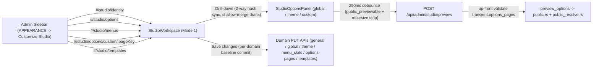

# Tái cấu trúc Điều hướng Studio Sub-Routes, Options Pages (`appearance`) & Sidebar `Customize Studio`

* **Status:** Approved
* **Approved By:** Owner
* **Approval Evidence:** Owner approved in chat on 2026-11-28 ("duyệt", confirming balanced `parent_menu = appearance`, 3-level Type B Studio navigation, concise `Customize Studio` / `Tùy chỉnh Studio` sidebar)
* **Date:** 2026-11-28
* **Baseline:** `main@00013fb`
* **Migrations:** Không có (`0` SQL migration; tái sử dụng nguyên bảng `custom_options_pages`, `theme_option_values`, `theme_option_locale_values`, `site_global_option_values` và enum `parent_menu = 'appearance'`)
* **Worktree / Branch:** `feat/studio-subroutes-and-options-ia`
* **Goldfish Review:** 1 vòng gọn (`egm-design` + `egm-codebase-details` · 2026-11-28 · `main@00013fb`) — toàn bộ 6 Blocker, 6 Major và 2 Minor đã được tích hợp trực tiếp vào đặc tả.

---

## Overview

Đặc tả này thống nhất trải nghiệm tùy biến giao diện website quanh **OpenDash Studio (`#/studio`)** theo 3 quyết định thiết kế đã chốt sơ bộ với Owner (2026-11-28):

1. **Hướng cân bằng cho Custom Options Pages (`custom_options_pages`):** Mọi Options Page đang `active` + `declared` đặt `parent_menu = 'appearance'` (nhãn hiển thị rõ ràng `Appearance -> Customize Studio`) được đưa vào làm sub-menu của **Customize Studio** (tiếng Việt: *Tùy chỉnh Studio*) và mở trực tiếp bên trong **OpenDash Studio** kèm **Live Preview tức thì** (`transient.options_pages`). Các Options Page thuộc `settings`, `content`, `system`, `top_level` tiếp tục mở dạng form Admin toàn chiều rộng (`#/options/<page_key>`) như hiện tại để phù hợp với bảng dữ liệu rộng, khóa API hoặc quyền `Editor`.
2. **Điều hướng 3 cấp kiểu B trong Studio (bỏ Accordion xếp chồng):** Thay vì nhồi Global Site Options (2 accordion *Mạng xã hội* + *Thương hiệu & Liên hệ chung*) cùng Theme-specific options vào một cột cuộn dài trong `#/studio?panel=theme-options`, toàn bộ phần tùy chọn trong Studio chuyển sang **sub-route phân cấp (drill-down)** với nút `←` và lịch sử Back/Forward của trình duyệt (`#/studio` → `#/studio/options` → `#/studio/options/global/:section`, `#/studio/options/theme[/:section]`, `#/studio/options/custom/:pageKey[/:groupId]`).
3. **Sub-menu gọn cho `Customize Studio` ở Sidebar Admin:** Đổi nhãn mục cha `Customize appearance` thành **`Customize Studio`** (`vi.po`: **`Tùy chỉnh Studio`**), đồng thời gộp mục `Menus` rời và các Custom Options Page `active` + `declared` có `parent_menu = 'appearance'` vào thành các mục con gọn (`Site identity`, `Options`, `Menus`, các Custom Options Page thuộc `appearance`, `Templates`), giữ nguyên `Themes` và `Patterns` ở cấp quản lý gói/mẫu trong nhóm `APPEARANCE`.

---

## The Problem

Qua đánh giá trực tiếp trên `main@00013fb`:

1. **Phân mảnh giữa Sidebar `APPEARANCE`, `Options pages` và `Studio`:**
   - Trong `cms/admin/src/shell/AdminShellMenu.tsx#L123-L194`, Custom Options Page có `parent_menu = 'appearance'` (ví dụ `OPTheme options`) hiện tách rời ở đầu nhóm `APPEARANCE` và mở form Admin tĩnh (`#/options/<page_key>`), trong khi `Menus` nằm ngang hàng với `Customize appearance` nhưng click vào lại nhảy vào Studio fullscreen (`#/studio?panel=menus`), còn Global/Theme options nằm ẩn bên trong Studio.
   - Người dùng không rõ ranh giới giữa "tùy chỉnh giao diện có xem trước" và "cài đặt hệ thống/vận hành".
2. **Màn `Appearance options` trong Studio (`cms/admin/src/studio/StudioCustomizerNav.tsx#L327-L393`) quá chật và dùng accordion xếp chồng:**
   - Cột sidebar Studio rộng `320px` đang phải chứa cùng lúc `Global site options` (2 accordion `acc_social_links` và `acc_brand_contact` khai báo tại `cms/crates/opendash-core/src/field_schema/spec/global_site_options.rs#L5-L83`), `Theme-specific options` (`ThemeOptionsForm.tsx`), và chưa hiển thị các Field Group ACF gắn qua Location Rule `options_page == site_global` / `theme:<id>` dù backend `public_resolve.rs#L240-L275` đã nạp chúng khi render công khai.
   - Điều hướng Studio hiện dùng query `?panel=theme-options` và chỉ đồng bộ 1 chiều từ URL vào state (`StudioWorkspace.tsx#L333,L795`) thay vì sub-route thực sự (`#/studio/options/...`) hỗ trợ Back/Forward.
3. **Thiếu Live Preview bản nháp cho Options Pages trong Studio:**
   - `preview_studio_with_cache_and_locale.rs#L177` và `preview_context.rs#L108,L322` đã nạp `custom_options` đã lưu từ DB, nhưng `TransientStudioOverrides` (`studio_preview.rs#L431-L440`) chưa nhận giá trị nháp chưa lưu của `options_pages` (`custom:<page_key>`, `site_global`, `theme:<id>`).

---

## Goals

- Chuyển toàn bộ điều hướng Mode 1 của Studio sang **sub-route chuẩn theo đường dẫn** (`#/studio`, `#/studio/identity`, `#/studio/options`, `#/studio/options/global/:section`, `#/studio/options/theme[/:section]`, `#/studio/options/custom/:pageKey[/:groupId]`, `#/studio/menus`, `#/studio/reading`, `#/studio/templates[/:targetKey]`), đồng thời giữ tương thích ngược 100% (redirect một bước thẳng tới canonical hash) cho toàn bộ URL cũ (`#/studio?panel=...`, `#/appearance/options`, `#/appearance/menus`, `#/builder?...`).
- Thay thế hoàn toàn accordion cấp đỉnh trong `Appearance options` của Studio bằng điều hướng **3 cấp Kiểu B** (`Root` → `Options` → từng mục con phẳng sạch không lồng accordion), bao phủ cả 3 tầng dữ liệu: `site_global` (12 field chuẩn + Field Group gắn thêm), `theme:<active_id>` (`theme.json` + Field Group gắn thêm), và mọi Custom Options Page `active` + `declared` có `parent_menu = 'appearance'`.
- Gom nhóm `APPEARANCE` ở Admin Sidebar gọn gàng: `Themes` → `Customize Studio` (submenu: `Site identity`, `Options`, `Menus`, các Custom Options Page `appearance`, `Templates`) → `Patterns`.
- Hỗ trợ **Live Preview tức thì** cho bản nháp chưa lưu của `custom:<page_key>`, `site_global` extra groups và `theme:<id>` extra groups qua `TransientStudioOverrides.options_pages` (xác thực chặt fail-closed trước mọi nhánh early-return, lọc đệ quy `HydrationVisibility::OptionsPublicOnly`, tôn trọng `public_previewable` của Field Group & `translatable` trên ngôn ngữ phụ, không ghi DB trước khi bấm `Save changes`), và lưu đồng bộ trong nút `Save changes` duy nhất của Studio (tái sử dụng `PUT /api/admin/options-pages/:key/values` với `If-Match` CAS + `expected_schema_token` và xử lý xung đột `409`/`412`).
- Giữ nguyên trải nghiệm form rộng `#/options/<page_key>` cho `settings`/`content`/`system`/`top_level` và đảm bảo tài khoản `Editor` không bao giờ bị khóa khỏi Options Page được cấp `min_edit_role = 'editor'`.
- Tuân thủ nghiêm ngặt giới hạn LOC (`<= 600` LOC cho mọi file mới và file ngoài baseline; không tăng vượt ratchet `loc-baseline.json` của `StudioWorkspace.tsx` và `App.tsx`).

---

## Non-Goals

- Không thêm SQL migration và không thay đổi schema bảng `custom_options_pages`, `site_global_option_values`, `theme_option_values`, `theme_option_locale_values`.
- Không hợp nhất 3 kho dữ liệu `site_global` / `theme:<id>` / `custom:<page_key>` thành một bảng duy nhất (bảo toàn bất biến "đổi theme không mất dữ liệu toàn trang").
- Không mở Studio Mode 1 (`#/studio*`) cho vai trò `Editor` (Mode 1 vẫn là Admin-only theo hợp đồng RBAC; `Editor` tiếp tục truy cập Options Page được cấp quyền qua `#/options/<page_key>`).
- Không thay đổi cấu trúc biểu mẫu của `CustomOptionsPageView.tsx` cho các Options Page thuộc `settings`/`content`/`system`/`top_level` (chỉ bổ sung nút shortcut `"Open in Studio"` cho Admin khi mở trang `appearance`).
- Không thêm dependency mới trong `cms/Cargo.toml` hay `cms/admin/package.json`.

---

## Critical User Journeys (CUJs)

### CUJ 1: Admin truy cập nhanh từ Sidebar `APPEARANCE → Customize Studio`
- **Given:** Admin đăng nhập và site có 1 Custom Options Page `optheme_options` đang `active` + `declared` đặt `parent_menu = 'appearance'` và 1 trang `brand_config` đặt `parent_menu = 'settings'`.
- **When:** Admin mở nhóm `APPEARANCE` trên sidebar trái.
- **Then:** Nhóm `APPEARANCE` chỉ gồm 3 mục cha theo thứ tự `Themes`, `Customize Studio`, `Patterns` (không còn mục `Menus` rời và không còn mục `OPTheme options` rời ở ngoài). Mở `Customize Studio` hiện gọn các mục con: `Site identity` (`#/studio/identity`), `Options` (`#/studio/options`), `Menus` (`#/studio/menus`), `OPTheme options` (`#/studio/options/custom/optheme_options`), `Templates` (`#/studio/templates`). Trang `brand_config` vẫn nằm trong `Settings` (`#/options/brand_config`).

### CUJ 2: Điều hướng 3 cấp không Accordion trong Studio `Options`
- **Given:** Admin đang ở `#/studio`.
- **When:** Admin bấm `Options` → URL đổi thành `#/studio/options` và hiện danh sách 3 phân khu: *Global site options* (`Mạng xã hội`, `Thương hiệu & Liên hệ chung`, cùng Field Group gắn thêm nếu có), *Theme options* (`opendash-starter`), và *Custom options pages* (`OPTheme options`). Admin bấm `Mạng xã hội` → URL đổi thành `#/studio/options/global/acc_social_links`, sửa Facebook URL, quay về `#/studio/options`, rồi mở `Thương hiệu & Liên hệ chung` (`#/studio/options/global/acc_brand_contact`) và sửa số điện thoại.
- **Then:** Mỗi màn con chỉ hiển thị phẳng các trường của riêng section đó (0 accordion lồng nhau), header hiển thị tên section với nút `←` quay về `Options` (`#/studio/options`). Sửa một section **merge nông (shallow-merge)** vào draft chung mà **không ghi đè/xóa** thay đổi ở section anh em. Nhấn Back/Forward trình duyệt hoặc nút `←` giữ nguyên bản nháp kèm chấm vàng dirty trên đúng mục đã sửa.

### CUJ 3: Sửa Custom Options Page trong Studio kèm Live Preview & Lưu chung 1 nút
- **Given:** Admin mở `#/studio/options/custom/optheme_options` (có 1 hoặc nhiều Field Group gắn Location Rule `options_page == custom:optheme_options`; theme đang bật đọc `custom_options.optheme_options.<key>`).
- **When:** Nếu trang có 1 Field Group → form hiện trực tiếp; nếu có >= 2 Field Groups → hiện danh sách group để drill-down vào `#/studio/options/custom/optheme_options/<group_id>`. Admin sửa 1 trường `public: true` (hoặc 1 trường thuộc admin-only group / `secret` field), xem khung Preview bên phải cập nhật sau `250 ms` mà chưa ghi DB, rồi bấm `Save changes`.
- **Then:** `POST /api/admin/studio/preview` chỉ gửi các khóa public-previewable (`public_previewable === true`, đã lọc đệ quy `Group`/`Repeater` bỏ con private/`secret`) trong `transient.options_pages["custom:optheme_options"]` — sửa trường `secret` hay admin-only group **không bao giờ gây `422`** và **không bao giờ rò rỉ ra HTML preview**. Khi bấm `Save changes`, Studio gọi `PUT /api/admin/options-pages/optheme_options/values` kèm `If-Match` và `expected_schema_token`, cập nhật ngay baseline của từng trang đã lưu thành công, xử lý xung đột `409`/`412` bằng banner reload mà giữ nguyên nháp, và bảo toàn bản nháp qua `401`.

### CUJ 4: Tương thích ngược URL cũ, `templateDirty` khi Back/Forward & Quyền `Editor`
- **Given:** Người dùng mở trực tiếp link cũ `#/studio?panel=menus`, `#/studio?panel=theme-options`, `#/appearance/menus`, `#/appearance/options`, `#/builder?template=header`, hoặc Admin đang sửa dở `templateDoc` ở `#/studio/templates/part%3Aheader` rồi bấm Back.
- **When:** Router xử lý hash và `App.tsx` kiểm tra `mayLeave`.
- **Then:** Các URL cũ tự động redirect 1 bước thẳng tới canonical hash (`#/studio/menus`, `#/studio/options`, `#/studio/templates/part%3Aheader`), đồng thời giữ `data-testid="studio-panel-menus"` cho các bộ E2E hiện có. Khi đổi `studioTemplateKey` trong lúc `templateDirty` (kể cả bằng Back/Forward trình duyệt), `mayLeave` bật xác nhận `window.confirm` và khi được chấp thuận sẽ chạy lại `hydrateTemplateTarget` đúng target mới (hoặc reset về danh sách template). Tài khoản `Editor` vẫn bị chặn `403` trên mọi route `#/studio*`, nhưng vẫn thấy và chỉnh được mọi Custom Options Page có `min_edit_role = 'editor'` (kể cả trang có `parent_menu = 'appearance'`) qua `#/options/<page_key>`.

---

## Technical Plan (Architecture)

### Sơ đồ Luồng Điều hướng & Preview



### 1. Hợp đồng Định tuyến Studio (`cms/admin/src/shell/studioRouter.ts` & `router.ts`)

Để giữ `router.ts <= 520` LOC, toàn bộ parser Studio Mode 1/Mode 2 được tách sang module mới `cms/admin/src/shell/studioRouter.ts` và gọi từ `router.ts`:

```ts
export type StudioPanelId =
  | 'root'
  | 'identity'
  | 'options'
  | 'menus'
  | 'reading'
  | 'templates';

export type StudioOptionsScope =
  | { kind: 'index' }
  | { kind: 'global'; section: string }
  | { kind: 'theme'; section?: string }
  | { kind: 'custom'; pageKey: string; groupId?: string };
```

Quy tắc parse an toàn:
- Mọi lời gọi `decodeURIComponent` được bọc trong helper `safeDecodeSegment(raw): string | null` (`try/catch` chống `URIError` khi hash có `%` lỗi).
- Segment `:pageKey` xác thực khớp `^[a-z][a-z0-9_]{0,63}$`; segment `:section`, `:groupId`, `:targetKey` cho phép định danh chứa `:`/`-`/`_` (phù hợp `ScopedResourceId` của Field Groups và `canonical_target_key` của Templates), từ chối chuỗi rỗng hoặc ký tự điều khiển.
- Bất kỳ path `#/studio/...` sai cấu trúc nào trả `{ view: 'studio', sub: 'invalid', rawHash: hash }` (giữ nhất quán với `isRouteAllowed` tại `router.ts#L462` hiện hành; đồng thời các link sai không bao giờ gây exception).

Bảng định tuyến chuẩn (`view: 'studio'`, Admin-only):

| Canonical Hash | `studioPanel` | `studioOptionsRoute` / `studioTemplateKey` | Hành vi Back (`←`) |
| --- | --- | --- | --- |
| `#/studio` | `'root'` | `undefined` | Không có nút Back (dùng nút `Exit`) |
| `#/studio/identity` | `'identity'` | `undefined` | `#/studio` (*Customize*) |
| `#/studio/options` | `'options'` | `{ kind: 'index' }` | `#/studio` (*Customize*) |
| `#/studio/options/global/:section` | `'options'` | `{ kind: 'global', section }` | `#/studio/options` (*Options*) |
| `#/studio/options/theme` | `'options'` | `{ kind: 'theme' }` | `#/studio/options` (*Options*) |
| `#/studio/options/theme/:section` | `'options'` | `{ kind: 'theme', section }` | `#/studio/options/theme` (nếu >= 2 mục) hoặc `#/studio/options` |
| `#/studio/options/custom/:pageKey` | `'options'` | `{ kind: 'custom', pageKey }` | `#/studio/options` (*Options*) |
| `#/studio/options/custom/:pageKey/:groupId` | `'options'` | `{ kind: 'custom', pageKey, groupId }` | `#/studio/options/custom/:pageKey` |
| `#/studio/menus` | `'menus'` | `undefined` | `#/studio` (*Customize*) |
| `#/studio/reading` | `'reading'` | `undefined` | `#/studio` (*Customize*) |
| `#/studio/templates` | `'templates'` | `undefined` | `#/studio` (*Customize*) |
| `#/studio/templates/:targetKey` | `'templates'` | `studioTemplateKey: decoded` | `#/studio/templates` (*Template list*) |

Bảng chuyển hướng 1 bước tương thích ngược (`redirectHash` — cập nhật cả nhánh `#/builder` tại `router.ts#L368,#L391` để không cần 2 lượt redirect):
- `#/appearance/options` và `#/studio?panel=theme-options` → `#/studio/options`
- `#/appearance/menus` và `#/studio?panel=menus` → `#/studio/menus`
- `#/studio?panel=identity` → `#/studio/identity`
- `#/studio?panel=reading` → `#/studio/reading`
- `#/studio?panel=templates` → `#/studio/templates`
- `#/studio?panel=templates&template=<k>`, `#/studio?template=<k>`, và `#/builder?template=<k>` → `#/studio/templates/${encodeURIComponent(canonicalKey)}`
- `#/studio?panel=root` → `#/studio`

Bảo vệ `templateDirty` khi điều hướng giữa các sub-route:
- Trong `App.tsx#L250-L252`: `mayLeave(destination)` vẫn không bật confirm khi di chuyển giữa các sub-route thông thường của Mode 1 (`studioIdentity(current) === studioIdentity(next)`), **nhưng** bổ sung kiểm tra riêng cho `templateDirtyRef`: nếu `current.view === 'studio' && next.view === 'studio' && current.studioTemplateKey && current.studioTemplateKey !== next.studioTemplateKey && studioTemplateDirtyRef.current`, hiển thị đúng hộp thoại xác nhận *"The current template has unsaved changes. Discard them and switch targets?"*.
- Trong `StudioWorkspace.tsx`: effect đồng bộ từ `route` cập nhật **cả** khi `route.studioTemplateKey` đổi sang `undefined` (Back về `#/studio/templates`) lẫn khi đổi sang target mới, và luôn gọi `hydrateTemplateTarget(nextKey, targets, overrideDocs)` + xóa `templateDiagnostics` (chống tình trạng lưu nhầm `templateDoc` của target A lên target B).

### 2. Tổ chức lại Sidebar `APPEARANCE` (`AdminShellMenu.tsx`, `AdminShell.tsx`)

Mở rộng `OptionsPageMenuItem` (`AdminShellMenu.tsx#L15` & `App.tsx#L200`) thêm 2 trường `provider_status: ProviderStatus` và `declaration_state: 'declared' | 'withdrawn'`:
- Khi `isAdmin === true`:
  - Lọc bỏ `page.parent_menu === 'appearance'` khỏi danh sách mục lẻ cấp 1 (giống cách lọc `page.parent_menu === 'settings' && isAdmin`).
  - Xóa mục rời `id: 'menus'` trong nhóm `appearance`.
  - Chỉ các trang `appearance` đang `provider_status === 'active' && declaration_state === 'declared'` mới xuất hiện trong `children` của `id: 'studio'` (*Customize Studio*, `hash: '#/studio'`, `group: 'appearance'`, `adminOnly: true`):
    1. `{ label: __("Site identity"), hash: '#/studio/identity' }`
    2. `{ label: __("Options"), hash: '#/studio/options' }`
    3. `{ label: __("Menus"), hash: '#/studio/menus' }`
    4. Các Custom Options Page `active` + `declared` có `parent_menu === 'appearance'` (sort theo `menu_position ASC, menu_label ASC`):
       `{ label: page.menu_label, hash: \`#/studio/options/custom/${encodeURIComponent(page.page_key)}\` }`
    5. `{ label: __("Templates"), hash: '#/studio/templates' }`
- Khi `isAdmin === false` (`Editor`):
  - `id: 'studio'` bị ẩn (`adminOnly: true`).
  - Nếu có Custom Options Page `active` + `declared` đặt `parent_menu === 'appearance'` và `min_edit_role === 'editor'`, mục đó được giữ lại cho Editor ở nhóm `content` trỏ về `#/options/<page_key>` (đảm bảo Editor không thấy nhóm `APPEARANCE` và không mất quyền sửa).
- Trong `AdminShell.tsx`:
  - `activeParentId`: trả `'studio'` cho mọi `route.view === 'studio' || route.view === 'studio-entry'`, **và** khi Admin mở form rộng `#/options/:key` của một trang có `parent_menu === 'appearance'` (tra trong `optionsPages`), cũng ánh xạ `activeParentId = 'studio'` để sidebar không mất highlight.
  - `selectedNavHash`: chuẩn hóa về đúng link con trong `studio.children` (rút gọn `:section`/`:groupId`/`:targetKey` về `#/studio/options`, `#/studio/options/custom/<pageKey>`, `#/studio/templates`).
- Trong `OptionsPagesListPage.tsx` (tách modal xóa sang tái sử dụng `ConfirmDialog.tsx` để giữ `< 575` LOC) & `CustomOptionsPageView.tsx`:
  - Đổi nhãn option `appearance` thành `Appearance -> Customize Studio` kèm ghi chú ngữ cảnh.
  - Nút hành động trên thẻ trang `appearance` đang `active` + `declared` (với Admin) dẫn sang `#/studio/options/custom/<page_key>` (`"Open in Studio"`); trên `CustomOptionsPageView.tsx` thêm nút `"Open in Studio"` cho Admin khi `snapshot.page?.parent_menu === 'appearance'` và trang đang hoạt động.

### 3. Phân tách Module Studio & Zero-Accordion Options Sub-Router

Để giữ `StudioWorkspace.tsx <= 1360` LOC (giảm so với baseline `1405`) và mọi file mới `< 450` LOC:

1. **`cms/admin/src/studio/studioOptionsSections.ts`** *(thuần TypeScript, có Node unit test)*:
   - `partitionFieldSections(fields: FieldSpec[])`: tách `FieldSpec[]` theo các marker UI-only `accordion`/`tab` ở cấp 1 thành `StudioOptionSection[]` (`{ key, label, description, fields }`), loại bỏ marker UI-only khỏi mảng `fields` con để màn chi tiết hiển thị phẳng sạch (0 accordion lồng nhau). Nếu không có marker → trả 1 section `key: 'default'`.
   - `stripNonPublicPreviewValues(specs: FieldSpec[], values: Record<string, unknown>)`: lọc **đệ quy** (bao gồm `group` và `repeater` sub-fields) theo đúng quy tắc `HydrationVisibility::OptionsPublicOnly` (`spec.type !== 'secret' && spec.public === true && spec.min_view_role !== 'admin'`) để chỉ gửi trường public-safe sang preview.
   - `buildStudioHash(panel, optionsRoute?, templateKey?)`, `resolveStudioBackTarget(...)` và `resolveStudioHeaderTitle(...)`.
2. **`cms/admin/src/studio/useStudioOptionsState.ts`**:
   - Nâng việc tải `getThemeOptions(activeThemeId, effectivePreviewLocale)` ra khỏi `ThemeOptionsForm.tsx` lên cấp Mode 1 (nạp ngay cùng Mode 1 load để `#/studio/options` biết trước số section và trạng thái dirty của Theme options trước khi click; đồng thời xóa bỏ dead-code nếu `ThemeOptionsForm.tsx` không còn consumer nào khác sau khi xác minh grep — nếu còn test/import ngoài thì giữ nguyên export mỏng).
   - Quản lý snapshot & draft cho `options_pages` (`'site_global'`, `'theme:<activeThemeId>'`, và lazy-load từng `'custom:<pageKey>'` khi mở):
     - Mọi chỉnh sửa trên từng section con (`global`, `theme`, `custom` group) **bắt buộc shallow-merge**: `prev => ({ ...prev, ...sectionNext })` và truyền full draft của scope đó xuống `<UnifiedFieldForm>` (nhờ vậy `conditions` vẫn đọc được sibling fields và sửa section A không bao giờ xóa trắng section B).
     - `buildTransientOptionsPages()`: chỉ xuất khóa thuộc các Field Group có `public_previewable === true` trên trang `active` + `declared`, tôn trọng `is_default_locale || spec.translatable`, và chạy qua `stripNonPublicPreviewValues(...)`.
     - `saveDirtyOptionsPages(csrfToken)`: lưu tuần tự từng `pageRef` có dirty bằng `putOptionsPageValues(pageRef, snap.version, { values: patch, expected_schema_token: snap.schema_token }, csrfToken, snap.locale)`, **cập nhật ngay baseline + version + schema_token sau mỗi `PUT` thành công** (chống tự gây `412` nếu trang kế tiếp lỗi).
     - Xuất `resetAll()` và `anyDirty` để nối thẳng vào `mode1Dirty`, `clearAllDrafts`, xác nhận chuyển `previewLocale`, `handleReloadConflict`, `themeRevision`, và `localeDraftBlocked`.
3. **`cms/admin/src/studio/useStudioMode1Controller.ts`**:
   - Rút gọn `StudioWorkspace.tsx` bằng cách đóng gói điều hướng 2 chiều (`handlePanelChange`, `handleOptionsRouteChange`, `handleContextBack`, `contextTitle`/`contextBadge`) và điều phối lưu Mode 1 (`handleSaveMode1`, xử lý cả `409` lẫn `412` bằng `setConflict(true)`, gọi `onSavedSettingsOrTheme()` trong `finally` nếu `savedNames.length > 0`).
4. **`cms/admin/src/studio/StudioOptionsPanel.tsx`**:
   - Render `panel === 'options'` theo `optionsRoute`:
     - **`kind: 'index'` (`#/studio/options`):** 3 phân khu: *Global site options* (từng section built-in + từng attached `site_global` Field Group), *Theme options* (`theme.json` + attached `theme:<id>` Field Group), *Custom options pages* (chỉ các trang `appearance` đang `active` + `declared`).
     - **`kind: 'global'` (`#/studio/options/global/:section`):** Form phẳng không accordion; hỗ trợ cả built-in section (`acc_social_links`, `acc_brand_contact`) và attached group (`group:<groupId>`).
     - **`kind: 'theme'` (`#/studio/options/theme[/:section]`):** Nếu >= 2 section/group và chưa có `:section` → danh sách sub-route con; ngược lại form phẳng hỗ trợ đa ngôn ngữ (`translatable` + khối read-only cho field không dịch trên ngôn ngữ phụ).
     - **`kind: 'custom'` (`#/studio/options/custom/:pageKey[/:groupId]`):** Nếu trang không tồn tại hoặc đang inactive/withdrawn → hiển thị `<AdminAlert tone="warning">` chỉ đọc (không gửi preview). Nếu 0 group → CTA tới `#/content-structure/field-groups`. Nếu 1 group → mở thẳng form phẳng. Nếu >= 2 group và chưa chọn `:groupId` → danh sách group drill-down. Luôn có link phụ `"Open full-width form"` (`#/options/:pageKey`).

### 4. Backend Transient Live Preview cho `options_pages` (Read-Only Preview, `0` Migration)

1. **Bổ sung `public_previewable: bool` trên `OptionsPageFieldGroupView`:**
   - `cms/crates/opendash-server/src/storage/options_pages/values.rs#L32`: thêm `pub public_previewable: bool` được tính bằng `!is_restricted_to_admin_only(&grp.location)` khi xây snapshot trong `get_options_page_values` / `put_options_page_values`.
   - `cms/admin/src/api/optionsPages.ts#L44`: thêm `public_previewable?: boolean`.
2. **Mở rộng `TransientStudioOverrides` (`cms/crates/opendash-server/src/storage/overrides/studio_preview.rs`):**
   - Thêm `#[serde(default)] pub options_pages: Option<BTreeMap<String, BTreeMap<String, serde_json::Value>>>` (giữ `#[serde(deny_unknown_fields)]`).
3. **Tách module `cms/crates/opendash-server/src/storage/overrides/preview_options.rs` (giữ `preview_context.rs < 580` LOC):**
   - Hàm `validate_transient_options_pages_refs_in_conn(conn, active_theme_id, transient_opt_pages)` chạy **1 lần ngay đầu `preview_studio_with_cache_and_locale`** (trước mọi nhánh early-return như `page_keys.is_empty()` hay `specs.is_empty()`):
     - Kiểm tra `transient_opt_pages.len() <= MAX_CUSTOM_OPTIONS_PAGES_PER_SITE + 2` (`66`).
     - Mỗi `page_ref` chỉ được là `"site_global"`, `"theme:<active_theme_id>"` (khi đúng theme đang active), hoặc `"custom:<page_key>"` khớp một bản ghi `active` + `declared` trong `custom_options_pages`. Bất kỳ `page_ref` nào khác → `422 Unprocessable Entity`.
4. **Validation & Hydration fail-closed trong `cms/crates/opendash-server/src/storage/options_pages/public.rs`:**
   - Helper `validate_and_apply_options_page_transient_in_conn(conn, page_ref, &all_active_specs, &public_eligible_keys, &reserved_builtin_keys, &mut raw, ov, target_locale, default_locale)`:
     - Kiểm tra từng `(k, v)` trong `ov`:
       - Từ chối `422` nếu `k` không có trong `public_eligible_keys` (gồm key lạ, field thuộc admin-only group, `secret`, `public: false`).
       - Từ chối `422` nếu `target_locale != default_locale && !spec.translatable` (đồng bộ luật `PUT`).
       - Từ chối `422` nếu `k` thuộc `reserved_builtin_keys` (tránh va chạm âm thầm với built-in `site_global` / `theme.json`).
       - Với `Group`/`Repeater`: lọc/từ chối đệ quy các sub-field không đạt `HydrationVisibility::OptionsPublicOnly.child_visibility()` (ngăn rò rỉ hoặc chấp nhận trường private/`secret` lồng bên trong).
       - Kiểm tra URL/Link chặt bằng `validate_url_or_link_spec_strict(spec, v)` (`422`).
     - Chạy `validate_field_values(&all_active_specs, FieldContext::Options, &merged_all, Some(&saved_all))` trên **đầy đủ `all_active_specs` + dữ liệu DB** (để `conditions` tham chiếu sibling non-public hoạt động chính xác!), rồi `verify_collected_media_ids_in_conn` & `validate_relational_refs_in_conn` (ánh xạ lỗi `400` → `422` qua helper cục bộ không nuốt lỗi `500` DB).
   - Cung cấp `load_public_options_page_values_with_override_in_conn` (dùng trong `public_resolve.rs` cho `"site_global"` và `"theme:<id>"`) và `load_active_custom_options_public_with_overrides_in_conn` (dùng trong `preview_studio_with_cache_and_locale.rs`, `preview_context.rs` và `wrap_entry_body_in_preview_shell_in_tx_with_budget.rs`, **luôn dùng `&effective_locale`** ở đường Studio preview để không lệch locale giữa entry và preview toolbar).
   - Các hàm cũ `load_public_options_page_values_in_conn` và `load_active_custom_options_public_in_conn` ủy quyền sang hàm mới với `None` để giữ nguyên 100% đường public `GET`.

---

## Alternatives Considered

1. **Đưa 100% mọi Custom Options Page (kể cả `settings` / `content` / `system`) vào Studio:**
   - *Bác bỏ:* Các Options Page mang tính vận hành (API key, Webhook, bảng dữ liệu nhiều cột) không cần iframe Live Preview và bị chật trong sidebar `320px`; đồng thời yêu cầu mở Studio cho vai trò `Editor` vốn đang là ranh giới Admin-only. Hướng cân bằng (`parent_menu = 'appearance'` vào Studio, còn lại giữ form Admin rộng) giữ đúng ngữ nghĩa và tối ưu cho cả hai nhóm nhu cầu.
2. **Giữ 2 cấp phẳng ngay trên root Studio (Kiểu A):**
   - *Bác bỏ theo lựa chọn của Owner:* Khi site có nhiều Custom Options Page và theme khai báo nhiều nhóm tùy chọn, màn gốc `#/studio` sẽ bị kéo dài. Điều hướng 3 cấp Kiểu B giữ root Studio luôn gọn (`Site identity`, `Options`, `Menus`, `Homepage & reading`, `Templates`).
3. **Hiển thị đầy đủ mọi sub-route nhỏ (`Social`, `Brand`, `Reading`, từng group) ra sidebar Admin ngoài:**
   - *Bác bỏ theo lựa chọn của Owner:* Làm phình nhóm `APPEARANCE` ngoài Admin. Chỉ đưa các mục chính (`Site identity`, `Options`, `Menus`, Custom Options Pages thuộc `appearance`, `Templates`) ra sub-menu của `Customize Studio`.

---

## Non-Functional Requirements

- **Bảo mật & Phân quyền (RBAC / Preview Safety):**
  - Mọi route `#/studio*` giữ nguyên kiểm tra `isRouteAllowed` Admin-only (`403` cho `Editor`).
  - Endpoint `POST /api/admin/studio/preview` giữ nguyên `require_admin_with_csrf`, chỉ đọc DB (read-only transaction), từ chối fail-closed `422` cho mọi `page_ref` / `field_key` / sub-field không hợp lệ, và chỉ hydrate qua `HydrationVisibility::OptionsPublicOnly` (tuyệt đối không rò rỉ `secret` hay private field vào HTML preview).
  - Lưu thật đi qua `PUT /api/admin/options-pages/:key/values` có sẵn `AdmittedMutation`, CSRF, `If-Match` CAS và `expected_schema_token`.
- **Bảo toàn dữ liệu & Bản nháp (`401`/`409`/`412`):**
  - Không đổi DB schema, không xóa dữ liệu options khi đổi `parent_menu` giữa `appearance` và `settings`.
  - Mọi draft trên `general`, `global_options`, `theme_options`, `menu_slots`, `options_pages` và `templateDoc` được hợp nhất nông theo section, tồn tại xuyên suốt chuyển sub-route và được bảo toàn khi gặp `401`/`409`/`412`.
- **Hiệu năng & Ranh giới LOC:**
  - Lazy-load snapshot cho từng `custom:<page_key>` khi mở (không fan-out 64 request khi vào `#/studio`).
  - Mọi file nguồn mới và ngoài baseline `<= 600` LOC; `StudioWorkspace.tsx <= 1405` LOC, `App.tsx <= 879` LOC.

---

## Detailed Implementation Plan

### Target Files to Create/Modify

| File | Action | LOC / Cap | Summary |
| --- | --- | --- | --- |
| `cms/crates/opendash-server/src/storage/options_pages/values.rs` | Modify | `<= 590 / 600` | Thêm `public_previewable: bool` vào `OptionsPageFieldGroupView`. |
| `cms/crates/opendash-server/src/storage/options_pages/public.rs` | Modify | `<= 560 / 600` | Thêm validation đệ quy fail-closed (`OptionsPublicOnly`, `translatable`, collision, full-spec `conditions`, 400→422) & `*_with_override(s)_in_conn`. |
| `cms/crates/opendash-server/src/storage/overrides/studio_preview.rs` | Modify | `<= 530 / 600` | Thêm `options_pages` vào `TransientStudioOverrides`. |
| `cms/crates/opendash-server/src/storage/overrides/preview_options.rs` | Create | `<= 160 / 600` | Xác thực up-front `transient.options_pages` refs & helper gom preview options (giữ `preview_context.rs < 580` LOC). |
| `cms/crates/opendash-server/src/storage/overrides/mod.rs` | Modify | `<= 120 / 600` | Đăng ký module `preview_options`. |
| `cms/crates/opendash-server/src/storage/settings/theme_options/public_resolve.rs` | Modify | `<= 495 / 600` | Truyền optional `transient_options_pages` cho extra attached Field Groups của `site_global` & `theme:<id>`. |
| `cms/crates/opendash-server/src/storage/overrides/preview_context.rs` | Modify | `<= 585 / 600` | Nối `transient.options_pages` và `&effective_locale` qua `preview_options`. |
| `cms/crates/opendash-server/src/storage/overrides/candidates/preview_studio_with_cache_and_locale.rs` | Modify | `<= 580 / 600` | Gọi `validate_transient_options_pages_refs_in_conn` ngay đầu hàm và truyền xuống đường preview. |
| `cms/crates/opendash-server/src/storage/overrides/candidates/wrap_entry_body_in_preview_shell_in_tx_with_budget.rs` | Modify | `<= 140 / 600` | Đồng bộ chữ ký gọi `build_preview_context_in_tx` / `build_entry_preview_context_in_tx` với `transient` & `effective_locale`. |
| `cms/crates/opendash-server/tests/content/options_pages_preview.rs` | Create | `<= 240 / 600` | Integration test cho `transient.options_pages` (`custom:<key>`, `site_global`, `theme:<id>`, `422` cho key lạ / `secret` / nested private / admin-only group / secondary non-translatable / page không active, không ghi DB). |
| `cms/crates/opendash-server/tests/content.rs` | Modify | `<= 80 / 600` | Đăng ký `mod options_pages_preview;` trong suite `content`. |
| `cms/admin/src/api/optionsPages.ts` | Modify | `<= 165 / 600` | Thêm `public_previewable?: boolean` vào `OptionsPageFieldGroupView`. |
| `cms/admin/src/api/studio.ts` | Modify | `<= 125 / 600` | Thêm `options_pages?: Record<string, Record<string, unknown>>` vào `TransientStudioOverrides` và `postStudioPreview`. |
| `cms/admin/src/shell/studioRouter.ts` | Create | `<= 190 / 600` | Parser sub-routes Studio (`StudioPanelId`, `StudioOptionsScope`, `safeDecodeSegment`, redirect 1 bước từ legacy `#/studio?panel=...` & `#/builder?...`). |
| `cms/admin/src/shell/router.ts` | Modify | `<= 490 / 600` | Ủy quyền nhánh `studio`/`appearance`/`builder` sang `studioRouter.ts`, giữ `< 500` LOC. |
| `cms/admin/src/shell/AdminShellMenu.tsx` | Modify | `<= 330 / 600` | Gom `Menus` + Custom Options Pages `active`+`declared` (`parent_menu === 'appearance'`) thành `children` gọn của `Customize Studio` cho Admin; giữ fallback nhóm `content` cho Editor. |
| `cms/admin/src/shell/AdminShell.tsx` | Modify | `<= 580 / 600` | Đồng bộ `activeParentId` (gồm `#/options/:key` của trang `appearance`) và `selectedNavHash` cho sub-routes mới của `Customize Studio`. |
| `cms/admin/src/features/options-pages/OptionsPagesListPage.tsx` | Modify | `<= 580 / 600` | Nhãn `Appearance -> Customize Studio`, gợi ý ngữ cảnh, nút `"Open in Studio"`, và chuyển hộp thoại xóa sang `ConfirmDialog` giữ biên LOC an toàn. |
| `cms/admin/src/features/options-pages/CustomOptionsPageView.tsx` | Modify | `<= 415 / 600` | Thêm nút shortcut `"Open in Studio"` cho Admin khi mở trang `appearance` đang hoạt động ở dạng form rộng. |
| `cms/admin/src/features/library/TemplateLibraryPage.tsx` | Modify | `<= 220 / 600` | Cập nhật link `Customize in Studio` sang canonical `#/studio/templates/${encodeURIComponent(role)}`. |
| `cms/admin/src/studio/studioOptionsSections.ts` | Create | `<= 230 / 600` | Pure helpers: `partitionFieldSections`, `stripNonPublicPreviewValues`, `buildStudioHash`, `resolveStudioBackTarget`, `resolveStudioHeaderTitle`. |
| `cms/admin/src/studio/useStudioOptionsState.ts` | Create | `<= 320 / 600` | Hook quản lý `theme_options` + `options_pages` (`site_global`, `theme:<id>`, `custom:<pageKey>`), shallow-merge section, `buildTransientOptionsPages`, per-page baseline save & `resetAll`. |
| `cms/admin/src/studio/useStudioMode1Controller.ts` | Create | `<= 280 / 600` | Rút controller điều hướng 2 chiều, `handleSaveMode1` (`409`/`412` + `finally` refresh) và header/back state khỏi `StudioWorkspace.tsx`. |
| `cms/admin/src/studio/StudioOptionsPanel.tsx` | Create | `<= 430 / 600` | UI 3 cấp không accordion cho `panel === 'options'` (`index`, `global`, `theme`, `custom`, đa ngôn ngữ, read-only banner cho inactive page, dirty badge). |
| `cms/admin/src/studio/StudioCustomizerNav.tsx` | Modify | `<= 510 / 600` | Đổi mục `theme-options` → `options`, ủy quyền render cho `StudioOptionsPanel`, giữ `data-testid="studio-panel-menus"`, rút gọn dưới `510` LOC. |
| `cms/admin/src/studio/StudioWorkspace.tsx` | Modify | `<= 1380 / 1405` | Tích hợp `useStudioOptionsState`, `useStudioMode1Controller`, đồng bộ 2 chiều URL + `hydrateTemplateTarget`, nối locale-switch/reload reset. |
| `cms/admin/src/features/themes/ThemeOptionsForm.tsx` | Delete *(hoặc giữ nếu có consumer ngoài)* | `0` | Dọn dead-code sau khi `useStudioOptionsState` + `StudioOptionsPanel` thay thế consumer duy nhất (`StudioCustomizerNav.tsx#L374`). |
| `cms/admin/src/App.tsx` | Modify | `<= 878 / 879` | Truyền `optionsPages` (kèm `provider_status`, `declaration_state`) & `onTemplateDirtyChange` cho `StudioWorkspace`; mở rộng `mayLeave` cho chuyển `studioTemplateKey` khi `templateDirty`. |
| `cms/admin/scripts/test-admin-navigation.mjs` | Modify | `<= 460 / 600` | Cập nhật + bổ sung unit tests cho Studio sub-routes, legacy redirects (`#/builder?...`, `#/studio?panel=...`), `Customize Studio` children, `appearance` options pages và Editor fallback. |
| `cms/admin/scripts/test-studio-ux.mjs` | Modify | `<= 520 / 600` | Cập nhật assertion legacy `'theme-options'` và bổ sung unit tests cho `partitionFieldSections`, `stripNonPublicPreviewValues`, `buildStudioHash`, `resolveStudioBackTarget`. |
| `cms/scripts/admin_sidebar_ia_e2e.py` | Modify | `<= 365 / 600` | Cập nhật danh sách `menu_ids` (`#L101`, bỏ `"menus"` cấp 1) và thao tác mở `button[data-menu-id="studio"]` trước khi kiểm `a[href="#/studio/menus"]` (`#L144,#L232`). |
| `cms/admin/src/shell/README.md` & `cms/admin/src/studio/README.md` | Modify | n/a | Cập nhật mô tả kiến trúc router & Studio 3 cấp khớp mã nguồn. |
| `cms/l10n/opendash.pot` & `cms/l10n/vi.po` | Modify | n/a | Trích xuất & dịch bổ sung 100% chuỗi mới (`0` missing). |

---

### Slice S01: Backend Transient Live Preview cho `options_pages` (`site_global`, `theme:<id>`, `custom:<page_key>`)

* **Dependencies:** Không có (nền tảng `main@00013fb`).
* **File Ownership:**
  - `cms/crates/opendash-server/src/storage/options_pages/values.rs`
  - `cms/crates/opendash-server/src/storage/options_pages/public.rs`
  - `cms/crates/opendash-server/src/storage/overrides/studio_preview.rs`
  - `cms/crates/opendash-server/src/storage/overrides/preview_options.rs`
  - `cms/crates/opendash-server/src/storage/overrides/mod.rs`
  - `cms/crates/opendash-server/src/storage/settings/theme_options/public_resolve.rs`
  - `cms/crates/opendash-server/src/storage/overrides/preview_context.rs`
  - `cms/crates/opendash-server/src/storage/overrides/candidates/preview_studio_with_cache_and_locale.rs`
  - `cms/crates/opendash-server/src/storage/overrides/candidates/wrap_entry_body_in_preview_shell_in_tx_with_budget.rs`
  - `cms/crates/opendash-server/tests/content/options_pages_preview.rs`
  - `cms/crates/opendash-server/tests/content.rs`
* **Acceptance Criteria:**
  1. `OptionsPageFieldGroupView` trả thêm `public_previewable: bool` (`!is_restricted_to_admin_only(&grp.location)`).
  2. `TransientStudioOverrides` nhận `options_pages` (`#[serde(deny_unknown_fields)]`, `<= 66` khóa) và được kiểm tra up-front ngay đầu `preview_studio_with_cache_and_locale` (trước mọi early-return `specs.is_empty()` / `page_keys.is_empty()`).
  3. `POST /api/admin/studio/preview` áp dụng bản nháp theo `&effective_locale` cho `custom:<page_key>` (cả 3 nhánh entry, placeholder, part), `site_global` extra groups và `theme:<active_theme_id>` extra groups mà không ghi DB; không đổi hành vi public `GET`.
  4. Trả `422 Unprocessable Entity` (không nuốt `500` DB) khi: `page_ref` không tồn tại / inactive / theme không active; key lạ / thuộc admin-only group / `secret` / `public: false` / nested private sub-field trong `Group`/`Repeater`; `is_secondary && !spec.translatable`; đụng key built-in; URL/media/relational ref sai. Validation `conditions` chạy trên tập full active specs + DB baseline.
  5. Mọi file Rust sửa/tạo `<= 600` LOC (`preview_context.rs < 585` LOC) và Tầng 0 (`python3 cms/scripts/run-tests.py --check`) PASS.
* **Rollback:** Hoàn nguyên commit S01 bằng `git revert`; không có migration hay thay đổi DB.

---

### Slice S02: Studio Sub-Routes (`studioRouter.ts`, `router.ts`), Sidebar `Customize Studio` & Options Page UI Hints

* **Dependencies:** S01 (hoặc song song vì chỉ phụ thuộc type `public_previewable?: boolean` của S01).
* **File Ownership:**
  - `cms/admin/src/api/optionsPages.ts`
  - `cms/admin/src/api/studio.ts`
  - `cms/admin/src/shell/studioRouter.ts`
  - `cms/admin/src/shell/router.ts`
  - `cms/admin/src/shell/AdminShellMenu.tsx`
  - `cms/admin/src/shell/AdminShell.tsx`
  - `cms/admin/src/features/options-pages/OptionsPagesListPage.tsx`
  - `cms/admin/src/features/options-pages/CustomOptionsPageView.tsx`
  - `cms/admin/src/features/library/TemplateLibraryPage.tsx`
  - `cms/admin/src/studio/studioOptionsSections.ts`
* **Acceptance Criteria:**
  1. `parseAdminRoute` (qua `studioRouter.ts`) parse an toàn (`safeDecodeSegment`, hỗ trợ `:`/`-` trong `:section`/`:groupId`/`:targetKey`) toàn bộ sub-route `#/studio/{identity,options,options/global/:section,options/theme[/:section],options/custom/:pageKey[/:groupId],menus,reading,templates[/:targetKey]}` và redirect 1 bước thẳng từ toàn bộ URL cũ (`#/studio?panel=...`, `#/appearance/options`, `#/appearance/menus`, `#/builder?...`).
  2. `buildMenuTree` gom `Menus` và mọi Custom Options Page `active`+`declared` có `parent_menu === 'appearance'` vào `children` của `id: 'studio'` (*Customize Studio*) cho Admin theo đúng thứ tự: `Site identity`, `Options`, `Menus`, các trang `appearance` (sort theo `menu_position`, `menu_label`), `Templates`; xóa mục `id: 'menus'` rời.
  3. Với `isAdmin === false` (`Editor`), mọi `#/studio*` đều bị `isRouteAllowed` chặn (`false`), còn Custom Options Page `active`+`declared` có `parent_menu === 'appearance'` và `min_edit_role === 'editor'` hiển thị ở nhóm `content` trỏ về `#/options/<page_key>`.
  4. `AdminShell.tsx` highlight đúng `Customize Studio` cho cả sub-route `#/studio/...` lẫn khi Admin mở `#/options/:key` của trang `appearance`; `OptionsPagesListPage` (`<= 580` LOC) hiển thị `Appearance -> Customize Studio` + nút `"Open in Studio"`.
  5. Tầng 0 (`npm --prefix cms/admin run typecheck`) PASS.
* **Rollback:** Hoàn nguyên commit S02 bằng `git revert`.

---

### Slice S03: Studio Zero-Accordion Options Sub-Router & 2-Way URL Sync

* **Dependencies:** S01, S02.
* **File Ownership:**
  - `cms/admin/src/studio/useStudioOptionsState.ts`
  - `cms/admin/src/studio/useStudioMode1Controller.ts`
  - `cms/admin/src/studio/StudioOptionsPanel.tsx`
  - `cms/admin/src/studio/StudioCustomizerNav.tsx`
  - `cms/admin/src/studio/StudioWorkspace.tsx`
  - `cms/admin/src/features/themes/ThemeOptionsForm.tsx` *(xóa sau khi xác nhận 0 consumer còn lại)*
  - `cms/admin/src/App.tsx`
* **Acceptance Criteria:**
  1. Root `#/studio` giữ gọn 5 mục lớn (*Site identity*, *Options*, *Menus and locations*, *Homepage and reading*, *Templates and page builder*), đồng bộ URL 2 chiều qua `onNavigateHash`, giữ `data-testid="studio-panel-menus"`.
  2. Trong `#/studio/options`, toàn bộ Global Site Options (`Mạng xã hội`, `Thương hiệu & Liên hệ chung` + extra `site_global` Field Groups), Theme Options (`theme.json` + extra `theme:<id>` Field Groups), và Custom Options Pages (`appearance` `active`+`declared`, tự mở thẳng nếu 1 group hoặc drill-down nếu >= 2) đều hiển thị **router con phẳng không accordion lồng nhau**; chỉnh sửa từng section **shallow-merge** không ghi đè section anh em.
  3. `useStudioOptionsState` chỉ gửi khóa thuộc `public_previewable` groups đã lọc đệ quy `stripNonPublicPreviewValues` sang `transient.options_pages`, cập nhật baseline ngay sau mỗi `PUT` thành công, xử lý `409` và `412` bằng `setConflict(true)`, gọi `onSavedSettingsOrTheme()` trong `finally` nếu đã lưu >= 1 domain, và `resetAll()` khi đổi `previewLocale` / reload conflict / đổi session.
  4. `App.tsx` bảo vệ `templateDirty` khi Back/Forward đổi `studioTemplateKey`, và `StudioWorkspace.tsx` luôn gọi `hydrateTemplateTarget` khi `route.studioTemplateKey` thay đổi (bao gồm quay về `undefined`).
  5. `StudioWorkspace.tsx <= 1405` LOC, `App.tsx <= 879` LOC, `StudioCustomizerNav.tsx <= 510` LOC, mọi file mới `<= 600` LOC; Tầng 0 (`npm --prefix cms/admin run typecheck`) PASS.
* **Rollback:** Hoàn nguyên commit S03 bằng `git revert`.

---

### Slice S04: Regression Tests, Gettext l10n Sync & Kiểm chứng Tầng 1

* **Dependencies:** S01, S02, S03.
* **File Ownership:**
  - `cms/admin/scripts/test-admin-navigation.mjs`
  - `cms/admin/scripts/test-studio-ux.mjs`
  - `cms/scripts/admin_sidebar_ia_e2e.py`
  - `cms/l10n/opendash.pot`
  - `cms/l10n/vi.po`
  - `cms/admin/src/shell/README.md`
  - `cms/admin/src/studio/README.md`
* **Acceptance Criteria:**
  1. `test:nav`, `test-studio-ux.mjs`, `test:fields`, `test:media-preview` và Rust integration tests `options_pages_preview` + `run-tests.py --changed` 100% PASS.
  2. `cms/scripts/admin_sidebar_ia_e2e.py` được cập nhật khớp cấu trúc `APPEARANCE` mới (`menu_ids` bỏ `"menus"` cấp 1, mở `studio` trước khi kiểm `a[href="#/studio/menus"]`).
  3. `cms/l10n/opendash.pot` và `cms/l10n/vi.po` đồng bộ sạch (`--l10n-extract` + `--l10n-compile` `0` missing) và `node cms/scripts/check-i18n.mjs --strict` PASS.
  4. Toàn bộ kiểm chứng Tầng 1 và kiểm thử live trình duyệt (Desktop + Mobile) xác nhận 0 lỗi console/UI, 0 accordion lồng nhau trong Studio `Options`, giữ nháp khi sửa đa section, và Live Preview `custom_options` phản hồi tức thì.
* **Rollback:** Hoàn nguyên commit S04 bằng `git revert`.

---

### Verification Plan

- **Tầng 0 (giữa các Slice trung gian S01–S03):**
  ```bash
  python3 cms/scripts/run-tests.py --check
  npm --prefix cms/admin run typecheck
  ```
- **Tầng 1 (1 lần duy nhất sau khi hoàn tất S04, trước Bước 6):**
  ```bash
  python3 cms/scripts/check-standards.py && python3 cms/scripts/check-standards.py --self-test
  python3 cms/scripts/check-plans.py && python3 cms/scripts/check-plans.py --self-test
  python3 .agents/scripts/check-agent-artifacts.py
  cargo fmt --manifest-path cms/Cargo.toml --all --check
  npm --prefix cms/admin run build
  node cms/scripts/check-i18n.mjs --strict
  npm --prefix cms/admin run test:nav
  npm --prefix cms/admin run test:fields
  npm --prefix cms/admin run test:media-preview
  node --test cms/admin/scripts/test-studio-ux.mjs
  python3 cms/scripts/run-tests.py --changed
  git diff --check
  ```
- **Live Browser Verification (trên bản build mới ở cổng tạm với DB bản sao cô lập):**
  - Kiểm tra sidebar `APPEARANCE` (`Themes`, `Customize Studio` có submenu `Site identity` / `Options` / `Menus` / `OPTheme options` / `Templates`, `Patterns`).
  - Kiểm tra Studio 3 cấp (`#/studio` → `#/studio/options` → `#/studio/options/global/acc_social_links`, `#/studio/options/global/acc_brand_contact`, `#/studio/options/theme`, `#/studio/options/custom/optheme_options`), sửa cả 2 section global xác nhận không ghi đè lẫn nhau, nút `←` và browser Back/Forward, xác nhận 0 accordion lồng nhau.
  - Kiểm tra chỉnh sửa & Live Preview + `Save changes` trên `OPTheme options` và `Global site options`, cùng chuyển hướng URL cũ (`#/studio?panel=menus`, `#/studio?panel=theme-options`, `#/appearance/options`, `#/builder?template=header`) và kiểm tra Desktop (`1440×900`) + Mobile (`390×844`) với `0` console/page errors.
