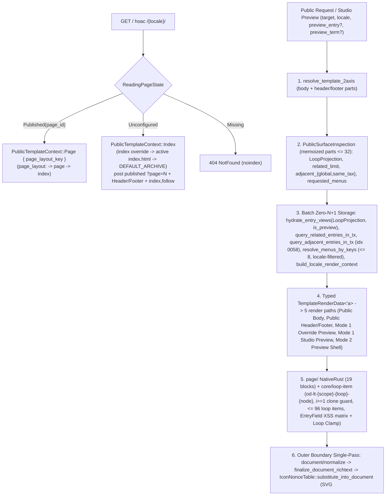

# OpenDash Studio Clean-Slate Theme V1, `Home → Page/Index`, Template-Context Blocks, `core/loop-item` Engine & Mode 1 Preview Sample Picker (Spec A2 — Luồng A)

* **Author:** Elephant / Orion (Antigravity)
* **Status:** Approved
* **Date:** 2026-11-26 *(Rebased lên `main@e6d9199` ngày 2026-11-27)*
* **Baseline SHA:** `e6d9199`
* **Approved By:** Owner
* **Approval Evidence:** Chủ dự án phê duyệt trực tiếp Spec A2 ngày 2026-11-26 (`"duyệt spec A2"` và nhấn Approve trên tài liệu, bao gồm ủy quyền cập nhật PRD `docs/product/PRODUCT_REQUIREMENTS.md` sang Theme Format V1); đồng bộ đường dẫn modular/gettext theo `main@9e17cca` ngày 2026-11-27 (giữ nguyên 100% thiết kế đã duyệt).
* **Goldfish Review:** Revision v2 Completed (4 independent zero-context reviewers: `egm-design`, `egm-codebase-details`, `egm-implementation-readiness`, `egm-comprehension` — 30 Blocker, 31 Major, 11 Minor, 4 Nit across reviewers; 100% resolved) + Delta Review S01 Completed (2 independent zero-context reviewers: `egm-design` [5 Blocker, 4 Major, 2 Minor — `D-S01-01`..`D-S01-11`] & `egm-codebase-details` [5 Blocker, 4 Major, 2 Minor — `C-S01-01`..`C-S01-11`]; 100% resolved — 0 Blocker / 0 Major tồn đọng; đã lưu hồ sơ đối chiếu trong phiên review).
* **Prerequisites (Merged / Required on `main` Before Code Implementation):**
  * **Đợt 1 — Unified Field Engine (`main@9e17cca`):** [`unified-field-engine.md`](unified-field-engine.md) (*Approved By: Owner*, PRs `#601`–`#603`, `#616`), cung cấp `opendash_core::field_schema/`, `field_hydrate.rs`, `RichTextNonceTable`, `options_source`, `entry.fields.<key>`, migrations `0055` & `0056`, và `opendash-starter` `1.0.0`.
  * **Chuẩn Gettext L10n & Feature-First Modularization (`main@9e17cca`):** [`gettext-pot-po-mo-localization.md`](gettext-pot-po-mo-localization.md) (PR `#615`: xóa `locales/*.json` của Theme & `i18n.rs::EXACT_ERROR_ENTRIES` cũ, dùng `cms/l10n/{error_codes.json,opendash.pot,vi.po}`, `content_render/l10n.rs`, và `opendash-starter/languages/opendash-starter{.pot,-vi.po}` + `{{ __(...) }}`) và [`test-suite-performance-and-reliability.md`](test-suite-performance-and-reliability.md) (7 domain test binaries + giới hạn `<= 600 LOC/file`).
  * **Spec A1 — Unified Recursive AST V1** ([`studio-unified-recursive-ast.md`](studio-unified-recursive-ast.md), *Approved By: Owner 2026-11-26*): cung cấp `BuilderDocument` (`schema_version: 1`, `blocks: Vec<BlockNode>`), `BlockNode`, `BlockSchema` (`schema_version: 1`), `CoreRenderBackend`, `HtmlSlotTable`, `apply_single_root_wrapper`, `StudioBlockTree` đệ quy & `Locked Compound Pairs`, migration `0057` (`template_override_media_refs`), và `STARTER_THEME_VERSION = "1.0.0"`.
  * **Thứ tự merge bắt buộc (không được đảo để bảo toàn lịch sử tuần tự `_sqlx_migrations` & `storage/restore.rs`):** Đợt 1 (`main@9e17cca`, migrations `0055`–`0056`) → **Spec A1** (migration `0057`) → **Spec A2 S01** (migration `0058`) → `S02` → `S03` → `S04`.
  * **Không chặn cứng bởi Luồng B (Content Structure ACF):** Cột `taxonomy_terms.featured_image_media_id` đã có sẵn từ migration `0052`, nên `core/archive-featured-image` hoạt động đầy đủ ngay ngày đầu. Các trường `term.description`, `term.fields` và `content_type.description` (do Luồng B bổ sung sau) được ánh xạ qua `Option<String>` / `BTreeMap` trên `TermRenderSummary` & `ArchiveTypeSummary` — tự động hiển thị ngay khi Luồng B merge, còn trước đó trả `None` an toàn.
* **Related Contracts:**
  * [Hợp đồng Hệ kiểu Trường Thống nhất (`UNIFIED_FIELD_SCHEMA` V1)](../contracts/UNIFIED_FIELD_SCHEMA.md)
  * [Yêu cầu Sản phẩm V1 (`PRODUCT_REQUIREMENTS`)](../product/PRODUCT_REQUIREMENTS.md)
  * [Core Foundation & Quy chuẩn Code (`CORE_FOUNDATION`)](../contracts/CORE_FOUNDATION.md)
  * [M8 Writer Inventory (`M8_WRITER_INVENTORY`)](../contracts/M8_WRITER_INVENTORY.md)

> **Quyết định Kiến trúc Chủ dự án đã khóa (2026-11-26):**
> 1. **Phương án 1 (`Home → Page/Index`):** Xóa bỏ `TemplateCandidateKind::Home`, `PublicTemplateContext::Home`, `home.html` và chuỗi chết `home_unconfigured` (`"Homepage is not configured."`). Nếu cấu hình Trang chủ tĩnh (`homepage_page_id`), `/` render qua **`Page`** (`page_layout:<key> → page → index`). Nếu chưa chọn (`ReadingPageState::Unconfigured`), `/` tự động render qua **`Index`** (`template_overrides['index'] → active_theme['index.html'] → DEFAULT_ARCHIVE`) với danh sách bài viết `post` phân trang (`/?page=N`), đầy đủ Header/Footer và SEO `index,follow`.
> 2. **Clean-Slate Theme Format V1 (`manifest_version: 1`, `source_format: 'v1'`):** OpenDash chưa phát hành V1 công khai nên xóa toàn bộ đánh số tiền-V1 (`v3`/`v2`/`v1_legacy`, `manifest_version: 3`, `theme_legacy_mappings`, `sample-theme-v3`); chuẩn hóa toàn bộ hệ theme hiện tại về **V1** (`manifest_version: 1`, `source_format = 'v1'`, `version: "1.0.0"`).

---

## Overview

Đặc tả này (**Spec A2 — Luồng A**) hoàn thiện bộ khung Theme & Template Studio của OpenDash V1 theo nguyên tắc **Clean-Slate V1**: hợp nhất định dạng theme về **Theme Format V1** (`manifest_version: 1`, `source_format: "v1"`), chuẩn hóa luồng định tuyến trang chủ **`Home → Page/Index`** (xóa `TemplateCandidateKind::Home`), và xây dựng trọn bộ **19 Template-Context Blocks** độc lập (`18` block mới + nâng cấp `core/entry-content` thay thế `core/content-slot` của Spec A1, nâng tổng Core blocks từ `21` lên **`39`**) chạy trên nền AST đệ quy V1 (`BlockSchema` + `allowed_contexts`) cho **OpenDash Studio Mode 1**.

Spec A2 giải quyết trọn vẹn 5 bài toán lõi:
1. **Clean-Slate Theme Format V1 & `Home → Page/Index` (`S01` + Migration `0058`):** Xóa bỏ toàn bộ tầng số tiền-V1 (`manifest_version: 3 → 1`, `'v1_legacy'/'v2'/'v3' → 'v1'`, `ThemeV3Manifest → ThemeManifest`, `ActiveThemeV3 → ActiveTheme`, drop bảng chết `theme_legacy_mappings`, đổi `sample-theme-v3 → sample-theme`, bỏ nhãn `(v3)` trong Admin); xóa `TemplateCandidateKind::Home` / `home.html` / `home_unconfigured` để `/` mặc định trở thành trang chủ Blog `index` (phân trang `/?page=N`, `index,follow`, góp mặt trong `sitemap.xml` và `alternates`), hoặc hiển thị `Page` tĩnh khi chọn `homepage_page_id`.
2. **19 Template-Context Blocks chuẩn kebab-case (`UNIFIED_FIELD_SCHEMA` V1, `BlockCategory::Template`):** Tách 3 nhóm ngữ cảnh rõ ràng — **Site Chrome & Navigation (`4`)**, **Single / Entry Context (`9`)**, và **Archive & Loop Engine (`6`)** — mọi Theme/Plugin sau này dùng đúng cơ chế `allowed_contexts` (`["single:type:product", "loop_item"]`) để tự đăng ký block ngữ cảnh riêng.
3. **Engine Lặp `core/loop-item` An toàn Tuyệt đối (Explicit Allowlist + `LoopProjection` + SVG `<symbol>` Dedupe + Shared CSS Scope):** Cho phép dựng bố cục card bài viết tự do cho `core/archive-loop`, `core/entry-related` và `core/list` (hợp nhất toàn bộ card mẫu thành `presets` AST depth `= 2` hợp lệ `BlockSchema`), chặn 100% đường vòng qua `template-part`/`pattern-ref`/`repeater`/`od_hook`/`<script>`/`html_id`, đẩy pha `PublicSurfaceInspection` lên trước hydration để `LoopProjection` chạy thật sự Zero-N+1, khử trùng lặp SVG icon (`<= 64` unique / `<= 256` usages) và ép ngân sách toàn trang `<= 96` loop items / request.
4. **Chuẩn hóa `core/entry-content` thay `core/content-slot` & Cấp `TemplateRenderData` trên đủ 5 đường render:** Loại bỏ hoàn toàn hiện tượng lặp `<header>`/`<h1>`/`<dl>` từ `DEFAULT_SINGLE` (giữ nguyên ranh giới `{{ od_content() }}` trên `ActiveTheme` để không nhân đôi `body` trong `opendash-starter`), mở cho CPT thuần custom-fields lưu Single template hợp lệ (đồng bộ cả `StudioTargetItem` và client save gate), và truyền `TemplateRenderData` vào đủ 5 đường render (`DbOverride` public, `part:header`/`part:footer` public, Mode 1 override preview, Mode 1 Studio preview, và Mode 2 entry preview shell).
5. **Nâng cấp Studio Mode 1 Preview Sample Picker & Taxonomy Targets:** Bổ sung nhóm `taxonomies` vào `list_studio_targets` & `StudioCustomizerNav.tsx`, thêm `preview_term`, khóa chặt `locale == effective_locale`, sửa regex `BuilderPreviewFrame.tsx` hỗ trợ cả `/api/admin/media/{id}/{file,thumbnail}` + `field_hydrate.rs` `is_preview`, tự nạp `8` bài mẫu `published` cho preview `Archive`/`Taxonomy`/`Index`, và bổ sung thanh `StudioSamplePickerBar` (tự reset state khi đổi target/locale để không bao giờ gây `400`).

### Thuật ngữ & Ký hiệu trong Tài liệu
* **Canonical Target Keys (`opendash-core/src/theme/declarations.rs`):** Khóa đích chuẩn của OpenDash gồm: `single:type:<cpt>`, `archive:type:<cpt>`, `taxonomy:key:<tax>`, `part:<key>`, `page_layout:<key>`, `page`, `single`, `singular`, `archive`, `taxonomy`, `index`, `not_found`. *(Đã xóa `home`; `/` khi có `homepage_page_id` dùng `page_layout:<key> → page → index`, khi chưa cấu hình dùng `index`.)*
* **`DbOverride` / `ActiveTheme` / `CoreFallback`:** Ba nhánh giải quyết template (`TemplateResolution`): `DbOverride` là AST Studio Mode 1 lưu trong bảng `template_overrides`; `ActiveTheme` là file HTML MiniJinja của theme V1 đang bật; `CoreFallback` là HTML dự phòng (`DEFAULT_SINGLE` / `DEFAULT_ARCHIVE`) khi không có cả hai.
* **`PublicSurfaceInspection` (`storage/overrides/surface_inspection.rs`):** Pha quét trước render (pre-render inspection) để xác định trang cần truy vấn `related_entries`, `adjacent_entries`, `menus_by_key`, và `LoopProjection` nào.
* **`preview_locale` vs `effective_locale`:** `preview_locale` là tham số ngôn ngữ tùy chọn client gửi lên API preview; `effective_locale` là mã ngôn ngữ đã được server chuẩn hóa từ `preview_locale` (fallback về ngôn ngữ mặc định của site nếu `None`).
* **`RichTextNonceTable` & `IconNonceTable`:** Hai bảng hậu-thế nonce 128-bit chạy sau `document/normalize/` để chèn HTML đã sanitize (`OD_RICHTEXT_*`, Đợt 1) và SVG icon server-owned (`OD_ICON_*`) mà tuyệt đối không mở `|safe`.
* **Dấu `*` hậu tố trong bảng §1:** Trường có `"responsive": true` (lưu `{ desktop?, tablet?, mobile? }`).

---

## The Problem

Sau khi Spec A1 mở khóa cây block đệ quy V1, Studio Mode 1 và lớp Theme/Routing vẫn còn 7 nút thắt cấu trúc:

1. **Nợ đánh số Theme tiền-V1 (`v1_legacy`/`v2`/`v3`, `manifest_version: 3`, `theme_legacy_mappings`) & bất hợp lý của template `home`:**
   - Hệ thống chưa phát hành V1 công khai nhưng đang mang `manifest_version: 3`, 3 giá trị `ThemeSourceFormat::{V1Legacy, V2, V3}`, bảng chết `theme_legacy_mappings` (0 tham chiếu trong Rust) cùng 2 cột chết `is_legacy` / `legacy_block_id`, tên thư mục `sample-theme-v3`, và nhãn Admin `Theme v3 (manifest_version=3...)`.
   - `TemplateCandidateKind::Home` / `home.html` khiến trang chủ `/` bị tách làm hai thái cực hỏng: nếu **chưa chọn** `homepage_page_id` thì trả về màn hình trống `"Homepage is not configured."` kèm `noindex,nofollow` (trong khi theme đã có `index.html`); nếu **đã chọn** 1 Page làm trang chủ thì `home.html` của `opendash-starter` lại chèn đè hero banner cứng lên trên nội dung trang được chọn thay vì dùng template `page.html` / `page-layouts/*`.
2. **Thiếu đường truyền `TemplateRenderData` vào cả `DbOverride` lẫn `part:header`/`part:footer` và Mode 2 Preview:** `content_render/`, `storage/seo/`, `storage/menu/`, `storage/public_content/` đã dựng sẵn view model ngữ cảnh, nhưng `page/` mới chỉ nhận `content_html` + `parts`; đặc biệt `resolve_and_render_header_footer_with_context_for_locale` (`storage/overrides/`), `render_preview_named_part_in_tx` (`storage/overrides/candidates/render_preview_part.rs`) và `wrap_entry_body_in_preview_shell_in_tx_with_budget` (`storage/overrides/candidates/wrap_entry_body_in_preview_shell_in_tx_with_budget.rs`) chưa nhận ngữ cảnh định kiểu.
3. **`core/content-slot` nhồi nguyên `DEFAULT_SINGLE` và khóa cứng `slots == 1` (`routes/public_content/`, `storage/overrides/`, `StudioWorkspace.tsx`):** Bài rich-text cổ điển lọt nguyên `<header>`/`<h1>`/`<dl>` khi đặt cạnh `core/entry-title`; cả server lẫn client đều khóa `slots == 1` làm CPT không có `body` không thể lưu Single template.
4. **Rủi ro bảo mật & hiệu năng trong vòng lặp (`core/loop-item`):** Cho thả block tùy ý vào vòng lặp dễ gây bypass qua `template-part`/`pattern-ref`, vượt cứng `MAX_ICONS_PER_REQUEST = 128` (`template_sec/policy/types.rs`), nổ trần `512 KiB` HTML từ `richtext`/`gallery`, mất `NodeMeta.visibility` trên card `#1..#23` nếu bỏ sai `data-node-id`, và lộ `OD_RICHTEXT_*` nonce nếu `core/entry-field` chạy `strip_richtext_to_plain` trên chuỗi nonce của Đợt 1.
5. **Đảo ngược thứ tự hydration & thiếu index SQLite cho Prev/Next:** `routes/public_content/` hiện hydrate toàn bộ `Vec<EntryView>` **trước** khi gọi `inspect_public_surfaces_and_precompile`, làm vô hiệu hóa `LoopProjection`; đồng thời `migrations/0049_entry_published_at.sql` thêm cột `published_at` nhưng chưa tạo index nên truy vấn Prev/Next theo `(published_at, id)` sẽ chạy full scan + temp B-tree sort.
6. **Thiếu nhóm `Taxonomy` trong `list_studio_targets` (`storage/overrides/candidates/list_studio_targets.rs`) & `StudioCustomizerNav.tsx`:** Admin hiện không thể mở sửa `taxonomy` hay `taxonomy:key:category` trong Studio Mode 1.
7. **5 lỗi thực tế trên Mode 1 Preview:** `resolve_preview_entry` (`storage/overrides/`) không kiểm `entry.locale == effective_locale`; `field_hydrate.rs` (Đợt 1) chưa đổi prefix URL media sang `/api/admin/media/` khi `is_preview == true` và `BuilderPreviewFrame.tsx` chỉ khớp `/file` (không khớp `/thumbnail` → ảnh `gallery` draft vỡ 401); `preview_studio` truyền `&empty_entries` cho Archive/Taxonomy/Index và hardcode `ThemeLocaleTarget::None`; `PreviewCompositionBudget::as_render_budget` (`template_sec/`) hardcode `"vi"` và không đồng bộ 3 bộ đếm ngân sách mới.

---

## Goals

1. **Clean-Slate Theme Format V1 (`manifest_version: 1`, `source_format: 'v1'`), Định tuyến `Home → Page/Index` & Migration `0058` (`<= 0` net schema objects):**
   - Hợp nhất toàn bộ hệ Theme về **V1** (`THEME_MANIFEST_VERSION = 1`, `ThemeManifest`, `ThemeSourceFormat::V1`, `ActiveTheme`, `opendash-starter` `1.0.0`, `sample-theme`), sửa `ThemesPanel.tsx`/`api/themes.ts`/`backup_worker/`/`storage/restore.rs`.
   - Xóa `TemplateCandidateKind::Home`, `PublicTemplateContext::Home`, `home.html` và `home_unconfigured`; đưa `/` `Unconfigured` về `PublicTemplateContext::Index` (danh sách `post` phân trang `?page=N`, `index,follow`, có trong `sitemap.xml` & `alternates`) và `/` `Published(page_id)` về `PublicTemplateContext::Page` (giữ nguyên route claim `"home"` trong `storage/permalinks/` và `EnqueueCondition::Home`).
   - Migration `0058_theme_v1_clean_slate_and_adjacent_index.sql` xóa bảng chết `theme_legacy_mappings` (`-1` bảng), chuẩn hóa `theme_packages` & `theme_revisions` chỉ nhận `'v1'` (bỏ `is_legacy`/`legacy_block_id`, dọn override `'home'`) và tạo partial expression index `idx_content_entries_pub_order` (`+1` index → net non-autoindex `0` objects, tổng `sqlite_schema` giảm `-3` dòng, `< 256`).
2. **19 Template-Context Blocks Chuẩn `UNIFIED_FIELD_SCHEMA` V1 (`NativeRust`, `BlockCategory::Template`, tổng 39 Core blocks):**
   - **Site Chrome & Navigation (`4`):** `core/site-brand`, `core/language-switcher`, `core/menu` (0-JS single-`<ul>` checkbox-peer drawer), `core/breadcrumbs`.
   - **Single / Entry Context (`9`):** `core/entry-title`, `core/entry-featured-image`, `core/entry-meta` (4 `date_format` tĩnh hỗ trợ `vi`/`en`, không có `author`), `core/entry-excerpt`, `core/entry-content` *(thay sạch `core/content-slot`)*, `core/entry-terms`, `core/entry-field` *(ma trận khóa XSS `25 FieldType × 8 display_format` + hỗ trợ 4 khóa lõi `context_fields` + đọc HTML đã sanitize thay vì chuỗi `OD_RICHTEXT_*`)*, `core/entry-related` *(Container)*, `core/entry-nav`.
   - **Archive & Loop Engine (`6`):** `core/archive-title`, `core/archive-description`, `core/archive-featured-image`, `core/archive-loop` *(Container, 4 presets depth `= 2` hợp lệ `BlockSchema`)*, `core/loop-item` *(Container có `layout: vertical | horizontal`)*, `core/archive-pagination`. *(Nhóm `archive-title`, `archive-loop`, `archive-pagination` dùng chung cho `archive`, `taxonomy`, và trang chủ blog `index`.)*
   - Nâng cấp `core/list` hỗ trợ `0..=1` con `core/loop-item` (kèm `ResolvedList::Page.hydrated_entries` + nút bật/tắt tùy biến card trên Inspector).
3. **Engine `core/loop-item` Chặt chẽ + Đảo thứ tự `PublicSurfaceInspection` Zero-N+1:**
   - Explicit Allowlist (`LOOP_ITEM_CORE_ALLOWLIST`, `MAX_LOOP_ITEM_NODES = 16`, `MAX_LOOP_ITEM_REL_DEPTH = 4`, cấm `NodeMeta.html_id`), kiểm tĩnh `loop_safe` cho Theme/Plugin ngay tại `validate_block_template_csec` (`supports_children == false`, không có `repeater`/`options_source`/`richtext`/`gallery`/`entry_ref`/`term_ref` kể cả trong `group`, không có `od_hook`/`<script>`/`on*`, tối đa `2` block Theme/Plugin mỗi `core/loop-item`).
   - Hoist `resolve_template_2axis` + `inspect_public_surfaces_and_precompile` (có memoization `inspected_parts` chống DAG amplification) lên **trước** bước hydrate `entries`, áp `LoopProjection` thực sự Zero-N+1 + Loop Safety Clamp trên `core/entry-field` (`richtext`/`text`/`textarea <= 300` chars, `gallery <= 4`, `entry_ref`/`term_ref <= 5`, `repeater <= 4`).
   - Shared CSS scope `od-lt-{scope}-{loop_id}-{node_id}` cho cả CSS vars lẫn `NodeMeta.visibility` trên mọi card `#0..#N` (bỏ `data-node-id` & `data-od-editable` trên `i >= 1`, gắn `data-od-loop-clone="1"` khi preview).
   - Ngân sách toàn request đồng bộ trên cả `RenderBudget` và `PreviewCompositionBudget`: `collection_queries_used <= 8` (chặn TRƯỚC khi chạy SQL `core/list`), `loop_items_rendered <= 96`, `menu_loads_used <= 8` (chặn ngay lúc nạp storage).
4. **SVG `<symbol>` Sprite Deduplication (`IconNonceTable`):**
   - Khử trùng lặp icon xuất hiện `>= 2` lần thành 1 `<svg aria-hidden="true" width="0" height="0" class="absolute overflow-hidden pointer-events-none"><defs><symbol id="od-sym-{name}" viewBox="0 0 24 24">...</symbol></defs></svg>` + `<svg viewBox="0 0 24 24" ...><use href="#od-sym-{name}"/></svg>`, trần gộp `<= 64` unique / `<= 256` usages, hạch toán byte deduped ở cả 4 call sites, chèn tại top-level `</body>` qua `HtmlScanState` (hoặc cuối preview fragment) đúng 1 lần ở biên ngoài cùng.
5. **Cắt chuyển sạch `core/entry-content`, `TemplateRenderData` đủ 5 đường render & Studio Mode 1 Preview Sample Picker:**
   - Tách `entry_body_html` thuần (sanitize tới `200 KiB`) khỏi `DEFAULT_SINGLE`, giữ ranh giới `{{ od_content() }}` trên `ActiveTheme` (0 nhân đôi `body` trên `opendash-starter`, không đổi phiên bản `1.0.0`), đồng bộ `StudioTargetItem.entry_content_rule` ở cả server và Admin ngay trong S03.
   - Bổ sung nhóm `taxonomies` vào `list_studio_targets` + `StudioCustomizerNav.tsx`, thêm `preview_term`, khóa locale, sửa `field_hydrate.rs` + `BuilderPreviewFrame.tsx` (`/(file|thumbnail)`), tự nạp `8` bài mẫu + preview stubs khi rỗng, và tạo `StudioSamplePickerBar.tsx` (tự reset khi đổi target/locale).

---

## Non-Goals

- **Không triển khai Interactive Micro-JS Pack (`/assets/opendash-blocks.js`) & Starter Marketing Blocks** (`core/tabs`, `core/slider`, `core/gallery`, `core/social-share`, `icon-box`, `testimonial`, `stats-bar`, `logo-strip`, `feature-list`): thuộc **Spec A3**.
- **Không thay đổi định danh route claim `kind = "home"` trong `storage/permalinks/`**, `EnqueueCondition::Home`, hay `route_kind = "home"` cho render hooks (chúng đại diện cho URL gốc `/` và `/{locale}/`, hoàn toàn độc lập với bộ lọc template `Page`/`Index`).
- **Không đổi `PluginManifest.manifest_schema` (`1..=3`) trong Spec A2** (~48 file plugin + `PLUGIN_ABI.md` sẽ tách PR riêng nếu chủ dự án yêu cầu để tránh xung đột với các PR của Luồng B).
- **Không triển khai `core/search-box`, `core/archive-filter`, `core/entry-toc`, hay trường `author` trên `core/entry-meta`.**
- **Không thay đổi `MAX_DEFAULT_CHILDREN_DEPTH = 2` / `MAX_DEFAULT_CHILDREN_NODES = 8` hay AST `schema_version: 1` của Spec A1** (toàn bộ 4 presets của `core/archive-loop` đạt depth `= 2` nhờ field `layout: vertical | horizontal` trên `core/loop-item`).
- **Không mở Public Media ACL cho bài/term `draft`:** ảnh draft chỉ hiển thị trong Studio Preview qua `/api/admin/media/{id}/{file,thumbnail}` bằng session Admin.

---

## Critical User Journeys (CUJs)

### CUJ 1: Dựng Template Single bài viết tùy biến (`single:type:post`) & Preview bài Draft
* **Given:** Admin mở Studio Mode 1 (`#/studio`), chọn target `Single: Bài viết (single:type:post)`, và chọn 1 bài viết ở trạng thái `draft` (có ảnh đại diện và custom fields dạng `image`/`gallery`) trên thanh **StudioSamplePickerBar**.
* **When:** Admin đặt `core/template-part` (`header`), `core/breadcrumbs`, `core/entry-title` (`h1`), `core/entry-meta` (`published_date`, `reading_time`, `primary_category`), `core/entry-featured-image`, `core/entry-content` (`prose_style: "default"`), `core/entry-field` (chọn trường công khai từ `options_source: "context_fields"`), `core/entry-terms` (`tag`), `core/entry-nav` (`cards`), và `core/entry-related` (chứa `core/loop-item`).
* **Then:**
  - Trong Preview: ảnh đại diện và toàn bộ thumbnail `gallery` của bài `draft` hiển thị sắc nét (qua `/api/admin/media/{id}/{file,thumbnail}` inlined bởi `BuilderPreviewFrame.tsx`), trong khi `GET /media/{id}/file` ẩn danh vẫn trả `404`.
  - Không lặp `<header>`, `<h1>` hay `<dl>` từ `DEFAULT_SINGLE`; lưu thành công và render trên URL công khai của mọi bài `post` `published` với đúng bài liên quan và Prev/Next index-backed.

### CUJ 2: Dựng Template Taxonomy (`taxonomy:key:category`) với `core/archive-loop` + `core/loop-item` & SVG `<symbol>` Dedupe
* **Given:** Admin mở Studio Mode 1, chọn nhóm **Phân loại (Taxonomies)** → `Taxonomy: Chuyên mục (taxonomy:key:category)`, và chọn chuyên mục *"Tin tức"* trong **StudioSamplePickerBar** (`preview_term`).
* **When:** Admin đặt `core/archive-featured-image`, `core/archive-title` (`show_total_count: true`), `core/archive-description`, `core/archive-loop` (chọn preset `card_grid_3` hoặc `horizontal_list`), chỉnh các block bên trong `core/loop-item` (bật `show_icons: true` trên `core/entry-meta`, bật `hide_mobile: true` trên `core/entry-excerpt`), và đặt `core/archive-pagination`.
* **Then:**
  - Preview tự động hiển thị tối đa `8` bài `published` thuộc *"Tin tức"* theo `effective_locale` (và preview stub cho `core/archive-pagination` nếu `total_pages <= 1`); click card `#0` chọn chính xác mọi block con (kể cả khi bật `card_link_to_entry`), còn card `#1..#7` là clone (`data-od-loop-clone="1"`, bỏ `data-node-id`) giữ nguyên responsive visibility mà không xung đột chọn Canvas.
  - Trên trang công khai `24` bài viết (`24 × 6 = 144` icon): phát đúng **1** SVG `<symbol>` sprite ẩn, **1** khối CSS scope `od-lt-*`, `0` N+1 SQLite query nhờ `LoopProjection` chạy trước hydration.
  - Thử kéo `core/template-part`, `core/pattern-ref`, `core/contact-form`, `core/entry-content` vào `core/loop-item`, xóa `core/loop-item` duy nhất, hay đặt `NodeMeta.html_id` trong loop bị chặn ở cả UI lẫn server (`400`).

### CUJ 3: Dựng Header & Footer Đa ngôn ngữ (`part:header`) Bằng Site Chrome Blocks (0 JS)
* **Given:** Site bật `vi` (mặc định) và `en` (phụ), đã có `site_logo`, menu slot `primary` gắn riêng cho `vi` và `en`.
* **When:** Admin mở Studio Mode 1 chọn `Part: Header (part:header)` và đặt `core/row` chứa `core/site-brand` (`logo_and_title`, `link_home: true`), `core/menu` (`source_mode: "slot"`, `slot_key: "primary"`, `mobile_drawer: true`), và `core/language-switcher` (`dropdown`, `native_name`).
* **Then:**
  - `TemplateRenderData` được truyền đủ vào cả public shell (`resolve_and_render_header_footer_with_context_for_locale` — kể cả trên `/` khi `Unconfigured` dùng `Index`!) lẫn Preview Mode 1/Mode 2 (`TransientStudioOverrides` phản ánh ngay khi sửa logo/menu trong Customizer).
  - Trên `/` (`vi`) và `/en/` (`en`): logo dẫn về `locale.home_url`, menu dùng đúng 1 `<ul>` duy nhất hoạt động cả desktop ngang lẫn mobile drawer **0 JS** (`checkbox + peer`), và `core/language-switcher` trỏ đúng bản dịch bài/chuyên mục/trang chủ hiện tại (`ThemeLocaleTarget::Entry/Term/Home`).

### CUJ 4: CPT Cấu trúc Không có `body` (`single:type:product` & `archive:type:product`) + Chống XSS `core/entry-field`
* **Given:** Site có CPT `"product"` không bật `supports.editor` (chỉ có ảnh đại diện và các custom fields `price`, `specs` [`richtext` công khai], `internal_cost` [`private`], `note` [`text` chứa `"javascript:alert(1)"`]).
* **When:** Admin tạo Template Override `single:type:product` chỉ gồm `core/entry-title`, `core/entry-featured-image`, `core/entry-field` (0 `core/entry-content`), và tạo `archive:type:product` đặt `core/entry-field` (`specs` và `note` với `display_format: "link"`) trong `core/loop-item`.
* **Then:**
  - Cả UI (`StudioTargetItem.entry_content_rule`) lẫn server (`validate_content_slots`) cho phép lưu `single:type:product` hợp lệ vì có `>= 1` block `core/entry-*` và `core/entry-content <= 1`.
  - `internal_cost` (`private`) tuyệt đối không xuất hiện; `note` (`text`) với `display_format: "link"` bị từ chối tạo `<a href="javascript:...">` và rơi về escape văn bản thuần; `specs` (`richtext`) đọc từ bản HTML đã sanitize (không lộ `OD_RICHTEXT_*` nonce) và bị cắt `<= 300` ký tự văn bản thuần trong `core/loop-item`.

### CUJ 5: Trang chủ `Home → Page/Index` & Clean-Slate Theme Format V1 (`manifest_version: 1`)
* **Given:** Một site cài mới (chưa cấu hình `homepage_page_id`, `ReadingPageState::Unconfigured`, có `> 20` bài `post` `published`), hoặc có một Page tĩnh `published` (dùng `page_layout: "full_width"`) được gán làm `homepage_page_id`; đồng thời có 2 gói Theme ZIP: 1 gói chuẩn V1 (`manifest_version: 1`) và 1 gói cũ tiền-V1 (`manifest_version: 3`).
* **When:** Khách truy cập `/` và `/?page=2`; Admin gán Page tĩnh vào `homepage_page_id` rồi truy cập lại `/`; Admin mở Giao diện (`ThemesPanel`) tải lên 2 gói theme và kiểm tra `sitemap.xml`.
* **Then:**
  - Khi chưa chọn `homepage_page_id`: `/` và `/?page=2` đều trả `200`, render theo nhánh **`Index`** (`template_overrides['index'] → opendash-starter/index.html → DEFAULT_ARCHIVE`) với danh sách bài `post` phân trang, Header/Footer, `robots: index,follow`, `alternates` đa ngôn ngữ trên trang 1, và `/` có mặt trong `sitemaps/1.xml` (khi không `noindex`); **không còn chuỗi `"Homepage is not configured."` / `"Chưa cấu hình trang chủ."`**. (Nếu `homepage_page_id` trỏ tới Page đã gỡ/draft `ReadingPageState::Missing`, `/` vẫn trả `404 noindex` và vắng mặt khỏi `sitemap.xml`.)
  - Khi gán Page tĩnh `published`: `/` render qua **`Page`** (`page_layout:full_width → page → index`), bảo toàn trọn vẹn SEO Trang chủ + route `/` + bố cục trang mà không bị `home.html` chèn đè banner cứng.
  - Gói Theme `manifest_version: 3` bị từ chối rõ (`400`, `"Theme manifest_version must be 1"`); gói `manifest_version: 1` cài đặt với `source_format: "v1"`, kích hoạt và backup/restore sạch; nâng cấp từ `baseline_0001.sqlite` qua `0058` giữ net non-autoindex schema objects `= 0` (`sqlite_schema < 256`).

---

## Technical Plan (Architecture)



### 0. Clean-Slate Theme Format V1, Migration `0058` & Định tuyến `Home → Page/Index` (`Slice S01`)

*(Chạy nối tiếp ngay sau khi Đợt 1 + Gettext + Modularization [`main@9e17cca`, `0055`–`0056`] và Spec A1 [`0057`] đã merge lên `main`; cập nhật đồng bộ cả `opendash-core/src/builder/` và `builtin_blocks/content-slot/block.json` của Spec A1 để biên dịch & pass 100% workspace.)*

#### 0.1. Migration `cms/migrations/0058_theme_v1_clean_slate_and_adjacent_index.sql` (`-4` dòng từ drop `theme_legacy_mappings` + 3 autoindexes, `+1` dòng từ `idx_content_entries_pub_order` = `-3` dòng `sqlite_schema` tổng; net non-autoindex `= 0`, tổng `< 256`)

Kiểm toán khóa ngoại toàn bộ `cms/migrations/` xác nhận chỉ có đúng 3 bảng tham chiếu tới `theme_packages` / `theme_revisions`: `theme_revisions`, `theme_legacy_mappings` (0 tham chiếu trong Rust, đã chết) và `theme_active_selection`; `template_override_media_refs` nối `ON DELETE CASCADE` với `template_overrides(id)`. Theo mẫu tái dựng bảng SQLite an toàn đã chứng minh tại `0042` (**không dùng `PRAGMA foreign_keys=OFF` hay `writable_schema`**):

```sql
-- 0058: Clean-Slate Theme Format V1 + xoa override 'home' + partial index Prev/Next
CREATE TABLE theme_packages_0058_copy AS SELECT * FROM theme_packages;
CREATE TABLE theme_revisions_0058_copy AS SELECT * FROM theme_revisions;
CREATE TABLE theme_active_selection_0058_copy AS SELECT * FROM theme_active_selection;

DROP TABLE theme_active_selection;
DROP TABLE theme_legacy_mappings;
DROP TABLE theme_revisions;
DROP TABLE theme_packages;

CREATE TABLE theme_packages (
    theme_id TEXT PRIMARY KEY NOT NULL,
    display_name TEXT NOT NULL,
    source_format TEXT NOT NULL DEFAULT 'v1' CHECK (source_format IN ('v1')),
    created_at TEXT NOT NULL DEFAULT (datetime('now'))
);
INSERT INTO theme_packages (theme_id, display_name, source_format, created_at)
SELECT DISTINCT p.theme_id, p.display_name, 'v1', p.created_at
  FROM theme_packages_0058_copy p
 WHERE EXISTS (
       SELECT 1 FROM theme_revisions_0058_copy r
        WHERE r.theme_id = p.theme_id
          AND r.source_format = 'v1'
          AND json_valid(r.manifest_json)
          AND json_extract(r.manifest_json, '$.manifest_version') = 1
 );

CREATE TABLE theme_revisions (
    revision_id TEXT PRIMARY KEY NOT NULL,
    theme_id TEXT NOT NULL REFERENCES theme_packages(theme_id) ON DELETE RESTRICT,
    version TEXT NOT NULL,
    revision_digest TEXT NOT NULL UNIQUE,
    source_format TEXT NOT NULL DEFAULT 'v1' CHECK (source_format IN ('v1')),
    manifest_json TEXT NOT NULL CHECK (json_valid(manifest_json)),
    file_digests_json TEXT NOT NULL DEFAULT '{}' CHECK (json_valid(file_digests_json)),
    provenance_json TEXT NOT NULL CHECK (json_valid(provenance_json)),
    created_at TEXT NOT NULL DEFAULT (datetime('now')),
    UNIQUE (theme_id, version)
);
CREATE INDEX idx_theme_revisions_theme_id ON theme_revisions(theme_id);
INSERT INTO theme_revisions (
    revision_id, theme_id, version, revision_digest, source_format,
    manifest_json, file_digests_json, provenance_json, created_at
)
SELECT revision_id, theme_id, version, revision_digest, 'v1',
       manifest_json, file_digests_json, provenance_json, created_at
  FROM theme_revisions_0058_copy
 WHERE source_format = 'v1'
   AND json_valid(manifest_json)
   AND json_extract(manifest_json, '$.manifest_version') = 1;

CREATE TABLE theme_active_selection (
    id INTEGER PRIMARY KEY NOT NULL CHECK (id = 1),
    revision_id TEXT REFERENCES theme_revisions(revision_id) ON DELETE RESTRICT,
    version INTEGER NOT NULL DEFAULT 1 CHECK (version >= 1)
);
INSERT INTO theme_active_selection (id, revision_id, version)
SELECT s.id,
       CASE WHEN EXISTS (SELECT 1 FROM theme_revisions tr WHERE tr.revision_id = s.revision_id)
            THEN s.revision_id ELSE NULL END,
       s.version
  FROM theme_active_selection_0058_copy s;

DROP TABLE theme_active_selection_0058_copy;
DROP TABLE theme_revisions_0058_copy;
DROP TABLE theme_packages_0058_copy;

-- Xoa override 'home' (template_override_media_refs tu dong cascade qua ON DELETE CASCADE)
DELETE FROM template_overrides WHERE target_kind = 'home' OR canonical_target_key = 'home';

-- Partial expression index phuc vu Prev/Next (Slice S02)
CREATE INDEX IF NOT EXISTS idx_content_entries_pub_order
    ON content_entries(content_type_key, locale, publication_status, COALESCE(published_at, updated_at) DESC, id DESC)
    WHERE publication_status = 'published' AND trashed_at IS NULL;
```

- **An toàn nâng cấp & bảo toàn dữ liệu:** Toàn bộ dữ liệu `v1_legacy` / `v2` / `v3` trên DB dev tiền-V1 được dọn sạch tại migration (giữ nguyên `theme_option_values`, `theme_option_locale_values`, `theme_option_versions` của người dùng); `theme_active_selection.revision_id` reset về `NULL` (giữ `version` CAS) để `ensure_default_starter_theme` tự cài lại `opendash-starter` `1.0.0` V1 (`manifest_version: 1`) ở khởi động đầu tiên. Trên DB mới, `baseline_0001.sqlite` (chỉ chứa bảng `theme_blocks` / `theme_packages` legacy), hay DB dev đều pass sạch. Giữ nguyên mệnh đề `CHECK (target_kind IN ('home', ...))` của bảng `template_overrides` (từ `0042`) để tránh rebuild chạm khóa ngoại `template_override_media_refs` (`0057`); Rust validation chặn `'home'` hoàn toàn và `0058` đã xóa sạch mọi dòng override `'home'` hiện có.

#### 0.2. Clean-Slate Theme Format V1 (`manifest_version: 1`, `source_format: "v1"`, `1.0.0`)

1. **`opendash-core/src/theme/{mod.rs,manifest.rs,declarations.rs,enqueue.rs}` & `opendash-core/src/builder/{mod.rs,types.rs,document.rs}`:**
   - Thêm `pub const THEME_MANIFEST_VERSION: u8 = 1;`.
   - Đổi tên `ThemeV3Manifest` → `ThemeManifest` và `valid_v3_asset_path` → `valid_theme_asset_path`; `ThemeManifest::validate` từ chối mọi `manifest_version != 1` với thông báo `"Theme manifest_version must be 1"`.
   - Xóa biến thể `TemplateCandidateKind::Home` và mọi match arm của nó (kể cả trong **`opendash-core/src/builder/` `BuilderContextTarget::matches_token`** từ Spec A1 ngay trong S01); **giữ nguyên `EnqueueCondition::Home`** (cùng tài liệu định nghĩa điều kiện `"home"` cho route gốc `/`).
2. **`opendash-server/src/{theme/,dev_mode/,backup_worker/,plugin/package.rs,plugin/manager.rs,l10n/error_catalog.rs}`, `routes/themes/` & `storage/{theme/,restore.rs,public_content/,patterns.rs,admin_extensions.rs,entries/,import/,settings/,menu/}`:**
   - Rút gọn `ThemeSourceFormat` thành duy nhất `V1` (`as_str() -> "v1"`, `from_db("v1")`); xóa `V1Legacy`, `V2`, `V3`, xóa trường `ThemePackageRecord.is_legacy` và mọi SQL ghi/đọc `is_legacy`/`legacy_block_id`.
   - Đổi tên toàn bộ ký hiệu nội bộ mang `V3`/`v3`: `ActiveThemeV3` → `ActiveTheme`, `load_active_theme_v3` → `load_active_theme`, `stage_and_commit_v3_revision` → `stage_and_commit_revision`, `ThemeV3Package` → `ThemePackage`, `parse_theme_zip_v3` → `parse_theme_zip`, `validate_theme_v3_files` → `validate_theme_files`, `V3_MAX_ACTIVE_ASSET_BYTES` → `MAX_ACTIVE_ASSET_BYTES`, `v3_entry_cap_and_allowlist` → `theme_entry_cap_and_allowlist`, `required_v3_utf8` → `required_theme_utf8`, `ThemeV3InstallResponse` → `ThemeInstallResponse`; giữ nguyên `STARTER_THEME_VERSION = "1.0.0"`.
   - Cập nhật đồng bộ `'v3'` / `ThemeSourceFormat::V3` / `ActiveThemeV3` → `'v1'` / `ThemeSourceFormat::V1` / `ActiveTheme` trong: `storage/{admin_extensions.rs, entries/mutations_and_status/validate_filter_in_tx.rs, import/, settings/theme_options/public_resolve.rs, menu/, patterns.rs, public_content/hydration_and_related.rs, public_content/taxonomy_queries/media_is_referenced.rs}` (xóa nhánh dead SQL `ov.target_kind = 'home'` trong `media_is_referenced`), `routes/themes/`, `backup_worker/`.
   - **Chặn backup tiền-V1 2 lớp (`storage/restore.rs`):**
     - *Chặn tiền-migration trong `validate_restored_db_read_only`* (chạy TRƯỚC `compiled_migrator().run`, sau kiểm fingerprint `actual_objects != expected_objects`): kiểm `PRAGMA table_info('theme_revisions')` có cột `source_format`; nếu có thì chạy `SELECT COUNT(*) FROM theme_revisions WHERE source_format != 'v1'` và trả `Err(ApiError::bad_request("Bản sao khôi phục chứa theme revision tiền-V1 không được hỗ trợ."))` (`400`) khi `> 0` (giữ `baseline_0001.sqlite` hợp lệ, còn mọi backup chứa `'v1_legacy'`/`'v2'`/`'v3'` bị từ chối sạch trước khi `0058` kịp xóa).
     - *Phòng vệ hậu-migration trong `verify_restored_db_references` (`L350-362`):* kiểm `!rev_dir.join(".complete").is_file()` khi `tr.source_format == "v1"` và trả `400` cho bất kỳ `tr.source_format != "v1"` nào.
   - **Cập nhật Gettext & bảng mã lỗi (`cms/l10n/{error_codes.json,opendash.pot,vi.po}`, `l10n/error_catalog.rs`):** đồng bộ toàn bộ mã/chuỗi `theme.*` và thông điệp `ApiError` mang `"v3" → "v1"` giữa mã nguồn (`theme/`, `storage/{theme/,import/,entries/,settings/,overrides/,patterns.rs}`, `routes/themes/`) và `cms/l10n/{error_codes.json,opendash.pot,vi.po}`, đổi khóa `"theme.theme_manifest_version_must_be_1"` (`"manifest_version của theme phải là 1."` / `"Theme manifest_version must be 1"`), đăng ký chuỗi lỗi restore tiền-V1 mới, và bảo đảm mọi test `l10n::tests` PASS 100%.
3. **`builtin_themes/`, `builtin_blocks/`, `examples/`, `fixtures/`, `admin/`, `scripts/`, `tests/` & `docs/`:**
   - `cms/crates/opendash-server/src/builtin_blocks/content-slot/block.json`: xóa `"home"` khỏi `allowed_contexts` ngay ở S01.
   - `cms/crates/opendash-server/src/builtin_themes/opendash-starter/`: cập nhật `"manifest_version": 1`, giữ `"version": "1.0.0"`, **xóa `home.html`** và entry `{"kind":"home","file":"home.html"}` trong `theme.json` + `builtin_themes/mod.rs`; cập nhật `opendash-starter/index.html` giữ chuẩn C-SEC Gettext từ PR `#615` (`{{ __("No content yet.", "opendash-starter") }}`) và bổ sung `<nav class="mt-10 flex justify-between gap-4" aria-label="{{ __("Pagination", "opendash-starter") }}"><a class="text-od-primary" href="{{ previous_url }}">{{ __("← Previous", "opendash-starter") }}</a><a class="text-od-primary" href="{{ next_url }}">{{ __("Next →", "opendash-starter") }}</a></nav>` kèm cập nhật `opendash-starter/languages/{opendash-starter.pot,opendash-starter-vi.po}`; sau đó chạy `npm --prefix cms/admin run build:public-tailwind` cập nhật `builtin_themes/opendash-tailwind.css` ngay ở S01.
   - Đổi tên `cms/examples/themes/sample-theme-v3/` → **`cms/examples/themes/sample-theme/`** (`manifest_version: 1`, `theme_id: "sample-theme"`, cập nhật `README.md`, `cms/README.md`, `cms/examples/plugins/rust-seo-plugin/README.md`); cập nhật `cms/examples/themes/theme-js-starter/theme.json`, `cms/fixtures/admin-review/theme/theme.json`, `cms/fixtures/demo-website/{README.md, theme-moc-studio/theme.json}` (và xóa `theme-moc-studio/home.html`) sang `manifest_version: 1`.
   - `cms/admin/src/`: `api/themes.ts` (`source_format: 'v1' | null`, đổi `ThemeV3InstallResponse → ThemeInstallResponse`, `isV3ThemeInstall → isV1ThemeInstall`), `api/builder.ts` (xóa `'home'` khỏi `TemplateCandidateKind`), `features/themes/ThemesPanel.tsx` (lọc `=== 'v1'`, bỏ `(v3)`, dùng Gettext `__('Theme v1 (manifest_version=1...)')` & `data-testid="theme-v1-revisions"`), `studio/StudioWorkspace.tsx:667` (đổi fallback `'home'` → `'index'` để Studio Mode 1 mới mở đi tới `'index'` thay vì rơi về `targets[0]` `part:header`), `studio/StudioCustomizerNav.tsx:358` (`__("No active v1 theme with configurable options.")`), đồng bộ `cms/l10n/{opendash.pot,vi.po}`.
   - Cập nhật scripts & 7 domain integration tests: giữ `cms/scripts/run-tests.py:649` trỏ `tests/theme/starter_theme.rs` (để `--self-test` PASS), cập nhật `cms/scripts/windows_auth_smoke.py:24-25,324-327` (đổi assert `GET /` `Unconfigured` sang `index,follow`), `cms/scripts/{demo-website-runner.py, pattern_library_studio_e2e.py, template_library_e2e.py, menu_picker_e2e.py, windows_smoke.py}`; cập nhật `storage/theme_tests/{suite_01.rs,suite_02.rs}` (kiểm chứng `0058` dọn sạch bản ghi `v1_legacy`/`v2`/`v3`, giữ nguyên `theme_active_selection.version` CAS với `revision_id = NULL`, rồi `ensure_default_starter_theme` tái cài Starter `1.0.0` `v1`) cùng toàn bộ các test trong `tests/theme/*`, `tests/builder/{studio_builder,studio_preview_api}.rs`, `tests/site_media_seo/sitemap.rs`, `tests/i18n/{locale_routing_and_seo,multilingual_e2e,theme_l10n}.rs`, `tests/ops/backup_restore_e2e.rs`.
   - Cập nhật tài liệu nền tảng theo Clean-Slate V1: `README.md`, `cms/README.md`, `docs/product/PRODUCT_REQUIREMENTS.md` (`L36-37`: `Theme Format v3` → `Theme Format V1` — đã được Owner ủy quyền khi phê duyệt Spec A2 theo [ADR-0010](../decisions/ADR-0010-agent-project-and-merge-authority.md)), `docs/contracts/CORE_FOUNDATION.md`, và `docs/contracts/PLUGIN_ABI.md`.

#### 0.3. Định tuyến `Home → Page/Index`, SEO, Alternates & Sitemap (`routes/{seo.rs,public.rs,public_content/}`, `storage/{overrides/,public_content/,seo/,sitemap.rs}`, `content_render/l10n.rs`)

1. **`routes/seo.rs:233-247` (`PublicRouteTarget::Home { locale }`), `routes/public.rs::render_home_for_locale`, `routes/public_content/` & `content_render/l10n.rs` (xóa hoàn toàn `CoreL10n.home_unconfigured`, thêm `CoreL10n.latest_posts_heading` backed by Gettext `tr("Latest posts")`):**
   - **Sửa `routes/seo.rs:233-247` cho ngôn ngữ phụ (`/en?page=2`, `/en/?page=2`):** Xóa `validate_single_query(raw)?` khỏi đầu nhánh `PublicRouteTarget::Home { locale }` (`L234`). Khi `resolved.redirect || had_trailing_slash`, kiểm tra `seo::reading_page_state_for_locale`: nếu `Unconfigured`, parse `QueryScope::ContentArchive`, từ chối `query.filters != PublicFilters::default()` (`400`), và redirect qua `CanonicalUrlBuilder::with_query(resolved.canonical_path, query, QueryScope::ContentArchive)` để bảo toàn `?page=N` khi `/en/?page=2 → /en?page=2`; nếu `Published`/`Missing`, chạy `validate_single_query(raw)?` rồi `permanent_public_redirect(resolved.canonical_path)`.
   - **Trong `routes/public.rs::render_home_for_locale`:** di chuyển kiểm tra query vào trong từng nhánh `match seo::reading_page_state_for_locale(db, Some(locale), true).await?`:
     - **`ReadingPageState::Published(page_id)`:** `validate_single_query(raw_query)` → tải & kiểm `page.content_type_key == "page"` → gọi `render_homepage_entry_response_for_locale` giải quyết **`PublicTemplateContext::Page { page_layout_key }`** (`page_layout:<key> → page → index`); giữ nguyên `route_kind = "home"`, `body_classes = &["od-route-home"]`, `EnqueueCondition::Home`, `seo::build_home_seo_view_for_locale(..., true)` và `ThemeLocaleTarget::Home`.
     - **`ReadingPageState::Missing`:** `validate_single_query(raw_query)` → trả `render_not_found_response_for_locale` (`404 noindex`).
     - **`ReadingPageState::Unconfigured`:** chạy `parse_query(raw_query, QueryScope::ContentArchive)` và **bắt buộc từ chối `400 Bad Request` nếu `query.filters != PublicFilters::default()`** (chỉ chấp nhận `?page=N` `1..=MAX_ARCHIVE_PAGE`, cấm filter taxonomy trên `/` để không trùng canonical `/posts?...`); gọi **`public_content::render_index_home_response_for_locale`**:
       - Gọi helper riêng **`public_content::list_published_for_index_home(&db, ARCHIVE_SIZE, offset, locale)`**: kiểm tra CPT `"post"` có `provider_status == Active` và `settings.public == true` rồi gọi `entries::list_published_filtered_with_total_in_tx` trực tiếp **không** qua `require_public_archive_in_conn` (nhờ vậy `/` vẫn hiển thị bài `post` ngay cả khi `/posts` cấu hình `has_archive == false`).
       - Nếu CPT `"post"` bị ẩn hoặc chưa cài: trả `entries = []`, `total_items = 0`, và dựng `synthetic_schema = ContentTypeDefinition { key: "post".into(), label: l10n.latest_posts_heading.to_string(), settings: Default::default(), fields: vec![] }` (`"Latest posts"` / `"Bài viết mới nhất"` — tránh trùng lặp `site.title`), truyền đồng bộ vào cả `render_archive_with_site_and_config_for_locale` lẫn `PublicRouteContext.content_type` (`json!({ "key": "post", "label": ... })`) để `DEFAULT_ARCHIVE` và `ActiveTheme` `index.html` không bao giờ HTTP 500 dưới `UndefinedBehavior::Strict`.
       - Tạo `PaginationView` + `previous`/`next` bằng `CanonicalUrlBuilder::with_query(canonical_path, ..., QueryScope::ContentArchive)` gắn vào `/` (hoặc `/{locale}/`); giải quyết template bằng **`overrides::build_candidates(&PublicTemplateContext::Index)`**; dùng `breadcrumbs = content_render::home_breadcrumbs(...)`.
       - SEO: `canonical_for_seo = CanonicalUrlBuilder::with_query(canonical_path, query, QueryScope::ContentArchive)`, `allow_alternates = (query.page == 1 && query.filters == PublicFilters::default())`, và truyền `allow_custom_canonical = (query.page == 1)` vào `seo::build_home_seo_view_for_locale` để `site_home_seo.canonical_url` **không** ghi đè `/?page=2` (`robots = "index,follow"` trừ khi site tắt `indexing_enabled` hoặc `site_home_seo.noindex = 1`).
       - Chuỗi ghép phản hồi hoàn chỉnh: `resolve_and_render_header_footer_with_context_for_locale` (`route_path = canonical_path`), `apply_public_render_hooks(..., "home", ..., canonicalize_public_query(raw_query, QueryScope::ContentArchive))`, `rendered_layout_with_form_csp(..., body.has_active_contact_form || shell_has_form)`, `body_classes = &["od-route-home", "od-route-index"]`, `EnqueueCondition::Home`, `ThemeLocaleTarget::Home`, `finalize_document_icons`.
2. **`storage/seo/` & `storage/sitemap.rs` (Mở rộng cho `Unconfigured` + Sửa lỗi `NULL`/`noindex` + Giữ chặt `Missing`):**
   - Cả 3 truy vấn (`sitemap::INDEXABLE_ROUTES_UNION` `route_kind = 1`, `sitemap::home_alternates`, và `seo::home_seo::build_home_seo_view_for_locale` khi `allow_alternates && !matches!(page_state, ReadingPageState::Missing)`) đều khởi đi từ **`FROM site_locales sl`** (`sl.enabled = 1 AND sl.deleted_at IS NULL AND (sl.is_default = 1 OR (SELECT multilingual_enabled FROM site_locales_state WHERE id = 1) = 1)`) nối `LEFT JOIN site_reading_settings reading ON reading.locale = sl.code`, `LEFT JOIN content_entries e ON e.id = reading.homepage_page_id`, `LEFT JOIN content_types t ON t.key = e.content_type_key`, `LEFT JOIN permalink_route_claims claims ON claims.target_kind = 'entry' AND claims.target_id = CAST(e.id AS TEXT) AND claims.locale = sl.code`, `LEFT JOIN entry_seo s ON s.entry_id = e.id`, `LEFT JOIN site_home_seo h ON h.locale = sl.code`:
     - Chọn **`COALESCE(e.id, 0) AS stable_id`** (kiểu `i64` non-null cho `sitemap.rs:220`), `lastmod = CASE WHEN reading.homepage_page_id IS NULL THEN NULL ELSE e.updated_at END`, và `canonical_path` non-null (`CASE WHEN reading.homepage_page_id IS NULL THEN (CASE WHEN sl.is_default = 1 THEN '/' ELSE '/' || sl.code END) ELSE COALESCE(claims.path, CASE WHEN sl.is_default = 1 THEN '/' ELSE '/' || sl.code END) END`).
     - Điều kiện hợp lệ + không noindex (khắc phục lỗi `entry_seo.noindex = 0` che khuất `site_home_seo.noindex = 1`): **`COALESCE(h.noindex, 0) = 0 AND (reading.homepage_page_id IS NULL OR (e.id IS NOT NULL AND e.content_type_key = 'page' AND e.locale = sl.code AND e.trashed_at IS NULL AND e.publication_status = 'published' AND t.provider_status = 'active' AND COALESCE(json_extract(t.definition_json, '$.settings.public'), 1) = 1 AND COALESCE(s.noindex, 0) = 0))`**.
     - Phân nhánh canonical tùy chỉnh để kiểm tra `is_self_canonical_for_origin`: **`CASE WHEN reading.homepage_page_id IS NULL THEN h.canonical_url ELSE COALESCE(s.canonical_url, h.canonical_url) END`**.
   - **`seo::view_context::build_theme_locale_context_in_conn` (`ThemeLocaleTarget::Home`):** Khởi đi từ `FROM site_locales sl LEFT JOIN site_reading_settings sr ON sr.locale = sl.code LEFT JOIN content_entries e ON e.id = sr.homepage_page_id LEFT JOIN content_types t ON t.key = e.content_type_key`, chọn các `enabled` locales mà `sr.homepage_page_id IS NULL` (`Unconfigured`) **HOẶC** `(e.id IS NOT NULL AND e.content_type_key = 'page' AND e.locale = sl.code AND e.trashed_at IS NULL AND e.publication_status = 'published' AND t.provider_status = 'active' AND COALESCE(json_extract(t.definition_json, '$.settings.public'), 1) = 1)` (bổ sung kiểm `e.locale = sl.code` và loại bỏ tuyệt đối `Missing`).
   - **Giữ nguyên** route claim `kind = "home"` trong `storage/permalinks/` (định danh URL `/` trên bảng route claims).
3. **`storage/overrides/`, `routes/public_content/`, `storage/public_content/` & Preview Studio:**
   - Xóa `PublicTemplateContext::Home` và toàn bộ các điểm xử lý `K::Home` trong `storage/overrides/` (`publictemplatecontext.rs`, `list_studio_targets.rs`, `preview_studio_with_cache_and_locale.rs`, `preview_context.rs` `build_placeholder_preview_theme_context`, `public_render.rs`, `resolve_2axis/`); thêm `PublicTemplateContext::Index => result.push(candidate(K::Index))`; cập nhật `build_candidates` (`Page` và `Index`), `build_reset_candidate_chain_for_locale_in_conn`, `route_kind_for_candidate`, `preview_condition`.
   - Trong `list_studio_targets.rs`: xóa `(K::Home, "Trang chủ (Home)")`; giữ `(K::Index, "Trang mặc định / Trang chủ Blog (Index)")`.
   - Xóa nhánh `"home"` tại cả **`routes/public_content/pages_and_render.rs`** lẫn **`storage/public_content/taxonomy_queries/media_is_referenced.rs`**.

---

### 1. Danh mục & Đặc tả Schema 19 Template-Context Blocks (100% kebab-case · `NativeRust` · `BlockCategory::Template`)

*Thêm `BlockCategory::Template` (`"template"`) vào `opendash-core/src/block_schema.rs` và `cms/admin/src/types.ts` để cả 19 Core blocks lẫn Theme/Plugin template blocks tự động gom vào nhóm **"Khối Ngữ cảnh Template"** ở đầu Studio Catalog.*

#### Nhóm A — Site Chrome & Navigation (`4` blocks)
| Block ID (`builtin_blocks/<slug>`) | `allowed_contexts` | Nguồn dữ liệu (`TemplateRenderData`) | Fields chuẩn (`UNIFIED_FIELD_SCHEMA` V1 — mọi trường `type`, `default`, `responsive*`) |
| --- | --- | --- | --- |
| `core/site-brand` (`site-brand`) | `["template", "part"]` | `site.{title,tagline}`, `site_logo` (ưu tiên `merged_options["site_logo"]` theo locale, fallback `site_options["site_logo"]`, object `{id,url,alt,width,height}` theo `is_preview`), `locale.home_url` | `display_mode`: `radio_buttons` (`logo_only\|title_only\|logo_and_title\|title_and_tagline`, def `logo_and_title`), `logo_height`: `range*` (`20..=120`, step `2`, `px`, def `36`, `css_var: "--od-brand-h"`), `title_tag`: `select` (`span\|p\|h1`, def `span`), `link_home`: `boolean` (def `true`), `align`: `radio_buttons*` (`left\|center\|right`, def `left`), `color`: `color` (`css_var: "--od-brand-color"`) |
| `core/language-switcher` (`language-switcher`) | `["template", "part"]` | `locale.{code,label,alternates}` (`storage/seo/view_context/`; `label_mode: "native_name"` đọc `alternate.label`, `"code"` đọc `alternate.code.to_uppercase()`) | `style`: `radio_buttons` (`dropdown\|inline\|pills`, def `dropdown` dùng `<details>` **0 JS**), `label_mode`: `radio_buttons` (`code\|native_name`, def `native_name`), `align`: `radio_buttons*` (`left\|center\|right`, def `right`). *(Public ẩn nếu `alternates.len() <= 1`; Preview hiện stub badge `[VI / EN]` chọn được trên Canvas)* |
| `core/menu` (`menu`) | `["template", "part"]` | `menus_by_slot` / `menus_by_key` (`<= 8` menu tổng/request, lọc public ACL & locale) | `source_mode`: `radio_buttons` (`slot\|menu`, def `slot`), `slot_key`: `select` (`options_source: "menu_slots"`, `conditions: source_mode == "slot"`), `menu_key`: `select` (`options_source: "menus"`, `conditions: source_mode == "menu"`), `layout`: `radio_buttons` (`horizontal\|vertical`, def `horizontal`), `max_depth`: `range` (`1..=3`, def `2`), `mobile_drawer`: `boolean` (def `true`), `align`: `radio_buttons*` (`left\|center\|right`, def `left`), `gap`: `range*` (`0..=48`, step `4`, `px`, def `16`, `css_var: "--od-menu-gap"`) |
| `core/breadcrumbs` (`breadcrumbs`) | `["template", "part"]` | `breadcrumbs: &[BreadcrumbItem]` | `separator`: `radio_buttons` (`chevron\|slash\|dot`, def `chevron`), `show_home_icon`: `boolean` (def `false`), `hide_on_home`: `boolean` (def `true`), `align`: `radio_buttons*` (`left\|center\|right`, def `left`), `color`: `color` (`css_var: "--od-bc-color"`) *(WAI-ARIA `<nav aria-label="{l10n.breadcrumb_nav}"><ol>`)* |

**Cấu trúc 0-JS 1-`<ul>` duy nhất cho `core/menu` (`mobile_drawer: true`):**
```html
<nav class="od-menu relative" aria-label="{menu.title}">
  <input type="checkbox" id="od-mt-{scope}-{node_id}" class="peer sr-only" aria-hidden="true">
  <label for="od-mt-{scope}-{node_id}" role="button" aria-label="{l10n.menu_toggle}"
         class="inline-flex cursor-pointer items-center gap-2 rounded-lg border border-od-border px-3 py-2 text-sm font-medium md:hidden">
    {od_icon("menu", "w-5 h-5")}<span>{l10n.menu_label}</span>
  </label>
  <ul class="hidden peer-checked:flex flex-col md:flex md:flex-row md:items-center ...">
    <!-- 1 cay <ul> duy nhat; cap con 2..3 dung <details class="od-menu-sub"> 0 JS -->
  </ul>
</nav>
```
*(Hoạt động trên 100% trình duyệt không cần `::details-content`, không nhân đôi DOM link; `core/menu` là `NativeRust` và bị cấm trong `core/loop-item` nên `id="od-mt-{scope}-{node_id}"` luôn duy nhất trên DOM.)*

#### Nhóm B — Single / Entry Context (`9` blocks — `core/entry-content` thay thế `core/content-slot`, 0 `"home"`)
| Block ID (`builtin_blocks/<slug>`) | `allowed_contexts` | Nguồn dữ liệu | Fields chuẩn (`UNIFIED_FIELD_SCHEMA` V1) |
| --- | --- | --- | --- |
| `core/entry-title` (`entry-title`) | `["single", "single_custom", "singular", "page", "page_layout", "index", "loop_item"]` | `active_entry.title`, `active_entry.url` | `tag`: `select` (`h1\|h2\|h3\|h4`, def `h1` — tự hạ `h1 → h2` trong `loop_item`), `size`: `select*` (`sm\|base\|lg\|xl\|2xl\|3xl\|4xl`, def `3xl`), `align`: `radio_buttons*` (`left\|center\|right`, def `left`), `color`: `color` (`css_var: "--od-et-color"`), `link_to_entry`: `boolean` (def `false`; chỉ bọc `<a>` khi `url` là `Some` khác rỗng), `max_lines`: `select` (`none\|1\|2\|3`, def `none`) |
| `core/entry-featured-image` (`entry-featured-image`) | `["single", "single_custom", "singular", "page", "page_layout", "index", "loop_item"]` | `active_entry.cover` (`{url, alt, width, height}` theo `is_preview`) | `aspect_ratio`: `select` (`auto\|16_9\|4_3\|3_2\|1_1\|4_5`, def `16_9`), `object_fit`: `radio_buttons` (`cover\|contain`, def `cover`), `radius`: `select` (`none\|sm\|md\|lg\|xl\|full`, def `lg`), `link_to_entry`: `boolean` (def `false`), `hide_if_empty`: `boolean` (def `true`), single root `<figure>` |
| `core/entry-meta` (`entry-meta`) | `["single", "single_custom", "singular", "page", "page_layout", "index", "loop_item"]` | `active_entry.{published_at,updated_at,reading_time_minutes,primary_category}` | `items`: `checkbox` (`published_date\|updated_date\|reading_time\|primary_category`, def `["published_date","reading_time"]` — **0 `author`**), `date_format`: `select` (`dmy_slash\|mdy_long\|iso_date\|short_month`, def `dmy_slash`), `separator`: `radio_buttons` (`dot\|slash\|pipe`, def `dot`), `show_icons`: `boolean` (def `true`), `align`: `radio_buttons*` (`left\|center\|right`, def `left`) |
| `core/entry-excerpt` (`entry-excerpt`) | `["single", "single_custom", "singular", "page", "page_layout", "index", "loop_item"]` | `active_entry.excerpt` | `font_size`: `select*` (`sm\|base\|lg`, def `base`), `align`: `radio_buttons*` (`left\|center\|right`, def `left`), `color`: `color` (`css_var: "--od-ex-color"`), `max_chars`: `number` (`40..=500`, def `180`), `max_lines`: `select` (`none\|2\|3\|4`, def `3`), `hide_if_empty`: `boolean` (def `true`) |
| `core/entry-content` (`entry-content`) | `["single", "single_custom", "singular", "page", "page_layout", "index"]` *(max `1`, **cấm trong `loop_item`**)* | `entry_body_html` (Mode 2 Builder HTML **hoặc** classic `body` sanitize tới `200 KiB`) | `prose_style`: `radio_buttons` (`default\|wide\|none`, def `default` — **chỉ áp cho classic RichText `body`**; khi `entry_has_builder_body == true` luôn xuất full-width không bó `od-prose`), `fallback_to_fields`: `boolean` (def `false`: xuất `<dl>` sạch của `entry.field_list` `Public` khi CPT không có `body`) |
| `core/entry-terms` (`entry-terms`) | `["single", "single_custom", "singular", "loop_item"]` | `active_entry.terms[taxonomy_key]` / `active_entry.all_terms` | `taxonomy_key`: `select` (`options_source: "taxonomies"`, `allow_null: true`), `style`: `radio_buttons` (`pill\|text\|outline`, def `pill`), `prefix_label`: `text` (def `""`), `max_items`: `range` (`1..=12`, def `6`), `link_to_term`: `boolean` (def `true`), `align`: `radio_buttons*` (`left\|center\|right`, def `left`), `hide_if_empty`: `boolean` (def `true`) |
| `core/entry-field` (`entry-field`) | `["single", "single_custom", "singular", "page", "page_layout", "index", "loop_item"]` | `active_entry` (4 khóa lõi `title/slug/url/cover_url` + `active_entry.fields[field_key]` + `active_entry.richtext_html[field_key]`) | `field_key`: `select` (`options_source: "context_fields"`), `label_mode`: `radio_buttons` (`hide\|inline\|stacked`, def `inline`), `custom_label`: `text` (def `""`), `display_format`: `select` (`auto\|text\|badge\|date\|number\|link\|image\|gallery`, def `auto`), `hide_if_empty`: `boolean` (def `true`) |
| `core/entry-related` (`entry-related`) | `["single", "single_custom", "singular"]` · **Container** (`allowed_children: ["core/loop-item"]`, `1..=1`) | `related_entries: &[EntryView]` | `heading`: `text` (def `""` → dùng `l10n.related_entries`), `limit`: `range` (`2..=8`, def `4`), `columns`: `range*` (`1..=4`, def `{mobile:1,tablet:2,desktop:4}`), `gap`: `range*` (`0..=48`, step `4`, `px`, def `24`, `css_var: "--od-rel-gap"`), `hide_if_empty`: `boolean` (def `true`), `default_children`: 1 `core/loop-item` (depth `= 2`) |
| `core/entry-nav` (`entry-nav`) | `["single", "single_custom", "singular"]` | `adjacent_entries_global` / `adjacent_entries_same_taxonomy` | `same_taxonomy`: `boolean` (def `false`), `show_thumbnail`: `boolean` (def `true`), `prev_label`: `text` (def `""` → `l10n.prev_entry`), `next_label`: `text` (def `""` → `l10n.next_entry`), `style`: `radio_buttons` (`cards\|minimal`, def `cards`) *(giữ lưới 2 cột khi chỉ có 1 bên: `prev` căn trái, `next` căn phải `md:col-start-2`)* |

- **Quy ước format ngày `jiff` cho 4 `date_format` (`core/entry-meta` & `core/entry-field`):**
  - `dmy_slash`: `26/11/2026` (cả `vi` & `en`).
  - `iso_date`: `2026-11-26` (cả `vi` & `en`).
  - `mdy_long`: `vi` → `26 tháng 11, 2026` (bảng tháng tĩnh `1..=12` trong `content_render/`); `en` → `November 26, 2026`.
  - `short_month`: `vi` → `26 Thg 11, 2026`; `en` → `Nov 26, 2026`.
  - Khi bài ở trạng thái `draft` trong Preview (`published_at == None`): `published_date` fallback sang `updated_at` kèm hậu tố nhãn xem trước; trên Public nếu `published_at == None` thì ẩn mục `published_date`.
- **Quy ước `hide_if_empty` đồng nhất trên Public vs Preview:** Khi dữ liệu rỗng, **Public** luôn trả `""` (không xuất `<figure></figure>`/`<p></p>` rỗng dù `hide_if_empty` là `true` hay `false`); **Studio Preview** luôn xuất 1 khung placeholder mảnh mang `data-od-editable="1"` (hiển thị tên block mờ) để Editor không bao giờ bị "mất dấu" block trên Canvas.

#### Nhóm C — Archive, Taxonomy, Index & Loop Engine (`6` blocks)
| Block ID (`builtin_blocks/<slug>`) | `allowed_contexts` | Nguồn dữ liệu | Fields chuẩn (`UNIFIED_FIELD_SCHEMA` V1) |
| --- | --- | --- | --- |
| `core/archive-title` (`archive-title`) | `["archive", "taxonomy", "index"]` *(dùng chung cho `/posts`, taxonomy, và `/` khi `Unconfigured`)* | `term.name` / `content_type.label`, `pagination.total_items` | `tag`: `select` (`h1\|h2`, def `h1`), `show_prefix`: `boolean` (def `false`; khi `true` trên Taxonomy phát `"{taxonomy_label}: {term.name}"`), `show_total_count`: `boolean` (def `false`), `size`: `select*` (`xl\|2xl\|3xl\|4xl`, def `3xl`), `align`: `radio_buttons*` (`left\|center\|right`, def `left`), `color`: `color` (`css_var: "--od-at-color"`) |
| `core/archive-description` (`archive-description`) | `["archive", "taxonomy"]` | `term.description` / `content_type.description` *(trả `None` an toàn trước khi Luồng B nối cột)* | `font_size`: `select*` (`sm\|base\|lg`, def `base`), `align`: `radio_buttons*` (`left\|center\|right`, def `left`), `color`: `color` (`css_var: "--od-ad-color"`), `hide_if_empty`: `boolean` (def `true`) |
| `core/archive-featured-image` (`archive-featured-image`) | `["taxonomy"]` | `term.featured_image` *(từ `taxonomy_terms.featured_image_media_id` sẵn có `0052`, URL theo `is_preview`)* | `aspect_ratio`: `select` (`auto\|16_9\|4_3\|3_2\|1_1\|4_5`, def `16_9`), `object_fit`: `radio_buttons` (`cover\|contain`, def `cover`), `radius`: `select` (`none\|sm\|md\|lg\|xl\|full`, def `lg`), `hide_if_empty`: `boolean` (def `true`), single root `<figure>` |
| `core/archive-loop` (`archive-loop`) | `["archive", "taxonomy", "index"]` *(dùng cho `/posts`, taxonomy, và `/` khi `Unconfigured`)* · **Container** (`allowed_children: ["core/loop-item"]`, `1..=1`) | `archive_entries: &[EntryView]` (tối đa `24`/trang) | `columns`: `range*` (`1..=4`, def `{mobile:1,tablet:2,desktop:3}`), `gap`: `range*` (`0..=48`, step `4`, `px`, def `24`, `css_var: "--od-loop-gap"`), `empty_message`: `text` (def `""` → `l10n.empty_content`), `default_children`: 1 `core/loop-item` (depth `= 2`), `presets`: 4 preset chuẩn depth `= 2` bên dưới |
| `core/loop-item` (`loop-item`) | `allowed_parents: ["core/archive-loop", "core/entry-related", "core/list"]` · `allowed_contexts: ["*"]` · **Explicit Allowlist** | `active_entry` của từng iteration | `layout`: `radio_buttons` (`vertical\|horizontal`, def `vertical` — khi `horizontal`, CSS grid chia 2 cột trên `md:` cho ảnh đầu tiên `<figure>` bên trái & thân bên phải), `surface_style`: `radio_buttons` (`flat\|bordered\|elevated`, def `bordered`), `bg_color`: `color` (`css_var: "--od-li-bg"`), `radius`: `select` (`none\|sm\|md\|lg\|xl`, def `lg`), `padding`: `spacing*` (`property: "padding"`, def `{top:16,right:16,bottom:16,left:16}`), `card_link_to_entry`: `boolean` (def `false`) |
| `core/archive-pagination` (`archive-pagination`) | `["archive", "taxonomy", "index"]` | `pagination: &PaginationView` | `style`: `radio_buttons` (`numbers\|prev_next\|compact`, def `numbers`), `prev_label`: `text` (def `""` → `l10n.previous_page`), `next_label`: `text` (def `""` → `l10n.next_page`), `align`: `radio_buttons*` (`left\|center\|right`, def `center`). *(Public ẩn khi `total_pages <= 1`; Preview hiện stub 3 trang `1 · 2 · 3` để chọn & chỉnh style được)* |

**4 `presets` chuẩn của `core/archive-loop` (tất cả đạt `depth == 2 <= MAX_DEFAULT_CHILDREN_DEPTH` & `<= 6` nodes `<= MAX_DEFAULT_CHILDREN_NODES`):**
```json
[
  {
    "key": "card_grid_3", "title": "Lưới 3 cột tiêu chuẩn", "icon": "layout-grid",
    "props": { "columns": { "desktop": 3, "tablet": 2, "mobile": 1 }, "gap": { "desktop": 24 } },
    "children": [{
      "block_id": "core/loop-item",
      "props": { "layout": "vertical", "surface_style": "bordered", "card_link_to_entry": true },
      "children": [
        { "block_id": "core/entry-featured-image", "props": { "aspect_ratio": "16_9" } },
        { "block_id": "core/entry-terms", "props": { "max_items": 2, "style": "pill" } },
        { "block_id": "core/entry-title", "props": { "tag": "h2", "size": { "desktop": "lg" }, "link_to_entry": true, "max_lines": "2" } },
        { "block_id": "core/entry-meta", "props": { "items": ["published_date", "reading_time"] } },
        { "block_id": "core/entry-excerpt", "props": { "max_lines": "2" } }
      ]
    }]
  },
  {
    "key": "card_grid_2", "title": "Lưới 2 cột rộng", "icon": "columns",
    "props": { "columns": { "desktop": 2, "tablet": 2, "mobile": 1 }, "gap": { "desktop": 28 } },
    "children": [{
      "block_id": "core/loop-item",
      "props": { "layout": "vertical", "surface_style": "elevated", "card_link_to_entry": true },
      "children": [
        { "block_id": "core/entry-featured-image", "props": { "aspect_ratio": "16_9" } },
        { "block_id": "core/entry-title", "props": { "tag": "h2", "size": { "desktop": "xl" }, "link_to_entry": true } },
        { "block_id": "core/entry-meta", "props": { "items": ["published_date", "primary_category", "reading_time"] } },
        { "block_id": "core/entry-excerpt", "props": { "max_lines": "3" } }
      ]
    }]
  },
  {
    "key": "horizontal_list", "title": "Danh sách ngang (Ảnh trái)", "icon": "list",
    "props": { "columns": { "desktop": 1, "tablet": 1, "mobile": 1 }, "gap": { "desktop": 20 } },
    "children": [{
      "block_id": "core/loop-item",
      "props": { "layout": "horizontal", "surface_style": "bordered", "card_link_to_entry": true },
      "children": [
        { "block_id": "core/entry-featured-image", "props": { "aspect_ratio": "4_3" } },
        { "block_id": "core/entry-title", "props": { "tag": "h2", "size": { "desktop": "xl" }, "link_to_entry": true } },
        { "block_id": "core/entry-meta", "props": { "items": ["published_date", "reading_time"] } },
        { "block_id": "core/entry-excerpt", "props": { "max_lines": "3" } }
      ]
    }]
  },
  {
    "key": "minimal_blog", "title": "Blog tối giản (Không ảnh)", "icon": "align-left",
    "props": { "columns": { "desktop": 1, "tablet": 1, "mobile": 1 }, "gap": { "desktop": 16 } },
    "children": [{
      "block_id": "core/loop-item",
      "props": { "layout": "vertical", "surface_style": "flat" },
      "children": [
        { "block_id": "core/entry-meta", "props": { "items": ["published_date", "primary_category"] } },
        { "block_id": "core/entry-title", "props": { "tag": "h2", "size": { "desktop": "2xl" }, "link_to_entry": true } },
        { "block_id": "core/entry-excerpt", "props": { "max_lines": "2" } }
      ]
    }]
  }
]
```
*(Tương tự, `core/entry-related.default_children` dùng 1 `core/loop-item` chứa 3 lá `core/entry-featured-image`, `core/entry-title`, `core/entry-meta` → depth `= 2`, `4` nodes.)*

### 2. Ma trận Chống XSS & Loop Clamp cho `core/entry-field` (`25 FieldType × 8 display_format`)

- **4 khóa lõi của `options_source: "context_fields"` (Đợt 1):** Khi `field_key` là `"title" | "slug" | "url" | "cover_url"`, `render_entry_field` đọc trực tiếp từ `active_entry.{title, slug, url, cover}` (escape HTML chuẩn, `url` xác thực qua `valid_block_url`, `cover_url` render `` khi `auto`/`image`).
- **Quy tắc khóa XSS theo `FieldType`:** Tuyệt đối **KHÔNG** xuất `href` hay `src` từ giá trị chuỗi chưa xác thực kiểu (`text`, `textarea`, `select`, `number`, ...). Mọi `display_format` không tương thích với `FieldType` tự động rơi về nhánh `auto` (escape văn bản thuần):

| Nhóm `FieldType` | `auto` (Ngoài `loop_item`) | Explicit `display_format` được phép | Loop Safety Clamp (`in_loop_item == true`) |
| --- | --- | --- | --- |
| `text`, `textarea`, `select`(single), `radio_buttons` | Escaped text (`<span/p>`) | `text`, `badge` (`<span class="od-badge">`) | Cắt tối đa `300` ký tự + `…` |
| `email` | `<a href="mailto:{esc}">{esc}</a>` | `text`, `link` (`mailto:`) | Giữ nguyên (đã `<= 254` chars) |
| `url` | `<a href="{validated_url}">{esc}</a>` *(kiểm `valid_block_url`)* | `text`, `link` | Cắt label hiển thị `<= 120` chars |
| `link` | `<a href="{validated_url}" target/rel>{esc(label)}</a>` | `text`, `link`, `badge` | Giữ nguyên (label `<= 160` chars) |
| `number`, `range` | `format_number` theo `locale` | `text`, `number`, `badge` | Giữ nguyên |
| `boolean` | `l10n.yes` / `l10n.no` | `text`, `badge` | Giữ nguyên |
| `date`, `datetime`, `time` | Format `jiff` theo `site.timezone` & `locale` | `text`, `date`, `badge` | Giữ nguyên |
| `color` | Swatch tròn + mã màu escaped | `text`, `badge` | Giữ nguyên |
| `icon` | `budget.icon_nonces.register_icon(name, class)` | `auto` | Gọi `register_icon` mỗi iteration |
| `richtext` | Đọc HTML đã sanitize từ `active_entry.richtext_html[key]` → đăng ký nonce mới vào `budget.richtext_nonces` bọc `<div class="od-prose">` *(tuyệt đối KHÔNG in `OD_RICHTEXT_*` thô!)* | `auto`, `text` (`strip_richtext_to_plain`) | Bắt buộc `strip_richtext_to_plain` trên HTML thật + cắt `<= 300` ký tự + `…` |
| `media` | `image` → `<figure></figure>`; `video` → `<video controls src="{url}">`; `file` → `<a href="{url}">` | `image` (chỉ khi `kind == "image"`), `link` | `image` dùng `thumbnail_url` (hoặc `url`), không xuất `<video>` autoplay |
| `gallery` | Grid ảnh `` | `gallery` | Tối đa `4` ảnh đầu, dùng `thumbnail_url` |
| `select`(multiple), `checkbox` | Danh sách pill/text phân cách dấu phẩy | `text`, `badge` | Tối đa `6` mục |
| `entry_ref`, `term_ref` | Danh sách `<a href="{url}">{title/name}</a>` (đã lọc `published` + `public = 1`) | `text`, `link`, `badge` | Tối đa `5` liên kết |
| `group`, `repeater` | Danh sách gọn các sub-field không rỗng (đệ quy theo bảng trên, cấm raw JSON) | `auto`, `text` | `repeater` cắt tối đa `4` mục phẳng |
| `spacing`, `secret` | Không xuất (`""`, luôn ẩn) | *(Bỏ qua)* | `""` |

### 3. Engine `core/loop-item`, `LoopProjection`, Shared CSS Scope & `core/list` (`builder/`, `template_sec/`, `page/`, `storage/builder/`)

```rust
pub const MAX_LOOP_ITEM_NODES: usize = 16;
pub const MAX_LOOP_ITEM_REL_DEPTH: usize = 4; // core/loop-item = 0; con trực tiếp = 1..=4
pub const MAX_LOOP_ITEMS_PER_REQUEST: usize = 96;
pub const MAX_MENU_LOADS_PER_REQUEST: usize = 8;
pub const MAX_THIRD_PARTY_BLOCKS_IN_LOOP: usize = 2;

pub const LOOP_ITEM_CORE_ALLOWLIST: &[&str] = &[
    "core/entry-title", "core/entry-featured-image", "core/entry-meta",
    "core/entry-excerpt", "core/entry-terms", "core/entry-field",
    "core/row", "core/column", "core/stack", "core/card", "core/banner",
    "core/heading", "core/text", "core/image", "core/button", "core/divider", "core/spacer",
];

/// Hợp đồng cardinality giữa Loop Container và `core/loop-item` (dùng đồng bộ Rust & TS).
pub const LOOP_PARENT_CARDINALITY: &[(&str, usize, usize)] = &[
    ("core/archive-loop", 1, 1),
    ("core/entry-related", 1, 1),
    ("core/list", 0, 1),
];

#[derive(Debug, Clone, Default, PartialEq, Eq)]
pub struct LoopProjection {
    pub needs_cover: bool,
    pub needs_excerpt: bool,
    pub needs_terms: bool,
    pub needs_primary_category: bool,
    pub needs_reading_time: bool,
    pub needs_all_fields: bool, // true cho ActiveTheme/CoreFallback hoặc có Theme/Plugin block trong loop
    pub custom_field_keys: BTreeSet<String>,
}
```

1. **Ranh giới Crate sạch giữa `opendash-core` và `opendash-server`:**
   - **Trong `opendash-core/src/block_schema.rs` (`BlockSchema::is_loop_schema_compatible()`):** Trả `true` khi và chỉ khi: (a) `allowed_contexts` chứa tường minh chuỗi `"loop_item"` (không chấp nhận `"*"`), (b) `supports_children == false` (cấm container Theme/Plugin bên trong loop ở V1 để không bypass Allowlist), (c) duyệt đệ quy cả trong `group` không có bất kỳ field nào thuộc `repeater | options_source | richtext | gallery | entry_ref | term_ref`.
   - **Trong `opendash-server/src/template_sec/block_validator.rs` (`validate_block_template_csec`):** Khi `schema.allowed_contexts` chứa `"loop_item"`, **từ chối ngay tại bước validate/install/sync gói** (`theme/`, `plugin/package.rs`, `dev_mode/`, `storage/page/`) nếu `render.html` gọi `od_hook(...)`, chứa thẻ `<script>`, hoặc thuộc tính `on*`. Nhờ chặn tuyệt đối ở cổng nạp gói, `opendash-core::builder` thuần Rust không cần đụng MiniJinja hay bảng DB!
   - **Trong `opendash-core/src/builder/` (`validate_for_save`):**
     - Khi vào `core/loop-item`, chuyển ngữ cảnh xuống `BuilderContextTarget::LoopItem` và giữ cờ `in_loop_item = true` đệ quy xuyên qua mọi container Core (`row`/`column`/`stack`/`card`/`banner`), kiểm: tổng hậu duệ `<= 16`, `rel_depth <= 4` (tổng độ sâu toàn cây vẫn `<= 8`), mọi Core block thuộc `LOOP_ITEM_CORE_ALLOWLIST`, mọi Theme/Plugin block thỏa `is_loop_schema_compatible()` và tổng `<= 2` block bên thứ ba/loop, và **toàn bộ node (kể cả `core/loop-item`) có `meta.html_id == None`**.
     - Với Theme/Plugin block hợp lệ đặt trong `core/loop-item`: ngữ cảnh MiniJinja nhận thêm `entry` (object `active_entry` đã hydrate), `loop_index` (0-based), `loop_count`, mỗi lần render giới hạn tối đa `500` fuel.
2. **Shared Scope `od-lt-{scope}-{loop_id}-{node_id}`, Visibility & `card_link_to_entry` (`page/scoped_css.rs`, `page/loop_engine.rs`, `tailwind-public.css`):**
   - Mọi node bên trong `core/loop-item` phát CSS custom properties, spacing fallback **và `NodeMeta.visibility`** theo selector chung **`[data-od-node-scope="od-lt-{scope}-{loop_id}-{node_id}"]`** đúng **1 lần duy nhất** (mở rộng regex validator scoped CSS trong `page/scoped_css.rs` chấp nhận prefix `od-lt-`).
   - Iteration `i == 0` giữ `data-node-id`, `data-od-node-scope` và (khi preview) `data-od-editable="1"`. Iteration `i >= 1` giữ `data-od-node-scope`, **bỏ `data-node-id` và `data-od-editable`** (và khi preview gắn `data-od-loop-clone="1"`). Kết quả: mọi card `#0..#23` áp dụng 100% responsive CSS + visibility y hệt nhau mà tuyệt đối không trùng `data-node-id`!
   - **`card_link_to_entry`:** Khi `true` và `active_entry.url` là `Some(u)` khác rỗng, thẻ `<article class="relative od-loop-card-linked ...">` chỉ phát `<a class="od-loop-stretched-link after:absolute after:inset-0 after:z-10" href="{u}" aria-hidden="true" tabindex="-1"></a>` **khi `!is_preview`** (ở Preview không phát lớp phủ để click chọn được mọi block con trên card `#0`!). Trong `cms/admin/src/tailwind-public.css` thêm quy tắc: `.od-loop-card-linked :is(a,button,summary,input,select,textarea):not(.od-loop-stretched-link) { position: relative; z-index: 20; }` (bảo đảm link trong `core/entry-terms`/`core/entry-field`/`core/button`/`core/card` bên trong luôn click được và không sinh double tab-stop).
3. **Ngân sách Toàn Request Đồng bộ trên `RenderBudget` & `PreviewCompositionBudget` (`template_sec/policy/`, `storage/builder/`, `storage/menu/`):**
   - Cả `RenderBudget` và `PreviewCompositionBudget` đều giữ `collection_queries_used: usize`, `loop_items_rendered: usize`, `menu_loads_used: usize` và `locale: String` (xóa hardcode `"vi"` ở `PreviewCompositionBudget::as_render_budget` `template_sec/policy/`), đồng bộ đầy đủ trong `with_render_budget` / `as_render_budget` / `sync_from_render_budget`.
   - **Chặn TRƯỚC khi truy vấn DB:** Truyền `&mut RenderBudget` vào `storage/builder/context_and_lists/` (`resolve_lists_in_tx_for_locale`) để kiểm và trừ `collection_queries_used <= 8` **trước** từng câu SQL `core/list` (chỉ tính SQL queries của `core/list`, không gộp nhầm `archive-loop`/`entry-related` vốn đọc slice đã nạp 1 lần). Tương tự, `storage/menu/` cắt trần tổng số menu tải (`menus_by_slot` sử dụng + `requested_menu_keys`) `<= 8` ngay tại pha nạp storage. `loop_items_rendered <= 96` đếm tổng số card render qua `core/archive-loop`, `core/entry-related` và `core/list` (có `core/loop-item`).
4. **Nâng cấp `core/list` + `core/loop-item` & Chặn 19 Template Blocks ở Mode 2 (`storage/builder/`, `page/`):**
   - `ResolvedList::Page` bổ sung trường `hydrated_entries: Option<Vec<EntryView>>`: chỉ khi node `core/list` có `1` con `core/loop-item`, `resolve_lists_in_tx_for_locale` gọi `hydrate_entry_views_in_conn` theo `LoopProjection` của chính `core/loop-item` đó và cờ `is_preview` (giữ nguyên `page_size`, `offset`, `translation_group_id`, phân trang). Khi `core/list` chạy ở Mode 2 `entry_body` (`TemplateRenderData == None`), các block trong `core/loop-item` đọc `timezone` từ `RenderFormattingConfig`, `locale` từ `RenderBudget.locale` và `is_preview` từ tham số `render_builder_with_budget`.
   - Cập nhật cổng lưu Mode 2 Entry Builder & Pattern (`storage/builder/mutations_and_save.rs`) để `validate_for_save` từ chối toàn bộ 19 Template-Context Blocks (kể cả `core/entry-content`) ở ngữ cảnh `EntryBody` / `Pattern` (vẫn cho phép `core/list` → `core/loop-item` → `LOOP_ITEM_CORE_ALLOWLIST` trong `EntryBody`).

### 4. SVG `<symbol>` Sprite Deduplication (`opendash-core/src/icons.rs`, `template_sec/nonces.rs`)

```rust
pub const MAX_UNIQUE_ICONS_PER_REQUEST: usize = 64;
pub const MAX_ICON_USAGES_PER_REQUEST: usize = 256;
```

- **`opendash_core::icons`:** Thêm `render_core_icon_symbol(name)` (`<symbol id="od-sym-{name}" viewBox="0 0 24 24">{paths}</symbol>`) và `render_core_icon_use(name, class)` (**bắt buộc giữ `viewBox="0 0 24 24"`**: `<svg viewBox="0 0 24 24" class="{cls}" aria-hidden="true" fill="none" stroke="currentColor" stroke-width="2" stroke-linecap="round" stroke-linejoin="round"><use href="#od-sym-{name}"/></svg>`).
- **`IconNonceTable` (`template_sec/nonces.rs`):**
  - Hợp nhất 1 tên method duy nhất `register_icon(&mut self, name: &str, class: Option<&str>, html_bytes_used: &mut usize) -> Result<String, &'static str>` dùng chung cho cả `od_icon(...)` MiniJinja lẫn mọi `NativeRust` block (bất biến: trong `core/loop-item`, mỗi iteration phải gọi `register_icon` riêng để sinh nonce duy nhất!).
  - **Hạch toán byte deduped ở cả 4 call sites** (`install_icon_function`, `CompiledCsecComposition::render`, `render_preview_csec_fragment_*`, `render_block_csec_*`): kiểm `(existing.unique ∪ local.unique).len() <= 64` và `existing.len() + local.len() <= 256`; lần đầu của `name` cộng cận trên `symbol_bytes + use_bytes - nonce_len`, các lần sau chỉ cộng `use_bytes - nonce_len` (bảo đảm 256 `<use>` không kích hoạt nhầm `512 KiB`).
  - **Chèn Sprite An toàn qua `HtmlScanState` & Single Outer Boundary:**
    - `finalize_document_icons` **chỉ được gọi đúng 1 lần duy nhất ở biên ngoài cùng của response HTML** (sau khi ghép xong header + body + footer + `compose_document_with_seo` hoặc sau khi ghép toàn bộ preview fragment — tuyệt đối không gọi bên trong part con!).
    - Dùng vòng quét `HtmlScanState` (bỏ qua `<script>`, `<style>`, `<!-- -->`, `<svg>`/`<foreignObject>`) tìm offset thẻ đóng `</body>` ở top-level `HtmlScanState::Body`; chèn sprite `<svg aria-hidden="true" width="0" height="0" class="absolute overflow-hidden pointer-events-none"><defs>...</defs></svg>` (0 inline `style=`, 0 lỗi WebKit `display:none`) ngay trước `</body>`, hoặc **nối vào cuối fragment** nếu preview fragment không có `</body>` (không bao giờ chèn trước `<style>` ở đầu). Icon dùng đúng 1 lần vẫn inline trực tiếp như cũ.

### 5. `TemplateRenderData` trên Đủ 5 Đường Render, `core/entry-content`, `PublicSurfaceInspection` & Prev/Next (`idx_content_entries_pub_order`)

1. **Struct `TemplateRenderData<'a>` Đầy đủ (`page/`, `content_render/`):**
   ```rust
   pub struct TemplateRenderData<'a> {
       pub site: &'a SiteContext<'a>,
       pub site_logo: Option<&'a HydratedMedia>,      // merged_options["site_logo"] -> site_options["site_logo"] (URL theo is_preview)
       pub locale: &'a LocaleRenderContext,           // { code, bcp47_tag, label, direction, home_url, alternates }
       pub menus_by_slot: &'a BTreeMap<String, MenuViewModel>,
       pub menus_by_key: &'a BTreeMap<String, MenuViewModel>,
       pub breadcrumbs: &'a [BreadcrumbItem],
       pub pagination: Option<&'a PaginationView>,    // None trên Single/Page/Part/NotFound
       pub entry: Option<&'a EntryView>,              // kèm cover{url,alt,w,h}, fields, field_list, richtext_html
       pub entry_schema: Option<&'a EffectiveContentSchema>,
       pub entry_body_html: Option<&'a str>,          // CHỈ thân bài thuần (Mode 2 hoặc classic body sanitize <= 200 KiB)
       pub entry_has_builder_body: bool,
       pub adjacent_entries_global: Option<&'a AdjacentEntriesView>,
       pub adjacent_entries_same_taxonomy: Option<&'a AdjacentEntriesView>,
       pub related_entries: &'a [EntryView],
       pub archive_entries: &'a [EntryView],
       pub content_type: Option<&'a ArchiveTypeSummary>, // { key, label, description: Option<String> }
       pub term: Option<&'a TermRenderSummary>,          // { id, kind, name, slug, taxonomy_label, description, featured_image, fields }
       pub is_preview: bool,
   }
   ```
   - **Bắt buộc truyền `&TemplateRenderData<'_>` vào đủ 5 điểm:**
     1. `overrides::resolve_2axis::render_resolved_public_builder_with_cache_for_locale` (Public `DbOverride` body — gồm Single, Page, Archive, Taxonomy, Index-home, Index, NotFound).
     2. `overrides::resolve_and_render_header_footer_with_context_for_locale` (Public `part:header` & `part:footer` DbOverride trên cả 5 route công khai tại `routes/public_content/` + `render_index_home_response_for_locale`, truyền kèm `route_path`).
     3. `overrides::preview_typed_override_with_cache_and_locale` (Mode 1 override preview — tính đủ `LocaleRenderContext` theo `ThemeLocaleTarget::{Home, Entry, Archive, Term}` và `menus_by_key`).
     4. `overrides::preview_studio_with_cache_and_locale` + `render_preview_named_part_in_tx` (Mode 1 Studio preview — áp `TransientStudioOverrides` lên `site_logo`/`menus`, tính đủ `LocaleRenderContext` theo `ThemeLocaleTarget::{Home, Entry, Archive, Term}` và `menus_by_key`).
     5. `overrides::wrap_entry_body_in_preview_shell_in_tx_with_budget` (Mode 2 Entry Builder preview shell).
   - Sửa `read_render_context_tx(&mut tx, is_preview, Some(&effective_locale))` tại `storage/overrides/` (hết hardcode `(false, None)`).
2. **Tách bạch `core/entry-content` vs `DEFAULT_SINGLE` vs `ActiveTheme {{ od_content() }}` (`routes/public_content/assets_and_sitemap/render_entry_response_with_cache.rs`, `storage/overrides/`):**
   - Cập nhật đủ cả 3 vị trí (`render_entry_response_with_cache` + `preview_typed_override_with_cache_and_locale` + `preview_studio_with_cache_and_locale`):
     - `fallback_html` (`DEFAULT_SINGLE`) CHỈ dùng cho `TemplateResolution::CoreFallback`.
     - Với `TemplateResolution::ActiveTheme`: `{{ od_content() }}` nhận Mode 2 Builder HTML khi `entry_has_builder_body == true`, còn với bài classic RichText giữ nguyên hành vi cũ (hoặc `""` vì `opendash-starter/single.html` đã render `entry.field_list` chứa `body`) → **0 nhân đôi `body` trên `opendash-starter` `1.0.0`**!
     - Với `TemplateResolution::DbOverride`: `entry_body_html` lấy từ Mode 2 Builder HTML (`entry_has_builder_body = true`), HOẶC đọc `record.values.get("body")` trước hydration (kiểm đủ 4 điều kiện `EffectiveFieldStatus::Active && public_exposure == Public && min_view_role == FieldRole::Editor && field_type == FieldType::Richtext`) và sanitize bằng `sanitize_entry_body_richtext` (hỗ trợ trần `200 KiB` của classic `body`!). Khi `entry == None` (vd `index` trên `/` hoặc fallback cho Archive/NotFound), `core/entry-content` trả `""` im lặng trên public.
   - **Quy tắc `validate_content_slots` & `StudioTargetItem.entry_content_rule` (đồng bộ server + client ngay trong S03):**
     - Đổi đếm `core/content-slot` → `core/entry-content`; đếm `entry_context_block_count` = tổng số node thuộc `{core/entry-title, core/entry-featured-image, core/entry-meta, core/entry-excerpt, core/entry-terms, core/entry-field, core/entry-related, core/entry-nav}`.
     - `StudioTargetItem` thay cặp cũ `requires_content_slot`/`forbids_content_slot` bằng `entry_content_rule: "required_or_entry_block" | "optional_max_one" | "forbidden"`:
       - `Single | SingleCustom | Singular`: `"required_or_entry_block"` (`entry_content_count <= 1 && (entry_content_count == 1 || entry_context_block_count >= 1)`).
       - `Page | PageLayout | Index`: `"optional_max_one"` (`entry_content_count <= 1`).
       - `Archive | Taxonomy | NotFound | Part`: `"forbidden"` (`entry_content_count == 0`).
3. **`query_adjacent_entries_in_tx` trên Index `0058` (`idx_content_entries_pub_order`, `storage/public_content/`):**
   - Tận dụng `idx_content_entries_pub_order` đã tạo ở Migration `0058` (Slice S01) để `query_adjacent_entries_in_tx(conn, entry_id, type_key, locale, same_taxonomy: bool, is_preview: bool) -> ApiResult<AdjacentEntriesView>` chạy với `EXPLAIN QUERY PLAN` zero temp B-tree sort:
     - Lọc chuẩn giống `query_related_entries`: `e.content_type_key = ? AND e.locale = ? AND e.publication_status = 'published' AND e.trashed_at IS NULL AND e.content_type_key != 'pattern' AND t.provider_status = 'active' AND COALESCE(json_extract(t.definition_json, '$.settings.public'), 1) = 1`, nối `site_locales` (`enabled = 1 AND deleted_at IS NULL`) khi `!is_preview`.
     - Khi `same_taxonomy == true`: nếu entry hiện tại có `primary_category_term_id` thuộc taxonomy `category` đang `public = 1 && active && declared` và eligible cho CPT thì lọc ưu tiên theo `e.primary_category_term_id = ?`; chỉ fallback sang mệnh đề `EXISTS` chung ít nhất 1 public eligible term (`storage/public_content/taxonomy_queries/`) khi `primary_category_term_id IS NULL`.
     - Resolve URL bằng `resolve_public_entry_paths_by_entry_ids_in_conn` cho tối đa `2` ID (giữ `url: Option<String>`), hydrate `cover_url` theo `EffectiveContentSchema` + `is_preview`.
4. **Hoist `PublicSurfaceInspection` + Memoization Chống DAG Amplification (`routes/public_content/`, `storage/overrides/surface_inspection.rs`):**
   - Trong `render_entry_response_with_cache`, `render_canonical_archive`, `render_canonical_taxonomy`, `render_index_home_response_for_locale`, `render_not_found_response_for_locale`: gọi `resolve_template_2axis` + `inspect_public_surfaces_and_precompile` (quét cả body lẫn `part:header`/`part:footer` với `inspected_parts: BTreeSet<String>` và `part_expansions <= 32`) **TRƯỚC** khi gọi `hydrate_entry_views_in_conn`!
   - Thu thập 2 cờ độc lập `uses_adjacent_global` & `uses_adjacent_same_taxonomy`, `related_limit` (mặc định `4` nếu chỉ thấy `core/entry-related` thiếu prop `limit`, `6` nếu theme template dùng `related_entries`, max `8`), `requested_menu_keys`, `requested_menu_slots`, và `loop_projection` (`LoopProjection::all()` cho `ActiveTheme`/`CoreFallback`).

### 6. Studio Mode 1 Preview Sample Picker, Taxonomy Targets & Admin Frontend (`routes/themes/`, `storage/overrides/`, `cms/admin/src/`)

```ts
export type EntryContentRule = 'required_or_entry_block' | 'optional_max_one' | 'forbidden';
export type StudioTargetGroup =
  | 'parts' | 'core' | 'content_types' | 'taxonomies' | 'page_layouts' | 'custom_templates' | 'overrides';
export interface TemplatePreviewTerm { taxonomy_key: string; term_id: number; }
export const LOOP_PARENT_CARDINALITY: Record<string, { min: number; max: number }> = {
  'core/archive-loop': { min: 1, max: 1 },
  'core/entry-related': { min: 1, max: 1 },
  'core/list': { min: 0, max: 1 },
};
```

1. **Backend Preview & Targets (`storage/overrides/`, `routes/themes/`, `cms/l10n/`):**
   - `list_studio_targets`: xóa `(K::Home, "Trang chủ (Home)")`; giữ `(K::Index, "Trang mặc định / Trang chủ Blog (Index)")`; thêm mục `taxonomy` chung vào nhóm `core` và nhóm `taxonomies` liệt kê toàn bộ `taxonomy:key:<key>` đang `public = 1 AND provider_status = 'active' AND declaration_state = 'declared'`.
   - `resolve_preview_entry`: kiểm `entry.locale == effective_locale` (trả `400`, đăng ký chuỗi lỗi trong `cms/l10n/{error_codes.json,opendash.pot,vi.po}`).
   - `resolve_preview_term`: đối xứng hoàn toàn với `resolve_preview_entry` — kiểm `target.kind == Taxonomy`, `target.taxonomy` khớp `sample.taxonomy_key`, `target.term_id`/`selector_slug` khớp term, `term.locale == effective_locale`, taxonomy `active + declared`; khi `preview_term == None` tự resolve theo `target.term_id`/`selector_slug` hoặc chọn term mới nhất trong `(kind, effective_locale)`.
   - **Auto-sample Archive/Taxonomy/Index & Preview Stubs khi DB trống:**
     - Archive/Taxonomy/Index: tự truy vấn tối đa `8` bài `published` khớp target CPT / `preview_term` / `effective_locale` (`Index` truy vấn `post`) với cờ `enforce_public_locale = false` (để preview được cả ngôn ngữ phụ đang chuẩn bị `enabled = 0`); nếu DB trả `0` bài, sinh `3` `EntryView` mẫu trong bộ nhớ, đồng thời cấp `PaginationView` + `breadcrumbs` tương ứng.
     - Single Preview: nếu `related_entries.is_empty()` sinh `min(limit, 3)` `EntryView` mẫu; nếu cả `prev`/`next` đều `None` sinh 2 stub mẫu cho `core/entry-nav` để Editor luôn thấy và chỉnh được `core/loop-item` / `core/entry-nav` trên Canvas!
2. **Frontend Studio Mode 1 (`cms/admin/src/`):**
   - **`StudioSamplePickerBar.tsx`:** Gọi `queryContentEntryTable(typeKey, { locale: previewLocale, limit: 50, sort: 'updated_at', order: 'desc' })` (`api/content.ts`, lấy cả `draft` + `published`) cho `single*`/`page`/`page_layout`/`singular` (mặc định `typeKey = "post"` nếu target chung `single`/`singular`), và `listTaxonomyTerms(taxonomyKey, 100, 0, signal, previewLocale)` (`api/taxonomy.ts`, sửa `kind?: string`) cho `taxonomy*` (mặc định `"category"` nếu target chung `taxonomy`).
   - **Chống `400` khi đổi target / đổi `previewLocale` (`StudioWorkspace.tsx`):** Reset `previewEntry = null` và `previewTerm = null` đồng bộ ngay trong handler đổi `selectedTargetKey` và `previewLocale` trước khi trigger `useEffect` gọi `postStudioPreview`.
   - **`BuilderInspector.tsx` (`contextTypeKey` wiring & `core/list` Loop Toggle):**
     - Truyền `contextTypeKey` vào `<UnifiedFieldForm>` theo ưu tiên: (1) nếu đang sửa `core/entry-field` nằm bên trong `core/list` → đọc `parentList.props.type_key`; (2) `selectedTarget.target.content_type` (hoặc `"post"` nếu `selectedTarget.target.kind === 'index'`); (3) `previewEntry?.type_key`; (4) `null`.
     - Khi chọn `core/list`: hiện nút **"Tùy biến giao diện từng thẻ (Thêm Loop Item)"** (Gettext `__('...')`) khi `children.length === 0`, và nút **"Quay về thẻ mặc định"** (xóa `core/loop-item`) khi `children.length === 1` (ẩn/khóa các cờ `show_image/show_date/show_excerpt/show_taxonomy/readmore_label` khi đang dùng `core/loop-item`, giữ `columns*`/`gap*`).
     - Khóa/ẩn trường `NodeMeta.html_id` khi node đang nằm trong `core/loop-item`.
   - **`BuilderPreviewFrame.tsx`:**
     - Sửa `PRIVATE_MEDIA_PATH` và `CSS_MEDIA_URL` khớp `\/(file|thumbnail)` (giữ cache key theo full path để không lẫn blob `/file` và `/thumbnail`).
     - Trong `BRIDGE_SCRIPT` (cập nhật 1 hash `BRIDGE_SCRIPT_SHA256`): tại `mouseover`, `click`, `dblclick`, `contextmenu`, kiểm tra **`if (e.target.closest('[data-od-loop-clone="1"]')) { e.preventDefault(); e.stopPropagation(); return; }`** TRƯỚC khi tìm `closest('[data-od-editable="1"]')`!
   - **Tailwind Public Safelist & CSS (`tailwind-public-safelist.txt`, `tailwind-public.css`, `opendash-tailwind.css`):**
     - Bổ sung vào `tailwind-public-safelist.txt`: `line-clamp-1`, `line-clamp-2`, `line-clamp-3`, `line-clamp-4`, `aspect-auto`, `aspect-[4/3]`, `aspect-[3/2]`, `aspect-[4/5]`, `object-cover`, `object-contain`, `after:absolute`, `after:inset-0`, `after:z-10`, `relative`, `z-20`, `peer`, `peer-checked:flex`, `sr-only`, `pointer-events-none`, `overflow-hidden`, `md:col-start-2`, `rounded-none`, `rounded-sm`, `rounded-md`, `rounded-lg`, `rounded-xl`, `rounded-full`.
     - Bổ sung vào `tailwind-public.css`: `.od-loop-card-linked :is(a,button,summary,input,select,textarea):not(.od-loop-stretched-link) { position: relative; z-index: 20; }` và `.od-loop-item-horizontal` layout 2 cột trên `@media (min-width: 768px)`.

---

## Alternatives Considered

1. **Giữ `manifest_version: 3`, `'v1_legacy'/'v2'/'v3'`, `TemplateCandidateKind::Home` và `home_unconfigured`:** Bị bác bỏ theo chỉ đạo Chủ dự án 2026-11-26 (Phương án 1 `Home → Page/Index` + chuẩn hóa Clean-Slate V1 `1.0.0`, không mang số `v3` tiền-V1 và không trả trang trắng `"Homepage is not configured."`).
2. **Giữ 2 chế độ `preset_card` vs `custom_loop_item` hoặc nâng `MAX_DEFAULT_CHILDREN_DEPTH = 4`:** Bị bác bỏ; thêm `layout: "vertical" | "horizontal"` trên `core/loop-item` giúp cả 4 presets đạt `depth == 2` hợp lệ `BlockSchema` mà không tăng độ sâu cây kéo-thả.
3. **Dùng `<details>` đơn thuần cho `core/menu` `mobile_drawer: true`:** Bị bác bỏ vì `<details>` đóng ẩn `<ul>` trong Shadow DOM kể cả trên desktop; thay bằng cặp 0-JS 1-`<ul>` `<input type="checkbox" class="peer sr-only">` + `<label class="md:hidden">` + `<ul class="hidden peer-checked:flex md:flex">`.
4. **Dùng `PRAGMA foreign_keys=OFF` hoặc giữ bảng `theme_legacy_mappings` trong Migration `0058`:** Bị bác bỏ; tái dựng thứ tự con → cha + bỏ `theme_legacy_mappings` (`-1` bảng) giúp giữ cân bằng net non-autoindex `= 0` khi thêm `idx_content_entries_pub_order` (`+1` index) mà không đụng `PRAGMA foreign_keys`.
5. **Chỉ đổi tên `core/content-slot → core/entry-content` trên Rust ở S03 và để Admin sang S04:** Bị bác bỏ vì `RustEmbed` sẽ làm gãy Mode 1 UI giữa S03 và S04; gộp phần cắt chuyển cơ học của Admin + `StudioTargetItem.entry_content_rule` vào ngay S03 để `main` xanh 100% sau mọi PR.

---

## Non-Functional Requirements

- **Bảo mật (Security):**
  - Theme V1 từ chối nghiêm ngặt `manifest_version != 1`; `storage/restore.rs` chặn backup có `source_format != "v1"`; `Missing` (`homepage_page_id` trỏ page draft/xóa) vẫn fail-closed `404 noindex` và không lọt vào `sitemap.xml` / `alternates`.
  - `core/entry-field` thực thi ma trận khóa XSS `25 FieldType × 8 display_format`, lọc cứng `public_exposure == Public`, không bao giờ xuất `OD_RICHTEXT_*` thô và áp Loop Safety Clamp trong `core/loop-item`.
  - `core/menu` lọc public ACL & locale trên cả `slot` lẫn `menu_key` (0 rò link xuyên ngôn ngữ hoặc bài draft).
  - Preview draft media dùng `/api/admin/media/{id}/{file,thumbnail}` qua session Admin; `GET /media/{id}/file` ẩn danh luôn trả `404` cho ảnh draft.
  - SVG `<symbol>` sprite sinh 100% server-side hậu-normalize qua `HtmlScanState`, không dùng inline `style=`, chỉ chạy 1 lần ở biên ngoài cùng.
- **Hiệu năng (Performance):**
  - 100% 19 Template-Context Blocks chạy `CoreRenderBackend::NativeRust` (`0` fuel MiniJinja).
  - Zero-N+1 thật sự nhờ hoist `PublicSurfaceInspection` + `LoopProjection` lên trước hydration; `query_adjacent_entries_in_tx` chạy 2 truy vấn `LIMIT 1` dùng `idx_content_entries_pub_order` (`0058`); `collection_queries_used <= 8` và `menu_loads_used <= 8` chặn ngay trước SQL.
  - Scoped CSS của `core/loop-item` phát đúng 1 lần (`od-lt-{scope}-{loop}-{node}`); `PUBLIC_TAILWIND_CSS < 120 KiB`.
- **Khả năng bảo trì, Tổ chức Module & Khôi phục (`Feature-First` `<= 600 LOC/file`):**
  - Xóa ~400+ dòng mã tiền-V1 (`theme_legacy_mappings`, `ThemeSourceFormat::{V1Legacy, V2, V3}`, `TemplateCandidateKind::Home`, `home_unconfigured`, `opendash-starter/home.html`).
  - Mọi file `.rs`, `.ts`, `.tsx` mới hoặc tách thêm trong `cms/` **không vượt quá `600` dòng (LOC)**, tổ chức theo tính năng thực tế (ví dụ `page/blocks_chrome.rs`, `page/blocks_entry.rs`, `page/blocks_archive.rs`, `page/loop_engine.rs`), **cấm đặt tên chung chung `part_*`**, pass `cms/scripts/check-standards.py` và `cms/scripts/loc-baseline.json`.
  - Duy nhất 1 migration (`0058`, net non-autoindex `= 0`, tổng `sqlite_schema` giảm `-3` dòng, `< 256`); mọi Slice (`S01`–`S04`) đều biên dịch sạch, pass 100% `cms-ci` và hoạt động end-to-end độc lập.

---

## Detailed Implementation Plan

### Target Files to Create/Modify

#### 1. Migration & `cms/crates/opendash-core/` (Pure Rust · 0 I/O · 0 SQL · `<= 600 LOC/file`)
- **Create `cms/migrations/0058_theme_v1_clean_slate_and_adjacent_index.sql`** *(S01)*: Drop `theme_legacy_mappings` (`-1`), rebuild `theme_packages` & `theme_revisions` (`source_format = 'v1'`, kèm `json_valid`, bỏ `is_legacy`/`legacy_block_id`, dọn dữ liệu tiền-V1, giữ `theme_active_selection.version`), xóa override `'home'`, và tạo `idx_content_entries_pub_order` (`WHERE publication_status = 'published' AND trashed_at IS NULL`, `+1` → net non-autoindex `= 0`, `-3` tổng dòng `sqlite_schema`). Cập nhật `cms/migrations/README.md`.
- **Modify `cms/crates/opendash-core/src/theme/{mod.rs,manifest.rs,declarations.rs,enqueue.rs}`** *(S01)*: `THEME_MANIFEST_VERSION = 1`, `ThemeManifest`, `valid_theme_asset_path`, xóa `TemplateCandidateKind::Home`, giữ `EnqueueCondition::Home`, cập nhật unit tests & `opendash-core/README.md`.
- **Modify `cms/crates/opendash-core/src/icons.rs`** *(S02)*: Thêm `render_core_icon_symbol(name)` (`id="od-sym-{name}"`) và `render_core_icon_use(name, class)` (giữ `viewBox="0 0 24 24"`).
- **Modify `cms/crates/opendash-core/src/block_schema.rs`** *(S02)*: Thêm `BlockCategory::Template` (`"template"`) và `BlockSchema::is_loop_schema_compatible()` (kiểm tường minh `"loop_item"`, `supports_children == false`, đệ quy cả trong `group` cấm `repeater`/`options_source`/`richtext`/`gallery`/`entry_ref`/`term_ref`).
- **Modify `cms/crates/opendash-core/src/builder/{mod.rs,types.rs,document.rs}`:**
  - *S01:* Xóa nhánh `TemplateCandidateKind::Home` khỏi `BuilderContextTarget::matches_token`.
  - *S02 (additive):* Thêm `BuilderContextTarget::LoopItem`, `MAX_LOOP_ITEM_NODES = 16`, `MAX_LOOP_ITEM_REL_DEPTH = 4`, `MAX_LOOP_ITEMS_PER_REQUEST = 96`, `MAX_MENU_LOADS_PER_REQUEST = 8`, `MAX_THIRD_PARTY_BLOCKS_IN_LOOP = 2`, `LOOP_ITEM_CORE_ALLOWLIST`, `LOOP_PARENT_CARDINALITY`, `LoopProjection` + `inspect_loop_projection`; cập nhật `validate_for_save` cho ngữ cảnh `LoopItem` (cấm `NodeMeta.html_id` trong loop) và chấp nhận tạm cả `core/content-slot` + `core/entry-content` (tổng `<= 1`).
  - *S03 (cutover):* Gỡ hoàn toàn `core/content-slot`, chỉ giữ `core/entry-content <= 1`.

#### 2. `cms/crates/opendash-server/` & Tài nguyên Theme/Gettext/Scripts/Tests/Docs
- **Slice S01 — Clean-Slate Theme V1 & Routing `Home → Page/Index`:**
  - `cms/crates/opendash-server/src/storage/theme/{mod.rs,read/*,types.rs,write.rs}` & `storage/theme_tests/{suite_01.rs,suite_02.rs}`: `ThemeSourceFormat::V1` (`"v1"`), xóa `is_legacy`/`legacy_block_id`, `ActiveTheme`/`load_active_theme`/`stage_and_commit_revision`, giữ `STARTER_THEME_VERSION = "1.0.0"`, cập nhật test upgrade `migration_0042_*`/`pre_0042_*` kiểm chứng `0058` dọn sạch bản ghi tiền-V1 và tái cài Starter V1.
  - `cms/crates/opendash-server/src/{theme/**,dev_mode/**,backup_worker/**,plugin/{package.rs,manager.rs},l10n/error_catalog.rs}`, `cms/l10n/{error_codes.json,opendash.pot,vi.po}`, `storage/{admin_extensions.rs,entries/mutations_and_status/validate_filter_in_tx.rs,import/**,patterns.rs,public_content/**,restore.rs,settings/**,menu/**}` & `routes/themes/**`: đổi toàn bộ ký hiệu `V3`/`v3` (`ThemePackage`, `parse_theme_zip`, `validate_theme_files`, `MAX_ACTIVE_ASSET_BYTES`, `ThemeInstallResponse`, `'v1'`, `ThemeSourceFormat::V1`, `ActiveTheme`); `storage/restore.rs` chặn tiền-migration `400` trong `validate_restored_db_read_only` (`source_format != 'v1'`) + phòng vệ hậu-migration trong `verify_restored_db_references`; đồng bộ toàn bộ `cms/l10n/{error_codes.json,opendash.pot,vi.po}` (`theme.theme_manifest_version_must_be_1`, chuỗi `"v3" → "v1"`, và lỗi restore tiền-V1).
  - `cms/crates/opendash-server/src/routes/{seo.rs,public.rs,public_content/**}`, `content_render/l10n.rs` & `storage/{overrides/**,public_content/**,seo/**,sitemap.rs}`:
    - `routes/seo.rs:233-247`: bỏ `validate_single_query` top-level ở `PublicRouteTarget::Home`, bảo toàn `?page=N` khi redirect `/en/?page=2` ở trạng thái `Unconfigured` (từ chối filter khác `page` với `400`).
    - `routes/public.rs`: xử lý 3 nhánh `ReadingPageState`: `Published` → `Page`, `Missing` → `404`, `Unconfigured` → `parse_query(..., ContentArchive)` (từ chối `filters != default`) + `render_index_home_response_for_locale`.
    - `routes/public_content/**` & `storage/public_content/**`: thêm `render_index_home_response_for_locale` + `list_published_for_index_home` (chỉ kiểm `provider_status = 'active'` & `settings.public = true`, không chặn khi `has_archive = false`), đổi `render_homepage_entry_response_for_locale` sang `PublicTemplateContext::Page`, bỏ `"home"` tại `routes/public_content/pages_and_render.rs` & `storage/public_content/taxonomy_queries/media_is_referenced.rs`.
    - `content_render/l10n.rs`: xóa `CoreL10n.home_unconfigured`, thêm `CoreL10n.latest_posts_heading: tr("Latest posts")` + `cms/l10n/{opendash.pot,vi.po}`.
    - `storage/overrides/**`: xóa `PublicTemplateContext::Home` & toàn bộ `K::Home`, thêm `PublicTemplateContext::Index => vec![candidate(K::Index)]`, xóa `(K::Home, ...)` trong `list_studio_targets.rs`.
    - `storage/{seo/**,sitemap.rs}`: đồng bộ `FROM site_locales sl LEFT JOIN` trên cả 3 truy vấn (`sitemap::INDEXABLE_ROUTES_UNION` dùng `COALESCE(e.id, 0) AS stable_id`, `sitemap::home_alternates`, `seo::home_seo::build_home_seo_view_for_locale` với điều kiện `COALESCE(h.noindex, 0) = 0 AND (...)`), `ThemeLocaleTarget::Home` bổ sung `e.locale = sl.code` + `content_types` active/public, vẫn loại bỏ `Missing`. *(Giữ nguyên `storage/permalinks/` route claim `"home"`.)*
  - `cms/crates/opendash-server/src/builtin_blocks/content-slot/block.json`: xóa `"home"` khỏi `allowed_contexts` ngay ở S01.
  - `cms/crates/opendash-server/src/builtin_themes/{mod.rs,opendash-tailwind.css,opendash-starter/**}`: `manifest_version: 1`, `version: "1.0.0"`, xóa `home.html` + `"home"` khỏi `theme.json`, cập nhật `index.html` có `<nav>` phân trang Gettext `{{ __(...) }}` + `languages/opendash-starter{.pot,-vi.po}`, và chạy `npm --prefix cms/admin run build:public-tailwind` cập nhật `opendash-tailwind.css`.
  - Rename `cms/examples/themes/sample-theme-v3/` → `cms/examples/themes/sample-theme/`; cập nhật `cms/examples/{themes/theme-js-starter,plugins/rust-seo-plugin/README.md}`, `cms/fixtures/{admin-review/theme/theme.json,demo-website/{README.md,theme-moc-studio/theme.json}}` (xóa `theme-moc-studio/home.html`).
  - `cms/admin/src/{api/{themes.ts,builder.ts},features/themes/ThemesPanel.tsx,studio/{StudioWorkspace.tsx,StudioCustomizerNav.tsx}}` + `cms/l10n/{opendash.pot,vi.po}`: `'v1'`, xóa `'home'` khỏi `TemplateCandidateKind`, đổi fallback `StudioWorkspace.tsx:667` `'home' → 'index'`, bỏ `(v3)`, đổi `StudioCustomizerNav.tsx:358` & `ThemesPanel.tsx` sang thông điệp V1 qua Gettext.
  - `cms/scripts/{run-tests.py,windows_auth_smoke.py,demo-website-runner.py,pattern_library_studio_e2e.py,template_library_e2e.py,menu_picker_e2e.py,windows_smoke.py}`, `README.md`, `cms/README.md`, `docs/product/PRODUCT_REQUIREMENTS.md`, `docs/contracts/{CORE_FOUNDATION.md,PLUGIN_ABI.md}` & 7 domain integration tests (`tests/theme/**`, `tests/builder/{studio_builder,studio_preview_api}.rs`, `tests/site_media_seo/sitemap.rs`, `tests/i18n/{locale_routing_and_seo,multilingual_e2e,theme_l10n}.rs`, `tests/ops/backup_restore_e2e.rs`, `storage/theme_tests/**`).
- **Slice S02 & S03 — Template Blocks Engine, SVG Dedupe, `TemplateRenderData`, 19 Blocks:**
  - **Modify `cms/crates/opendash-server/src/template_sec/{block_validator.rs,nonces.rs,composition/**,policy/**}`** *(S02)*: 3 bộ đếm (`collection_queries_used`, `loop_items_rendered`, `menu_loads_used`) + `locale` trên `RenderBudget` & `PreviewCompositionBudget`; `IconNonceTable::register_icon` + `<symbol>` sprite (`<= 64`/`<= 256`, `HtmlScanState`, 0 inline `style=`); `validate_block_template_csec` từ chối `"loop_item"` có `od_hook`/`<script>`/`on*`.
  - **Modify `cms/crates/opendash-server/src/field_hydrate.rs`** *(S02)*: Truyền `is_preview` đệ quy (`/api/admin/media/{id}/{file,thumbnail}`), trả `richtext_html`.
  - **Modify `cms/crates/opendash-server/src/content_render/{mod.rs,entry_view.rs,page_render.rs,l10n.rs}`** *(S02)*: Giữ wrapper `entry_view_with_context(...)`, thêm `cover`, `richtext_html`, `AdjacentEntryItem/View`, `ArchiveTypeSummary`, `TermRenderSummary`, `LocaleAlternateItem`, `LocaleRenderContext`, `sanitize_entry_body_richtext` (`<= 200 KiB`), `render_entry_body_fragment`, `jiff` date format `vi`/`en`, chuỗi `CoreL10n` mới + `cms/l10n/{opendash.pot,vi.po}`.
  - **Modify `cms/crates/opendash-server/src/storage/{seo/**,menu/**,public_content/**,overrides/**}`** *(S02)*: `build_locale_render_context_in_conn`; `resolve_menus_by_keys_for_path_in_tx` (lọc locale + `<= 8`); `PublicTerm.featured_image_media_id`, `query_related_entries_in_tx`, `hydrate_entry_views_in_conn`, `query_adjacent_entries_in_tx` (dùng `idx_content_entries_pub_order` từ `0058`); `resolve_preview_term`, kiểm `entry.locale == effective_locale`, nhóm `taxonomies` trong `list_studio_targets`, memoized `PublicSurfaceInspection`.
  - **Modify `cms/crates/opendash-server/src/routes/themes/**`** *(S02)*: `preview_term` trên `TemplateOverridePreviewInput` & `StudioPreviewRequest`.
  - **Modify `cms/scripts/run-tests.py`** *(S02)*: kiểm tra ánh xạ `icons.rs`, `template_sec/**`, `routes/themes/**` vào đúng nhóm `builder`/`theme`.
  - **Modify/Split `cms/crates/opendash-server/src/page/{mod.rs,render.rs,budget_render.rs,html_helpers.rs,scoped_css.rs,blocks_chrome.rs,blocks_entry.rs,blocks_archive.rs,loop_engine.rs}`, `cms/l10n/{error_codes.json,opendash.pot,vi.po}`, `routes/public_content/**` & `storage/{page/**,builder/**,overrides/**}`** *(S03 — giữ mỗi file `<= 600 LOC`)*: cắt chuyển `core/content-slot` → `core/entry-content`, truyền `TemplateRenderData` đủ 5 đường render + hoist `PublicSurfaceInspection` trên 5 route, tách `entry_body_html` thuần, cài 19 `NativeRust` blocks + XSS matrix + Loop Clamp + `od-lt-*` + clone guard `i >= 1` + `core/list` `0..=1` `core/loop-item`, nạp 8 bài mẫu + stubs preview, Mode 2 chặn 19 Template blocks.
  - **Create/Modify Builtin Blocks, Tailwind CSS & Domain Tests** *(S03)*: 19 `builtin_blocks/*/block.json`, xóa `content-slot/`, cập nhật `list/block.json`, rebuild `opendash-tailwind.css` (`< 120 KiB`), cập nhật `tests/builder/**` & thêm `tests/builder/studio_template_blocks.rs` (gắn vào `tests/builder.rs`).

#### 3. `cms/admin/` (Tailwind Safelist · Cutover cơ học S03 · Studio Mode 1 UI S04 + Gettext `__('...')`)
- **Slice S03 (Safelist + Cutover cơ học):** `tailwind-public-safelist.txt`, `tailwind-public.css`, `types.ts`, `api/{studio.ts,builder.ts}`, `builder/{document.ts,document/**,BuilderEditorCore.tsx,BuilderInspector.tsx}`, `studio/{StudioWorkspace.tsx,StudioCustomizerNav.tsx,StudioBlockCatalog.tsx}`, `cms/l10n/{opendash.pot,vi.po}`, `cms/admin/scripts/test-studio-ux.mjs` (`core/content-slot → core/entry-content`, `entry_content_rule`, `taxonomies` type, `TemplatePreviewTerm`).
- **Slice S04 (Sample Picker, Loop UX & Clone Guard):**
  - **Create `cms/admin/src/studio/StudioSamplePickerBar.tsx`** + **Modify `cms/admin/src/api/taxonomy.ts`** (`kind?: string`).
  - **Modify `cms/admin/src/studio/{StudioWorkspace.tsx,StudioCustomizerNav.tsx,StudioBlockCatalog.tsx,StudioBlockTree.tsx}`** + **`builder/{document.ts,document/**,BuilderEditorCore.tsx,BuilderInspector.tsx,BuilderPreviewFrame.tsx}`** (`\/(file|thumbnail)`, `BRIDGE_SCRIPT` clone guard `data-od-loop-clone="1"` trước `closest('[data-od-editable="1"]')` với 1 `BRIDGE_SCRIPT_SHA256`, `contextTypeKey` ưu tiên `parentList.props.type_key`, nút toggle `core/loop-item`, khóa `html_id` trong loop) + **`cms/l10n/{opendash.pot,vi.po}`** + **`cms/admin/scripts/test-studio-ux.mjs`**.

---

### Slice S01: Clean-Slate Theme Format V1 (`manifest_version: 1`, `source_format: "v1"`), Định tuyến `Home → Page/Index` & Migration `0058`

**Dependencies:** Đợt 1 + Gettext L10n + Feature-First Modularization (`main@9e17cca`, migrations `0055`–`0056`) và **Spec A1** ([`studio-unified-recursive-ast.md`](studio-unified-recursive-ast.md), migration `0057`) đã merge vào `main`; Owner duyệt Spec A2. *(Không đảo thứ tự `0055`–`0056` → `0057` → `0058`.)*

**File Ownership:**
- `cms/migrations/{0058_theme_v1_clean_slate_and_adjacent_index.sql,README.md}`
- `cms/crates/opendash-core/{src/{theme/**,builder/**},README.md}` *(xóa `TemplateCandidateKind::Home` khỏi cả `builder/`)*
- `cms/crates/opendash-server/src/{theme/**,dev_mode/**,backup_worker/**,plugin/{package.rs,manager.rs},content_render/l10n.rs,l10n/error_catalog.rs}`
- `cms/crates/opendash-server/src/storage/{theme/**,theme_tests/**,overrides/**,public_content/**,patterns.rs,seo/**,sitemap.rs,admin_extensions.rs,entries/mutations_and_status/validate_filter_in_tx.rs,import/**,restore.rs,settings/**,menu/**}`
- `cms/crates/opendash-server/src/routes/{seo.rs,public.rs,public_content/**,themes/**}`
- `cms/crates/opendash-server/src/builtin_blocks/content-slot/block.json` *(xóa `"home"` khỏi `allowed_contexts`)*
- `cms/crates/opendash-server/src/builtin_themes/{mod.rs,opendash-tailwind.css,opendash-starter/**}` *(xóa `home.html`; cập nhật `index.html`, `languages/opendash-starter{.pot,-vi.po}`, `theme.json`, rebuild CSS)*
- `cms/examples/{themes/sample-theme/**,themes/theme-js-starter/theme.json,plugins/rust-seo-plugin/README.md}` *(đổi tên từ `sample-theme-v3`)*
- `cms/fixtures/{admin-review/theme/theme.json,demo-website/{README.md,theme-moc-studio/theme.json}}` *(xóa `theme-moc-studio/home.html`)*
- `cms/l10n/{error_codes.json,opendash.pot,vi.po}`
- `cms/admin/src/{api/{themes.ts,builder.ts},features/themes/ThemesPanel.tsx,studio/{StudioWorkspace.tsx,StudioCustomizerNav.tsx}}`
- `cms/scripts/{run-tests.py,windows_auth_smoke.py,demo-website-runner.py,pattern_library_studio_e2e.py,template_library_e2e.py,menu_picker_e2e.py,windows_smoke.py}`
- `README.md`, `cms/README.md`, `docs/product/PRODUCT_REQUIREMENTS.md`, `docs/contracts/{CORE_FOUNDATION.md,PLUGIN_ABI.md}`
- `cms/crates/opendash-server/tests/{theme/**,builder/{studio_builder.rs,studio_preview_api.rs},site_media_seo/sitemap.rs,i18n/{locale_routing_and_seo.rs,multilingual_e2e.rs,theme_l10n.rs},ops/backup_restore_e2e.rs}`

**Acceptance Criteria:**
1. Migration `0058` chạy nguyên tử với net non-autoindex schema objects `= 0` (`-4` từ drop `theme_legacy_mappings` + 3 autoindexes, `+1` từ `idx_content_entries_pub_order` = `-3` dòng `sqlite_schema` tổng, `< 256`), chạy sạch trên cả DB mới lẫn `baseline_0001.sqlite` và dọn override `'home'`; `idx_content_entries_pub_order` có đủ điều kiện `WHERE publication_status = 'published' AND trashed_at IS NULL`.
2. `ThemeManifest` bắt buộc `manifest_version == 1`, `ThemeSourceFormat::V1` (`"v1"`) là định dạng duy nhất; `storage/restore.rs::validate_restored_db_read_only` chặn backup tiền-V1 (`400`) **trước** `compiled_migrator().run` (kèm phòng vệ tại `verify_restored_db_references`); `opendash-starter` `1.0.0` V1 khởi động & kích hoạt sạch (0 `home.html`, giữ chuẩn Gettext `.pot`/`.po`), `sample-theme` & `theme-moc-studio` pass `--check-theme`, Admin `ThemesPanel.tsx` & `StudioWorkspace.tsx` fallback `'index'` hoạt động sạch không lỗi `ts`/Gettext i18n.
3. `/` & `/{locale}/` khi `ReadingPageState::Published(page_id)` render qua `PublicTemplateContext::Page` (`page_layout:<key> → page → index`), giữ SEO & `permalink_route_claims` `"home"`; khi `ReadingPageState::Unconfigured` render qua `PublicTemplateContext::Index` bằng `list_published_for_index_home` (hoạt động ngay cả khi `post.has_archive == false`, hoặc hiển thị `latest_posts_heading` khi `post` bị ẩn), `/?page=2`, `/en?page=2` & redirect `/en/?page=2 → /en?page=2` trả đúng `200`/`301`, `robots: index,follow`, Header/Footer, `alternates` đa ngôn ngữ trang 1, và góp mặt trong `sitemap.xml` (vẫn tôn trọng `site_home_seo.noindex = 1`); khi `ReadingPageState::Missing` trả `404 noindex` và vắng khỏi `sitemap.xml` & `alternates`. `home_unconfigured` và `TemplateCandidateKind::Home` biến mất hoàn toàn khỏi codebase.
4. `npm --prefix cms/admin run build:public-tailwind` (TRƯỚC test Rust), `npm --prefix cms/admin run typecheck && npm --prefix cms/admin run build`, `node cms/scripts/check-i18n.mjs --strict`, `cargo fmt --check`, `check-standards.py`, `python3 cms/scripts/run-tests.py --self-test` và `python3 cms/scripts/run-tests.py --group all --release` PASS 100%.

**Rollback:** `git revert` commit của S01 (vì `0058` là migration forward-only, môi trường đã chạy `0058` cần khôi phục từ bản sao lưu SQLite trước `0058`).

---

### Slice S02: Hạ tầng Additive — `LoopProjection`, Allowlist, SVG `<symbol>` Dedupe, Prev/Next SQL (`idx_content_entries_pub_order`), `field_hydrate` & Preview Backend

*(100% Additive trên nền Spec A1 + Spec A2 S01 — chưa xóa `core/content-slot`, giữ wrapper `entry_view_with_context`, mọi file `<= 600 LOC`, biên dịch sạch & pass 100% `cms-ci` độc lập.)*

**Dependencies:** `Slice S01` và Spec A1 (`Approved By: Owner`) đã merge vào `main`. *(Không chặn cứng bởi Luồng B.)*

**File Ownership:**
- `cms/crates/opendash-core/src/{icons.rs,block_schema.rs,builder/{mod.rs,types.rs,document.rs}}`
- `cms/crates/opendash-server/src/{field_hydrate.rs,template_sec/{block_validator.rs,nonces.rs,composition/**,policy/**},content_render/{mod.rs,entry_view.rs,page_render.rs,l10n.rs}}`
- `cms/crates/opendash-server/src/storage/{seo/**,menu/**,public_content/**,overrides/**}`
- `cms/crates/opendash-server/src/routes/themes/**`
- `cms/l10n/{error_codes.json,opendash.pot,vi.po}`
- `cms/scripts/run-tests.py`

**Acceptance Criteria:**
1. `query_adjacent_entries_in_tx` đạt `EXPLAIN QUERY PLAN` dùng `idx_content_entries_pub_order` (tạo từ S01) không có `USE TEMP B-TREE FOR ORDER BY` và lọc đủ `site_locales`/`public`/`!pattern`/taxonomy eligibility.
2. `opendash_core::icons` + `IconNonceTable::register_icon` khử trùng lặp SVG `<symbol id="od-sym-...">` (`viewBox="0 0 24 24"`, 0 inline `style=`, `<= 64` unique / `<= 256` usages, hạch toán byte deduped ở cả 4 call sites, chèn qua `HtmlScanState`); `RenderBudget` và `PreviewCompositionBudget` đồng bộ 2 chiều cả 3 bộ đếm mới + `locale`.
3. `BlockCategory::Template`, `is_loop_schema_compatible()`, `LOOP_ITEM_CORE_ALLOWLIST`, `LOOP_PARENT_CARDINALITY`, `LoopProjection`, `MAX_LOOP_ITEM_NODES = 16`, `MAX_LOOP_ITEM_REL_DEPTH = 4`, cấm `NodeMeta.html_id` trong loop, và `validate_block_template_csec` từ chối Theme/Plugin block `"loop_item"` có `od_hook`/`<script>`/`on*` PASS unit tests.
4. `field_hydrate.rs` (`is_preview` media URL + `richtext_html`), `storage/menu/` (`resolve_menus_by_keys_for_path_in_tx` lọc locale & trần `<= 8`), `storage/seo/` (`build_locale_render_context_in_conn`), `storage/public_content/` (`PublicTerm.featured_image_media_id`, `query_related_entries_in_tx`, `hydrate_entry_views_in_conn`), `storage/overrides/` (`list_studio_targets` nhóm `taxonomies`, `resolve_preview_term`, khóa `entry.locale == effective_locale`, `PublicSurfaceInspection` có memoization `inspected_parts`), `routes/themes/` (`preview_term`), `l10n` (`error_codes.json` + `catalog`), `check-standards.py` (`<= 600 LOC/file`) và `python3 cms/scripts/run-tests.py --changed` PASS 100%.

**Rollback:** `git revert` commit của S02 (0 migration SQLite).

---

### Slice S03: Atomic Cutover — 19 Template-Context Blocks, `core/entry-content` (Rust + Admin Core), `TemplateRenderData` trên Đủ 5 Đường Render & Server Tests

*(Cắt chuyển đồng bộ `core/content-slot` → `core/entry-content` trên cả Rust lẫn Admin Core, triển khai trọn 19 Template-Context Blocks tách module Feature-First `<= 600 LOC/file`, `core/list` + `core/loop-item`, rebuild `opendash-tailwind.css` & `cms/admin/dist` để binary và `cms-ci` xanh 100% ngay sau S03.)*

**Dependencies:** `Slice S02`.

**File Ownership:**
- `cms/crates/opendash-core/src/builder/{mod.rs,types.rs,document.rs}` *(gỡ hẳn `core/content-slot`)*
- `cms/crates/opendash-server/src/{page/{mod.rs,render.rs,budget_render.rs,html_helpers.rs,scoped_css.rs,blocks_chrome.rs,blocks_entry.rs,blocks_archive.rs,loop_engine.rs},routes/public_content/**}`
- `cms/crates/opendash-server/src/storage/{page/**,builder/**,overrides/**}`
- `cms/crates/opendash-server/src/builtin_blocks/**` *(tạo mới 19 blocks; xóa `content-slot/`; cập nhật `list/block.json`)*
- `cms/crates/opendash-server/src/builtin_themes/opendash-tailwind.css`
- `cms/l10n/{error_codes.json,opendash.pot,vi.po}`
- `cms/admin/src/{tailwind-public-safelist.txt,tailwind-public.css,types.ts,api/{studio.ts,builder.ts}}`
- `cms/admin/src/builder/{document.ts,document/**,BuilderEditorCore.tsx,BuilderInspector.tsx}`
- `cms/admin/src/studio/{StudioWorkspace.tsx,StudioCustomizerNav.tsx,StudioBlockCatalog.tsx}`
- `cms/admin/scripts/test-studio-ux.mjs`
- `cms/crates/opendash-server/tests/{builder.rs,builder/**}` *(cập nhật test `content-slot` → `entry-content` + thêm `tests/builder/studio_template_blocks.rs`)*

**Acceptance Criteria:**
1. Toàn bộ 19 Template-Context Blocks (`39` Core blocks tổng cộng, 4 presets `core/archive-loop` depth `= 2`) pass `BlockSchema::validate` và Pha 2 `validate_block_catalog_templates`; `core/content-slot` bị xóa sạch khỏi cả `cms/crates/`, `cms/admin/src/` và bảng `builder_block_definitions`; Mode 2 Entry Body & Pattern từ chối toàn bộ 19 Template-Context Blocks.
2. `PublicSurfaceInspection` được hoist lên trước hydration ở đủ cả 5 route công khai trong `routes/public_content/**`; `TemplateRenderData` được truyền đủ vào cả 5 đường render (gồm `resolve_and_render_header_footer_with_context_for_locale` và `wrap_entry_body_in_preview_shell_in_tx_with_budget`); `core/entry-content` xuất thân bài thuần (`<= 200 KiB`, 0 lặp `DEFAULT_SINGLE`, 0 lặp `body` trên `ActiveTheme`); `validate_content_slots` & `StudioTargetItem.entry_content_rule` cho phép lưu `single:type:product` không có `core/entry-content` khi có `>= 1` `core/entry-*`.
3. `page/` render đủ 19 blocks `NativeRust` (mọi file `<= 600 LOC`): `core/entry-field` thực thi ma trận khóa XSS `25 × 8` + 4 khóa lõi + Loop Clamp trên HTML thật (0 lộ `OD_RICHTEXT_*`); `core/menu` xuất 1 `<ul>` 0-JS; `core/loop-item` dùng shared scope `od-lt-{scope}-{loop}-{node}` cho cả CSS vars & `NodeMeta.visibility`, bỏ `data-node-id` cho `i >= 1`, tắt stretched-link overlay khi preview; `core/list` hỗ trợ `0..=1` `core/loop-item` qua `ResolvedList::Page.hydrated_entries` và kiểm `collection_queries_used <= 8` trước SQL; Preview tự nạp `8` bài mẫu (`Index` nạp `post`) + stubs khi rỗng.
4. `npm --prefix cms/admin run build:public-tailwind` (`opendash-tailwind.css < 120 KiB`), `npm --prefix cms/admin run typecheck`, `npm --prefix cms/admin run build`, `node cms/scripts/check-i18n.mjs --strict`, `node cms/admin/scripts/test-studio-ux.mjs`, `python3 cms/scripts/check-standards.py` và `python3 cms/scripts/run-tests.py --group all --release` PASS 100%.

**Rollback:** `git revert` commit của S03 (0 migration SQLite).

---

### Slice S04: Studio Mode 1 UI (`StudioSamplePickerBar`, Taxonomy Group, Template Catalog, Loop UX, `BRIDGE_SCRIPT` Clone Guard & `/thumbnail`) + Live Browser E2E

**Dependencies:** `Slice S03`.

**File Ownership:**
- `cms/admin/src/studio/{StudioSamplePickerBar.tsx,StudioWorkspace.tsx,StudioCustomizerNav.tsx,StudioBlockCatalog.tsx,StudioBlockTree.tsx}`
- `cms/admin/src/api/taxonomy.ts`
- `cms/admin/src/builder/{document.ts,document/**,BuilderEditorCore.tsx,BuilderInspector.tsx,BuilderPreviewFrame.tsx}`
- `cms/l10n/{opendash.pot,vi.po}`
- `cms/admin/scripts/test-studio-ux.mjs`

**Acceptance Criteria:**
1. `StudioCustomizerNav` hiển thị nhóm `Phân loại (Taxonomies)` (`taxonomy` + `taxonomy:key:<key>`) và không còn `Trang chủ (Home)`; `StudioSamplePickerBar` chọn bài mẫu (`queryContentEntryTable`, gồm cả `draft`) hoặc term mẫu (`listTaxonomyTerms`) theo `previewLocale` và tự reset đồng bộ `previewEntry`/`previewTerm` khi đổi target hoặc đổi `previewLocale` (0 lỗi `400`).
2. `StudioBlockCatalog` đưa nhóm **"Khối Ngữ cảnh Template"** (`BlockCategory::Template`) lên đầu Mode 1 kèm 4 presets `core/archive-loop`; `StudioBlockTree` & `document/` (`computeDragMask`) thực thi `LOOP_PARENT_CARDINALITY`, `LOOP_ITEM_CORE_ALLOWLIST`, `MAX_LOOP_ITEM_NODES = 16` (không đếm đúp khi reorder trong cùng loop), và `MAX_LOOP_ITEM_REL_DEPTH = 4`.
3. `BuilderInspector` truyền `contextTypeKey` (ưu tiên `parentList.props.type_key` khi ở trong `core/list`, fallback `"post"` cho `index`), cung cấp nút bật/tắt `core/loop-item` cho `core/list` (ẩn cờ card mặc định khi bật), và khóa `NodeMeta.html_id` trong loop.
4. `BuilderPreviewFrame.tsx` inline được cả `/api/admin/media/{id}/{file,thumbnail}` (ảnh `gallery` bài draft hiển thị 100%) và `BRIDGE_SCRIPT` (1 hash `BRIDGE_SCRIPT_SHA256`) chặn tương tác trên `[data-od-loop-clone="1"]` trước `closest('[data-od-editable="1"]')`; mọi file `.ts`/`.tsx` `<= 600 LOC` và dùng Gettext `__('...')`.
5. `npm --prefix cms/admin run typecheck`, `npm --prefix cms/admin run build`, `node cms/scripts/check-i18n.mjs --strict`, `node cms/admin/scripts/test-studio-ux.mjs`, `python3 cms/scripts/check-standards.py` và Live Browser E2E (Playwright) cho CUJ 1–5 PASS 100%.

**Rollback:** `git revert` commit của S04.

---

### Verification Plan

Chạy đầy đủ sau mỗi Slice và trước khi đóng Spec A2:

1. **Chuẩn dự án, Spec & Định dạng:**
   ```bash
   python3 cms/scripts/check-standards.py
   python3 cms/scripts/check-standards.py --self-test
   python3 cms/scripts/check-plans.py
   python3 cms/scripts/check-plans.py --self-test
   python3 cms/scripts/run-tests.py --self-test
   python3 .agents/scripts/check-agent-artifacts.py
   cargo fmt --manifest-path cms/Cargo.toml --all --check
   git diff --check
   ```
2. **Build Public Tailwind CSS & Kiểm tra Frontend Admin + I18n** *(chạy `build:public-tailwind` TRƯỚC test Rust ở S01 & S03; chạy đầy đủ ở S01, S03 & S04)*:
   ```bash
   npm --prefix cms/admin run build:public-tailwind
   npm --prefix cms/admin run typecheck
   npm --prefix cms/admin run build
   node cms/scripts/check-i18n.mjs --strict
   node cms/admin/scripts/test-studio-ux.mjs
   ```
3. **Kiểm tra Rust (Tầng 1 sau S02; Tầng 2 release toàn workspace sau S01, S03 & S04):**
   ```bash
   python3 cms/scripts/run-tests.py --changed
   python3 cms/scripts/run-tests.py --group all --release
   ```
4. **Kiểm chứng CLI & Live Browser E2E (Playwright / Chrome DevTools sau S04, lưu biên bản tại `docs/verification/`):**
   - `cms/target/release/opendash --check-theme cms/examples/themes/sample-theme` và `--check-theme cms/fixtures/demo-website/theme-moc-studio`
   - **E2E-1 (CUJ 1):** Dựng `single:type:post` đủ `breadcrumbs`, `entry-title`, `entry-meta`, `entry-featured-image`, `entry-content`, `entry-field`, `entry-terms`, `entry-nav`, `entry-related`; preview bài `draft` xác nhận ảnh chính & thumbnail `gallery` hiển thị rõ trong Studio và `404` khi gọi công khai `/media/{id}/file`; xuất bản xác nhận 0 lặp `<header>`/`<h1>`/`<dl>` và 0 lặp `body` trên `ActiveTheme`.
   - **E2E-2 (CUJ 2):** Mở nhóm `Taxonomies` → `taxonomy:key:category`, chọn `preview_term`, đổi preset `horizontal_list` & `card_grid_3`, xác nhận `24` bài công khai phát đúng `1` SVG `<symbol id="od-sym-...">` sprite, `1` khối CSS `od-lt-*` giữ đúng `hide_mobile` trên mọi card, card `#0` click chọn được mọi block con, và kéo thả chặn `template-part`/`pattern-ref`/`html_id` trong loop.
   - **E2E-3 (CUJ 3):** Dựng `part:header` bằng `site-brand` + `menu` (`mobile_drawer: true`, 1 `<ul>` 0-JS) + `language-switcher`, xác nhận hiển thị trên cả `/` (`vi`), `/en/` (`en`) và Mode 2 Entry Preview Shell.
   - **E2E-4 (CUJ 4):** Dựng `single:type:product` không có `core/entry-content`, xác nhận lưu thành công ở UI + server, ẩn trường `private`, chặn XSS `javascript:` trên `display_format: "link"`, và cắt `richtext <= 300` ký tự không lộ `OD_RICHTEXT_*` trong `archive:type:product`.
   - **E2E-5 (CUJ 5):** Truy cập `/` & `/?page=2` khi `Unconfigured` (hiển thị `post` phân trang theo `index`, Header/Footer, `index,follow`, có `/` trong `sitemaps/1.xml`, `0` chuỗi `"Homepage is not configured."` / `"Chưa cấu hình trang chủ."`), gán `homepage_page_id` tĩnh dùng `page_layout:full_width` xác nhận `/` dùng `Page`, kiểm tra tải ZIP theme `manifest_version: 3` bị từ chối `400` và theme `manifest_version: 1` hoạt động sạch trên `ThemesPanel`.
