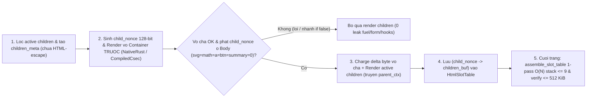

# OpenDash Studio Unified Recursive AST, Container `block.json` & Core Baseline Blocks (Spec A1 — Luồng A)

* **Author:** Elephant / Orion (Antigravity)
* **Status:** Approved
* **Date:** 2026-11-26 *(Rebased lên `main@e6d9199` ngày 2026-11-27)*
* **Baseline SHA:** `e6d9199`
* **Implementation Sync Note (2026-11-28):** Đã đồng bộ `origin/main@3553f20` (PR #627–#631 dùng `0058`–`0061`), đổi số migration của Spec A1 từ `0058` sang `0062_template_override_media_ref_roles.sql` (`+0` net `sqlite_schema` objects, được Owner phê duyệt), và mở rộng danh mục lõi từ `21` lên `23` Core Blocks (`18 NativeRust + 5 CompiledCsec`, bổ sung `core/search-form` & `core/search-results` từ PR #629 chuẩn kebab-case).
* **Approved By:** Owner
* **Approval Evidence:** Chủ dự án phê duyệt trực tiếp Spec A1 ngày 2026-11-26 (`"Mình đồng ý với spec A1"` và nhấn Approve trên tài liệu) sau khi hoàn tất 4/4 Goldfish review độc lập (`0 Blocker / 0 Major` tồn đọng), đồng bộ Clean-Slate V1 (`schema_version: 1`, `BlockSchema`, `data-builder-version="1"`, `opendash-starter 1.0.0`, migration `0057`), và cập nhật đường dẫn modular/gettext theo `main@9e17cca` (giữ nguyên 100% kiến trúc & hành vi đã duyệt).
* **Goldfish Review:** Completed (4 independent zero-context reviewers: `egm-design`, `egm-codebase-details`, `egm-implementation-readiness`, `egm-comprehension` — 22 Blocker, 25 Major, 9 Minor, 4 Nit across reviewers; 100% resolved before Owner approval)
* **Prerequisites (Merged on `main@9e17cca`):**
  * **Đợt 1 — Unified Field Engine** ([`unified-field-engine.md`](unified-field-engine.md), *Approved By: Owner 2026-11-26*, PRs `#601`–`#603`, `#616`, hợp đồng [`UNIFIED_FIELD_SCHEMA.md` V1](../contracts/UNIFIED_FIELD_SCHEMA.md)): đã hợp nhất trên `main` gồm `opendash_core::field_schema/`, `field_hydrate.rs`, `GET /api/admin/fields/{options-source,entries-resolve}`, `spacing.property` (`padding`/`margin` âm), `term_ref.taxonomy_from_field`, `entry_ref.target_types: ["*"]`, `od_icon(icon.name, ...)`, migrations `0055` & `0056`, `opendash-starter` `1.0.0` duy nhất, và `<UnifiedFieldForm>`.
  * **Chuẩn Gettext L10n & Feature-First Modularization** ([`gettext-pot-po-mo-localization.md`](gettext-pot-po-mo-localization.md) / PR `#615` & [`test-suite-performance-and-reliability.md`](test-suite-performance-and-reliability.md) / `661b3e7`–`c956496`): đã hợp nhất trên `main`; dùng `cms/l10n/{error_codes.json,opendash.pot,vi.po}`, `content_render/l10n.rs`, `tests/<group>.rs` (7 domain binary), và giới hạn `<= 600 LOC/file` theo `cms/scripts/check-standards.py`.
* **Related Contracts:**
  * [Hợp đồng Hệ kiểu Trường Thống nhất (`UNIFIED_FIELD_SCHEMA`)](../contracts/UNIFIED_FIELD_SCHEMA.md)
  * [Yêu cầu Sản phẩm V1 (`PRODUCT_REQUIREMENTS`)](../product/PRODUCT_REQUIREMENTS.md)
  * [Core Foundation & Quy chuẩn Code (`CORE_FOUNDATION`)](../contracts/CORE_FOUNDATION.md)
  * [M8 Writer Inventory (`M8_WRITER_INVENTORY`)](../contracts/M8_WRITER_INVENTORY.md)

> **Quyết định Kiến trúc Chủ dự án đã khóa (2026-11-26):**
> 1. **Dedicated Template Blocks — Xóa `ElementBinding`:** Xóa hoàn toàn `ElementBinding`, `BlockNode.bindings` và `storage/builder_binding.rs`. Mọi block ngữ cảnh template (Spec A2 và Theme/Plugin sau này) là block độc lập có `allowed_contexts`.
> 2. **Accordion 0-JS Container:** Nâng cấp `core/accordion` sang mô hình Container (`core/accordion` + `core/accordion-item`) dùng HTML5 `<details name="od-acc-{{ parent_ctx.parent_id }}">` không cần JavaScript.
> 3. **Giữ lõi nhẹ:** Dời nhóm block tương tác micro-JS (`tabs`, `slider`, `gallery`, `social-share`) và 5 block marketing (`icon-box`, `testimonial`, `stats-bar`, `logo-strip`, `feature-list`) sang Spec A3 (Core micro-JS + `opendash-starter` Theme Blocks).

---

## Overview

Đặc tả này (**Spec A1 — Nền tảng Luồng A**) thay thế cây bố cục 4 tầng cứng hiện tại (`SectionNode → RowNode → ColumnNode → ElementNode`) bằng **Cây Block Đệ quy Hợp nhất (`BuilderDocument` Clean-Slate V1: `schema_version: 1`, `blocks: Vec<BlockNode>`)** theo nguyên tắc **Clean-Slate V1 (Zero Legacy Shim, chuẩn đánh số V1 `1.0.0` duy nhất)** — đồng bộ hoàn toàn với hệ kiểu trường `opendash_core::field_schema` và `<UnifiedFieldForm>` từ Đợt 1.

Spec A1 giải quyết trọn vẹn 4 mục tiêu nền tảng trước khi **Spec A2** ([`studio-template-blocks-and-loop.md`](studio-template-blocks-and-loop.md): Theme Format V1, `Home → Page/Index`, 19 Template-Context Blocks & `core/loop-item`) và **Spec A3** (Interactive micro-JS + Starter Marketing Blocks) xây chồng lên:
1. **Không bắt buộc `Section → Row → Column`:** Đặt bất kỳ block hợp lệ nào trực tiếp ở gốc trang hoặc bên trong bất kỳ Container nào; xóa sổ hoàn toàn `meta.synthetic: true`, `KnownElement`, `ElementBinding` và `storage/builder_binding.rs`.
2. **Container Block toàn diện ngay trong `block.json` (`BlockSchema`, `schema_version: 1`):** Bổ sung `supports_children`, `allowed_parents`, `allowed_children`, `allowed_contexts`, `default_children`, `presets`, cùng hợp đồng render C-SEC an toàn **`{{ children_html }}`** (đảo thứ tự render vỏ cha trước, lắp ráp 1 pass `O(N)` qua `HtmlSlotTable`, kiểm soát `svg_depth`/`math_depth`/`foreign_object_depth` và interactive nesting `<a>`/`<button>`/`<summary>`) + **`children_meta`** (con → cha) + **`parent_ctx`** (cha → con).
3. **Kiến trúc "Schema-Unified, Backend-Dispatched":** 100% block dùng chung 1 AST `BlockNode`, 1 `BlockSchema`, 1 validator, 1 media-ref scanner, 1 Comment-Block Codec V1 và 1 `<UnifiedFieldForm>`, trong khi tầng render server phân nhánh `CoreRenderBackend::NativeRust` (0 fuel MiniJinja cho layout/leaf tần suất cao & block đặc quyền `<form>`/`content-slot`/`pattern-ref`) và `CoreRenderBackend::CompiledCsec` (cache `base_env: Arc<minijinja::Environment<'static>>` biên dịch sẵn, clone nhẹ per-node để gắn `fuel`/`od_icon`/`od_hook`/`timezone` cô lập 100%).
4. **Cắt chuyển đồng bộ 21 Core Blocks (`20 Core Baseline Blocks + core/content-slot`, 100% kebab-case ID)**, chuyển `core/accordion` sang Container 0-JS, thêm `core/stack` & cột 12-span responsive, rút `core/showcase` sang test fixture, cập nhật `opendash-starter` `1.0.0` sang cây đệ quy V1, và nâng cấp `StudioBlockTree` / `StudioBlockCatalog` / `BuilderInspector` / `BuilderPreviewFrame` sang kéo-thả đệ quy `before`/`after`/`inside`.

### Thuật ngữ & Ký hiệu trong Tài liệu
* **Ký hiệu `*` hậu tố trong bảng §5** (ví dụ `padding*`, `span*`, `columns*`): trường có bật `"responsive": true` (lưu `{ desktop?, tablet?, mobile? }`, kế thừa `desktop → tablet → mobile`).
* **C-SEC & `FORBIDDEN_TAGS`:** Hệ kiểm định tĩnh + sandbox template MiniJinja (`cms/crates/opendash-server/src/template_sec/`) kết hợp bộ chuẩn hóa tài liệu HTML (`document/`), cấm `|safe`, `<script>`, `<iframe>`, `<form>`, `<input>` trong template bên thứ ba.
* **Mode 1 / Mode 2:** Hai chế độ biên tập của OpenDash Studio — **Mode 1** là Template & Theme Override (`#/studio`, lưu vào bảng `template_overrides`), **Mode 2** là nội dung bài/trang (`#/studio/entry/:type/:id`, lưu vào `content_entries.values_json["body"]` qua Comment Block).
* **`shared template_overrides`:** Bản ghi `template_overrides` dùng chung cho mọi ngôn ngữ của site (không nhân bản theo từng locale), nên các block như `core/list` phải tự giải mã `term_id` sang bản dịch ứng với `active_locale` lúc render.
* **`ProviderInactive` / `Withdrawn`:** Trạng thái trong `RegistryCatalog` khi Theme/Plugin sở hữu block bị tắt/đổi (`ProviderInactive`) hoặc nâng cấp bỏ khai báo block (`Withdrawn`).
* **`CONTENT_SLOT_TOKEN`:** Chuỗi sentinel nội bộ được `page/` đặt tại vị trí `core/content-slot` để bộ ghép trang thay thế nội dung thân bài (`entry.body`).
* **`richtext nonces` (`BLOCK_RICHTEXT_NONCE_PREFIX`):** Cơ chế 2 giai đoạn của `template_sec/` — khi render MiniJinja với auto-escape HTML, nội dung `richtext` đã đi qua `sanitize_richtext` được thay tạm bằng 1 nonce ngẫu nhiên 128-bit rồi mới thế lại trong một lượt quét `HtmlScanState::Body` sau khi render, bảo đảm HTML hợp lệ mà không mở `|safe`.
* **`BRIDGE_SCRIPT` / `BRIDGE_SCRIPT_SHA256`:** Đoạn script tĩnh duy nhất được phép chạy trong iframe sandbox của `BuilderPreviewFrame.tsx` để tương tác chọn/hover/mở `<details>` trên Canvas, được xác thực bằng 1 hash SHA-256 cố định trong CSP.

---

## The Problem

Kiểm toán mã nguồn thực tế sau Đợt 1 cho thấy 6 nút thắt cấu trúc không thể vá nhỏ trên cây bố cục 4 tầng tiền-V1 (`sections → rows → columns → elements`):

1. **Khóa cứng cây 4 tầng & nợ `synthetic: true` (`builder/`, `document/`):** Mọi thao tác đọc/validate/render/extract media phải lặp lại 4 vòng `section → row → column → element`; chèn 1 phần tử tự do ở root sinh ra 3 container ảo `synthetic: true` làm rối `StudioBlockTree` và `builder_blocks/`.
2. **Declarative `block.json` không thể làm Container & bọc double-`<div>` (`block_schema.rs`, `page/`):** `core/banner`, `core/card`, `core/accordion` không thể chứa block con tùy ý; mọi declarative block hiện bị bọc 2 lớp `<div>` (`builder-element` + `builder-plugin-block`), phá vỡ CSS Grid (`col-span-*`) và Flexbox (`flex-*`).
3. **Chi phí biên dịch lặp & truy vấn lặp Core blocks trên đường nóng public:**
   - `BlockTemplateCache` (`page/cache_types/`) chỉ lưu chuỗi `source: String`, khiến mỗi node C-SEC phải parse + compile lại template MiniJinja từ đầu; với cây 150–300 node, 100% MiniJinja chạm trần `TEMPLATE_FUEL_LIMIT = 10_000`.
   - `load_declared_blocks_in_conn` (`storage/page/read.rs`) trên mỗi request đều query và `serde_json::from_str` lại toàn bộ Core blocks từ SQLite.
4. **C-SEC `HtmlScanState` chưa bảo vệ foreign content `<svg>`/`<math>`/`<foreignObject>` hay interactive nesting (`template_sec/composition/html_scan_state.rs`):** `HtmlScanState::Tag.prefix` hiện bị cắt ở `8` byte (không thể nhận diện `<foreignObject>`), chưa theo dõi `svg_depth`/`math_depth` hay `<a>`/`<button>`/`<summary>`, mở ra rủi ro phá DOM/foster-parenting khi Container nhận `{{ children_html }}`.
5. **Trùng lặp kiến trúc `ElementBinding` vs Dedicated Template Blocks (`builder/`, `storage/builder_binding.rs`):** `ElementBinding` chỉ xuất chuỗi phẳng, chạy N truy vấn SQL riêng, không hỗ trợ `loop_item`/`richtext`/`gallery`/`terms`. Chủ dự án đã chốt xóa `ElementBinding` để mọi block ngữ cảnh là block độc lập có `allowed_contexts`.
6. **Phân mảnh Inspector, lỗi N+1 `core/list` và rò ACL tiềm ẩn khi lồng Container:** `StudioBlockCatalog.tsx` lọc bằng cờ boolean rời rạc, `BuilderInspector.tsx` duy trì 3 form viết tay (`BuilderBindingFields`, `BuilderListFields`, `BuilderContactFormFields`), `storage/builder/` còn N+1 SQLite lookup URL, và `extract_block_refs_lenient_with_schemas` chưa stack-aware cho Container tắt plugin.

---

## Goals

1. **Cây Block Đệ quy Hợp nhất Clean-Slate V1 (`schema_version: 1`, `blocks: Vec<BlockNode>`, `MAX_BUILDER_DEPTH = 8`, `MAX_BUILDER_NODES = 512`, `MAX_BUILDER_JSON_BYTES = 256 KiB`):**
   - Một struct `BlockNode { id, block_id, props, meta, children }` duy nhất trong `opendash_core::builder` (chuẩn `BlockNode.id` theo `valid_package_id`: `[a-z0-9-]`, dài `3..=64`), xóa sạch `SectionNode`, `RowNode`, `ColumnNode`, `ElementNode`, `ElementContent`, `KnownElement`, `ElementBinding`, `LegacyBlockProps`, `NodeMeta.synthetic` và `storage/builder_binding.rs`.
   - **Sparse Props Serialization (`strip_default_props`):** Chỉ lược bỏ khóa có giá trị **trùng tuyệt đối (`==`)** với `field.default` (không lược bỏ chuỗi rỗng `""` khi `default` khác rỗng) để trang 300–512 node ở xa trần `256 KiB` JSON / `384 KiB` Comment-Block body (`builder_blocks/`).
2. **Mở rộng `BlockSchema` (`block.json` `schema_version: 1`) cho Container & Context-Aware Blocks:**
   - Đổi tên `BlockSchemaV1` → `BlockSchema` (`BLOCK_SCHEMA_VERSION = 1`), bổ sung `supports_children: bool`, `allowed_parents: Option<Vec<String>>`, `allowed_children: Option<Vec<String>>` (`"*"` và `"!..."`), `allowed_contexts: Option<Vec<String>>` (`"*"` và `"!..."`), `default_children: Vec<DefaultChildSpec>`, và `presets: Vec<BlockPresetSpec>` với kiểm định 2 pha (cục bộ + đồ thị catalog).
   - Chuẩn hóa **100% Block ID kebab-case** (`valid_namespaced_block_id`, cấm `_`), đồng bộ 1:1 giữa `block_id` và thư mục `builtin_blocks/<slug>/`.
3. **Container Rendering An toàn & Hiệu năng cao (Đảo thứ tự Render + `HtmlSlotTable` 1-Pass `O(N)` + Hybrid `CoreRenderBackend`):**
   - Nâng `HtmlScanState` (buffer `prefix >= 20` bytes) theo dõi `svg_depth`, `math_depth`, `foreign_object_depth`, `a_depth`, `button_depth`, `summary_depth` và kiểm cân bằng nhánh ``; chỉ cho phép tối đa `1` bare `{{ children_html }}` ở `Body` khi mọi bộ đếm `== 0`, cấm trong `ForLoop`/`Set`/`SetBlock`/`WithBlock`/filter.
   - Đảo thứ tự render Container (**render vỏ cha trước → chỉ render `children` nếu vỏ cha thành công và thực sự phát `child_nonce`**) giúp tránh 100% rò `has_active_contact_form`, `hook_nonces` và lãng phí `fuel`/`512 KiB` budget; ghép cuối bằng `assemble_slot_table` 1 pass `O(N)`.
   - Nâng `BlockTemplateCache` cache `base_env: Arc<minijinja::Environment<'static>>` gắn `SiteCacheEpoch` (`--dev-theme` + `--dev-plugin`), clone nhẹ mỗi node để cô lập `set_fuel`/`od_icon`/`od_hook`/`date_format(tz)`; tối ưu `load_declared_blocks_in_conn` chỉ đọc `WHERE owner_kind != 'core'`.
   - Cài đặt **Single Root Wrapper Contract (`apply_single_root_wrapper`)** dùng HTML-aware attribute merger (tái sử dụng pattern tokenizer `document/normalize/`, 0 crate mới) + sửa `serialize_scoped_block_css` hỗ trợ cả self và descendant selector `[data-od-node-scope][data-od-spacing]`.
4. **Comment-Block Codec V1 (`builder_blocks/`) & Public Media ACL Chặt chẽ:**
   - Giữ đủ 7 public API hiện hành (`contains_blocks`, `parse_blocks_lenient_or_recover`, `parse_blocks_to_builder_document`, `serialize_builder_document_to_blocks`, `extract_block_refs_lenient`, `extract_block_refs_lenient_with_schemas`, `extract_visible_text`) + thêm `parse_blocks_lenient_with_schemas`.
   - Viết lại `extract_block_refs_lenient_with_schemas` theo stack `inactive_depth`, đồng bộ cả `entry_pattern_refs` trong `resync_plugin_block_acls_in_tx`, và chuẩn hóa `template_override_media_refs` qua migration `0058` *(đổi từ `0057` cũ do `PR #619` dùng `0057_manual_redirects_and_404_log.sql`, Owner chốt ngày 2026-11-27; `+0` net schema objects)* để đồng bộ hoàn toàn với Đợt 1 (`0055` & `0056`).
5. **21 Core Blocks (`20 Core Baseline + core/content-slot`), Starter `1.0.0` V1 & Studio Recursive Frontend:**
   - Cắt chuyển toàn bộ 21 Core Blocks sang AST đệ quy V1 + `UNIFIED_FIELD_SCHEMA` V1, rút `core/showcase` sang test fixture, cập nhật `opendash-starter` `1.0.0` (blocks & patterns sang AST đệ quy V1, giữ duy nhất `STARTER_THEME_VERSION = "1.0.0"`), cập nhật `tailwind-public-safelist.txt` + rebuild `opendash-tailwind.css` (`< 120 KiB`).
   - Nâng cấp `StudioBlockTree` (kéo-thả đệ quy `before`/`after`/`inside`, Compatibility Mask với công thức `effectiveParentDepth + draggedSubtreeHeight <= 8`, Locked Compound Pairs suy diễn động từ schema), `StudioBlockCatalog` (`presets`), `BuilderInspector` (`<UnifiedFieldForm>` + `StudioBuilderClipboard`), và `BRIDGE_SCRIPT` (tự mở `<details>` tổ tiên trong `applyAttr` — 0 snap-back).
   - Cập nhật đồng bộ `PRODUCT_REQUIREMENTS.md` §4, `M8_WRITER_INVENTORY.md`, `UNIFIED_FIELD_SCHEMA.md`, `CORE_FOUNDATION.md`.

---

## Non-Goals

- **Không triển khai Theme Format V1 (`manifest_version: 1`, `source_format: 'v1'`), cắt chuyển `Home → Page/Index`, 19 Template-Context Blocks & `core/loop-item` Engine** (`core/site-brand`, `core/language-switcher`, `core/menu`, `core/breadcrumbs`, `core/entry-*`, `core/archive-*`, Preview Sample Picker `preview_term`): thuộc [**Spec A2 (`studio-template-blocks-and-loop.md`)**](studio-template-blocks-and-loop.md).
- **Không triển khai Interactive Micro-JS Pack (`/assets/opendash-blocks.js`) & Marketing Starter Blocks** (`core/tabs`, `core/slider`, `core/gallery`, `core/social-share`, `icon-box`, `testimonial`, `stats-bar`, `logo-strip`, `feature-list`): thuộc **Spec A3**.
- **Không bổ sung `core/search-box`, `core/video` `embed_url` (`<iframe>`), `core/accordion` `faq_schema`, `core/archive-filter`, `core/entry-toc`:** không khả thi dưới C-SEC/CSP hiện hành hoặc ngoài phạm vi PRD V1.
- **Không chạm logic domain của Luồng B (Content Structure ACF):** không sửa `opendash-core/src/content/`, `storage/{content,taxonomy,permalinks}/`, `routes/{content,taxonomy}.rs`, hay `cms/admin/src/features/{content,taxonomy,editor}/`. Riêng `storage/entries/` chỉ chạm khoanh vùng đúng 3 hàm phục vụ `core/list` (`list_published_page_with_offset_in_tx`, `collect_builder_list_term_ids`, `apply_builder_list_term_remap`).
- **Không giữ dual-parser hay upcast AST 4 tầng tiền-V1 (`sections`) sang cây đệ quy (`blocks`) trong runtime production** (Clean-Slate V1). Nhờ `#[serde(deny_unknown_fields)]` trên `BuilderDocument { schema_version: 1, blocks }`, khi mở DB dev/backup cũ còn chứa khóa `"sections"` hoặc `schema_version != 1`, đường dẫn đọc/restore trả lỗi rõ ràng `400 Bad Request` (`"Builder AST tiền-V1 (cấu trúc sections cũ hoặc schema_version != 1) không được hỗ trợ ở Clean-Slate V1."`), và `load_declared_blocks_in_conn` bỏ qua kèm `tracing::warn!` với block non-core không tương thích.

---

## Critical User Journeys (CUJs)

### CUJ 1: Dựng trang tự do không cần bọc `Section → Row → Column` & dùng Container lồng nhau
* **Given:** Editor mở một Page mới trong OpenDash Studio Mode 2 (`#/studio/entry/page/:id`).
* **When:** Editor thả trực tiếp `core/banner` ở cấp root (tự chèn `default_children`: `core/heading` + `core/text` + `core/button`), kéo thêm `core/stack` (hướng ngang) bọc 2 `core/button` bên trong `core/banner`, thêm `core/row` (`grid_12`, preset `8+4`) với cột 4 bật `sticky: true`, và đặt `core/accordion` + 2 `core/accordion-item` chứa `core/text` + `core/image` bên trong cột 8.
* **Then:**
  - `StudioBlockTree` hiển thị đúng cấu trúc thực không có node ảo `synthetic`; mọi inspector render 100% từ `<UnifiedFieldForm>`.
  - Lưu vào `values_json["body"]` dưới dạng Comment Block đệ quy V1 (`<!-- od:core/banner ... --> ... <!-- /od:core/banner -->`), tải lại round-trip 100% nguyên vẹn.
  - Trang công khai hiển thị đúng lưới 8/4 (`lg:col-span-8` / `lg:col-span-4`, 0 double-`<div>`), `core/stack` ngang, và Accordion 0-JS (`<details name="od-acc-...">`, mở sẵn mục 1 khi `open_first: true`).

### CUJ 2: Kéo-thả đệ quy an toàn với `Locked Compound Pairs`, `Compatibility Mask` & `MAX_BUILDER_DEPTH = 8`
* **Given:** Tài liệu Studio có nhiều Container (`core/section`, `core/row`, `core/column`, `core/card`, `core/accordion`).
* **When:** Editor kéo `core/button` từ `core/column` thả `inside` vào `core/card` hoặc `core/accordion-item`; thử kéo `core/accordion-item` thả vào `core/row`; kéo 1 leaf thả `after` một node ở `depth = 8` (cùng tầng `effectiveParentDepth = 7`, `7 + 1 <= 8` → hợp lệ); và thử thả 1 cây con cao 4 tầng `inside` vào node ở `depth = 6` (`6 + 4 > 8` → bị chặn).
* **Then:**
  - `Compatibility Mask` chỉ sáng các vị trí hợp lệ; thao tác hợp lệ cập nhật Canvas ngay và `BRIDGE_SCRIPT` giữ `<details open>` trên `core/accordion-item` đang chọn kể cả khi preview re-render.
  - Thả sai cặp hoặc vượt `MAX_BUILDER_DEPTH = 8` bị chặn ở UI lẫn server validator (`400`).

### CUJ 3: Theme/Plugin tự tạo Container Block với `{{ children_html }}` an toàn C-SEC & Public Media ACL
* **Given:** Theme cài block `acme-theme/highlight-box` (`schema_version: 1`, `supports_children: true`, `allowed_children: ["*", "!core/section"]`) có `render.html` đặt bare `{{ children_html }}` trong `<div>`.
* **When:** Admin kích hoạt theme, đặt `acme-theme/highlight-box` chứa `core/image` + `core/pattern-ref` (Pattern có ảnh riêng) lên trang, xuất bản, sau đó **tắt / đổi theme**.
* **Then:**
  - Khi active: `validate_block_template_csec` chấp nhận `{{ children_html }}` ở HTML `Body` (`svg_depth == math_depth == a_depth == button_depth == summary_depth == 0`) và từ chối template đặt trong `<svg>`, `<foreignObject>`, `<a>`, attribute, hay ``; ảnh trong `core/image` và trong Pattern con đều trả `200`.
  - Khi đổi theme: AST giữ nguyên `acme-theme/highlight-box` cùng cây con (props cha read-only trong Admin, cấm chèn thêm con mới vào trong nhưng cho phép kéo con ra cứu dữ liệu hoặc xóa cả khối; `media_refs.rs` giữ delete pin); trên public toàn bộ subtree ẩn và cả ảnh trực tiếp lẫn ảnh từ `core/pattern-ref` bên trong đều trả `404`.

### CUJ 4: `core/list` đa ngôn ngữ trên Shared `template_overrides` (Zero-N+1 & Fail-Closed)
* **Given:** Site bật `vi` (mặc định) và `en` (phụ), có chuyên mục *"Tin tức"* (`term_id = 5`, `vi`) liên kết cùng `translation_group_id` với *"News"* (`term_id = 12`, `en`), và chuyên mục *"Nội bộ VN"* (`term_id = 9`, `vi`) chưa có bản dịch `en`. Admin đặt 2 `core/list` lọc lần lượt `term_id = 5` và `term_id = 9` trên Template Override `page` (hoặc `index`).
* **When:** Khách truy cập trang chủ `/` (`vi`) và `/en/` (`en`).
* **Then:**
  - Trên `/`: cả 2 danh sách hiển thị bài `published` `vi` tương ứng với 0 N+1 query (batch URL + batch media/terms theo cờ `show_*`).
  - Trên `/en/`: danh sách 1 ánh xạ `term_id = 5 → 12` hiển thị bài `en` của *"News"*; danh sách 2 fail-closed trả **danh sách rỗng `[]`** (tuyệt đối không bỏ bộ lọc term rồi đổ toàn bộ bài `en` ra).

---

## Technical Plan (Architecture)

### 1. AST Đệ quy Hợp nhất V1 (`cms/crates/opendash-core/src/builder/`)

```rust
pub const BUILDER_SCHEMA_VERSION: u32 = 1;
pub const MAX_BUILDER_NODES: usize = 512;
pub const MAX_BUILDER_DEPTH: usize = 8;
pub const MAX_BUILDER_JSON_BYTES: usize = 256 * 1024;
pub const MAX_BUILDER_LISTS_PER_REQUEST: usize = 8;
pub const MAX_BUILDER_PATTERN_INSTANCES: usize = 16;
pub const MAX_EXPANDED_BUILDER_NODES: usize = 1024;

#[derive(Debug, Clone, PartialEq, Serialize, Deserialize)]
#[serde(deny_unknown_fields)]
pub struct BuilderDocument {
    pub schema_version: u32, // bắt buộc == 1 (Clean-Slate V1; `deny_unknown_fields` từ chối khóa `sections` tiền-V1)
    #[serde(default)]
    pub blocks: Vec<BlockNode>,
}

#[derive(Debug, Clone, PartialEq, Serialize, Deserialize)]
#[serde(deny_unknown_fields)]
pub struct BlockNode {
    pub id: String,       // tuân thủ opendash_core::id::valid_package_id ([a-z0-9-], 3..=64)
    pub block_id: String, // tuân thủ valid_namespaced_block_id (kebab-case: <owner>/<slug>)
    #[serde(default, skip_serializing_if = "BTreeMap::is_empty")]
    pub props: BTreeMap<String, serde_json::Value>,
    #[serde(default, skip_serializing_if = "empty_node_meta_option")]
    pub meta: Option<NodeMeta>,
    #[serde(default, skip_serializing_if = "Vec::is_empty")]
    pub children: Vec<BlockNode>,
}

#[derive(Debug, Clone, PartialEq, Eq, Default, Serialize, Deserialize)]
#[serde(deny_unknown_fields)]
pub struct NodeMeta {
    #[serde(default, skip_serializing_if = "Option::is_none")]
    pub name: Option<String>,        // <= 80 chars, no control chars
    #[serde(default, skip_serializing_if = "Option::is_none")]
    pub html_id: Option<String>,     // <= 64 chars, [a-zA-Z0-9_-]
    #[serde(default, skip_serializing_if = "Option::is_none")]
    pub class_name: Option<String>,  // <= 256 chars, safe CSS class charset
    #[serde(default, skip_serializing_if = "empty_visibility_option")]
    pub visibility: Option<NodeVisibility>,
    // ĐÃ XÓA `synthetic: bool`
}
```

- **Xóa bỏ hoàn toàn (Clean-Slate V1):** `SectionNode`, `RowNode`, `ColumnNode`, `ElementNode`, `ElementContent`, `KnownElement`, `HeadingProps`, `TextProps`, `ImageProps`, `VideoProps`, `ButtonProps`, `ListProps`, `ContactFormProps`, `ContentSlotProps`, `PatternRefProps`, `TemplatePartProps`, `LegacyBlockProps`, `PluginBlockProps`, `ElementBinding`, `BindingSource`, `BindingTarget`, `Responsive`, `ResponsiveStyle`, `SectionStyle`, `NodeMeta.synthetic`.
- **Giữ nguyên helper Tailwind:** `BoxSpacing`, `TW_PADDING_STEPS`, `TW_MARGIN_STEPS`, `TW_GAP_STEPS`, `compile_box_spacing_tailwind`, `gap_px_to_tw_step`.
- **Ngữ cảnh Validation (`BuilderContextTarget`):**
  ```rust
  #[derive(Debug, Clone, PartialEq, Eq)]
  pub enum BuilderContextTarget {
      EntryBody { content_type: String },
      Pattern,
      ThemePattern, // dùng bởi theme/package.rs::validate_theme_v3_files cho patterns/*.json
      Template {
          kind: TemplateCandidateKind,
          content_type: Option<String>,
          taxonomy: Option<String>,
          part_key: Option<String>,
      },
  }
  ```
- **Bảng chân lý ánh xạ `BuilderContextTarget::matches_token(token)`:**
  - `allowed_contexts` hỗ trợ wildcard `"*"` và phủ định `"!<token>"` (ưu tiên kiểm tra phủ định trước; danh sách chỉ có `"!..."` ngầm định bao gồm `"*"`). `None` đồng nghĩa mọi ngữ cảnh hợp lệ (trừ khi bị hạn chế bởi `allowed_parents`).

  | Token `allowed_contexts` | Khớp với `BuilderContextTarget` |
  | --- | --- |
  | `"*"` | Mọi variant |
  | `"entry_body"` / `"entry_body:<cpt>"` | `EntryBody { .. }` / khớp đúng `content_type == <cpt>` |
  | `"pattern"` | `Pattern` (site-owned Pattern CPT) |
  | `"theme_pattern"` | `ThemePattern` (package `patterns/*.json` trong Theme) |
  | `"template"` | **Mọi** `Template { .. }` (gồm cả `Index`, `Page`, `PageLayout`, `Single`, `SingleCustom`, `Singular`, `Archive`, `Taxonomy`, `NotFound`, `Part` — và `Home` tạm thời trước Spec A2 S01) |
  | `"part"` / `"part:<key>"` | `Template { kind: Part, .. }` / khớp đúng `part_key == Some(<key>)` |
  | `"single"` / `"single:<cpt>"` | `Template { kind: Single \| SingleCustom \| Singular, .. }` / khớp `content_type == Some(<cpt>)` |
  | `"single_custom"` / `"singular"` | `Template { kind: SingleCustom, .. }` / `Template { kind: Singular, .. }` |
  | `"page"` / `"page_layout"` | `Template { kind: Page, .. }` / `Template { kind: PageLayout, .. }` |
  | `"home"` / `"index"` | `Template { kind: Home, .. }` *(chỉ tạm giữ trong Spec A1 để xanh test hiện hành; Spec A2 S01 xóa `TemplateCandidateKind::Home` theo mô hình `Home → Page/Index`)* / `Template { kind: Index, .. }` |
  | `"archive"` / `"archive:<cpt>"` | `Template { kind: Archive, .. }` / khớp `content_type == Some(<cpt>)` |
  | `"taxonomy"` / `"taxonomy:<tax>"` | `Template { kind: Taxonomy, .. }` / khớp `taxonomy == Some(<tax>)` |
  | `"not_found"` | `Template { kind: NotFound, .. }` |
  | `"loop_item"` | *(Token hợp lệ được đặt trước cho Spec A2; trong Spec A1 chưa có `BuilderContextTarget` khớp token này)* |

- **Quy tắc `BuilderDocument::validate_for_save(&self, catalog, ctx, previous)` (1 lượt đệ quy):**
  1. `schema_version == 1`, tổng node `<= 512`, `depth <= 8` (root children ở `depth = 1`), `BlockNode.id` duy nhất và khớp `valid_package_id`, `NodeMeta` hợp lệ.
  2. Đếm toàn tài liệu: `core/content-slot` `<= 1`, `core/list` `<= 8`, tổng instance `core/pattern-ref` `<= 16` (`MAX_BUILDER_PATTERN_INSTANCES`).
  3. Block có provider `Active + Declared`:
     - `allowed_contexts` khớp `ctx` (ví dụ `core/content-slot` khớp `["single", "single_custom", "singular", "page", "page_layout", "home", "index"]`, khớp 1:1 với `storage/overrides/` cho đến khi Spec A2 S01/S03 thay bằng `core/entry-content` và xóa `"home"`; `core/template-part` khớp `["template", "part"]`; `core/pattern-ref` khớp `["entry_body"]`; `core/list` khớp `["*", "!pattern", "!theme_pattern"]`; `core/contact-form` khớp `["*", "!theme_pattern"]`).
     - `supports_children` (`false` ⇒ `children.is_empty()`), `allowed_parents` khớp cha (`"root"` hoặc `parent.block_id`), `allowed_children` của cha khớp `node.block_id`.
     - Validate `props` bằng `opendash_core::field_schema::validate_field_values(&schema.fields, &node.props, FieldContext::StudioBlock, prev_props)`.
  4. **Quy tắc bất biến, không mâu thuẫn cho block thiếu provider / `ProviderInactive` / `Withdrawn`:**
     - Chỉ chấp nhận nếu trong `previous` tồn tại node có đúng cùng `id` và `block_id`, và `node.props == prev_node.props` (cấm tạo mới, cấm sửa `props`).
     - **Di chuyển & Xóa:** Được phép xóa toàn bộ node/subtree; được phép giữ nguyên tại cha cũ (miễn check `allowed_children` của cha cũ) HOẶC di chuyển nguyên khối sang cha mới có `allowed_children` cho phép `"*"`.
     - **Bảo vệ `children` bên trong Container `ProviderInactive`/`Withdrawn`:** Được phép **giữ nguyên**, **xóa** hoặc **kéo các node con hợp lệ ra ngoài** để người dùng cứu nội dung; **CẤM thêm mới node con hoặc sửa `props` của con ngay bên trong** Container đang tắt (mọi node con còn nằm bên trong phải có `id` đã tồn tại trong subtree cũ của chính Container đó và giữ nguyên `props`).
- **Sparse Props Normalization (`strip_default_props`) & Re-Hydration:**
  - **Thời điểm chạy:** Sau `validate_for_save` và sau `filter:content/prepare_save`, ngay trước khi serialize JSON lưu DB hoặc Comment Block.
  - **Quy tắc chặt:** Chỉ xóa khóa `(k, v)` trong `node.props` khi `field.default` tồn tại **và `v == *default`** (so sánh JSON bằng tuyệt đối; **tuyệt đối không** xóa chuỗi rỗng `""` nếu `default` khác `""`). Không đụng `props` của block `ProviderInactive`/`Withdrawn`.
  - **Re-Hydration:** Cả `field_hydrate.rs` (render server) và `<UnifiedFieldForm>` (Studio Inspector) đều điền giá trị mặc định từ `field.default` khi khóa vắng mặt trong `node.props`.
  - **Chính sách hậu-V1:** Sau khi phát hành V1 công khai, không được đổi giá trị `default` của field hiện hữu trên Core block (đổi default cần tạo preset mới hoặc option mới để không làm trôi giao diện bài cũ).

### 2. Mở rộng `BlockSchema` (`cms/crates/opendash-core/src/block_schema.rs`)

```rust
pub const BLOCK_SCHEMA_VERSION: u8 = 1;
pub const MAX_BLOCK_PRESETS: usize = 12;
pub const MAX_DEFAULT_CHILDREN_DEPTH: usize = 2;
pub const MAX_DEFAULT_CHILDREN_NODES: usize = 8;

/// Khóa trường bị cấm trong `BlockSchema.fields` để tránh shadow biến hệ thống C-SEC.
pub const RESERVED_BLOCK_FIELD_KEYS: &[&str] = &[
    "children_html", "children_meta", "parent_ctx", "site_options",
];

#[derive(Debug, Clone, PartialEq, Serialize, Deserialize)]
#[serde(deny_unknown_fields)]
pub struct DefaultChildSpec {
    pub block_id: String, // valid_namespaced_block_id
    #[serde(default, skip_serializing_if = "BTreeMap::is_empty")]
    pub props: BTreeMap<String, serde_json::Value>,
    #[serde(default, skip_serializing_if = "Vec::is_empty")]
    pub children: Vec<DefaultChildSpec>,
}

#[derive(Debug, Clone, PartialEq, Serialize, Deserialize)]
#[serde(deny_unknown_fields)]
pub struct BlockPresetSpec {
    pub key: String,   // valid_snake_key, duy nhất trong block
    pub title: String, // 1..=80 ký tự, không ký tự điều khiển
    #[serde(default, skip_serializing_if = "Option::is_none")]
    pub icon: Option<String>, // khóa hợp lệ trong CORE_ICONS
    #[serde(default, skip_serializing_if = "BTreeMap::is_empty")]
    pub props: BTreeMap<String, serde_json::Value>,
    #[serde(default, skip_serializing_if = "Vec::is_empty")]
    pub children: Vec<DefaultChildSpec>,
}

#[derive(Debug, Clone, PartialEq, Serialize, Deserialize)]
#[serde(deny_unknown_fields)]
pub struct BlockSchema {
    pub schema_version: u8, // bắt buộc == 1 (Clean-Slate V1)
    pub id: String,         // valid_namespaced_block_id: "<owner>/<kebab-slug>"
    pub title: String,
    pub category: BlockCategory,
    #[serde(default, skip_serializing_if = "Option::is_none")]
    pub icon: Option<String>,
    pub render: String,     // "native" CHỈ cho owner == "core"; Theme/Plugin bắt buộc "render.html"
    #[serde(default)]
    pub supports_children: bool,
    #[serde(default, skip_serializing_if = "Option::is_none")]
    pub allowed_parents: Option<Vec<String>>,
    #[serde(default, skip_serializing_if = "Option::is_none")]
    pub allowed_children: Option<Vec<String>>,
    #[serde(default, skip_serializing_if = "Option::is_none")]
    pub allowed_contexts: Option<Vec<String>>,
    #[serde(default, skip_serializing_if = "Vec::is_empty")]
    pub default_children: Vec<DefaultChildSpec>,
    #[serde(default, skip_serializing_if = "Vec::is_empty")]
    pub presets: Vec<BlockPresetSpec>,
    #[serde(default)]
    pub fields: Vec<FieldSpec>,
}
```

- **Ngữ nghĩa chèn `default_children` vs `presets`:**
  - Chèn block thường → tạo node với `props` từ `field.default` và cây con sinh đệ quy từ `schema.default_children`.
  - Chèn một `preset` → áp dụng `preset.props` (ghi đè trên default) và sinh cây con từ `preset.children` (thay thế `schema.default_children`).
- **Kiểm định 2 pha:**
  - **Pha 1 — Cục bộ trong `BlockSchema::validate(&self, owner: &str)`** *(được gọi tự động ở `storage/page/`, `theme/package.rs::collect_package_blocks` / `--check-theme`, `plugin/package.rs::parse_plugin_package` / `--check-plugin`, và `dev_mode/`)*:
    - `schema_version == 1`; `id` khớp `valid_namespaced_block_id` và prefix `"{owner}/"`.
    - Nếu `render == "native"`: từ chối ngay trừ khi `owner == "core"`; với `owner != "core"` bắt buộc `render == "render.html"`.
    - Cấm mọi `FieldSpec.key` trùng `RESERVED_BLOCK_FIELD_KEYS`.
    - Nếu `!supports_children`: `allowed_children` phải là `None`, `default_children` phải rỗng và mọi `preset.children` phải rỗng.
    - Kiểm `presets.len() <= 12`, `preset.key` duy nhất, `default_children` và mỗi `preset.children` có độ sâu `<= 2`, tổng số node mẫu `<= 8`, không tự tham chiếu (`child.block_id != self.id`), `child.block_id` thỏa `self.allowed_children`, `preset.props` hợp lệ theo `self.fields`.
    - Kiểm mọi token trong `allowed_contexts` thuộc bảng chuẩn §1.
  - **Pha 2 — Đồ thị toàn Catalog (`validate_block_catalog_templates(catalog)`):** chạy ở test khởi động embedded core blocks, `theme/package.rs` (`--check-theme` / install) và `plugin/package.rs` (`--check-plugin` / install) kết hợp Core catalog: phát hiện chu trình chéo (`A -> B -> A`), kiểm tra mọi `child.block_id` tham chiếu tồn tại và cho phép cha (`allowed_parents`), và kiểm `child.props` đúng schema của block con.

### 3. Container C-SEC An toàn, Đảo thứ tự Render, `HtmlSlotTable` 1-Pass `O(N)` & `BlockTemplateCache` (`template_sec/`, `page/`)



1. **Mở rộng `HtmlScanState` (`template_sec/composition/html_scan_state.rs`):**
   - Nâng buffer `HtmlScanState::Tag { prefix }` từ `8` byte lên **`>= 20` byte** để phân biệt chính xác `<foreignObject>`, `</foreignObject>`, `<svg>`, `</svg>`, `<math>`, `</math>`, `<a>`, `</a>`, `<button>`, `</button>`, `<summary>`, `</summary>` và phát hiện thẻ self-closing `/>` (không tăng depth khi gặp `<svg .../>`).
   - Bổ sung 6 bộ đếm độ sâu: `svg_depth`, `math_depth`, `foreign_object_depth`, `a_depth`, `button_depth`, `summary_depth` (ngăn tuyệt đối lỗi HTML5 foster-parenting khi Container đặt `{{ children_html }}` bên trong `<a>`, `<button>` hoặc `<summary>`).
   - Xác minh mọi nhánh `` kết thúc cân bằng với `svg_depth == math_depth == foreign_object_depth == a_depth == button_depth == summary_depth == 0`.
   - Thêm `children_html`, `children_meta`, `parent_ctx` vào `RESERVED_CONTEXT_VARS` và `is_sensitive_name` (cấm ``).
   - Khi `schema.supports_children == true`, `walk_block_ast_stmt` (`template_sec/policy/block_stmt_walker.rs`) kiểm tra tĩnh:
     - Biểu thức `children_html` xuất hiện **tối đa `1` lần**, dạng bare `{{ children_html }}` (cấm filter, biểu thức phức, `ForLoop`, `Set`, `SetBlock`, `WithBlock`).
     - Trạng thái tại điểm xuất hiện là `HtmlScanState::Body` với **toàn bộ 6 bộ đếm `== 0`**.
     - Template `CompiledCsec` không được hardcode các thuộc tính hệ thống `data-node-id`, `data-od-node-scope`, `data-od-editable`, `data-od-kind` trên thẻ gốc.
   - Khi `schema.supports_children == false`, bất kỳ tham chiếu nào tới `children_html` đều bị từ chối.
   - Cấm chuỗi `BLOCK_CHILDREN_NONCE_PREFIX` (`"__OD_CHILDREN_NONCE_"`) trong mọi nguồn template (`template_sec/block_validator.rs`, `template_sec/theme_validator.rs` & `template_sec/policy/theme_html_walker.rs`) — **không** cấm cứng trên mọi `props` người dùng để không chặn bài viết kỹ thuật (an toàn nhờ nonce 128-bit CSPRNG sinh riêng cho từng container).
2. **Hợp đồng `children_meta` & `parent_ctx` (Read-Only C-SEC, 0 Double-Escape):**
   - **`children_meta`:** Mảng các object của con **đang active** (`ProviderInactive`/`Withdrawn` bị lọc bỏ trước, `index` và `sibling_count` tính lại trên tập con active): `{ id, block_id, index, title, icon, open_by_default }`. Dữ liệu là giá trị đã hydrate **chưa HTML-escape** để MiniJinja auto-escape đúng 1 lần duy nhất (tránh `&amp;amp;`); khai báo kiểu tĩnh trong `BlockSchemaTemplateContext` để `item.icon.name` dùng được với `od_icon(...)`.
   - **`parent_ctx`:** `{ parent_id, parent_block_id, index, sibling_count, parent_props }` truyền từ Container cha xuống con trực tiếp:
     - `parent_id` tuân thủ `valid_package_id` (`[a-z0-9-]`, an toàn tuyệt đối trong `name="od-acc-{{ parent_ctx.parent_id }}"`).
     - `parent_props`: map read-only chỉ chứa các top-level props kiểu vô hướng (`boolean | string | number`, không chứa `secret`, `url`, `richtext`, `media`) của Container cha — tổng quát hóa tự nhiên cho cả `parent_ctx.parent_props.allow_multiple`, `parent_ctx.parent_props.open_first` (trên `core/accordion-item`) lẫn các cặp Container–Child tùy biến của Theme/Plugin!
3. **Nâng cấp `BlockTemplateCache` Cô lập 100% Per-Request (`page/cache_types/`, `template_sec/policy/`, `routes/themes/`, `dev_mode/`):**
   - `ValidatedBlockTemplate` lưu `base_env: Arc<minijinja::Environment<'static>>` (đã cài đặt `AutoEscape::Html`, `UndefinedBehavior::Strict`, các filter/test tĩnh và gọi `add_template(block_id, source)` đúng **1 lần duy nhất**).
   - Khóa cache: `(block_id: String, revision_digest: String, cache_epoch: u64)` gắn trực tiếp với `SiteCacheEpoch` (`dev_mode/` tăng epoch trên cả `--dev-theme` và `--dev-plugin`), cộng thêm hàm `BlockTemplateCache::clear()` được gọi tại `routes/themes/` `dev_sync`.
   - Khi render từng node (`render_block_csec_compiled`): thực hiện `let mut env = (*cached.base_env).clone();` *(MiniJinja `=3.0.5` chia sẻ `CompiledTemplate` qua `Arc` nội bộ nên clone `Environment` cực nhẹ, 0 re-parse, 0 re-compile)*, rồi gắn trực tiếp trạng thái per-request/node: `env.set_fuel(Some(node_fuel))`, closure `od_icon`, closure `od_hook`, và `date_format(cfg.timezone)`.
4. **Đảo thứ tự Render Container & `HtmlSlotTable` 1-Pass `O(N)` (`page/`):**
   - Với Container node (`NativeRust` hoặc `CompiledCsec`):
     1. Lọc danh sách con active, xây `children_meta`, sinh `child_nonce` 128-bit (`__OD_CHILDREN_NONCE_<32hex>`).
     2. Render **vỏ Container trước** với `children_html = child_nonce`.
     3. Với `CompiledCsec`: chạy `validate_html_and_css_context` chỉ trên vỏ ngoài, thế `BLOCK_RICHTEXT_NONCE_PREFIX` trên vỏ ngoài, áp `apply_single_root_wrapper`.
     4. Quét 1 lượt bằng `HtmlScanState` xác định xem `child_nonce` có thực sự xuất hiện trong vỏ (tối đa 1 lần, đúng `Body` với `svg_depth == 0 && math_depth == 0`) hay không.
     5. Charge **đúng delta byte vỏ cha** cho cả `NativeRust` lẫn `CompiledCsec`: `shell_own_bytes = shell.len().saturating_sub(if emitted_nonce { child_nonce.len() } else { 0 })` vào `RenderBudget`.
     6. **Chỉ khi `emitted_nonce == true`**: mới render danh sách con active (truyền `parent_ctx`, mỗi con tự charge byte vào `RenderBudget`) vào `children_buf`, rồi chèn `(child_nonce, children_buf)` vào `HtmlSlotTable`. Nếu vỏ lỗi hoặc nhánh `` không phát `child_nonce`, **không render con** (0 leak `has_active_contact_form`, 0 `hook_nonces` mồ côi, 0 tốn fuel).
   - Cuối trang: `assemble_slot_table(root_html, &mut slot_table)` chạy **đúng 1 lượt streaming `O(N)`** với stack khung `Vec<(&str, usize)>` (độ sâu tối đa `MAX_BUILDER_DEPTH + 1`) và 1 `String` đích duy nhất, `.remove(&nonce)` tiêu thụ mỗi nonce tối đa 1 lần (chuỗi trùng prefix không có trong map được phát nguyên văn), xác nhận tổng độ dài `<= MAX_RENDERED_HTML_BYTES (512 KiB)`.
5. **Phân luồng `CoreRenderBackend` (`page/`) — Đủ 21 Core Blocks:**
   - **`NativeRust` (16 blocks — 0 fuel MiniJinja, chung validation & hydration từ `block.json`):**
     - Layout (4): `core/section`, `core/row`, `core/column`, `core/stack`.
     - Core Leaf (7): `core/heading`, `core/text`, `core/image`, `core/video`, `core/button`, `core/divider`, `core/spacer`.
     - Privileged Runtime & Template (5): `core/list`, `core/contact-form` (bật `has_active_contact_form = true`), `core/pattern-ref`, `core/template-part`, `core/content-slot` (`CONTENT_SLOT_TOKEN`).
   - **`CompiledCsec` (5 Core blocks + 100% Theme/Plugin blocks):**
     - `core/banner`, `core/card`, `core/accordion`, `core/accordion-item`, `core/social-follow`.
6. **Single Root Wrapper Contract (`apply_single_root_wrapper`), CSS Scope & `data-od-kind` (`page/`):**
   - Hàm `apply_single_root_wrapper(rendered: &str, attrs: &RootAttrs, is_preview: bool) -> String` dùng lại mô hình tokenizer HTML bounded single-pass của `document/normalize/` (0 crate mới):
     - Nếu `rendered.trim().is_empty()` (ví dụ `core/social-follow` không có link): public trả `""`; preview trả `<div {attrs} class="od-block-empty-preview"></div>` để vẫn chọn được trên Canvas.
     - Quét bỏ qua whitespace/comment đầu chuỗi, kiểm tra output có **đúng 1 phần tử gốc duy nhất và không phải void/replaced** (`IMG|HR|BR|INPUT|VIDEO|AUDIO|IFRAME|EMBED|SOURCE`):
       - Nếu thỏa: parse thuộc tính thẻ mở đầu tiên; **nối (merge)** `attrs.classes` (`NodeMeta.class_name` + lớp visibility) vào thuộc tính `class` sẵn có (không bao giờ phát trùng `duplicate_attribute`); ghi/cập nhật `id` nếu `NodeMeta.html_id` có giá trị; chèn `data-node-id`, `data-block-id`, `data-od-node-scope` (token định danh CSS scope `od-n-{scope}-{node_id}`), và (khi preview) `data-od-editable="1"` + `data-od-kind`.
       - Nếu output có `>= 2` root anh em, text root, hoặc void/replaced root: **tự động fallback bọc trong 1 `<div {attrs}>...</div>`** để bảo toàn tuyệt đối `--od-*` CSS vars, visibility và Canvas gear.
     - Với `NativeRust`: `core/image` và `core/video` luôn xuất `<figure>` làm single root; `core/divider` xuất `<div role="separator"><hr ...></div>`.
   - **Sửa hồi quy selector `[data-od-spacing]` (`page/scoped_css.rs`):** `serialize_scoped_block_css` phát cả selector self lẫn descendant:
     `[data-od-node-scope="{s}"][data-od-spacing="{p}"],[data-od-node-scope="{s}"] [data-od-spacing="{p}"]{...}`.
   - **Chuẩn hóa `data-builder-version="1"` & `data-od-kind`:** Giữ `<main data-builder-version="1">` và CSS tương ứng trong `page/` (Clean-Slate V1); gán `data-od-kind`: `"section"` cho `core/section`, `"container"` cho các block `supports_children == true` khác, `"block"` cho leaf (đồng bộ 1:1 với `BuilderPreviewFrame.tsx` và `test-studio-ux.mjs`).
7. **An toàn `core/pattern-ref` chống phóng đại HTML & trùng Scope/ID:**
   - Giới hạn **tổng số instance** `core/pattern-ref` toàn trang `<= 16` (`MAX_BUILDER_PATTERN_INSTANCES`, bên cạnh `<= 16` distinct `pattern_id`), kiểm `expanded_count <= 1024`.
   - Charge `rendered.len()` vào `RenderBudget` cho **mỗi instance** `core/pattern-ref` (chặn nổ > 512 KiB ngay lúc render).
   - Render mỗi instance với scope riêng `pat-{pattern_id}-{node.id}` để `data-od-node-scope` và Accordion `name="od-acc-..."` không bao giờ va chạm khi nhúng cùng 1 Pattern nhiều lần trên 1 trang.

### 4. Comment-Block Codec V1 (`cms/crates/opendash-core/src/builder_blocks/`)

- **Cú pháp tuần tự hóa (100% không phụ thuộc schema khi serialize):**
  - Node có `!node.children.is_empty()` luôn dùng cặp thẻ namespaced đầy đủ:
    ```html
    <!-- od:core/banner {"id":"blk-1","props":{"min_height":{"desktop":420}},"meta":{"name":"Hero"}} -->
    <!-- od:core/heading {"id":"blk-2","props":{"level":"h2","text":"Xin chào"}} /-->
    <!-- /od:core/banner -->
    ```
  - Node có `children.is_empty()` (trừ `core/text`) dùng self-closing `<!-- od:core/image {"id":"blk-3","props":{"image":"<sha256>"}} /-->`.
  - Ngoại lệ `core/text`: dùng cặp `<!-- od:core/text {"id":"blk-4"} --><p>...</p><!-- /od:core/text -->` (bỏ `content` khỏi JSON header và bỏ luôn khóa `"props"` nếu rỗng) khi `content` không chứa `<!--`/`-->`/`--!>`; tự rơi về self-closing nếu chứa chuỗi ranh giới comment.
  - Parser chấp nhận **cả 2 dạng paired và self-closing** cho mọi `block_id`.
- **Recovery không làm mất dữ liệu người dùng (`hoisted_freeform_html`):**
  - Thêm `parse_blocks_lenient_with_schemas(raw_body, catalog)` cho đường dẫn Studio (`storage/builder/`). Khi gặp HTML tự do lọt bên trong một Container có `allowed_children` không chấp nhận `core/text` (ví dụ `core/row`, `core/accordion`, hoặc Container Theme/Plugin), parser **tuyệt đối không xóa dữ liệu** — thay vào đó **hoist (đẩy lên)** thành 1 node `core/text` ở tổ tiên gần nhất chấp nhận `core/text` (hoặc cấp root) kèm diagnostic `hoisted_freeform_html`.
- **Giữ đủ 7 public API & Stack-Aware Media/Pattern Scanner:**
  - Giữ ổn định cả 7 chữ ký: `contains_blocks`, `parse_blocks_lenient_or_recover`, `parse_blocks_to_builder_document`, `serialize_builder_document_to_blocks`, `extract_block_refs_lenient`, `extract_block_refs_lenient_with_schemas`, `extract_visible_text` (giới hạn body giữ nguyên `MAX_BUILDER_BLOCK_BODY_BYTES = 384 * 1024`).
  - Viết lại `extract_block_refs_lenient_with_schemas(raw_body, catalog)` thành bộ quét **có stack trạng thái provider (`inactive_depth`)**: khi gặp thẻ mở Container không ở trạng thái `Active + Declared`, tăng `inactive_depth` và bỏ qua toàn bộ `media_ids` lẫn `pattern_ids` cho đến thẻ đóng khớp (chặn 100% kẽ hở Public Media ACL của subtree bị tắt).

### 5. Danh mục 21 Core Blocks (`20 Core Baseline Blocks + core/content-slot`)

*(100% kebab-case Block ID, 100% tuân thủ `UNIFIED_FIELD_SCHEMA` V1: dùng `tab`/`accordion` UI-only giữ mọi `css_var` ở top-level; dùng `link` có `label`, `icon`, `spacing.property`, `select.options_source`, `conditions` DNF. Dấu `*` = `responsive: true`.)*

| Nhóm | Block ID (Folder `builtin_blocks/<slug>`) | Backend | Container & Quan hệ | Chi tiết Props & Hành vi cốt lõi |
| --- | --- | --- | --- | --- |
| **Layout (4)** | `core/section` (`section`) | `NativeRust` | `children: ["*", "!core/section"]`, `parents: ["root"]` | `content_width` (`full\|boxed\|wide`), `text_scheme`, `min_height*`, `accordion` nền (`bg_color`, `bg_image`, `bg_overlay`, `bg_focal_x/y`), `padding*`, `margin*` |
| | `core/row` (`row`) | `NativeRust` | `children: ["core/column"]`, `default_children`: 2 `core/column`, `presets`: `1col`, `2col`, `3col`, `8_4`, `4_8` | `layout_mode` (`equal\|grid_12`), `columns*` (1..6 khi `equal`), `gap*`, `v_align`, `h_align`, `reverse_mobile` (render `flex flex-col-reverse md:grid` để đảo chiều sạch trên mobile), `padding*`, `margin*` |
| | `core/column` (`column`) | `NativeRust` | `parents: ["core/row"]`, `children: ["*", "!core/section"]` | Nhận `parent_layout_mode` từ `core/row` trong `NativeRust`: khi `grid_12`, `span*` (`1..12`, mặc định mobile `col-span-12` & desktop `12 / child_count` hoặc `6`); `text_align*`, `v_align`, `bg_color`, `radius`, `sticky` (`sticky top-4`), `padding*`, `margin*` |
| | `core/stack` (`stack`) | `NativeRust` | `children: ["*", "!core/section"]` | `direction*` (`row\|column`), `wrap`, `justify`, `align`, `gap*`, `padding*`, `margin*` |
| **Visual Containers (4)** | `core/banner` (`banner`) | `CompiledCsec` | `children: ["*", "!core/section"]`, `default_children`: Heading + Text + Button | `tab` Nền / Bố cục; `bg_image`, `bg_color`, `bg_overlay`, `bg_focal_x/y` ở top-level (`css_var`), `min_height*`, `v_align`, `h_align`, `text_scheme`, `radius`, `padding*` |
| | `core/card` (`card`) | `CompiledCsec` | `children: ["*", "!core/section"]`, `default_children`: Heading + Text | `image`, `media_position` (`top\|left\|right\|none`), `media_ratio`, `surface_style` (`flat\|bordered\|elevated`), `tone` (`default\|neutral\|brand\|info\|success\|warning`), `icon`, `bg_color`, `radius`, `padding*`, `card_link` (dùng CSS stretched-link `after:absolute after:inset-0 after:z-10`, kết hợp nâng `relative z-20` cho hậu duệ `a, button, summary, input, select, textarea` để không cướp click của nút con) |
| | `core/accordion` (`accordion`) | `CompiledCsec` | `children: ["core/accordion-item"]`, `default_children`: 2 `accordion-item` | `style` (`bordered\|minimal\|separated`), `allow_multiple` (`boolean`), `open_first` (`boolean`) — **0 JS**, không có `faq_schema` |
| | `core/accordion-item` (`accordion-item`) | `CompiledCsec` | `parents: ["core/accordion"]`, `children: ["*", "!core/section"]`, `default_children`: 1 `core/text` | `title` (`required`), `open_by_default`; đọc `parent_ctx.parent_id`, `parent_ctx.parent_props.allow_multiple`, `parent_ctx.parent_props.open_first` + `parent_ctx.index == 0` để xuất `<details name="od-acc-{{ parent_ctx.parent_id }}" open>` |
| **Core Leaf (8)** | `core/heading` (`heading`) | `NativeRust` | Leaf | `level` (`h1..h6`), `text` (`required`), `size*`, `align*`, `color`, `decoration` (`none\|underline\|line_side`), `link` |
| | `core/text` (`text`) | `NativeRust` | Leaf | `content` (`richtext`), `font_size*`, `align*`, `color`, `max_width` |
| | `core/image` (`image`) | `NativeRust` | Leaf (`<figure>` root) | `image` (`media:image`), `alt` (override), `caption`, `aspect_ratio`, `object_fit`, `radius`, `link` |
| | `core/video` (`video`) | `NativeRust` | Leaf (`<figure>` root) | `video` (`media:video`), `poster` (`media:image`), `controls`, `muted`, `loop` *(0 `embed_url`/`<iframe>`)* |
| | `core/button` (`button`) | `NativeRust` | Leaf | `cta` (`link` có `label`), `variant`, `size`, `icon`, `icon_pos`, `full_width` |
| | `core/divider` (`divider`) | `NativeRust` | Leaf (`<div role="separator"><hr></div>`, xóa `render.html` cũ) | `line_style`, `thickness`, `width_pct*`, `align`, `color`, `margin*` |
| | `core/spacer` (`spacer`) | `NativeRust` | Leaf (`<div aria-hidden="true">`, xóa `render.html` cũ) | `height*` (`range`, `px`, `css_var`) |
| | `core/social-follow` (`social-follow`) | `CompiledCsec` | Leaf | Đọc `site_options.*`, `display_style`, `button_size`, `align*`, `open_new_tab`, `padding*` |
| **Runtime & Template (5)** | `core/list` (`list`) | `NativeRust` | Leaf, `allowed_contexts: ["*", "!pattern", "!theme_pattern"]` | `type_key` (`select`, `options_source: "content_types"`), `taxonomy_key` (`select`, `options_source: "taxonomies"`), `term_id` (`term_ref` với `taxonomy_from_field: "taxonomy_key"` — đồng bộ Đợt 1 V1), `include_descendants`, `sort`, `page_size` (`1..=24`), `offset` (`0..=200`), `layout` (`grid\|list`), `columns*` (`1..4`), `show_image/show_date/show_excerpt/show_taxonomy`, `readmore_label`. Zero-N+1 URL & batch card hydration + `translation_group_id` fail-closed. |
| | `core/contact-form` (`contact-form`) | `NativeRust` | Leaf, `allowed_contexts: ["*", "!theme_pattern"]` | `form_id` (`select`, `options_source: "contact_forms"`, wire `Value::String`, parse qua `parse_positive_i64_prop`), `submit_label`, `style` (`default\|compact`) |
| | `core/pattern-ref` (`pattern-ref`) | `NativeRust` | Leaf, `allowed_contexts: ["entry_body"]` | `pattern_id` (`select`, `options_source: "patterns"`, wire `Value::String`, parse qua `parse_positive_i64_prop`) — cấm trong `template`, `part`, `pattern`, `theme_pattern`; tổng instance `<= 16`, scope per-instance |
| | `core/template-part` (`template-part`) | `NativeRust` | Leaf, `allowed_contexts: ["template", "part"]` | `part_key` (`select`, `options_source: "template_parts"`), giữ nguyên giới hạn sâu 3 & kiểm chu trình `validate_part_graph_in_tx` |
| | `core/content-slot` (`content-slot`) | `NativeRust` | Leaf, `allowed_contexts: ["single", "single_custom", "singular", "page", "page_layout", "home", "index"]`, max `1` | Giữ tạm cho Mode 1 khớp 1:1 với `storage/overrides/` đến Spec A2 S01/S03 nâng cấp sang `core/entry-content` và xóa `"home"` |

**Ví dụ hợp đồng `builtin_blocks/list/block.json` (`term_id` dùng `taxonomy_from_field`):**
```json
{
  "schema_version": 1,
  "id": "core/list",
  "title": "Danh sách bài viết",
  "category": "content",
  "icon": "list",
  "render": "native",
  "allowed_contexts": ["*", "!pattern", "!theme_pattern"],
  "fields": [
    { "key": "type_key", "label": "Loại nội dung", "type": "select", "options_source": "content_types", "required": true },
    { "key": "taxonomy_key", "label": "Phân loại lọc", "type": "select", "options_source": "taxonomies", "allow_null": true },
    {
      "key": "term_id",
      "label": "Chuyên mục / Nhãn",
      "type": "term_ref",
      "taxonomy_from_field": "taxonomy_key",
      "multiple": false,
      "conditions": [[{ "field": "taxonomy_key", "op": "not_empty" }]]
    },
    { "key": "page_size", "label": "Số bài / trang", "type": "number", "min": 1, "max": 24, "default": 6 },
    { "key": "offset", "label": "Bỏ qua bài đầu", "type": "number", "min": 0, "max": 200, "default": 0 }
  ]
}
```

### 6. Storage, Public Media ACL, Migration `0058`, Starter `1.0.0` V1 & Studio Frontend

- **Tối ưu & Dọn dẹp `storage/page/` (`read.rs`, `write.rs`, `mod.rs`):**
  - `load_declared_blocks_in_conn`: trả bản `Arc` bất biến của `embedded_core_block_defs()` từ `OnceLock`, chỉ query `SELECT ... FROM builder_block_definitions WHERE owner_kind != 'core' ORDER BY block_id`; bỏ qua kèm `tracing::warn!` nếu gặp dòng non-core không khớp `BlockSchema` V1.
  - `ensure_embedded_core_blocks_in_conn`: upsert đủ 21 Core blocks (trong transaction đơn) và chạy `DELETE FROM builder_block_definitions WHERE owner_kind = 'core' AND owner_id = 'core' AND block_id NOT IN (SELECT value FROM json_each(?))` để xóa sạch `core/showcase` cũ trên DB nâng cấp.
- **Public Media ACL & `entry_pattern_refs` (`storage/builder/`, `storage/page/`, `storage/media_refs.rs`):**
  - Mọi thao tác xóa/chèn `entry_builder_media_refs` cho builder bắt buộc gắn ràng buộc `WHERE entry_id = ? AND source_kind = 'builder'` (không bao giờ đụng `source_kind = 'field'` của Đợt 1 `0056`).
  - `active_document_refs(doc, catalog)` duyệt đệ quy `BlockNode`, dừng duyệt cả `props`, `pattern_ids` lẫn `children` khi Container không ở trạng thái `Active + Declared`.
  - `resync_plugin_block_acls_in_tx`:
    - Cập nhật đồng bộ cả `entry_builder_media_refs` (`source_kind = 'builder'`), **`entry_pattern_refs`** (thu hồi quyền media của Pattern nằm trong Container vừa tắt!), và `template_override_media_refs`.
    - Khi gặp AST lỗi (tại cả `entry_builder_documents` lẫn `template_overrides`): **fail-closed bảo mật** — ghi `tracing::error!` chẩn đoán và **thu hồi Public ACL (`DELETE`)** (không trả `Err` gây deadlock tắt plugin, và `storage/media_refs.rs` vẫn giữ nguyên raw delete pin nên không mất media gốc).
- **Migration `0058_template_override_media_ref_roles.sql` (`+0` net schema objects, `< 256` objects):**
  - Rebuild `template_override_media_refs` mở rộng `ref_role CHECK (ref_role IN ('image', 'video', 'poster', 'file', 'any'))` kèm index `idx_template_override_media_refs_media`, đồng bộ 100% với `entry_builder_media_refs` từ Đợt 1 (`0056`).
- **`core/list` Zero-N+1, `storage/entries/`, Fail-Closed Đa ngôn ngữ & Toàn trang:**
  - `storage/entries/list_query.rs` & `mutations_and_status/`: thêm `list_published_page_with_offset_in_tx` (nâng trần `page_size` lên `1..=24`, thêm `extra_offset: 0..=200` → `OFFSET (page - 1) * page_size + extra_offset`) và cập nhật `collect_builder_list_term_ids` / `apply_builder_list_term_remap` sang đệ quy `BlockNode`.
  - `storage/builder/context_and_lists/`: mở rộng `ListItem` gồm `cover_url`, `published_at`, `excerpt`, `terms: Vec<ListItemTerm>`, chỉ chạy batch loader (`load_effective_content_schema_in_tx` kiểm `public_exposure == Public`, `load_media_hydration_map_in_conn`, `batch_load_public_entry_terms_in_conn` kiểm `d.public = 1`) khi có ít nhất 1 `core/list` bật cờ `show_*` tương ứng; gom batch URL Zero-N+1.
  - Ánh xạ `translation_group_id` cho shared `template_overrides`: truy vấn tìm term đích có `t2.kind = t1.kind`, `t2.locale = active_locale`, `d.public = 1 AND d.provider_status = 'active' AND d.declaration_state = 'declared'` (không đòi locale gốc của `t1` phải đang `enabled = 1`); **nếu không có bản dịch ở `active_locale`, trả danh sách rỗng `[]` (fail-closed)**.
  - Chuyển bộ đếm `MAX_BUILDER_LISTS_PER_REQUEST = 8` vào `RenderBudget` (đếm xuyên suốt `template_override` + `template_part` + `entry_body`) và truyền đủ query pages + canonical base path trên `storage/overrides/` & `page/`.
- **Cập nhật `opendash-starter` `1.0.0` V1 & Restore Guard (`storage/theme/`, `builtin_themes/mod.rs`, `storage/restore.rs`):**
  - Giữ duy nhất **`STARTER_THEME_VERSION = "1.0.0"`** (đã hợp nhất ở Đợt 1 S02, không dùng `1.2.0`/`1.3.0`), cập nhật đồng bộ `opendash-starter/blocks/{quote-box,stats-bar}/*` (`schema_version: 1`) và `opendash-starter/patterns/*.json` sang cây đệ quy `blocks` (`schema_version: 1`) + `theme.json -> demo_content` sang Comment Block đệ quy V1, tái sử dụng cơ chế thay sạch bản nháp `1.0.0` khác digest từ Đợt 1 S02 trong `ensure_default_starter_theme` (không bao giờ gây `409 Conflict` hay FK).
  - `storage/restore.rs::validate_and_rebase_copy`: kiểm tra giải mã `serde_json::from_str::<BuilderDocument>` (`schema_version == 1` + `#[serde(deny_unknown_fields)]`) cho mọi bản ghi trong `template_overrides.ast_json` và `entry_builder_documents.document_json`, từ chối sạch (`400`) mọi backup chứa cấu trúc `sections` tiền-V1 trước khi ghi đè DB live.
- **Studio Recursive Frontend (`cms/admin/src/`):**
  ```ts
  export interface BlockNode {
    id: string;
    block_id: string;
    props?: Record<string, unknown>;
    meta?: NodeMeta;
    children?: BlockNode[];
  }
  export interface BuilderDocument { schema_version: 1; blocks: BlockNode[]; }
  export type DropMaskEntry = { before: boolean; after: boolean; inside: boolean };
  export type DragCompatibilityMask = Record<string, DropMaskEntry>;
  export interface StudioBuilderClipboard {
    block_id: string;
    props: Record<string, unknown>;
    class_name?: string;
    visibility?: NodeVisibility;
  }
  ```
  - **`builder/document/` (`{index.ts,types_and_tree.ts,mutations.ts,validation.ts,clipboard_and_insert.ts}`):** Cài `findNode`, `insertNode`, `moveNode(sourceId, targetId, 'before'|'after'|'inside')`, `duplicateNode`, `cloneWithFreshNodeIds`, `maxSubtreeDepth`, `computeDragMask`:
    - Công thức độ sâu chính xác: **`effectiveParentDepth + draggedSubtreeHeight <= 8`**, với `effectiveParentDepth = 0` (root), `depth(target)` (`inside`), hoặc `depth(target) - 1` (`before`/`after`).
    - Kiểm tra chống drop vào chính nó/hậu duệ, kiểm `allowed_parents`/`allowed_children`/`supports_children`, cấm thả vào Container `ProviderInactive`, và **không** báo sai vượt giới hạn `content_slot <= 1` / `list <= 8` khi reorder node đã nằm trong cùng tài liệu.
    - `StudioBuilderClipboard` cho *Copy options / Paste options*: chỉ dán vào node cùng `block_id` (trừ `core/content-slot` và node `ProviderInactive`), giữ nguyên `id`/`children`/`meta.name`/`meta.html_id`.
  - **`StudioBlockTree.tsx` & `Locked Compound Pairs` (suy diễn động cho cả Core, Theme, Plugin):** Một block có `allowed_parents.length === 1 && !allowed_parents.includes("root")` là block con cặp khóa (ví dụ `core/column` thuộc `core/row`, `core/accordion-item` thuộc `core/accordion`). Block cha hiển thị nút thêm nhanh `+ Thêm <child.title>`; block con cặp ẩn khỏi Catalog chung, được phép kéo giữa 2 cha cùng loại (`Row A → Row B`), và cha có thể tạm rỗng kèm nút thêm nhanh.
  - **`StudioBlockCatalog.tsx`:** Lọc theo `allowed_contexts` & `allowed_children`; hiển thị `presets` (`core/row` 1/2/3 cột, 8+4, 4+8; `core/banner`, `core/card`, `core/accordion`).
  - **`BuilderInspector.tsx`:** 1 vỏ mỏng duy nhất gọi `<UnifiedFieldForm context="studio_block" layoutMode="sidebar" />` + khối `NodeMeta` chung; xóa `BuilderBindingFields.tsx`, `BuilderListFields.tsx`, `BuilderContactFormFields.tsx`.
  - **`BuilderPreviewFrame.tsx`:** Giữ nguyên sandbox/CSP (1 `BRIDGE_SCRIPT_SHA256`); cập nhật `data-od-kind` hỗ trợ `"section" | "container" | "block"`; mở rộng `preparePreviewMarkup` inline thêm `video[src]`; sửa trực tiếp `applyAttr` trong `BRIDGE_SCRIPT` để khi `attr === "data-od-selected"`, duyệt ngược DOM `var p = nodes[j]; while (p) { if (p.tagName === "DETAILS") p.open = true; p = p.parentElement; }` → mở đúng `<details>` ở cả initial `srcDoc` reload lẫn `od-highlight` (**0 snap-back**).
  - **Tailwind Public Safelist & CSS Build:** Bổ sung đủ `col-span-7..12`, `md:col-span-1..12`, `lg:col-span-1..12`, `md:grid-cols-7..12`, `lg:grid-cols-7..12`, `flex-col-reverse`, `order-*`, `md:flex-col`, `lg:flex-col`, `sticky`, `top-4`, `after:absolute`, `after:inset-0`, `after:z-10`, `relative`, `z-20` vào `cms/admin/src/tailwind-public-safelist.txt` và chạy `npm --prefix cms/admin run build:public-tailwind` sinh `cms/crates/opendash-server/src/builtin_themes/opendash-tailwind.css` (`< 120 KiB`).

---

## Alternatives Considered

1. **Giữ cây 4 tầng cố định + `repeater` (`sections → rows → columns → elements`):** Bị bác bỏ vì trái yêu cầu người dùng (ép bọc `Section → Row → Column` và sinh `synthetic: true`), không thể chứa bố cục tự do bên trong Container.
2. **100% Core Blocks chạy qua MiniJinja C-SEC không có `NativeRust` fast-path:** Bị bác bỏ vì cạn `TEMPLATE_FUEL_LIMIT = 10_000` trên trang ~200 node và không thể xuất `<form>` cho `core/contact-form` nếu không phá rào chắn `FORBIDDEN_TAGS`.
3. **Render con trước vỏ Container / `.replace()` bottom-up:** Bị bác bỏ vì render con trước làm rò `has_active_contact_form` và `hook_nonces` khi vỏ cha nhánh `` hoặc lỗi, còn `.replace()` gây chi phí bậc hai và double-charge `512 KiB`. Đảo sang render vỏ Container trước + `HtmlSlotTable` 1 pass `O(N)`.
4. **Chia 4 Slice (S01 chỉ sửa `opendash-core`, S02 chỉ sửa `opendash-server`, S03 mới sửa `builtin_blocks`/`tests`):** Bị bác bỏ vì PR S01 và S02 sẽ fail biên dịch toàn workspace trên required check `cms-ci`. Chuyển sang **3 Vertical Green Slices** (S01 additive xanh 100% → S02 atomic Rust + assets + tests cutover xanh 100% → S03 Frontend & Live E2E xanh 100%).
5. **Giữ `ElementBinding`, đánh số `schema_version: 2`/`BlockSchemaV2`, hay giữ upcast AST 4 tầng → đệ quy:** Bị bác bỏ theo quyết định Chủ dự án (Dedicated Template Blocks + Clean-Slate V1 duy nhất `1.0.0`, không đánh `v2` trước khi phát hành V1).

---

## Non-Functional Requirements

- **Bảo mật (Security):**
  - C-SEC không mở `|safe`; cấm `{{ children_html }}` trong `<svg>`, `<math>`, `<foreignObject>`, `<a>`, `<button>`, `<summary>`, attribute, `<script>`, `<style>`, ``, `` và filter; cấm hardcode thuộc tính `data-node-id`/`data-od-node-scope` trên template C-SEC.
  - `BlockTemplateCache` cô lập 100% `fuel`, `od_icon`, `od_hook`, `timezone` theo từng request/node và invalidate sạch theo `SiteCacheEpoch` cho cả `--dev-theme` và `--dev-plugin`.
  - Public Media ACL thu hồi ngay cho cả media trực tiếp lẫn `entry_pattern_refs` bên trong Container `ProviderInactive`/`Withdrawn`, giữ nguyên raw delete pin ở `storage/media_refs.rs`, và không bao giờ đụng `source_kind = 'field'`.
  - `core/list` fail-closed (trả `[]`) khi thiếu bản dịch term ở `active_locale`; không bao giờ rò bản nháp, CPT riêng tư, hay trường `private`.
- **Hiệu năng (Performance):**
  - Trang 300 node với `NativeRust` layout tiêu tốn `0` MiniJinja fuel cho layout; `HtmlSlotTable` ghép HTML `O(N)` 1 pass; `0` truy vấn SQLite cho Core blocks trên mỗi request; `0` re-parse/re-compile MiniJinja cho `CompiledCsec`; `0` N+1 SQLite query cho `core/list`.
  - `PUBLIC_TAILWIND_CSS` (`opendash-tailwind.css`) duy trì `< 120 KiB`.
- **Khả năng bảo trì, Tổ chức Module & Khôi phục (`Feature-First` `<= 600 LOC/file`):**
  - Xóa ~1.500+ dòng mã cũ (`KnownElement`, `synthetic`, `builder_binding.rs`, 3 form Inspector rời).
  - Mọi file `.rs`, `.ts`, `.tsx` mới hoặc tách thêm trong `cms/` **không vượt quá `600` dòng (LOC)**, tổ chức theo trách nhiệm tính năng thực tế (ví dụ `page/blocks_layout.rs`, `page/blocks_leaf.rs`, `page/blocks_runtime.rs`), **cấm đặt tên chung chung `part_*`**, pass `cms/scripts/check-standards.py` và `cms/scripts/loc-baseline.json`.
  - Chỉ 1 migration rebuild nhỏ `+0` net schema objects (`0058`); giữ tổng `sqlite_schema < 256`; mọi Slice đều xanh độc lập trên `cms-ci`.

---

## Detailed Implementation Plan

### Target Files to Create/Modify

#### 1. Migration & `cms/crates/opendash-core/` (Pure Rust · 0 I/O · 0 SQL · `<= 600 LOC/file`)
- **Create `cms/migrations/0058_template_override_media_ref_roles.sql`:** Rebuild `template_override_media_refs` với `ref_role IN ('image', 'video', 'poster', 'file', 'any')` + `idx_template_override_media_refs_media` (`+0` net schema objects). Cập nhật `cms/migrations/README.md`.
- **Modify `cms/crates/opendash-core/src/block_schema.rs`:** Đổi tên `BlockSchemaV1` → `BlockSchema` (`schema_version: 1`, `DefaultChildSpec`, `BlockPresetSpec`, `supports_children`, `allowed_parents`, `allowed_children`, `allowed_contexts`, `RESERVED_BLOCK_FIELD_KEYS`, kiểm `render == "native"` chỉ cho `owner == "core"`, Pha 1 + Pha 2 `validate_block_catalog_templates`).
- **Modify `cms/crates/opendash-core/src/builder/{mod.rs,types.rs,document.rs}`:** Chuyển `BuilderDocument` sang `schema_version: 1` (`#[serde(deny_unknown_fields)]`), `blocks: Vec<BlockNode>`, `MAX_BUILDER_DEPTH = 8`, `MAX_BUILDER_PATTERN_INSTANCES = 16`, `BuilderContextTarget` (gồm `ThemePattern`), xóa toàn bộ 4-tier structs + `KnownElement` + `ElementBinding` + `NodeMeta.synthetic`; cài `validate_for_save`, `strip_default_props`, `walk_blocks`, `matches_context`, `parse_positive_i64_prop`.
- **Modify `cms/crates/opendash-core/src/builder_blocks/{mod.rs,parser.rs,parser_state.rs,refs.rs}`:** Codec đệ quy V1 `<!-- od:<block_id> ... -->...<!-- /od:<block_id> -->` & self-closing, paired `core/text`, `hoisted_freeform_html` (không xóa nội dung), stack-aware `extract_block_refs_lenient_with_schemas`, `parse_blocks_lenient_with_schemas`, giữ đủ 7 public API.

#### 2. `cms/crates/opendash-server/` (C-SEC · Renderer · Storage · Routes · Gettext · Builtin Assets · Tests)
- **Delete `cms/crates/opendash-server/src/storage/builder_binding.rs`** (gỡ `pub mod builder_binding` tại `storage/mod.rs` và mọi lời gọi trong `storage/{builder,overrides,public_content}/` & `page/`).
- **Modify `cms/crates/opendash-server/src/template_sec/{block_validator.rs,theme_validator.rs,nonces.rs,composition/{mod.rs,html_scan_state.rs,ast_validation.rs,fragment_validation.rs,url_and_css.rs},policy/{block_render.rs,block_stmt_walker.rs,theme_html_walker.rs,nonces.rs,environment.rs,preview.rs,types.rs}}`:** Nâng `HtmlScanState` (`prefix >= 20`, 6 bộ đếm `svg`/`math`/`foreign_object`/`a`/`button`/`summary`, cân bằng nhánh ``), `BLOCK_CHILDREN_NONCE_PREFIX` (chặn ở cả block & theme template), `RESERVED_CONTEXT_VARS`/`is_sensitive_name`, kiểm tĩnh `{{ children_html }}`/`children_meta`/`parent_ctx`, và `render_block_csec_compiled` (clone `base_env` per-node).
- **Modify/Split `cms/crates/opendash-server/src/page/{mod.rs,render.rs,budget_render.rs,html_helpers.rs,scoped_css.rs,cache_types/{mod.rs,cache.rs,types.rs},blocks_layout.rs,blocks_leaf.rs,blocks_runtime.rs}`** *(giữ `<= 600 LOC/file`)*: Nâng `BlockTemplateCache` (`base_env: Arc<Environment>`, `cache_epoch`, `clear()`), cài `HtmlSlotTable` + streaming `assemble_slot_table`, `apply_single_root_wrapper`, sửa `serialize_scoped_block_css` (self + descendant), `RenderBudget` đếm global `MAX_BUILDER_LISTS_PER_REQUEST = 8`, `CoreRenderBackend` (`NativeRust` 16 blocks + `CompiledCsec` 5 Core & Theme/Plugin), giữ `data-builder-version="1"`, `data-od-kind` (`section`/`container`/`block`), per-instance `pattern-ref` scope & budget.
- **Modify `cms/crates/opendash-server/src/storage/{page/,builder/,overrides/,patterns.rs,media_refs.rs,public_content/,entries/,plugin/,theme/,restore.rs}`:**
  - `storage/page/{mod.rs,read.rs,write.rs,types.rs}`: đăng ký 21 Core blocks, xóa `core/showcase` cũ trong `ensure_embedded_core_blocks_in_conn`, `load_declared_blocks_in_conn` trả Core từ `Arc` + `WHERE owner_kind != 'core'` + fail-safe bỏ qua non-core tiền-V1, `resync_plugin_block_acls_in_tx` đồng bộ cả `entry_pattern_refs`, giữ `source_kind = 'builder'`, fail-closed revoke + `tracing::error!` khi AST hỏng.
  - `storage/builder/{mod.rs,context_and_lists/,mutations_and_save.rs,patterns_and_refs.rs,read_and_preview/}`: duyệt đệ quy `BlockNode`, Zero-N+1 URL & batch `ListItem` hydration, `translation_group_id` fail-closed, `source_kind = 'builder'`, active-only `pattern_ids`, per-instance `pattern-ref` cap/scope.
  - `storage/overrides/{mod.rs,candidates/,preview_context.rs,public_render.rs,resolve_2axis/,studio_preview.rs}`: truyền `BuilderContextTarget::Template { .. }`, gỡ `builder_binding` + `validate_cpt_target_fields_in_tx` + `validate_route_context_for_role`, truyền query pages & canonical base path cho `core/list`.
  - `storage/entries/{list_query.rs,mutations_and_status/}` *(khoanh vùng 3 hàm)*: thêm `list_published_page_with_offset_in_tx` (`page_size <= 24`, `extra_offset <= 200`), cập nhật `collect_builder_list_term_ids` & `apply_builder_list_term_remap` sang đệ quy `BlockNode`.
  - `storage/public_content/`: gỡ `builder_binding::resolve_in_tx_with_route_and_locale`, giữ truy vấn `entry_pattern_refs` đồng bộ với ACL mới.
  - `storage/patterns.rs` & `storage/media_refs.rs`: duyệt đệ quy `BlockNode` (chặn `pattern-ref`/`list` trong Pattern; giữ raw delete pin ở mọi độ sâu bất kể provider status).
  - `storage/plugin/`, `storage/theme/`, `storage/restore.rs`: cập nhật `BlockSchema`, giữ `STARTER_THEME_VERSION = "1.0.0"` dùng lại cơ chế thay sạch bản nháp `1.0.0` khác digest từ Đợt 1 S02, từ chối backup chứa cấu trúc `sections` tiền-V1 (`400`) tại `validate_and_rebase_copy`.
- **Modify `cms/crates/opendash-server/src/{theme/,dev_mode/,plugin/package.rs,l10n/error_catalog.rs}`, `routes/{builder.rs,themes/,public_content/}` & `cms/l10n/{error_codes.json,opendash.pot,vi.po}`:**
  - `theme/{mod.rs,package.rs,resolver.rs,types.rs}`, `dev_mode/{mod.rs,service.rs,types.rs}`, `plugin/package.rs`: chuyển `BlockSchemaV1` → `BlockSchema`, truyền `BuilderContextTarget::ThemePattern` trong `validate_theme_v3_files`, chạy Pha 2 `validate_block_catalog_templates`, nối `SiteCacheEpoch` cho `--dev-theme` + `--dev-plugin`.
  - `routes/builder.rs`: đổi `BlockCatalogItemDto.schema` sang `BlockSchema`.
  - `routes/themes/`: gọi `block_template_cache.clear()` trong `dev_sync`.
  - `routes/public_content/`: bỏ tham số `builder_binding`, truyền query pages cho `core/list` trên `template_overrides`.
  - `cms/l10n/{error_codes.json,opendash.pot,vi.po}` + `l10n/error_catalog.rs`: cập nhật thông điệp lỗi `schema_version == 1`, `render == "render.html"`, và lỗi AST `sections` tiền-V1.
- **Create/Modify Builtin Blocks, Starter `1.0.0` V1, Tailwind CSS, Fixtures, Scripts & 7 Domain Test Binaries:**
  - `cms/crates/opendash-server/src/builtin_blocks/`:
    - Tạo mới (15): `{section,row,column,stack,heading,text,image,video,button,list,contact-form,pattern-ref,template-part,content-slot}/block.json` (`render: "native"`, `schema_version: 1`) và `accordion-item/{block.json,render.html}` (`CompiledCsec`).
    - Cập nhật (6): `{banner,card,accordion,social-follow}/{block.json,render.html}` (`CompiledCsec` V1); `{divider,spacer}/block.json` (`render: "native"` V1) và **xóa** `{divider,spacer}/render.html` cũ.
    - Chuyển `builtin_blocks/showcase/` sang `cms/crates/opendash-server/tests/fixtures/showcase_block/`.
  - `cms/crates/opendash-server/src/builtin_themes/{mod.rs,opendash-starter/blocks/*/*,opendash-starter/patterns/*.json,opendash-starter/theme.json,opendash-tailwind.css}` (`STARTER_THEME_VERSION = "1.0.0"`).
  - `cms/crates/opendash-server/src/storage/{theme_tests/,s03_media_acl_tests.rs}`, `cms/crates/opendash-server/tests/{builder.rs,builder/**,theme/**,ops/**}` (+ `tests/builder/studio_unified_ast.rs` wired vào `tests/builder.rs`).
  - `cms/examples/**`, `cms/fixtures/**`, `cms/scripts/{windows_smoke.py,demo-website-runner.py,page_builder_scope_e2e.py,run-tests.py}` (gỡ `builder_binding.rs` ở `run-tests.py:331`).
  - `docs/{product/PRODUCT_REQUIREMENTS.md (§4),contracts/M8_WRITER_INVENTORY.md,contracts/UNIFIED_FIELD_SCHEMA.md,contracts/CORE_FOUNDATION.md}`.

#### 3. `cms/admin/` (React Studio Recursive Builder + Gettext `__('...')`)
- **Delete:** `cms/admin/src/builder/{BuilderBindingFields.tsx,BuilderListFields.tsx,BuilderContactFormFields.tsx}`.
- **Modify:**
  - `cms/admin/src/tailwind-public-safelist.txt` (thêm các lớp 12-cột/responsive/sticky/reverse/stretched-link; thực hiện ở S02 để sinh `opendash-tailwind.css`).
  - `cms/admin/src/{types.ts,api/{builder.ts,studio.ts}}`: chuyển sang `BlockSchema`, `BlockNode`, `BuilderDocument { schema_version: 1, blocks }`.
  - `cms/admin/src/builder/{document.ts,document/**,BuilderEditorCore.tsx,BuilderInspector.tsx,BuilderPreviewFrame.tsx,StudioFieldControls.tsx,StudioFieldControls/**,PatternLibraryModal.tsx}`:
    - `document/`: đệ quy `BlockNode`, `computeDragMask` (`effectiveParentDepth + draggedSubtreeHeight <= 8`), `StudioBuilderClipboard`, giữ export `BoxSpacing` cho `StudioFieldControls/`.
    - `PatternLibraryModal.tsx`: chèn Theme Pattern từ `document.blocks`.
    - `BuilderInspector.tsx`: 100% `<UnifiedFieldForm context="studio_block" layoutMode="sidebar" />` + `NodeMeta`.
    - `BuilderPreviewFrame.tsx`: `BRIDGE_SCRIPT` mở `<details>` tổ tiên trong `applyAttr`, `data-od-kind` `section|container|block`, inline `video[src]`, cập nhật 1 hash `BRIDGE_SCRIPT_SHA256`.
  - `cms/admin/src/studio/{StudioBlockTree.tsx,StudioBlockCatalog.tsx,StudioWorkspace.tsx,StudioCustomizerNav.tsx}`:
    - `StudioBlockTree.tsx`: kéo-thả `before`/`after`/`inside`, Compatibility Mask, Locked Compound Pairs động.
    - `StudioBlockCatalog.tsx`: lọc theo `allowed_contexts`/`allowed_children`, hiển thị `presets`.
    - `StudioWorkspace.tsx` & `StudioCustomizerNav.tsx`: cập nhật điều hướng/khởi tạo state `BuilderDocument` V1, truyền `BuilderContextTarget` xuống `StudioBlockCatalog` và bỏ các cờ boolean lọc rời rạc (`allowPatternRef`/`allowList`/`allowContentSlot`/`allowTemplatePart`).
  - `cms/admin/src/features/shared/OwnerOptionsForm.tsx`: xác nhận đồng bộ kiểu (không còn phụ thuộc `BlockSchemaV1`).
  - Dùng `__('...')` (không dùng chuỗi tiếng Việt hardcode trong TSX) + cập nhật `cms/l10n/{opendash.pot,vi.po}` & `cms/admin/scripts/test-studio-ux.mjs`.

---

### Slice S01: Hạ tầng Additive — Container C-SEC (`HtmlScanState`), Compiled `BlockTemplateCache`, `HtmlSlotTable` `O(N)`, `core/list` Zero-N+1 & Migration `0058`

*(100% Additive trên nền AST hiện hành — không xóa type cũ, giữ mọi file `<= 600 LOC`, biên dịch sạch và pass 100% `cms-ci` độc lập.)*

**Dependencies:** Đợt 1 ([`unified-field-engine.md`](unified-field-engine.md) — đã merge trên `main@3948066`, gồm `0055` & `0056`), Manual Redirects (`PR #619`, `0057`), Gettext L10n (PR `#615`/`#618`), Feature-First Modularization (`c956496`), và phê duyệt Spec A1 của Owner.

**File Ownership:**
- `cms/migrations/{0058_template_override_media_ref_roles.sql,README.md}`
- `cms/crates/opendash-server/src/template_sec/{nonces.rs,block_validator.rs,theme_validator.rs,composition/{mod.rs,html_scan_state.rs,ast_validation.rs,fragment_validation.rs,url_and_css.rs},policy/{block_render.rs,block_stmt_walker.rs,theme_html_walker.rs,nonces.rs,environment.rs}}`
- `cms/crates/opendash-server/src/page/{mod.rs,render.rs,budget_render.rs,html_helpers.rs,scoped_css.rs,cache_types/{mod.rs,cache.rs,types.rs}}`
- `cms/crates/opendash-server/src/dev_mode/{mod.rs,service.rs,types.rs}`
- `cms/crates/opendash-server/src/storage/{page/{mod.rs,read.rs,write.rs},builder/{mod.rs,context_and_lists/mod.rs,context_and_lists/builderrendercontext.rs},entries/list_query.rs}`
- `cms/crates/opendash-server/src/routes/themes/{mod.rs,packages_and_overrides/mod.rs}`

**Acceptance Criteria:**
1. Migration `0058` rebuild `template_override_media_refs` với `ref_role IN ('image', 'video', 'poster', 'file', 'any')` (`+0` net schema objects, `sqlite_schema < 256`).
2. `template_sec/`: nâng `HtmlScanState` (`prefix >= 20`, 6 bộ đếm `svg`/`math`/`foreign_object`/`a`/`button`/`summary`, cân bằng nhánh ``), thêm `BLOCK_CHILDREN_NONCE_PREFIX` + `RESERVED_CONTEXT_VARS`, cài validator bare `{{ children_html }}` + `children_meta`/`parent_ctx` và `render_block_csec_compiled` (clone `base_env` per-node).
3. `page/` + `routes/themes/` + `dev_mode/`: `BlockTemplateCache` cache `base_env: Arc<Environment>` theo `(block_id, revision_digest, cache_epoch)` + `clear()` trong `dev_sync`; cài `HtmlSlotTable` + streaming `assemble_slot_table` `O(N)` và `apply_single_root_wrapper`; sửa `serialize_scoped_block_css` phát cả self & descendant selector; đưa `MAX_BUILDER_LISTS_PER_REQUEST = 8` vào `RenderBudget`.
4. `storage/page/` (`load_declared_blocks_in_conn` `WHERE owner_kind != 'core'` + cleanup core rows) và `storage/{builder,entries}/` (`list_published_page_with_offset_in_tx` `1..=24` & `offset <= 200`, batch URL + `ListItem` hydration, `translation_group_id` fail-closed trả `[]`).
5. `python3 cms/scripts/check-standards.py` (`<= 600 LOC/file`) và `python3 cms/scripts/run-tests.py --changed` PASS 100% trên nền workspace xanh hoàn toàn.

**Rollback:** `git revert` commit của S01 (với DB dev đã chạy `0058`, khôi phục từ backup hoặc tái tạo DB dev; không thay đổi định dạng AST).

---

### Slice S02: Atomic Clean-Slate Cutover — Unified Recursive AST V1, `BlockSchema`, 21 Core Blocks, Starter `1.0.0`, Public Media ACL, Tailwind Safelist & Server Tests

*(Cắt chuyển đồng bộ toàn bộ `opendash-core` + `opendash-server` + `builtin_blocks` + `opendash-starter 1.0.0` + `opendash-tailwind.css` + `cms/l10n` + `tests/**` + `docs/` trong 1 Vertical Green Slice duy nhất để PR biên dịch sạch, tuân thủ `<= 600 LOC/file` & pass 100% `cms-ci`.)*

**Dependencies:** `Slice S01`.

**File Ownership:**
- `cms/crates/opendash-core/src/{block_schema.rs,builder/{mod.rs,types.rs,document.rs},builder_blocks/{mod.rs,parser.rs,parser_state.rs,refs.rs}}`
- `cms/crates/opendash-server/src/template_sec/{mod.rs,block_validator.rs,policy/{mod.rs,block_render.rs,block_stmt_walker.rs,preview.rs,types.rs}}`
- `cms/crates/opendash-server/src/page/{mod.rs,render.rs,budget_render.rs,html_helpers.rs,scoped_css.rs,cache_types/{mod.rs,cache.rs,types.rs},blocks_layout.rs,blocks_leaf.rs,blocks_runtime.rs}`
- `cms/crates/opendash-server/src/{theme/{mod.rs,package.rs,resolver.rs,types.rs},dev_mode/{mod.rs,service.rs},plugin/package.rs,l10n/error_catalog.rs}`
- `cms/crates/opendash-server/src/storage/{mod.rs,page/**,builder/**,overrides/**,patterns.rs,media_refs.rs,public_content/**,entries/{mod.rs,list_query.rs,mutations_and_status/**},plugin/**,theme/**,restore.rs,theme_tests/**,s03_media_acl_tests.rs}` *(xóa `storage/builder_binding.rs`)*
- `cms/crates/opendash-server/src/routes/{builder.rs,themes/**,public_content/**}`
- `cms/crates/opendash-server/src/builtin_blocks/**` *(21 Core blocks; xóa `{divider,spacer}/render.html` cũ; chuyển `showcase` sang `tests/fixtures/showcase_block/`)*
- `cms/crates/opendash-server/src/builtin_themes/{mod.rs,opendash-starter/**,opendash-tailwind.css}`
- `cms/l10n/{error_codes.json,opendash.pot,vi.po}`
- `cms/admin/src/tailwind-public-safelist.txt`
- `cms/crates/opendash-server/tests/{builder.rs,builder/**,theme/**,ops/**,fixtures/showcase_block/**}` *(bao gồm thêm `tests/builder/studio_unified_ast.rs`)*
- `cms/examples/**`, `cms/fixtures/**`, `cms/scripts/{windows_smoke.py,demo-website-runner.py,page_builder_scope_e2e.py,run-tests.py}`
- `docs/{product/PRODUCT_REQUIREMENTS.md,contracts/M8_WRITER_INVENTORY.md,contracts/UNIFIED_FIELD_SCHEMA.md,contracts/CORE_FOUNDATION.md}`

**Acceptance Criteria:**
1. `opendash-core`: xóa sạch 4-tier AST + `KnownElement` + `ElementBinding` + `NodeMeta.synthetic`; `BlockSchema` (`schema_version: 1`, `DefaultChildSpec`, `BlockPresetSpec`, 2-phase validate, kebab-case IDs); `BuilderDocument` (`schema_version: 1`, `blocks: Vec<BlockNode>`, `#[serde(deny_unknown_fields)]`, `MAX_BUILDER_DEPTH = 8`, `strip_default_props`, `ProviderInactive` subtree protection); `builder_blocks/` đệ quy V1 với đủ 7 public API, stack-aware `extract_block_refs_lenient_with_schemas`, và `hoisted_freeform_html`.
2. `opendash-server`: xóa `storage/builder_binding.rs`; 21 Core Blocks (`16 NativeRust + 5 CompiledCsec`) pass `BlockSchema::validate`, Pha 2 `validate_block_catalog_templates` và `validate_block_template_csec`; đảo thứ tự render Container + `HtmlSlotTable` + `apply_single_root_wrapper` + `data-builder-version="1"` + per-instance `pattern-ref` scope/budget; `resync_plugin_block_acls_in_tx` cập nhật cả `entry_pattern_refs` và giữ `source_kind = 'builder'`; `storage/restore.rs` chặn backup chứa cấu trúc `sections` tiền-V1 (`400`).
3. `opendash-starter` giữ duy nhất `STARTER_THEME_VERSION = "1.0.0"` (`blocks/*` & `patterns/*.json` & `demo_content` chuẩn AST đệ quy V1, tự thay sạch bản nháp tiền-V1 khác digest không `409 Conflict`/FK); `core/showcase` dọn sạch khỏi DB & chuyển sang test fixture; `opendash-tailwind.css` rebuild `< 120 KiB` và unit test xác minh 100% lớp Tailwind sinh ra tồn tại trong `PUBLIC_TAILWIND_CSS`; mọi file `.rs` `<= 600 LOC`.
4. `npm --prefix cms/admin run build:public-tailwind`, `python3 cms/scripts/check-standards.py`, `python3 cms/scripts/run-tests.py --group all --release`, `--check-theme` và `--check-plugin` PASS 100% toàn workspace.

**Rollback:** `git revert` commit của S02 (khôi phục hoàn toàn Rust workspace, assets và docs về S01).

---

### Slice S03: Studio Recursive Frontend (`document/`, `StudioBlockTree`, `StudioBlockCatalog`, `<UnifiedFieldForm>`, `BRIDGE_SCRIPT`) & Live Browser E2E

**Dependencies:** `Slice S02`.

**File Ownership:**
- `cms/admin/src/{types.ts,api/{builder.ts,studio.ts}}`
- `cms/admin/src/builder/{document.ts,document/**,BuilderEditorCore.tsx,BuilderInspector.tsx,BuilderPreviewFrame.tsx,StudioFieldControls.tsx,StudioFieldControls/**,PatternLibraryModal.tsx}` *(xóa `BuilderBindingFields.tsx`, `BuilderListFields.tsx`, `BuilderContactFormFields.tsx`)*
- `cms/admin/src/studio/{StudioBlockTree.tsx,StudioBlockCatalog.tsx,StudioWorkspace.tsx,StudioCustomizerNav.tsx}`
- `cms/admin/src/features/shared/OwnerOptionsForm.tsx`
- `cms/l10n/{opendash.pot,vi.po}`
- `cms/admin/scripts/test-studio-ux.mjs`

**Acceptance Criteria:**
1. `StudioBlockTree` hỗ trợ kéo-thả đệ quy `before`/`after`/`inside` với `DragCompatibilityMask` (`effectiveParentDepth + draggedSubtreeHeight <= 8`, chống vòng lặp, không chặn oan reorder), Locked Compound Pairs suy diễn động từ `BlockSchema`, và `StudioBuilderClipboard` (Copy/Paste options).
2. `StudioBlockCatalog` lọc theo `allowed_contexts` & `allowed_children`, hiển thị `presets` (`core/row` 1/2/3 cột, 8+4, 4+8; `core/banner`, `core/card`, `core/accordion`); `PatternLibraryModal` chèn Theme Pattern AST đệ quy V1.
3. `BuilderInspector` render 100% qua `<UnifiedFieldForm context="studio_block" layoutMode="sidebar" />` + `NodeMeta`; `BuilderPreviewFrame` giữ nguyên sandbox/CSP (1 `BRIDGE_SCRIPT_SHA256`), hỗ trợ `data-od-kind` `section|container|block`, inline `video[src]`, và tự mở `<details>` tổ tiên trong `applyAttr` (0 snap-back); mọi file `.ts`/`.tsx` `<= 600 LOC` và dùng Gettext `__('...')`.
4. `npm --prefix cms/admin run typecheck`, `npm --prefix cms/admin run build`, `node cms/scripts/check-i18n.mjs --strict`, `node cms/admin/scripts/test-studio-ux.mjs` và Live Browser E2E (Playwright) cho CUJ 1–4 PASS 100%.

**Rollback:** `git revert` commit của S03.

---

### Verification Plan

Chạy đầy đủ sau mỗi Slice và trước khi đóng Spec A1:

1. **Chuẩn dự án, Spec & Định dạng:**
   ```bash
   python3 cms/scripts/check-standards.py
   python3 cms/scripts/check-standards.py --self-test
   python3 cms/scripts/check-plans.py
   python3 cms/scripts/check-plans.py --self-test
   python3 cms/scripts/run-tests.py --self-test
   python3 .agents/scripts/check-agent-artifacts.py
   cargo fmt --manifest-path cms/Cargo.toml --all --check
   git diff --check
   ```
2. **Build Public Tailwind CSS & Kiểm tra Frontend Admin + I18n** *(chạy `build:public-tailwind` TRƯỚC test Rust ở S02; chạy đầy đủ ở S03)*:
   ```bash
   npm --prefix cms/admin run build:public-tailwind
   npm --prefix cms/admin run typecheck
   npm --prefix cms/admin run build
   node cms/scripts/check-i18n.mjs --strict
   node cms/admin/scripts/test-studio-ux.mjs
   ```
3. **Kiểm tra Rust (Tầng 1 sau S01; Tầng 2 release toàn workspace sau S02 & S03):**
   ```bash
   python3 cms/scripts/run-tests.py --changed
   python3 cms/scripts/run-tests.py --group all --release
   ```
4. **Kiểm chứng CLI Theme/Plugin & Live Browser E2E (Playwright / Chrome DevTools sau S03, lưu biên bản tại `docs/verification/`):**
   - `cms/target/release/opendash --check-theme cms/examples/themes/sample-theme-v3` *(Spec A2 S01 đổi tên thành `sample-theme` chuẩn Theme Format V1)*
   - **E2E-1 (CUJ 1):** Dựng trang tự do gồm `core/banner` ở root → `core/stack` 2 `core/button` + `core/row` (`grid_12`, 8+4 sticky) + `core/accordion` (`2` `core/accordion-item` với `open_first: true` chứa ảnh & chữ), lưu Mode 2, reload xác nhận round-trip và kiểm DOM/CSS công khai (0 double-`<div>`, 0 JS trên Accordion, nút bên trong `core/card` có `card_link` click được bình thường).
   - **E2E-2 (CUJ 2):** Kéo thả `before`/`after`/`inside` trên `StudioBlockTree`, kiểm tra thả ngang cấp `depth = 8` hợp lệ, chặn thả `core/accordion-item` vào `core/row`, chặn vượt `MAX_BUILDER_DEPTH = 8`, và giữ `<details open>` không snap-back khi chỉnh sửa trong Inspector.
   - **E2E-3 (CUJ 3):** Cài Theme Container block dùng `{{ children_html }}` chứa `core/image` + `core/pattern-ref`, xác nhận public media `200` khi active và cả 2 đều `404` + giữ delete pin khi tắt theme.
   - **E2E-4 (CUJ 4):** Kiểm tra `core/list` trên Template Override `page` (hoặc `index`) ở `/` (`vi`) và `/en/` (`en`): xác nhận ánh xạ `translation_group_id` đúng ngôn ngữ và fail-closed trả `[]` khi chuyên mục chưa có bản dịch `en`.
