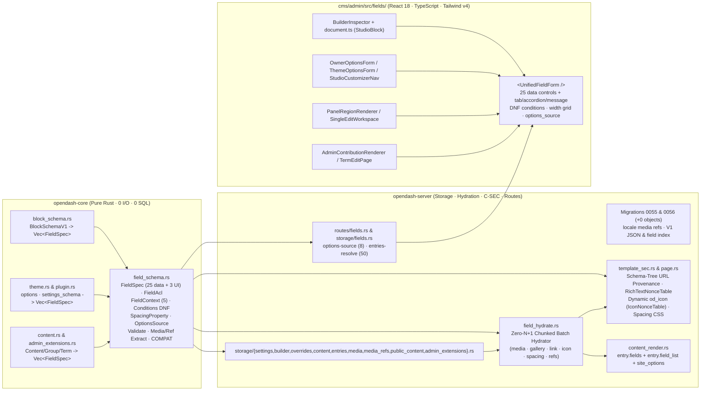

# Unified Field Engine — Hệ kiểu Trường Thống nhất, Hydrator, C-SEC & `<UnifiedFieldForm>` (Đợt 1)

* **Author:** Orion (Elephant / Antigravity)
* **Status:** Approved
* **Date:** 2026-11-26
* **Baseline:** `main@f47af30`
* **Approved By:** Owner
* **Approval Evidence:** Owner phê duyệt tường minh ngày 2026-11-26 sau khi đồng bộ [UNIFIED_FIELD_SCHEMA.md V1](../contracts/UNIFIED_FIELD_SCHEMA.md) (quyết định D1=1B của Luồng A), hoàn tất 3 vòng Goldfish review độc lập, và khẳng định chuẩn đánh phiên bản duy nhất **V1 (`1.0.0`)** (loại bỏ hoàn toàn code/bản nháp tiền-V1 cũ, không đánh `1.1`/`1.2`).
* **Goldfish Review:** 3 vòng fresh-context độc lập (`egm-design`, `egm-codebase-details`, `egm-implementation-readiness`); toàn bộ Blocker/Major từ vòng 1–2 đã xử lý triệt để, vòng 3 đạt `0 Blocker` và vá sạch 1 Major cuối cùng (`storage/builder.rs::pattern_ids_with_schemas` + `opendash-core/src/builder_blocks.rs::extract_block_refs_lenient_with_schemas`), 3 Minor và 2 Nit; 100% kiểm tra governance (`check-plans`, `check-standards`, `check-agent-artifacts`) PASS.
* **Related Contracts & Specs:**
  * [Hợp đồng Hệ kiểu Trường Thống nhất (`UNIFIED_FIELD_SCHEMA` V1)](../contracts/UNIFIED_FIELD_SCHEMA.md)
  * [Yêu cầu Sản phẩm V1](../product/PRODUCT_REQUIREMENTS.md)
  * [Core Foundation & Quy chuẩn Code](../contracts/CORE_FOUNDATION.md)
  * [Plugin ABI v1 / v1.1](../contracts/PLUGIN_ABI.md)
  * [M8 Writer Inventory](../contracts/M8_WRITER_INVENTORY.md)
  * [Declarative `block.json` Block Engine](declarative-block-json-engine.md)
  * [OpenDash Studio & Comment-Block Entry Content](opendash-studio-customizer-and-ux-builder.md)
  * [Theme v3 PageLayout Chrome, C-SEC Cache & Safe `od_icon()`](theme-chrome-cache-and-safe-icons.md)
  * [Unified JS Runtime (`boa_engine`), Render/Route Hooks & Dev Live-Edit](unified-js-runtime-render-hooks-and-dev-mode.md)

---

## Overview

Đặc tả này (**Đợt 1 — Unified Field Engine**) hiện thực hóa trọn vẹn phần móng dùng chung của [UNIFIED_FIELD_SCHEMA.md V1](../contracts/UNIFIED_FIELD_SCHEMA.md) (§1–§4, §6, §7) theo nguyên tắc **Clean-Slate V1 (Zero Legacy Shim)** — thay thế đồng bộ 5 hệ thống khai báo/nhập liệu trường rời rạc hiện có trong `cms/` bằng **1 lõi domain thuần Rust (`opendash_core::field_schema`)**, **1 bộ hydrate template Zero-N+1 (`opendash-server/src/field_hydrate.rs`)**, **1 bộ kiểm tra tĩnh C-SEC dựa trên cây schema** (gồm cả `RichTextNonceTable` cho theme templates và `od_icon` động qua `IconNonceTable`), và **1 Form Engine React duy nhất (`cms/admin/src/fields/`)**.

Mục tiêu chiến lược của Đợt 1 là **gỡ nút cổ chai chung cho cả hai luồng phát triển song song ngay sau khi merge**:
- **Luồng A (55 Core & Template Studio Blocks):** có sẵn toàn bộ 25 kiểu dữ liệu + 3 layout UI-only (`tab`, `accordion`, `message`), `spacing.property` (`padding` | `margin` âm), `select.options_source` (8 nguồn động kèm `GET /api/admin/fields/options-source` và kiểm tra server khi lưu), `term_ref.taxonomy_from_field` & `entry_ref.target_types: ["*"]` (để `core/list` chạy 100% qua `<UnifiedFieldForm>`), `link.label`, `icon` + `od_icon(icon.name, "class")`, DNF `conditions`, context `site_options` + `menus` trong block, và hydration dạng object đồng nhất (`{{ image.url }}`, `{{ cta.url }}`, `{{ padding.classes }}`, `{{ margin.classes }}`).
- **Luồng B (Đợt 2 & Đợt 3 — Content Structure ACF):** có sẵn `FieldSpec` thống nhất trong `opendash_core::content`, `storage/media.rs`, `storage/public_content.rs`, `content_render.rs` (`entry.fields.<key>` + `entry.field_list`), migration `0055` & `0056` (`+0` net schema objects), và `<UnifiedFieldForm>` sẵn sàng gắn vào ACF Field Group Builder UI, Taxonomy Term Meta và Custom Options Pages.

---

## The Problem

Kiểm toán thực tế mã nguồn `cms/` tại baseline `main@cfe320b` ghi nhận 5 phân hệ field tách rời kèm các khiếm khuyết vận hành trực tiếp:

1. **5 hệ thống kiểu trường không tương thích nhau trong Rust & React:**
   - `ContentFieldType` (`opendash-core/src/content.rs:183`): chỉ có 9 kiểu phẳng (`short_text`, `long_text`, `rich_text`, `image`, `gallery`, …), nhập liệu qua `FieldValueInput.tsx` sơ khai và chuyển đổi chuỗi thô `toInputString`/`parseInputString` ở `PanelRegionRenderer.tsx:67-89`.
   - `BlockFieldSpec` (`opendash-core/src/block_schema.rs:330`): có 15 kiểu và `show_if` đơn lẻ, thiếu `gallery`, `date`, `datetime`, `time`, `email`, `checkbox`, `icon`, `entry_ref`, `term_ref`, layout `tab`/`accordion`/`message`, `spacing.property` (`margin` âm), và `select.options_source`; đồng thời `group` lưu phẳng thay vì nested object.
   - `ThemeOptionType` (`opendash-server/src/storage/settings.rs`): trộn 16 kiểu cũ + mới, phải bóc `public`/`translatable` bằng `extract_public_flags_and_strip` (`settings.rs:1890`) và chứa **lỗi thực tế tại `settings.rs:2115-2124`** từ chối `translatable: true` trên `text`/`textarea`/`richtext` (chỉ kiểm tra `ThemeOptionType::String | Url`), cũng như bỏ qua media trong overlay locale (`settings.rs:2895`) và thiếu cột `locale` trong `theme_option_media_refs` (`0053:87-94`).
   - `PluginSettingFieldType` (`opendash-core/src/plugin.rs:55`): chỉ có 8 kiểu, dùng `choices` thay vì `options`; server phải chuyển đổi giả lập qua `plugin_setting_to_block_field` (`settings.rs:3474`) còn React phải dựng `BlockSchemaV1` giả trong `OwnerOptionsForm.tsx:208-222` và tách riêng trường `secret` xuống cuối form.
   - `TermFieldType` (`opendash-core/src/admin_extensions.rs:44`): chỉ có 3 kiểu (`text`, `textarea`, `boolean`), dùng `min_role` đơn trục thay vì `acl` 3 trục, render bằng form riêng trong `AdminContributionRenderer.tsx:96-129`.
2. **Biến template hậu tố phẳng rời rạc, thiếu `RichTextNonceTable` trên theme và `od_icon()` chưa hỗ trợ field:**
   - `template_sec.rs:6424-6509` phát sinh hàng loạt biến hậu tố phẳng (`<key>_url`, `<key>_alt`, `<key>_width` rỗng, `<key>_height` rỗng, `<key>_target`, `<key>_rel`, `<key>_classes`) kéo theo bảng cấm khóa hậu tố phức tạp (`block_schema.rs:783-826`).
   - `entry.fields` ở `content_render.rs:780` là mảng `Vec<FieldView>` chứ không cho truy cập `entry.fields.<key>`; theme templates chưa có đường ống `RichTextNonceTable` (hiện chỉ tồn tại ở `render_block_csec_*`), chưa bảo vệ `site_options` trong `RESERVED_CONTEXT_VARS`, và `od_icon()` (`template_sec.rs:2324`) chỉ nhận string literal tĩnh.
   - `spacing_field_tailwind_classes` (`template_sec.rs:6554`) và `page.rs:705-737` hardcode `"p"` (`padding`) và `n >= 0.0`, không thể tái sử dụng `compile_box_spacing_tailwind("m", ..., true)` cho `margin` (kể cả margin âm).
3. **Lỗ hổng & giới hạn thực tế ở Public Media ACL:**
   - `storage/public_content.rs:1268-1296` kiểm tra public media ACL bằng raw SQL `json_extract(f.value, '$.type') = 'image'` và chỉ đọc cấp 1 của `r.manifest_json -> $.options`, còn `routes/public_content.rs:1467-1472` gọi `media_is_referenced` trước `media::find` (lãng phí truy vấn cho probe ID không tồn tại) và kiểm tra thumbnail sai cho loại `file` (`asset.kind == "video"` thay vì `asset.kind != "image"`).
4. **Không còn lý do giữ nợ tương thích ngược:** OpenDash chưa phát hành bất kỳ bản CMS hay Theme V1 công khai nào. Cắt chuyển sạch ngay từ Đợt 1 tránh mang 2 bộ parser và alias tên kiểu cũ vào mọi tính năng về sau.

---

## Goals

1. **Một lõi domain thuần Rust duy nhất (`opendash_core::field_schema`):**
   - Định nghĩa trọn vẹn **25 kiểu dữ liệu** (`text`, `textarea`, `number`, `range`, `email`, `url`, `secret`, `richtext`, `media`, `gallery`, `link`, `select`, `checkbox`, `radio_buttons`, `boolean`, `color`, `icon`, `date`, `datetime`, `time`, `spacing`, `entry_ref`, `term_ref`, `group`, `repeater`) và **3 layout UI-only** (`tab`, `accordion`, `message`) đúng bảng §2.1 & §3 của [UNIFIED_FIELD_SCHEMA.md V1](../contracts/UNIFIED_FIELD_SCHEMA.md).
   - Thực thi ma trận năng lực theo 5 context (`FieldContext::{Content, Term, Options, OwnerSettings, StudioBlock}`), bất biến M7-S09, điều kiện ẩn/hiện DNF (`Vec<Vec<ConditionRule>>` với 8 toán tử, chống chu trình và chống oracle quyền đọc), `spacing.property: Padding | Margin` (`0..=256` vs `-256..=256`), `select.options_source` (8 nguồn động cho `StudioBlock`), `term_ref.taxonomy_from_field` & `entry_ref.target_types: ["*"]` (cho `StudioBlock`), giới hạn độ sâu/số lượng/bytes, và `check_schema_compatibility` (`COMPAT-1..4`).
   - **Xóa bỏ 100% kiểu field cũ:** `BlockFieldSpec`, `ShowIfRule`, `ShowIfScalar`, `ThemeOptionType`, `ThemeOptionDef`, `ThemeOptionChoice`, `PluginSettingFieldType`, `PluginSettingChoice`, `PluginSettingField`, `TermFieldType`, `TermFieldRole`, `TermPanelField`, `ContentFieldType`, `ContentFieldDefinition`, `FieldDefinitionInput`.
2. **Một bộ Hydrator Zero-N+1 (`opendash-server/src/field_hydrate.rs`) & C-SEC Schema-Tree (`template_sec.rs`, `page.rs`):**
   - Hydrate đồng nhất mọi bề mặt (`StudioBlock`, `Entry`, `Options`/`SiteOptions`) sang object chuẩn §6 trong tối đa **3 truy vấn batch SQL có phân mảnh (`CHUNK = 500`) và trần ID bảo vệ bộ nhớ** (`media <= 512`, `entry_ref <= 128`, `term_ref <= 128`, chỉ hydrate 1 tầng).
   - Nâng cấp `template_sec.rs`: cây `FieldTemplateNode` đầy đủ cho Block & Theme, thêm `RichTextNonceTable` cho theme templates (cấm literal `OD_RICHTEXT_`, chỉ cho phép thế chỗ trong `HtmlScanState::Body`), bảo vệ `site_options` trong `RESERVED_CONTEXT_VARS`, cô lập `entry.fields.*` theo CPT ở template đặc thù (`single-<cpt>.html`/`archive-<cpt>.html`), nâng cấp `od_icon(<icon_expr>, "class"?)` phát `OD_ICON_<32hex>` vào `IconNonceTable` khi chạy thực tế, và gỡ toàn bộ biến hậu tố phẳng cũ.
   - Nâng cấp `page.rs::serialize_scoped_block_css` duyệt đệ quy `group` cho `css_var` và phát CSS fallback `padding:` / `margin:` tương ứng `spacing.property` với selector `[data-od-spacing="{path}"]`.
3. **API nguồn động `options_source`, API resolve `entries-resolve` & Kiểm tra Server Khi Lưu:**
   - Cung cấp `GET /api/admin/fields/options-source` (8 nguồn, trần 200 mục) và `GET /api/admin/fields/entries-resolve` (tối đa 50 IDs cho `EntryRefControl`), đều `require_session` + `Cache-Control: no-store`.
   - Kiểm tra giá trị `options_source` và `entry_ref`/`term_ref` (gồm cả `target_types: ["*"]` và `taxonomy_from_field`) trên server khi lưu với bảo toàn `previous_values`; đưa `options_source: "template_parts"` vào bộ kiểm tra vòng lặp `overrides.rs::validate_part_graph_in_tx`, chặn `options_source: "patterns"` trong `template_overrides`, và ghi `entry_pattern_refs` trên entry.
4. **2 Migration `+0` Schema Objects (`0055` & `0056`), Starter Theme V1 (`1.0.0`) & Media ACL có Index:**
   - **`0055_theme_option_locale_media_refs.sql` (S02, `+0` objects):** rebuild `theme_option_media_refs` bổ sung cột `locale` vào PK để hỗ trợ đầy đủ `translatable: true` trên `media`/`gallery`/`group`/`repeater`, kèm kiểm tra `site_locales` và pin media trong `theme_option_locale_values`.
   - **`0056_unified_field_content_cutover.sql` (S04, `+0` objects):** chuẩn hóa JSON cho `content_types` (`post`/`page`), `content_field_groups`, `admin_extensions` (`min_role` → `acl`), dọn hàng non-core tiền-V1 trong `builder_block_definitions`, và rebuild `entry_builder_media_refs` bổ sung `source_kind IN ('builder', 'field')` + backfill để Public Media ACL và `media_refs.rs` chạy theo index `O(log N)` không bao giờ `LIKE '%...%'` full-table scan.
   - Hợp nhất built-in starter theme về duy nhất **`STARTER_THEME_VERSION = "1.0.0"`** (xóa bỏ toàn bộ các bản nháp overlay tiền-V1 cũ, thay sạch bản nháp tiền-V1 trên DB dev mà không gây `409 Conflict` hay lỗi FK) và cắt chuyển trọn bộ `builtin_blocks/`, `examples/`, `fixtures/`.
5. **Một React Form Engine duy nhất (`cms/admin/src/fields/`) với 0 dependency mới:**
   - Xây dựng `<UnifiedFieldForm>` hỗ trợ đủ 25 kiểu dữ liệu + 3 layout UI-only, DNF `conditions`, lưới `width`, `spacing` (`padding`/`margin` âm), `select` động `options_source`, `icon` picker 48 `CORE_ICONS`, `gallery`, `link` có `label`, `entry_ref`/`term_ref`, `group` nested, `repeater` 1 cấp, và `secret` write-only nội tuyến.
   - Kiểm thử unit logic thuần bằng `node:test` + `typescript` có sẵn (`cms/admin/scripts/test-field-engine.mjs`, 0 dependency mới), cắt chuyển cả 5 bề mặt Admin, xóa `BlockSchemaForm.tsx`, `FieldValueInput.tsx` và `upcastOwnerDefToBlockField`.

---

## Non-Goals

Những hạng mục sau thuộc **Luồng A (55 Studio Blocks)** hoặc **Luồng B (Đợt 2 & Đợt 3 — `docs/designs/acf-content-structure.md`)**, tuyệt đối **không** làm phình phạm vi Đợt 1:
- Không bổ sung 48 Studio Block mới (Đợt 1 chỉ cắt chuyển 7 builtin blocks + 2 blocks của `opendash-starter`).
- Không nâng cấp `ElementBinding` / `storage/builder_binding.rs` / `BuilderBindingFields.tsx` và bỏ hẳn thuộc tính `bindable` (theo quyết định D1=1B của Luồng A, Spec A1 sẽ xóa bỏ hoàn toàn cơ chế binding cũ để tách các Template Block độc lập theo `allowed_contexts`; Đợt 1 S04 chỉ đổi tối thiểu tên enum `ContentFieldType` → `FieldType` trên 2 file đó để giữ biên dịch xanh trước khi Spec A1 chạy).
- Không xóa `base fields` khỏi `ContentTypeDefinition`, không bỏ `base_field_panels`, không thêm Location Rules DNF cho `content_field_groups`, không thêm UI 4 tab ACF Field Group Builder, và không kích hoạt ghi tự động `sync_entry_terms` (thuộc Đợt 2; ở Đợt 1, `sync_entry_terms: true` bị từ chối rõ ràng với thông báo lỗi để tránh no-op âm thầm).
- Không thêm cột `taxonomy_terms.{description, sort_order, values_json}`, `term_seo`, `selection_mode`, `editor_can_create_terms`, `hierarchical` CPT, public Term Meta (`AdminTermPanel` ở Đợt 1 giữ `public_exposure == Private`, chỉ dùng cho admin + media pins), hay Custom Options Pages (thuộc Đợt 2 & Đợt 3).
- Không bổ sung cột `alt` riêng trong `media_assets` ở Đợt 1 (`HydratedMedia.alt` trả `""` dự phòng cho Đợt sau; mọi block cần alt mô tả khai báo field `alt: text` riêng như `UNIFIED_FIELD_SCHEMA.md` §6).
- Không hỗ trợ `flexible_content` hoặc `repeater` lồng quá 1 cấp (ngoài phạm vi V1 theo [PRODUCT_REQUIREMENTS.md](../product/PRODUCT_REQUIREMENTS.md) §7).
- Không thay đổi phiên bản dependency đã pin trong `cms/Cargo.toml` và `cms/admin/package.json` (**0 dependency mới**).

---

## Critical User Journeys (CUJs)

### CUJ 1: Tác giả Studio Block dùng `spacing.property`, `select.options_source`, `icon`, `group` nested & DNF `conditions`
* **Given:** Một block khai báo `block.json` chuẩn `UNIFIED_FIELD_SCHEMA` V1 gồm `tab` (`tab_content` / `tab_style`), `accordion` (`acc_advanced`), `message`, `group` nested `hero_card` (`media`, `link` có `label`, `icon`), `spacing` (`property: "margin"`, `min: -64`), `select` (`options_source: "menus"`), và trường phụ thuộc DNF `conditions`.
* **When:** Admin mở OpenDash Studio, thêm block `core/showcase`, chọn menu tải động qua `GET /api/admin/fields/options-source?source=menus`, chọn icon từ 48 `CORE_ICONS`, chỉnh margin âm `-16px`, nhập link kèm nhãn, bật/tắt điều kiện ẩn/hiện rồi lưu và xem trang công khai.
* **Then:**
  - Studio hiển thị form sạch từ `<UnifiedFieldForm>` (2 tab gọn, margin âm hiển thị `-m-4` / `-mt-4`, trường ẩn không chặn lưu và bảo toàn giá trị cũ khi bật lại).
  - Server xác thực `menu_key` tồn tại, lưu `hero_card` dưới dạng nested object `{ ... }` trong `props.values`, pin `media_id` ở mọi độ sâu trong `entry_builder_media_refs` (`source_kind = 'builder'`) / `template_override_media_refs`.
  - Trang công khai render đúng `{{ hero_card.image.url }}` (có `width`/`height` thật), `{{ hero_card.cta.url }}`/`{{ hero_card.cta.label }}`, `{{ od_icon(hero_card.badge_icon.name, "w-5 h-5") }}` (qua `IconNonceTable`), và `{{ outer_margin.classes }}` sinh `-m-4` (hoặc fallback CSS `margin:` khi không trùng thang Tailwind `±128px`).

### CUJ 2: Quản trị viên cấu hình Theme Options đa ngôn ngữ (gồm cả `media`/`gallery`), Global Site Options & Owner Secrets
* **Given:** Active theme `opendash-starter` `1.0.0` (V1) khai báo `options` dùng kiểu chuẩn `text`, `url`, `media`, `richtext` với `translatable: true` và `public: true`; một plugin và `theme.json -> functions` khai báo `settings_schema` chứa `text`, `select` (`options`), `group`, `media` và `secret`.
* **When:** Admin chỉnh Global Site Options (logo + social links), chỉnh Theme Options (bao gồm cả text và ảnh đa ngôn ngữ) ở cả locale mặc định lẫn locale phụ, và lưu Plugin/Theme Functions Settings kèm thay đổi 1 trường `secret`.
* **Then:**
  - `translatable: true` hoạt động đúng trên mọi kiểu dữ liệu nội dung (gồm cả `media`/`gallery`/`group`/`repeater`), đồng bộ `theme_option_media_refs` theo từng `locale` (`0055`) và kiểm tra `site_locales` khi phục vụ `/media/{id}/file`.
  - `OwnerOptionsForm` render trực tiếp `<UnifiedFieldForm>` (trường `secret` hiển thị nội tuyến đúng vị trí schema, luôn trả `{"configured": bool}` sau khi lưu, cấm trùng khóa `"secret_ref"` trong `group`).
  - Trang công khai truy cập đồng nhất `{{ options.site_logo.url }}`, `{{ site_options.site_logo.url }}`, `{{ options.header_cta_url }}`; ảnh trong `media`/`gallery` (kể cả trong `group`/`repeater` và ở locale phụ) của option `public: true` được cấp quyền tải công khai và bị chặn xóa bởi `media_refs`.

### CUJ 3: Biên tập viên soạn Entry giàu trường & kiểm soát Public Media ACL theo Index
* **Given:** Một CPT có base fields (`body`, `featured_image`) và Extension Field Group (`user:product_specs`) chứa `richtext`, `media`, `gallery`, `link`, `icon`, `repeater`, `entry_ref`, cùng 1 trường `media` đặt `acl.public_exposure = "private"`.
* **When:** Editor mở màn hình Single Edit, nhập giá trị có cấu trúc trong `<UnifiedFieldForm>`, lưu nháp rồi xuất bản.
* **Then:**
  - Single Edit gửi JSON đúng kiểu mà không qua `toInputString`/`parseInputString`; mọi `media_id` ở mọi độ sâu được xác minh `active` + đúng `media_kind` và đồng bộ vào `entry_builder_media_refs` (`source_kind = 'field'`).
  - Khi còn `draft` hoặc với trường `private`, `/media/{id}/file` trả `404` (kiểm tra `media::find` trước, rồi truy vấn index `idx_entry_builder_media_refs_media`, 0 full-table scan); khi xuất bản, ảnh ở trường `public` (kể cả trong `group`/`repeater`) tải được công khai và hiển thị qua `{{ entry.fields.<key>.url }}` cũng như ``.
  - Trường `richtext` trong `entry.fields.*` được render an toàn qua `RichTextNonceTable` chỉ trong `HtmlScanState::Body`.

### CUJ 4: Khởi tạo DB mới & Nâng cấp an toàn từ `baseline_0001.sqlite` qua `0055` + `0056` + Starter V1 (`1.0.0`)
* **Given:** Một database trống, một database nâng cấp từ fixture lịch sử `cms/fixtures/baseline_0001.sqlite`, và một database dev cũ đang lưu bản nháp `opendash-starter` tiền-V1.
* **When:** Chạy `init_db` (`preflight_builtin_key_collisions` → `sqlx::migrate!` (`0055` + `0056`) → `ensure_embedded_core_blocks`) và `ensure_default_starter_theme`.
* **Then:**
  - `preflight_builtin_key_collisions` chấp nhận cả định nghĩa `post`/`page` tiền-`0056` (`rich_text`/`image`) lẫn hậu-`0056` (`richtext`/`media`) cho `owner_kind == 'core'`.
  - Cả `0055` và `0056` đều đóng góp **`+0` net schema objects** (giữ tổng `sqlite_schema < 256` theo `schema_fingerprints.json`).
  - `ensure_default_starter_theme` cài mới và tự động thay sạch các bản nháp `opendash-starter` tiền-V1 về duy nhất **`1.0.0`** mà không gặp lỗi `409 Conflict` hay vi phạm FK `ON DELETE RESTRICT`.

---

## Technical Plan (Architecture)

### Kiến trúc Tổng thể & Luồng Dữ liệu



---

### A. Lõi Domain Thuần Rust (`cms/crates/opendash-core/src/field_schema.rs`)

`opendash-core` tiếp tục giữ nguyên `0` dependency ngoài (`serde`, `serde_json`, `url`, `std`) và `0` I/O/HTTP/SQL theo [CORE_FOUNDATION.md](../contracts/CORE_FOUNDATION.md). Đồng bộ ghi chú tại [CORE_FOUNDATION.md](../contracts/CORE_FOUNDATION.md) §3.1: `field_key` tuân theo `valid_snake_key` (`1..=64` ký tự, khớp `UNIFIED_FIELD_SCHEMA.md` §3.1).

#### A.1. Chữ ký Chuẩn `FieldSpec`, `FieldAcl` & Wire Contract JSON

Để `#[serde(deny_unknown_fields)]` hoạt động chặt chẽ 100% (vì `serde` không hỗ trợ kết hợp `deny_unknown_fields` + `#[serde(flatten)]`) mà không nhân bản 28 struct boilerplate, dùng struct phẳng `FieldSpec` kèm bộ kiểm biên ma trận `(field_type, ctx)`. Mọi struct chứa `FieldSpec` derive `PartialEq` (không derive `Eq` do `f64`/`serde_json::Value`), và hàm chuẩn hóa canonical hóa `-0.0` → `0.0` trước khi serialize/băm `schema_token` để bảo đảm tính tất định.

```rust
#[derive(Debug, Clone, Copy, PartialEq, Eq, Hash, Serialize, Deserialize)]
#[serde(rename_all = "snake_case")]
pub enum FieldContext {
    Content,
    Term,
    Options,
    OwnerSettings,
    StudioBlock,
}

#[derive(Debug, Clone, Copy, PartialEq, Eq, Hash, Serialize, Deserialize)]
#[serde(rename_all = "snake_case")]
pub enum FieldScopeKind {
    BaseCptField,
    ExtensionGroupField,
    UserFieldGroup,
    TermPanelField,
}

#[derive(Debug, Clone, Copy, PartialEq, Eq, Hash, Serialize, Deserialize)]
#[serde(rename_all = "snake_case")]
pub enum FieldType {
    // 25 kiểu dữ liệu
    Text, Textarea, Number, Range, Email, Url, Secret, Richtext,
    Media, Gallery, Link, Select, Checkbox, RadioButtons, Boolean,
    Color, Icon, Date, Datetime, Time, Spacing, EntryRef, TermRef,
    Group, Repeater,
    // 3 layout UI-only
    Tab, Accordion, Message,
}

#[derive(Debug, Clone, Copy, PartialEq, Eq, Default, Serialize, Deserialize)]
#[serde(rename_all = "snake_case")]
pub enum SpacingProperty { #[default] Padding, Margin }

#[derive(Debug, Clone, Copy, PartialEq, Eq, Hash, Serialize, Deserialize)]
#[serde(rename_all = "snake_case")]
pub enum SelectOptionsSource {
    Menus, MenuSlots, ContactForms, ContentTypes,
    Taxonomies, ContextFields, TemplateParts, Patterns,
}

#[derive(Debug, Clone, Copy, PartialEq, Eq, Default, Serialize, Deserialize)]
#[serde(rename_all = "snake_case")]
pub enum MediaFieldKind { #[default] Image, Video, File, Any }

#[derive(Debug, Clone, Copy, PartialEq, Eq, Default, Serialize, Deserialize)]
#[serde(rename_all = "snake_case")]
pub enum SelectDisplay { #[default] Dropdown, Buttons }

#[derive(Debug, Clone, Copy, PartialEq, Eq, Default, Serialize, Deserialize)]
#[serde(rename_all = "snake_case")]
pub enum TermPickerStyle { #[default] Auto, Checklist, Tags, Select, Radio }

#[derive(Debug, Clone, Copy, PartialEq, Eq, PartialOrd, Ord, Serialize, Deserialize)]
#[serde(rename_all = "snake_case")]
pub enum FieldRole { Editor, Admin }

#[derive(Debug, Clone, Copy, PartialEq, Eq, Serialize, Deserialize)]
#[serde(rename_all = "snake_case")]
pub enum PublicExposure { Public, Private }

#[derive(Debug, Clone, Copy, PartialEq, Eq, Default, Serialize, Deserialize)]
#[serde(rename_all = "snake_case")]
pub enum FieldDeclarationState { #[default] Declared, Withdrawn }

#[derive(Debug, Clone, Copy, PartialEq, Eq, Default, Serialize, Deserialize)]
#[serde(rename_all = "snake_case")]
pub enum RichTextToolbar { Minimal, #[default] Standard }

#[derive(Debug, Clone, Copy, PartialEq, Eq, Default, Serialize, Deserialize)]
#[serde(rename_all = "snake_case")]
pub enum CssUnit { #[default] Px, Rem, Em, #[serde(rename = "%")] Percent, Vw, Vh }

#[derive(Debug, Clone, Copy, PartialEq, Eq, Default, Serialize, Deserialize)]
#[serde(rename_all = "snake_case")]
pub enum CheckboxLayout { #[default] Vertical, Horizontal }

#[derive(Debug, Clone, Copy, PartialEq, Eq, Default, Serialize, Deserialize)]
#[serde(rename_all = "snake_case")]
pub enum RadioLayout { #[default] Buttons, Radio }

#[derive(Debug, Clone, Copy, PartialEq, Eq, Default, Serialize, Deserialize)]
#[serde(rename_all = "snake_case")]
pub enum RepeaterLayout { #[default] Accordion, Table, Block }

#[derive(Debug, Clone, Copy, PartialEq, Eq, Default, Serialize, Deserialize)]
#[serde(rename_all = "snake_case")]
pub enum FieldLayoutPlacement { #[default] Top, Left }

#[derive(Debug, Clone, Copy, PartialEq, Eq, Default, Serialize, Deserialize)]
#[serde(rename_all = "snake_case")]
pub enum MessageTone { #[default] Info, Warning, Neutral }

#[derive(Debug, Clone, Copy, PartialEq, Eq, Serialize, Deserialize)]
#[serde(rename_all = "snake_case")]
pub enum ConditionOp { Eq, Neq, Empty, NotEmpty, Contains, Gt, Lt, In }

#[derive(Debug, Clone, PartialEq, Serialize, Deserialize)]
#[serde(deny_unknown_fields)]
pub struct ConditionRule {
    pub field: String,
    pub op: ConditionOp,
    #[serde(default, skip_serializing_if = "Option::is_none")]
    pub value: Option<Value>,
}

pub type ConditionGroups = Vec<Vec<ConditionRule>>;

#[derive(Debug, Clone, PartialEq, Eq, Serialize, Deserialize)]
#[serde(deny_unknown_fields)]
pub struct SelectOption {
    pub value: String,
    pub label: String,
    #[serde(default, skip_serializing_if = "Option::is_none")]
    pub icon: Option<String>,
}

#[derive(Debug, Clone, PartialEq, Eq, Default, Serialize, Deserialize)]
#[serde(deny_unknown_fields)]
pub struct LinkValue {
    pub url: String,
    #[serde(default)]
    pub label: String,
    #[serde(default)]
    pub new_tab: bool,
    #[serde(default)]
    pub nofollow: bool,
}

#[derive(Debug, Clone, PartialEq, Default, Serialize, Deserialize)]
#[serde(deny_unknown_fields)]
pub struct SpacingValue {
    #[serde(default, skip_serializing_if = "Option::is_none")]
    pub top: Option<f64>,
    #[serde(default, skip_serializing_if = "Option::is_none")]
    pub right: Option<f64>,
    #[serde(default, skip_serializing_if = "Option::is_none")]
    pub bottom: Option<f64>,
    #[serde(default, skip_serializing_if = "Option::is_none")]
    pub left: Option<f64>,
}

#[derive(Debug, Clone, PartialEq, Eq, Default, Serialize, Deserialize)]
#[serde(deny_unknown_fields)]
pub struct FieldAcl {
    #[serde(default, skip_serializing_if = "Option::is_none")]
    pub min_view_role: Option<FieldRole>,
    #[serde(default, skip_serializing_if = "Option::is_none")]
    pub min_edit_role: Option<FieldRole>,
    #[serde(default, skip_serializing_if = "Option::is_none")]
    pub public_exposure: Option<PublicExposure>,
}

#[derive(Debug, Clone, PartialEq, Serialize, Deserialize)]
#[serde(deny_unknown_fields)]
pub struct FieldSpec {
    #[serde(rename = "type")]
    pub field_type: FieldType,
    pub key: String,
    #[serde(default)]
    pub label: String,
    #[serde(default, skip_serializing_if = "Option::is_none")]
    pub instructions: Option<String>,
    #[serde(default, skip_serializing_if = "Option::is_none")]
    pub placeholder: Option<String>,
    #[serde(default, skip_serializing_if = "is_false")]
    pub required: bool,
    #[serde(default, skip_serializing_if = "Option::is_none")]
    pub default: Option<Value>,
    #[serde(default, skip_serializing_if = "Option::is_none")]
    pub width: Option<u8>,
    #[serde(default, skip_serializing_if = "Option::is_none")]
    pub conditions: Option<ConditionGroups>,

    // Context-specific capability flags (chỉ chấp nhận `true` đúng context; omitted/`false` được bỏ qua khi serialize)
    #[serde(default, skip_serializing_if = "Option::is_none")]
    pub acl: Option<FieldAcl>,
    #[serde(default, skip_serializing_if = "Option::is_none")]
    pub declaration_state: Option<FieldDeclarationState>,
    #[serde(default, skip_serializing_if = "is_false")]
    pub show_in_list: bool,
    #[serde(default, skip_serializing_if = "is_false")]
    pub public: bool,
    #[serde(default, skip_serializing_if = "is_false")]
    pub translatable: bool,
    #[serde(default, skip_serializing_if = "is_false")]
    pub responsive: bool,
    #[serde(default, skip_serializing_if = "Option::is_none")]
    pub css_var: Option<String>,

    // Text / Textarea / Richtext / Number / Range / Date / Spacing
    #[serde(default, skip_serializing_if = "Option::is_none")]
    pub min_chars: Option<usize>,
    #[serde(default, skip_serializing_if = "Option::is_none")]
    pub max_chars: Option<usize>,
    #[serde(default, skip_serializing_if = "Option::is_none")]
    pub max_bytes: Option<usize>,
    #[serde(default, skip_serializing_if = "Option::is_none")]
    pub rows: Option<u8>,
    #[serde(default, skip_serializing_if = "Option::is_none")]
    pub prepend: Option<String>,
    #[serde(default, skip_serializing_if = "Option::is_none")]
    pub append: Option<String>,
    #[serde(default, skip_serializing_if = "Option::is_none")]
    pub toolbar: Option<RichTextToolbar>,
    #[serde(default, skip_serializing_if = "Option::is_none")]
    pub min: Option<f64>,
    #[serde(default, skip_serializing_if = "Option::is_none")]
    pub max: Option<f64>,
    #[serde(default, skip_serializing_if = "Option::is_none")]
    pub step: Option<f64>,
    #[serde(default, skip_serializing_if = "Option::is_none")]
    pub unit: Option<CssUnit>,
    #[serde(default, skip_serializing_if = "Option::is_none")]
    pub property: Option<SpacingProperty>,
    #[serde(default, skip_serializing_if = "Option::is_none")]
    pub min_date: Option<String>,
    #[serde(default, skip_serializing_if = "Option::is_none")]
    pub max_date: Option<String>,

    // Choice / Boolean / Color / Media / Gallery / Relational
    #[serde(default, skip_serializing_if = "Vec::is_empty")]
    pub options: Vec<SelectOption>,
    #[serde(default, skip_serializing_if = "Option::is_none")]
    pub options_source: Option<SelectOptionsSource>,
    #[serde(default, skip_serializing_if = "Option::is_none")]
    pub display: Option<SelectDisplay>,
    #[serde(default, skip_serializing_if = "is_false")]
    pub multiple: bool,
    #[serde(default, skip_serializing_if = "is_false")]
    pub allow_null: bool,
    #[serde(default, skip_serializing_if = "Option::is_none")]
    pub on_label: Option<String>,
    #[serde(default, skip_serializing_if = "Option::is_none")]
    pub off_label: Option<String>,
    #[serde(default, skip_serializing_if = "is_false")]
    pub allow_alpha: bool,
    #[serde(default, skip_serializing_if = "Option::is_none")]
    pub media_kind: Option<MediaFieldKind>,
    #[serde(default, skip_serializing_if = "Option::is_none")]
    pub min_items: Option<usize>,
    #[serde(default, skip_serializing_if = "Option::is_none")]
    pub max_items: Option<usize>,
    #[serde(default, skip_serializing_if = "Vec::is_empty")]
    pub target_types: Vec<String>,
    #[serde(default, skip_serializing_if = "Option::is_none")]
    pub taxonomy: Option<String>,
    #[serde(default, skip_serializing_if = "Option::is_none")]
    pub taxonomy_from_field: Option<String>,
    #[serde(default, skip_serializing_if = "Option::is_none")]
    pub picker_style: Option<TermPickerStyle>,
    #[serde(default, skip_serializing_if = "is_false")]
    pub sync_entry_terms: bool,

    // Group / Repeater
    #[serde(default, skip_serializing_if = "Vec::is_empty")]
    pub fields: Vec<FieldSpec>,
    #[serde(default, skip_serializing_if = "Option::is_none")]
    pub layout: Option<String>, // được kiểm biên chặt theo field_type: CheckboxLayout | RadioLayout | RepeaterLayout
    #[serde(default, skip_serializing_if = "Option::is_none")]
    pub item_label_field: Option<String>,
    #[serde(default, skip_serializing_if = "Option::is_none")]
    pub button_label: Option<String>,

    // UI-only layout primitives (tab / accordion / message)
    #[serde(default, skip_serializing_if = "Option::is_none")]
    pub placement: Option<FieldLayoutPlacement>,
    #[serde(default, skip_serializing_if = "is_false")]
    pub open_by_default: bool,
    #[serde(default, skip_serializing_if = "is_false")]
    pub multi_expand: bool,
    #[serde(default, skip_serializing_if = "is_false")]
    pub endpoint: bool,
    #[serde(default, skip_serializing_if = "Option::is_none")]
    pub tone: Option<MessageTone>,
    #[serde(default, skip_serializing_if = "Option::is_none")]
    pub body: Option<String>,
}
```

> **Lưu ý về khóa `layout` dùng chung trên JSON wire:** `UNIFIED_FIELD_SCHEMA.md` §2.1 dùng cùng khóa JSON `"layout"` cho 3 kiểu khác nhau (`checkbox`: `vertical | horizontal`, `radio_buttons`: `buttons | radio`, `repeater`: `accordion | table | block`). Trên struct phẳng `FieldSpec`, dùng duy nhất trường `pub layout: Option<String>` kết hợp các helper thuần `field.checkbox_layout()`, `field.radio_layout()`, `field.repeater_layout()` và kiểm biên chặt trong `validate_field_specs` — bảo đảm JSON wire khớp 100% `"layout"` ở cả 3 kiểu mà không tạo alias hay trường thừa.

#### A.2. Quy chuẩn Chuẩn hóa, Ma trận `(FieldType × FieldContext)` & Bất biến M7-S09

1. **Chuẩn hóa `acl` theo `FieldScopeKind` (`normalize_field_specs_for_scope`):**
   - `BaseCptField`: default `min_view_role = Editor`, `min_edit_role = Editor`, `public_exposure = Public`.
   - `UserFieldGroup`: default `min_view_role = Editor`, `min_edit_role = Editor`, `public_exposure = Public` *(đồng bộ 100% với [UNIFIED_FIELD_SCHEMA.md](../contracts/UNIFIED_FIELD_SCHEMA.md) §3.2 — cập nhật `FieldGroupsManager.tsx:46,271` và `m7_s09_t02_exposure_and_plugin_grants.rs` từ mặc định cũ `private` sang `public`!)*.
   - `ExtensionGroupField` (Theme/Plugin manifest): default `min_view_role = Editor`, `min_edit_role = Editor`, `public_exposure = Private`.
   - `TermPanelField` (`AdminTermPanel` ở Đợt 1): default `min_view_role = Editor`, `min_edit_role = Editor`, `public_exposure = Private`; **bắt buộc từ chối** `public_exposure == Public` trong Đợt 1 (public Term Meta được mở ở Đợt 2).
   - Mọi `FieldAcl` đã chuẩn hóa phải điền đủ 3 trường `Some(...)` trước khi lưu DB và **bắt buộc thỏa 4 bất biến M7-S09**:
     1. `min_view_role <= min_edit_role` (Admin không thể không nhìn thấy trường mình sửa; Editor không thể sửa trường Admin-only view).
     2. `public_exposure == Public` ⇒ `min_view_role == Editor` (cấm trường Admin-only view nhưng lại public).
     3. `default` bị cấm (phải là `None`) trên `media`, `gallery`, `secret`.
     4. `required == true && min_edit_role == Admin` ⇒ bắt buộc có `default` hợp lệ, khác rỗng (để Editor vẫn tạo được bản ghi mà không bị kẹt validation).
2. **Giá trị rỗng chuẩn hóa (Canonical Empty JSON Values) cho đủ 25 kiểu:**
   - `text`, `textarea`, `email`, `url`, `richtext`, `color`, `icon`, `date`, `datetime`, `time`: `""` (hoặc `null` khi không gửi; chấp nhận cả `null` và `""` là rỗng khi `!required`, chuẩn hóa về `""` trừ `color`/`icon`/`date`/`datetime`/`time` cho phép `""` hoặc `null`).
   - `number`, `range`, `media`, `link`, `spacing`: `null` (hoặc `{}` đối với `spacing` khi tất cả 4 cạnh `None`).
   - `select` (single), `radio_buttons`: `""` hoặc `null` khi `allow_null: true` hoặc `!required`.
   - `select` (`multiple: true`), `checkbox`, `gallery`, `repeater`: `[]`.
   - `boolean`: `false` (mặc định khi không đặt `default`).
   - `entry_ref` / `term_ref`: `null` khi `!multiple`, `[]` khi `multiple: true`.
   - `group`: `{}` (chỉ chuẩn hóa sub-field khi có ít nhất 1 sub-field hoặc sub-field có default/required).
   - `secret`: không có giá trị rỗng plaintext (lưu ở `SecretStore`; trên wire trả `{"configured": false}` khi chưa cấu hình).
3. **Ma trận kiểm biên theo `(FieldType, FieldContext)` (khớp 100% [UNIFIED_FIELD_SCHEMA.md](../contracts/UNIFIED_FIELD_SCHEMA.md) §2.1 & §3.2):**
   - **Kiểu được phép / bị chặn theo từng context:**
     - `OwnerSettings`: **CHỈ cho phép đúng 13 kiểu dữ liệu + 3 UI layout** (`text`, `textarea`, `number`, `range`, `boolean`, `select`, `radio_buttons`, `checkbox`, `email`, `url`, `media`, `secret`, `group`, `tab`, `accordion`, `message`). **Cấm tuyệt đối 12 kiểu còn lại** (`richtext`, `gallery`, `link`, `color`, `icon`, `date`, `datetime`, `time`, `spacing`, `entry_ref`, `term_ref`, `repeater`).
     - `secret`: chỉ được phép ở `OwnerSettings` top-level (cấm trong `group`, cấm mọi context khác). **Đồng thời cấm đặt sub-field key `"secret_ref"` bên trong mọi `group`** (ngăn xung đột với cấu trúc sentinel `{"secret_ref": "<64-hex>", "configured": true}` ở `theme_option_values`!).
     - `spacing`: chỉ được phép ở `StudioBlock` và `Options` (cấm ở `Content`, `Term`, `OwnerSettings`).
     - `Content` & `Term`: cho phép 23 kiểu dữ liệu (trừ `secret`, `spacing`) + 3 UI layouts.
     - `Options`: cho phép 24 kiểu dữ liệu (trừ `secret`; gồm cả `gallery` và `link`) + 3 UI layouts.
     - `StudioBlock`: cho phép 24 kiểu dữ liệu (trừ `secret`) + 3 UI layouts.
     - `tab`, `accordion`, `message`: được phép ở top-level và trong `group` cấp 1 trên cả 5 context; **cấm đặt bên trong `repeater`** (giữ giao diện bảng/thẻ repeater gọn và tránh mơ hồ cấu trúc).
   - **Thuộc tính bị chặn theo context:**
     - `acl`, `declaration_state`: chỉ `Content` và `Term`.
     - `show_in_list`: chỉ `Content` (kiểu scalar hiển thị được: không dùng trên `richtext`, `gallery`, `group`, `repeater`, UI-only).
     - `public`, `translatable`: chỉ `Options` (`translatable: true` hợp lệ trên mọi kiểu dữ liệu ở `Options` trừ UI-only; khi gắn trên `group`/`repeater`, toàn bộ object/mảng đó lưu theo locale trong `theme_option_locale_values`). *(Trên `Content`/`Term`, vì OpenDash Content i18n vận hành theo mô hình Entity-per-Locale nên `translatable: true` bị từ chối rõ ràng trong Đợt 1.)*
     - `responsive`, `css_var`, `options_source`, `taxonomy_from_field`: chỉ `StudioBlock` (`responsive`/`css_var` cấm bên trong `repeater` và cấm kết hợp `options_source.is_some()` hoặc `multiple == true`; `options_source` và `taxonomy_from_field` đều **bị cấm bên trong `repeater`** để kiểm soát rõ ràng `previous_values` và đồ thị phụ thuộc).
   - **Ràng buộc chuyên biệt từng kiểu (khớp `UNIFIED_FIELD_SCHEMA.md` §2.1 & §3.1):**
     - `key`: `valid_snake_key` (`^[a-z][a-z0-9_]{0,63}$`), duy nhất trong cùng scope (kể cả UI-only để React keying ổn định).
     - `label`: không rỗng, không control chars, `<= 100` ký tự — **ngoại lệ duy nhất:** `accordion` có `endpoint: true` được phép `label == ""`.
     - `width`: nếu `Some(w)` thì `w ∈ {25, 33, 50, 66, 75, 100}`.
     - `prepend` / `append`: tối đa `32` ký tự plain text, hợp lệ trên `text`, `number`, `email`, `url` (bị từ chối trên các kiểu khác).
     - `text`: `max_chars` mặc định **`512`** (`min_chars <= max_chars <= 2_000`; giữ tương thích kiểm chứng 513 ký tự trong `content_entries_smoke.py:110`).
     - `textarea`: `rows` trong `2..=16` (mặc định `4`); `max_chars` mặc định **`4_000`** (`min_chars <= max_chars <= 100_000`).
     - `gallery`: `media_kind` chỉ nhận `Image | Video | Any` (mặc định `Image`; **từ chối `File`** theo §2.1), `min_items <= max_items <= 50`.
     - `message`: `body` bắt buộc khác rỗng (`<= 1_000` ký tự plain text, không HTML), `tone` mặc định `Info`.
     - `richtext`: mặc định `max_bytes <= 32_768`, đi qua `crate::richtext::sanitize_richtext`; **ngoại lệ core `body`**: khi `ctx == Content && field.key == "body"`, chấp nhận comment-block (`builder_blocks::contains_blocks`, tối đa `MAX_BUILDER_BLOCK_BODY_BYTES = 384 KiB`) hoặc rich text đến `200_000` ký tự (`content.rs:1668-1674`).
     - `spacing`: `property` mặc định `Padding` (`min` mặc định `0.0`, hợp lệ `0.0..=256.0`); khi `Margin` (`min` mặc định `-128.0`, hợp lệ `-256.0..=256.0`); `max` mặc định `256.0` (`<= 256.0`, `min <= max`).
     - `select`: khi `options_source.is_some()` ⇒ bắt buộc `ctx == StudioBlock`, `options.is_empty()`, `!responsive`, `css_var.is_none()`, và không nằm trong `repeater`; khi `options_source.is_none()` ⇒ `1..=100` options duy nhất `value`.
     - `radio_buttons`: `1..=12` options, `icon` hợp lệ trong `CORE_ICONS` nếu có, `layout ∈ {buttons, radio}`.
     - `icon`: `default` (nếu khác rỗng) và giá trị lưu bắt buộc có trong `crate::icons::lookup_core_icon_paths`.
     - `entry_ref`: `target_types` bắt buộc `1..=16` `valid_snake_key` (cấm `"pattern"`); riêng với `ctx == StudioBlock` cho phép mảng wildcard đúng 1 phần tử `["*"]` (cho phép chọn mọi CPT `active` khác `pattern`; **cấm trộn** `"*"` với tên CPT cụ thể như `["*", "post"]`; ở mọi context khác `"*"` bị từ chối).
     - `term_ref`: trên `Content`/`Term`/`Options` bắt buộc `taxonomy.is_some()` (valid key) và cấm `taxonomy_from_field`; trên `StudioBlock` bắt buộc khai báo **đúng 1 trong 2** (`taxonomy` hoặc `taxonomy_from_field`, **loại trừ lẫn nhau**); `taxonomy_from_field` bị cấm bên trong `repeater`, phải là `valid_snake_key` tham chiếu một field sibling (hoặc fallback top-level) cùng schema có `field_type == FieldType::Select && !multiple && !responsive` (thường dùng `options_source: "taxonomies"`), cấm tự tham chiếu; `sync_entry_terms: true` bị từ chối ở Đợt 1 với thông báo `"sync_entry_terms được kích hoạt ở Đợt 2 (ACF Content Structure)"`; `picker_style` hợp lệ theo `TermPickerStyle`.
     - `group`: `fields` không rỗng, sâu tối đa **2 cấp**, cấm `repeater` ở cấp 2 hoặc khi `group` đã nằm trong `repeater`.
     - `repeater`: `fields` không rỗng, cấm `repeater` lồng, cho phép tối đa 1 `group` phẳng bên trong, `max_items <= 50` (`<= 32` cho `StudioBlock`, tổng `max_items` trên 1 block `<= 64`).
     - **Trần số lượng data fields:** `<= 64` cho `Content`/`Term`/`Options`/`OwnerSettings` (riêng `AdminTermPanel` trong `admin_extensions.rs` giữ trần chặt `1..=16` data fields/panel), và `<= 32` top-level / `<= 48` leaf data fields / `<= 64` khóa / `<= 64 KiB` JSON cho `StudioBlock`. (`--check-theme` / `--check-plugin` báo cáo `options_count` / `settings_count` là số **data fields** không tính UI-only `tab`/`accordion`/`message`.)
4. **Điều kiện ẩn/hiện DNF (`ConditionGroups` — Bảo mật, Cascade & Thời gian):**
   - `ConditionGroups = Vec<Vec<ConditionRule>>` (tối đa `8` nhóm `OR` × `8` điều kiện `AND`; 8 toán tử `eq`, `neq`, `empty`, `not_empty`, `contains`, `gt`, `lt`, `in`).
   - **Phạm vi, Chống chu trình & Chống ACL Oracle:**
     - Tra cứu `rule.field` theo sibling cùng scope trước, rồi fallback top-level.
     - Cấm tự tham chiếu, cấm chu trình (3-color DFS), cấm tham chiếu UI-only, `secret`, `spacing`, `repeater`, `group`, hoặc field `responsive: true`.
     - **Bất biến chống ACL Oracle (`Content`/`Term`):** bắt buộc `target.acl.min_view_role <= dependent.acl.min_view_role` (ngăn trường Editor-visible tham chiếu trường Admin-only để dò giá trị bí mật!).
   - **Ngữ nghĩa so sánh `Gt` / `Lt`:** `number`/`range` so sánh `f64` hữu hạn; `date` so sánh theo chuẩn ISO `YYYY-MM-DD`; **`datetime` parse về UTC epoch milliseconds (`i64`) trước khi so sánh** (tránh sai lệch `.000Z` vs `Z`); **`time` parse về tổng số giây trong ngày (`0..=86399`)** (tránh sai lệch `HH:MM` vs `HH:MM:SS`).
   - **Ngữ nghĩa Cascade `A → B → C` & Kiểm tra Khi Lưu (đồng nhất 100% giữa Rust và TS):**
     - `evaluate_conditions` luôn đánh giá dựa trên `effective_values` (giá trị hiện tại kết hợp `default` của trường). Nếu `A` ẩn `B` nhưng `B` vẫn giữ giá trị cũ đã bảo toàn, `C` phụ thuộc `B` thấy đúng giá trị hiệu lực của `B` (không xóa dữ liệu `B`).
     - Khi trường (hoặc `group` cha) đang ẩn: bỏ qua `required`; **nếu client thay đổi giá trị của trường đang ẩn sang giá trị mới khác `previous_values`, server vẫn chạy ĐẦY ĐỦ kiểm biên kiểu/bảo mật/XSS/ACL**; chỉ khi giá trị bằng chính `previous_values` (không đổi) mới bỏ qua kiểm tra tồn tại tham chiếu ngoài đã bị xóa (`media`/`entry_ref`/`term_ref`/`options_source`) để bảo toàn dữ liệu cũ!
5. **Ma trận `check_schema_compatibility` (`COMPAT-1..4` đầy đủ khi `has_existing_data == true`):**
   - Bỏ qua UI-only (`tab`/`accordion`/`message`) vì không có dữ liệu lưu.
   - Chặn xóa khóa dữ liệu đang có hoặc chuyển khóa dữ liệu từ top-level vào trong `group` (hoặc ngược lại) khi `has_existing_data`.
   - Chặn đổi `field_type` gây mất dữ liệu (chỉ cho phép nới tương thích `text → textarea`).
   - Chặn lật `multiple` (`false ↔ true`) trên `select`, `entry_ref`, `term_ref` (đổi cấu trúc scalar ↔ array).
   - Chặn thu hẹp `media_kind` (`any → image|video`, `image ↔ video`, `file → image|video`).
   - Chặn xóa option đang khai báo khỏi `select`, `checkbox`, `radio_buttons`.
   - Chạy đệ quy `check_schema_compatibility` cho sub-fields bên trong `group` và `repeater`.
6. **Helper chia sẻ trong `opendash_core::field_schema`:**
   - `global_site_option_fields() -> Vec<FieldSpec>` dùng `FieldType::Accordion` (`open_by_default: true`, `multi_expand: true`) thay cho `Group` cũ để giữ các khóa `site_logo`, `brand_primary_color`, `social_*`, `contact_*`, `footer_note` phẳng tại root.
   - `collect_media_ids(specs, values) -> CollectedMediaIds` (`image_ids`, `video_ids`, `file_ids`, `any_ids`) và `collect_public_media_ids(specs_with_acl, values, include_withdrawn_public: bool)` duyệt đệ quy qua top-level, `group` 2 cấp, `repeater`.
   - `collect_relational_refs(specs, values) -> CollectedRelationalRefs` (`entry_ids`, `term_ids`).
   - `extract_visible_text(specs, values, out)`.
   - `EffectiveContentSchema` giữ song song `ui_fields: Vec<FieldSpec>` (bảo toàn đúng thứ tự `tab`/`accordion`/`message` của từng panel cho `<UnifiedFieldForm>`) và `effective_fields: BTreeMap<String, EffectiveFieldEntry>` (chỉ data fields cho validation/ACL/binding/render).

---

### B. API Nguồn Động (`options-source`, `entries-resolve`) & Kiểm tra Server Khi Lưu

1. **2 Endpoint đọc mới (`routes/fields.rs` + `storage/fields.rs` + `app.rs`):**
   - **`GET /api/admin/fields/options-source`** (`require_session`, `Cache-Control: no-store`, `X-Content-Type-Options: nosniff`):
     - Query: `OptionsSourceQuery { source: SelectOptionsSource, type_key: Option<String>, locale: Option<String> }`.
     - Response: `OptionsSourceResponse { source, items: Vec<DynamicSelectOption> }` (trần `200` mục, `ORDER BY` tất định).
   - **`GET /api/admin/fields/entries-resolve`** (`require_session`, `Cache-Control: no-store`, `X-Content-Type-Options: nosniff`):
     - Query: `ids` (danh sách số nguyên dương phân cách dấu phẩy, tối đa `50` IDs; vượt quá trả `400`).
     - Trả `Vec<ResolvedEntrySummary { id, content_type_key, title, slug, publication_status, locale }>` cho các entry đang tồn tại (`trashed_at IS NULL`) thuộc CPT `provider_status = 'active'` và `content_type_key != 'pattern'` (dùng để `EntryRefControl` hiển thị nhãn các ID đã chọn kể cả khi `target_types` gồm nhiều CPT!).
2. **Hợp đồng 8 nguồn động (`storage/fields.rs`):**

| `options_source` | Giá trị `value` | Nguồn SQL / Manifest | Kiểm tra Server khi lưu (`validate_block_dynamic_options_in_tx`) & Tích hợp liên-luồng |
|---|---|---|---|
| `menus` | `site_menus.menu_key` | `SELECT menu_key, title FROM site_menus ORDER BY title, menu_key LIMIT 200` | Tồn tại trong `site_menus` (hoặc không đổi so với `previous_values`). |
| `menu_slots` | `slot_key` | Khóa trong `active_theme.manifest.menus` | Khớp định danh & có trong `active_theme.manifest.menus` (hoặc không đổi). |
| `contact_forms` | `contact_forms.id.to_string()` | `SELECT id, slug, title FROM contact_forms WHERE status = 'active' ORDER BY title, id LIMIT 200` | `i64 > 0` tồn tại `status = 'active'` (hoặc không đổi). **Bổ sung cho Luồng A:** `has_active_contact_form` cũng kiểm tra block có `options_source == ContactForms` để mở CSP form nhất quán. |
| `content_types` | `content_types.key` | `content_types` `provider_status = 'active' AND key != 'pattern'` | Tồn tại active & `!= 'pattern'` (hoặc không đổi). |
| `taxonomies` | `taxonomy_definitions.key` | `taxonomy_definitions` `provider_status = 'active' AND declaration_state = 'declared'` | Tồn tại active & declared (hoặc không đổi). |
| `context_fields` | `field_key` | 4 khóa lõi (`title`, `slug`, `url`, `cover_url`) + nếu có `type_key`: chỉ tải khi CPT `provider_status = 'active' AND key != 'pattern' AND COALESCE(settings.public, 1) = 1`, lấy field `Active` + `Public` + `min_view_role <= actor_role` từ `EffectiveContentSchema` | Với template/entry gắn `scoped_type_key`: thuộc 4 khóa lõi hoặc field active `Public` (`min_view_role <= actor_role`) của CPT đó; với template tổng quát: thuộc 4 khóa lõi hoặc `valid_snake_key` (lúc render luôn lọc `Public`). |
| `template_parts` | `part_key` | Khóa trong `active_theme.manifest.parts` | Có trong `active_theme.manifest.parts` (hoặc không đổi). **Chống vòng lặp bắt buộc:** `overrides.rs::document_parts_and_slot_count` phải quét cả `PluginBlock` có field `options_source == TemplateParts` đưa vào `validate_part_graph_in_tx`! |
| `patterns` | `entry.id.to_string()` | `content_entries` JOIN `site_locales` (`deleted_at IS NULL`) WHERE `content_type_key = 'pattern' AND publication_status = 'draft' AND trashed_at IS NULL` (lọc `locale` nếu truyền) `ORDER BY id DESC LIMIT 200` | **Bị từ chối trong `template_overrides`** (`overrides.rs:742-746`) và **bị từ chối bên trong mọi bản ghi `type_key == 'pattern'`** (truyền `&schemas` vào `storage/builder.rs::has_nested_pattern_or_list` tại cả L524 & L1167 để giữ bất biến 1-hop Pattern chống chu trình `A → B → A` theo PRD §4); trên Entry Builder & comment-block: bổ sung `storage/builder.rs::pattern_ids_with_schemas(document, &schemas)` (nối vào đủ 4 điểm gọi `builder.rs:515, 1172, 1554` và `overrides.rs:742`) và mở rộng `opendash-core/src/builder_blocks.rs::extract_block_refs_lenient_with_schemas` thu thập cả `KnownElement::PatternRef` lẫn `PluginBlock` có `options_source == Patterns` vào `pattern_ids` (ép trần chung `MAX_PATTERN_REFS = 16` và đồng bộ `entry_pattern_refs`)! |

3. **Kiểm tra `entry_ref` & `term_ref` trên Server khi lưu (mọi write path):**
   - Khi lưu `Content` (`storage/entries.rs`), `Term` (`storage/admin_extensions.rs`), `Options` (`storage/settings.rs`), hoặc `StudioBlock` (`storage/builder.rs`, `storage/overrides.rs`, `storage/entries.rs`):
     - `entry_ref`: mọi ID mới (không có trong tập `previous_values` của chính field đó) phải tồn tại trong `content_entries` (`trashed_at IS NULL`), thuộc CPT `provider_status = 'active'` và `content_type_key != 'pattern'`, khớp `target_types` (khi `target_types == ["*"]` ở `StudioBlock` thì chấp nhận mọi CPT `active` khác `pattern`); về locale: với `Content`, `Term` (khớp `taxonomy_terms.locale`), và `ThemeOptions` theo locale phải khớp locale bản ghi/term/option đang lưu (tránh liên kết chéo ngôn ngữ hỏng), với `GlobalSiteOptions` và `StudioBlock` chấp nhận mọi locale chưa bị xóa (`deleted_at IS NULL`).
     - `term_ref`: với `taxonomy` tĩnh, mọi ID mới phải tồn tại trong `taxonomy_terms` thuộc `taxonomy_definitions` `provider_status = 'active' AND declaration_state = 'declared'`, khớp `taxonomy`, và tuân cùng quy tắc locale như trên. Với `taxonomy_from_field` ở `StudioBlock`: đọc `resolved_taxonomy` từ giá trị đang lưu tại khóa `taxonomy_from_field` (fallback `default` của field đích); nếu `resolved_taxonomy` rỗng/`null`, chỉ chấp nhận giá trị rỗng (`null`/`[]`) hoặc `previous_values` không đổi (mọi ID mới đều trả `400`); nếu khác rỗng, xác minh mọi ID mới thuộc `taxonomy_terms.kind = resolved_taxonomy` của taxonomy active+declared (bảo toàn `previous_values` nếu taxonomy/term bị xóa).
     - Các ID đã có sẵn trong `previous_values` được bảo toàn nếu mục tiêu bị xóa về sau (khi render công khai sẽ tự ẩn/lọc sạch).

---

### C. Unified Template Hydrator (`field_hydrate.rs`) & C-SEC (`template_sec.rs`, `page.rs`)

1. **Batch Preload Zero-N+1 có Phân mảnh & Trần Bộ nhớ (`storage/fields.rs` + `field_hydrate.rs`):**
   - Trước khi render một trang (`public_content.rs`, `page.rs`, `routes/themes.rs`), gom toàn bộ `media_ids`, `entry_ids`, `term_ids` từ options, entry và blocks cần render, áp trần bảo vệ bộ nhớ (**`MAX_HYDRATE_MEDIA_IDS = 512`**, **`MAX_HYDRATE_ENTRY_IDS = 128`**, **`MAX_HYDRATE_TERM_IDS = 128`** — phần dư bỏ qua an toàn thay vì OOM), rồi thực thi tối đa **3 hàm batch SQL dùng phân mảnh `CHUNK = 500` với `IN (SELECT value FROM json_each(?))`**:
     1. `load_media_hydration_map_in_conn(conn, &media_ids)`: `SELECT id, kind, width, height FROM media_assets WHERE lifecycle_state = 'active' AND id IN (SELECT value FROM json_each(?))`.
     2. `load_entry_ref_hydration_map_in_conn(conn, &entry_ids, is_preview, active_locale)`: lọc cứng `e.trashed_at IS NULL`, `t.provider_status = 'active'`, `e.content_type_key != 'pattern'`, khi `!is_preview` lọc thêm `e.publication_status = 'published'`, `COALESCE(json_extract(t.definition_json, '$.settings.public'), 1) = 1`, `sl.enabled = 1 AND sl.deleted_at IS NULL AND (sl.is_default = 1 OR (SELECT multilingual_enabled FROM site_locales_state WHERE id = 1) = 1)`. Resolve `cover_url` bằng cách batch-load `EffectiveContentSchema` theo từng `distinct type_key` (chỉ 1 lần/type, không N+1) và lấy trường `media` (`media_kind == Image`, `Active`, `Public`) đầu tiên. **Chỉ hydrate 1 tầng** (không đệ quy `entry_ref` bên trong `entry_ref`).
     3. `load_term_ref_hydration_map_in_conn(conn, &term_ids, is_preview, active_locale)`: lọc cứng `d.provider_status = 'active' AND d.declaration_state = 'declared'`, khi `!is_preview` lọc thêm `d.public = 1` và locale đang bật; preload `featured_image_media_id` gộp vào batch media. **Chỉ hydrate 1 tầng.**
   - `field_hydrate.rs` thuần biến đổi dữ liệu (0 SQL), trả đầy đủ object chuẩn §6 (`media` với `alt: ""`, `gallery`, `link`, `icon`, `spacing`, `entry_ref`, `term_ref`, `group`, `repeater`, `richtext` qua nonce).
   - **Tích hợp `spacing.property` (`Padding` vs `Margin`):**
     - `spacing_field_tailwind_classes` nhận `property: SpacingProperty`: `Padding` → `compile_box_spacing_tailwind("p", ..., false)` (`0..=32` tức `0..=128px`); `Margin` → `compile_box_spacing_tailwind("m", ..., true)` (`-32..=32` tức `-128px..=128px`, đã có đủ safelist trong `tailwind-public-safelist.txt`). Bỏ kiểm tra `n >= 0.0` tại `template_sec.rs:6574` khi `property == Margin`.
     - Khi giá trị ngoài thang Tailwind (ví dụ `130px` hoặc `-200px` trong `±256px`) hoặc đơn vị `rem`/`%`: `classes` rỗng cho cạnh đó và `page.rs::serialize_scoped_block_css` tự động xuất CSS fallback `padding:` hoặc `margin:` trên selector `[data-od-node-scope="{node_scope}"] [data-od-spacing="{path}"]` (`path` = `key` ở top-level, `group_key.sub_key` trong `group`).
2. **Đường ống `RichTextNonceTable` Thống nhất cho CẢ Block lẫn Theme Templates (Khắc phục lỗ hổng Theme RichText):**
   - Bổ sung `pub struct RichTextNonceTable` (thiết kế song song `IconNonceTable` trong `template_sec.rs`, `Arc<Mutex<Vec<(String, String)>>>`, giới hạn `MAX_RICHTEXT_NONCES_PER_REQUEST = 128`, mỗi token `OD_RICHTEXT_<32hex>` chứa HTML đã qua `sanitize_richtext`).
   - Gắn `RichTextNonceTable` vào `RenderBudget` / `PublicCompositionBudget` / `PreviewCompositionBudget`.
   - **Chặn tuyệt đối `OD_RICHTEXT_` nguyên văn (literal)** trong mọi theme template tại bước C-SEC compile/validate (`template_sec.rs:2172-2177`, giống `OD_ICON_`).
   - **Bảo vệ `HtmlScanState::Body` hai lớp & Chống khuếch đại DoS:**
     1. Tại compile-time (cho Block và các `options.*`/`entry.fields.*` đã khai báo trong `theme.json`): AST walker từ chối nếu field kiểu `Richtext` xuất hiện ngoài `HtmlScanState::Body` (trong attribute, `<script>`, `<style>`, `<title>`, comment).
     2. Tại post-render substitution (`finalize_document_richtext` / `substitute_richtext_nonces(html, &table)`): quét bằng state machine HTML bỏ qua `<main data-doc-diagnostic>` / `<pre>`, áp **trần tổng kích thước HTML đầu ra tích lũy `MAX_RENDERED_HTML_BYTES`** (tương đồng `MAX_ICON_DOCUMENT_BYTES` tại `template_sec.rs:549`, chặn triệt để kịch bản khuếch đại bộ nhớ), hỗ trợ lặp hợp pháp tối đa `16` lần/nonce trong giới hạn tổng bytes đó, và **fail-closed trả `Err(...)`** nếu bất kỳ nonce nào xuất hiện ngoài `HtmlScanState::Body` (giống `IconNonceTable` tại `template_sec.rs:543-545`, không bao giờ để rò chuỗi `OD_RICHTEXT_<32hex>` vào HTML attribute!).
   - Hoàn tất `finalize_document_richtext` song đôi với **mọi** điểm gọi `finalize_document_icons`: `CompiledCsecComposition::render_with_budget`, `render_preview_csec_fragment`, `routes/public_content.rs`, `storage/overrides.rs` (`preview_typed_override_with_cache_and_locale` L1845, `preview_studio_with_cache_and_locale` L3298, và `wrap_entry_body_in_preview_shell_in_tx_with_budget` L3529), `storage/builder.rs` preview, VÀ `content_render::render_single_with_context_for_locale` (bao phủ cả `routes/content.rs:134` / `routes/entries.rs:796` preview dùng `DEFAULT_SINGLE`).
3. **C-SEC Schema-Tree URL Provenance, Bảo vệ Context & Dynamic `od_icon` (`template_sec.rs`):**
   - **Chống shadowing context (an toàn vòng lặp ``):**
     - Chỉ thêm **`"site_options"`** vào `RESERVED_CONTEXT_VARS` (`template_sec.rs:2918-2942`) — **KHÔNG** thêm `"entry"`, `"term"`, `"field"` vào `RESERVED_CONTEXT_VARS` (vì `reject_reserved_context_rebinding` tại `template_sec.rs:2964-2968` chặn cả `Stmt::ForLoop`, sẽ phá vỡ `` và ``).
     - Bảo vệ `"entry"`, `"term"`, `"field"` khỏi `set`/`with`/`set_block` rebinding qua **`UrlScopeStack`** (mở rộng quy tắc bảo vệ `"entry"` hiện có tại `template_sec.rs:3395-3402, 4986-5085` sang `"term"` và `"field"`).
     - Bổ sung cả **`"site_options"` và `"menus"`** vào `BlockSchemaTemplateContext::is_sensitive_name` (`template_sec.rs:5845`).
   - **Cấm Theme Options ghi đè sai kiểu lên Global URL/Media Options:** trong `ThemeV3Manifest::validate`, nếu theme khai báo một option trùng khóa với `GLOBAL_PUBLIC_URL_OPTION_KEYS` (`social_*`) hoặc `GLOBAL_PUBLIC_MEDIA_OPTION_KEYS` (`site_logo`) bằng kiểu không tương thích (ví dụ `text` đè `media` hoặc `text` đè `url`), từ chối manifest ngay lúc kiểm định (fail-closed, không thể biến `options.site_logo.url` thành chuỗi tùy ý).
   - **Thay thế `BlockUrlVarAllowlist` string-split bằng AST-walker theo cây `FieldTemplateNode`:**
     - `FieldTemplateNode::{Scalar, Url, Link, Media, Gallery, Icon, Richtext, EntryRef { multiple }, TermRef { multiple }, Group(BTreeMap<..>), Repeater(BTreeMap<..>)}`.
     - `active_loops` trong AST walker ràng buộc biến lặp `` trực tiếp vào node con tương ứng (`Repeater` → `Group(fields)`, `Gallery` → `Media`, `EntryRef` → `EntryRef(single)`, `TermRef` → `TermRef(single)`), hỗ trợ đầy đủ `item.<media>.url`, `item.<group>.<link>.url`, `img.url`, `hero.banner.url`.
   - **Cô lập `entry.fields.*` theo CPT & Chống nhiễm độc `ThemeCompositionCache`:**
     - Các đường dẫn `entry.fields.<key>` (URL/Link/Media/Gallery/Group/Repeater) sinh từ `theme.json -> declarations / field_groups` **CHỈ được truyền cho template gắn đúng CPT đó (`single:<cpt>`, `archive:<cpt>`, và `single_custom` có `allowed_types.len() == 1`)** trong cả `theme.rs::validate_theme_v3_files`, `storage/overrides.rs` (`inspect_public_surfaces_and_precompile`, `render_csec_template_for_preview`, `render_public_part`), lẫn nhánh fallback biên dịch chưa cache tại `routes/public_content.rs:338`.
     - Mọi **`parts`** (`header.html`, `footer.html`, `post-card.html`, …), **`page_layouts`**, và **template tổng quát** (`single.html`, `archive.html`, `index.html`, `taxonomy.html`, `page.html`) **LUÔN biên dịch với `cpt_key = None`**, đồng thời `validate_and_compile_csec_composition_with_theme_urls` (`template_sec.rs:2006`) chủ động gỡ policy `entry.fields.*` theo CPT khi xác thực `parts` như lớp phòng thủ chiều sâu (ngăn tuyệt đối `part:header` nhiễm độc `ThemeCompositionCache` dùng chung!).
     - Các template tổng quát dùng `entry.field_list` (`UrlSourceKind::TrustedField`: cho phép `field.media.url`, `field.media.thumbnail_url`, `field.link.url`, `for img in field.gallery` → `img.url`/`img.thumbnail_url`) và các thuộc tính lõi cố định (`entry.url`, `entry.cover_url`, `term.url`, `term.featured_image.url`).
     - `ThemeUrlPolicy` cũng hỗ trợ đường dẫn đệ quy cho `options.*` và `site_options.*` (`options.<group>.<media>.url`, `for item in options.<repeater>` → `UrlSourceKind::TrustedOptionRepeaterItem`, `for img in options.<gallery>` → `UrlSourceKind::TrustedOptionGalleryItem`).
   - **Dynamic `od_icon(<expr>, "class"?)` an toàn qua `IconNonceTable`:**
     - Tại compile-time (`validate_stmt_with_icons`, `reject_icons_in_set_block` tại `template_sec.rs:6308`): truyền `BlockSchemaTemplateContext` / `ThemeIconPolicy` vào AST walker; chấp nhận tham số 1 là string literal thuộc `CORE_ICONS` HOẶC đường dẫn `.name` chứng minh trỏ vào `FieldTemplateNode::Icon` (`icon.name`, `hero.icon.name`, `item.icon.name`, `options.badge_icon.name`, `entry.fields.icon.name` trên CPT template); tham số 2 (`class`) luôn bắt buộc string literal tĩnh qua `valid_icon_class_attr`.
     - Tại runtime (`install_icon_function`, `template_sec.rs:584-609`): nếu `name` là `""` hoặc `None` trả `Ok(String::new())` (hỗ trợ trường `icon` không bắt buộc); nếu khác rỗng thì tra `render_core_icon_svg(name, class)` (từ chối mọi tên ngoài `CORE_ICONS`), đẩy SVG vào `IconNonceTable` (tôn trọng trần `MAX_ICONS_PER_REQUEST = 128`) và trả token **`OD_ICON_<32hex>`** để bộ hậu-xử lý thế chỗ (không bao giờ trả raw `<svg>` khiến MiniJinja auto-escape!).
   - **Context bổ sung cho `StudioBlock` (mở đường Luồng A):** ngoài `props.values` đã hydrate, truyền read-only `site_options` (đã hydrate) và `menus` (`BTreeMap<String, Vec<MenuItemView>>` của locale hiện tại) vào `BuilderRenderContext` → `render_block_csec_*` (giữ `options` cũ trỏ sang `merged_options` cho `core/social-follow`).
   - **Gỡ bỏ hoàn toàn** mã sinh biến hậu tố phẳng cũ (`_url`, `_alt`, `_width`, `_height`, `_target`, `_rel`, `_new_tab`, `_nofollow`, `_classes`).

---

### D. Hợp nhất Storage, Migrations `0055` & `0056`, Starter V1 (`1.0.0`) & Public Media ACL

#### D.1. Hai Migration `+0` Net Schema Objects (`0055` trong S02, `0056` trong S04)

1. **`cms/migrations/0055_theme_option_locale_media_refs.sql` (Slice S02 — `+0` net schema objects):**
   - Rebuild `theme_option_media_refs` (bảng hiện có ở `0053:87-94`) bổ sung `locale TEXT NOT NULL DEFAULT ''` vào khóa chính để lưu riêng tham chiếu media theo từng ngôn ngữ (mặc định `''`, locale phụ như `'en'`, `'vi'`):
   ```sql
   -- 0055: Them cot locale vao PK cua theme_option_media_refs (+0 net schema objects)
   CREATE TABLE theme_option_media_refs_0055 (
       theme_id TEXT NOT NULL,
       owner_kind TEXT NOT NULL DEFAULT 'theme' CHECK (owner_kind IN ('theme', 'plugin', 'theme_functions')),
       owner_id TEXT NOT NULL,
       locale TEXT NOT NULL DEFAULT '',
       option_key TEXT NOT NULL,
       media_id TEXT NOT NULL REFERENCES media_assets(id) ON DELETE RESTRICT,
       PRIMARY KEY (owner_kind, owner_id, locale, option_key, media_id)
   );
   INSERT INTO theme_option_media_refs_0055 (theme_id, owner_kind, owner_id, locale, option_key, media_id)
   SELECT theme_id, owner_kind, owner_id, '', option_key, media_id
     FROM theme_option_media_refs;
   DROP TABLE theme_option_media_refs;
   ALTER TABLE theme_option_media_refs_0055 RENAME TO theme_option_media_refs;
   ```
2. **`cms/migrations/0056_unified_field_content_cutover.sql` (Slice S04 — `+0` net schema objects):**
   - **Bước 1 — Rebuild `entry_builder_media_refs` bổ sung `source_kind` (`+0` objects):**
     ```sql
     CREATE TABLE entry_builder_media_refs_0056 (
         entry_id INTEGER NOT NULL REFERENCES content_entries(id) ON DELETE CASCADE,
         media_id TEXT NOT NULL REFERENCES media_assets(id) ON DELETE RESTRICT,
         ref_role TEXT NOT NULL CHECK (ref_role IN ('image', 'video', 'poster', 'file')),
         source_kind TEXT NOT NULL DEFAULT 'builder' CHECK (source_kind IN ('builder', 'field')),
         PRIMARY KEY (entry_id, media_id, ref_role, source_kind)
     );
     INSERT INTO entry_builder_media_refs_0056 (entry_id, media_id, ref_role, source_kind)
     SELECT entry_id, media_id, ref_role, 'builder' FROM entry_builder_media_refs;
     DROP TABLE entry_builder_media_refs;
     ALTER TABLE entry_builder_media_refs_0056 RENAME TO entry_builder_media_refs;
     CREATE INDEX idx_entry_builder_media_refs_media ON entry_builder_media_refs(media_id);
     ```
     *(Lưu ý tương thích `CHECK` trên cả `entry_builder_media_refs` trong S03 lẫn `template_override_media_refs` của `0042:87`: khi ghi media refs cho `CollectedMediaIds::{file_ids, any_ids}`, server **luôn suy `ref_role` từ `media_assets.kind` đã xác minh** (`'image'` | `'video'`, và `'file'` khi có loại file về sau), không bao giờ chèn literal `'any'` vi phạm ràng buộc `CHECK`! Trong S03/S04, cập nhật đồng bộ cả `storage/entries.rs:92-117, 204-215` lẫn `storage/builder.rs:305-408` (`DocumentMediaRefs` / `extract_document_media_refs` / `resolve_document_media_refs_in_conn`) để kiểm tra và bảo vệ `collected.file_ids` theo `media_assets.kind`.)*
   - **Bước 2 — Chuẩn hóa JSON tiền-V1 cho `content_types`, `content_field_groups`, `admin_extensions` bằng SQLite thuần (an toàn thứ tự, không hỏng `fields: []`, giữ nguyên `$.settings`):**
     - **Bắt buộc bảo vệ 4 bẫy SQLite JSON:**
       1. Chỉ `UPDATE` hàng có `json_array_length(...) > 0` (tránh biến `fields: []` của `pattern` thành `[null]`).
       2. Luôn gom mảng bằng subquery có `ORDER BY CAST(f.key AS INTEGER)` trước `json_group_array(...)` (tránh thứ tự chuỗi `"10" < "2"` làm xáo trộn thứ tự field!).
       3. Dùng `json_set(definition_json, '$.fields', json(...))` để **giữ nguyên 100% `$.settings`** (do `0038` ghi) và các thuộc tính khác của `ContentTypeDefinition`.
       4. Với mỗi phần tử field trong `content_types.definition_json -> $.fields` và `content_field_groups.fields_json`:
          - Ánh xạ `type`: `'short_text' → 'text'`, `'long_text' → 'textarea'`, `'rich_text' → 'richtext'`, `'image' → 'media'`.
          - Bổ sung `'media_kind': 'image'` nếu `type` cũ là `'image'`.
          - Đổi khóa `'default_value'` → `'default'` (và xóa `'default_value'`; xóa luôn nếu giá trị là `null`).
          - **Xóa khóa `'options'`** khỏi mọi field có `type != 'select'` (vì `ContentFieldDefinition` cũ luôn ghi `"options": []` kể cả trên `short_text`/`rich_text`/`image`!).
          - Di chuyển `'min_view_role'`, `'min_edit_role'`, `'public_exposure'` phẳng vào object `'acl'` (chỉ ghi các khóa không `null`, và xóa 3 khóa phẳng cũ).
       5. Với **`admin_extensions.declaration_json`**: mỗi hàng lưu tagged enum `{"kind": "term_panel", "config": {"local_key": "...", "fields": [...]}}` (`storage/admin_extensions.rs:16-21`, KHÔNG có mảng `$.term_panels`). Do đó áp điều kiện `WHERE json_extract(declaration_json, '$.kind') = 'term_panel' AND json_array_length(declaration_json, '$.config.fields') > 0`, viết lại `$.config.fields` theo `ORDER BY CAST(f.key AS INTEGER)`: chuyển `'min_role': 'admin'` → `'acl': {"min_view_role":"admin","min_edit_role":"admin","public_exposure":"private"}`, `'min_role': 'editor'` → `'acl': {"min_view_role":"editor","min_edit_role":"editor","public_exposure":"private"}`, và xóa `'min_role'`.
       6. **Backfill `entry_builder_media_refs` (`source_kind = 'field'`) đầy đủ cả Base CPT lẫn Extension Field Groups:** UNION các định nghĩa field `type IN ('media', 'gallery')` (loại trừ `key = 'body'`) từ **CẢ HAI nguồn**: (i) `content_types.definition_json -> $.fields` VÀ (ii) `content_field_group_targets` JOIN `content_field_groups -> fields_json` (`association_state IN ('declared', 'withdrawn')` AND `status IN ('active', 'provider_inactive', 'withdrawn')`), kiểm tra `json_type(e.values_json, '$.' || field_key) IN ('text', 'array')`, JOIN `media_assets AS ma ON ma.id = media_id` để lấy `ref_role = ma.kind` (không hardcode `'image'`), rồi `INSERT OR IGNORE INTO entry_builder_media_refs (entry_id, media_id, ref_role, source_kind) VALUES (..., 'field')`.
       7. **Dọn `builder_block_definitions` tiền-V1 non-core:** xóa các bản ghi `owner_kind != 'core'` có `schema_json` chứa khóa bị loại bỏ (`show_if`, `image_ref`, `choices`) *(cơ chế fail-safe bỏ qua kèm cảnh báo tại `storage/page.rs:207` đã được đặt ngay từ **S03** nên không bao giờ gây 500 ở commit trung gian giữa S03 và S04!)*.
   - **Cập nhật `storage/content.rs::preflight_builtin_key_collisions`:** hàm này chạy *trước* `sqlx::migrate!`, nên chấp nhận định nghĩa `post`/`page` có cặp `(rich_text, image)` tiền-`0056` lẫn `(richtext, media)` hậu-`0056` đối với `owner_kind == 'core'`, và vẫn fail-closed nếu `user`/`theme`/`plugin` chiếm khóa `post`/`page`/`pattern`/`section`.

#### D.2. Chuẩn hóa Built-in Starter Theme về `STARTER_THEME_VERSION = "1.0.0"` (Loại bỏ hoàn toàn bản nháp tiền-V1)

- OpenDash đang hướng tới phát hành **Version 1.0 đầu tiên** — các bản nháp starter tiền-V1 cũ (`opendash-starter-1.0.1/`, `opendash-starter-1.1.0/`, `opendash-starter-1.1.1/`) và các hàm repair frozen digest cũ **không** được coi là bản phát hành V1.0 cần giữ lại hay đẩy lên `1.2.0`, mà bị **loại bỏ hoàn toàn**.
- Trong S02:
  - Giữ duy nhất **`STARTER_THEME_VERSION = "1.0.0"`** trong `builtin_themes/mod.rs`.
  - Hợp nhất toàn bộ file chuẩn Clean-Slate V1 (`"version": "1.0.0"`, `options` dùng `"text"`/`"url"`, `canvas` giữ `"chrome": "none"`, `locales/{vi,en}.json`, `language-switcher.html`) vào thư mục duy nhất `cms/crates/opendash-server/src/builtin_themes/opendash-starter/`, **xóa bỏ** 3 thư mục nháp tiền-V1 (`opendash-starter-1.0.1/`, `opendash-starter-1.1.0/`, `opendash-starter-1.1.1/`), gỡ các hàm `builtin_starter_theme_v100/v101/v110_files()` và vòng lặp repair frozen digest khỏi `storage/theme.rs:643-695` (cập nhật `storage/theme_tests.rs` & `tests/starter_theme_v3_test.rs` xác minh bản duy nhất `1.0.0`).
  - **Xử lý sạch & không bao giờ gây `409 Conflict` / lỗi FK trên DB dev cũ:** Trong `ensure_default_starter_theme`, trước khi gọi `stage_and_commit_v3_revision` với `STARTER_THEME_VERSION = "1.0.0"` và `new_digest`:
    1. Nếu trong `theme_revisions` có hàng cũ với `theme_id = 'opendash-starter' AND version = '1.0.0' AND revision_digest != new_digest`: tạm đổi cột `version` của hàng nháp đó sang `'0.0.0-pre-' || substr(revision_digest, 1, 8)` để tránh xung đột `UNIQUE(theme_id, version)` tại `storage/theme.rs:463-476` mà không vi phạm FK `ON DELETE RESTRICT`.
    2. Stage & commit bản `opendash-starter` **`1.0.0`** chuẩn V1.
    3. Nếu `selection.revision_id.is_none()` HOẶC active theme hiện tại là một bản nháp `opendash-starter` tiền-V1 (`revision_digest != new_digest`), tự động `activate_revision` sang bản `1.0.0` mới (chỉ giữ `version = 1` cho fresh install).
    4. Dọn sạch mọi hàng `theme_revisions` có `theme_id = 'opendash-starter' AND revision_digest != new_digest` không còn bị tham chiếu bởi `theme_active_selection` hoặc `theme_legacy_mappings`.
  - Ghi chú về cập nhật template của `opendash-starter` ở S04: S04 cập nhật `single.html`/`page.html`/`single-post.html`/`archive.html`/`archive-post.html` trong `opendash-starter/` sang `entry.fields.*` & `entry.field_list` và cập nhật digest kiểm chứng `1.0.0` trong `storage/theme_tests.rs`.

#### D.3. Hợp nhất `storage/settings.rs` (`Options` + `OwnerSettings`), `plugin/runtime.rs` & Translatable Media

- Xóa `ThemeOptionType`, `ThemeOptionDef`, `ThemeOptionChoice`, `upcast_legacy_def_to_field`, `extract_public_flags_and_strip`, `plugin_setting_to_block_field` (`settings.rs:3474`).
- `parse_theme_options_schema` trả `Result<Vec<FieldSpec>, &'static str>`.
- **Sửa trọn vẹn `translatable: true` (kể cả `media`/`gallery`/`group`/`repeater`):**
  - Cho phép `translatable: true` trên mọi kiểu dữ liệu ở `Options` (chấm dứt bug `settings.rs:2115-2124`).
  - Gỡ bỏ `!is_media_option_type` tại `settings.rs:2895` để locale overlay ghi đè đúng cả `media`/`gallery`/`group`/`repeater`.
  - Đồng bộ `theme_option_media_refs` theo từng `(owner_kind, owner_id, locale, option_key)` bằng `field_schema::collect_media_ids` cho cả default (`locale = ''`) lẫn secondary locale (`locale = code`), xác minh `media_assets` `active` và khớp `media_kind` (`Image`→`image`, `Video`→`video`, `File`/`Any`→bất kỳ active — bỏ hardcode `kind = 'image'` tại `settings.rs:2304,2533,2930,2981,3994` & `media.rs:241,258,286`; trên `PlannedPluginWrite` tại `storage/settings.rs:3794`, thay cặp `(media_id: Option<String>, sync_media_ref: bool)` bằng `media_refs: CollectedMediaIds` để xử lý đệ quy `media` bên trong `group`).
  - Trong `purge_orphan_locale` (`settings.rs:699-706`): xóa kèm `DELETE FROM theme_option_media_refs WHERE locale = ?`.
  - Trong `storage/media_refs.rs::collect_pins_in_tx`: bổ sung quét `theme_option_locale_values` (S02) và `term_extension_values` (S04); trích xuất một helper dùng chung `is_secret_sentinel(val: &Value) -> Option<&str>` (`obj.len() == 2 && obj.get("configured") == Some(&Value::Bool(true)) && valid_sha256_media_id(secret_ref)`) và áp dụng đồng nhất tại `media_refs.rs:496-504`, `storage/settings.rs:3625-3640, 3814-3818`, `storage/theme.rs:904-912`, và `plugin/runtime.rs:1313-1348` (bỏ qua UI-only fields và lọc bỏ mọi object sentinel lạc sang field non-secret trong `PluginSettingsGet`).
- **DTO Settings API thống nhất 1 trường `fields: Vec<FieldSpec>`:**
  - `GlobalSiteOptionsSnapshot { version, fields: Vec<FieldSpec>, values: BTreeMap<String, Value> }`
  - `ThemeOptionsSnapshot { theme_id, version, locale: Option<String>, fields: Vec<FieldSpec>, values: BTreeMap<String, Value> }` *(giữ nguyên `locale: Option<String>` cho selector đa ngôn ngữ trong Admin!)*
  - `PluginSettingsSnapshot { plugin_id, version, fields: Vec<FieldSpec>, values: Map<String, Value>, updated_at }`
  - `ThemeFunctionsSettingsResponse` (`routes/themes.rs:750`): `{ theme_id, revision_id, has_functions, version, fields: Vec<FieldSpec>, values: Map<String, Value>, actions }`
- **Public options & Plugin Host Read `SiteOptionsGet`:**
  - `get_active_merged_public_options_in_conn_for_locale` trả cặp `(site_options, merged_options)` đã hydrate qua `field_hydrate.rs` (cập nhật toàn bộ caller: `content_render.rs`, `routes/public_content.rs`, `storage/overrides.rs`, `storage/builder.rs`, `plugin/runtime.rs`).
  - Cập nhật `plugin/runtime.rs:14, 1297-1361` (`HostReadRequest::SiteOptionsGet` & `PluginSettingsGet`): `SiteOptionsGet` trả `merged_options` đã hydrate chuẩn `UNIFIED_FIELD_SCHEMA` §6 (`media` là object `{ id, url, thumbnail_url, alt, width, height, kind }`, `link` có `label`, …); đồng bộ ghi chú kiểu trả về tại `cms/sdk/js/opendash.d.ts` và `docs/contracts/PLUGIN_ABI.md`.

#### D.4. Public Media ACL theo Index (`storage/public_content.rs` & `routes/public_content.rs`)

- **Đổi thứ tự kiểm tra tại `routes/public_content.rs:1467-1473`:**
  1. Gọi `storage::media::find(&db, &id)` **trước** (chặn tức thì probe ID không tồn tại ở `O(log N)` trên PK `media_assets`).
  2. Sau đó mới gọi `storage::public_content::media_is_referenced(&db, &id)`.
  3. Tại nhánh thumbnail (`routes/public_content.rs:1473`): sửa `if asset.kind == "video"` thành `if asset.kind != "image"` (trả `404` cho cả `video` và `file`).
- **Trong `storage/public_content.rs::media_is_referenced(db, id)`:**
  - Nhánh `theme_option_media_refs AS tom`: lọc active theme AND (`tom.locale = ''` OR `EXISTS (SELECT 1 FROM site_locales AS sl WHERE sl.code = tom.locale AND sl.enabled = 1 AND sl.deleted_at IS NULL AND (sl.is_default = 1 OR (SELECT multilingual_enabled FROM site_locales_state WHERE id = 1) = 1))`), rồi parse `Vec<FieldSpec>` qua `parse_theme_options_schema` trong Rust kiểm tra `tom.option_key` có `public == true` (hỗ trợ đệ quy `media`, `gallery`, `group`, `repeater`).
  - Nhánh `entry_builder_media_refs` (`source_kind = 'builder'`): giữ nguyên logic kiểm tra `body_can_grant_media(&schema)` (thêm điều kiện `r.source_kind = 'builder'` vào cả nhánh trực tiếp và nhánh `entry_pattern_refs`).
  - Nhánh `entry_builder_media_refs` (`source_kind = 'field'`): truy vấn theo index `idx_entry_builder_media_refs_media` lấy ứng viên `(e.id, e.content_type_key, e.values_json)` có `e.trashed_at IS NULL`, đã xuất bản trên locale đang bật và `t.provider_status = 'active' AND t.declaration_state = 'declared'` với `COALESCE(json_extract(t.definition_json, '$.settings.public'), 1) = 1`, rồi xác minh trong Rust bằng `load_effective_content_schema_in_tx` trên các `Active` `effective_fields` + `field_schema::collect_public_media_ids(..., include_withdrawn_public = false)` đồng bộ 100% với hiển thị công khai tại `EntryView` (chặn tức thì `Private`, chuỗi 64-hex trong trường `text`, provider tắt, hoặc trường `Withdrawn`; trong khi `sync_entry_field_media_refs_in_conn` bên dưới vẫn bảo toàn chỉ mục trên mọi `effective_fields` kể cả `Withdrawn`/`ProviderInactive` để khôi phục quyền đọc ngay khi kích hoạt lại). **Tuyệt đối 0 câu lệnh `LIKE '%...%'` full-table scan!**
- **Trong `storage/entries.rs`, `storage/import.rs`, `storage/builder.rs`, `storage/page.rs`:**
  - Mọi lệnh xóa builder media refs (`builder.rs:1549`, `page.rs:523`, `entries.rs:135`) phải giới hạn `WHERE entry_id = ? AND source_kind = 'builder'`.
  - Tạo helper `sync_entry_field_media_refs_in_conn(conn, entry_id, &effective_schema, &values)` duyệt **TOÀN BỘ `effective_schema.effective_fields` (bao gồm cả `Active`, `Withdrawn`, và `ProviderInactive`, loại trừ `body`)** để giữ nguyên nguyên tắc bảo toàn media ACL khi đổi theme / tắt plugin / thu hồi trường; xóa `WHERE entry_id = ? AND source_kind = 'field'` rồi `INSERT OR IGNORE` với `ref_role` lấy từ `media_assets.kind`. Gọi helper này trong cùng transaction tại **mọi** điểm ghi entry: `create_entry*`, `update_entry*`, `commit_composite_entry_save`, `commit_entry_translation` (`entries.rs:3260`), và `storage/import.rs:1295` (ngay cạnh `sync_entry_body_refs_in_conn`).

#### D.5. Cập nhật `content_render.rs` (`EntryView` & `site_options`)

- `content_render.rs`: **xóa bỏ `EntryView.values`** (giữ `values` thô trên `ContentEntryRecord` cho plugin hooks `filter:entry/view`, `filter:seo/head`, `filter:content/prepare_save`) và chuyển `EntryView` sang `fields: BTreeMap<String, Value>` (hydrated qua `field_hydrate.rs`, chỉ `Active` + `Public`) + `field_list: Vec<FieldListItemView { key, label, field_type, text, media, gallery, link }>` cho fallback templates (`single.html`, `page.html`, `single-post.html`, `DEFAULT_SINGLE`). Bổ sung `site_options` vào `PublicThemeContextInput`/`SerializedThemeContext`.
- *Ghi chú tương thích biên dịch tối thiểu cho Spec A1 (D1=1B):* `storage/builder_binding.rs` và `cms/admin/src/builder/BuilderBindingFields.tsx` sẽ bị Spec A1 (Luồng A) xóa bỏ hoàn toàn; Đợt 1 S04 **không** nâng cấp tính năng hay mở rộng Extension Field Group cho 2 file này, chỉ cập nhật tên kiểu tối thiểu `ContentFieldType` → `FieldType` (và `short_text` → `text`, `long_text` → `textarea`, `rich_text` → `richtext`, `image` → `media`) để `cargo test` và `tsc --noEmit` biên dịch xanh trong giai đoạn giữa Đợt 1 và Spec A1.

---

### E. Hệ thống Giao diện Nhập liệu Hợp nhất (`cms/admin/src/fields/`)

1. **Cấu trúc module mới `cms/admin/src/fields/` (0 dependency mới):**
   - `types.ts`: phản ánh 1:1 `opendash_core::field_schema` (đầy đủ 25 data types + 3 UI layouts + mọi thuộc tính V1).
   - `conditions.ts`: hàm thuần `evaluateConditions(conditions, scopeValues, rootValues, defaults)` cài đúng 8 toán tử DNF, so sánh `datetime` UTC millis & `time` seconds-since-midnight, đồng nhất 100% với Rust.
   - `helpers.ts`: hàm thuần `canonicalEmptyValue`, `initialValuesFromFields`, `flattenDataFields`, `normalizeSpacingValue`, `formatDateTimeForSiteTz` / `parseSiteTzToUtcIso`.
   - `optionsSource.ts`: gọi `GET /api/admin/fields/options-source` và `GET /api/admin/fields/entries-resolve` qua `cms/admin/src/api/client.ts` (`requestJson`, tuân thủ `check-standards.py`), cache in-memory ngắn hạn theo `(source, type_key, locale)`.
   - `icons.ts`: danh mục 48 `CORE_ICONS` đồng bộ 1:1 với `opendash-core/src/icons.rs` (kèm kiểm tra parity trong `cms/scripts/check-standards.py` hoặc unit test để không bao giờ trôi!).
   - `UnifiedFieldForm.tsx`:
     - Props: `fields: FieldSpec[]`, `context: FieldContext`, `values: Record<string, unknown>`, `onChange: (next: Record<string, unknown>) => void`, `layoutMode?: 'grid' | 'sidebar'`, `viewport?: BuilderViewport`, `siteTimezone?: string`, `csrfToken: string | null`, `contextTypeKey?: string | null`, `locale?: string | null`, `disabled?: boolean`, `readOnlyKeys?: ReadonlySet<string>`, `fieldErrors?: Record<string, string>`, `savedValues?: Record<string, unknown>`, `onApiError: (err: unknown, fallback: string) => void`.
     - **Quy tắc dựng UI-only layout:**
       - Các field đứng *trước* `tab` đầu tiên render trực tiếp phía trên thanh tab bar.
       - `tab`: gom các field cùng cấp kể từ 1 `tab` đến `tab` tiếp theo thành tab panel (`placement: 'top' | 'left'`); không tạo key trong `values`.
       - `accordion`: gom từ 1 `accordion` đến `accordion`/`tab` tiếp theo hoặc `accordion` có `endpoint: true` (`label` được phép rỗng); cờ `multi_expand` áp dụng cho chuỗi accordion liên tiếp; không tạo key trong `values`.
       - `message`: render `AdminAlert` thuần văn bản (`tone: 'info' | 'warning' | 'neutral'`).
     - **Controls chuyên biệt (`cms/admin/src/fields/controls/`):**
       - Tái sử dụng & chuyển sang `fields/controls/` (giữ export cho `BuilderInspector.tsx` dùng ở Section/Row/Column): `ToggleSwitchControl` (hỗ trợ `on_label`/`off_label`), `RangeNumberControl` (`prepend`/`append`), `SegmentedButtonsControl`, `ColorSwatchControl` (`allow_alpha`), `MediaCardControl`, `SpacingBoxControl` (`propPrefix={'m' | 'p'}`, `allowNegative={field.property === 'margin'}`), `LinkControl` (bổ sung `label`), `LightboxRichTextTrigger` (`toolbar: 'minimal' | 'standard'`).
       - Bổ sung controls mới: `GalleryControl` (bổ sung prop `maxItems?: number` trên `cms/admin/src/features/media/MediaPicker.tsx` + nút ↑↓/xóa), `CheckboxGroupControl`, `IconPickerControl` (tìm kiếm 48 `CORE_ICONS`), `DateTimeControl` (chuyển đổi theo `siteTimezone` → ISO-8601 UTC), `DynamicSelectControl` (`options_source`, `multiple`, `allow_null`, `display: 'dropdown' | 'buttons'`), `EntryRefControl` (tìm kiếm qua `/api/admin/content-types/{type}/entry-table`; khi `target_types` là `["*"]` tự tải danh sách CPT active qua `optionsSource.ts` `source=content_types` để lọc/chọn mọi CPT khác `pattern`; resolve nhãn đã chọn qua `GET /api/admin/fields/entries-resolve`), `TermRefControl` (`picker_style`, tái sử dụng `TermPicker`; khi có `taxonomy_from_field` tự đọc `taxonomyKey` động từ `scopeValues`/`rootValues`, hiển thị nhắc chọn phân loại khi rỗng, tự xóa ID không khớp và nạp lại `/api/admin/taxonomy/terms?kind=<taxonomyKey>` khi đổi taxonomy), `SecretFieldControl` (render nội tuyến write-only), `GroupControl` (nested object 2 cấp), `RepeaterControl` (1 cấp, `accordion`/`table`/`block`, `item_label_field`, `min_items`/`max_items`).
2. **Chiến lược Unit Test Frontend với 0 Dependency Mới:**
   - **Không** tạo file `*.test.tsx` bên trong `cms/admin/src/` (vì `tsconfig.json` có `"include": ["src"]` và `package.json` không cài `vitest`/`jsdom`/`@testing-library/react`).
   - Tạo **`cms/admin/scripts/test-field-engine.mjs`** sử dụng `node:test` + `node:assert/strict` (có sẵn trên Node `22.16.0` CI và Node `24.x`) kết hợp `typescript` (`ts.transpileModule`, đã là `devDependency` trực tiếp trong `cms/admin/package.json`) để kiểm thử trọn bộ `conditions.ts` (8 toán tử DNF, `datetime` UTC millis, `time` seconds, cascade `A → B → C`, scope fallback) và `helpers.ts` (`canonicalEmptyValue`, `initialValuesFromFields`, `flattenDataFields`, `normalizeSpacingValue` gồm margin âm). Đăng ký `"test:fields": "node ./scripts/test-field-engine.mjs"` trong `cms/admin/package.json`.
   - Kiểm chứng render DOM thực tế của `<UnifiedFieldForm>` với cả 25 kiểu + 3 layout bằng Playwright Live Browser E2E.
3. **Cắt chuyển 5 bề mặt Admin UI & Các file đồng bộ không thể bỏ sót:**
   - **S02 (`Options` & `OwnerSettings`):** `OwnerOptionsForm.tsx`, `ThemeOptionsForm.tsx`, `StudioCustomizerNav.tsx`, `StudioWorkspace.tsx` (bỏ map `schema` → dùng `fields`), `ThemesPanel.tsx`, `PluginsPanel.tsx`, `api/themes.ts`, `api/settings.ts`, `types.ts`.
   - **S03 (`StudioBlock`):** `BuilderInspector.tsx`, `StudioFieldControls.tsx`, **`cms/admin/src/builder/document.ts`** (cập nhật `initialBlockValues`, `declaredBlockKeys`, `pluginValuesReadyForFreshNode` cho nested `group`, flat `tab`/`accordion`/`message`, `conditions`, `options_source`, margin âm, đủ 25 kiểu!), xóa `BlockSchemaForm.tsx`.
   - **S04 (`Content` & `Term Panels`):** `PanelRegionRenderer.tsx`, `SingleEditWorkspace.tsx` (đổi `'image'` → `'media'`, áp DNF `conditions` trong kiểm tra `required` phía client), `EditorDraftStore.ts` (giữ bản nháp nested object/array an toàn cho `401`/`412`), `ContentTypeForm.tsx`, `ContentTypeSchemaSettings.tsx` (làm phẳng `flattenDataFields` khi đếm/chip), `FieldGroupsManager.tsx` (mặc định `public_exposure: 'public'` khớp §3.2), `EditorLayoutConfigurator.tsx`, `AdminContributionRenderer.tsx`, `TermEditPage.tsx` (deep clone/diff cho nested values + truyền `csrfToken`/`onApiError` cho `MediaPicker`), xóa `FieldValueInput.tsx` *(riêng `BuilderBindingFields.tsx` chỉ đổi tối thiểu tên kiểu `ContentFieldType` → `FieldType` để giữ `tsc` xanh trước khi Spec A1 xóa bỏ)*. *(Ghi chú phạm vi UI tạo schema: dropdown tạo nhanh của `ContentTypeForm.tsx` và `FieldGroupsManager.tsx` trong Đợt 1 giữ 9 kiểu thông dụng; việc mở rộng Schema Builder UI cho đủ 23+3 kiểu nằm ở Luồng B `Content Structure ACF`, còn API/manifest & `<UnifiedFieldForm>` hỗ trợ đầy đủ 23+3 kiểu ngay trong Đợt 1.)*

---

### F. Danh mục Cắt chuyển Tài nguyên Nội bộ (`cms/`)

| Nhóm tài nguyên | Đường dẫn cụ thể | Thay đổi cắt chuyển Clean-Slate V1 |
|---|---|---|
| **7 Builtin Core Blocks** | `cms/crates/opendash-server/src/builtin_blocks/{accordion,banner,card,divider,showcase,social-follow,spacer}/{block.json,render.html}` | • `banner` & `social-follow`: đổi visual `group` → `accordion` (`open_by_default: true`, `multi_expand: true`) để giữ khóa props phẳng khớp 100% 6 patterns và `sample.pages`; đổi `show_if` → `conditions`; cập nhật `render.html` sang `{{ bg_media.url }}`, `{{ box_padding.classes }}`.<br>• `card`, `accordion`, `divider`, `spacer`: đổi `show_if` → `conditions`, `{{ image.url }}`, `{{ box_padding.classes }}`.<br>• `showcase`: nâng cấp rõ ràng theo E2E-1 gồm `tab` (`tab_content`, `tab_style`), `accordion` (`acc_advanced`), `message`, nested `group` `hero_card` (`cover_image: media`, `primary_link: link`, `badge_icon: icon`), `spacing` `box_padding` (`property: "padding"`) + `outer_margin` (`property: "margin"`, `min: -64`), `select` `linked_menu` (`options_source: "menus"`), `gallery` `photos`, `email` `contact_email`, `checkbox` `features`, `date` `launch_date`, DNF `conditions` (điều khiển bởi `show_cta`), và `repeater` `highlights` (có 1 `group` phẳng bên trong); `render.html` render đủ `hero_card.cover_image.url`, `hero_card.primary_link.label/url`, `od_icon(hero_card.badge_icon.name, "w-5 h-5")`, `box_padding.classes`, `outer_margin.classes`. |
| **Builtin Starter Theme V1 (`1.0.0`)** | `cms/crates/opendash-server/src/builtin_themes/{mod.rs,opendash-starter/**}` *(xóa 3 thư mục nháp tiền-V1 `opendash-starter-{1.0.1,1.1.0,1.1.1}/`)* | • S02: hợp nhất thành duy nhất `version: "1.0.0"` (`options[].type` `"string"` → `"text"`, giữ `locales/{vi,en}.json`, `language-switcher.html`, `canvas.chrome: "none"`).<br>• S03: kiểm định `blocks/{quote-box,stats-bar}/*` và 6 `patterns/*.json` pass validator V1.<br>• S04: cập nhật `single.html`, `page.html`, `single-post.html`, `archive.html`, `archive-post.html` sang `entry.fields.*` & `entry.field_list` (`field.media.url`, `field.gallery`, `field.link.url`). |
| **Examples** | `cms/examples/themes/{sample-theme-v3,theme-js-starter}/theme.json`, `cms/examples/plugins/{plugin-js-example,rust-seo-plugin,sample-plugin}/manifest.json` | Đảm bảo `options` & `settings_schema` chuẩn `FieldSpec` (`text`/`secret`/`options`), pass `--check-theme` / `--check-plugin`. |
| **Fixtures & Smoke Scripts** | `cms/fixtures/demo-website/theme-moc-studio/{theme.json,single.html,page.html,archive.html}`, `cms/fixtures/admin-review/{theme/theme.json,plugin/plugin.json}`, `cms/scripts/{demo-website-runner.py,content_types_smoke.py,content_entries_smoke.py}` | • S02: `theme-moc-studio/theme.json` đổi `"string"` → `"text"`, `"choices"` → `"options"`.<br>• S04: `theme-moc-studio/{single,page,archive}.html` đổi sang `entry.fields.*` & `entry.field_list`; `admin-review` đổi `min_role` → `acl`; 3 script Python smoke đổi `"short_text"`/`"long_text"`/`"rich_text"`/`"image"` → `"text"`/`"textarea"`/`"richtext"`/`"media"`. |

---

## Alternatives Considered

1. **Giữ alias tên kiểu cũ (`short_text`, `string`, `image`, `image_ref`, `choices`, `show_if`) và dual parser song song:**
   - *Lý do bác bỏ:* Chủ dự án đã chốt **Clean-Slate V1** vì chưa phát hành bản CMS/Theme V1 công khai nào. Giữ dual parser nhân đôi bề mặt bảo mật C-SEC/validation và kéo nợ kỹ thuật sang cả Luồng A lẫn Luồng B.
2. **Dùng `#[serde(tag = "type")]` với 28 enum variant riêng biệt:**
   - *Lý do bác bỏ:* 28 variant lặp ~15 trường chung tạo hàng nghìn dòng boilerplate và không kết hợp được `#[serde(flatten)]` với `#[serde(deny_unknown_fields)]`. Một struct phẳng `FieldSpec` kèm `#[serde(deny_unknown_fields)]` và ma trận kiểm biên `(field_type, ctx)` vừa chặt tuyệt đối lúc deserialize vừa gọn dễ kiểm toán.
3. **Giữ chuỗi snapshot tiền-V1 (`1.0.1`/`1.1.0`/`1.1.1`) và đẩy Starter Theme lên `1.2.0`:**
   - *Lý do bác bỏ:* OpenDash chưa phát hành bản V1.0 công khai nào — các bản nháp tiền-V1 cũ không phải phiên bản 1.0 cần duy trì tương thích. Hợp nhất về duy nhất `STARTER_THEME_VERSION = "1.0.0"` và để `ensure_default_starter_theme` thay sạch các hàng `opendash-starter` tiền-V1 cũ trên DB dev (tạm đổi version trùng `1.0.0` trước khi stage, rồi kích hoạt và xóa hàng không còn FK) vừa giữ đúng định hướng phát hành `1.0.0`, vừa không bao giờ gây `409 Conflict` hay lỗi `ON DELETE RESTRICT`.
4. **Dùng `content_entries.values_json LIKE '%<id>%'` cho Public Media ACL:**
   - *Lý do bác bỏ:* Yêu cầu `GET /media/{id}/file` là endpoint công khai không xác thực — chạy `LIKE` full-table scan trên bảng lớn dễ bị lợi dụng làm DoS CPU/IO. Rebuild `entry_builder_media_refs` bổ sung `source_kind IN ('builder', 'field')` (`+0` net schema objects) tái sử dụng sẵn index `idx_entry_builder_media_refs_media`, cho phép lọc ứng viên trong `O(log N)` rồi xác minh `EffectiveContentSchema` trong Rust với độ chính xác 100%.
5. **Cài thêm `vitest`/`jsdom` cho Frontend tests:**
   - *Lý do bác bỏ:* Phá nguyên tắc 0 dependency mới trong Đợt 1. Dùng `node:test` + `typescript` (`ts.transpileModule`) có sẵn chạy unit tests cho toàn bộ logic thuần (`conditions.ts`, `helpers.ts`), kết hợp Live Playwright E2E cho render DOM 25 controls.
6. **Gộp `AdminTermPanel` vào S02 trước khi có migration `0056`:**
   - *Lý do bác bỏ:* Sẽ khiến dữ liệu `admin_extensions` cũ (`min_role`) vỡ trên DB nâng cấp ở khoảng giữa S02–S04. Đặt `AdminTermPanel` vào S04 cùng `0056` bảo đảm cắt chuyển nguyên tử và mọi slice đều xanh độc lập.

---

## Non-Functional Requirements

1. **Bảo mật & Cách ly (Security):**
   - `opendash-core::field_schema` thuần Rust, `0` I/O/HTTP/SQL, `#[serde(deny_unknown_fields)]` trên mọi DTO; `check-standards.py` pass 100%.
   - `secret` chỉ tồn tại ở `OwnerSettings` top-level, write-only qua `SecretStore`, cấm sub-field key `"secret_ref"` trong `group`, kiểm tra sentinel 2 khóa nghiêm ngặt, bảo toàn qua Backup/Restore.
   - `GET /api/admin/fields/options-source` và `GET /api/admin/fields/entries-resolve` bắt buộc `require_session`, `Cache-Control: no-store`, `X-Content-Type-Options: nosniff`, lọc cứng inactive provider / `pattern` / private fields.
   - `template_sec.rs`: bảo vệ `site_options` trong `RESERVED_CONTEXT_VARS`, cấm theme option ghi đè sai kiểu lên global URL/media option, cô lập `entry.fields.*` theo CPT ở template đặc thù, `od_icon` động đi qua `IconNonceTable` (`CORE_ICONS` only, `<= 128`/request), `richtext` đi qua `sanitize_richtext` + `RichTextNonceTable` chỉ thế chỗ trong `HtmlScanState::Body` (cấm literal `OD_RICHTEXT_`).
   - DNF `conditions` bắt buộc `target.min_view_role <= dependent.min_view_role` (chống ACL oracle); trường ẩn bị sửa giá trị vẫn qua đủ kiểm tra bảo mật.
   - Public Media ACL: kiểm tra `media::find` trước `media_is_referenced`, truy vấn `O(log N)` qua index `entry_builder_media_refs` (`source_kind`) và `theme_option_media_refs` (`locale` JOIN `site_locales`), không rò trường `Private` hay bản `draft`.
2. **Hiệu năng & Giới hạn Tài nguyên (Performance & Bounds):**
   - Zero-N+1 hydration: tối đa 3 hàm SQL batch phân mảnh `CHUNK = 500` (`json_each`), trần bộ nhớ `512` media / `128` entries / `128` terms mỗi request, độ sâu hydrate `1` tầng.
   - Trần schema: `<= 64` data fields/schema (`<= 16` cho `AdminTermPanel`); `StudioBlock` `<= 32` top-level / `<= 48` leaf / `<= 64` khóa / `<= 64 KiB` JSON; `repeater` `<= 50` mục (`<= 32` trên block, tổng `<= 64`/block); `group` `<= 2` cấp; `conditions` `<= 8×8`; giữ nguyên ngân sách render (`10_000` fuel/request, `2_000` fuel/block, `512 KiB` HTML).
3. **Bảo toàn Dữ liệu, Migration & Rollback:**
   - Cả `0055` (S02) và `0056` (S04) đều đóng góp **`+0` net schema objects** (tổng `sqlite_schema < 256`), chạy nguyên tử trong transaction SQLx, được kiểm chứng cả DB mới lẫn nâng cấp từ `baseline_0001.sqlite`.
   - `COMPAT-1..4` ngăn đổi schema phá dữ liệu; trường ẩn theo `conditions` giữ nguyên dữ liệu cũ; Media ACL bảo toàn `Withdrawn`/`ProviderInactive` đối với trường `Public`.
   - S01 và S03 hoàn nguyên trực tiếp bằng `git revert`; S02 (`0055`) và S04 (`0056`) là migration forward-only nên rollback trước khi phát hành cần khôi phục bản sao lưu SQLite tương ứng trước khi chạy binary cũ.

---

## Detailed Implementation Plan

### Target Files to Create/Modify

Toàn bộ thay đổi mã nguồn, migration, tài nguyên nhúng và kiểm thử được phân chia chặt chẽ theo 4 Vertical Green Slices bên dưới để mỗi PR đều biên dịch và vượt qua 100% kiểm tra Rust + Admin nhúng (`rust-embed`):

| Lớp / Nhóm | Tạo mới (`Create`) | Sửa đổi (`Modify`) | Xóa bỏ (`Delete`) |
|---|---|---|---|
| **Core (`opendash-core`)** | `src/field_schema.rs` | `src/{lib,richtext,theme,plugin,block_schema,builder,builder_blocks,content,admin_extensions}.rs` | *(Xóa các kiểu cũ trong từng module)* |
| **Migrations (`cms/migrations/`)** | `0055_theme_option_locale_media_refs.sql`, `0056_unified_field_content_cutover.sql` | `cms/migrations/README.md` | — |
| **Server (`opendash-server`)** | `src/{field_hydrate.rs,storage/fields.rs,routes/fields.rs}`, `tests/unified_field_engine_test.rs` | `src/{main,app,theme,dev_mode,template_sec,page,content_render}.rs`, `src/plugin/{package,manager,runtime}.rs`, `src/storage/{mod,settings,import,media_refs,admin_extensions,builder,overrides,page,content,entries,entry_table,media,public_content,builder_binding,theme,theme_tests,plugin,s03_media_acl_tests}.rs`, `src/routes/{mod,fields,settings,themes,plugin,builder,content,entries,taxonomy,public_content}.rs`, `src/builtin_blocks/**`, `src/builtin_themes/{mod.rs,opendash-starter/**}`, `tests/*.rs` | `src/builtin_themes/opendash-starter-{1.0.1,1.1.0,1.1.1}/` |
| **Admin UI (`cms/admin/`)** | `src/fields/**`, `scripts/test-field-engine.mjs` | `package.json`, `src/{types.ts,api/{themes,settings}.ts,builder/{document.ts,BuilderInspector.tsx,StudioFieldControls.tsx,BuilderBindingFields.tsx},studio/{StudioCustomizerNav.tsx,StudioWorkspace.tsx},features/{media/MediaPicker.tsx,shared/OwnerOptionsForm.tsx,themes/{ThemeOptionsForm.tsx,ThemesPanel.tsx},plugins/PluginsPanel.tsx,content/{types.ts,ContentTypeForm.tsx,ContentTypeSchemaSettings.tsx,FieldGroupsManager.tsx,EditorLayoutConfigurator.tsx},editor/{EditorDraftStore.ts,PanelRegionRenderer.tsx,SingleEditWorkspace.tsx},extensions/AdminContributionRenderer.tsx,taxonomy/TermEditPage.tsx},i18n/locales/{en,vi}.ts}` | `src/builder/BlockSchemaForm.tsx`, `src/features/content/FieldValueInput.tsx` |
| **Scripts, SDK, Docs & Fixtures** | — | `cms/scripts/{run-tests.py,check-standards.py,demo-website-runner.py,content_types_smoke.py,content_entries_smoke.py}`, `cms/sdk/js/opendash.d.ts`, `cms/examples/**`, `cms/fixtures/**`, `docs/contracts/{CORE_FOUNDATION.md,PLUGIN_ABI.md}` | — |

---

### Slice S01: Pure Core `field_schema`, Dynamic Field APIs & `<UnifiedFieldForm>` Engine

**Dependencies:** Không (baseline `main@f47af30`; 100% additive, không phá vỡ bất kỳ API/UI hiện hành nào).

**File Ownership:**
- **Create:**
  - `cms/crates/opendash-core/src/field_schema.rs`
  - `cms/crates/opendash-server/src/storage/fields.rs`
  - `cms/crates/opendash-server/src/routes/fields.rs`
  - `cms/admin/src/fields/{types.ts,conditions.ts,helpers.ts,optionsSource.ts,icons.ts,UnifiedFieldForm.tsx,index.ts}`
  - `cms/admin/src/fields/controls/{BasicControls.tsx,SecretControl.tsx,RichTextControl.tsx,MediaControl.tsx,GalleryControl.tsx,LinkControl.tsx,ChoiceControls.tsx,VisualControls.tsx,DateTimeControls.tsx,SpacingControl.tsx,RelationalControls.tsx,StructureControls.tsx,LayoutPrimitives.tsx}`
  - `cms/admin/scripts/test-field-engine.mjs`
- **Modify:**
  - `cms/crates/opendash-core/src/{lib.rs,richtext.rs}`
  - `cms/crates/opendash-server/src/{app.rs,routes/mod.rs,storage/mod.rs}`
  - `cms/admin/package.json` (chỉ thêm script `"test:fields": "node ./scripts/test-field-engine.mjs"`, **0 dependency mới**)
  - `cms/admin/src/features/media/MediaPicker.tsx` (thêm prop `maxItems?: number` phục vụ `GalleryControl`)
  - `cms/admin/src/i18n/locales/{en.ts,vi.ts}`
  - `cms/scripts/run-tests.py` (chủ đích **không** đưa `field_schema.rs` vào `core_routes` để mọi sửa đổi trên lõi `field_schema.rs` tự động leo thang sang toàn bộ workspace giống `lib.rs`/`id.rs`/`registry.rs`; thêm `storage/fields.rs` & `routes/fields.rs` vào `server_routes` trỏ tới 6 nhóm miền `("theme", "builder", "content", "plugin", "i18n", "site-media-seo")` + `unit_filters` + cập nhật `--self-test`)
  - `cms/scripts/check-standards.py` (kiểm tra parity danh sách 48 `CORE_ICONS` giữa `opendash-core/src/icons.rs` và `cms/admin/src/fields/icons.ts`, **đồng thời cập nhật `self_test()`** seed đủ cả 2 file + 1 negative regression test mismatch để `--self-test` luôn PASS)
  - `docs/contracts/CORE_FOUNDATION.md` (đồng bộ ghi chú `field_key` `1..=64` ký tự ở §3.1)

**Acceptance Criteria:**
1. `opendash_core::field_schema` cài đặt đầy đủ 25 data types + 3 UI layouts + mọi thuộc tính V1 (không có `bindable`), `FieldAcl` + 4 bất biến M7-S09, ma trận 5 `FieldContext`, cấm sub-field key `"secret_ref"` trong `group`, từ chối `sync_entry_terms: true` ở Đợt 1, DNF `conditions` (8 toán tử + DFS cycle check + ACL oracle check + `datetime` UTC millis + `time` seconds), `spacing.property` (`padding` `0..=256` vs `margin` `-256..=256`), `select.options_source` (8 nguồn, cấm trong `repeater` / cùng `options` / `responsive` / `css_var`), `term_ref.taxonomy_from_field` (chỉ `StudioBlock`, loại trừ lẫn nhau với `taxonomy`, cấm trong `repeater`, đích `select` đơn không-responsive) và `entry_ref.target_types: ["*"]` (wildcard chỉ `StudioBlock`, cấm trộn), canonical `-0.0` → `0.0`, `collect_media_ids`/`collect_public_media_ids`/`collect_relational_refs`/`extract_visible_text`/`check_schema_compatibility` (`COMPAT-1..4`) với `>= 45` unit test pass (`cargo test --manifest-path cms/Cargo.toml -p opendash-core`).
2. `GET /api/admin/fields/options-source` (8 nguồn, trần `200` mục, lọc `context_fields` active+public và `patterns` non-deleted locale) và `GET /api/admin/fields/entries-resolve` (tối đa `50` IDs, loại `pattern`) đều áp `require_session`, `Cache-Control: no-store`, có unit/integration tests kiểm đủ 8 nguồn + `401`/`400`.
3. `cms/admin/src/fields/` biên dịch sạch (`npm run typecheck && npm run test:fields && npm run build`), `test-field-engine.mjs` pass 100% trên Node `22.16+` với 0 dependency mới, và `node cms/scripts/check-i18n.mjs --strict` PASS.
4. `check-standards.py` (+ `--self-test`), `cargo fmt --check`, và `python3 cms/scripts/run-tests.py --changed` PASS (sau khi build `cms/admin/dist`).

**Rollback:** `git revert` commit của S01 (100% additive, không có migration SQLite).

---

### Slice S02: Cutover `Options` & `OwnerSettings`, Migration `0055` (Locale Media Refs), Hydrator, Theme C-SEC & Starter V1 (`1.0.0`)

**Dependencies:** `Slice S01`.

**File Ownership:**
- **Create:**
  - `cms/migrations/0055_theme_option_locale_media_refs.sql`
  - `cms/crates/opendash-server/src/field_hydrate.rs`
- **Modify:**
  - `cms/migrations/README.md`
  - `cms/crates/opendash-core/src/{theme.rs,plugin.rs}`
  - `cms/crates/opendash-server/src/{main.rs,theme.rs,dev_mode.rs,content_render.rs (thêm site_options vào PublicThemeContextInput/SerializedThemeContext + finalize_document_richtext trong render_single_with_context_for_locale),template_sec.rs (ThemeUrlPolicy đệ quy + chỉ thêm site_options vào RESERVED_CONTEXT_VARS + mở rộng UrlScopeStack bảo vệ term/field + RichTextNonceTable cho theme templates có MAX_RENDERED_HTML_BYTES + dynamic od_icon IconNonceTable + giữ options.site_logo gộp dạng hydrated object options.site_logo.url),plugin/{package.rs (--check-plugin settings_count chỉ đếm data fields),runtime.rs (SiteOptionsGet & PluginSettingsGet + is_secret_sentinel + bỏ qua UI-only)},storage/{settings.rs (PlannedPluginWrite.media_refs + is_secret_sentinel),import.rs,media_refs.rs (thêm theme_option_locale_values + is_secret_sentinel),theme.rs (STARTER_THEME_VERSION = "1.0.0", bỏ repair tiền-V1 cũ, thay sạch bản nháp tiền-V1 khác digest không lỗi 409/FK + is_secret_sentinel),theme_tests.rs,plugin.rs,builder.rs (unpack tuple, forward locale/is_preview & finalize_document_richtext),overrides.rs (unpack tuple, site_options & finalize_document_richtext trên preview_typed_override / preview_studio / wrap_entry_body_in_preview_shell_in_tx_with_budget L3529),public_content.rs (nhánh theme_option_media_refs có tom.locale JOIN site_locales + site_locales_state)},routes/{settings.rs,themes.rs (ThemeFunctionsSettingsResponse),plugin.rs,public_content.rs (unpack tuple & finalize_document_richtext)}}`
  - `cms/crates/opendash-server/src/builtin_themes/{mod.rs,opendash-starter/**}` *(hợp nhất thành duy nhất `1.0.0`)*
  - `cms/examples/{themes,plugins}/**/{theme.json,manifest.json}`
  - `cms/fixtures/demo-website/theme-moc-studio/theme.json`
  - `cms/sdk/js/opendash.d.ts` & `docs/contracts/PLUGIN_ABI.md` (cập nhật kiểu trả về của `od.site.getOptions()`)
  - `cms/admin/src/{types.ts (Options/OwnerSettings),api/{themes.ts,settings.ts},studio/{StudioCustomizerNav.tsx,StudioWorkspace.tsx},features/{shared/OwnerOptionsForm.tsx,themes/{ThemeOptionsForm.tsx,ThemesPanel.tsx},plugins/PluginsPanel.tsx}}`
  - `cms/scripts/run-tests.py` (thêm `field_hydrate.rs` vào `server_routes` trỏ tới 6 nhóm miền `("theme", "builder", "content", "plugin", "i18n", "site-media-seo")` + `unit_filters`)
  - `cms/crates/opendash-server/tests/{m5_s04_t01_theme_options.rs,m5_s06_t01_preservation.rs,m5_s08_t01_e2e_delivery.rs,m6_s08_t01_plugin_e2e.rs,plugin_extensibility_test.rs,theme_ergonomics_test.rs,starter_theme_v3_test.rs,multilingual_s01_test.rs,multilingual_s02_test.rs,reading_public_s03.rs,studio_s02_preview_api.rs,studio_builder_test.rs,theme_functions_dev_e2e_test.rs}`
- **Delete:**
  - `cms/crates/opendash-server/src/builtin_themes/opendash-starter-1.0.1/`
  - `cms/crates/opendash-server/src/builtin_themes/opendash-starter-1.1.0/`
  - `cms/crates/opendash-server/src/builtin_themes/opendash-starter-1.1.1/`

**Acceptance Criteria:**
1. Xóa sạch `ThemeOptionType`, `ThemeOptionDef`, `ThemeOptionChoice`, `upcast_legacy_def_to_field`, `extract_public_flags_and_strip`, `plugin_setting_to_block_field` (`settings.rs:3474`), và `upcastOwnerDefToBlockField`; `ThemeV3Manifest.options`, `PluginManifest.settings_schema`, `ThemeFunctionsSpec.settings_schema` đều dùng `Vec<FieldSpec>`; DTO giữ `ThemeOptionsSnapshot.locale: Option<String>` và `ThemeFunctionsSettingsResponse.fields`.
2. `0055_theme_option_locale_media_refs.sql` chạy nguyên tử với `+0` net schema objects (có test delta = `0` và `< 256` kiểu `migration_0053_schema_delta_is_zero`); `translatable: true` hoạt động trên mọi kiểu nội dung gồm cả `media`/`gallery`/`group`/`repeater`, đồng bộ `theme_option_media_refs` theo `locale`, xóa khi `purge_orphan_locale`, kiểm tra `site_locales` trong `media_is_referenced`, và quét `theme_option_locale_values` trong `media_refs.rs`.
3. `field_hydrate.rs` hoạt động với Zero-N+1 chunked batching (`CHUNK = 500`, trần `512`/`128`/`128`, depth-1); `ThemeUrlPolicy` kiểm tra đệ quy `options.*` và `site_options.*`, chặn shadowing `site_options` trong `RESERVED_CONTEXT_VARS` (và bảo vệ `term`/`field` qua `UrlScopeStack` không phá vòng lặp ``), chặn theme option ghi đè sai kiểu lên global URL/media option; `RichTextNonceTable` hoạt động trên mọi điểm kết xuất theme & preview (chặn literal `OD_RICHTEXT_`, áp trần `MAX_RENDERED_HTML_BYTES`, fail-closed nếu nằm ngoài `HtmlScanState::Body`); `od_icon` động phát `OD_ICON_<32hex>` qua `IconNonceTable` và trả `""` khi rỗng.
4. `STARTER_THEME_VERSION = "1.0.0"` là bản starter duy nhất (đã xóa 3 thư mục nháp tiền-V1 và vòng lặp repair cũ), cài mới và thay sạch DB dev cũ có bản nháp tiền-V1 không gặp `409 Conflict` hay lỗi FK; `examples` và `theme-moc-studio` pass `--check-theme` / `--check-plugin`; toàn bộ Admin UI Options/Settings dùng `<UnifiedFieldForm>`.
5. Build `cms/admin` xong trước, sau đó `python3 cms/scripts/run-tests.py --changed` PASS toàn bộ các nhóm `theme`, `plugin`, `i18n`, `site-media-seo`, `ops`.

**Rollback:** `git revert` commit của S02; vì `0055` là migration forward-only, môi trường đã chạy `0055` cần khôi phục bản sao lưu SQLite trước `0055`.

---

### Slice S03: Cutover `StudioBlock` (`BlockSchemaV1`), C-SEC Block Tree, `spacing.property`, `options_source` Save Validation & Builtin Blocks

**Dependencies:** `Slice S02`.

**File Ownership:**
- **Create:**
  - `cms/crates/opendash-server/tests/unified_field_engine_test.rs` (bộ kiểm thử chuyên sâu `StudioBlock`, `options_source`, `spacing` margin âm, dynamic `od_icon`, DNF `conditions`)
- **Modify:**
  - `cms/crates/opendash-core/src/{block_schema.rs,builder.rs,builder_blocks.rs (extract_block_refs_lenient_with_schemas thu pattern_ids cho options_source patterns & file_ids)}`
  - `cms/crates/opendash-server/src/{template_sec.rs (Block AST FieldTemplateNode + thêm site_options/menus vào is_sensitive_name L5845 + bỏ hậu tố phẳng + spacing_field_tailwind_classes margin âm + site_options/menus context),page.rs (serialize_scoped_block_css đệ quy group & margin fallback + field_schema::{valid_color,CssUnit} + contact_forms CSP check),storage/{page.rs (fail-safe bỏ qua non-core pre-V1 builder_block_definitions kèm log cảnh báo + ref_role theo media_assets.kind),builder.rs (DocumentMediaRefs/resolve_document_media_refs_in_conn hỗ trợ file_ids + pattern_ids_with_schemas tại L515,1172,1554 + has_nested_pattern_or_list nhận &schemas tại L524,1167 + validate_block_dynamic_options_in_tx),overrides.rs (validate_block_dynamic_options_in_tx + document_parts_and_slot_count cho template_parts + dùng pattern_ids_with_schemas tại L742 chặn patterns trong overrides + menus/site_options context),entries.rs (comment-block validate_block_dynamic_options_in_tx + chấp nhận file_ids theo media_assets.kind & pattern_ids trần 16 từ builder_blocks::extract_block_refs_lenient_with_schemas)},routes/builder.rs}`
  - `cms/crates/opendash-server/src/builtin_blocks/{accordion,banner,card,divider,showcase,social-follow,spacer}/{block.json,render.html}`
  - `cms/crates/opendash-server/src/builtin_themes/opendash-starter/{blocks/*/*,patterns/*.json}` (xác nhận & đồng bộ nếu cần)
  - `cms/admin/src/{types.ts (xóa BlockFieldSpec cũ),builder/{document.ts,BuilderInspector.tsx,StudioFieldControls.tsx}}`
  - `cms/scripts/run-tests.py` (đăng ký `"unified_field_engine_*"` trong `GROUPS.test_patterns`)
  - `cms/crates/opendash-server/tests/{studio_s02_preview_api.rs,m6_s05_t01_domain_bridge.rs}`
- **Delete:**
  - `cms/admin/src/builder/BlockSchemaForm.tsx`

**Acceptance Criteria:**
1. Xóa sạch `BlockFieldSpec`, `ShowIfRule`, `ShowIfScalar`, `BlockSchemaForm.tsx` và toàn bộ phát sinh/bảng cấm biến hậu tố phẳng (`_url`, `_alt`, `_width`, `_height`, `_target`, `_rel`, `_new_tab`, `_nofollow`, `_classes`).
2. `BlockSchemaV1.fields` dùng `Vec<FieldSpec>` (`FieldContext::StudioBlock`); `group` lưu nested object `{ ... }`, `tab`/`accordion`/`message` lưu phẳng; `spacing.property = "margin"` phát Tailwind `-m-*`/`m-*` và CSS fallback `margin:` qua `[data-od-spacing="group.key"]`; `css_var` hoạt động đệ quy trong `group` và bị từ chối trong `repeater`.
3. `template_sec.rs` xác thực cây `FieldTemplateNode` trong AST walker (không string-split), hỗ trợ `{{ od_icon(icon.name, "w-5 h-5") }}` qua `IconNonceTable`, truyền `site_options` & `menus` vào render block; `overrides.rs` quét `options_source == TemplateParts` trong `validate_part_graph_in_tx` và chặn `options_source == Patterns` trong `template_overrides`.
4. `storage/builder.rs`, `storage/overrides.rs`, và `storage/entries.rs` gọi `validate_block_dynamic_options_in_tx` + kiểm tra `entry_ref` (gồm wildcard `["*"]`) & `term_ref` (gồm `taxonomy_from_field` giải quyết động theo giá trị field đích, chặn ID mới khi taxonomy rỗng) với bảo toàn `previous_values`; `pattern_ids_with_schemas` & `opendash-core/src/builder_blocks.rs::extract_block_refs_lenient_with_schemas` thu thập đủ `options_source == Patterns` trên cả Studio Mode 1/2 lẫn comment-block, chặn lồng trong `pattern` qua `has_nested_pattern_or_list(&doc, &schemas)` tại `builder.rs:524,1167`, ép trần `16` và ghi `entry_pattern_refs`, xử lý `file_ids` theo `media_assets.kind` trên cả `DocumentMediaRefs` lẫn `entries.rs`; `storage/page.rs` bỏ qua kèm log cảnh báo các non-core pre-V1 `builder_block_definitions` không tương thích thay vì trả `500`.
5. `cms/admin/src/builder/document.ts` khởi tạo & kiểm tra đầy đủ nested `group`, flat layout primitives, `conditions`, margin âm; toàn bộ 7 builtin blocks (`core/showcase` khớp E2E-1), 2 starter blocks và 6 starter patterns pass kiểm định nghiêm ngặt; `run-tests.py --list` & `run-tests.py --changed` PASS sau khi build `cms/admin`.

**Rollback:** `git revert` commit của S03 (không có migration SQLite; `ensure_embedded_core_blocks` tự đồng bộ lại `builder_block_definitions` từ binary).

---

### Slice S04: Cutover `Content` & `AdminTermPanel`, Migration `0056`, Indexed Media ACL & Entry/Term UI

**Dependencies:** `Slice S03`.

**File Ownership:**
- **Create:**
  - `cms/migrations/0056_unified_field_content_cutover.sql`
- **Modify:**
  - `cms/migrations/README.md`
  - `cms/crates/opendash-core/src/{content.rs,admin_extensions.rs,plugin.rs (L1086-1147 field group manifest validation)}`
  - `cms/crates/opendash-server/src/{theme.rs (L851-953 & validate_theme_v3_files truyền CPT-scoped ThemeUrlPolicy riêng cho single-<cpt>/archive-<cpt>, cpt_key = None cho parts/page_layouts/generic),template_sec.rs (CPT-scoped entry.fields.* trong ThemeUrlPolicy & entry.field_list + L2006 gỡ CPT policy khi xác thực parts),content_render.rs (xóa EntryView.values + EntryView.fields + EntryView.field_list + DEFAULT_SINGLE),plugin/{manager.rs,runtime.rs (L1380)},storage/{content.rs (preflight_builtin_key_collisions + EffectiveContentSchema.ui_fields),entries.rs (sync_entry_field_media_refs_in_conn trên mọi effective_fields gồm Withdrawn/ProviderInactive tại create/update/composite/translation + entry_ref/term_ref validation lọc trashed_at IS NULL),import.rs (L1295 gọi sync_entry_field_media_refs_in_conn),entry_lifecycle.rs (cập nhật fixture unit test sang "text"),entry_table.rs,media.rs (collect_media_ids đa độ sâu + media_kind),media_refs.rs (tách builder vs field + quét term_extension_values),admin_extensions.rs (FieldSpec + validate media_assets/media_kind + entry_ref/term_ref same-locale + split min_view_role/min_edit_role),page.rs (source_kind='builder'),builder.rs (source_kind='builder'),overrides.rs (cô lập CPT ThemeUrlPolicy khỏi parts/page_layouts/ThemeCompositionCache),public_content.rs (indexed media_is_referenced lọc trashed_at IS NULL + hydrate_entry_views_in_conn),builder_binding.rs (chỉ đổi tối thiểu tên enum ContentFieldType → FieldType giữ biên dịch xanh; Spec A1 xóa theo D1=1B)},routes/{content.rs,entries.rs,taxonomy.rs,public_content.rs (L338 truyền CPT-scoped ThemeUrlPolicy cho nhánh fallback chưa cache + đổi thứ tự media::find trước media_is_referenced + sửa thumbnail asset.kind != "image")}}`
  - `cms/crates/opendash-server/src/storage/s03_media_acl_tests.rs`
  - `cms/crates/opendash-server/src/builtin_themes/opendash-starter/{single.html,page.html,single-post.html,archive.html,archive-post.html}` + `storage/theme_tests.rs` (cập nhật digest `1.0.0` V1 hoàn chỉnh)
  - `cms/fixtures/demo-website/theme-moc-studio/{single.html,page.html,archive.html}`
  - `cms/fixtures/admin-review/{theme/theme.json,plugin/plugin.json}`
  - `cms/admin/src/builder/BuilderBindingFields.tsx` *(chỉ đổi tối thiểu `ContentFieldType` → `FieldType` giữ `tsc` xanh; Spec A1 xóa theo D1=1B)*
  - `cms/admin/src/features/{content/{types.ts,ContentTypeForm.tsx,ContentTypeSchemaSettings.tsx,FieldGroupsManager.tsx,EditorLayoutConfigurator.tsx},editor/{EditorDraftStore.ts,PanelRegionRenderer.tsx,SingleEditWorkspace.tsx},extensions/AdminContributionRenderer.tsx,taxonomy/TermEditPage.tsx}`
  - `cms/scripts/{demo-website-runner.py,content_types_smoke.py,content_entries_smoke.py,entry_lifecycle_bulk_actions_e2e.py}`
  - `cms/crates/opendash-server/tests/{egm_cpt_builder_s01.rs,entry_lifecycle_s02.rs,entry_lifecycle_s03.rs,entry_lifecycle_s04.rs,m5_s06_t01_preservation.rs,m5_s08_t01_e2e_delivery.rs,m5_s10_t01_theme_cnt_declarations.rs,m6_s02_t01_plugin_cnt_bridge.rs,m6_s08_t01_plugin_e2e.rs,m6_s10_t01_admin_extensions.rs,m7_s03_t01_routes.rs,m7_s08_t01_e2e.rs,m7_s09_t01_schema_field_groups.rs,m7_s09_t02_exposure_and_plugin_grants.rs,m7_s10_t01_panel_registry_and_layout.rs,m7_s11_t01_composite_save_and_profile.rs,m7_s12_t02_single_edit_and_draft_recovery.rs,m7_s16_t05_entry_table.rs,m8_s08_t01_e2e.rs,multilingual_s01_test.rs,multilingual_s03_test.rs,theme_ergonomics_test.rs,unified_field_engine_test.rs}`
- **Delete:**
  - `cms/admin/src/features/content/FieldValueInput.tsx`

**Acceptance Criteria:**
1. Xóa sạch `ContentFieldType`, `ContentFieldDefinition`, `FieldDefinitionInput`, `TermFieldType`, `TermFieldRole`, `TermPanelField`, `FieldValueInput.tsx`, và `toInputString`/`parseInputString`; 0 kết quả tìm kiếm tên kiểu cũ (`short_text`, `long_text`, `rich_text`, `image_ref`) trong mã nguồn hoạt động `cms/crates/` và `cms/admin/src/` (ngoại trừ literal chuyển đổi lịch sử trong `0056` và `preflight_builtin_key_collisions`).
2. `0056_unified_field_content_cutover.sql` (`+0` net schema objects, tổng `< 256`) chạy sạch trên DB mới và khi nâng cấp từ `cms/fixtures/baseline_0001.sqlite` (bảo toàn thứ tự `fields` với `ORDER BY CAST(f.key AS INTEGER)`, bảo toàn `$.settings` của `0038`, không làm hỏng `pattern` có `fields: []`, chuẩn hóa `admin_extensions` tại `$.config.fields`, backfill `entry_builder_media_refs` `source_kind = 'field'` từ cả `content_types` lẫn `content_field_groups`); tất cả 4 smoke scripts (`windows_auth_smoke.py`, `content_types_smoke.py`, `content_entries_smoke.py`, `demo-website-runner.py`) PASS.
3. `EntryView` xóa `values`, xuất `entry.fields.<key>` (hydrated qua `field_hydrate.rs`) và `entry.field_list`; `ThemeUrlPolicy` cô lập `entry.fields.*` theo CPT ở template đặc thù (`single:<cpt>`/`archive:<cpt>`) và luôn truyền `cpt_key = None` cho `parts`/`page_layouts`/template tổng quát để không nhiễm độc `ThemeCompositionCache`; `RichTextNonceTable` bảo vệ mọi trường `richtext` trong `entry.fields.*` chỉ ở `HtmlScanState::Body`.
4. `routes/public_content.rs` gọi `media::find` trước `media_is_referenced` và chặn thumbnail khi `asset.kind != "image"`; `storage/public_content.rs::media_is_referenced` dùng index `entry_builder_media_refs` (`source_kind = 'field'`) kiểm tra đệ quy `media`/`gallery` ở mọi độ sâu, `sync_entry_field_media_refs_in_conn` bao phủ mọi write path (kể cả `storage/import.rs` và `commit_entry_translation`) trên mọi `effective_fields` (gồm `Withdrawn`/`ProviderInactive`), chặn `Private`/`draft`, và 0 câu lệnh `LIKE '%...%'`; `media_refs.rs` quét `term_extension_values`.
5. Single Edit (`SingleEditWorkspace.tsx`, `PanelRegionRenderer.tsx`, `EditorDraftStore.ts`) và Term Edit (`TermEditPage.tsx`, `AdminContributionRenderer.tsx`) vận hành hoàn chỉnh trên `<UnifiedFieldForm>`, giữ nguyên bảo toàn nháp `401`/`412`, `readOnlyKeys` theo ACL, và DNF `conditions`.

**Rollback:** `git revert` commit của S04; vì `0056_unified_field_content_cutover.sql` là migration forward-only, môi trường đã chạy `0056` cần khôi phục bản sao lưu SQLite trước `0056` trước khi chạy binary cũ.

---

### Verification Plan

Sau mỗi Slice và khi đóng toàn bộ Đợt 1, bắt buộc chạy **đúng thứ tự** (build Admin TRƯỚC test Rust/smoke để `RustEmbed` nhúng `cms/admin/dist/` mới nhất) và ghi nhận kết quả thực tế:

1. **Chuẩn dự án, tài liệu & định dạng:**
   ```bash
   python3 cms/scripts/check-standards.py
   python3 cms/scripts/check-standards.py --self-test
   python3 cms/scripts/check-plans.py
   python3 cms/scripts/check-plans.py --self-test
   python3 .agents/scripts/check-agent-artifacts.py
   cargo fmt --manifest-path cms/Cargo.toml --all --check
   git diff --check
   ```
2. **Kiểm tra & Build Frontend Admin (BẮT BUỘC chạy trước bước 3 & 4):**
   ```bash
   (cd cms/admin && npm run typecheck && npm run test:fields && npm run build)
   node cms/scripts/check-i18n.mjs --strict
   ```
3. **Kiểm tra Rust (Tầng 1 cho từng Slice PR S01–S03; Tầng 2 release toàn workspace khi đóng S04):**
   ```bash
   # Tầng 1 (S01–S03):
   python3 cms/scripts/run-tests.py --list
   python3 cms/scripts/run-tests.py --self-test
   python3 cms/scripts/run-tests.py --changed
   # Tầng 2 (đóng S04 — đổi lõi dùng chung):
   python3 cms/scripts/run-tests.py --group all --release
   ```
4. **Kiểm tra nâng cấp DB từ baseline lịch sử (`0001` → `0056`) & CLI kiểm tra gói:**
   ```bash
   python3 cms/scripts/windows_auth_smoke.py --binary cms/target/release/opendash --baseline-db cms/fixtures/baseline_0001.sqlite
   python3 cms/scripts/content_types_smoke.py --binary cms/target/release/opendash --baseline-db cms/fixtures/baseline_0001.sqlite
   python3 cms/scripts/content_entries_smoke.py --binary cms/target/release/opendash --baseline-db cms/fixtures/baseline_0001.sqlite
   cms/target/release/opendash --check-theme cms/examples/themes/sample-theme-v3
   cms/target/release/opendash --check-theme cms/examples/themes/theme-js-starter
   cms/target/release/opendash --check-plugin cms/examples/plugins/plugin-js-example
   ```
5. **Kiểm chứng Live Browser E2E (Playwright / Chrome DevTools sau khi merge S04, lưu biên bản tại `docs/verification/`):**
   - **E2E-1 (Studio Block — CUJ 1):** Mở Studio, thêm `core/showcase`, kiểm tra `tab` (`tab_content`/`tab_style`), `accordion` (`acc_advanced`), `message`, sửa nested `group` `hero_card`, đặt `outer_margin` âm (`-16px`), chọn `badge_icon`, nhập `primary_link` kèm `label`, chọn `linked_menu` từ `select` `options_source`, bật/tắt `show_cta` xác nhận bảo toàn giá trị ẩn, lưu và kiểm tra DOM + computed styles + SVG `od_icon` trang công khai.
   - **E2E-2 (Options, Translatable Media & Secrets — CUJ 2):** Lưu Global Site Options (logo + social), lưu Theme Options `translatable: true` gồm cả text và ảnh trên 2 locale, lưu Plugin/Theme-Functions Settings có `secret` → tải lại xác nhận chỉ hiện badge `Configured`, trang công khai hiển thị đúng `options.*`, `site_options.*` và ảnh theo từng locale.
   - **E2E-3 (Content Entry & Indexed Media ACL — CUJ 3):** Tạo Extension Field Group giàu kiểu (`richtext`, `media`, `gallery`, `group`, `repeater`, `link`, `icon`, `entry_ref`, 1 `media` `private`), nhập trong Single Edit, kiểm tra `/media/{id}/file` trả `404` khi `draft`/`private` và `200` sau khi `Publish` cho ảnh `public` nằm trong `repeater`, và kiểm tra `richtext` hiển thị đúng HTML đã sanitize trên trang công khai.
   - **E2E-4 (Clean-Slate Audit):** Chạy `grep` xác nhận 0 định danh legacy (`BlockFieldSpec`, `ThemeOptionType`, `PluginSettingFieldType`, `TermFieldType`, `ContentFieldType`, `FieldValueInput`, `BlockSchemaForm`) còn sót lại trong `cms/crates/` và `cms/admin/src/`.
