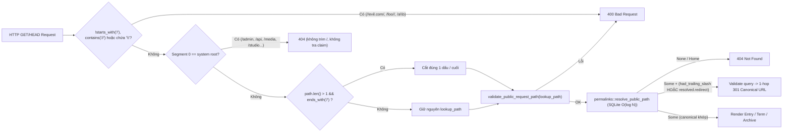

# WordPress-Style Permalinks (Phase 1): Root Post/Page/CPT/Taxonomy URLs, `%category%` + Primary Category, Auto-Unique Slug & Trailing Slash `301`

- **Author:** Orion (Elephant)
- **Status:** Verified
- **Approved By:** Owner
- **Approval Evidence:** Owner chat 2026-11-22 ("duyệt spec" — WordPress-Style Permalinks Phase 1)
- **Date:** 2026-11-22
- **Baseline:** `main@dd517a37dfcc7aac1de76270486507e132fd3dba`
- **Goldfish Review:** 3-agent independent review (`egm-codebase-details`, `egm-design`, `egm-implementation-readiness`) · 2026-11-22 · Stage A + Stage B completed on `main@fce1e3d` (0 Blockers, 0 Majors remaining)
- **Related:** [`docs/product/PRODUCT_REQUIREMENTS.md`](../product/PRODUCT_REQUIREMENTS.md), [`docs/contracts/CORE_FOUNDATION.md`](../contracts/CORE_FOUNDATION.md), [`docs/contracts/PLUGIN_ABI.md`](../contracts/PLUGIN_ABI.md), [`docs/contracts/M8_WRITER_INVENTORY.md`](../contracts/M8_WRITER_INVENTORY.md), [`docs/contracts/CONTENT_FOUNDATION_2026_11.md`](../contracts/CONTENT_FOUNDATION_2026_11.md), [`docs/decisions/ADR-0019-content-foundation.md`](../decisions/ADR-0019-content-foundation.md)

---

## Overview

Đặc tả này nâng cấp hệ thống định tuyến công khai `C3/C4` hiện có của OpenDash ([`permalinks.rs`](../../cms/crates/opendash-server/src/storage/permalinks.rs)) lên chuẩn URL thân thiện kiểu WordPress (`domain.com/<slug>`), nhưng **giữ nguyên kiến trúc Materialized Route Claims (`permalink_route_claims` + `permalink_route_redirects`)** trong SQLite để loại bỏ hoàn toàn regex matching mơ hồ và lỗi phải `flush_rewrite_rules()` thủ công:

1. **Loại bỏ hoàn toàn tiền tố mặc định `/content/...` & `/taxonomy/...`:** Mặc định đưa `page` và `post` ra root (`/{slug}`, `post_structure = "/%postname%"`), CPT tùy chỉnh công khai ra `/{cpt-key}/{slug}` (archive `/{cpt-key}`), Taxonomy công khai ra `/{taxonomy-key}/{slug}` (`/category/{slug}`, `/tag/{slug}`), và Post archive mặc định dùng `posts_page_id` hoặc `/posts` khi chưa gán trang. Hợp nhất mọi public dynamic dispatch qua [`public_fallback`](../../cms/crates/opendash-server/src/routes/seo.rs).
2. **Mở rộng `post_structure` với `%category%` (không hỗ trợ token ngày/tháng/năm):** Hỗ trợ `%category%`, `%postname%`, `%post_id%` (loại bỏ hoàn toàn `%year%`, `%monthnum%`, `%day%`, `%author%`), kèm **Primary Category** cho `post` trên Single Edit (fallback `MIN(term_id)` → `"uncategorized"`).
3. **Opt-in `auto_unique_slug` (`-2`, `-3`, ...) khi tạo mới từ Admin UI:** Thăm dò có giới hạn khi tạo bài/trang trùng đường dẫn ở root hoặc trùng reserved root, giữ nguyên `409 Conflict` cho plugin `content_save`, sample import (`import.rs`), `POST /entries` non-composite, sửa slug bài cũ, `custom_path`, và đổi cấu hình toàn cục.
4. **Chuẩn hóa No-Trailing-Slash `301` an toàn & Nâng cấp Admin UI:** Xử lý 1-hop `301` trong `routes/seo.rs::public_fallback` sau khi kiểm tra `resolve_public_path` (chặn `//` và `\` open redirect/aliasing, không lộ draft, chuẩn hóa query qua `CanonicalUrlBuilder::with_query`), và nâng cấp [`PermalinkSettingsPage.tsx`](../../cms/admin/src/features/settings/PermalinkSettingsPage.tsx).

> **Phạm vi cập nhật hợp đồng cũ (`CONTENT_FOUNDATION_2026_11.md` §4):** Sau khi triển khai và kiểm chứng hoàn tất, gắn ghi chú `Superseded by docs/designs/wordpress-style-permalinks.md` tại [`CONTENT_FOUNDATION_2026_11.md`](../contracts/CONTENT_FOUNDATION_2026_11.md) §4 cho phần mặc định `/content/{type}/{slug}` / `/taxonomy/{kind}/{slug}`, nhãn opt-out `"legacy"` của explicit `null`, và quy tắc `DynamicPattern` cũ.

---

## The Problem

1. **URL mặc định & Router cũ mang tiền tố `/content/...` và `/taxonomy/...`:** `0040_permalink_claims.sql`, `storage/permalinks.rs`, `app.rs` (`L164-167`), `routes/public_content.rs` và `CanonicalUrlBuilder` đang gắn cứng `/content/post/{slug}`, `/content/page/{slug}`, `/content/{cpt}/{slug}`, `/taxonomy/{kind}/{slug}`; đồng thời `sync_claims_in_tx` còn cấp claim công khai cho cả `section`/CPT `public = false` và tạo `page` trong `patterns`.
2. **Thiếu `%category%` & Primary Category:** `validate_post_structure` chỉ chấp nhận literal kebab-case + đúng 1 token cuối `%postname%`/`%post_id%`, không cấu hình được `/%category%/%postname%`, và `content_entries` chưa lưu danh mục chính khi bài viết thuộc nhiều chuyên mục.
3. **`DynamicPattern` quá chặt & chưa có Auto-Suffix + Trailing Slash `301`:** Kiểm tra trùng `prefix` giữa các `DynamicPattern` chặn đứng cặp `post = /%postname%` + `page` ở root (cùng 1-segment `/*`) cũng như `/%category%/%postname%` vs `/<base>/*`. Ngoài ra, tạo bài/trang trùng slug báo `409` ngay thay vì tự thêm `-2`, đường dẫn dư `/` cuối trả `400` thay vì `301`, và thay đổi slug trên bản `draft` chưa từng xuất bản vẫn tạo `permalink_route_redirects` (cũng như `legacy_aliases` vẫn tạo redirect `/content/...` cho mọi bài mới).
4. **Admin UI cũ:** [`PermalinkSettingsPage.tsx`](../../cms/admin/src/features/settings/PermalinkSettingsPage.tsx) chưa có preset `/%category%/%postname%` hay `/archives/%post_id%`, chưa có chip chèn nhanh token, và còn nhãn `"Section"` / `"Dùng đường dẫn legacy"` cũ thay vì `"Pattern"` / `"Mặc định hệ thống"`.

---

## Goals

1. **URL mặc định chuẩn WordPress & Single Authoritative Dispatcher:**
   - Gỡ bỏ 4 route cố định `/content/...`, `/taxonomy/...` khỏi `app.rs:164-167` và các handler wrapper lỗi thời trong `routes/public_content.rs` để `routes/seo.rs::public_fallback` điều phối đồng nhất mọi dynamic public target (`Entry`, `Term`, `Archive`).
   - `page`: `/{slug}` (hoặc `/` nếu được chọn làm `homepage_page_id`, hoặc `custom_path` nếu cấu hình tay; không có archive `/page`).
   - `post`: mặc định `/%postname%` → `/{slug}`; hỗ trợ tùy biến `/blog/%postname%`, `/%category%/%postname%`, `/archives/%post_id%`, hoặc tổ hợp literal kebab-case + tối đa 1 `%category%` + 1 token cuối (`%postname%` hoặc `%post_id%`).
   - CPT tùy chỉnh công khai active (`key NOT IN ('pattern', 'section', 'page')`, `public = true`, `provider_status = 'active'`): `/{base}/{slug}` nếu có `content_type_bases[key]` hoặc `provider_rewrite_defaults`, mặc định **`/{key}/{slug}`**; archive **`/{base}`** hoặc **`/{key}`**. CPT `public = false` / `provider_inactive` / `section` / `pattern` **không** được tạo claim công khai.
   - Taxonomy công khai active: `/{base}/{slug}` nếu có `taxonomy_bases[kind]` hoặc `provider_rewrite_defaults`, mặc định **`/{kind}/{slug}`** (vd: `/category/{slug}`, `/tag/{slug}`).
   - Post archive (`archive:post`): URL của `posts_page_id` nếu Reading Settings đã gán Page, mặc định **`/posts`** nếu chưa gán.
2. **Primary Category tất định (`flat slug`):** Cho phép chọn Primary Category ngay trong card `category` của `post` trên Single Edit ([`TermPicker.tsx`](../../cms/admin/src/features/taxonomy/TermPicker.tsx), bảo toàn dữ liệu kể cả khi đang chọn preset `/%postname%`); nếu không chọn thì lấy `MIN(term_id)` trong các `category` hợp lệ đang gán, fallback `"uncategorized"` khi chưa có hoặc khi `category` bị tắt `public` / gỡ eligibility. Đổi category slug hoặc đổi Primary Category cập nhật đồng bộ claim và `301`.
3. **Thu gọn `DynamicPattern`, Khóa Key Hệ thống & Bảng Lỗi `409` Có Cấu Trúc:**
   - Chỉ giữ `DynamicPattern` cho các namespace có literal prefix (`prefix.len() >= 1`), loại bỏ `("entry", "page")` và root `("entry", "post")` khỏi `patterns` và bỏ kiểm tra pattern mù đối với các redirect mồ côi đã bị xóa target.
   - Chặn tạo mới CPT có key thuộc `is_reserved_system_root`, `"posts"`, `"category"`, `"tag"`, `"section"`, `"pattern"` tại [`storage/content.rs`](../../cms/crates/opendash-server/src/storage/content.rs); chặn `%category%` ở segment 0 trùng reserved roots hoặc literal base đầu của CPT/Taxonomy công khai active ngay từ lúc tạo/sửa `category` term (`storage/taxonomy.rs`) và lúc `put_settings`.
   - Ngăn bản `draft` chiếm `/posts` làm kẹt `archive:post`; trả JSON `409 Conflict` có cấu trúc (tối đa `20` mục va chạm) tại `PUT /api/admin/settings/permalinks`; giữ trần `MAX_CLAIMS = 50_000` và `MAX_REDIRECTS = 100_000` (tự dọn stale orphan redirects trước khi chạm ngưỡng).
4. **Opt-in `auto_unique_slug` cho luồng tạo mới Admin UI (`CompositeEntrySaveInput`):** Thăm dò tối đa `100` hậu tố `-2`..`-100` (cắt gọn gốc giữ `<= 64` bytes, kiểm tra **cả** `(content_type_key, slug)` **lẫn** `permalink_route_claims`, `permalink_route_redirects`, `entry_redirects` và reserved roots cho cả Page/Post root lẫn `%category%`) trong `1` lần gọi `sync_claims_in_tx`; giữ nguyên `409 Conflict` cho plugin `content_save`, sample `import.rs`, `POST /entries` non-composite, sửa slug bài cũ, `custom_path` và đổi cấu hình toàn cục.
5. **No-Trailing-Slash `301` an toàn & Chống ô nhiễm Redirect từ Draft:** Xử lý 1-hop `301` trong `routes/seo.rs::public_fallback` (chặn `//` và `\`, loại trừ reserved prefixes theo ranh giới segment, gọi `resolve_public_path` trước khi redirect), xóa `legacy_aliases` `/content/...` & `entry_redirects` ghi từ bản nháp, và dùng trigger SQLite + kiểm tra `has_been_published == 1` để bản `draft` chưa từng xuất bản không bao giờ tạo `permalink_route_redirects`.
6. **Migration `0045` tất định & UI hoàn chỉnh:** Đảm bảo tái dựng schema trong `storage/restore.rs` khớp byte-for-byte, cập nhật [`PermalinkSettingsPage.tsx`](../../cms/admin/src/features/settings/PermalinkSettingsPage.tsx) (dọn `"Section"` → `"Pattern"`, `"legacy"` → `"Mặc định hệ thống"`), [`client.ts`](../../cms/admin/src/api/client.ts), [`types.ts`](../../cms/admin/src/features/content/types.ts), [`EditorDraftStore.ts`](../../cms/admin/src/features/editor/EditorDraftStore.ts), [`SingleEditWorkspace.tsx`](../../cms/admin/src/features/editor/SingleEditWorkspace.tsx), [`PanelRegionRenderer.tsx`](../../cms/admin/src/features/editor/PanelRegionRenderer.tsx) và [`TermPicker.tsx`](../../cms/admin/src/features/taxonomy/TermPicker.tsx).

---

## Non-Goals

- **Không** hỗ trợ `%year%`, `%monthnum%`, `%day%`, `%hour%`, `%minute%`, `%second%`, `%author%`.
- **Không** hỗ trợ Page phân cấp cha–con (`/parent/child`), Taxonomy URL phân cấp (`/category/parent/child`), Date archive (`/2026/11`), Author archive (`/author/<slug>`), hoặc Clean Pagination (`/page/2`).
- **Không** triển khai regex rewrite engine (`WP_Rewrite`) hay chế độ bật `/` cuối URL.
- **Không** mở rộng Plugin ABI v1 (`content_save`) để truyền `primary_category_term_id` hay tự động đổi slug từ plugin/import.

---

## Critical User Journeys (CUJs)

### CUJ 1: URL mặc định kiểu WordPress & chuyển sang `/%category%/%postname%`
- **Given:** Site vừa chạy migration `0045` (hoặc cài mới).
- **When:** Admin tạo Trang `gioi-thieu`, Bài viết `xin-chao` (gán danh mục `tin-tuc`), CPT `project` với entry `alpha`, rồi vào `Cài đặt → Đường dẫn tĩnh` chọn preset `/%category%/%postname%` và bấm Lưu.
- **Then:** Trước khi đổi preset, URL lần lượt là `/gioi-thieu`, `/xin-chao`, `/project/alpha`, `/category/tin-tuc`, archive bài viết ở `/posts`. Sau khi đổi sang `/%category%/%postname%`, bài viết chuyển sang `/tin-tuc/xin-chao` và `/xin-chao` tự động `301` về `/tin-tuc/xin-chao`.

### CUJ 2: Chọn Primary Category trên Single Edit & đổi slug danh mục
- **Given:** Site dùng `/%category%/%postname%`; bài viết `rust-cms` đang thuộc 2 danh mục `Backend` (`id=2`, slug `backend`) và `Rust` (`id=5`, slug `rust`).
- **When:** Editor chọn `Rust` làm Primary Category rồi Xuất bản; sau đó Admin đổi slug của danh mục `Rust` thành `ngon-ngu-rust`.
- **Then:** URL bài viết chuyển sang `/rust/rust-cms` khi lưu, rồi tự động thành `/ngon-ngu-rust/rust-cms` khi đổi slug danh mục; mọi URL đã xuất bản trước đó trả `301` tới URL mới. Nếu bài viết gỡ hết danh mục, URL chuyển sang `/uncategorized/rust-cms`.

### CUJ 3: Auto-unique slug `-2`, `-3` khi tạo mới từ Admin UI
- **Given:** Đã có Page `about` chiếm `/about` (và `"media"` thuộc reserved system roots).
- **When:** Editor tạo mới một Post qua màn hình Single Edit (`createEntryComposite`) với slug `about` (khi `post_structure = /%postname%`), rồi tạo tiếp Post slug `media`, đồng thời một Wasmi plugin gọi `content_save` tạo Post slug `about`.
- **Then:** Hai lệnh tạo từ Admin UI tự động nhận slug `about-2` (`/about-2`) và `media-2` (`/media-2`); trong khi plugin `content_save` nhận đúng `409 Conflict` để bảo toàn tính idempotent.

### CUJ 4: Trailing Slash `301` an toàn & bảo vệ bản nháp (`draft`)
- **Given:** Trang `/gioi-thieu` đang `published`, bài `/nhap-noi-bo` đang `draft` (`has_been_published = 0`), sau đó bài nháp đổi slug thành `/nhap-v2` trước khi xuất bản.
- **When:** Khách truy cập `GET /gioi-thieu/?utm_source=abc`, `GET /nhap-noi-bo/`, `GET /nhap-v2/`, và `GET //evil.com/`.
- **Then:** `/gioi-thieu/` trả **1-hop `301`** về `Location: /gioi-thieu` (bỏ query rác của Single); `/nhap-noi-bo/` và `/nhap-v2/` (chưa xuất bản) trả thẳng `404` (không lộ bản nháp); `//evil.com/` bị từ chối với `400` (không bao giờ phát `Location: //evil.com`). Ngay cả sau khi `/nhap-v2` được xuất bản, `/nhap-noi-bo` cũ vẫn không tồn tại dưới dạng `301`.

---

## Technical Plan (Architecture)

### 1. Luồng xử lý Request Công khai & Trailing Slash `301` (`routes/seo.rs`, `app.rs`, `public_context.rs`)



- **Hợp nhất Router (`app.rs` & `routes/public_content.rs`):** Xóa 4 route cố định tại `app.rs:164-167` (`.route("/content/{type_key}", ...)`, `.route("/content/{type_key}/{slug}", ...)`, `.route("/taxonomy/category/{slug}", ...)`, `.route("/taxonomy/tag/{slug}", ...)`) và xóa các wrapper handler `archive`, `single`, `category_archive`, `tag_archive`, cùng các helper nội bộ hết người gọi `check_type_key` (`L37`) và `taxonomy_archive` (`L711`) tại `routes/public_content.rs` (cùng import thừa trong `app.rs:52`) để tránh dead-code warnings. Giữ nguyên các hàm dựng response `render_canonical_archive`, `render_single_entry_response`, `redirect_canonical_taxonomy`, `render_canonical_taxonomy`, `render_not_found_response`. Toàn bộ public HTML route (trừ `/` do `public_page` phục vụ) đi qua `routes/seo.rs::public_fallback`.
- **Hợp nhất Reserved Roots (`seo.rs`, `storage/seo.rs`, `public_context.rs`, `storage/content.rs`, `storage/taxonomy.rs`):** Tập trung 1 hàm công khai duy nhất `pub fn is_reserved_system_root(root: &str) -> bool` trong [`cms/crates/opendash-server/src/seo.rs`](../../cms/crates/opendash-server/src/seo.rs) (dùng chung bởi `validate_custom_entry_path`, `storage/seo.rs::is_reserved_route_root`, `public_context.rs::CanonicalUrlBuilder::valid_type`, `permalinks.rs` và `routes/seo.rs`):
  - Danh sách đóng gồm **25 gốc**: `"admin"`, `"api"`, `"assets"`, `"auth"`, `"builder"`, `"content"`, `"favicon.ico"`, `"forms"`, `"health"`, `"media"`, `"page"`, `"pattern"`, `"preview"`, `"registry"`, `"robots.txt"`, `"save"`, `"section"`, `"sitemap.xml"`, `"sitemaps"`, `"static"`, `"studio"`, `"taxonomy"`, `"theme"`, `"themes"`, `"uploads"`.
  - Cố ý giữ `"page"` để bảo vệ endpoint JSON `/page` tại `app.rs:623-626`; cố ý **không** đưa `"posts"`, `"category"`, `"tag"` vào `is_reserved_system_root` để Admin vẫn có thể gán Page `/posts` làm `posts_page_id` hoặc đổi base taxonomy — nhưng dùng chung helper chặn tạo mới CPT hoặc Taxonomy có `key` trùng `is_reserved_system_root(key)`, `"posts"`, `"category"`, `"tag"`, hoặc trùng chéo CPT ↔ Taxonomy trên cả luồng Admin UI ([`storage/content.rs`](../../cms/crates/opendash-server/src/storage/content.rs)`::insert_user_content_type`, [`storage/taxonomy.rs`](../../cms/crates/opendash-server/src/storage/taxonomy.rs)`::create_definition`) lẫn khai báo theme/plugin (`sync_owner_cnt_declarations_in_tx`, `sync_provider_definitions_in_tx`).
- **Thứ tự xử lý 7 bước bắt buộc trong `routes/seo.rs::public_fallback`:**
  1. Nếu `method != Method::GET && method != Method::HEAD` → trả `StatusCode::NOT_FOUND`.
  2. Lấy `path = uri.path()`. Nếu `!path.starts_with('/') || path.contains("//") || path.contains('\\')` → trả `Err(ApiError::bad_request("Đường dẫn công khai không hợp lệ."))` (`400`, chặn scheme-relative `//evil.com/`, `/foo//` và backslash).
  3. Lấy chính xác **segment đầu tiên**: `let first_seg = path[1..].split('/').next().unwrap_or("");`. Nếu `!first_seg.is_empty() && crate::seo::is_reserved_system_root(first_seg)` → trả `missing_public_page(&db, themes_root).await` (`404`, kiểm tra theo ranh giới segment để `/api-docs/` hoặc `/media-kit/` vẫn hoạt động).
  4. Kiểm tra `let had_trailing_slash = path.len() > 1 && path.ends_with('/');` và đặt `let lookup_path = if had_trailing_slash { &path[..path.len() - 1] } else { path };`.
  5. Chạy `validate_public_request_path(lookup_path).map_err(ApiError::bad_request)?;` (`400` nếu chứa `%`, `#`, `.`, `..`, `\`, control chars).
  6. Gọi `permalinks::resolve_public_path(&db, lookup_path).await?`: nếu `None` hoặc `PublicRouteTarget::Home` → trả `missing_public_page` (`404`, tuyệt đối không trả `301` cho draft hay path không tồn tại).
  7. Với `resolved` hợp lệ: kiểm tra visibility & validate query **trước** (`validate_single_query(raw)` với `Entry`, `parse_query(raw, QueryScope::ContentArchive)` với `Archive`, `redirect_canonical_taxonomy` với `Term` — trả `400` nếu query sai kể cả khi `had_trailing_slash == true`); nếu `resolved.redirect || had_trailing_slash` → phát **1-hop `301`** (`Location` = `resolved.canonical_path` cho `Entry`, `CanonicalUrlBuilder::with_query(...)` cho `Archive`/`Term`, giữ nguyên `permanent_public_redirect`).
- **Cập nhật `public_context.rs`, `content_render.rs` & `storage/builder_binding.rs`:**
  - Trong `validate_public_request_path(path)`: bổ sung từ chối `'\\'` (`path.contains('\\')` → `Err(...)`).
  - Trong `CanonicalUrlBuilder`: `valid_type` dùng `!crate::seo::is_reserved_system_root(type_key) && type_key != "posts"` (vì `"page"` nằm trong `is_reserved_system_root` nên `archive("page")` trả `None`); **`entry(type_key, slug)` cho phép riêng `type_key == "page" || Self::valid_type(type_key)`** trước khi kiểm tra `slug` để `CanonicalUrlBuilder::entry("page", slug)` trả `Some(format!("/{slug}"))` thay vì `None`; `archive("post")` → `Some("/posts".to_owned())`; `archive(type_key)` → `Some(format!("/{type_key}"))`; `entry("post" | "page", slug)` → `Some(format!("/{slug}"))`; `entry(type_key, slug)` → `Some(format!("/{type_key}/{slug}"))`; `taxonomy(kind, slug)` → `Some(format!("/{}/{slug}", kind.as_str()))`.
  - Cập nhật `CanonicalUrlBuilder::normalize_internal_link` (gọi bởi `storage/builder_binding.rs:332`): nếu `!input.starts_with('/')` trả ngay `Some(input.to_string())` (giữ nguyên URL tuyệt đối `https://...#anchor` hoặc `%20` theo `builder::valid_button_url`); chỉ với đường dẫn bắt đầu bằng `'/'`, kiểm tra an toàn đường dẫn tương đối (`!contains("//")`, `!contains('%')`, `!contains('#')`, `!contains('\\')`, `!chars().any(char::is_control)`) và **không** ép `QueryScope::Single` mù lên path chưa rõ target; giữ `content_render.rs:397` dùng `CanonicalUrlBuilder::archive(&schema.key)` mới làm fallback preview.

### 2. Schema SQLite — Migration tất định `0045_wordpress_permalinks.sql`

Migrations `0001`–`0044` giữ nguyên bất biến để `storage/restore.rs` tái dựng khớp byte-for-byte `sqlite_schema` (khi restore trên DB trống, `ALTER TABLE` + 2 trigger khớp tuyệt đối trước khi copy dữ liệu nguồn sang):

```sql
-- 0045_wordpress_permalinks.sql
-- Mặc định WordPress permalinks, Primary Category, cờ has_been_published + triggers tất định, và tái dựng claims.

-- Chuyển mặc định /content/post/%postname% (hoặc cấu trúc chứa /content/ hay prefix literal nay trùng reserved root, '/posts', hoặc CPT/Taxonomy base) về chuẩn root /%postname%
UPDATE site_permalink_settings
   SET post_structure = '/%postname%'
 WHERE id = 1
   AND (
       post_structure = '/content/post/%postname%'
       OR post_structure LIKE '/content/%'
       OR (
           instr(post_structure, '%') > 2
           AND (
               trim(substr(post_structure, 2, instr(post_structure, '%') - 2), '/') IN (
                   'admin','api','assets','auth','builder','content','favicon.ico','forms',
                   'health','media','page','pattern','preview','registry','robots.txt',
                   'save','section','sitemap.xml','sitemaps','static','studio','taxonomy','theme','themes','uploads'
               )
               OR (
                   trim(substr(post_structure, 2, instr(post_structure, '%') - 2), '/') = 'posts'
                   AND (SELECT posts_page_id FROM site_reading_settings WHERE id = 1) IS NULL
               )
               OR EXISTS (
                   SELECT 1 FROM content_types t
                    WHERE t.key NOT IN ('pattern', 'section', 'page', 'post')
                      AND t.provider_status = 'active'
                      AND COALESCE(json_extract(t.definition_json, '$.settings.public'), 1) = 1
                      AND trim(substr(post_structure, 2, instr(post_structure, '%') - 2), '/') = COALESCE(
                          NULLIF(json_extract(site_permalink_settings.content_type_bases_json, '$."' || t.key || '"'), ''),
                          (SELECT d.rewrite_base FROM provider_rewrite_defaults d
                            WHERE d.resource_kind = 'content_type' AND d.resource_key = t.key
                              AND d.provider_status = 'active' AND d.declaration_state = 'declared'
                              AND json_type(site_permalink_settings.content_type_bases_json, '$."' || t.key || '"') IS NULL),
                          t.key
                      )
               )
               OR EXISTS (
                   SELECT 1 FROM taxonomy_definitions td
                    WHERE td.public = 1 AND td.provider_status = 'active' AND td.declaration_state = 'declared'
                      AND trim(substr(post_structure, 2, instr(post_structure, '%') - 2), '/') = COALESCE(
                          NULLIF(json_extract(site_permalink_settings.taxonomy_bases_json, '$."' || td.key || '"'), ''),
                          (SELECT d.rewrite_base FROM provider_rewrite_defaults d
                            WHERE d.resource_kind = 'taxonomy' AND d.resource_key = td.key
                              AND d.provider_status = 'active' AND d.declaration_state = 'declared'
                              AND json_type(site_permalink_settings.taxonomy_bases_json, '$."' || td.key || '"') IS NULL),
                          td.key
                      )
               )
           )
       )
   );

ALTER TABLE content_entries
  ADD COLUMN primary_category_term_id INTEGER REFERENCES taxonomy_terms(id) ON DELETE SET NULL;

ALTER TABLE content_entries
  ADD COLUMN has_been_published INTEGER NOT NULL DEFAULT 0 CHECK (has_been_published IN (0, 1));

UPDATE content_entries
   SET has_been_published = 1
 WHERE publication_status = 'published';

-- Dọn redirect cũ thuộc bản nháp chưa từng xuất bản (nếu có từ các bản 0040..0044)
DELETE FROM entry_redirects
 WHERE entry_id IN (SELECT id FROM content_entries WHERE has_been_published = 0);

DELETE FROM permalink_route_redirects
 WHERE target_kind = 'entry'
   AND target_id IN (SELECT CAST(id AS TEXT) FROM content_entries WHERE has_been_published = 0);

-- 0b. Dọn mọi entry_public_paths có segment đầu thuộc 25 gốc hệ thống (gồm 3 gốc mới 'studio', 'section', 'pattern' — áp dụng cho cả posts_page_id)
DELETE FROM entry_public_paths
 WHERE (
       CASE
         WHEN instr(substr(path, 2), '/') > 0 THEN substr(path, 2, instr(substr(path, 2), '/') - 1)
         ELSE substr(path, 2)
       END
   ) IN (
       'admin','api','assets','auth','builder','content','favicon.ico','forms',
       'health','media','page','pattern','preview','registry','robots.txt',
       'save','section','sitemap.xml','sitemaps','static','studio','taxonomy','theme','themes','uploads'
   );

CREATE INDEX idx_content_entries_primary_category
    ON content_entries(primary_category_term_id)
 WHERE primary_category_term_id IS NOT NULL;

-- Giữ has_been_published đơn điệu (0 -> 1) ở tầng DB trên mọi nhánh INSERT/UPDATE
CREATE TRIGGER content_entries_mark_has_been_published_insert
    AFTER INSERT ON content_entries
    WHEN NEW.publication_status = 'published' AND NEW.has_been_published = 0
BEGIN
    UPDATE content_entries SET has_been_published = 1 WHERE id = NEW.id;
END;

CREATE TRIGGER content_entries_mark_has_been_published_update
    AFTER UPDATE OF publication_status ON content_entries
    WHEN NEW.publication_status = 'published' AND OLD.has_been_published = 0
BEGIN
    UPDATE content_entries SET has_been_published = 1 WHERE id = NEW.id;
END;

-- Tái dựng đồng bộ claims cho site nâng cấp từ 0040..0044 theo đúng thứ tự:
-- (1) Home/homepage_page_id -> (2) Public Active CPT/Post Archives -> (3) Public Active Terms
-- -> (3b) Dọn entry_public_paths va chạm -> (4) Disambiguate slug -> (5) Entries -> (6) Dọn redirects trùng claim.
-- Lưu ý JSON1: dùng json_type(...) IS NULL thay vì json_extract(...) IS NULL để phân biệt explicit JSON null (opt-out) với key omitted;
-- và luôn bọc key bằng cặp dấu nháy kép '$."' || key || '"' để hỗ trợ key có dấu '-'.
DELETE FROM permalink_route_claims;

-- 1. Home hoặc homepage_page_id (giữ '/' làm tombstone ('entry', id) khi homepage_page_id IS NOT NULL khớp permalinks.rs:657-667)
INSERT INTO permalink_route_claims (path, target_kind, target_id)
SELECT '/',
       CASE WHEN r.homepage_page_id IS NOT NULL THEN 'entry' ELSE 'home' END,
       COALESCE(CAST(r.homepage_page_id AS TEXT), 'site')
  FROM site_reading_settings r
 WHERE r.id = 1;

-- 2. Archives (loại trừ 'pattern', 'section', 'page', CPT public=0 hoặc provider_inactive;
-- nếu posts_page_id có slug trùng 25 gốc hệ thống hoặc trỏ Page đã xóa thì rebuild về '/posts')
INSERT INTO permalink_route_claims (path, target_kind, target_id)
SELECT CASE
         WHEN t.key = 'post' THEN COALESCE(
             (SELECT COALESCE(
                         p.path,
                         CASE
                           WHEN e.slug NOT IN (
                               'admin','api','assets','auth','builder','content','favicon.ico','forms',
                               'health','media','page','pattern','preview','registry','robots.txt',
                               'save','section','sitemap.xml','sitemaps','static','studio','taxonomy','theme','themes','uploads'
                           ) THEN '/' || e.slug
                         END
                     )
                FROM site_reading_settings r
                JOIN content_entries e ON e.id = r.posts_page_id
                LEFT JOIN entry_public_paths p ON p.entry_id = e.id
               WHERE r.id = 1 AND e.content_type_key = 'page'),
             '/posts'
         )
         ELSE '/' || COALESCE(
             NULLIF(json_extract(s.content_type_bases_json, '$."' || t.key || '"'), ''),
             (SELECT d.rewrite_base FROM provider_rewrite_defaults d
               WHERE d.resource_kind = 'content_type' AND d.resource_key = t.key
                 AND d.provider_status = 'active' AND d.declaration_state = 'declared'
                 AND json_type(s.content_type_bases_json, '$."' || t.key || '"') IS NULL),
             t.key
         )
       END,
       'archive',
       t.key
  FROM content_types t
  JOIN site_permalink_settings s ON s.id = 1
 WHERE t.key NOT IN ('pattern', 'section', 'page')
   AND t.provider_status = 'active'
   AND COALESCE(json_extract(t.definition_json, '$.settings.public'), 1) = 1
   AND COALESCE(json_extract(t.definition_json, '$.settings.has_archive'), 1) = 1;

-- 3. Public active taxonomy terms: /{base|kind}/{slug}
INSERT INTO permalink_route_claims (path, target_kind, target_id)
SELECT '/' || COALESCE(
           NULLIF(json_extract(s.taxonomy_bases_json, '$."' || tm.kind || '"'), ''),
           (SELECT d.rewrite_base FROM provider_rewrite_defaults d
             WHERE d.resource_kind = 'taxonomy' AND d.resource_key = tm.kind
               AND d.provider_status = 'active' AND d.declaration_state = 'declared'
               AND json_type(s.taxonomy_bases_json, '$."' || tm.kind || '"') IS NULL),
           tm.kind
       ) || '/' || tm.slug,
       'term',
       CAST(tm.id AS TEXT)
  FROM taxonomy_terms tm
  JOIN taxonomy_definitions td ON td.key = tm.kind
  JOIN site_permalink_settings s ON s.id = 1
 WHERE td.public = 1 AND td.provider_status = 'active' AND td.declaration_state = 'declared';

-- 3b. Dọn entry_public_paths cũ (trừ posts_page_id) nếu trùng claim Home/Archive/Term (Steps 1–3),
-- trùng path của một post cố định theo %post_id%, hoặc trùng đường dẫn mặc định của một CPT công khai active khác
DELETE FROM entry_public_paths
 WHERE entry_id IS NOT (SELECT posts_page_id FROM site_reading_settings WHERE id = 1)
   AND (
       EXISTS (
           SELECT 1 FROM permalink_route_claims c
            WHERE c.path = entry_public_paths.path
       )
       OR EXISTS (
           SELECT 1
             FROM content_entries pe
             JOIN site_permalink_settings s ON s.id = 1
             LEFT JOIN site_reading_settings r ON r.id = 1
            WHERE pe.id != entry_public_paths.entry_id
              AND pe.content_type_key = 'post'
              AND s.post_structure NOT LIKE '%postname%'
              AND pe.id IS NOT r.posts_page_id
              AND entry_public_paths.path = REPLACE(s.post_structure, '%post_id%', CAST(pe.id AS TEXT))
       )
       OR EXISTS (
           SELECT 1
             FROM content_entries cpt
             JOIN content_types ct ON ct.key = cpt.content_type_key
             JOIN site_permalink_settings s ON s.id = 1
            WHERE cpt.id != entry_public_paths.entry_id
              AND cpt.content_type_key NOT IN ('pattern', 'section', 'page', 'post')
              AND ct.provider_status = 'active'
              AND COALESCE(json_extract(ct.definition_json, '$.settings.public'), 1) = 1
              AND entry_public_paths.path = '/' || COALESCE(
                  NULLIF(json_extract(s.content_type_bases_json, '$."' || cpt.content_type_key || '"'), ''),
                  (SELECT d.rewrite_base FROM provider_rewrite_defaults d
                    WHERE d.resource_kind = 'content_type' AND d.resource_key = cpt.content_type_key
                      AND d.provider_status = 'active' AND d.declaration_state = 'declared'
                      AND json_type(s.content_type_bases_json, '$."' || cpt.content_type_key || '"') IS NULL),
                  cpt.content_type_key
              ) || '/' || cpt.slug
       )
   );

-- 4. Disambiguate content_entries.slug trên DB nâng cấp (ưu tiên post cố định theo %post_id% > page > post theo %postname%)
WITH post_paths AS (
    SELECT e.id,
           e.content_type_key,
           e.slug,
           CASE
             WHEN e.content_type_key = 'page' OR s.post_structure LIKE '%postname%' THEN 1
             ELSE 0
           END AS can_rename_path,
           CASE
             WHEN e.content_type_key = 'page' THEN '/' || e.slug
             ELSE REPLACE(REPLACE(s.post_structure, '%postname%', e.slug), '%post_id%', CAST(e.id AS TEXT))
           END AS proposed_path
      FROM content_entries e
      JOIN content_types t ON t.key = e.content_type_key
      JOIN site_permalink_settings s ON s.id = 1
      LEFT JOIN entry_public_paths p ON p.entry_id = e.id
      LEFT JOIN site_reading_settings r ON r.id = 1
     WHERE e.content_type_key IN ('page', 'post')
       AND t.provider_status = 'active'
       AND COALESCE(json_extract(t.definition_json, '$.settings.public'), 1) = 1
       AND p.entry_id IS NULL
       AND e.id IS NOT r.homepage_page_id
       AND e.id IS NOT r.posts_page_id
)
UPDATE content_entries
   SET slug = CASE
         WHEN NOT EXISTS (
             SELECT 1 FROM content_entries dup
              WHERE (dup.content_type_key = content_entries.content_type_key OR dup.content_type_key IN ('page', 'post'))
                AND dup.slug = RTRIM(SUBSTR(content_entries.slug, 1, MAX(1, 63 - LENGTH(CAST(content_entries.id AS TEXT)))), '-') || '-' || CAST(content_entries.id AS TEXT)
         )
         AND NOT EXISTS (
             SELECT 1 FROM entry_public_paths epp
              WHERE epp.entry_id != content_entries.id
                AND (
                    epp.path = '/' || RTRIM(SUBSTR(content_entries.slug, 1, MAX(1, 63 - LENGTH(CAST(content_entries.id AS TEXT)))), '-') || '-' || CAST(content_entries.id AS TEXT)
                    OR (
                        content_entries.content_type_key = 'post'
                        AND epp.path = REPLACE(
                            REPLACE((SELECT post_structure FROM site_permalink_settings WHERE id = 1), '%postname%', RTRIM(SUBSTR(content_entries.slug, 1, MAX(1, 63 - LENGTH(CAST(content_entries.id AS TEXT)))), '-') || '-' || CAST(content_entries.id AS TEXT)),
                            '%post_id%', CAST(content_entries.id AS TEXT)
                        )
                    )
                )
         )
         THEN RTRIM(SUBSTR(content_entries.slug, 1, MAX(1, 63 - LENGTH(CAST(content_entries.id AS TEXT)))), '-') || '-' || CAST(content_entries.id AS TEXT)
         ELSE RTRIM(SUBSTR(content_entries.slug, 1, MAX(1, 62 - LENGTH(CAST(content_entries.id AS TEXT)))), '-') || '-u' || CAST(content_entries.id AS TEXT)
       END
 WHERE id IN (
       SELECT c1.id FROM post_paths c1
        WHERE c1.can_rename_path = 1
          AND (
              (
                  c1.proposed_path = '/' || c1.slug
                  AND c1.slug IN (
                      'admin','api','assets','auth','builder','content','favicon.ico','forms',
                      'health','media','page','pattern','preview','registry','robots.txt',
                      'save','section','sitemap.xml','sitemaps','static','studio','taxonomy','theme','themes','uploads'
                  )
              )
              OR EXISTS (SELECT 1 FROM permalink_route_claims c WHERE c.path = c1.proposed_path)
              OR EXISTS (
                  SELECT 1
                    FROM entry_public_paths epp
                    JOIN content_entries ee ON ee.id = epp.entry_id
                    JOIN content_types et ON et.key = ee.content_type_key
                    LEFT JOIN site_reading_settings r2 ON r2.id = 1
                   WHERE epp.path = c1.proposed_path
                     AND ee.id != c1.id
                     AND ee.id IS NOT r2.homepage_page_id
                     AND ee.id IS NOT r2.posts_page_id
                     AND et.key NOT IN ('pattern', 'section')
                     AND et.provider_status = 'active'
                     AND COALESCE(json_extract(et.definition_json, '$.settings.public'), 1) = 1
              )
              OR EXISTS (
                  SELECT 1 FROM post_paths c2
                   WHERE c2.proposed_path = c1.proposed_path
                     AND (
                         c2.can_rename_path = 0
                         OR (
                             c2.can_rename_path = 1
                             AND (
                                 (c2.content_type_key = 'page' AND c1.content_type_key != 'page')
                                 OR (c2.content_type_key = c1.content_type_key AND c2.id < c1.id)
                             )
                         )
                     )
              )
          )
   );

-- 5. Public active Entries (bỏ qua pattern, section, public=0, inactive, homepage_page_id và posts_page_id;
-- Step 3b & Step 4 đã loại bỏ mọi va chạm giữa p.path / CPT default / %post_id% / page-post slug)
INSERT INTO permalink_route_claims (path, target_kind, target_id)
SELECT COALESCE(
           p.path,
           CASE
             WHEN e.content_type_key = 'page' THEN '/' || e.slug
             WHEN e.content_type_key = 'post' THEN
               REPLACE(REPLACE(s.post_structure, '%postname%', e.slug), '%post_id%', CAST(e.id AS TEXT))
             ELSE '/' || COALESCE(
                 NULLIF(json_extract(s.content_type_bases_json, '$."' || e.content_type_key || '"'), ''),
                 (SELECT d.rewrite_base FROM provider_rewrite_defaults d
                   WHERE d.resource_kind = 'content_type' AND d.resource_key = e.content_type_key
                     AND d.provider_status = 'active' AND d.declaration_state = 'declared'
                     AND json_type(s.content_type_bases_json, '$."' || e.content_type_key || '"') IS NULL),
                 e.content_type_key
             ) || '/' || e.slug
           END
       ),
       'entry',
       CAST(e.id AS TEXT)
  FROM content_entries e
  JOIN content_types t ON t.key = e.content_type_key
  JOIN site_permalink_settings s ON s.id = 1
  LEFT JOIN entry_public_paths p ON p.entry_id = e.id
  LEFT JOIN site_reading_settings r ON r.id = 1
 WHERE e.content_type_key NOT IN ('pattern', 'section')
   AND t.provider_status = 'active'
   AND COALESCE(json_extract(t.definition_json, '$.settings.public'), 1) = 1
   AND e.id IS NOT r.homepage_page_id
   AND e.id IS NOT r.posts_page_id;

-- 6. Loại bỏ bất kỳ redirect cũ nào trùng với canonical claim mới
DELETE FROM permalink_route_redirects
 WHERE EXISTS (
     SELECT 1 FROM permalink_route_claims c
      WHERE c.path = permalink_route_redirects.source_path
 );
```

### 3. Bộ sinh Đường dẫn Chuẩn, `DynamicPattern` & Bảng Lỗi `409` Có Cấu Trúc (`storage/permalinks.rs`)

1. **`validate_post_structure(format: &str)`:**
   - Gỡ bỏ ngoại lệ `format != LEGACY_POST` ở `permalinks.rs:316`: nếu người dùng cố lưu `/content/post/%postname%`, từ chối ngay vì `"content"` thuộc `is_reserved_system_root`.
   - Ràng buộc: `format.starts_with('/')`, `!format.ends_with('/')`, `format.len() <= 512`, `1..=8` segments.
   - Segment cuối (`segs.last()`) bắt buộc là `"%postname%"` hoặc `"%post_id%"`.
   - Các segment `0..segs.len() - 1`: mỗi segment phải là `"%category%"` (tối đa **1 lần** trong toàn chuỗi) HOẶC literal kebab-case (`valid_kebab_segment_with_limit(seg, 64)`). Cấm mọi `%...%` token khác (`%year%`, `%monthnum%`, `%day%`, `%author%`, ...).
   - Nếu `segs[0]` là literal (không phải token), cấm trùng `crate::seo::is_reserved_system_root(segs[0])`.
   - *Hợp lệ ví dụ:* `/%postname%`, `/blog/%postname%`, `/%category%/%postname%`, `/blog/%category%/%postname%`, `/archives/%post_id%`, `/%post_id%`.
2. **`entry_path`, `term_path`, `archive_path` (loại bỏ `/content/...` & `/taxonomy/...`):**
   - `page`: `"/"` nếu là `homepage_page_id`; else `custom_path`; else `format!("/{slug}")`.
   - `post`: `custom_path` nếu có; else thay `%postname%` → `slug`, `%post_id%` → `id`, `%category%` → flat primary category slug (fallback `MIN(term_id)` → `"uncategorized"`).
   - CPT công khai active (`key NOT IN ("pattern", "section", "page")`): `custom_path` nếu có; else `match settings.content_type_bases.get(key) { Some(Some(base)) => format!("/{base}/{slug}"), _ => format!("/{key}/{slug}") }`.
   - Taxonomy công khai active: `match settings.taxonomy_bases.get(kind) { Some(Some(base)) => format!("/{base}/{slug}"), _ => format!("/{kind}/{slug}") }`.
   - Archive: `"post"` → `posts_page_path.unwrap_or_else(|| "/posts".to_owned())`; CPT công khai active khác (`!= "page"`) → `match settings.content_type_bases.get(key) { Some(Some(base)) => format!("/{base}"), _ => format!("/{key}") }`.
3. **Nạp Primary Category (Batch SQL — 0 N+1) & Kiểm soát `%category%`:**
   - Kiểm tra 1 lần trong transaction xem taxonomy `"category"` có tồn tại với `public = 1`, `provider_status = 'active'`, `declaration_state = 'declared'` và đang eligible với `post` (đọc cả `taxonomy_eligibility` lẫn `content_type_taxonomy_overrides` giống `storage/content.rs`).
   - Nếu `post_structure.contains("%category%")`:
     - Nếu `category` không active/eligible/public → tất cả `post` fallback sang `"uncategorized"`.
     - Ngược lại chạy **1 truy vấn SQL batch duy nhất** đọc với mỗi `post`: `slug` của `e.primary_category_term_id` (nếu nằm trong `entry_terms` và `kind = 'category'`), else `slug` của `SELECT t.slug FROM entry_terms et JOIN taxonomy_terms t ON t.id = et.term_id WHERE et.entry_id = e.id AND t.kind = 'category' ORDER BY t.id ASC LIMIT 1`, else `"uncategorized"`.
   - **Quy tắc an toàn `%category%` ở segment 0 (`segs[0] == "%category%"`):**
     - Tập `forbidden_cat_first_segs`: gồm mọi `is_reserved_system_root`, `"posts"` (khi `posts_page_id.is_none()`), mọi literal segment đầu của CPT công khai active (`key != "pattern" && key != "section" && key != "page" && key != "post"`), và mọi literal segment đầu của Taxonomy công khai active (`"category"`, `"tag"`, v.v.).
     - Khi `segs[0] == "%category%"`, kiểm tra **mọi `category` term hiện có trong DB** (kể cả khi chưa gắn bài viết nào) AND `"uncategorized"` không trùng với `forbidden_cat_first_segs` — chặn ngay từ lúc `put_settings`, `create_term`, `patch_term`, hoặc tạo mới CPT/Taxonomy với `409 Conflict`.
4. **Sửa `sync_claims_in_tx`, `DynamicPattern`, Collector `409` & `has_been_published`:**
   - **Lọc `cpts` (`L669`), `taxonomies` (`L675`), `entries` (`L711`), `terms` (`L787`) & `validate_input_in_tx` (`L334`):** Bắt buộc điều kiện `provider_status = 'active'`, `key NOT IN ('pattern', 'section')`, và `COALESCE(json_extract(definition_json, '$.settings.public'), 1) = 1` cho CPT/Entries; ở `validate_input_in_tx` đổi `key == "pattern"` → `matches!(key.as_str(), "pattern" | "section")`; và truy vấn `terms` (`L787`) phải `JOIN taxonomy_definitions td ON td.key = t.kind WHERE td.public = 1 AND td.provider_status = 'active' AND td.declaration_state = 'declared' ORDER BY t.id`. Khi một CPT/Taxonomy bị tắt `public = false` hoặc `provider_inactive`, nó biến mất khỏi `proposed` (mọi redirect tới entry ẩn sẽ trả `404` ở `resolve_public_path`). Riêng `page` chỉ tạo `entry` claims, **không** đưa `page` vào `archive` hoặc `patterns`.
   - **Sửa `DynamicPattern` (`permalinks.rs:527-562, 680-709, 832-848, 992-1014`):**
     - Nâng cấp struct thành `struct DynamicPattern { prefix: Vec<String>, seg_count: usize, kind: String, family: String }` và `pattern_for(template: &str, kind: &str, family: &str) -> Option<DynamicPattern>`: đếm `seg_count` theo số segment của template, lấy `prefix` = các literal segment đứng trước token `%...%` đầu tiên (`take_while(|s| !s.starts_with('%'))`); **trả `None` khi `prefix.is_empty()`** (tự động loại `("entry", "page")` và root `("entry", "post")` như `/%postname%`, `/%category%/%postname%`, `/%post_id%`), giữ lại các template có literal prefix như `/blog/%postname%`, `/blog/%category%/%postname%`, `/archives/%post_id%`, CPT `/{base|key}/%postname%`, và Taxonomy `/{base|kind}/%term%` (đồng thời sửa dòng `692` từ `format!("/taxonomy/{key}/%term%")` sang `format!("/{key}/%term%")`).
     - `DynamicPattern::matches`: `segments.len() == self.seg_count && segments.starts_with(&self.prefix) && !segments.last().is_some_and(|last| last.is_empty())`.
     - Kiểm tra va chạm pattern (`L698`): `lhs.seg_count == rhs.seg_count && (lhs.prefix.starts_with(&rhs.prefix) || rhs.prefix.starts_with(&lhs.prefix))` (bắt được cặp `/blog/%category%/%postname%` `(prefix: ["blog"], seg_count: 3)` vs CPT `/blog/docs/%postname%` `(prefix: ["blog", "docs"], seg_count: 3)`). Riêng `post_structure` bắt đầu bằng `%category%` ở segment 0 dùng `forbidden_cat_first_segs` + `UNIQUE(path)`.
     - Cả `proposed` (`L832-848`) và `historical` (`L992-1014`) chỉ so với prefixed `patterns` này (giữ quy tắc chuyển giao `posts_page_id` giữa `("archive", "post")` ↔ `("entry", "page")`, bỏ đoạn hardcode `&& path.starts_with("/content/page/")` ở `L1006`).
     - Với redirect mồ côi đã xóa target khỏi DB (`!target_families.contains_key(owner)` tại `L976-1014`): không chặn `DynamicPattern` ở `historical` (chỉ giữ kiểm tra `UNIQUE(source_path)` ở mức exact path) để xóa 1 bài cũ ở `/tech/hello` không làm liệt khả năng tạo CPT `tech` về sau.
   - **Ngăn Draft chiếm `/posts`, xóa `/content/...` & `/taxonomy/...` alias, nhưng GIỮ `/{homepage_slug}` → `/` redirect:**
     - Đọc trước `posts_page_path` từ `content_entries`/`entry_public_paths` (khi `posts_page_id.is_some()`), sau đó tạo claims cho `archive` & `term` **trước** `entries` (giữ tombstone `prior_post_archive_path` nếu `posts_page_id` trỏ tới Page đã xóa trong runtime `permalinks.rs:765-769`); nếu một `draft` `page`/`post` cố tạo claim đè lên `/posts` (khi chưa phải `posts_page_id`), trả `409 Conflict` ở thao tác lưu draft (và `auto_unique_slug` tự né `/posts` → `posts-2` khi tạo mới).
     - Gỡ bỏ hoàn toàn phần tạo `/content/...` và `/taxonomy/...` alias trong `legacy_aliases` (`permalinks.rs:728, 733-735, 741-743, 746-748, 779-782, 793-796`), **nhưng giữ lại redirect của `homepage_page_id` (`L738-745`: đẩy `(current_path, ("entry", id.to_string()))` khi `has_been_published == 1`)** để URL `/{homepage_slug}` (hoặc `custom_path`) của trang chủ luôn `301` về `/` và không bị entry khác chiếm mất.
   - **Lọc `previous` và `entry_redirects` theo `has_been_published == 1` (`L877-944`):** Mọi `entry:<id>` có `has_been_published == 0` không bao giờ ghi vào `permalink_route_redirects`.
   - **Chống chạm ngưỡng vĩnh viễn `MAX_REDIRECTS` (`pub const MAX_REDIRECTS: usize = 100_000;`):** Nếu `historical.len() > MAX_REDIRECTS`, kiểm tra trực tiếp trên bảng `content_entries` (`target_kind = 'entry'`) và `taxonomy_terms` (`target_kind = 'term'`) (không dùng `!target_families.contains_key(owner)`, vì `target_families` cố ý loại CPT/taxonomy ẩn hoặc `provider_inactive`) để xóa tối đa phần dư các redirect mồ côi đã mất target (`DELETE` FIFO theo `created_at`); nếu vẫn vượt `100_000`, trả `409 Conflict`.
5. **Collector thu thập `<= 20` va chạm `409 Conflict` (`storage/permalinks.rs` & `routes/settings.rs`):**
   - Khai báo trong `storage/permalinks.rs`:
     ```rust
     #[derive(Clone, Debug, Eq, PartialEq, Serialize)]
     pub struct PermalinkConflictItem {
         pub path: String,
         pub new_target: String,
         pub existing_target: String,
     }

     #[derive(Clone, Debug, Eq, PartialEq, Serialize)]
     pub struct PermalinkConflictError {
         pub error: String,
         pub total_conflicts: usize,
         pub truncated: bool,
         pub conflicts: Vec<PermalinkConflictItem>, // tối đa 20 mục
     }

     #[derive(Debug)]
     pub enum PermalinkPutError {
         Api(ApiError),
         Conflicts(PermalinkConflictError),
     }

     impl From<ApiError> for PermalinkPutError {
         fn from(err: ApiError) -> Self { Self::Api(err) }
     }
     ```
   - Tách lõi `sync_claims_with_options(conn: &mut SqliteConnection, collect_conflicts: bool) -> Result<(), PermalinkPutError>`:
     - `sync_claims_in_tx(conn)` giữ nguyên signature `ApiResult<()>`, gọi với `collect_conflicts = false` (fail-fast ở va chạm đầu tiên cho các writer entry/term/CPT).
     - `permalinks::put_settings` gọi với `collect_conflicts = true`: thu thập toàn bộ xung đột từ mọi chốt kiểm tra (`%category%` segment 0 vs `forbidden_cat_first_segs` với `path: "/{seg}"`, `new_target: "post_structure:%category%"`; `DynamicPattern` vs `DynamicPattern` với `path: lhs.describe()`; `add_claim` exact duplicate `L598`; reserved roots `L823`; proposed vs pattern `L832`; redirect collisions `L894, L906, L933`; proposed vs redirect `L957`; historical vs pattern `L1008`), tăng `total_conflicts` và lưu tối đa `20` item đầu tiên vào `conflicts`. Nếu `total_conflicts > 0`, trả `Err(PermalinkPutError::Conflicts(...))` **trước** khi ghi DB (transaction tự rollback). Các lỗi `400`/`412`/`500` từ `validate_input_in_tx`/CAS chuyển qua `From<ApiError>` thành `PermalinkPutError::Api`.
   - Handler `routes/settings.rs::permalinks_put` trả `(StatusCode::CONFLICT, [(header::CACHE_CONTROL, "no-store")], Json(conflict_payload)).into_response()` khi gặp `PermalinkPutError::Conflicts(c)`.

### 4. `primary_category_term_id` & Opt-In `auto_unique_slug` (`storage/entries.rs`, `storage/taxonomy.rs`, `storage/seo.rs`, `storage/import.rs`)

- **Exact Struct Changes (`storage/entries.rs` & `cms/admin/src/features/content/types.ts`):**
  - `ContentEntryRecord` (`storage/entries.rs:212`, `types.ts:81`): thêm `pub primary_category_term_id: Option<i64>` (hydrate trong `decoded_with_terms()` tại `entries.rs:331` — **không** đổi `EntryRow`) / `primary_category_term_id?: number | null` (TS).
  - `CompositeEntrySaveInput` (`storage/entries.rs:1247`, `types.ts:266`): giữ `#[serde(deny_unknown_fields)]`, thêm:
    - `#[serde(default, deserialize_with = "deserialize_patch_field")] pub primary_category_term_id: PatchField<i64>` (dùng `PatchField::Omitted`, `PatchField::Clear` khi JSON `null`, `PatchField::Set(tid)` khi có ID nguyên dương).
    - `#[serde(default)] pub auto_unique_slug: bool` (`auto_unique_slug?: boolean` trong TS).
  - `opendash_core::content::ContentEntryInput` (`content.rs:1540`) và `POST /entries` (`create_entry_with_fence`, `create_entry_with_schema_fence`, Wasmi `content_save`, `storage/import.rs`) **giữ nguyên**: `auto_unique_slug = false` (`409` khi trùng slug), và `replace_term_ids` tự reset `primary_category_term_id = NULL` nếu category chính cũ bị gỡ.
- **Hợp lệ hóa `primary_category_term_id` (trong Slice S02):**
  - Khi `input.primary_category_term_id == PatchField::Set(tid)`: bắt buộc `type_key == "post"` (trả `400 Bad Request` nếu `Set(_)` cho `page` hoặc CPT khác; cho phép `Omitted`/`Clear` cho mọi loại), kiểm tra `tid > 0`, tồn tại trong `taxonomy_terms(kind = 'category')`, và nằm trong `effective_term_ids` (lấy từ `input.term_ids` nếu `Some`, ngược lại đọc `read_term_ids(&mut tx, entry_id)` trong transaction để hỗ trợ update chỉ đổi primary category mà không gửi lại `term_ids`). Vi phạm trả `400`.
  - Khi cập nhật `term_ids` (`Some(ids)`) mà `input.primary_category_term_id == PatchField::Omitted` (kể cả qua `update_entry_with_fence`, `update_entry_with_schema_fence`, hoặc plugin `content_save`): nếu `old_primary` không nằm trong `ids`, tự động set `primary_category_term_id = NULL`.
- **Thuật toán `resolve_auto_unique_slug_in_tx` (trong Slice S02):**
  - Signature đầy đủ:
    ```rust
    pub(super) async fn resolve_auto_unique_slug_in_tx(
        conn: &mut SqliteConnection,
        type_key: &str,
        base_slug: &str,
        term_ids: Option<&[i64]>,
        primary_category_term_id: Option<i64>,
        has_custom_path: bool,
    ) -> ApiResult<String>
    ```
  - Chạy trong `commit_composite_entry_save` (`entries.rs:1697`) **trước** `check_default_slug_claim_in_tx` (và thay thế nó) khi `entry_id.is_none() && input.auto_unique_slug`, với `has_custom_path = matches!(&input.custom_path, PatchField::Set(raw) if !raw.trim().is_empty())` khớp chuẩn hóa của `apply_entry_route_patch_in_tx`.
  - Tiền kiểm tra: `valid_kebab_segment_with_limit(base_slug, 64)` nếu sai trả `400`/`422` ngay; nếu `type_key == "post"` và `post_structure.starts_with("/%category%/")`, kiểm tra `resolved_cat_slug` (suy ra từ `primary_category_term_id` / `MIN(term_id)` trong `term_ids` / `"uncategorized"`) có nằm trong `forbidden_cat_first_segs` hay không — nếu có trả `409` ngay thay vì lặp `1..=100`.
  - Thăm dò `n = 1..=100`: `n == 1` giữ `base_slug`, `n >= 2` nối `suffix = format!("-{n}")`, cắt `base_slug` `<= 64 - suffix.len()` + `.trim_end_matches('-')`.
  - Mỗi ứng viên `candidate` **luôn kiểm tra cả 2 điều kiện** (không tách nhánh bỏ sót `permalink_route_claims`!):
    1. Chưa tồn tại `(content_type_key, candidate)` trong `content_entries`.
    2. Nếu `!has_custom_path && !(type_key == "post" && post_structure.contains("%post_id%"))`:
       - Nếu đường dẫn mặc định sinh ra là root 1-segment (`type_key == "page"` hoặc `post_structure == "/%postname%"`), bắt buộc `!crate::seo::is_reserved_system_root(&candidate)`.
       - Tính `candidate_path` (ví dụ `/{candidate}`, `/<cat>/{candidate}`, `/{cpt}/{candidate}`) và kiểm tra `candidate_path` chưa tồn tại trong `permalink_route_claims(path)`, `permalink_route_redirects(source_path)`, `entry_redirects(source_path)` — điều này tự động né cả Page vs Post trùng ở root, `/posts`, CPT/taxonomy archives và các redirect đang giữ!
    3. Với `post_structure` kết thúc bằng `%post_id%` (ví dụ `/archives/%post_id%` hoặc `/%post_id%`): đường dẫn sinh theo ID bài mới là duy nhất nên chỉ cần kiểm tra `(content_type_key, candidate)` chưa tồn tại trong `content_entries` (vì `validate_post_structure` không cho `%postname%` đi kèm `%post_id%`).
  - `INSERT INTO content_entries` đúng `1` lần → gọi `sync_claims_in_tx(&mut tx)` đúng `1` lần. Hết `100` ứng viên → `409 Conflict`.
  - *Hook timing:* `ContentBeforeSave` chạy trước transaction với `input.slug` gốc để veto nội dung; `ContentAfterSave` gửi payload sau commit (`{type_key, id, operation, version}`, kèm slug mới nếu plugin gọi GET đọc lại).
- **Dọn `storage/seo.rs`, `storage/import.rs`, `storage/content.rs` & `storage/taxonomy.rs`:**
  - Trong `storage/seo.rs`:
    - Cập nhật `validate_route_claim_in_tx:143` kiểm tra cả `content_types` (`key NOT IN ('post', 'page', 'pattern', 'section')`), `taxonomy_definitions`, `provider_rewrite_defaults`, và `"posts"` (khi `posts_page_id.is_none()`).
    - Cập nhật `check_cpt_root_claim_in_tx:210` kiểm tra `permalink_route_claims` lẫn redirect trên `permalink_route_redirects` & `entry_redirects` — **chỉ chặn khi target còn tồn tại thực tế** trong `content_entries`/`taxonomy_terms`, bỏ qua mọi orphan redirect đã xóa target để giữ đồng nhất với ngoại lệ tại `sync_claims_in_tx`.
    - Chặn ghi `entry_redirects` khi `has_been_published == 0` ở **cả** `set_entry_route_in_tx:359` **lẫn** `apply_entry_route_patch_in_tx:1023` (vốn được Single Edit `commit_composite_entry_save` gọi tại `entries.rs:1857`); đồng thời trong S01 biến `check_default_slug_claim_in_tx:244` và `record_slug_change_redirect_in_tx:269` thành `Ok(())` no-op (vì `sync_claims_in_tx` bảo đảm toàn vẹn route ở cuối mỗi writer tx, tránh báo `409` sai cho bài `/%category%/%postname%` trùng slug với Page ở S01) trước khi S02 gỡ các lời gọi cuối cùng và xóa 2 hàm thừa này.
  - Trong `storage/import.rs`: bỏ `check_default_slug_claim_in_tx` (`L1175`) và gọi `crate::storage::permalinks::sync_claims_in_tx(&mut *conn).await?` sau vòng lặp tạo sample pages (`L1233`) trước khi hoàn tất giao dịch `tx_res` (`L1401`) để trang import được cấp `permalink_route_claims` ngay.
  - Trong `storage/content.rs` & `storage/taxonomy.rs`: dùng chung 1 helper kiểm tra namespace chặn mọi key thuộc `is_reserved_system_root`, `"posts"`, `"category"`, `"tag"` hoặc trùng chéo giữa `content_types` và `taxonomy_definitions` trên cả 4 điểm ghi: `insert_user_content_type` (`content.rs:397`), `sync_owner_cnt_declarations_in_tx` (`content.rs:1391`), `create_definition` (`taxonomy.rs:309`) và `sync_provider_definitions_in_tx` (`taxonomy.rs:167`). Trong `create_term` / `patch_term` trên `category`, chạy `sync_claims_in_tx` và chặn ngay `409` nếu `post_structure` bắt đầu bằng `%category%` mà slug mới trùng `forbidden_cat_first_segs` (lưu ý `delete_term` vẫn bị `0014_entry_terms.sql ON DELETE RESTRICT` chặn `409` nếu còn bài gán, còn `ON DELETE SET NULL` của `primary_category_term_id` là lưới an toàn bổ sung).

---

## Alternatives Considered

1. **Dùng Regex Rewrite Engine (`WP_Rewrite`) thay Materialized Claims:** Bác bỏ vì gây mơ hồ first-match, cần `flush_rewrite_rules()` và chậm hơn `UNIQUE(path)` SQLite index.
2. **Giữ `page_structure` để chuyển đổi legacy `/content/page/...` ↔ `/%pagename%`:** Bác bỏ vì chưa có site sản xuất cũ cần gánh tương thích ngược; trên WordPress Page luôn ở root.
3. **Lưu `is_primary` trên `entry_terms` hoặc `values_json`:** Bác bỏ vì `entry_terms` cần trigger kiểm tra `kind='category'`, còn `values_json` mất FK và rò vào 3-axis field ACL.
4. **Global Middleware Trailing Slash `301`:** Bác bỏ vì dễ làm hỏng `/admin/`, `/builder/`, tạo redirect 2 hop, và dễ gây lộ `draft` hoặc Open Redirect `//`.
5. **Bật `auto_unique_slug` cả cho plugin `content_save` & `import.rs`:** Bác bỏ vì phá tính idempotent và gây lệch dữ liệu giữa `ContentBeforeSave` với slug thực lưu.

---

## Non-Functional Requirements

- **Security:** Chặn scheme-relative Open Redirect (`//evil.com/`, `\`), không phản xạ raw `uri.query()`, chỉ `301` khi `resolve_public_path` xác nhận `published & public`, không ghi redirect cho `draft` (`has_been_published = 0`), không leak `section`/`public = false` CPT qua `permalink_route_claims`, `auto_unique_slug` chỉ áp dụng cho người dùng đã xác thực (`Admin`/`Editor`), mọi API mutation giữ `require_admin_with_csrf` / `require_session_with_csrf` + `AdmittedMutation` + `If-Match`.
- **Performance & Scale:** Lookup công khai `O(log N)`; batch SQL 0 N+1 trong `sync_claims_in_tx`; thăm dò `auto_unique_slug` giới hạn `<= 100` ứng viên trước `INSERT` và chạy `sync_claims_in_tx` 1 lần; trần `MAX_CLAIMS = 50_000` và `MAX_REDIRECTS = 100_000` (tự dọn orphan redirects trước khi reject).
- **Durability & Boundaries:** Migrations `0001`–`0044` bất biến, `0045` tất định giữ nguyên khả năng validate/restore của `storage/restore.rs`; `opendash-core` không I/O/SQL; 100% SQL ở `storage/`; Admin HTTP qua `client.ts`.

---

## Detailed Implementation Plan

### Target Files to Create/Modify

| Phạm vi / Slice | File / Thư mục mục tiêu | Vai trò chính |
| :--- | :--- | :--- |
| **Slice S01 (Migration & Core Permalinks)** | `cms/migrations/0045_wordpress_permalinks.sql*` (số migration lấy tuần tự kế tiếp trên `origin/main` tại thời điểm merge S01: `0045` nếu merge trước `#473`, hoặc `0046` nếu `#473` merge trước), `cms/migrations/README.md`, `cms/crates/opendash-server/src/{seo.rs,public_context.rs,content_render.rs,app.rs,page.rs}`, `cms/crates/opendash-server/src/storage/{permalinks,seo,content,taxonomy,import,builder_binding,entry_table,public_content}.rs`, `cms/crates/opendash-server/src/routes/{seo,settings,public_content}.rs`, `cms/crates/opendash-server/tests/` (25 integration tests) | Migration `0045`, WordPress default URLs (`/{slug}`, `/{cpt}/{slug}`, `/{tax}/{slug}`, `/posts`), `%category%` + batch SQL, `DynamicPattern` + Collector `409` JSON `<= 20`, 25 reserved roots + namespace guards, 7-step trailing slash `301`, dọn draft `entry_redirects`. |
| **Slice S02 (Primary Category & Auto-Unique Slug)** | `cms/crates/opendash-server/src/storage/{entries,seo}.rs` | `primary_category_term_id` (`PatchField<i64>`) validation/auto-clear, opt-in `auto_unique_slug` (`-2`..`-100`) trên `CompositeEntrySaveInput`, xóa 2 hàm thừa ở `storage/seo.rs`. |
| **Slice S03 (Admin UI & Full E2E)** | `cms/admin/src/api/client.ts`, `cms/admin/src/features/content/types.ts`, `cms/admin/src/features/settings/PermalinkSettingsPage.tsx`, `cms/admin/src/features/taxonomy/TermPicker.tsx`, `cms/admin/src/features/editor/{EditorDraftStore.ts,SingleEditWorkspace.tsx,PanelRegionRenderer.tsx}`, `cms/crates/opendash-server/tests/wordpress_permalinks_test.rs*` | Presets + chip token + `customMode` + hiển thị `409 conflicts[]`, nút Primary Category sibling trong `TermPicker`, `auto_unique_slug: true` khi tạo mới, full E2E matrix test. |

### Slice S01: Migration `0045`, WordPress Default Permalinks, `%category%`, `DynamicPattern`, Namespace Guards & Trailing Slash `301`

- **Dependencies:** `main@dd517a37dfcc7aac1de76270486507e132fd3dba` (số file migration lấy tuần tự kế tiếp trên `origin/main` khi merge S01: `0045` nếu merge trước `#473`, hoặc `0046` nếu `#473` merge trước)
- **File Ownership:**
  - `cms/migrations/0045_wordpress_permalinks.sql` (new)
  - `cms/migrations/README.md` (ghi nhận `0045`)
  - `cms/crates/opendash-server/src/seo.rs`
  - `cms/crates/opendash-server/src/storage/permalinks.rs`
  - `cms/crates/opendash-server/src/storage/seo.rs`
  - `cms/crates/opendash-server/src/storage/content.rs`
  - `cms/crates/opendash-server/src/storage/taxonomy.rs` (phần chặn key/category slug ở segment 0 trùng `forbidden_cat_first_segs` trong `create_term`/`patch_term`/`create_definition`)
  - `cms/crates/opendash-server/src/storage/import.rs`
  - `cms/crates/opendash-server/src/storage/builder_binding.rs`
  - `cms/crates/opendash-server/src/public_context.rs`
  - `cms/crates/opendash-server/src/content_render.rs`
  - `cms/crates/opendash-server/src/routes/seo.rs`
  - `cms/crates/opendash-server/src/routes/settings.rs` (trả `PermalinkPutError::Conflicts` JSON `409`)
  - `cms/crates/opendash-server/src/routes/public_content.rs`
  - `cms/crates/opendash-server/src/app.rs`
  - `cms/crates/opendash-server/src/{page.rs, storage/entry_table.rs, storage/public_content.rs}` (cập nhật inline unit test assertions `/content/...` & `/taxonomy/...`)
  - `cms/crates/opendash-server/tests/` (cập nhật 25 integration test files hiện hữu từ `/content/...` & `/taxonomy/...` sang URL WordPress mặc định: `content_foundation_m6_s11_t01.rs`, `content_foundation_m7_s17_t01.rs`, `content_foundation_m7_s17_t02.rs`, `egm_cpt_builder_s02.rs`, `m4_s11_t01_page_scope.rs`, `m5_s02_t01_public_context.rs`, `m5_s03_t01_roles_csec.rs`, `m5_s03_t02_overrides.rs`, `m5_s05_t02_import_execute.rs`, `m5_s06_t01_preservation.rs`, `m5_s07_t01_security_fallback.rs`, `m5_s09_t01_site_menus.rs`, `m5_s10_t01_theme_cnt_declarations.rs`, `m6_s02_t02_plugin_taxonomy.rs`, `m6_s08_t01_plugin_e2e.rs`, `m6_s10_t01_admin_extensions.rs`, `m7_s03_t01_routes.rs`, `m7_s03_t02_seo.rs`, `m7_s04_t01_sitemap.rs`, `m7_s15_t03_publication_create.rs`, `m7_s16_t04_term_routes.rs`, `m7_s16_t05_entry_table.rs`, `m8_s10_t01_restored_startup.rs`, `reading_public_s03.rs`, `studio_s02_preview_api.rs`; kiểm chứng thêm `m8_s08_t01_e2e.rs` & `studio_builder_test.rs`)
- **Implementation Details:**
  1. Tạo `cms/migrations/0045_wordpress_permalinks.sql` đúng DDL, 2 trigger `has_been_published`, dọn draft redirects & `entry_public_paths` trùng 25 gốc bảo vệ (Step `0b`), JSON1 `json_type(...) IS NULL` + `'$.\"' || key || '\"'`, lọc CPT `NOT IN ('pattern', 'section', 'page')` & `public = 1` & `provider_status = 'active'`, và SQL rebuild claims (kể cả Step 4 kiểm `entry_public_paths` khi chọn `-<id>` vs `-u<id>`) ở Technical Plan §2; cập nhật `cms/migrations/README.md`.
  2. Trong `seo.rs` & `storage/seo.rs`: xuất dùng chung `is_reserved_system_root(root: &str) -> bool` (25 gốc gồm cả `"section"` & `"pattern"`); cập nhật `validate_route_claim_in_tx` & `check_cpt_root_claim_in_tx` (lọc live-target redirects, bỏ qua orphan); chuyển `check_default_slug_claim_in_tx` & `record_slug_change_redirect_in_tx` về `Ok(())` no-op trong S01 và chặn ghi `entry_redirects` khi `has_been_published == 0` ở **cả** `set_entry_route_in_tx` (`L359`) **lẫn** `apply_entry_route_patch_in_tx` (`L1023`).
  3. Trong `storage/permalinks.rs` & `routes/settings.rs` & `storage/content.rs` & `storage/taxonomy.rs`:
     - Gỡ `LEGACY_POST` exemption ở `validate_post_structure`; hỗ trợ tối đa 1 `%category%` trước token cuối `%postname%` / `%post_id%`, từ chối `%year%`, `%monthnum%`, `%day%`, `%author%` và literal segment 0 trùng `is_reserved_system_root`.
     - Sửa `entry_path`, `term_path`, `archive_path` và `L692` (`/{key}/%term%`) về mặc định WordPress (`/{slug}`, `/{key}/{slug}`, `/{kind}/{slug}`, `/posts`).
     - Cập nhật `validate_input_in_tx` (`matches!(key.as_str(), "pattern" | "section")`) và `sync_claims_in_tx`: đọc `posts_page_path` trước khi chèn `archive:post`; lọc `cpts`, `entries`, `taxonomies`, **`terms` (`L787`)** theo `public = 1`, `provider_status = 'active'`, `declaration_state = 'declared'`, loại `'section'`/`'pattern'` (và loại `'page'` khỏi `archive` & `patterns`); nâng cấp `DynamicPattern { prefix, seg_count, kind, family }` theo prefix trước `%` đầu tiên & bỏ root pattern; bỏ orphan redirect deadlock; gỡ alias `/content/...` & `/taxonomy/...` nhưng giữ redirect `/{slug}` → `/` của `homepage_page_id` (`L738-745`); batch query 1 lần cho `primary_category_term_id` + fallback `MIN(term_id)` (qua `taxonomy_eligibility` + `content_type_taxonomy_overrides` + `declaration_state = 'declared'`) → `"uncategorized"`; chặn tất cả `category` term + `"uncategorized"` trùng `forbidden_cat_first_segs` khi `%category%` ở segment 0; lọc redirect theo `has_been_published == 1`; giữ `MAX_CLAIMS = 50_000` & `MAX_REDIRECTS = 100_000` (tự dọn orphan redirects bằng truy vấn trực tiếp `content_entries`/`taxonomy_terms` trước khi reject); gỡ `path.starts_with("/content/page/")`.
     - Dùng chung helper chặn key mới trùng `is_reserved_system_root`, `"posts"`, `"category"`, `"tag"`, hoặc trùng chéo CPT ↔ Taxonomy trên cả user UI (`insert_user_content_type`, `create_definition`) lẫn provider sync (`sync_owner_cnt_declarations_in_tx`, `sync_provider_definitions_in_tx`).
     - Xuất `PermalinkConflictItem`, `PermalinkConflictError` (`conflicts.len() <= 20`), `PermalinkPutError` (`From<ApiError>`), tách `sync_claims_with_options(conn, collect_conflicts)` cho `put_settings` thu thập đủ `total_conflicts` + top 20 items, và xử lý trả JSON `409` trong `routes/settings.rs::permalinks_put`.
  4. Trong `app.rs`, `public_context.rs`, `content_render.rs`, `storage/builder_binding.rs`, `storage/import.rs`, `routes/seo.rs`, `routes/public_content.rs`:
     - Xóa 4 route `/content/...` & `/taxonomy/...` ở `app.rs:164-167`, import thừa ở `app.rs:52`, cùng các wrapper handler & helper chết (`archive`, `single`, `category_archive`, `tag_archive`, `check_type_key`, `taxonomy_archive`) ở `routes/public_content.rs`.
     - Thêm chặn `'\\'` ở `validate_public_request_path`; cài đặt 7 bước trailing-slash `301` 1-hop trong `routes/seo.rs::public_fallback`.
     - Cập nhật `CanonicalUrlBuilder` (cho phép `"page"` trong `entry()` riêng với `valid_type()`), `normalize_internal_link` (giữ nguyên URL không bắt đầu bằng `'/'`, bỏ ép `QueryScope::Single` mù cho relative path), và gọi `sync_claims_in_tx` sau vòng lặp sample pages (`L1233`) trước `L1401` trong `storage/import.rs`.
     - Cập nhật 25 test files + inline unit tests trong `src/`.
- **Acceptance Criteria:**
  - Site cài mới/sau `0045` mặc định sinh `/{slug}` cho `page` & `post`, `/{cpt}/{slug}` cho CPT công khai active, `/{tax}/{slug}` cho taxonomy công khai active, `/posts` cho Post archive; `section`/CPT `public = false` không có claim công khai.
  - `post_structure = "/%category%/%postname%"` + `page` ở root hoạt động đồng thời; reserved root & trùng literal base bị chặn `409` JSON có `conflicts[]` (`<= 20`); `draft` đổi slug không tạo `301`; xóa bài cũ không deadlock tạo CPT cùng slug.
  - `/about/` trả 1-hop `301` → `/about`; bản `draft` `/nhap/` trả `404`; `GET //evil.com/` trả `400`; `/api-docs/` không bị block bởi reserved prefix `/api`.
  - Toàn bộ `cargo test --workspace --release --locked` (bao gồm `m8_s08`, `m8_s10`, `studio_builder_test`) PASS 100%.
- **Rollback:** Revert PR S01 trước khi triển khai S02–S03 (rollback DB bằng snapshot trước migration `0045`).

---

### Slice S02: `primary_category_term_id` Persistence, Auto-Clear & Opt-In `auto_unique_slug` (`-2`, `-3`)

- **Dependencies:** Slice S01 merged on `main`.
- **File Ownership:**
  - `cms/crates/opendash-server/src/storage/entries.rs`
  - `cms/crates/opendash-server/src/storage/seo.rs` (xóa 2 hàm thừa `check_default_slug_claim_in_tx:244` & `record_slug_change_redirect_in_tx:269` sau khi gỡ hết lời gọi trong `entries.rs`)
- **Implementation Details:**
  1. Trong `storage/entries.rs` & `storage/seo.rs`:
     - Thêm `pub primary_category_term_id: Option<i64>` vào `ContentEntryRecord` (`L212`, hydrate qua `decoded_with_terms()` ở `L331` — giữ nguyên `EntryRow`), và thêm `#[serde(default, deserialize_with = "deserialize_patch_field")] pub primary_category_term_id: PatchField<i64>` + `#[serde(default)] pub auto_unique_slug: bool` vào `CompositeEntrySaveInput` (`L1247`).
     - Validate `primary_category_term_id`: từ chối `400` nếu `PatchField::Set(tid)` cho `type_key != "post"`, hoặc `tid <= 0`, hoặc không nằm trong `taxonomy_terms(kind = 'category')`, hoặc không có trong `effective_term_ids` (đọc `read_term_ids` nếu `input.term_ids.is_none()` trên update). Tự reset `primary_category_term_id = NULL` khi `replace_term_ids` (từ mọi caller, gồm `update_entry_with_fence`, `update_entry_with_schema_fence`, plugin `content_save`) gỡ mất category chính hiện hành lúc trường này đang `PatchField::Omitted`.
     - Trong `commit_composite_entry_save` (`entries.rs:1697`): khi `entry_id.is_none() && input.auto_unique_slug == true`, tính `has_custom_path = matches!(&input.custom_path, PatchField::Set(raw) if !raw.trim().is_empty())` và gọi `resolve_auto_unique_slug_in_tx(conn, type_key, base_slug, term_ids, primary_category_term_id, has_custom_path)` **trước** (và thay thế cho) `check_default_slug_claim_in_tx` theo đúng thuật toán ở Technical Plan §4 (luôn kiểm tra `content_entries` lẫn `permalink_route_claims`/`permalink_route_redirects`/`entry_redirects` & reserved roots cho cả root `page`/`post` lẫn `%category%`; giữ nguyên `409` cho `custom_path`, plugin `content_save`, `import.rs`, `POST /entries` non-composite và update entry cũ).
     - Gỡ bỏ hoàn toàn `record_slug_change_redirect_in_tx` (`L1037, 1221, 1822`) cùng các lời gọi `check_default_slug_claim_in_tx` trong `entries.rs`, rồi xóa hẳn 2 định nghĩa thừa này khỏi `storage/seo.rs:244, 269` để không còn dead-code warnings. (Hook `ContentBeforeSave` trong `routes/entries.rs` giữ nguyên hành vi trước transaction.)
- **Acceptance Criteria:**
  - Tạo mới 2 entry từ `POST /api/admin/content-types/{type_key}/entries/composite` với `auto_unique_slug: true` bị trùng URL ở root (hoặc `media`, `posts`, hoặc archive CPT `/project`, hoặc slug 64 ký tự) tự sinh `-2`, `-3`, `media-2`, `posts-2` với độ dài `<= 64` bytes; plugin `content_save`, `POST /entries`, và `import.rs` trùng vẫn trả `409`.
  - Đổi `primary_category_term_id` (kể cả khi `term_ids` không gửi kèm trên update), gỡ category khỏi bài, hoặc đổi slug category cập nhật đúng canonical URL và `301` cho `has_been_published == 1` (và không tạo `301` cho `has_been_published == 0`).
- **Rollback:** Revert PR S02; schema `0045` & routing S01 vẫn vận hành bình thường.

---

### Slice S03: Admin UI (`PermalinkSettingsPage`, `TermPicker`, `SingleEditWorkspace`) & Full E2E Test Suite

- **Dependencies:** Slice S02 merged on `main`.
- **File Ownership:**
  - `cms/admin/src/api/client.ts` (`export interface PermalinkConflictItem { path: string; new_target: string; existing_target: string }` và `readonly conflicts?: PermalinkConflictItem[]` trên `ApiClientError`)
  - `cms/admin/src/features/content/types.ts`
  - `cms/admin/src/features/settings/PermalinkSettingsPage.tsx`
  - `cms/admin/src/features/taxonomy/TermPicker.tsx`
  - `cms/admin/src/features/editor/EditorDraftStore.ts`
  - `cms/admin/src/features/editor/SingleEditWorkspace.tsx`
  - `cms/admin/src/features/editor/PanelRegionRenderer.tsx`
  - `cms/crates/opendash-server/tests/wordpress_permalinks_test.rs` (new)
- **Implementation Details:**
  1. `PermalinkSettingsPage.tsx` & `client.ts`:
     - Thay `PRESETS` bằng 4 preset chuẩn (`/%postname%`, `/blog/%postname%`, `/%category%/%postname%`, `/archives/%post_id%`) + chế độ `Tùy chỉnh`; thay cách suy diễn `const preset = PRESETS.some(...)` ở `L291-292` bằng state tường minh `const [customMode, setCustomMode] = useState(false)` (đồng bộ `!PRESETS.some(...)` trong **`load()`** (`L117-124`, cả nhánh `pending` lẫn config mới), **`resetDraft()`** (`L202`) và `discardStaleAndReload()`, bật `true` khi chọn `Tùy chỉnh` hoặc bấm chip token, tắt `false` khi chọn 1 trong 4 preset) để chọn `Tùy chỉnh` từ `/%category%/%postname%` giữ nguyên giá trị hiện tại và mở đúng ô `#permalink-post-custom`.
     - Thêm thanh chip bấm chèn `%category%`, `%postname%`, `%post_id%`: khi bấm chip, bật `setCustomMode(true)`, chèn/nối token vào input nếu chưa có (tránh trùng lặp), giữ preview thật từ `permalink-server-preview` cho dữ liệu đã lưu trên server (không tự ghép URL giả từ draft chưa lưu), xóa `error`/`notice` khi chỉnh sửa, lọc `['post', 'page', 'section', 'pattern']`, cập nhật toàn bộ nhãn lựa chọn explicit `null` từ *"legacy"* sang **`"Mặc định hệ thống (/{key}/{slug})"`** cho cả CPT (`L346, 365-366, 370-372`) lẫn **`"Mặc định hệ thống (/{kind}/{slug})"`** cho Taxonomy (`L387, 406-407, 411-413`), sửa câu giải thích dòng 300 & 342 thành `"Page luôn dùng đường dẫn gốc (/<slug>); Pattern luôn riêng tư."` và `"Hỗ trợ literal kebab-case cùng các thẻ %category%, %postname%, %post_id% (không dùng ngày/tháng/năm)."`, đồng thời hiển thị chi tiết `reason.conflicts` (nếu có) khi nhận `409`.
  2. `types.ts`, `EditorDraftStore.ts`, `SingleEditWorkspace.tsx`, `PanelRegionRenderer.tsx`, `TermPicker.tsx`:
     - Thêm `primary_category_term_id?: number | null` vào `ContentEntryRecord` (`types.ts:81`), `primary_category_term_id?: number | null` & `auto_unique_slug?: boolean` vào `CompositeEntrySaveInput` (`types.ts:266`), và `primary_category_term_id: number | null` vào `EditorDraftPayload` (`EditorDraftStore.ts:6`), `diffEditorPayload` (`L50`) và `restoreAuthorizedDraft` (`L133-205`: chỉ phục hồi `primary_category_term_id` nếu `savedDirty.has('primary_category_term_id') && freshConfig.taxonomies.includes('category')`, sau đó kẹp `if (next.primary_category_term_id !== null && !next.term_ids.includes(next.primary_category_term_id)) next.primary_category_term_id = null` để tránh gửi `400` khi `term_ids` phía server vừa gỡ term đó).
     - Trong `SingleEditWorkspace.tsx`: chỉ gửi `auto_unique_slug: true` khi `entryId === null` (tạo mới), không gửi khi update (`entryId !== null`); chỉ gửi `primary_category_term_id` khi `typeKey === 'post' && config.taxonomies.includes('category')` và giá trị thay đổi so với baseline (`number` → set, `null` → clear, tránh gửi `400` khi taxonomy `category` bị Admin gỡ eligibility sau khi bài đã có giá trị cũ); khi nhận `409` hiển thị rõ thông báo xung đột permalink/slug thay vì câu xuất bản mặc định ở `L654`.
     - Trong `PanelRegionRenderer.tsx` (`L643-651`) & `TermPicker.tsx` (`L20-26, 200-276`): truyền `primaryCategoryTermId` & `onPrimaryCategoryChange` xuống `<TermPicker variant="cards" ... />`; khi `typeKey === 'post' && group.kind === 'category'`, bọc mỗi hàng trong flex container gồm `<label>` (`checkbox + name`) và nút sibling `<button type="button" aria-pressed={...} data-testid={`set-primary-term-${term.id}`}>` bên cạnh (không lồng trong `<label>` để tránh click nút làm bật/tắt checkbox) với nhãn *"Chính"* / *"Đặt làm chính"* cho các term đang được tích chọn; bỏ tích term đang là chính tự gọi `onPrimaryCategoryChange(null)`.
  3. Tạo mới `cms/crates/opendash-server/tests/wordpress_permalinks_test.rs` bao phủ toàn bộ ma trận: URL mặc định `/<slug>`, `/{cpt}/{slug}`, `/category/{slug}`, `/posts`; `%category%` + Primary Category + category rename cascade + revoke eligibility + fallback `MIN(term_id)` / `"uncategorized"`; `auto_unique_slug` (`-2`, `-3`, `media-2`, `posts-2`, `project-2`, truncation 64 bytes, `%post_id%`) vs plugin `content_save` & `POST /entries` `409`; `409` JSON `conflicts[]` top 20; trailing slash 1-hop `301` + `400` trên `//evil.com/` & `\ ` + `404` trên `draft` + `/api-docs/` bypass; `section`/private CPT không có claim; và từ chối `%year%`/`%monthnum%`/`%day%` (`400`).
- **Acceptance Criteria:**
  - `npm --prefix cms/admin run typecheck` và `npm --prefix cms/admin run build` PASS 100%.
  - Toàn bộ `wordpress_permalinks_test.rs`, toàn bộ workspace tests và Live Browser E2E trên `opendash` PASS 100%.
- **Rollback:** Revert PR S03; backend S01–S02 vẫn vận hành độc lập.

---

### Verification Plan

Sau khi hoàn tất từng Slice (`S01`–`S03`) và trước khi chuyển trạng thái Spec sang `Implemented` / `Verified`, bắt buộc chạy đầy đủ:

```powershell
python cms/scripts/check-standards.py
python cms/scripts/check-standards.py --self-test
python cms/scripts/check-plans.py
python cms/scripts/check-plans.py --self-test
python .agents/scripts/check-agent-artifacts.py
cargo fmt --manifest-path cms/Cargo.toml --all --check
cargo build --manifest-path cms/Cargo.toml --locked
cargo test --manifest-path cms/Cargo.toml --workspace --release --locked
npm --prefix cms/admin run typecheck
npm --prefix cms/admin run build
git diff --check
```

Và kiểm chứng thực tế trên server `opendash` đang chạy (Live Browser E2E):
1. Đổi cấu trúc Permalink giữa `/%postname%`, `/%category%/%postname%`, `/archives/%post_id%` trong `Cài đặt → Đường dẫn tĩnh`, kiểm tra preset, chip chèn token, nhãn `Pattern`/`Mặc định hệ thống` và hiển thị danh sách va chạm `409` nếu có xung đột.
2. Trên Single Edit của `post`, gán nhiều danh mục, chọn **Danh mục chính (Primary Category)**, xuất bản và xác nhận URL công khai khớp chuyên mục chính; tạo mới Post & Page trùng slug kiểm tra tự sinh `-2`.
3. Kiểm tra trailing slash `/<slug>/` trả `301` về `/<slug>`, trong khi bản nháp `/nhap/` trả `404`.
4. Sau khi S03 hoàn tất & kiểm chứng thực tế, Coordinator chạy `/egm-drift-report`, gắn ghi chú `Superseded by docs/designs/wordpress-style-permalinks.md` tại [`CONTENT_FOUNDATION_2026_11.md`](../contracts/CONTENT_FOUNDATION_2026_11.md) §4, cập nhật [`SITEMAP.md`](SITEMAP.md) sang `Verified`, và chạy `node cms/scripts/codegraph-index-docs.mjs`.
