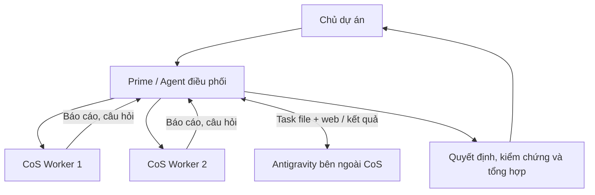

# Điều phối nhiều AI agent trong OpenDash

> **Historical process (retired):** The Windows PowerShell and
> Antigravity handoff scripts, Stop hook and previous skills mentioned
> below have been retired into `.agents/archive/` or removed from the
> active paths. Do not follow the commands below as current instructions.
> For the active rules, see [PROTOCOL](PROTOCOL.md) and
> [`.agents/README.md`](../../.agents/README.md).

**Mục đích:** Một cách giao việc, thảo luận và nhận kết quả nhất quán giữa Chat On Steroids (CoS), Codex và Antigravity. Đây là hướng dẫn vận hành, không phải quyết định kiến trúc CMS.

## 1. Ai điều phối ai?



- **Chủ dự án** đặt mục tiêu, ràng buộc sản phẩm và quyết định những vấn đề sản phẩm chưa chốt.
- **Prime** tách công việc, phân quyền sửa file, giao cho từng agent, chuyển câu hỏi giữa các agent, kiểm tra kết quả và báo cáo.
- **CoS Worker** thực hiện đúng nhiệm vụ được giao. Trong cơ chế `agents` hiện có, tin nhắn đi qua **Prime ↔ Worker**; nếu Worker A cần phản biện Worker B, Prime chuyển câu hỏi và nhận câu trả lời. Không giả định hai Worker có một phòng chat chung.
- **Antigravity** là agent bên ngoài nhóm CoS. Giao việc qua workflow `.agents/` và giao diện web; không giả định `agents.spawn` tự tạo một phiên Antigravity.

## 2. Chọn kênh liên lạc

| Việc cần làm | Kênh dùng | Dấu hiệu hoàn thành |
| --- | --- | --- |
| Chia việc độc lập trong một phiên CoS | `agents.spawn` / `agents.message` | Worker gửi báo cáo `finish`; Prime kiểm tra và tích hợp |
| Hỏi đáp, phản biện giữa hai Worker | Prime nhận và chuyển `agents.message` | Prime tổng hợp câu trả lời hoặc giao một vòng phản biện nữa |
| Giao một lượt cho Antigravity | `.agents/sync/task-for-ag.md` + gửi lệnh trên web Antigravity | Nhận `.agents/sync/result-from-ag.md`, rồi Prime kiểm tra kết quả |
| Ghi lại tranh luận kỹ thuật cần lưu lâu dài | `docs/discussions/threads/*.md` theo [PROTOCOL](PROTOCOL.md) | `CONSENSUS_REACHED` hoặc một câu hỏi cụ thể cho chủ dự án |
| Theo dõi công việc nhiều bước | Kế hoạch trong `docs/plans/` và tiến độ của Prime | Có tiêu chí nghiệm thu và bằng chứng kiểm chứng thực tế |

CoS có thể tạo các Worker trong những cuộc trò chuyện riêng, nhưng số Worker phụ thuộc khả năng của phiên đang dùng. Khi khởi tạo, Worker có thể dùng worktree riêng; Prime cần kiểm tra bản thay đổi ở từng nơi và cách đưa chúng vào cây nguồn chính trước khi tuyên bố đã tích hợp.
Tin nhắn và báo cáo Worker được trả về qua lượt sử dụng công cụ của Prime; một báo cáo đến khi Prime đang ngừng hoạt động không tự khởi động thêm công việc. Chỉ chạy vòng thảo luận hữu hạn khi có nhiệm vụ cụ thể.

## 3. Vòng đời của một nhiệm vụ

1. **Prime chia việc:** đặt một mã việc, xác định đầu vào, kết quả mong muốn, contract liên quan, file được sửa, kiểm chứng và phần ngoài phạm vi.
2. **Giao người phụ trách:** mỗi file đang được viết chỉ có một agent được quyền sửa ở cùng thời điểm. Agent review đọc mã và nêu nhận xét; Prime giao việc sửa sau khi phân định lại ownership.
3. **Agent báo cáo:** dùng `RESULT / CHANGES / VALIDATION / BLOCKERS`, nêu chính xác lệnh đã chạy và giới hạn. Nếu cần ý kiến agent khác, gửi câu hỏi cho Prime để chuyển tiếp.
4. **Prime kiểm chứng:** xem diff và kiểm tra trên cây nguồn thực tế, giải quyết xung đột, chạy các bước nghiệm thu có liên quan, rồi cập nhật trạng thái. `AGREED` (đồng thuận thiết kế), `IMPLEMENTED` (đã viết mã) và `VERIFIED` (đã kiểm chứng) là ba kết quả khác nhau.
5. **Kết thúc hoặc hỏi chủ dự án:** Prime báo cáo quyết định và vấn đề tồn đọng. Chỉ chuyển câu hỏi thật sự về yêu cầu sản phẩm hoặc thay đổi phạm vi cho chủ dự án.

### Phiếu giao việc tối thiểu

```text
TASK ID: OD-<mã-ngắn>
Mục tiêu: <một kết quả đo được>
Agent phụ trách: <Worker 1 | Worker 2 | Antigravity>
Nguồn/contract: <đường dẫn tài liệu và file cần đọc>
Được phép sửa: <đường dẫn hoặc chỉ read-only>
Tiêu chí nghiệm thu: <hành vi / lệnh / bằng chứng>
Ngoài phạm vi: <những việc không giao>
Báo cáo: RESULT / CHANGES / VALIDATION / BLOCKERS
```

## 4. Hai chế độ nên dùng

**Thảo luận kiến trúc:** Prime giao cùng câu hỏi cho 2 agent độc lập (đọc, không sửa). Prime gửi những điểm bất đồng cho mỗi bên phản biện tối đa 1–2 lượt, rồi tổng hợp một phương án, lý do và câu hỏi sản phẩm còn mở. Muốn lưu lịch sử thì ghi thread theo [PROTOCOL](PROTOCOL.md). Không tạo vòng hội thoại tự chạy vô hạn.

**Triển khai mã:** Prime tách việc theo file/module không giao nhau. Một agent triển khai, một agent có thể review độc lập; Prime kiểm tra việc tích hợp và chạy test. Với thay đổi chạm tới cùng file hoặc API dùng chung, giao nối tiếp để tránh xung đột.

**Ví dụ trong OpenDash:** Prime giao Worker 1 kiểm tra hiện trạng các Base APIs (`id`, `registry`, `hooks`) theo [CORE_FOUNDATION](../contracts/CORE_FOUNDATION.md); Worker 2 đánh giá phạm vi ảnh hưởng của plugin host, chỉ đọc. Sau khi nhận hai báo cáo, Prime quyết định slice cần sửa và giao duy nhất một writer cho các file liên quan.

## 5. Lưu ý khi giao cho Antigravity trên Mac

Handoff hiện có được thiết kế cho Windows: `prepare-task.ps1`, `wait-for-ag.ps1`, `notify-codex.ps1`, `.agents/hooks.json` gọi `powershell.exe` và dùng Windows `EventWaitHandle` (xem [hướng dẫn `.agents/`](../../.agents/README.md)). Không mặc định cơ chế báo hoàn thành này chạy trên macOS.

Trên Mac, khi chưa có bridge tương đương được cài và kiểm thử, quy trình có thể thực hiện theo từng lượt: Prime chuẩn bị task (kèm ID duy nhất) trong `.agents/sync/task-for-ag.md` ở **đúng checkout Antigravity đang mở**, gửi lệnh `Thực hiện task trong .agents/sync/task-for-ag.md` bằng giao diện Antigravity đã kết nối, sau đó đọc báo cáo `.agents/sync/result-from-ag.md` có ID khớp nếu Antigravity có quyền truy cập **cùng workspace**. Không mặc định các checkout/worktree CoS chia sẻ `.agents/sync/`. Đây là handoff theo file/web có bước tương tác; không phải giao tiếp Agent ↔ Agent hoàn toàn tự động. Không ghi đè task đang chạy và không dùng các file tạm trong `.agents/sync/` làm tài liệu quyết định.

Khi cần hoàn toàn tự động, phải xây và kiểm thử riêng adapter cho macOS: gửi trigger tới đúng phiên Antigravity, nhận tín hiệu kết thúc của đúng task, xác nhận kết quả và xử lý timeout. Chưa có bằng chứng adapter đó hoạt động trong repository hiện tại.
